# Module 03 — KV Cache Engineering

## 00 Why This Module Exists
KV cache is often one of the dominant sources of dynamic memory consumption in LLM serving and can become a primary concurrency constraint, particularly under long-context or high-concurrency workloads. How you manage KV memory determines:
- how many requests you can serve simultaneously;
- how you handle memory pressure;
- how you exploit sharing across requests.

This is where OS-level systems thinking meets ML inference.

**Module Orientation**
- **Engineering Problem**: Solving memory exhaustion and latency spikes under continuous batching.
- **What You Will Do**: Build a paged KV allocator, simulate external vs internal fragmentation, diagnose a latency incident, and design an architecture transfer plan.
- **Environment**: A basic Python environment for the simulator (Labs A-C). Access to a single GPU is optional but recommended for latency bounds testing (Lab D).
- **If You Only Have One Week**: Lessons 3.1, 3.3, 3.5 — they derive KV bytes, explain paged block tables, and diagnose scheduler memory pressure; sharing, prefix caching, routing, quantization, and offloading build on those three.

## 01 Baseline Assumptions
- **Architecture**: You can state:
  - K/V head geometry for MHA, MQA, and GQA (Module 01, Lesson 1.3).
  - The MLA retained-state model (Module 01, Lesson 1.7): per token per layer, one joint latent $c^{KV}$ of width $d_c$ plus one head-shared RoPE key $k^R$ of width $d_h^R$; per-head K/V are reconstructed rather than cached.
  - This module converts that element count into bytes, blocks, and runtime layout; it does not re-derive MLA.
- **Sampling**: You know that parallel samples from one prompt share a prefix and diverge only after sampling (Module 01, Lesson 1.2); this is the sharing case in Lesson 3.4.
- **Hardware**: You understand the GPU memory hierarchy, HBM bandwidth constraints, and basic CUDA memory allocation concepts (Module 02).

Scope boundaries:
- **This module owns**: KV state geometry, allocation, block tables, sharing, prefix identity, lifecycle/eviction, representation, and tiering. It exposes feasibility and pressure signals to the scheduler.
- **Module 04 owns**: request queueing, admission objectives, fairness, preemption policy, TTFT/TPOT, and capacity.
- **Module 05 owns**: general quantization/kernel optimization.
- **Module 20 owns**: distributed placement/transport.

Research cutoff: evidence registry updated **2026-09-30** (WP-F1 review: MLA sizing, Lesson 3.5 timeline, and corrected vLLM hashing symbols); other claims keep their 2026-09-25 access dates. Runtime behavior is claimed only against pinned source revisions.

## 02 Target Mastery

```yaml
depth_contract:
  conceptual: REQUIRED
  mechanistic: REQUIRED
  mathematical: REQUIRED
  quantitative: REQUIRED
  implementation: REQUIRED
  source_code: REQUIRED
  instrumentation: REQUIRED
  experimental: REQUIRED
  statistical: SELECTIVE
  production_reasoning: REQUIRED
  failure_analysis: REQUIRED
  falsification: REQUIRED
  security: NOT_APPLICABLE
  economics: SELECTIVE
  architecture_tradeoff: REQUIRED
  research_connection: SELECTIVE

estimated_effort:
  instruction: 5h
  guided_practice: 2h
  labs: 14h
  assessment: 3h
  source_trace: 2h
  total: 26h
```

*Effort reconciliation*:
- Lesson instruction sums to 300 min; lesson practice to 120 min.
- Labs: A 3h + B 4h + C 3h + D 3h + E's 1h instrumented comparison = 14h.
- LAB E's 2h source trace is counted once, under `source_trace`.
- The WP-F1 revision raised labs from 13h to match the lab estimates already stated (total 25h → 26h).

---

### LAYER 1: KNOWLEDGE / INSTRUCTIONAL LAYER

## 03 Knowledge Map
```mermaid
flowchart TD
  subgraph S1["State & sizing (3.1–3.2)"]
    A1["KV state in autoregressive inference"] --> A2["KV tensor dimensions"] --> A3["Analytical KV memory model"] --> A4["Prefill vs decode lifecycle"] --> A5["Dynamic sequence growth"] --> A6["Continuous batching pressure"] --> A7["Naive / contiguous allocation"] --> A8["Reservation waste + fragmentation"]
  end
  subgraph S2["Paging & sharing (3.3–3.4)"]
    B1["Logical vs physical KV address space"] --> B2["Paged KV management"] --> B3["Block tables"] --> B4["Allocation / deallocation"] --> B5["Block-size trade-offs"] --> B6["Reference counting"] --> B7["Shared blocks"] --> B8["Copy-on-write"]
  end
  subgraph S3["Scheduling & caching (3.5–3.7)"]
    C1["Scheduler interaction"] --> C2["Memory pressure"] --> C3["Preemption / recomputation / swapping"] --> C4["Prefix caching"] --> C5["Cache identity / matching"] --> C6["Partial blocks"] --> C7["Cache lifecycle"] --> C8["Eviction"] --> C9["Radix / tree-based reuse"] --> C10["Cache locality"] --> C11["Cache-aware routing"]
  end
  subgraph S4["Representation & placement (3.8–3.10)"]
    D1["KV quantization"] --> D2["KV offloading / memory tiering"] --> D3["Distributed KV implications"] --> D4["Prefill-decode disaggregation / KV transfer"]
  end
  A8 --> B1
  B8 --> C1
  C11 --> D1
```

## 04 Lessons

### Lesson 3.1 — KV State & Quantitative Model

**Engineering Question:**
What is the logical KV payload per retained token under explicit architecture assumptions, and why is it not exact process memory?

**Concepts & Definitions:**
- **Autoregressive KV Reuse** (**O**, CLM-001):
  - Previous tokens' Key (K) and Value (V) representations do not change when computing the next token.
  - KV caching avoids recomputing K/V for previously processed tokens during autoregressive decoding.
  - Each new query still attends over the cached prefix, so KV reads/attention work still grow with context length.
- **Prefill vs. Decode Lifecycle**:
  - *Prefill* computes the KV cache for the entire prompt in one highly parallel forward pass; it often tends toward compute-heavy regimes.
  - *Decode* generates token-by-token; it often tends toward memory-bandwidth-sensitive regimes.
  - The actual bottleneck depends on hardware, batch size, architecture, and kernel implementation.
  - The learner must PREDICT THE BOTTLENECK → PROFILE → COMPARE PREDICTION WITH OBSERVATION.

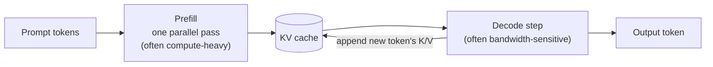

**Quantitative Model / Derivation:**
Logical KV payload bytes per retained token (**D**, CLM-002):

$$
M_{\text{tok}} = 2 \cdot b \cdot L \cdot H_{kv} \cdot d_{\text{head}}
$$

where:
- $M_{\text{tok}}$: KV bytes per retained token
- $2$: one K and one V vector
- $b$: bytes per element (2 for FP16/BF16, 1 for FP8)
- $L$: number of cached layers
- $H_{kv}$: number of KV heads (config `num_key_value_heads`)
- $d_{\text{head}}$: head dimension (config `head_dim`)

*Assumptions*: Uniform uncompressed decoder self-attention with one stored K and V vector per cached layer/head/token. Excludes:
- sharding/replication, block rounding, alignment;
- scales/metadata, allocator state;
- latent attention, sliding windows, recurrent/state-space state, and hybrid layouts.

*Where each factor comes from*:
- Each cached layer stores, per cached token, one K vector and one V vector (factor 2) per KV head.
- Each vector has $d_{\text{head}}$ elements; each element costs $b$ bytes.
- Multiplying the counts gives elements per token; the dtype size converts elements to bytes.
- Query heads do not appear: only KV heads are cached. That is why MQA ($H_{kv} = 1$) and GQA ($H_{kv}$ < query heads) shrink the payload relative to MHA.

**Latent-attention variant (MLA):** the formula above does not apply. Using the retained state from Module 01 Lesson 1.7 (**O**, CLM-014), the logical MLA payload per retained token is

$$
M_{\text{tok}}^{\text{MLA}} = b \cdot L \cdot \left(d_c + d_h^R\right)
$$

where:
- $M_{\text{tok}}^{\text{MLA}}$: MLA KV bytes per retained token
- $b$: bytes per element; $L$: number of cached layers
- $d_c$: width (element count) of the joint KV latent $c^{KV}$
- $d_h^R$: width (element count) of the head-shared RoPE key $k^R$

There is no factor 2 and no KV-head factor, because one shared latent stands in for both K and V across all heads.

*Assumptions*: one latent and one decoupled RoPE key per layer per token, no per-head K/V cached, no padding. Runtime-specific (`TODO_VERIFY` per runtime):
- whether the latent is stored before or after its normalization;
- in which dtype;
- padded to what width.

**Worked Example:**
- *Input (synthetic MHA configuration)*: 32 layers, 32 query heads, 32 KV heads (MHA), head_dim=128, FP16.
- *Steps*:
  - Factors: $b=2$ (FP16), $L=32$, $H_{kv}=32$, $d_{\text{head}}=128$.
  - Per token: $M_{\text{tok}} = 2 \times 2 \times 32 \times 32 \times 128 = 524{,}288$ bytes $= 0.5$ MiB (1 MiB $=2^{20}=1{,}048{,}576$ bytes).
  - Per 2,048-token sequence: $2048 \times 0.5$ MiB $= 1{,}024$ MiB $= 1$ GiB.
  - 80 sequences: $80 \times 1$ GiB $= 80$ GiB.
- *Result*: KV alone for 80 such sequences equals an 80 GiB device's capacity, so they cannot fit once weights and runtime memory are included.
- *Input (MLA, DeepSeek-V2 paper values and released config)*: 60 layers, $d_c=512$, $d_h^R=64$, BF16 (2 bytes) assumed for the exercise.
- *Steps*:
  - Elements per layer: $d_c + d_h^R = 512 + 64 = 576$.
  - Per token: $M_{\text{tok}}^{\text{MLA}} = 2 \times 60 \times 576 = 69{,}120$ bytes $= 69{,}120 / 1{,}024 = 67.5$ KiB (**D**, CLM-015).
  - Per 4,096-token request: $4{,}096 \times 67.5 = 276{,}480$ KiB $= 276{,}480 / 1{,}024 = 270$ MiB.
- *Counterexample*: inserting the config's $H_{kv}=128$ and $d_{\text{head}}=128$ into the GQA formula:
  - Per token: $2 \times 2 \times 60 \times 128 \times 128 = 3{,}932{,}160$ bytes $= 3.75$ MiB.
  - Ratio to MLA: $3{,}932{,}160 / 69{,}120 \approx 56.9\times$; equivalently $(2 \times 128 \times 128)/576$, since dtype and layers cancel.
- *Interpretation / limits*: both are logical payloads. *Validation hierarchy* (each level adds overhead the previous one omits): analytical KV estimate → runtime KV allocator metrics → framework allocator metrics → process/device VRAM.

**Knowledge Check:**
1. Derive the bytes/token for a model with 64 layers, 8 KV heads, head_dim 128, in FP8.
2. Why is the analytical KV estimate not equal to `nvidia-smi` usage?
3. Which two config fields set MLA's retained payload, and why is the KV-head count irrelevant to it?

**Guided Practice:**
For a screening exercise, assume:
- an 80 GiB device;
- the standard formula above with the MHA configuration;
- every request exactly 4096 retained tokens;
- 15 GiB of parameters and 2 GiB of other fixed buffers;
- no headroom, allocator rounding, workspace growth, or failures.

Calculate the payload-only upper bound on concurrent requests, then list why it is unsafe as a deployment limit.

**Feedback Contract:**
- *Expected Evidence*:
  - KC1: $2 \times 1 \times 64 \times 8 \times 128 = 131{,}072$ bytes $= 128$ KiB/token (excluding FP8 scales).
  - KC3: $d_c$ (`kv_lora_rank`) and $d_h^R$ (`qk_rope_head_dim`); per-head K/V are reconstructed, not cached.
  - Guided practice:
    - KV budget: $80 - 15 - 2 = 63$ GiB.
    - Per request: $4096 \times 0.5$ MiB $= 2$ GiB.
    - Bound: $\lfloor 63/2 \rfloor = 31$ requests, labeled an optimistic upper bound.
  - It is unsafe because it ignores headroom, block rounding, allocator reservations, workspaces, variable lengths, and failures.
- *Common Failure*: Using the full 80 GiB, forgetting to multiply by 4096, or applying the GQA formula to an MLA config.
- *Diagnostic Hint*: After subtracting weights and buffers, how much memory is actually free for KV? For MLA, which tensors does the model retain?
- *Concept to Revisit*: Total device memory vs KV-only analytical requirement; retained versus reconstructed state (Module 01 Lesson 1.7).

**Learning Outcome:**
Derive KV memory from a model architecture, including latent attention, and predict theoretical batch limits.

*(Effort: 35m instruction, 20m practice)*

---

### Lesson 3.2 — Memory Allocation & Fragmentation

**Engineering Question:**
What are the different types of memory waste in LLM inference, and how do they manifest under continuous batching?

**Concepts & Definitions:**
- **Abstraction Hierarchy**: each layer requests memory from the one below it.

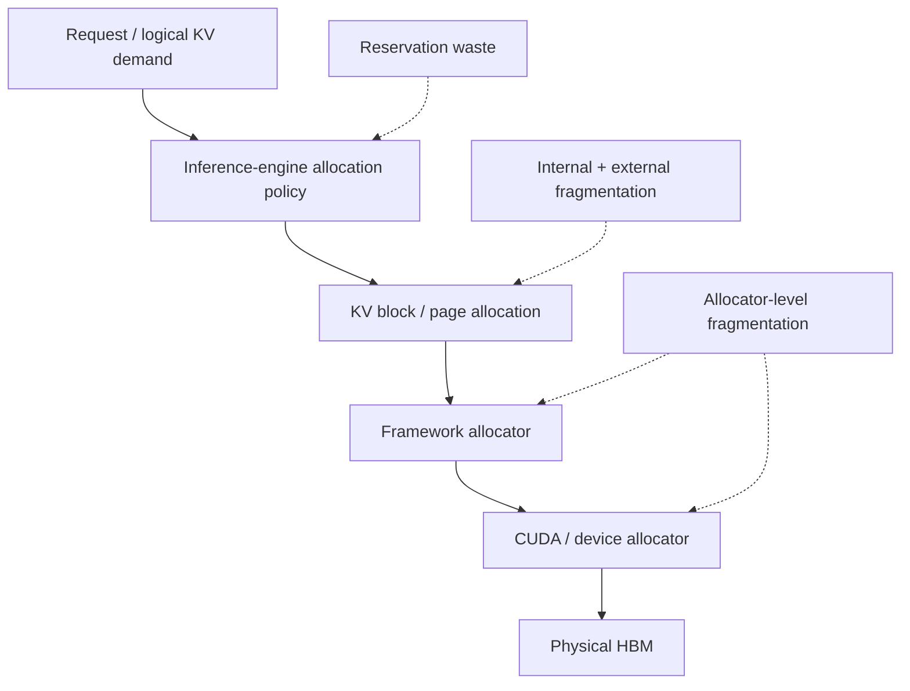

- **Reservation Waste (Logical)**: Over-allocating memory based on a predicted `max_sequence_length` that the request never reaches.
- **Internal Fragmentation (Block level)**: Wasted space *inside* an allocated block (**D**, CLM-004):
  - Tail slack per independently allocated sequence, for block size $B$ and length $S>0$: $B\lceil S/B\rceil-S\in[0,B-1]$ tokens.
  - $S$: sequence length in tokens; $\lceil S/B\rceil$: number of blocks allocated (round up); $B\lceil S/B\rceil$: token capacity of those blocks. Slack is capacity minus use.
  - It is 0 when $S$ is a multiple of $B$, and at most $B-1$ when the last block holds one token.
  - Example, $B=16$, $S=100$: $\lceil100/16\rceil=7$ blocks $=112$ slots, slack $12$.
  - Example, $B=16$, $S=1000$: $63$ blocks $=1008$ slots, slack $8$.
- **External Fragmentation (Engine level)**: Free memory scattered in non-contiguous chunks, preventing large contiguous logical allocations.
- **Allocator-level Fragmentation**: Waste caused by the OS/CUDA memory manager failing to coalesce freed segments.

**Mechanism Explanation:**
- Naive systems allocate contiguous tensors of size `max_length`.
- If requests finish early or at different times, the inference engine cannot allocate a new contiguous chunk.
- Paged KV changes how the inference runtime maps logical sequence growth onto physical KV storage; it does NOT magically defragment all GPU memory layers.

**Worked Example:**
Request A (needs 1000 tokens), Request B (needs 100), Request C (needs 1000). Naive continuous contiguous allocation reserves 2048 tokens per request.
- Requested: $1000+100+1000=2100$ tokens.
- Allocated: $3\times2048=6144$ token slots.
- Reservation waste: $6144-2100=4044$ token slots, i.e. per request $1048+1948+1048$.
- Utilization: only $2100/6144\approx34\%$ of the reservation holds KV.
- Comparison, paging with $B=16$: $63+7+63=133$ blocks $=2128$ slots, leaving $28$ slots of internal slack (Lesson 3.3).

**Knowledge Check:**
1. At which layer of the abstraction hierarchy does reservation waste occur?
2. If your inference engine uses Paged KV, can you still experience allocator-level fragmentation from `cudaMalloc`?

**Feedback Contract:**
- *Expected Evidence*: Identifying the correct layer of abstraction.
- *Common Failure*: Believing Paged KV solves `cudaMalloc` fragmentation.
- *Diagnostic Hint*: Does Paged KV manage HBM directly or does it ask the framework allocator for memory?
- *Concept to Revisit*: Fragmentation Abstraction Hierarchy.

**Independent Practice:**
Proceed to **LAB A** to build the Allocation Simulator.

**Learning Outcome:**
Distinguish fragmentation/waste mechanisms across the abstraction hierarchy.

*(Effort: 30m instruction, Lab A integration)*

---

### Lesson 3.3 — Paged KV Memory Management

**Engineering Question:**
How can we store growing sequential data in non-contiguous physical memory blocks to mitigate external fragmentation?

**Concepts & Definitions:**
- **Logical Token Position**: The token's index in the logical sequence (e.g., token 15).
- **Logical Block**: A fixed-size grouping of logical token positions (e.g., tokens 0-15).
- **Physical Block**: Contiguous storage capacity allocated from the GPU KV memory pool.
- **Block Table**: Per-sequence mapping from logical block indices to physical blocks.
- **Block Size**: The number of tokens per block.
- **Allocator Invariants**: Every allocated logical block maps to exactly one valid physical block. A physical block cannot simultaneously be in the free pool and allocated. Mappings remain stable unless explicitly remapped/reclaimed.

**Mechanism Explanation:**
Paged KV separates the logical address space from physical storage.
$$
\begin{aligned}
\ell &= \left\lfloor i / B \right\rfloor && \text{(logical block)} \\
o &= i \bmod B && \text{(offset in block)} \\
p &= \text{table}[\ell] && \text{(physical block)}
\end{aligned}
$$

where:
- $i$: 0-based token index (the $n$-th token has $i = n-1$)
- $B$: block size in tokens
- $\lfloor\cdot\rfloor$: integer division; $\bmod$: remainder

- $\ell$: logical block index; $o$: offset (slot) within the block
- $p$: physical block index; $\text{table}$: the sequence's block table

Together they are the quotient/remainder split $i = \ell B + o$, with $0 \le o < B$. A sequence of $N$ tokens needs $\lceil N / B \rceil$ blocks; a new block is needed exactly when the token being written has $o = 0$.

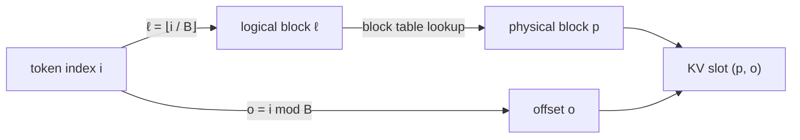

**Worked Example:**
Block size B = 16. A sequence has 34 tokens.
- Logical blocks needed: $\lceil 34/16 \rceil = 3$ (indices 0, 1, 2).
- The Block Manager allocates physical blocks: `[7, 19, 4]`.
- Token $i = 33$ (the 34th token): $33 = 2 \times 16 + 1$, so $\ell = 2$, $o = 1$.
- It resides at physical block `4`, offset `1`.

**Guided Practice:**
`block_size = 4`.
Current block table: `logical 0 → physical 7`, `logical 1 → physical 2`.
Free pool: `[4, 8, 11]`.
Sequence grows from 8 tokens to 9 tokens.
1. Determine whether a new logical block is required.
2. Allocate one physical block.
3. Update the block table.
4. Update the free pool.
5. State the allocator invariant after the transition.

**Knowledge Check:**
1. When does sequence growth require a new logical block?
2. Which invariants prevent a physical block from being simultaneously free and allocated?

**Feedback Contract:**
- *Expected Evidence*:
  - Logical block 2 required (token index $i=8$, $\lfloor 8/4 \rfloor = 2$, offset $0$).
  - Physical block 4 (or 8/11, depending on the free-pool policy) allocated.
  - Table gets `logical 2 → 4`.
  - Free pool drops to `[8, 11]`.
  - Invariant: physical block 4 is no longer free and appears in exactly one block table.
- *Common Failure*: Allocating at the 8th token (off-by-one between count and index) or leaving block 4 in the free pool after mapping it.
- *Diagnostic Hint*: 8 tokens filled exactly how many 4-token blocks? What does the 9th token trigger?
- *Concept to Revisit*: Paged allocation thresholds and invariant bounds.

**Independent Practice:**
Proceed to **LAB B** to build the Minimal Paged KV Block Manager.

**Learning Outcome:**
Explain paged KV management precisely, reason about block-size trade-offs, and track logical-to-physical state transitions.

*(Effort: 30m instruction, 15m practice, Lab B integration)*

---

### Lesson 3.4 — Sharing & Lifetime

**Engineering Question:**
How do we safely share identical physical KV blocks across multiple distinct logical requests?

**Concepts & Definitions:**
- **Ownership & Reference Count**: Physical blocks carry a reference count indicating active logical ownership. `refcount(block) = number of active logical references to that block`.
- **Shared Block**: A physical block with `refcount > 1`.
- **Copy-on-Write (CoW)**: A shared mutable partial block must not be modified in-place if doing so would change state observed by another logical sequence. It must be duplicated.
- **Cache Residency vs Ownership**: Distinguish active ownership (`refcount > 0`) from cache residency. A block may have `refcount == 0` while still being cache-resident under a cache policy.

**Mechanism Explanation:**
Two sequences generated from the same prompt share the physical blocks. Their block tables point to the exact same physical indices.

**Worked Example:**
- *Full block*: Prompt is 16 tokens (1 full block, block `9`). Seq A and Seq B share it, `refcount=2`.
  - Seq A generates token 17. Block `9` is full, so Seq A allocates a new block `14`. No CoW needed.
- *Partial block*: the prompt is 14 tokens, and Seq A appends token 15.
  - Modifying block `9` in place would corrupt Seq B, so CoW is triggered.
  - Block `9` is copied to `15`; Seq A appends to `15`; block `9`'s refcount drops to 1.

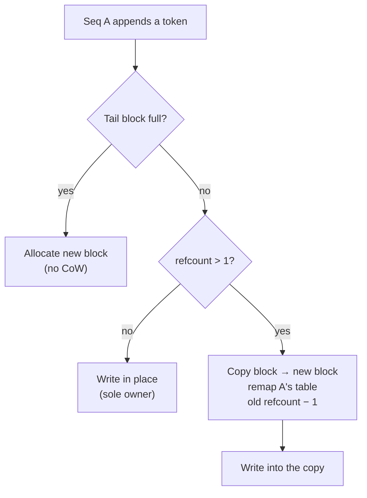

**Knowledge Check:**
1. Why is CoW unnecessary when appending to a full block?
2. Trace the refcount of a partial block shared by 3 parallel sampling sequences.

**Feedback Contract:**
- *Expected Evidence*:
  1. Appending to a full block writes into a new block, so the shared full block is never mutated.
  2. Three samples share a partial block: refcount 3.
     - The first writer copies (new block refcount 1, original 2).
     - The second writer copies (original 1).
     - The third may write in place because it is now the sole owner.
     - Final state: three private blocks, each refcount 1.
- *Common Failure*: Copying for every writer including the last sole owner (wasted copy), or decrementing the refcount without redirecting the writer's block table (stale mapping).
- *Diagnostic Hint*: Can a token be inserted into a block that is already full?
- *Concept to Revisit*: Block lifecycle invariants and mutability.

**Independent Practice:**
Implement CoW and invariant tests (refcount invariant, no free-and-allocated state overlap) in **LAB B**.

**Learning Outcome:**
Reason about sharing, refcounts, and CoW mechanisms under strict invariants.

*(Effort: 25m instruction, 10m practice)*

---

### Lesson 3.5 — KV-Aware Scheduling & Memory Pressure

**Engineering Question:**
How does the KV memory allocator interact with the request scheduler under severe memory pressure?

**Concepts & Definitions:**
- **Continuous Batching**: Iteration-level scheduling where new requests are admitted as soon as others finish or pause.
- **Admission**: The decision to allow a new request into the running batch.
- **Preemption / Swapping**: Pausing an active request and moving its KV blocks to CPU memory (or discarding for recomputation).
- **Scheduler Thrashing** (**H**, CLM-013): A feedback loop in which preemption, eviction, and recomputation consume a growing share of work while useful token progress falls. Rising churn alone does not prove it; aligned allocation, scheduler, and progress evidence is required.

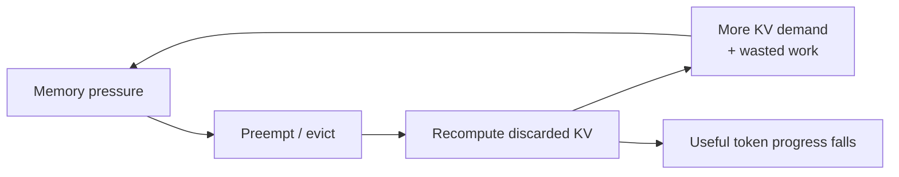

**Mechanism Explanation:**
The scheduler cannot decide feasibility from request count alone; it needs allocator state and projected demand.
- If active sequences exhaust allocatable blocks, a runtime may: delay work, reject/admit differently, evict reusable state, preempt and recompute, swap/offload, or fail allocation.
- Which policy runs and its TTFT/TPOT effect are runtime- and workload-specific and belong to Module 04.
- This lesson covers the allocator signals and state transitions exposed at that boundary, and shows why a block count alone cannot predict a latency effect.

**Quantitative Model / Trade-off Comparison:**
- *Feasibility at one instant* is exact arithmetic: `free_after = free − demand`.
- *A later shortfall* depends on a *timeline*: when each running request needs its next block, and when completions release blocks.
- *The latency effect* depends on a per-iteration *cost model*, measured rather than assumed (Module 04 Lesson 4.3):

$$
T_{\text{step}} = f\left(n_{\text{res}}, n_{\text{pf}}, \dots\right)
$$

where:
- $T_{\text{step}}$: duration of one scheduler iteration (ms)
- $n_{\text{res}}$: resident batch (requests resident in that iteration)
- $n_{\text{pf}}$: prefill tokens scheduled in that iteration

The effect of admission on per-token latency is therefore a conditional hypothesis (**H**, CLM-016), not a consequence of the block count.

**Worked Example (synthetic; every number is an exercise assumption):**
- *Input — identical block state in every scenario*:
  - `free_blocks = 10`; block size 16 tokens.
  - Running `A` (expected growth +4 blocks, holds 6 blocks) and `B` (+8 blocks, holds 8).
  - A and B have full tails, so each needs a block at iterations 1, 17, 33, ….
  - Queued `C` needs 6 blocks for its 96-token prompt, emits 32 tokens, and needs a block at its 1st and 17th decode iteration.
  - On completion a request frees all its blocks.
- *Step 1 — the invariant arithmetic*:
  - Admitting C now leaves $10-6=4$ free blocks.
  - A+B's projected growth is 12 blocks, more than the 10 free *even without C*, so the snapshot alone cannot certify either choice.
- *Step 2 — two completion timelines*:
  - **T1**: A really uses all +4 blocks (64 more tokens).
  - **T2**: A emits end-of-sequence after 12 tokens; the +4 was a `max_tokens` bound, not a forecast.
- *Step 3 — two step-cost models* (*batch* = number of requests resident in that iteration):
  - **K1**: a decode iteration costs 20 ms for batch 1–3 (insensitive to batch in this range), plus 0.5 ms per prefill token scheduled in that iteration.
  - **K2**: $14+6\times\text{batch}$ ms plus the same prefill term, giving $20$, $26$, and $32$ ms for batch 1, 2, 3.
  - Example iteration with A, B, and C resident that also runs C's 96-token prefill:
    - K2: $14+6\times3+0.5\times96=80$ ms.
    - K1: $20+48=68$ ms.
- *Step 4 — two policies*:
  - **Admit now**, preempting the youngest request with recomputation on shortfall.
  - **Delay** C until A completes.
- *Step 5 — replay the timeline iteration by iteration* (mean gap = mean duration of the iterations in which the request emitted a token):

| Timeline | Cost | Policy | Preemptions | A mean gap | B mean gap | C TTFT | C done |
|---|---|---|---:|---:|---:|---:|---:|
| T1 | K1 | Admit now | 1 | 20.75 ms | 20.81 ms | 68 ms | 1,704 ms |
| T1 | K1 | Delay | 0 | 20.00 ms | 20.38 ms | 1,348 ms | 1,968 ms |
| T1 | K2 | Admit now | 1 | 28.25 ms | 25.31 ms | 80 ms | 2,280 ms |
| T1 | K2 | Delay | 0 | 26.00 ms | 24.88 ms | 1,738 ms | 2,544 ms |
| T2 | K1 | Admit now | 0 | 24.00 ms | 20.38 ms | 68 ms | 688 ms |
| T2 | K1 | Delay | 0 | 20.00 ms | 20.38 ms | 308 ms | 928 ms |
| T2 | K2 | Admit now | 0 | 36.00 ms | 22.44 ms | 80 ms | 952 ms |
| T2 | K2 | Delay | 0 | 26.00 ms | 22.44 ms | 386 ms | 1,192 ms |

- *How one row is computed (T1, K1, Admit now)*:
  - Iteration 1:
    - Allocate A's and B's blocks: $10 - 2 = 8$ left.
    - Admit C with 6 blocks: $8 - 6 = 2$ left.
    - Run C's 96-token prefill: $20 + 0.5 \times 96 = 68$ ms.
  - Iteration 2: C takes its next block, 1 left.
  - Iteration 17:
    - A takes the last block; B needs one, so there is a shortfall.
    - The youngest request, C, is preempted, discarding 111 cached positions.
  - Iteration 65: A finishes and C is re-admitted.
    - Re-prefill: $96 + 16 = 112$ tokens.
    - Cost: $20 + 0.5 \times 112 = 20 + 56 = 76$ ms.
  - Mean gaps (total time of the iterations a request took part in, divided by its iteration count):
    - A, 64 iterations (one 68 ms prefill iteration plus 63 plain ones): $(63 \times 20 + 68)/64 = 1{,}328/64 = 20.75$ ms.
    - B, 128 iterations (both C prefills): $(126 \times 20 + 68 + 76)/128 = 2{,}664/128 = 20.8125 \approx 20.81$ ms.
- *Result* (**D**, CLM-017), with the same “$10-6=4$” in every row:
  - **T1**: admission turns into a preemption and wasted prefill. Delay lowers A's and B's mean gaps under both cost models, at the cost of C's TTFT rising from 68 ms to 1,348 ms (K1).
  - **T2**: no preemption. B's mean gap is identical under both policies, because delaying C moves C's prefill and co-residency later in B's life instead of removing them.
  - **T2, A**: pays for admission: 4 ms extra mean gap under K1 but 10 ms under K2, because K2 charges every co-resident iteration.
- *Interpretation / limits*:
  - “Delaying C protects TPOT” held for A in these four synthetic cases, failed for B in T2, and its size depended on the cost model.
  - None of these numbers is a measurement.
  - Real schedulers also chunk prefill, choose victims differently, and may not recompute, so treat the table as a template for the measurements below.

**Knowledge Check:**
1. Why is current free-block count insufficient to prove safe admission?
2. Which observation distinguishes allocator refusal from a scheduler policy decision?
3. Which measurements separate (a) prefill interference, (b) lower per-iteration efficiency from a larger resident batch, and (c) preemption and recomputation as causes of a TPOT change after admission?

**Guided Practice:**
Keep the same block state and T1. A third policy admits C only if the free blocks after this iteration's growth cover C's prompt blocks plus every block that A, B, and C will need within the next $W$ iterations, assuming no completions.
1. Evaluate the decision at iteration 1 for $W=16$ and $W=32$.
2. For each, name the row of the table its behavior matches under T1.
3. State what the $W=32$ policy costs in T2.

**Feedback Contract:**
- *Expected Evidence*:
  - $W=16$: demand $=1+1$ (A, B at iteration 1) $+6+1$ (C prompt and its iteration-2 block) $=9\le10$.
    - It admits and still hits the iteration-17 shortfall: T1 “Admit now”.
  - $W=32$: demand $=2+2+6+2=12>10$.
    - It delays: T1 “Delay” if C is re-admitted when A completes.
  - T2 with $W=32$: the conservative rule still delays C, although admission would not have preempted. C's TTFT rises (68→308 ms under K1) while B's mean gap is unchanged.
  - KC3:
    - (a) and (b): per-iteration duration regressed on resident batch size and prefill tokens.
    - (c): preemption events, recomputed tokens, and the free-block trace.
    - Per-request token timestamps show *whose* gaps moved.
- *Common Failure*: Concluding “admitting C hurts TPOT” or “delaying protects TPOT” from the 4 remaining blocks alone, or assuming the +4/+8 growth is a forecast rather than a bound.
- *Diagnostic Hint*: Replay the next 32 iterations. When does each request need a block, and when does A release its blocks?
- *Concept to Revisit*: KV growth uncertainty, completion/reclaim timing, and measured step-cost models.

**Independent Practice:**
Diagnose scheduler thrashing in the **Incident Scenario**.

**Learning Outcome:**
Analyze scheduler-memory interaction as a timeline, state admission's latency effect as a conditional hypothesis, and name the measurements that discriminate prefill interference, batching efficiency, and preemption.

*(Effort: 40m instruction, 30m practice, Incident integration)*

---

### Lesson 3.6 — Prefix Cache, Radix & Eviction

**Engineering Question:**
How do we persist and match previously computed KV blocks for future, unconnected requests?

**Concepts & Definitions:**
- **Cache Identity**:
  - Two prefixes are safely reusable only if the runtime can establish that their cached KV state is equivalent under the relevant execution context (e.g., token sequence, model version, adapter, position semantics).
  - Token-prefix hashing/tree lookup is an IMPLEMENTATION STRATEGY for identifying reusable state, not the semantic definition of reuse.
- **Eviction**: Reclaiming cache-resident KV according to a policy. LRU is one possible policy.
- **Lifecycle Transition**: `refcount == 0` means no active logical sequence currently references the block.
  - Depending on policy, it MAY remain resident/evictable, be reclaimed, or participate in another cache policy.
  - `refcount == 0` does NOT mean it must immediately be freed, nor does it mean it must remain cached.

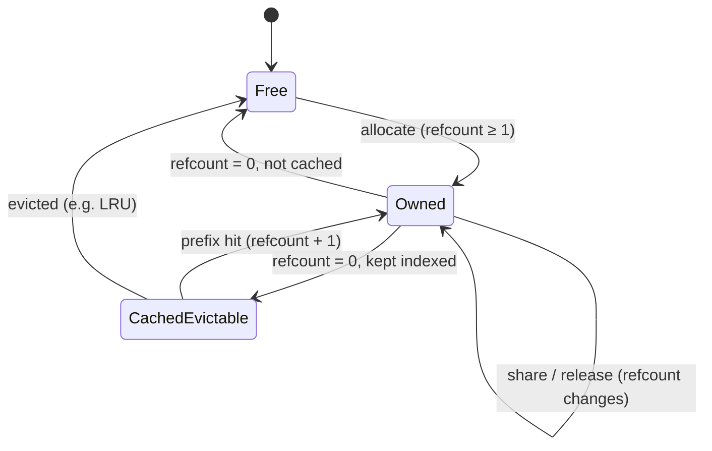

- *Legend*: `Owned` = actively referenced (`refcount > 0`); `CachedEvictable` = resident and indexed but reclaimable. Exact transitions are policy- and runtime-specific.

**Mechanism Explanation:**
When a new request arrives, the scheduler searches the index for a safe match. If found, the scheduler initializes the request's block table with the matching blocks and increments their refcounts.

**Worked Example:**
Under a 16-token full-block reuse policy, System Prompt A has a reusable 96-token prefix mapped to physical blocks `[10...15]` plus a partial tail that is not indexed yet.
1. Request 1 finishes. Blocks `[10...15]` drop to `refcount=0`. The runtime policy leaves them indexed but physically reusable as eviction candidates.
2. Request 2 arrives with the same validated execution identity. The index finds `[10...15]`:
   - removes them from the free/eviction queue;
   - increments their reference counts;
   - skips recomputation of the 96-token full-block prefix.
3. The tail behavior remains runtime-specific.

**Knowledge Check:**
1. If two requests have the exact same token prefix, does that guarantee their KV caches are mathematically identical? Name one context variable that could invalidate reuse.

**Feedback Contract:**
- *Expected Evidence*: No. Token equality is necessary but not sufficient.
  - KV depends on model weights/version, adapter (LoRA), position semantics, multimodal inputs, and any tenant isolation salt.
  - In the pinned vLLM revision, extra keys cover LoRA name, multimodal identifiers, cache salt, and prompt-embedding hashes (**O**, CLM-006).
  - Model identity is a deployment responsibility.
- *Common Failure*: Treating a hash hit as proof of equivalence, or forgetting that only full blocks are hashed there.
- *Diagnostic Hint*: What if the exact same prompt is passed to two completely different model architectures or checkpoints?
- *Concept to Revisit*: Semantic Cache Identity.

**Independent Practice:**
Proceed to **LAB C** to simulate Prefix Sharing.

**Learning Outcome:**
Model prefix-cache effectiveness and diagnose caching semantics.

*(Effort: 30m instruction, 10m practice, Lab C integration)*

---

### Lesson 3.7 — Cache-Aware Routing

**Engineering Question:**
How does a multi-node load balancer know which worker holds the KV cache for a specific prompt?

**Concepts & Definitions:**
- **Cache Locality**: The probability a request routes to a worker possessing its prefix.
- **Load Skew**: When one worker receives disproportionately more requests.

**Mechanism Explanation:**
Pure round-robin load balancing often reduces cache locality, while perfect cache-aware routing can create severe load skew. The router tracks a heuristic view of downstream worker cache state to balance these concerns.

**Worked Example (synthetic):**
- *Input*: a hot prefix is resident only on Worker 1. A request's prefill costs 150 ms on a miss and 30 ms on a hit. Current queue wait is 400 ms on Worker 1 and 50 ms on Worker 2.
- *Steps*:
  - TTFT on Worker 1: $400 + 30 = 430$ ms.
  - TTFT on Worker 2: $50 + 150 = 200$ ms.
- *Result*: Worker 2 is better by 230 ms despite the cache miss. Routing to the hit wins only when Worker 1's wait is below $50 + (150 - 30) = 170$ ms.
- *Derivation*: Worker 1 wins when

  $$W_1 + P_{\text{hit}} < W_2 + P_{\text{miss}} \iff W_1 < W_2 + (P_{\text{miss}} - P_{\text{hit}})$$

  where:
  - $W_1, W_2$: queue waits on Worker 1 and Worker 2 (ms)
  - $P_{\text{hit}}$: prefill cost on a cache hit (ms)
  - $P_{\text{miss}}$: prefill cost on a cache miss (ms)

  The cache hit is worth exactly the prefill it saves, $120$ ms here.
- *Interpretation / limits*: the break-even ignores:
  - that the miss also inserts the prefix on Worker 2 (future hits);
  - that queue waits change as routing shifts load;
  - that the costs are workload-specific estimates to be measured in Lab C.

**Quantitative Model / Trade-off Comparison:**
Compare policies using hit rate, per-worker admitted load, queue residence, TTFT, completions, and SLO-goodput. No scalar cache-hit objective captures the full routing trade-off.

**Knowledge Check:**
1. Why might perfectly cache-aware routing degrade system goodput for a highly skewed workload?

**Feedback Contract:**
- *Expected Evidence*: Concentrating a skewed workload on the cache holder saturates it: queue wait grows faster than the per-request prefill saving while other workers idle, so completions and SLO-goodput fall even as hit rate rises.
- *Common Failure*: Optimizing hit rate as the objective.
- *Diagnostic Hint*: If 99% of requests use Prefix X, and Prefix X is only on Worker 1, what happens to Worker 2?
- *Concept to Revisit*: Load Skew.

**Independent Practice:**
Implement multi-worker routing simulation in **LAB C**.

**Learning Outcome:**
Reason about routing/locality trade-offs.

*(Effort: 20m instruction, 10m practice, Lab C integration)*

---

### Lesson 3.8 — KV Quantization and Lossy Retention

**Engineering Question:**
How does reducing the precision of the KV cache impact memory capacity, bandwidth, and generation quality?

**Concepts & Definitions:**
- **KV Quantization**: Storing physical KV blocks in FP8/INT8/INT4 rather than native FP16/BF16.
- **Scale / Quantization Metadata**: Extra scaling factors stored alongside the quantized blocks.

**Quantitative Model / Derivation:**
- FP16 → FP8 approximately halves the NOMINAL KV PAYLOAD BYTES PER ELEMENT.
- This provides an analytical upper bound of ~2× KV capacity.
- It does NOT automatically imply 2× total throughput or exactly half measured HBM traffic; that depends on metadata layout, kernel dequantization overhead, and model quality regressions.

Token-selective eviction is a different mechanism:
- It changes which positions attention can use, so it is lossy unless the model/attention semantics already specify that window.
- Policies such as H2O provide important research evidence, but their quality and speed results remain model-, task-, kernel-, and workload-specific.

**Worked Example (synthetic scale layout):**
- *Input*: the Lesson 3.1 MHA configuration (512 KiB/token at FP16) and the Lesson 3.1 guided-practice budget (63 GiB for KV, 4,096-token requests). Assume FP8 values plus one FP32 scale per (layer, K or V, KV head, 16-token block).
- *Steps*:
  - Payload: FP8 is 1 byte/element versus 2 for FP16, so $512 / 2 = 256$ KiB/token.
  - Scales per block: one per (layer, K or V, KV head) gives $32 \times 2 \times 32 = 2{,}048$ scales; at 4 bytes each, $8{,}192$ bytes per 16 tokens.
  - Scales per token: $8{,}192 / 16 = 512$ bytes $= 0.5$ KiB.
  - Total: $256 + 0.5 = 256.5$ KiB/token, a $512 / 256.5 \approx 1.996\times$ reduction.
  - Per request: $4{,}096 \times 256.5 = 1{,}050{,}624$ KiB $= 1{,}026$ MiB $\approx 1.0020$ GiB.
- *Result*: the payload-only bound moves from $\lfloor 63/2 \rfloor = 31$ to $\lfloor 63/1.0020 \rfloor = 62$ requests.
- *Interpretation / limits* (**O**, CLM-009):
  - This doubles a *screening* bound only.
  - Unmeasured: weights, activations, dequantization kernels, any full-precision residual window, and the quality gate.
  - A different scale granularity changes the metadata term.

**Knowledge Check:**
1. Why doesn't INT8 quantization automatically double request concurrency?

**Feedback Contract:**
- *Expected Evidence*:
  - Only the KV term shrinks; weights, activations, workspaces, and headroom do not.
  - Metadata, alignment, and any retained full-precision state reduce the gain.
  - Dequantization can cost time, and the quality gate may fail.
  - Concurrency may also be limited by compute or scheduling rather than KV.
- *Common Failure*: Multiplying concurrency or throughput by the bit-width ratio.
- *Diagnostic Hint*: Does quantizing the KV cache shrink the model weights?
- *Concept to Revisit*: Nominal vs System-level payload reduction.

**Independent Practice:**
Quantization trade-offs are evaluated in **LAB D**.

**Learning Outcome:**
Evaluate quantization trade-offs explicitly based on empirical validation.

*(Effort: 30m instruction, 10m practice, Lab D integration)*

---

### Lesson 3.9 — KV Offloading & Memory Tiering

**Engineering Question:**
When is it viable to move KV blocks off the GPU and into host memory?

**Concepts & Definitions:**
- **Memory Tiering**: HBM (fast/small) ↔ Pinned Host Memory (CPU DRAM, medium) ↔ NVMe (slow/large).
- **Pinned Host Memory**: Page-locked CPU memory enabling DMA-capable transfer paths. It avoids pageable-memory staging constraints but does NOT mean zero CPU orchestration/synchronization.

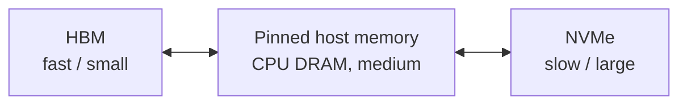

**Quantitative Model / Derivation:**
$$
T_{\text{ser}} \ge \frac{M_{kv}}{BW_{\text{eff}}}
$$

where:
- $T_{\text{ser}}$: transfer serialization time
- $M_{kv}$: KV bytes to move ($M_{\text{tok}} \times$ tokens, Lesson 3.1)
- $BW_{\text{eff}}$: sustained bandwidth actually measured on that path (not the link's nominal peak)

- It is a lower bound ($\ge$) because it counts only the time to push the bytes.
- Setup, synchronization, contention, conversion, and non-overlapped critical-path work add to completion time.
- Both terms must use the same unit family: GiB with GiB/s, or GB with GB/s ($1$ GiB $=2^{30}$ bytes, $1$ GB $=10^9$ bytes).

**Worked Example:**
- Assume the 0.5 MiB/token configuration from Lesson 3.1.
- A 4096-token KV cache is offloaded: $M_{kv} = 4096 \times 0.5$ MiB $= 2{,}048$ MiB $= 2$ GiB.
- Assume measured host↔device bandwidth $BW_{\text{eff}} = 50$ GiB/s.
- Lower bound: $T_{\text{ser}} \ge 2 / 50 = 0.04$ s $= 40$ ms.
- Unit check: if the same link were quoted as 50 GB/s ($50 \times 10^9$ bytes/s $\approx 46.6$ GiB/s):
  - Bound: $2 \times 2^{30} / (50 \times 10^9) \approx 0.0429$ s $\approx 43$ ms, about 7% higher.
  - This is the mismatch named in the Common Failure below.

If restore is required before the first resumed computation, it adds at least 40 ms to that request's critical path before setup and contention. It is not automatically a per-output-token TPOT charge; placement and overlap determine which request metric moves.

**Knowledge Check:**
1. Calculate the ideal transfer time for a 16,384 token prompt under the exact same assumptions.

**Feedback Contract:**
- *Expected Evidence*: 16384 * 0.5 MiB = 8192 MiB = 8 GiB. 8 GiB / 50 GiB/s = 160 ms, a serialization lower bound only (**D**, CLM-011).
- *Common Failure*: Mixing GiB payloads with GB/s link rates, or reporting 160 ms as the added TPOT of every token.
- *Diagnostic Hint*: Ensure units align before dividing by bandwidth.
- *Concept to Revisit*: Analytical transfer time.

**Independent Practice:**
Tiering latency is modeled in **LAB D**.

**Learning Outcome:**
Evaluate offloading viability by quantitatively reasoning about host↔device transfer bandwidth.

*(Effort: 30m instruction, 15m practice, Lab D integration)*

---

### Lesson 3.10 — Production Source Trace and Cross-Instance KV

**Engineering Question:**
How does a current runtime connect scheduler feasibility, physical blocks, and prefix-cache lifecycle, and what changes when KV crosses an instance boundary?

**Concepts & Definitions:**
The source trace distinguishes allocator feasibility, physical ownership, reusable residency, cache identity, release order, and cross-instance transfer boundaries.

**Mechanism Explanation:**

At vLLM commit `25b0add7b8a1c944d5c4e364f2de6aa82497a2ad`, the verified V1 path is:

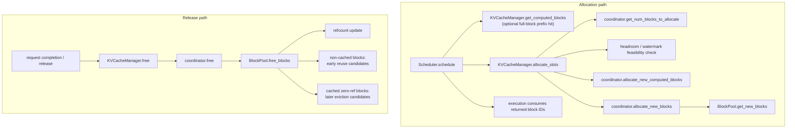

- Edges = call nesting in the pinned source, in listed order; not a measured runtime timeline.
- Legend: zero-ref = reference count 0; watermark = reserved free-block headroom.

The same revision hashes only full blocks for prefix reuse (**O**, CLM-006):
- `get_request_block_hasher` returns a per-request hasher that walks full blocks.
- For each full block it calls `hash_block_tokens(parent_hash, block_token_ids, extra_keys)`.
- Extra keys come from `generate_block_hash_extra_keys`: LoRA name, multimodal identifiers and offsets, cache salt (first block only), and prompt-embedding hashes.
- This is a current implementation contract, not a universal proof that token equality alone implies KV equivalence.

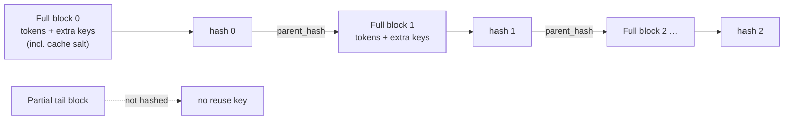

**Worked Example:**
A zero-reference cached block can remain indexed and reclaimable while appearing in an eviction/free queue under the pinned implementation; active ownership and reusable residency are different states (**O**, CLM-007).

For cross-instance reuse or prefill/decode disaggregation, add ownership/validity metadata and a transfer path. The screening lower bound is

$$
T_{\text{transfer}} \ge \frac{M_{kv}}{BW_{\text{eff}}}
$$

where:
- $T_{\text{transfer}}$: cross-instance KV transfer time
- $M_{kv}$: KV bytes to move
- $BW_{\text{eff}}$: measured effective interconnect bandwidth

- Actual critical-path cost includes setup, contention, synchronization, layout conversion, and only the non-overlapped portion.
- The transport is not universally NCCL.
- Placement, routing, and distributed transport specialization belong to Module 20.

**Knowledge Check:**
1. Why can a vLLM block be both in the free queue and still indexed as a cached eviction candidate?
2. Which source-level extra keys prevent two token-identical requests with different execution state from sharing a block?

**Feedback Contract:**
- *Expected Evidence*:
  - Distinguishes active ownership from reusable residency.
  - Identifies LoRA/multimodal/cache-salt/prompt-embedding keys.
  - Notes that the cache salt enters only the first block's key and propagates through the parent-hash chain.
- *Common Failure*: Reading a free-queue length as “empty memory”, or citing a hashing entry point that does not exist at the pinned revision.
- *Diagnostic Hint*: Read `BlockPool.touch`, `BlockPool.free_blocks`, `get_request_block_hasher`, and `generate_block_hash_extra_keys` at the pinned revision.
- *Concept to Revisit*: Runtime-specific lifecycle versus general mechanism.

**Independent Practice:**
Prefill→decode transfer latency modeled in **LAB D**.

**Learning Outcome:**
Trace a current allocator/cache implementation without generalizing its objects or policies to every runtime.

*(Effort: 30m instruction, Lab D integration)*

---

## 05 Literature & Production Source Map

**REFERENCE / BASELINE**

- Kwon et al. (SOSP 2023), [*Efficient Memory Management for Large Language Model Serving with PagedAttention*](https://doi.org/10.1145/3600006.3613165) — block tables, non-contiguous physical blocks, sharing, and paper-era evaluation (CLM-003).
- Zheng et al. (NeurIPS 2024), [*SGLang: Efficient Execution of Structured Language Model Programs*](https://arxiv.org/abs/2312.07104) — RadixAttention and structured-program prefix reuse (CLM-008).
- DeepSeek-AI (2024), [*DeepSeek-V2*](https://arxiv.org/abs/2405.04434) v5, Sections 2.1.2–2.1.4, and the released [`config.json`](https://huggingface.co/deepseek-ai/DeepSeek-V2/blob/4461458f186c35188585855f28f77af5661ad489/config.json) — MLA retained state used for Lesson 3.1 sizing; read 2026-09-30 (CLM-014).

**WORKLOAD-DEPENDENT EXTENSIONS**

- Liu et al. (ICML 2024), [*KIVI*](https://arxiv.org/abs/2402.02750) — asymmetric low-bit KV quantization; empirical results are configuration-specific (CLM-009).
- Zhang et al. (NeurIPS 2023), [*H2O*](https://arxiv.org/abs/2306.14048) — lossy attention-state retention based on recent/heavy-hitter tokens (CLM-010).
- TensorRT-LLM [KV Cache System](https://nvidia.github.io/TensorRT-LLM/features/kvcache.html) documentation (accessed 2026-09-25) — paged/contiguous caches, reuse, prioritized eviction, offload, events, and distinct managers for hybrid layouts (CLM-012).

**CURRENT SOURCE SNAPSHOT**

- vLLM `25b0add7b8a1c944d5c4e364f2de6aa82497a2ad`, statically verified 2026-09-25; presence of every symbol below re-checked 2026-09-30:
  - `vllm/v1/core/sched/scheduler.py`: `Scheduler.schedule`;
  - `vllm/v1/core/kv_cache_manager.py`: `KVCacheManager.get_computed_blocks`, `allocate_slots`, `free`;
  - `vllm/v1/core/block_pool.py`: `BlockPool.get_new_blocks`, `touch`, `free_blocks`, `_maybe_evict_cached_block`;
  - `vllm/v1/core/kv_cache_utils.py`: `get_request_block_hasher`, `generate_block_hash_extra_keys`, `hash_block_tokens` (hashing symbols re-read and corrected 2026-09-30: the previously listed `generate_block_hashes` does not exist at this commit).

**Currentness classification**

- **REFERENCE / BASELINE**: exact KV reuse and logical payload accounting.
- **OBSERVED IN TWO CURRENT RUNTIMES, NOT A PREVALENCE CLAIM**: block/paged pools with dynamic per-request assignment appear in the pinned vLLM V1 source (CLM-005) and in TensorRT-LLM documentation, which also documents contiguous caches (CLM-012). Adoption across other runtimes is `TODO_VERIFY`.
- **WORKLOAD-DEPENDENT**: prefix/radix reuse, block size, eviction priority, cache-aware routing, and offload.
- **FRONTIER / ARCHITECTURE-SPECIFIC**:
  - latent-attention state (MLA, CLM-014);
  - hybrid attention/state managers (documented in TensorRT-LLM, CLM-012);
  - low-bit representations (KIVI, CLM-009);
  - token-selective retention (H2O, CLM-010);
  - cold-page representations and cross-instance KV connectors are listed as frontier topics without a source opened in this revision: `TODO_VERIFY`.
- **LEGACY**: current claims based on removed `vllm/core/block_manager.py` or assuming the original 2023 vLLM architecture still defines current V1 internals.

---

### LAYER 2: ENGINEERING PRACTICE LAYER

## 06 Engineering Labs

For every major experiment, follow:

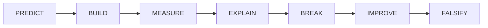

### LAB A — KV Analytical Model + Allocation Simulator
- **Objective**: Implement a contiguous allocator simulator and expose fragmentation effects.
- **Pre-Registered Hypothesis**: Heterogeneous growth and completion will separate reservation waste, internal fragmentation, and contiguous-allocation failure in the declared model.
- **Independent Variables**: Block/reservation size, prompt/output-length trace, allocation policy, completion order, and fixed non-KV memory.
- **Dependent Variables**: Logical payload, allocated capacity, each waste category, admission failures, and optimistic concurrency bound.
- **Break & Falsify**: Use equal fixed-length sequences and sufficient contiguous space; if fragmentation remains, inspect the simulator invariant or definition.
- **Alignment**: Explicitly exercises Lessons 3.1 and 3.2.
- **Effort Estimate**: 2h implementation, 1h experiments (3h total).

### LAB B — Minimal Paged KV Block Manager
- **Objective**: Implement a physical block pool and logical block table.
- **Pre-Registered Hypothesis**: Paged assignment will avoid contiguous logical-placement requirements while block rounding and lifecycle metadata remain measurable costs.
- **Independent Variables**: Block size, growth/completion order, sharing, partial-tail policy, and injected lifecycle fault.
- **Dependent Variables**: Allocations, free blocks, internal waste, refcounts, CoW events, stale references, and invariant violations.
- **Action**:
  1. Implement allocation, growth, reference counting, and a CoW variant for shared partial blocks. Treat CoW as a reference mechanism from PagedAttention, not a claim that every current runtime shares partial blocks this way.
  2. Add invariant tests for ownership, free-pool membership, isolation, and stale metadata.
  3. Drive the block manager with the Lesson 3.5 timeline (T1/T2 × K1/K2): reproduce the table, add one cost model of your own, and report which conclusions about running requests' mean gaps change.
- **Break & Falsify**: Double-free, append through a shared mutable tail, or retain a stale block-table entry; each must fail an invariant rather than silently corrupt another sequence.
- **Alignment**: Explicitly exercises Lessons 3.3, 3.4, and 3.5 (timeline replay).
- **Effort Estimate**: 3h implementation, 1h analysis (4h total).

### LAB C — Prefix Sharing & Multi-Worker Routing
- **Objective**: Simulate Prefix tree lifecycles, cache identity policies, LRU eviction, and cache-aware routing.
- **Pre-Registered Hypothesis**: Prefix affinity will improve reuse only where saved work exceeds added queue/load-skew cost.
- **Independent Variables**: Prefix popularity/locality, identity policy, cache capacity, eviction policy, routing policy, and worker load.
- **Dependent Variables**: Hit rate, saved prompt work, per-worker queue/load, latency quantiles, completions, and SLO-goodput.
- **Action**:
  - Compare policies (round-robin vs prefix-affinity).
  - Measure hit rate, load skew, and queue latency.
  - Require repeated runs, p50/p95/p99 latency analysis, and variance measurement to avoid single-run conclusions (Statistical exercise).
- **Break & Falsify**: Use a hot-prefix workload that overloads its resident worker; a policy that improves hits but harms declared utility falsifies hit-rate-only selection.
- **Alignment**: Explicitly exercises Lessons 3.6 and 3.7.
- **Effort Estimate**: 2h simulation, 1h analysis (3h total).

### LAB D — Compression, Tiering, & Disaggregation Bounds
- **Objective**: Model latency constraints of tiering, quantization, and disaggregated transfers.
- **Pre-Registered Hypothesis**: Nominal payload reduction predicts only a lower-bound capacity/transfer change; metadata, quality, conversion, overlap, and contention can reverse deployment utility.
- **Independent Variables**: Representation bits/granularity, retained tokens, tier, transfer size/bandwidth, overlap fraction, and workload shape.
- **Dependent Variables**: Payload/metadata, quality result, transfer lower bound, critical-path time, concurrency, and goodput.
- **Action**:
  - Compare exact paging, representation quantization, lossy token retention, and offload as distinct mechanisms.
  - Extend analytical models to include simplified prefill→decode KV transfers.
  - Reason about payload, metadata, quality, overlap, and critical-path impact without inventing a transport.
- **Break & Falsify**: Include a small transfer dominated by setup and a lossy policy that fails the quality gate; do not preserve a capacity claim after either violation.
- **Alignment**: Explicitly exercises Lessons 3.8, 3.9, and 3.10.
- **Effort Estimate**: 2h modeling, 1h report (3h total).

### LAB E — Pinned vLLM V1 Lifecycle Trace
- **Objective**: Connect scheduler feasibility, prefix lookup, block allocation, release, and cached eviction candidates in a current source revision.
- **Pre-Registered Hypothesis**: The pinned runtime will differ from the minimal simulator in at least one lifecycle or cache-residency state.
- **Independent Variables**: Prefix caching on/off, cache identity, prompt reuse, completion order, and allocation pressure.
- **Dependent Variables**: Cache groups, block IDs, reusable tokens, allocatable/evictable blocks, allocation refusals, and trace coverage.
- **Action**:
  1. Trace the exact files and symbols in Lesson 3.10.
  2. Run a small workload with prefix caching enabled and disabled.
  3. Record cache groups/coordinator, block IDs, allocatable versus cached-evictable blocks, hits in reusable tokens, and any allocation refusal.
  4. Mark unexecuted branches `TODO_VERIFY`.
- **Break & Falsify**: Find one behavior in the minimal simulator that is not valid for the pinned runtime, such as treating every free-queue block as semantically empty.
- **Alignment**: Explicitly exercises Lesson 3.10.
- **Effort Estimate**: 2h source trace (counted under `source_trace`), 1h instrumented comparison (3h total).

## 07 Break / Incident Scenarios

### Incident 03.1: The Undiagnosed Latency Collapse
- **Incident Symptoms** (exercises Lesson 3.5: Scheduling / Memory Pressure):
  - Traffic patterns shift.
  - Admission failures rise significantly.
  - The reported "free capacity" metrics appear high, yet the system refuses to admit new requests.
  - The TPOT latency distribution heavily tails.
- **Diagnostic Protocol (Task)**:
  1. Formulate >= 3 plausible hypotheses for the failure (for example: “free” capacity counts cached eviction candidates or blocks from another cache group; admission reserves headroom for projected growth; preemption/recompute churn; prefill interference unrelated to KV).
  2. Rank hypotheses based on system constraints.
  3. Identify missing evidence/metrics (allocatable versus cached-evictable blocks, allocation refusals, preemptions, recomputed tokens, per-iteration batch composition and duration).
  4. Design a discriminating experiment, such as changing only KV headroom or only prefill chunking.
  5. Diagnose the supported mechanism(s) and state what remains unresolved.
  6. Separate immediate mitigation from long-term intervention.
  7. Re-measure with declared admission, allocation, TPOT, completion, and goodput recovery criteria.

---

### LAYER 3: MASTERY / ASSESSMENT LAYER

## 08 Mastery Assessment

### Architecture Transfer Problem — Constrained MoE KV Capacity

You are serving a massive Mixture-of-Experts (MoE) model where KV cache footprint matches dense models, but parameter weights consume 80% of your HBM. You have strict Time-Per-Output-Token (TPOT) latency SLOs. The workload is highly concurrent, conversational, with little prefix locality.

The problem intentionally omits exact architecture and workload figures. Declare every missing quantity (layers, KV heads or latent widths, precision, length distribution, arrival rate, non-KV memory) as a labeled assumption or a measurement to collect; answers conditional on declared assumptions are expected.

You must design an architecture that maximizes concurrency while meeting SLOs.
The learner should:
1. Construct a quantitative workload model.
2. Predict the dominant KV bottleneck.
3. Generate at least three technically distinct interventions.
4. Derive expected effect and state assumptions for each.
5. Identify required evidence and compare trade-offs.
6. Reject inappropriate interventions based on evidence (e.g., if you propose prefix caching, justify it against the low prefix locality).
7. Defend a final architecture decision.
8. State uncertainty and rollback/reversal conditions.

## 09 Required Evidence & Rubric
Evidence must demonstrate the following. Submissions are evaluated on engineering capability.

### Required Artifact: Production Source Trace
Trace the pinned vLLM V1 path beginning at `Scheduler.schedule`, through `KVCacheManager.allocate_slots`, coordinator allocation, and `BlockPool.get_new_blocks`; then trace prefix lookup/hash and release/eviction paths. Do not substitute the removed legacy `vllm/core/block_manager.py` architecture.

Evidence must include:
- repository, commit `25b0add7b8a1c944d5c4e364f2de6aa82497a2ad`, and verification date;
- exact files and symbols, and the execution path;
- mapping from implementation objects to Module 03 concepts;
- selected coordinator/cache groups at runtime;
- one observation where the production implementation differs from the learner's minimal Block Manager.

Use `TODO_VERIFY` for any dynamic path not executed.

### Rubric Dimensions
A submission is Competent overall only when every dimension is at least Competent. *Calibration*:
- Inferring a TPOT effect from free-block counts without a timeline and cost model is Insufficient on Quantitative Reasoning.
- Sizing an MLA model with the GQA formula is Insufficient on Mechanistic Reasoning.
- **Mechanistic Reasoning**: *Insufficient* describes surface behavior. *Competent* explains causal mechanisms. *Strong* connects mechanisms across boundaries (e.g., scheduler + block manager).
- **Quantitative Reasoning**: *Insufficient* uses formulas without assumptions. *Competent* derives estimates with explicit assumptions. *Strong* predicts behavior, measures it, and explains discrepancies.
- **Experiment Design**: *Insufficient* runs benchmarks without hypothesis. *Competent* controls variables and tests a hypothesis. *Strong* designs discriminating experiments between competing hypotheses.
- **Failure Diagnosis**: *Insufficient* guesses a root cause. *Competent* forms multiple hypotheses. *Strong* ranks hypotheses by information gain and systematically eliminates them.
- **Falsification**: *Insufficient* only seeks confirming evidence. *Competent* tests counterexamples. *Strong* constructs adversarial conditions capable of disproving the design.
- **Architecture Decision**: *Insufficient* selects a technology. *Competent* explains trade-offs using evidence. *Strong* states uncertainty, operational risks, rollback strategies, and evidence that would reverse the decision.
- **Source Reasoning**: *Insufficient* quotes implementation details. *Competent* traces relevant execution paths. *Strong* connects implementation to observed system behavior.

## 10 Capability Traceability Matrix

| Capability | Taught | Practiced | Assessed | Evidence |
|---|---|---|---|---|
| KV Memory Footprint (incl. MLA) | 3.1 | KC + GP + Lab A | Mastery D1–D2 | Payload derivation with assumptions; rubric: Quantitative, Mechanistic |
| Fragmentation Reasoning | 3.2 | KC + Lab A | Lab A; Incident steps 1, 3 | Waste-category table from simulator; rubric: Mechanistic |
| Paged KV Allocation | 3.3 | GP + Lab B | Lab B invariant tests | Block-table/free-pool invariant test log; rubric: Experiment Design |
| Refcount / CoW | 3.4 | KC + Lab B | Lab B break tests | Double-free/shared-tail failure log; rubric: Falsification |
| Scheduling Pressure | 3.5 | Worked timeline + GP + Incident | Incident steps 1–7; Mastery D4–D5 | Timeline replay with stated cost model; rubric: Quantitative, Failure Diagnosis |
| Prefix Caching / Radix | 3.6 | KC + Lab C | Lab C; Mastery D6 | Hit/identity report; rubric: Architecture Decision |
| Cache-Aware Routing | 3.7 | Worked example + Lab C | Lab C; Mastery D3, D5 | Routing experiment with SLO-goodput; rubric: Experiment Design |
| Quantization / Lossy Retention | 3.8 | Worked example + Lab D | Lab D; Mastery D3–D4 | Payload+metadata and quality-gate report; rubric: Falsification |
| Offloading Latency | 3.9 | KC + Lab D | Lab D; Mastery D4 | Transfer lower-bound model; rubric: Quantitative |
| Production Source / Cross-Instance KV | 3.10 | KC + Lab E | Required source trace; Mastery D7 | Pinned vLLM trace with runtime observation; rubric: Source Reasoning |

*(Key: KC = Knowledge Check, GP = Guided Practice, D = Mastery deliverable number in §08)*

## 11 Exit Criteria & Module Wrap-Up

### Exit Criteria

A learner completing Module 03 should be able to derive KV memory footprint, explain paged block tables, diagnose scheduler memory thrashing, evaluate quantization/offloading mathematically, trace production code, and defend an architecture design.

### Module Wrap-Up (Final Mental Model Reconstruction)
- Final mental model chain:

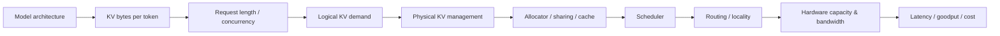

- When KV becomes limiting, possible interventions may include: admission/scheduling changes, block-size/allocation policy changes, prefix reuse, eviction changes, routing/locality, KV representation/quantization, tiering/offloading, or placement/disaggregation.
- The correct intervention depends entirely on evidence. The final mental model is: PREDICT → OBSERVE → DIAGNOSE → INTERVENE → FALSIFY.

### Cost & Telemetry Hook

- [Lesson 22.4](../22-ai-economics/README.md): price prefix reuse from measured hit rate in reusable tokens, net of eviction, recompute, and memory reserved for cached blocks.
- [Lesson 22.2](../22-ai-economics/README.md): charge KV memory (HBM and offload tier) as capacity cost per resident token-second, not only per request.
- [Lesson 23.1](../23-observability-reliability/README.md) and [Lesson 23.2](../23-observability-reliability/README.md): emit per-request cached/computed token counts, allocation refusals, and preemptions; report sampled or dropped cache events as telemetry loss.

## 12 Competency Targets
```yaml
competency:
  sfia: 5
  bloom: Evaluate -> Create
  solo: Relational -> Extended Abstract
  dreyfus: Competent
```
