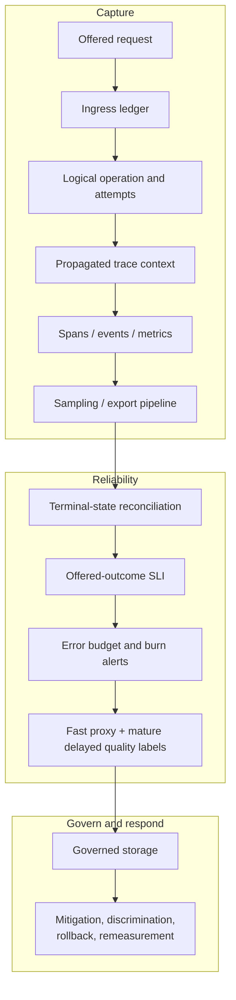
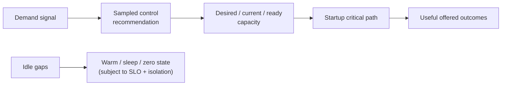
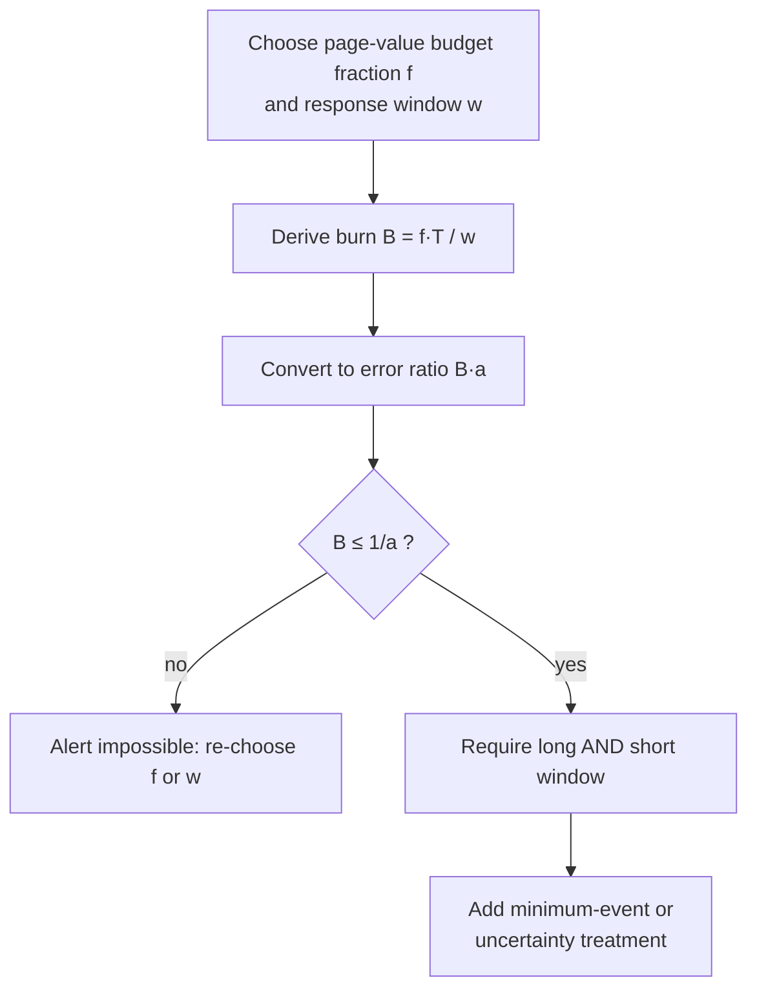
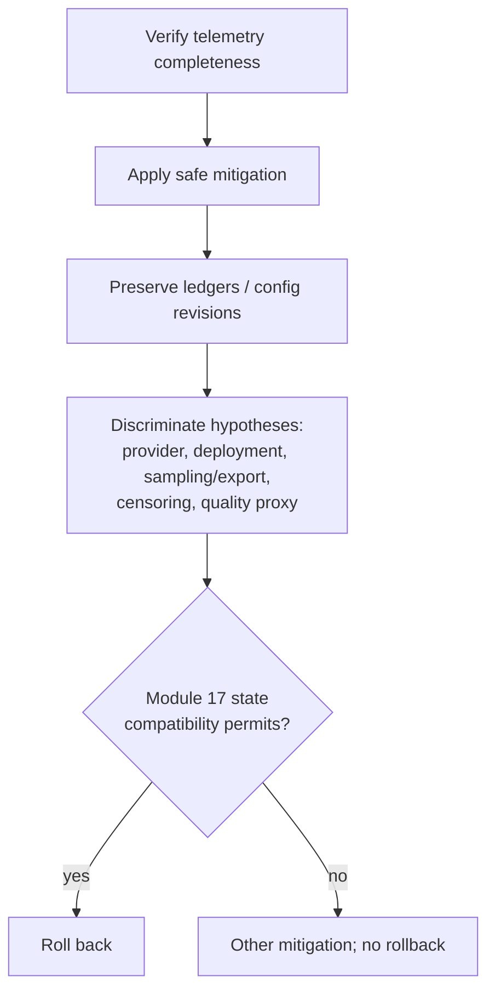
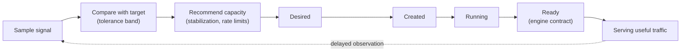
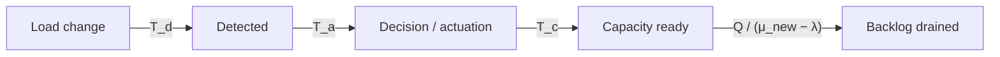
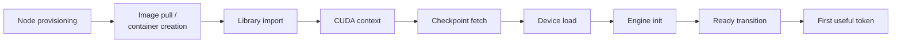
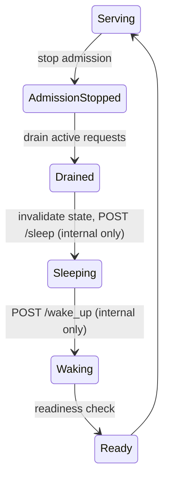

# Module 23 — Observability & Reliability

## 00 Why This Module Exists

A green dashboard can accompany a failing service:
- Successful exported spans omit rejected work, crashed workers, unfinished requests, and dropped telemetry.
- A judge score can move while true quality does not.
- A trace can detect failure yet omit evidence needed to localize origin.

Reliability therefore starts with measurement contracts, not dashboards.

This module owns production telemetry boundaries, trace continuity and sampling, offered-outcome reliability, SLO burn control, delayed quality signals, telemetry governance, and incident discrimination. Neighbouring topics stay elsewhere:
- Serving metric mechanics: Module 04.
- Evaluation design: Module 15.
- Rollout and rollback-state compatibility: Module 17.
- Security detection: Module 18.
- Full cost modeling: Module 22.

**Research cutoff:** 2026-09-30.

**Module Orientation**
- **Engineering Problem**: Build evidence that remains interpretable when requests retry, cancel, remain unfinished, lose telemetry, or receive delayed quality labels.
- **What You Will Do**: Define signal contracts; trace pinned OpenTelemetry GenAI conventions; propagate context; simulate biased sampling and censoring; build offered-outcome SLIs and burn alerts; calibrate proxy-quality signals; budget telemetry; and execute a mitigation-first incident runbook.
- **Environment**: Python 3.10+, a small trace/ledger simulator, optional OpenTelemetry Collector. All fixtures are synthetic unless marked source observation.
- **Evidence Rule**: Registry claims appear as source observation **O**, derivation **D**, or hypothesis **H** with `CLM-###`. Detector output, LLM-judge output, and embedding distance are instrument readings, never ground truth.
- **If You Only Have One Week**: Lessons 23.2, 23.3, 23.4 — they quantify sampling and censoring bias, build offered-outcome SLIs, and derive multiwindow burn alerts; conventions, proxy quality, governance, and autoscaling build on those three.

## 01 Baseline Assumptions

- Module 04 Lessons 4.1, 4.4, 4.6: latency boundaries, censoring semantics, admission/rejection, and offered versus admitted populations.
- Module 08 Lesson 8.6: annotation systems and delayed human labels.
- Module 15: grader validation, slices, intervals, and offline/online validity.
- Module 16: fault injection and falsification.
- Module 17: canaries, rollback triggers, and rollback-state compatibility.
- Module 18: security detectors and protected telemetry. This module governs their signals; it does not design attacks.
- Modules 12–14: trajectory, retry, effect, and recovery telemetry.

## 02 Target Mastery

```yaml
depth_contract:
  conceptual: REQUIRED
  mechanistic: REQUIRED
  mathematical: REQUIRED
  quantitative: REQUIRED
  implementation: REQUIRED
  source_code: REQUIRED
  instrumentation: REQUIRED
  experimental: REQUIRED
  statistical: REQUIRED
  production_reasoning: REQUIRED
  failure_analysis: REQUIRED
  falsification: REQUIRED
  security: REQUIRED
  economics: SELECTIVE
  architecture_tradeoff: REQUIRED
  research_connection: REQUIRED

estimated_effort:
  instruction: 8h
  guided_practice: 3.75h
  labs: 18h
  assessment: 3h
  source_trace: 2h
  total: 34.75h
```

- Lesson lines sum to 480 minutes instruction and 225 minutes guided practice.
- LABs A–F are 3 hours each (18h).
- The 2h source-trace budget is shared between Lesson 23.1/LAB A and the selected autoscaling/startup paths in LABs E/F, counted once.
- Module-local schedule is 34.75h (formerly 23.5h); shared ROADMAP changes are outside this edit scope.

---

### LAYER 1: KNOWLEDGE / INSTRUCTIONAL LAYER

## 03 Knowledge Map



- SLI: service-level indicator.

Cross-cutting invariants:
- Every number declares boundary, population, units, aggregation, window, failure/cancellation/unfinished treatment, sampling probability, and schema revision.
- Missing telemetry is unknown, not success.

Scaling extension:



- SLO: service-level objective.
- Idle gaps select warm/sleep/zero states subject to SLO and isolation constraints.
- Owned elsewhere: steady-state sizing in 4.7; failure/reload recovery in 20.6; prices in 22; LoRA adapter cold start in EXPERT-TRACK module 35.

## 04 Lessons

### Lesson 23.1 — Signal Contracts and Pinned GenAI Conventions

**Engineering Question:**
What does each span, event, and metric measure, and which schema revision makes its name interpretable?

**Concepts & Definitions:**
- A **span** times one operation and preserves causal links; an **event** records a timestamped occurrence; a **metric** is an aggregate that has lost request identity.
- A **logical client span** may cover retries; attempt child spans/events preserve attempt detail. Client, server, and attempt clocks are not interchangeable (**O**, CLM-004, CLM-005; **D**, CLM-011).
- At core semantic-conventions commit `70550277d98a01ca3fe83bcfc3a2dac18a0d98b7`, GenAI definitions are moved/deprecated.
  - At `semantic-conventions-genai` commit `b31e9e8ea26ac1c086d3313d474e31d7c3f391ae`, inspected GenAI spans, metrics, events, and attributes are **Development**, not Stable (**O**, CLM-001, CLM-002, CLM-003).
  - Production mappings must record revision.
- Finish reasons preserve error/cancellation positions; operation status does not imply answer quality (**O**, CLM-006, CLM-044). Token histograms and counters have different aggregation contracts (**O**, CLM-010).

**Mechanism Explanation:**
- At request start, create a logical operation span with sampling-eligible attributes.
- Each retry gets attempt evidence.
- Evaluation results are events correlated by response ID, not truth labels (**O**, CLM-009).
- At completion, record declared terminal state, latency, usage, and schema revision.
- Metrics aggregate bounded dimensions; the ledger retains request identity.


**Quantitative Model / Derivation:**
For $n$ client chunks with arrival times $t_1, \dots, t_n$, mean per-output-chunk time is

$$
\bar g = \frac{t_n - t_1}{n - 1}
$$

where:
- $\bar g$: mean gap between consecutive client chunks (s)
- $t_1$, $t_n$: arrival times of the first and last chunk on the client clock (s)
- $n$: number of chunks received (count)

Server TPOT similarly divides post-first-token duration by output-token gaps. These are exact only at their named clocks and populations.

*Why divide by $n-1$:*
- $n$ arrivals have only $n-1$ gaps between them (fence-post rule).
- The first arrival marks the start of the averaged interval, so 121 chunks give 120 gaps and 241 tokens give 240 gaps.
- TTFC (time to first chunk) is read on the client clock; TTFT (time to first token) and TPOT (time per output token) are read on the server clock.

**Worked Example (synthetic):**
Input:
- Logical client span 3.650 s.
- Attempt 1 fails at 0.600 s; retry starts 0.650 s.
- First client chunk at 1.250 s; last at 3.650 s.
- Server receives retry at 0.670 s, first token after 0.560 s, and 241 tokens finish after 2.960 s server duration.

1. Client time to first chunk from logical start = 1.250 s; from retry = 0.600 s.
2. Client mean chunk gap $= (3.650 - 1.250) / 120 = 0.020$ s.
3. Server TPOT $= (2.960 - 0.560) / 240 = 0.010$ s.
4. A `(0.64,1.28]` TTFC histogram bucket cannot recover retry or server decomposition.
Step 4 in plain terms: a histogram keeps only "this request fell somewhere in 0.64–1.28 s"; the retry and the server-side timings are already gone and cannot be rebuilt from it.
Result: no valid subtraction converts client TTFC into server TTFT. Limit: synthetic clocks; unsynchronized clock skew needs separate measurement.

**Knowledge Check:**
1. Why can one successful logical span contain a failed attempt?
2. Why cannot span status serve as quality truth?
3. Are pinned GenAI attributes stable?

**Guided Practice:**
Write contracts for one logical span, attempt event, evaluation event, and offered-request counter. Include timestamps, population, units, aggregation, terminal states, and revision.

**Feedback Contract:**
- **Expected Evidence**: Four contracts; explicit logical/attempt boundary; exact commits; Development label.
- **Common Failure**: Calling experimental/Development attributes stable or equating client and server latency.
- **Diagnostic Hint**: Ask which clock starts and which population can disappear.
- **Concept to Revisit**: Signal boundary and convention stability.

**Learning Outcome:** Define versioned trace, event, and metric contracts without boundary collapse.

*(Effort: 50m instruction, 20m practice; source trace counted separately)*

---

### Lesson 23.2 — Propagation, Sampling, Telemetry Loss, and Censoring

**Engineering Question:**
How can trace continuity and rate estimates survive retries, sampling, late spans, exporter loss, crashes, and window closure?

**Concepts & Definitions:**
- W3C `traceparent` version 00 carries trace ID, parent ID, and flags; sampled is a propagation signal, not completeness proof (**O**, CLM-012).
- Head sampling uses creation-time facts; tail sampling can use outcomes but waits, buffers, evicts, and may split late spans (**O**, CLM-007, CLM-013, CLM-014, CLM-016, CLM-017).
- Batch processors can drop after queue limits; deployed settings, not specification defaults, govern reality (**O**, CLM-015).
- **Censoring**: unfinished, crashed, cancelled, or unexported work lacks an observed terminal span. It is neither a negative label nor success.

**Mechanism Explanation:**


- Propagate context gateway → orchestrator → retrieval/provider/tool.
- Record request, trace, operation, and attempt IDs in a reliability ledger, never as unbounded metric labels.
- Reconcile ingress offered records with terminal ledger rows and export counters.
- If inclusion probability is known, use adjusted counts; if eviction adds unknown selection, report non-identifiability.

**Quantitative Model / Derivation:**
$$
P(\text{observe at least one of } k \text{ rare events}) = 1 - (1-p)^k
$$

where:
- $p$: per-event inclusion (sampling) probability (dimensionless, 0–1)
- $k$: number of rare events offered (count)

With unequal inclusion probabilities, estimate a rate as

$$
\hat r = \frac{\sum_i y_i / p_i}{\sum_i 1 / p_i}
$$

only when every $p_i$ is known and no extra censoring exists.

where:
- $\hat r$: estimated failure rate over offered requests (fraction)
- $i$: index over exported traces
- $y_i$: 1 if trace $i$ failed, else 0
- $p_i$: inclusion probability of trace $i$ (0–1)

*Reading the formulas:*
- Each event is kept independently with probability $p$, so it is missed with probability $1-p$.
- All $k$ are missed with probability $(1-p)^k$; the complement is "see at least one".
- In the weighted estimate, each kept trace stands in for $1/p_i$ offered requests: the numerator estimates total failures, the denominator total requests.
- If traces vanished for a reason with no known $p_i$ (eviction, crash), their weight is unknown and the rate is not identifiable.

**Worked Example (synthetic; D):**
Input: one million offered requests contain 40 rare failures.

- Head sampling at $p = 0.01$ (**D**, CLM-018):
  - Expected sampled failures: $40 \times 0.01 = 0.4$.
  - Chance of seeing none: $0.99^{40} \approx 0.669$.
  - Visibility: $1 - 0.669 = 0.331$.
- Tail sampling keeps all 40 failures and 1% of 999,960 successes:
  - Exported traces: $40 + 0.01 \times 999{,}960 = 40 + 9{,}999.6 = 10{,}039.6$.
  - Naive failure share: $40 / 10{,}039.6 = 0.398\%$, versus true $0.004\%$ (inflated about $100\times$).
- Weighted correction: each kept success has $p_i = 0.01$ (weight 100), each failure $p_i = 1$ (weight 1):
  - Weighted failures: $40$.
  - Weighted total: $40 + 9{,}999.6 \times 100 = 1{,}000{,}000$.
  - Rate: $40 / 1{,}000{,}000 = 0.004\%$.
- If 500 crashed workers never end spans, span-only correction cannot recover them (**D**, CLM-019).

**Knowledge Check:**
1. Why is sampled=true not proof all child spans arrived?
2. When is inverse-probability weighting invalid?
3. What population contains crashed requests?

**Guided Practice:**
Simulate 1,000 windows and test the predicted zero-observation fraction, naive tail bias, adjusted rate, and ingress reconciliation (**H**, CLM-042).

**Feedback Contract:**
- **Expected Evidence**: Seeded simulator; expected 0.669 zero windows; adjusted and unadjusted estimates; explicit eviction counter.
- **Common Failure**: Dividing sampled failures by sampled traces after outcome-dependent selection.
- **Diagnostic Hint**: Can every missing trace be assigned a known inclusion probability?
- **Concept to Revisit**: Censoring versus sampling.

**Learning Outcome:** Quantify propagation, sampling, export, and censoring bias and state when correction is impossible.

*(Effort: 50m instruction, 20m practice)*

---

### Lesson 23.3 — Offered-Outcome SLIs

**Engineering Question:**
Which denominator represents user-visible reliability when work is rejected, cancelled, unfinished, slow, malformed, or low quality?

**Concepts & Definitions:**
- SLI is good events / eligible total events; SLO is target; error budget is `1-SLO` (**O**, CLM-020).
- **Offered denominator** contains every eligible ingress request, before admission.
- **Good predicate** declares terminal success plus latency/schema/policy checks and, when mature, validated quality.
- Cancellations and unfinished requests are included, excluded by declared policy with sensitivity, or bounded—never silently dropped.

**Mechanism Explanation:**


- Ingress writes every offered request.
- Terminal reconciliation assigns rejection, success, explicit error, timeout, cancellation, or unfinished-at-close.
- The SLI joins outcome checks.
- Trace-derived success is a diagnostic view, not reliability denominator.

**Quantitative Model / Derivation:**
$$
\text{SLI}_{\text{offered}} = \frac{\text{good}}{\text{offered}}
$$

where:
- $\text{SLI}_{\text{offered}}$: fraction of offered requests that meet the good predicate (0–1)
- good: requests satisfying the good predicate (count)
- offered: every eligible ingress request, before admission (count)

With $u$ unfinished and $g$ known good, bounds are $\left[\dfrac{g}{N},\ \dfrac{g+u}{N}\right]$. Exclusion sensitivity recomputes both numerator and denominator under the declared policy.

*Why these bounds:*
- $N$ is the offered count.
- Unfinished requests have no known outcome, so the worst case counts all $u$ as bad (lower bound $g/N$) and the best case counts all as good (upper bound $(g+u)/N$).
- The width $u/N$ shows how much the unknowns could matter.

**Worked Example (synthetic; D, CLM-021):**
Input:
- 120,000 offered; 6,000 rejected.
- 108,300 completed OK; 1,140 errors; 2,280 timeouts; 1,710 cancellations; 570 unfinished.
- 104,000 pass latency and schema.
Check:
- Offered: $6{,}000 + 108{,}300 + 1{,}140 + 2{,}280 + 1{,}710 + 570 = 120{,}000$.
- Admitted: $120{,}000 - 6{,}000 = 114{,}000$.
- Completed (OK plus explicit error): $108{,}300 + 1{,}140 = 109{,}440$.

Each view below changes the denominator (and, for step 4, the good predicate).
1. Completion-conditioned success $= 108{,}300 / 109{,}440 = 98.96\%$.
2. Admitted completion $= 108{,}300 / 114{,}000 = 95.00\%$.
3. Offered completion $= 108{,}300 / 120{,}000 = 90.25\%$.
4. Offered-outcome good $= 104{,}000 / 120{,}000 = 86.67\%$.
5. Excluding cancellations $= 104{,}000 / 118{,}290 = 87.92\%$.
6. Unfinished bounds $= [104{,}000,\ 104{,}570] / 120{,}000 = [86.67\%,\ 87.14\%]$ (the upper bound counts all 570 unfinished as good).
Limit: cancellations may be caused by slowness; exclusion can hide harm.

**Knowledge Check:**
1. Why can admitted latency look healthy during mass rejection?
2. How should unfinished requests appear?
3. When may quality join the primary SLI?

**Guided Practice:**
Design availability/latency and mature-quality predicates for a streaming endpoint; include retry ownership, cancellation sensitivity, and window closure.

**Feedback Contract:**
- **Expected Evidence**: Recomputable ledger query and four denominator views.
- **Common Failure**: Counting only ended exported spans.
- **Diagnostic Hint**: Start from ingress IDs and account for every terminal bucket.
- **Concept to Revisit**: Offered versus admitted populations.

**Learning Outcome:** Build offered-outcome SLIs with explicit cancellation and unfinished-work policy.

*(Effort: 40m instruction, 20m practice)*

---

### Lesson 23.4 — Error Budgets and Multiwindow Burn Alerts

**Engineering Question:**
How should alert thresholds be recomputed for this SLO, window, traffic level, and response time?

**Concepts & Definitions:**
- Allowance and burn rate:

  $$a = 1 - S, \qquad B = \frac{e}{a}$$

  where:
  - $S$: SLO target (fraction, e.g. 0.999)
  - $a$: allowed bad fraction (dimensionless)
  - $e$: observed error ratio in a window (dimensionless)
  - $B$: burn rate (multiple of the allowed rate)
  - $T$: SLO period (min or h)

  Burn $B = 1$ exhausts budget exactly over the SLO period.
  - Example: $S = 99.9\%$ gives $a = 0.001$; over 30 days ($43{,}200$ min) that equals $0.001 \times 43{,}200 = 43.2$ min of full outage.
  - Burn $B = 2$ spends budget twice as fast as allowed, so it lasts $T/2$.
  - Since $e \le 1$, the largest possible burn is $1/a$.
- Multiwindow alerts pair a long budget-consumption window with a short active-burn window. Workbook values 14.4/6/1 are starting points for a 99.9%, 30-day example, not constants (**O**, CLM-022).
- Low traffic needs counts/intervals, separate synthetics, or a longer/combined population; one failure can be a noisy page (**O**, CLM-024).

**Mechanism Explanation:**


- $f$: budget fraction; $w$: window; $T$: SLO period; $a$: allowed bad fraction; $B$: burn rate.
- Keep synthetics separate from real-user SLIs.

**Quantitative Model / Derivation:**
$$
f = \frac{B w}{T}, \qquad T_{\text{exhaust}} = \frac{T}{B}, \qquad t_{\text{fire}} \approx \frac{a}{e}\, w B
$$

where:
- $f$: budget fraction consumed over window $w$ (dimensionless)
- $w$: alert window length (h or min)
- $B$: burn rate; $T$: SLO period (same unit as $w$)
- $T_{\text{exhaust}}$: time to exhaust budget at constant burn (unit of $T$)
- $t_{\text{fire}}$: approximate fire time after outage onset, plus evaluation and notification delay (unit of $w$)
- $a$: allowed bad fraction; $e$: actual outage error ratio

*Derivation steps:*
1. Pick the budget fraction $f$ a page should represent and the long window $w$.
2. Solve $f=Bw/T$ for the alert burn $B=fT/w$.
3. Convert to an error-ratio threshold $Ba$.
4. In the fire-time formula, $B$ is the alert-threshold burn and $e$ the actual outage error ratio. The window average rises roughly linearly as the outage fills the window, reaching $Ba$ after a fraction $Ba/e$ of $w$, i.e. time $(a/e)wB$.

**Worked Example (synthetic arithmetic; D, CLM-023):**
Input: $T = 30$ days $= 720$ h.

- Alert burns from $B = fT/w$:
  - 2% / 1 h: $0.02 \times 720 / 1 = 14.4$.
  - 5% / 6 h: $0.05 \times 720 / 6 = 6$.
  - 10% / 72 h: $0.10 \times 720 / 72 = 1$.
- Error-ratio thresholds at SLO 99% ($a = 0.01$): $14.4 \times 0.01 = 14.4\%$, $6 \times 0.01 = 6\%$, $1 \times 0.01 = 1\%$.
- A 30% error ratio:
  - Burn: $B = 0.30 / 0.01 = 30$.
  - Exhaustion: $720 / 30 = 24$ h.
  - Fire time for the 1 h page: $(0.01 / 0.30) \times 60 \text{ min} \times 14.4 = 28.8$ min.
- At SLO 90%: $a = 0.1$, max burn $1/0.1 = 10 < 14.4$, so a $14.4\times$ alert is impossible.
- Low traffic (10 req/h, SLO 99.9%):
  - 1 failure in 10 requests: $e = 0.1$, $B = 0.1 / 0.001 = 100$.
  - Month: $10 \times 720 = 7{,}200$ requests, $7{,}200 \times 0.001 = 7.2$ allowed failures.
  - One failure uses $1 / 7.2 \approx 13.9\%$ of monthly budget, not $1{,}000\times$.
  - $1{,}000\times$ ($= 1/a$) would require every request in the window to fail.

**Knowledge Check:**
1. Why does maximum burn depend on SLO?
2. Why require long and short windows?
3. Why can synthetic success not repair real-user reliability?

**Guided Practice:**
For SLO 99.5%, derive thresholds for 2%/1 h and 5%/6 h, expected fire times for 20% errors, and low-traffic behavior at 30 requests/hour.

**Feedback Contract:**
- **Expected Evidence**: $a = 0.005$; burns 14.4 and 6; error thresholds 7.2% and 3%; explicit count treatment.
- **Common Failure**: Copying thresholds or paging on a percentage with one event.
- **Diagnostic Hint**: Check maximum burn and actual event count first.
- **Concept to Revisit**: Error allowance and budget fraction.

**Learning Outcome:** Derive multiwindow burn policies and low-traffic safeguards from first principles.

*(Effort: 45m instruction, 20m practice)*

---

### Lesson 23.5 — Proxy Quality and Delayed Labels

**Engineering Question:**
How can fast detectors support operations without being promoted to ground truth?

**Concepts & Definitions:**
- Judge, detector, and embedding-distance outputs are proxy readings. Validate against independent adjudication; version evaluator and rubric; report slices and uncertainty (**O**, CLM-025, CLM-028, CLM-029, CLM-039).
- A GenAI evaluation event transports a score; it does not carry validated error rates (**O**, CLM-009).
- Recent unlabeled outcomes are right-censored. Compare mature cohorts or model delay from mature data (**O**, CLM-030).
- Prediction-powered inference is an alternative using labeled and unlabeled target samples; registry inspection is abstract-level (**O**, CLM-027).

**Mechanism Explanation:**


- Fast proxies page or prioritize review.
- A separate mature quality SLI joins independent labels by response ID and cohort age.
- Calibration correction requires invariant conditional judge behavior; new failure mixes invalidate it.

**Quantitative Model / Derivation:**
$$
\hat\theta = \frac{p + q_0 - 1}{q_0 + q_1 - 1}, \qquad \hat r_d = \frac{n_d}{N\,F(d)}, \qquad \text{PPV} = \frac{\pi s}{\pi s + (1 - \pi)\,\text{FPR}}
$$

where:
- $\hat\theta$: corrected prevalence (true good rate, 0–1), from sensitivity $q_1$, specificity $q_0$, raw pass $p$; requires $q_0 + q_1 > 1$ and invariance
- $\hat r_d$: delayed-positive estimate at age $d$ (fraction)
- $n_d$, $N$: positives seen and outcomes at age $d$ (counts); $F(d)$: arrival fraction by age $d$ (0–1)
- PPV: detector positive predictive value (0–1); $\pi$: prior incident rate; $s$: sensitivity; FPR: false-positive rate

*Where these come from:*
- Correction:
  - $q_1=P(\text{judge pass}\mid\text{truly good})$, $q_0=P(\text{judge reject}\mid\text{truly bad})$.
  - With true good rate $\theta$, raw pass is $p=q_1\theta+(1-q_0)(1-\theta)$; solving for $\theta$ gives $(p+q_0-1)/(q_0+q_1-1)$.
  - If $q_0+q_1\le 1$ the judge is no better than chance and the denominator is zero or negative.
- Delay: $n_d$ is positives (e.g. complaints) seen among $N$ outcomes of age $d$; $F(d)$ is the fraction of eventual positives arrived by age $d$, estimated from mature cohorts. Dividing by $F(d)$ scales the partial count to its expected final value.
- PPV (positive predictive value) is Bayes' rule: $\pi$ is the prior incident rate, $s$ sensitivity, FPR the false-positive rate. Numerator = true alarms; denominator = true plus false alarms.

**Worked Example (synthetic; D):**
- Calibration correction with $q_1 = 0.92$, $q_0 = 0.80$ (**D**, CLM-026):
  - Denominator: $q_0 + q_1 - 1 = 0.80 + 0.92 - 1 = 0.72$.
  - Raw $0.88$: numerator $0.88 + 0.80 - 1 = 0.68$, corrected $0.68 / 0.72 = 0.944$.
  - Raw $0.82$: numerator $0.62$, corrected $0.62 / 0.72 = 0.861$.
  - Raw gap $0.88 - 0.82 = 0.06$ understates corrected gap $0.944 - 0.861 = 0.083$.
  - A new accepted failure type can make stale correction read $0.919$ while truth is $0.860$; proxy is not truth.
- Delayed labels: 150 complaints among 10,000 day-old outcomes with $F(1\text{d}) = 0.5$ estimate $150 / (10{,}000 \times 0.5) = 3\%$, not 1.5%.
- PPV at 2% incident prior, sensitivity 0.9, FPR 0.1 (**D**, CLM-031):
  - True alarms: $0.02 \times 0.9 = 0.018$.
  - False alarms: $0.98 \times 0.1 = 0.098$.
  - PPV: $0.018 / 0.116 = 0.155$; roughly 1 alarm in 6.5 is a real incident.

**Knowledge Check:**
1. What invariance makes correction valid?
2. Why are missing recent complaints not negatives?
3. Can drift detection identify harm?

**Guided Practice:**
Create two weekly cohorts, inject a judge-accepted failure slice, and compare raw, corrected, and human-audited rates with evaluator/rubric versions.

**Feedback Contract:**
- **Expected Evidence**: Confusion matrix, correction and interval inputs, cohort maturity, slice audit.
- **Common Failure**: Calling judge or embedding distance ground truth.
- **Diagnostic Hint**: Recompute $P(\text{proxy} \mid \text{truth})$ by slice and week.
- **Concept to Revisit**: Conditional invariance and delayed censoring.

**Learning Outcome:** Operate proxy-quality and delayed-label systems with calibration limits explicit.

*(Effort: 50m instruction, 25m practice)*

---

### Lesson 23.6 — Telemetry Governance and Incident Discrimination

**Engineering Question:**
How do we keep telemetry affordable and private while preserving enough evidence to mitigate and discriminate incidents?

**Concepts & Definitions:**
- Each unique metric-label combination is a series; unbounded IDs do not belong on metric labels (**O**, CLM-033).
- OpenTelemetry specifies filtering before a default 2,000-point cardinality limit and an overflow series, subject to SDK support (**O**, CLM-032).
- Prompt/output content is sensitive and large, off by default; an external content hook may run regardless of trace sampling (**O**, CLM-008).
- Data minimization and collector filtering/redaction remain implementer duties (**O**, CLM-034).
- Incident loop: Stop bleeding and preserve evidence before prolonged root-cause work (**O**, CLM-036).

  Incident loop: symptom → competing hypotheses → missing evidence → discriminating measurement → ranked explanation → intervention → remeasurement.
- Detection is not localization; controlled synthetic research reports this gap but is abstract-level and not a production rate (**O**, CLM-038).

**Mechanism Explanation:**
Governance:
- Filter labels before aggregation and observe overflow.
- Sample trace envelopes and content independently.
- Separate access/retention.

During a page:



**Quantitative Model / Derivation:**
$$
S_{\max} = \prod_j |L_j|, \qquad V_{\text{trace}} = R \cdot \rho \cdot n_{\text{span}} \cdot b_{\text{span}}
$$

where:
- $S_{\max}$: series upper bound (count); $|L_j|$: retained cardinality of label $j$ (count)
- $V_{\text{trace}}$: trace volume (bytes per period); $R$: requests (per period); $\rho$: sample fraction (0–1); $n_{\text{span}}$: spans/request; $b_{\text{span}}$: bytes/span

Content uses its own capture probability.

*Why a product:*
- A metric stores one time series per distinct label combination.
- With 3 values of label A and 2 of label B there are at most $3 \times 2 = 6$ combinations; each added label multiplies the count.
- A tenant or request ID label multiplies series by the number of tenants or requests, which is why unbounded IDs belong in the ledger, not on metric labels.

**Worked Example (synthetic; D, CLM-035):**
- Series per metric (3 models, 2 providers, 5 operations, 5 errors, 6 regions, 4 tiers): $3 \times 2 \times 5 \times 5 \times 6 \times 4 = 3{,}600$.
- Adding 500 tenants: $3{,}600 \times 500 = 1{,}800{,}000$.
- Traces at 1M requests/day, 12 spans × 1.2 KB:
  - Unsampled: $10^6 \times 12 \times 1.2$ KB $= 14.4$ GB/day.
  - 30 days at 1%: $14.4 \times 30 \times 0.01 = 4.32$ GB.
- Content at 26 KB/request, hook at 100%:
  - Per day: $10^6 \times 26$ KB $= 26$ GB.
  - 30 days: $26 \times 30 = 780$ GB.
- Total: $4.32 + 780 = 784.32$ GB. Content dominates because the hook ignores trace sampling; sampling traces alone misses budget and privacy target.

Mitigation arithmetic (**D**, CLM-037), using $f = Bw/T$ with $B = 30$ (99% SLO) and $T = 43{,}200$ min:
- At page: $30 \times 28.8 / 43{,}200 = 2.00\%$.
- Rollback (6 min): $30 \times 6 / 43{,}200 \approx 0.42\%$.
- Diagnosis (45 min): $30 \times 45 / 43{,}200 \approx 3.13\%$.
- Mitigate first: $2.00 + 0.42 = 2.42\%$.
- Diagnose first: $2.00 + 3.13 + 0.42 \approx 5.54\%$.
- Limit: rollback may be unsafe or irrelevant.

**Knowledge Check:**
1. Why does trace sampling not bound content capture?
2. What evidence distinguishes telemetry loss from traffic loss?
3. When should rollback not be first mitigation?

**Guided Practice:**
Given provider errors, exporter drops, a new evaluator rubric, and a deployment change, write predicted telemetry for each, a safe mitigation, and one discriminating query.

**Feedback Contract:**
- **Expected Evidence**: Cardinality/volume ledger; privacy controls; four hypotheses with predicted signals; rollback compatibility check.
- **Common Failure**: Long diagnosis before mitigation, or treating an alert dimension as origin.
- **Diagnostic Hint**: Compare ingress counts, terminal ledger, exporter counters, deployment and evaluator versions.
- **Concept to Revisit**: Telemetry completeness and mitigation-first triage.

**Learning Outcome:** Govern telemetry and execute mitigation-first, evidence-preserving incident discrimination.

*(Effort: 35m instruction, 15m practice)*

---

### Lesson 23.7 — Autoscaling Control Loops for LLM Serving

**Engineering Question:**
Why can desired replicas rise while useful capacity stays flat, and which signal should drive the control loop?

**Concepts & Definitions:**
- **Control loop:** sample a signal, compare with a target, recommend capacity, actuate, and observe the delayed result.
  - **Desired**, **created**, **Running**, **Ready**, and **serving useful traffic** are different states.
  - Readiness must represent the declared engine contract, not merely a live process.
- Three distinct controls address different sources of oscillation and delay:
  - **Dead band/tolerance** ignores small target deviations.
  - **Stabilization** holds recommendations over time.
  - **Rate limits** bound replica changes.
- **HPA** is Kubernetes' Horizontal Pod Autoscaler. Its metric calculator and the surrounding controller policies are separate stages.
- **KPA** is Knative's pod autoscaler; its stable/panic windows are not HPA settings.
- **Time to capacity** spans a load change through useful added service, including sensing, decision, scheduling, and startup.
  - This lesson owns the transient; [Lesson 4.7](../04-serving-scheduling-capacity/README.md#lesson-47--capacity-planning--bottleneck-discrimination) owns steady-state sizing and bottleneck discrimination.



**Mechanism Explanation:**
Observe offered arrivals, waiting work, queue age, loaded latency/goodput, and desired/current/ready replicas on the same timeline. Signal choice:
- Google GKE guidance explains why `DCGM_FI_DEV_GPU_UTIL` is a poor sole scaling signal: it measures duty cycle, not work accomplished during active time.
- GPU memory occupancy can remain high because serving systems preallocate memory; that does not establish current request load (**O**, CLM-047).
- Queue depth is closer to pending demand, but heterogeneous lengths mean equal request counts need not mean equal work.
- Calibrate the target against Module 04 load tests; no copied queue threshold guarantees an SLO.

At the pinned Kubernetes **master snapshot** (**O**, CLM-045):
- `GetResourceReplicas`/`calcPlainMetricReplicas` group ignored, missing, and unready pods.
- Missing samples conservatively damp changes: on scale-up use zero for missing pods; resource-utilization scale-down uses at least 100% of requested resource.
- CPU readiness/initialization filtering applies only to CPU, not every custom metric.
- A revised ratio inside tolerance or reversing direction cancels the action.
- A loading server with no custom sample may be missing, but its actual exporter timing must be measured, not inferred from this code.

At the pinned Knative snapshot (**O**, CLM-046):
- Stable concurrency averages guide normal scaling; a shorter panic average can enter panic.
- In panic, the requested scale cannot decrease below the retained panic maximum; exit needs a stable-window calm period.
- Default config: stable window 60 s, panic window 10% of stable, panic threshold 200%, with separate scale-rate and scale-down-delay controls.
- Default unconstrained concurrency total is 100 and target fraction 0.7, yielding a target of 70, not an LLM-specific recommendation.
- Trace `ResolveMetricTarget`, window construction, and `(*autoscaler).Scale` together; defaults alone do not prove configured behavior.


**Quantitative Model / Derivation:**
For complete pod metrics with ready count $N_r$, measured average $m$, positive target $m_*$ and ratio $r=m/m_*$, the pinned HPA calculator keeps current replicas inside the inclusive band
$$1-\tau_d\le r\le1+\tau_u,$$
and otherwise recommends
$$N'=\lceil N_r r\rceil.$$

where:
- $N_r$: ready pods with metrics (count)
- $m$: measured average metric per pod (metric unit, e.g. waiting requests)
- $m_*$: positive target per pod (same unit as $m$)
- $r$: usage ratio $m/m_*$ (dimensionless)
- $\tau_d$, $\tau_u$: downward and upward tolerance (dimensionless; docs default 0.1)
- $N'$: recommended replicas before controller policies (count)

Caveats (**O**, CLM-045):
- The familiar docs expression $\lceil N_{current}m/m_*\rceil$ assumes the current population equals the measured ready population.
- Missing/unready samples and downstream min/max, stabilization, or rate policies change the result.
- Tolerance supports asymmetric values in code; the docs report default 0.1.
- For total external/object metric scale-from-zero, the inspected helper instead returns $\lceil m/m_*\rceil$ without multiplying by zero; this does not by itself configure API/feature eligibility.

For KPA (**O**, CLM-046):
- Desired stable and panic counts are initially $\lceil C_s/t\rceil$ and $\lceil C_p/t\rceil$.
  - $C_s$, $C_p$: stable- and panic-window average aggregate concurrency (requests in flight)
  - $t$: target concurrency per pod (requests)
- Rate clamps and panic retention follow.
- Window percentages yield $60\cdot0.10=6$ s at defaults, floored by the bucket size.

For a non-overlapping causal startup path:
$$T_{cap}=T_d+T_a+T_c.$$

where:
- $T_{cap}$: time to capacity (s)
- $T_d$, $T_a$, $T_c$: elapsed detection, decision, and cold-start times (s)

This is an accounting decomposition, not a guarantee that detection waits a whole averaging window. Overlapping work requires a critical-path timeline, not double counting.

With fixed excess offered rate $\Delta\lambda=\lambda-\mu_{current}>0$ req/s, an initially empty fluid queue, no drops/cancellations, and no added capacity before $T_{cap}$:
$$Q(T_{cap})=\Delta\lambda T_{cap}.$$

where:
- $Q(T_{cap})$: backlog at time to capacity (requests)
- $\lambda$: offered arrival rate (req/s)
- $\mu_{current}$: current total service rate (req/s)
- $\Delta\lambda$: excess arrival rate (req/s)

- If new total service is $\mu_{new}>\lambda$, subsequent drain time is $Q/(\mu_{new}-\lambda)$.
- Adding just enough capacity to match arrivals does not drain the backlog.
- Neither equation guarantees per-request tails (**D**, CLM-048).



- $T_d$, $T_a$, $T_c$: detection, decision, cold-start times (s); $Q$: backlog (requests); $\mu_{new}$: new service rate (req/s); $\lambda$: arrival rate (req/s).
- Backlog grows at $\Delta\lambda$ from load change to capacity ready; drain starts only after.

**Worked Example (synthetic inputs; Python-recomputed):**
HPA ratio:
- Four ready pods report average waiting depth 7, target 5.
  - Ratio: $7/5 = 1.4$.
  - Recommendation: $\lceil4\cdot1.4\rceil=6$.
- At depth 5.4: ratio $1.08$ stays inside a symmetric 10% band, so keep 4.
- Six current pods: four with value 7 and two missing/loading pods.
  - Simplified zero-fill scale-up recomputation: $28/6/5=0.9333$.
  - This reverses the initial scale-up direction: no additional increase.
  - Six created pods are not six useful replicas.

Time to capacity and backlog:
- Measured detection 30 s, decision 15 s, startup 45 s: $T_{cap}=30+15+45=90$ s.
- Excess arrivals 2 req/s build $2\times90=180$ requests.
- After scale-up, spare capacity 3 req/s takes $180/3=60$ s to drain them.
- A 90 s startup forecast is therefore not a 90 s recovery forecast.
- These are synthetic constant-rate assumptions, not HPA/Knative timing measurements.

**Knowledge Check:**
1. Why is high GPU duty cycle insufficient to choose a replica target?
2. What is the difference between tolerance, stabilization, and slow engine readiness?
3. Why can a successful scale-up leave queue age high?

**Guided Practice:**
1. Replay the example with one missing sample instead of two and record original and adjusted ratios, direction, desired/current/ready counts.
2. Sketch a burst timeline with delayed metrics, slow readiness, and KPA panic retention.
3. Choose one measurement that distinguishes a dead band from a startup bottleneck.

**Feedback Contract:**
- **Expected Evidence:**
  - Five current pods, four values of 7 and one zero, give adjusted ratio $28/5/5=1.12$ and recommendation $\lceil1.12\cdot5\rceil=6$ before controller limits.
  - Submit metric freshness, configured tolerance, startup-state intervals, and offered-outcome SLI; retain timed-out work.
- **Common Failure:** Treating desired count as ready capacity, using CPU initialization rules for custom metrics, or calling an averaging window a fixed detection delay.
- **Diagnostic Hint:** Mark first sample, recommendation, pod creation, engine-ready, and first useful completion separately.
- **Concept to Revisit:** Measurement population; delayed actuation; transient queue conservation.

**Learning Outcome:** Trace autoscaler recommendations through delayed useful capacity and defend a workload-calibrated signal with explicit control policies.

*(Effort: 90m instruction, 45m practice; LAB E simulation counted separately)*

---

### Lesson 23.8 — Cold Start, Model Loading, Scale-to-Zero, and GPU Sharing

**Engineering Question:**
Which startup phase should be optimized, when should capacity stay warm, and what isolation is lost by sharing a GPU?

**Concepts & Definitions:**
- **Cold start** rebuilds the resources needed to serve from the declared initial state.
  - A warm node, cached image, local checkpoint, compile cache, live CUDA context, and retained weights are distinct cache states.
  - Always name the starting state and endpoint: engine readiness and first token are not identical.
- Startup phases:
  - **Weight fetch** moves checkpoint bytes from storage.
  - **Device load** materializes weights on the GPU.
  - **Engine initialization** can include communication setup, compilation/cache loading, KV profiling, and graph capture.
  - A faster loader need not shorten all engine initialization.
- Idle states differ in billing, host memory, retained state, and wake work:
  - **Scale-to-zero** removes serving replicas.
  - **Keep-alive** retains them for idle interval $K$.
  - **Sleep** retains a process while releasing selected device allocations.
- GPU sharing modes are not interchangeable tenant security boundaries (**O**, CLM-053, CLM-054, CLM-055):
  - **MIG** partitions supported NVIDIA GPUs into GPU instances with hardware resource paths and documented QoS/fault isolation.
  - **MPS** multiplexes client execution, with address-space protection but limited fault containment.
  - **Time-slicing** advertises logical replicas sharing device time without memory or fault isolation.

**Mechanism Explanation:**
Instrument each phase:



- CUDA: GPU computing platform and context.
- Phases may overlap; the chain shows instrumentation points, not a strict serial order.
- Attach model/runtime/GPU/configuration and cache state.
- Retain failed/unfinished startups and requests in Lessons 23.2–23.3 accounting.
- Individual IDs belong in traces/ledgers, not metric labels.
- With overlap, report phase intervals and critical path rather than summing durations blindly.

The papers disagree about the dominant phase because they measure different systems:

| Source observation | Conditions and boundary | What it does not establish |
|---|---|---|
| HydraServe: fetch 24.5 s; full listed path 44.70 s after summing phases (**O**, CLM-049; sum **D**, CLM-056) | Author-reported vLLM/Llama2-7B, NVIDIA A10, public-cloud serverless platform; container 8.52 s, library 2.65 s, context 1.56 s, fetch 24.5 s, load 6.87 s, first-token inference 0.6 s; 12.5 GB model, server network 16 Gbps | One platform/model, not a universal loading time; repetition/variance not established by inspected sections |
| Foundry: CUDA graph capture remains dominant; warmed torch.compile cache still leaves 8 s startup for Qwen3-14B (**O**, CLM-050) | Author-reported v1 preprint; Qwen3-14B on 2×H200; vLLM v0.11.2, PyTorch 2.9, CUDA 13.1, driver 590.48; compile cache on local NVMe | Not comparable to a remote-fetch-dominated A10 case; no independent reproduction here |
| BLITZSCALE separates control-plane setup and weight data plane, and reports negligible control-plane overhead after its own optimizations (**O**, CLM-051) | Author-reported research platform with checkpoint/restore and Rust/C++ setup optimizations; data-plane-focused design, not stock vLLM startup | Does not prove context/library/graph work is negligible in another platform; garbled figure timings omitted |
| ServerlessLLM: local PyTorch loading takes 34 s for OPT-30B/4 GPUs and 84 s for LLaMA-2-70B/8 GPUs (**O**, CLM-052) | Author-reported FP16 OPT/LLaMA-2-era baselines; loader study uses 8×A5000, RAID0 NVMe 12 GB/s, 20 copies/model, cleared page/inode caches | Checkpoint-loading boundary is not full end-to-end cold start; historical PyTorch baseline, not a modern-runtime constant |

**Measure each phase.** A network intervention is not justified by a graph-capture bottleneck, and a local checkpoint does not imply a warm engine. Node-provisioning latency has no verified primary measurement in the authorized dossier: measure it locally or leave it unknown.

At pinned Knative code, scale-to-zero requires all of these gates (**O**, CLM-046):


- Defaults include stable window 60 s, grace 30 s, retention 0, scale-down delay 0.
- These are separate gates, **not a guaranteed 90 s idle-to-zero timer**: prior PA age, existing Activator routing, probes and reconciliation change overlap and elapsed time.
- The activation failure path gives up after configured progress deadline plus a 30 s buffer; the default deadline was not verified.
- PA: PodAutoscaler resource.

Pinned vLLM sleep (**main snapshot**, static observations, not executed timing results; **O**, CLM-057):
- Documentation says level 1 offloads weights to CPU RAM and discards KV.
- Level 2 discards parameters and KV and backs up other load-time allocations.
- `CuMemAllocator.sleep` backs up selected tagged allocations before unmapping; `wake_up` remaps and restores backed-up bytes.

Development endpoints:
- The HTTP endpoints `POST /sleep`, `POST /wake_up`, and `GET /is_sleeping` require `VLLM_SERVER_DEV_MODE=1`.
- They are development-only controls and must not be exposed to users. Any experiment must isolate them behind an internal control plane with restricted access.
- Sleep is not permission to interrupt active requests; define admission stop, drain, state invalidation, and readiness before changing allocation state.
- Do not claim level 2 can restore discarded weights from a CPU backup that it never retained.



GPU-sharing choice must include failure and telemetry boundaries:
- **MIG** (**O**, CLM-053):
  - Separate resource paths and documented QoS/fault isolation.
  - Verify supported GPU/profile and model plus KV fit before recommending a slice.
  - No current profile sizes are asserted here.
- **MPS** (**O**, CLM-054):
  - Isolated GPU address spaces do not imply an isolated service failure domain.
  - On Volta+ a fatal GPU fault is reported to clients sharing affected GPUs, with limited containment.
  - Unsynchronized client termination can leave other clients/server undefined.
  - Measure colocated latency and connect blast-radius planning to [Lesson 20.6](../20-distributed-inference/README.md#lesson-206--routing-across-replicas-stragglers-failure-and-recovery).
- **Time-slicing** (**O**, CLM-055):
  - Logical replica requests do not reserve proportional compute, nor provide memory/fault isolation.
  - GPU Operator docs say DCGM Exporter cannot associate metrics with containers under time-slicing.
  - Record the attribution blind spot rather than inventing per-tenant GPU SLIs.

**Quantitative Model / Derivation:**
Startup bounds (**D**, CLM-056):
$$T_c=\sum_j T_j, \qquad T_{fetch}\ge \frac{S}{B_{net}}, \qquad T_{h2d}\ge \frac{S}{B_{h2d,agg}}$$

where:
- $T_c$: cold-start time (s); $T_j$: duration of sequential phase $j$ (s)
- $S$: checkpoint payload (bytes)
- $B_{net}$: measured effective network bandwidth (bytes/s)
- $B_{h2d,agg}$: measured effective aggregate host-to-device bandwidth (bytes/s)
- $T_{fetch}$, $T_{h2d}$: fetch and host-to-device copy time (s)

- The sum holds for sequential phases only; for overlap use the dependency graph's longest causal path.
- Runtime construction and graph capture remain outside these payload bounds.
- Startup-to-ready may omit first-token work; do not add that work twice to Lesson 23.7's capacity timeline.

Keep-warm economics uses [Lesson 22.2](../22-ai-economics/README.md#lesson-222--marginal-fixed-fully-loaded-and-build-versus-api-cost) for fully loaded costs and idle provisioned capacity, not new price quotations here. Ignoring fixed costs common to both policies:
$$C(G,K)=c\min(G,K)+P\mathbf1[G>K].$$

where:
- $C(G,K)$: incremental cost of one idle gap (cost units)
- $c>0$: idle warm cost per second (cost units/s)
- $G$: idle gap (s)
- $K\ge0$: keep-alive timeout (s)
- $P$: incremental cold-start penalty (same cost units): loading resource charges plus explicitly valued SLO harm; avoid double counting useful request execution and separate nonmonetizable hard SLO constraints
- $\mathbf1[G>K]$: 1 if the gap outlasts keep-alive (a cold start happens), else 0

For **assumed exponential** gaps of mean $g>0$, $P(G>K)=e^{-K/g}$ and $E[\min(G,K)]=\int_0^K e^{-t/g}dt=g(1-e^{-K/g})$, so
$$E[C]=cg(1-e^{-K/g})+Pe^{-K/g},\qquad
\frac{dE[C]}{dK}=e^{-K/g}(c-P/g).$$

where:
- $c$: warm cost rate (cost units/s); $P$: cold-start penalty (cost units)
- $K$: keep-alive timeout (s); $C$: gap cost (cost units)
- $g$: mean idle gap (s)
- $E[C]$: expected cost per gap (cost units)
- $t$: integration variable (s)

Reading the derivative (**D**, CLM-058):
- If $P/g>c$, increasing $K$ lowers expected cost.
- If $P/g<c$, immediate zero minimizes this toy model.
- Equality makes all $K$ equivalent.
- This all-or-nothing optimum relies on memoryless gaps and constant penalty/cost. Empirical heavy-tailed gaps, cache tiers, changing penalty, and hard availability constraints require replay, not this optimum.
- Sleep adds residual host-memory/platform cost and a distinct wake penalty; do not equate released HBM with eliminated GPU billing.
- No competitive-ratio bound is asserted.

**Worked Example (Python-recomputed):**
From HydraServe's **author-reported** phase inputs above:
- Sum: $8.52+2.65+1.56+24.5+6.87+0.6=44.70$ s.
- Fetch share: $24.5/44.7=54.81\%$.
- Payload-only bound for 12.5 GB over 16 Gbps: $12.5\cdot8/16=6.25$ s.
- Observed fetch implies $100/24.5=4.08$ Gbps.
- Contention is a candidate explanation, not proven by this bandwidth calculation alone.
- The 44.70 s first-token path is not a universal $T_c$.

For a separate **synthetic economics fixture**, assume exponential mean gap $g=600$ s and cold-start resource cost equivalent to $44.7c$:
- No assigned miss penalty:
  - $P/g=44.7c/600=0.0745c<c$.
  - Immediate zero costs $44.7c$, versus $600c$ keeping warm indefinitely.
- SLO harm valued at an additional $1800c$:
  - $P=44.7c+1800c=1844.7c$.
  - $P/g=3.0745c>c$; keep warm wins.
- Coefficients multiplying $c$ are seconds, not published dollar prices.
- A hard latency constraint can prohibit scale-to-zero regardless of this expected-cost comparison.

**Knowledge Check:**
1. Why do HydraServe and Foundry not establish a universal startup bottleneck?
2. Which state and costs remain under sleep versus zero, and what disappears at sleep level 2?
3. Why do MPS address spaces and time-sliced logical GPU counts not imply MIG-like isolation?
4. What assumption creates the all-or-nothing keep-alive result?

**Guided Practice:**
Build a startup span contract with cold/warm cache tiers, timeouts, and missing phases.
- Replace the synthetic gap distribution with an empirical trace; compare warm, sleep, and zero using symbolic Module 22 costs and a hard latency gate.
- For sharing, fill in memory isolation, fault domain, metric attribution, and model-fit evidence for MIG/MPS/time-slicing.

**Feedback Contract:**
- **Expected Evidence:** Phase intervals and critical path; readiness versus first-token distinction; per-gap policy replay with resource and miss cost separated; isolation/attribution matrix; restricted development endpoint plan. Preserve timed-out startups in offered reliability.
- **Common Failure:** Summing overlapping phases, optimizing weight copy when graphs dominate, treating CPU backup as free, or presenting time-slicing as tenant isolation.
- **Diagnostic Hint:** List exactly what survives each state transition and which measurement boundary each paper used.
- **Concept to Revisit:** Startup phase boundary; cache-state conditioning; idle-gap assumptions; failure containment.

**Learning Outcome:** Select startup and idle-state interventions from measured phase evidence, economic sensitivity, and GPU isolation constraints.

*(Effort: 120m instruction, 60m practice; LAB F replay counted separately)*

---

## 05 Literature & Production Source Map

**Platform-operations evidence update:** Lessons 23.7–23.8 use only the authorized dossier, sources inspected 2026-11-10. Earlier claims retain their earlier verification dates. This is not an exhaustive 2026 platform survey.

**REFERENCE / BASELINE**
- W3C Trace Context pinned source `acab820be9db7b3433668baa5cdd43f57f4c4be0`: propagation format (**O**, CLM-012).
- Dapper: sampling baseline and low-traffic limits (**O**, CLM-017).
- Google SRE Workbook, “Implementing SLOs” and “Alerting on SLOs”: SLI, budget, burn, multiwindow, low-traffic guidance (**O**, CLM-020, CLM-022, CLM-024).
- Chapelle, delayed feedback: censored recent labels (**O**, CLM-030).

**PLATFORM REFERENCES / WORKLOAD-DEPENDENT / FRONTIER**
- Autoscaling references:
  - [Kubernetes HPA docs](https://kubernetes.io/docs/concepts/workloads/autoscaling/horizontal-pod-autoscale/) (read 2026-11-10): control ratio and default tolerance.
    - Effective calculator behavior uses the code pin below (CLM-045).
  - [GKE autoscaling guidance](https://cloud.google.com/kubernetes-engine/docs/best-practices/machine-learning/inference/autoscaling) (updated 2026-11-07, read 2026-11-10): GPU duty-cycle and preallocated-memory signal limits (CLM-047).
    - Vendor guidance, not measured universal thresholds.
- [HydraServe v2](https://arxiv.org/abs/2502.15524v2), Lou et al., 2025: §2.2, §8.1, Llama2-7B/A10 startup phases (CLM-049), WORKLOAD-DEPENDENT. [Foundry v1](https://arxiv.org/abs/2604.06664v1), Liu et al., 2026: §2, §6.1–6.2, graph-context materialization and H200 baseline conditions (CLM-050), FRONTIER preprint.
- [BLITZSCALE v2](https://arxiv.org/abs/2412.17246v2), Zhang et al., 2025 revision: §1, §3, §6.3, optimized control/data-plane separation (CLM-051), FRONTIER. [ServerlessLLM v2](https://arxiv.org/abs/2401.14351v2), Fu et al., OSDI 2024: §2, §7.1–7.2, checkpoint loading and cache-conditioned baselines (CLM-052), REFERENCE.
  - Author-reported, not reproduced; no garbled/parsed table values imported.
- NVIDIA [MIG introduction](https://docs.nvidia.com/datacenter/tesla/mig-user-guide/introduction.html), [MPS when-to-use/limitations](https://docs.nvidia.com/deploy/mps/when-to-use-mps.html), and [GPU Operator time-slicing](https://docs.nvidia.com/datacenter/cloud-native/gpu-operator/latest/gpu-sharing.html), read 2026-11-10: isolation and metric attribution only (CLM-053–CLM-055).
  - Supported profiles require separate verification.

**CURRENT DEFAULT (scoped)**
- OpenTelemetry specification commit `32c0651edf148cfd67054274c5025ebb27773c38`: tracing sampler, processor, probability-sampling, and metric cardinality contracts (**O**, CLM-013, CLM-014, CLM-015, CLM-032).
- Prometheus label guidance and OpenTelemetry sensitive-data guidance (**O**, CLM-033, CLM-034).
- Offered-ledger reconciliation and denominator sensitivity are recommended derivations, not universal runtime defaults (**D**, CLM-019, CLM-021).

**WORKLOAD-DEPENDENT**
- Collector tail sampler commit `e43dcb9956a84805be15749055050fb5ea69afd7` (**O**, CLM-016).
- Judge correction and delayed-label models; validity depends on calibration and invariance (**O**, CLM-025, CLM-027; **D**, CLM-026, CLM-031).

**FRONTIER**
- Judge vulnerability, criteria drift, shift detection, and TelemetrySuffBench are scoped or abstract-level observations (**O**, CLM-028, CLM-029, CLM-038, CLM-039).
- Lab predictions remain hypotheses until executed (**H**, CLM-040, CLM-041, CLM-042).

**LEGACY / INSUFFICIENT**
- Successful exported spans as reliability denominator; copied 14.4/6/1 thresholds; sampled flag as completeness; proxy as truth; unbounded IDs on metrics; prompt capture by default.

**PRODUCTION SOURCE TRACE**
- Core semantic conventions: `70550277d98a01ca3fe83bcfc3a2dac18a0d98b7`; moved/deprecated GenAI definitions and Development “Recording errors” (**O**, CLM-001, CLM-044).
- GenAI conventions: `b31e9e8ea26ac1c086d3313d474e31d7c3f391ae`; `model/gen-ai/{spans,metrics,events,token-metrics,registry}.yaml`, generated GenAI docs; all inspected GenAI signals Development (**O**, CLM-002, CLM-004, CLM-005, CLM-006, CLM-007, CLM-008, CLM-009, CLM-010).
- Collector contrib: `e43dcb9956a84805be15749055050fb5ea69afd7`; `processor/tailsamplingprocessor/{factory.go,config.go,README.md}::createDefaultConfig`, defaults 30 s/50,000 and documented eviction/late-span behavior (**O**, CLM-016).
- Verification date 2026-10-01; static inspection only; no SDK or collector execution.

---

**PLATFORM SOURCE TRACE — static upstream snapshots, not release guarantees; dossier inspection 2026-11-10**
- [kubernetes/kubernetes](https://github.com/kubernetes/kubernetes/blob/3197813cc57dfb94631f8f20bbb8fc5b5bb4e763/pkg/controller/podautoscaler/replica_calculator.go), master `3197813cc57dfb94631f8f20bbb8fc5b5bb4e763` (CLM-045):
  - HPA metric entry → `GetResourceReplicas` / `calcPlainMetricReplicas` → pod grouping, ratio/tolerance, missing-metric recomputation.
  - `getUsageRatioReplicaCount` provides the inspected external/object zero path.
  - Controller defaulting and feature eligibility are not established by that helper.
- [knative/serving](https://github.com/knative/serving/tree/c5e9503ca03323ba34a18715078148db31193634), `c5e9503ca03323ba34a18715078148db31193634` (CLM-046):
  - `pkg/autoscaler/config/config.go::defaultConfig`.
  - `pkg/reconciler/autoscaling/resources/{target.go,metric.go}::ResolveMetricTarget` and panic-window construction.
  - `pkg/autoscaler/scaling/autoscaler.go::(*autoscaler).Scale`.
  - `pkg/reconciler/autoscaling/kpa/scaler.go::handleScaleToZero`.
  - Config → resolved targets/windows → recommendation/panic retention → Activator/grace gating.
- [vllm-project/vllm](https://github.com/vllm-project/vllm/tree/feb4cb019f445b2b3cd2bd0ba0f258610100910e), main `feb4cb019f445b2b3cd2bd0ba0f258610100910e` (CLM-057):
  - `docs/features/sleep_mode.md` documents levels and development endpoints.
  - `vllm/device_allocator/cumem.py::CuMemAllocator.sleep/wake_up` backs up/remaps tagged allocations.
  - `vllm/v1/metrics/loggers.py` exposes sleep-state, waiting/running and queue-time instruments.
  - Internal state instrumentation is not permission to expose development endpoints.
- Generalization: HPA/KPA behavior is controller-specific; vLLM allocation details are runtime-specific. The reusable pattern is delayed actuation plus measured per-phase state transitions. No controller or GPU execution was performed for these observations.

### LAYER 2: ENGINEERING PRACTICE LAYER

## 06 Engineering Labs

All labs use `PREDICT → BUILD → MEASURE → BREAK → EXPLAIN → IMPROVE → FALSIFY → DEFEND`.
### LAB A — Signal Contract and Pinned Source Trace
- **Objective**: Instrument a synthetic gateway→orchestrator→provider/tool path; emit logical/attempt evidence and a revisioned mapping layer; complete Section 09 trace.
- **Hypothesis**: Revisioned mappings preserve queries across a simulated attribute rename; hard-coded queries break.
- **Variables**: retry, cancellation, propagation break, convention revision, content opt-in.
- **Measurements**: orphan rate, contract completeness, query parity, content bytes.
- **Break/Falsify**: Remove `traceparent`, cancel a stream, rename one Development attribute, enable a content hook under 1% trace sampling.
- **Alignment**: Lessons 23.1, 23.6. **Effort**: 3h; source trace separate.

### LAB B — Sampling and Censoring Simulator
- **Objective**: Compare uniform head, outcome-aware tail, adjusted estimates, buffer eviction, and ingress-ledger truth.
- **Hypothesis**: CLM-042 predictions hold within Monte Carlo uncertainty.
- **Variables**: sample probability, rare-class rate, tail policy, buffer, late spans, crash rate.
- **Measurements**: visibility, bias, adjusted bias, evictions, ingress-terminal gap.
- **Break/Falsify**: Set no eviction and verify correction; add unknown eviction and show correction loses identification.
- **Alignment**: Lesson 23.2. **Effort**: 3h.

### LAB C — Offered SLI and Burn-Alert Fault Library
- **Objective**: Build offered and terminal ledgers, multiwindow rules, and fault schedule.
- **Hypothesis**: Availability faults alert within 20% of derived time; quality regression and exporter loss require quality/completeness SLIs (**H**, CLM-040).
- **Variables**: provider errors, timeouts, rejections, stalls, exporter loss, silent quality regression, traffic.
- **Measurements**: alert time, budget at detection, precision/recall, reset time, completeness.
- **Expected telemetry**:
  - Provider fault raises terminal `error`.
  - Timeout raises unfinished age, then timeout.
  - Rejection changes offered/admitted gap.
  - Stall raises latency failures.
  - Exporter loss raises ingress/span gap and exporter drops without offered-outcome change.
  - Quality fault changes mature/corrected quality only.
- **Alignment**: Lessons 23.3–23.4, 23.6. **Effort**: 3h.

### LAB D — Calibrated Quality with Delayed Labels
- **Objective**: Join evaluator events to independent delayed labels and compare raw, corrected, mature, and slice rates.
- **Hypothesis**: Correction tracks audited truth before a new judge-accepted failure type and diverges afterward (**H**, CLM-041).
- **Variables**: failure mix, label delay, rubric version, calibration size.
- **Measurements**: q0/q1, raw/corrected/audited rate, interval coverage, slice errors, maturity.
- **Break/Falsify**: Change rubric and inject a novel failure; never call judge, detector, or embedding distance truth.
- **Alignment**: Lesson 23.5. **Effort**: 3h.

### LAB E — Delayed Autoscaling and Useful-Capacity Replay
- **Hardware:** CPU; synthetic discrete-event replay, not a live GPU benchmark.
- **Objective/Hypothesis:** predict whether reducing detection/startup delay lowers offered SLO misses more than changing replica target under a fixed synthetic burst. Predeclare a meaningful effect; reject the prediction if replay contradicts it.
- **Variables:** target, tolerance, stable/panic windows, missing samples, readiness/startup delay, replica limits; preserve the same arrivals and service-curve assumptions from Lesson 4.7.
- **Measure:** desired/current/ready/useful counts, sample age, time-to-capacity, queue age/backlog, offered misses/rejections/cancellations, idle replica-seconds. Compare predicted and observed queue conservation.
- **Break/Explain/Improve/Falsify/Defend:** inject loading pods with missing metrics and a burst shorter than startup; discriminate sensor delay from actuator delay; test a proposed fix and a calm/no-burst counterexample.
  - Account for admission outcomes rather than promising autoscaling eliminates overload.
- **Evidence/Alignment:** Lesson 23.7; runnable replay assertions, pinned calculator path, and recommendation versus useful-capacity timeline, assessed in D10. **Effort:** 3h; source reading shares the 2h source-trace budget, not another 3h task.

### LAB F — Startup Phases, Idle Policy, and Sharing Boundaries
- **Hardware:** TRACE for supplied source phase observations; CPU for synthetic/empirical idle-gap replay. No local GPU required. Label synthetic intervals; do not claim replay proves hardware performance.
- **Objective/Hypothesis:** the best permitted warm/sleep/zero policy changes with measured startup/cache state and assigned miss cost; identify the flip condition before replay and reject the proposed policy if cost or a hard SLO gate fails.
- **Variables:** gap trace, cache tier, startup phases, symbolic resource/miss costs, keep-alive, sharing choice; hold workload and SLO contract fixed.
- **Measure:** phase intervals/critical path, ready and first-token clocks, cold-affected offered requests, timeouts/unfinished starts, idle cost and cold penalty separately, model/KV fit, isolation and telemetry blind spots.
- **Break/Explain/Improve/Falsify/Defend:** swap a fetch-dominated trace for graph-dominated initialization; use long-tail gaps instead of exponential ones; add residual sleep costs and loss of container attribution under time-slicing.
  - Reject unsafe tenant-isolation and public development-endpoint designs.
- **Evidence/Alignment:** Lesson 23.8; phase ledger, per-gap policy replay with assertions, MIG/MPS/time-slicing decision matrix, and guarded drain/wake/ready plan, assessed in D10. **Effort:** 3h, independent of guided practice; source reading shares existing budget.

**Runnable model check (CPU; synthetic control/economic inputs, cited phase inputs):**
```python
import math
assert math.ceil(4 * 7 / 5) == 6
assert 0.9 <= 5.4 / 5 <= 1.1
assert math.isclose(28 / 6 / 5, 0.9333333333333333)
assert 2 * (30 + 15 + 45) == 180
phases = [8.52, 2.65, 1.56, 24.5, 6.87, 0.6]  # HydraServe observation
assert math.isclose(sum(phases), 44.7)
def expected_cost(c, g, k, penalty):
    return c * g * (1 - math.exp(-k / g)) + penalty * math.exp(-k / g)
assert math.isclose(expected_cost(1, 600, 0, 44.7), 44.7)
assert 44.7 / 600 < 1 < 1844.7 / 600
```

## 07 Break / Incident Scenarios

### Incident 23.1 — Green Spans, Red Users

**Synthetic symptoms:**
- At 10:05 a deployment changes retry and evaluator configuration.
- Offered requests remain 20k/min.
- Exported successful spans show 99.4%; offered good falls to 70%.
- Exporter queue drops rise; cancellations triple.
- Raw judge pass stays 91%; complaints are immature.
- 1% traces show provider timeouts, but tail sampling keeps errors.
- State-compatible rollback is available.


**Diagnostic Protocol:**
1. **Mitigate and preserve**: verify compatibility, shift 50% traffic to prior deployment, freeze configs, preserve ingress/terminal/export/evaluator revisions.
2. **Competing hypotheses**: provider fault; retry amplification; deployment defect; exporter loss; tail-sampling selection; cancellation censoring; stale judge calibration.
3. **Missing evidence**: offered/admitted/terminal counts, attempt count, unfinished age, inclusion policy, collector eviction/drop, deployment split, mature labels.
4. **Discriminating tests**: compare old/new deployment at same offered mix; ingress versus terminal versus exported; attempts/logical operation; raw versus adjusted traces; evaluator confusion matrix by slice.
5. **Ranked explanation**: permit interacting causes; detection alone is not localization.
6. **Intervention**: complete rollback if new deployment is causal; otherwise traffic shift/degradation. Repair telemetry separately from service.
7. **Remeasure**: offered good, burn, attempt amplification, cancellations, unfinished bounds, completeness, and mature quality on same population.

Expected runbook telemetry is defined in LAB C, making each synthetic fault testable rather than narrative.

---

### LAYER 3: MASTERY / ASSESSMENT LAYER

## 08 Mastery Assessment

### Transfer Fixture — Enterprise Assistant Reliability Contract

Use registry exercise fixture (**CLM-043**, synthetic):
- Traffic: 20M offered requests/30 days; premium tenant 30 req/h.
- SLO: 99.0% offered availability/latency.
- Judge calibration: 230/250 accepted true-good and 117/150 rejected true-bad; raw judge pass 0.84.
- Complaint delay: 40%/75%/95% by 1/7/30 days.
- Telemetry: 9 spans/request at 1.5 KB; 30 KB content/request; 600 GB/30-day storage.
- Proposed label cardinalities: 4×2×4×8×5×6×1,200.

**Numbered Deliverables:**
1. Signal dictionary with boundaries, clocks, populations, terminal states, revision, and pinned source trace.
2. Offered/admitted/completed/useful-good ledger query with cancellation sensitivity and unfinished bounds.
3. Two-tier multiwindow burn policy, recomputed thresholds, maximum-burn check, and premium-tenant low-traffic policy.
4. Sampling plan with adjusted-count conditions, telemetry-completeness SLI, and one non-identifiable case.
5. Quality plan: confusion matrix, corrected estimate, uncertainty inputs, delay maturity, rubric/evaluator version, and novel-failure falsifier.
6. Cardinality, trace/content volume, privacy, access, and retention budget under 600 GB.
7. Incident 23.1 execution: mitigation, evidence, discriminating tests, ranked diagnosis, rollback verification, and remeasurement.
8. Synthetic fault suite with expected telemetry for provider error, timeout, rejection, stall, exporter loss, propagation break, and silent quality regression.
9. O/D/H evidence ledger and `TODO_VERIFY` list.

10. Platform-operations extension: LAB E autoscaling replay and LAB F phase/idle-state comparison; defend signal, delayed capacity, hard SLO gate, restricted sleep controls, sharing isolation, and a falsifying workload. Include explicit no-change/keep-warm alternative.

## 09 Required Evidence & Rubric

**Required artifacts:** source trace; signal dictionary; request/terminal ledger; SLI and alert code; sampling simulator; calibration/delay workbook; governance budget; incident timeline; fault assertions.

**Reference checks:**
- Calibration:
  - $q_1 = 230 / 250 = 0.92$, $q_0 = 117 / 150 = 0.78$.
  - Denominator: $0.92 + 0.78 - 1 = 0.70$.
  - Corrected quality: $(0.84 + 0.78 - 1) / 0.70 = 0.8857$.
- Metric series:
  - Without tenant: $4 \times 2 \times 4 \times 8 = 256$, $\times 5 = 1{,}280$, $\times 6 = 7{,}680$.
  - With tenant: $7{,}680 \times 1{,}200 = 9{,}216{,}000$.
- Unsampled volume:
  - Traces: $20\text{M} \times 9 \times 1.5$ KB $= 270$ GB.
  - Content: $20\text{M} \times 30$ KB $= 600$ GB, already the full budget before trace/storage overhead.
- Any feasible plan must default content off or reduce it independently.

| Dimension | Insufficient | Competent | Strong |
|---|---|---|---|
| Boundaries | Mixes clocks/populations | Declares every signal contract | Tests retry, cancel, unfinished, and revision drift |
| Reliability | Uses ended spans | Offered ledger and bounded censoring | Sensitivity plus completeness and retry ownership |
| Alerting | Copies thresholds | Recomputes burn/windows/counts | Simulates detection/reset and low traffic |
| Quality | Proxy equals truth | Calibration and mature labels | Slice drift, intervals, and novel-failure falsifier |
| Governance | Samples traces only | Cardinality/volume/privacy budget | Enforced overflow, independent content control, access/retention |
| Incident | Guesses root cause | Mitigates, discriminates, remeasures | Handles interacting causes and failed rollback |
| Source reasoning | Unpinned names | Exact revisions/files/status | Mapping layer plus static/executed limits |

Platform extension evidence: D10 includes runnable queue/phase/cost assertions and source-versus-synthetic provenance.
- Insufficient substitutes replica counts for useful capacity or sharing for isolation;
- Competent measures startup/control phases and enforces SLO/isolation gates;
- Strong falsifies the proposed policy under changed cache, traffic, or fault-domain conditions.

## 10 Capability Traceability Matrix

| Capability | Taught | Practiced | Assessed | Evidence |
|---|---|---|---|---|
| Signal and convention boundaries | 23.1 | LAB A | D1 | Dictionary; pinned trace |
| Propagation, sampling, censoring | 23.2 | LAB B | D4, D8 | Simulator; completeness ledger |
| Offered-outcome SLI | 23.3 | LAB C | D2 | Recomputable query and bounds |
| Burn alerts | 23.4 | LAB C | D3 | Alert rules; detection timeline |
| Proxy quality and delay | 23.5 | LAB D | D5 | Confusion matrix; cohort workbook |
| Governance | 23.6 | LAB A | D6 | Series/bytes/privacy budget |
| Incident discrimination/rollback | 23.6 | LAB C | D7; Incident steps 1–7 | Timeline, tests, rollback check |
| Fault sufficiency | 23.2–23.6 | LABs B–D | D8 | Expected-versus-observed assertions |
| Evidence discipline | all | all | D9 | O/D/H ledger and TODO_VERIFY |

| Autoscaling control and delayed capacity | 23.7 | Guided Practice; LAB E | D10 | Metric contract; pinned code path; replica/readiness timeline; backlog assertions |
| Startup, idle states, and GPU sharing | 23.8 | Guided Practice; LAB F | D10 | Phase ledger; policy sensitivity; isolation/attribution matrix; guarded transition plan |

## 11 Exit Criteria & Module Wrap-Up

A learner can exit when they can:
1. Define signal boundaries and pin Development-status GenAI conventions without calling them stable.
2. Propagate context and quantify sampling, telemetry-loss, retry, cancellation, and unfinished-request bias.
3. Build an offered-outcome SLI and derive multiwindow alerts for the actual SLO and traffic.
4. Keep detector, judge, and embedding signals separate from independent truth and delayed-label maturity.
5. Budget metric cardinality, trace bytes, content bytes, privacy, access, and retention.
6. Mitigate first, preserve evidence, discriminate causes, verify rollback, and remeasure completeness.

7. Explain HPA/KPA control policies, distinguish recommendation from useful capacity, measure cold-start phases, and defend warm/sleep/zero and GPU-sharing choices with hard SLO and isolation gates (D10).

**Final mental model:** Reliability evidence begins at offered ingress, not exported success.
- Traces explain individual causal paths; events record occurrences; metrics aggregate bounded populations; ledgers reconcile what telemetry can lose.
- Sampling saves cost but changes inference.
- Quality proxies accelerate response but never become ground truth.
- During incidents, preserve evidence and stop harm, then use measurements that separate hypotheses.

## 12 Competency Targets

```yaml
competency:
  sfia: 5
  bloom: Evaluate -> Create
  solo: Relational -> Extended Abstract
  dreyfus: Competent
```
