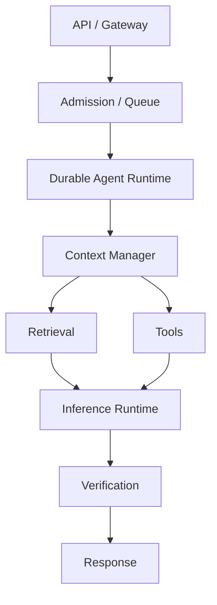

# Capstone — AI Runtime Platform

## What This Is

The capstone is a progressively built AI Runtime Platform — not merely a chatbot. It integrates artifacts from every module starting at Week 6.

## Conceptual Architecture



- API: application programming interface.

### Cross-Cutting Concerns

- **Observability** — distributed tracing, telemetry, SLO monitoring
- **Security** — threat model, trust boundaries, audit trails
- **Evaluation** — online quality signals, regression testing
- **Economics** — cost attribution, model routing
- **Failure Recovery** — checkpoint, retry, rollback, graceful degradation

## Structure

```
capstone/
├── README.md           ← this file
├── architecture/       ← ADRs, system diagrams, component specs
├── runtime/            ← agent runtime implementation
├── retrieval/          ← retrieval pipeline
├── context/            ← context management
├── evaluation/         ← evaluation framework
├── security/           ← threat model, security controls
├── observability/      ← instrumentation, tracing, alerting
├── benchmarks/         ← system benchmarks and load tests
├── incidents/          ← incident exercises against the capstone
├── adrs/               ← Architecture Decision Records
└── runbooks/           ← operational runbooks
```

## Progressive Integration

| Module | Capstone Contribution |
|--------|-----------------------|
| 04 | Admission control, scheduling strategy |
| 05 | Inference optimization choices |
| 08-09 | Retrieval pipeline |
| 10 | Context management |
| 11 | Durable agent runtime |
| 12-13 | Evaluation and falsification framework |
| 14 | Security architecture |
| 17 | Cost optimization, model routing |
| 18 | Observability infrastructure |
| 19 | Architecture-model coupling decisions |

## Assessment

The capstone is assessed through:

1. **Architecture review** — defend design decisions with evidence
2. **Load testing** — demonstrate behavior under realistic and extreme workloads
3. **Failure injection** — demonstrate graceful degradation and recovery
4. **Security review** — demonstrate threat awareness and defense
5. **Cost analysis** — demonstrate economic reasoning

## Status

🏗️ **Skeleton only.** Implementation begins at Week 6 and continues through Week 25.
