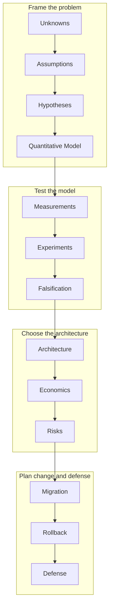

# Graduation — Architecture Review

## Purpose

Graduation is a comprehensive architecture review under realistic constraints:

- Ambiguous requirements.
- Incomplete information.
- Security constraints.
- SLOs.
- Budget limits.
- Growth projections.

[Design-doc/RFC guide](design-docs.md) · [Fill-in design-doc template](../templates/design-doc.md)

## What Is Tested

- Ambiguous requirements → structured assumptions
- Incomplete telemetry → identifying what's missing
- Quality constraints → evaluation strategy
- SLO targets → capacity and scheduling design
- Security constraints → threat modeling and defense
- GPU/resource budget → economic optimization
- Growth projection → scaling strategy

## Expected Reasoning Pattern



## Structure

```
graduation/
├── README.md          ← this file
├── rubric.md          ← assessment criteria
└── incidents/
    └── README.md      ← graduation-level diagnostic scenarios
```

## Status

🏗️ **Skeleton only.** Graduation scenarios will be developed alongside the capstone.
