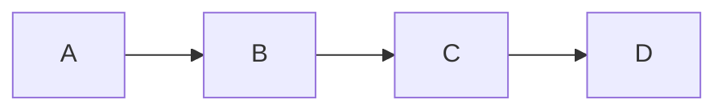

# Source Reading — Methodology

## Purpose

Source reading builds the ability to:

- Navigate unfamiliar production codebases.
- Trace execution paths.
- Form accurate mental models of system behavior from code rather than documentation alone.

## Primary Systems

| System | Repository | Focus |
|--------|-----------|-------|
| vLLM | `vllm-project/vllm` | Serving, scheduling, KV cache, PagedAttention |
| SGLang | `sgl-project/sglang` | Serving, scheduling, radix caching |
| HF Transformers | `huggingface/transformers` | Model implementations, tokenization |
| FlashAttention | `Dao-AILab/flash-attention` | Attention kernels, memory optimization |
| FlashInfer | `flashinfer-ai/flashinfer` | Attention kernels, KV cache operations |
| Triton | `triton-lang/triton` | GPU kernel development |

## Exercise Format

Every source-reading exercise must record:

```yaml
repository: _
commit_or_tag: _
date_verified: YYYY-MM-DD
subsystem: _
entry_point: _
```

### Execution Path

Trace the code path from entry point through the key operations:



- A–D: placeholder components along the execution path, starting at the entry point.

For each node:
- File and line number (pinned to commit)
- What this component does
- Key data structures
- Key decisions / branching logic

### Files

| File | Purpose | Key Functions/Classes |
|------|---------|----------------------|
| `path/to/file.py` | _description_ | `ClassName`, `function_name` |

### Questions

1. _What does this code assume about its inputs?_
2. _What are the performance-critical paths?_
3. _Where would you add instrumentation?_
4. _What would break if [specific condition] changed?_

### Expected Artifact

_What should the learner produce? (diagram, annotated code walkthrough, modified implementation, etc.)_

---

## Example: vLLM Scheduler (Placeholder)

```yaml
repository: vllm-project/vllm
commit_or_tag: TODO — pin before use
date_verified: TODO
subsystem: Scheduler
entry_point: TODO
```

This example will be populated when Module 04 is developed.

---

## Rules

1. **Always pin a commit or tag.** Source paths change between versions.
2. **Verify before publishing.** Re-check paths against the pinned commit.
3. **Date your verification.** Stale source readings must be flagged.
4. **Trace, don't summarize.** The goal is execution path understanding, not API documentation.
