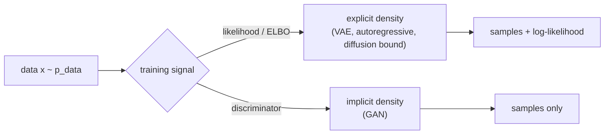
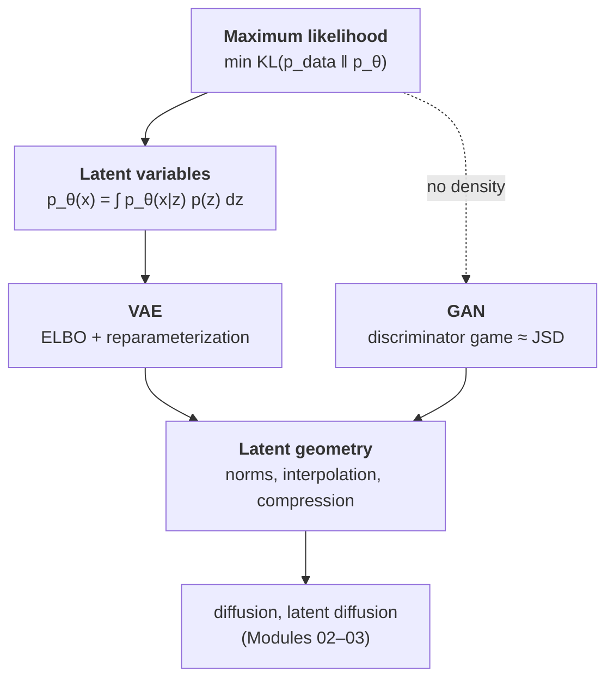

# Generative Media Module 01 — Generative Model Foundations

## 00 Why This Module Exists

A generative model is a sampler plus, sometimes, a density. Which of the two it gives you decides how it can be trained, how it can be evaluated, and how it fails.
- A model with an explicit density can be scored on held-out data, but its samples may still look poor.
- A model with only a sampler can produce sharp samples, but it can silently drop whole modes of the data, and no training loss will report it.


- Legend: ELBO: evidence lower bound; GAN: generative adversarial network; VAE: variational autoencoder.

This module covers the likelihood view, divergences and their mode behavior, VAEs and the ELBO, GANs and their failure modes, latent-space geometry, and why sample metrics such as FID must be read with care.
- The diffusion objective and its link to the ELBO belong to [Generative Media Module 02](../02-diffusion/README.md).
- The autoencoder used as a compressor for latent diffusion belongs to [Generative Media Module 03](../03-latent-diffusion/README.md).
- Text-conditioned image generation and guidance belong to [Generative Media Module 06](../06-image-generation/README.md).

**Research status:** satellite 80/20 revision, 2026-11-26. Formulas below are derived or checked numerically in the text. Results attributed to papers, and function names in the cited repositories, were written from the cited sources but were **not** re-read against a pinned commit in this revision (`TODO_VERIFY`). Pin and re-check them in the source trace before citing them elsewhere. No benchmark numbers are quoted.

**Module Orientation**

- **Engineering problem:** choose a model family and an evaluation protocol that can detect the failures that family is prone to.
- **What you will do:**
  - compute likelihoods, bits per dimension, and divergences by hand;
  - derive the Gaussian KL term of the ELBO and implement the reparameterization trick;
  - train a small VAE and a small GAN on a 2-D mixture and count covered modes;
  - break both models on purpose and read the failure from metrics, not only from pictures.
- **Environment:** Python 3.10+, NumPy, PyTorch (CPU is enough), and Matplotlib. Toy 2-D data and MNIST-scale images only.
- **Evidence rule:** separate source observations (**O**), derivations (**D**), and hypotheses that need measurement (**H**).
- **If You Only Have One Week**: Lessons GM1.2 and GM1.3. The ELBO and the adversarial game are the two training signals every later module in this track builds on or reacts against.

## 01 Baseline Assumptions

- Core [Module 00](../../advanced-ai-engineering/00-scientific-ai-engineering/README.md): paired comparisons, seeds, and the observation/derivation/hypothesis split.
- Core [Module 01](../../advanced-ai-engineering/01-foundation-model-internals/README.md): cross-entropy loss and next-token likelihood as an explicit-density objective.
- Mathematical prerequisites: expectations, Gaussian densities, logarithms, KL divergence as a definition, and gradient descent. Measure theory is not needed.

## 02 Target Mastery

```yaml
depth_contract:
  conceptual: REQUIRED
  mechanistic: REQUIRED
  mathematical: REQUIRED
  quantitative: REQUIRED
  implementation: REQUIRED
  source_code: SELECTIVE
  instrumentation: SELECTIVE
  experimental: REQUIRED
  statistical: SELECTIVE
  production_reasoning: SELECTIVE
  failure_analysis: REQUIRED
  falsification: SELECTIVE
  security: NOT_APPLICABLE
  economics: NOT_APPLICABLE
  architecture_tradeoff: REQUIRED
  research_connection: SELECTIVE

estimated_effort:
  instruction: 2h
  guided_practice: 1.25h
  labs: 3h
  assessment: 0.75h
  source_trace: 0.5h
  total: 7.5h
```

The learner must be able to state what each model family optimizes, predict its characteristic failure from that objective, compute the quantities that expose the failure, and choose an evaluation that would catch it.

### LAYER 1: KNOWLEDGE / INSTRUCTIONAL LAYER

## 03 Knowledge Map


- Legend: KL: Kullback–Leibler divergence; JSD: Jensen–Shannon divergence; θ: model parameters; z: latent variable.

Keep three questions separate:

1. **Objective:** which divergence or bound does training actually reduce?
2. **Coverage vs fidelity:** does the model put mass on every data mode, and does it put mass anywhere the data has none?
3. **Measurement:** which metric can see each of those two errors, and with how many samples?

## 04 Lessons

### Lesson GM1.1 — Likelihood, Divergences, and Mode Behavior

**Engineering Question:**
When a model is trained to minimize a divergence, which kind of error does that divergence tolerate?

**Concepts & Definitions:**

- **Discriminative model:** learns $p(y \mid x)$, a label given an input. **Generative model:** learns $p(x)$ or a sampler for it.
- **Explicit density model:** can compute (or bound) $\log p_\theta(x)$ for a given $x$. Autoregressive models, VAEs (through a bound), normalizing flows, and diffusion models (through a bound) are explicit. **Implicit model:** can only sample. GANs are implicit.
- **Forward KL:**

$$
\mathrm{KL}(p \,\|\, q) = \sum_x p(x) \log \frac{p(x)}{q(x)}
$$

where:

- $p$ is the data distribution $p_{\text{data}}$ and $q$ is the model $p_\theta$;
- the sum runs over outcomes $x$ (an integral for continuous $x$);
- the logarithm is natural, so the unit is nats.

Maximum likelihood minimizes $\mathrm{KL}(p_{\text{data}} \,\|\, p_\theta)$, because $\mathbb{E}_{p_{\text{data}}}[\log p_{\text{data}}]$ does not depend on $\theta$.

- **Bits per dimension (bpd):** the average negative log-likelihood per pixel channel, in bits:

$$
\text{bpd} = \frac{\mathrm{NLL}}{D \ln 2}
$$

where $\mathrm{NLL} = -\log p_\theta(x)$ in nats for one image and $D$ is the number of dimensions (height × width × channels). For discrete 8-bit pixels, the density model must be dequantized first, or the comparison is invalid.

**Mechanism Explanation:**

*Step-by-step: why forward KL covers modes and reverse KL seeks them.*

1. In $\mathrm{KL}(p \,\|\, q)$ each term is weighted by $p(x)$. Where data exists ($p > 0$) and the model puts almost no mass ($q \to 0$), $\log(p/q) \to \infty$. Forward KL therefore punishes **missing a mode** without limit.
2. In the reverse direction $\mathrm{KL}(q \,\|\, p)$, terms are weighted by $q(x)$. Where the model puts no mass, the term is zero, so dropping a data mode costs little. What reverse KL punishes is **mass where the data has none**.
3. Likelihood training is therefore mode-covering and tends to spread mass, which can look blurry. Objectives closer to reverse KL tend to be mode-seeking, which looks sharp but can drop modes (**D**).

**Worked Example (two-mode data):**
*Input.* Data puts equal mass on two modes, $p = (0.5, 0.5)$. A model has collapsed toward the first mode, $q = (0.9, 0.1)$.

*Steps.*
- $\ln(0.5/0.9) = -0.5878$ and $\ln(0.5/0.1) = 1.6094$.
- Forward: $\mathrm{KL}(p \,\|\, q) = 0.5(-0.5878) + 0.5(1.6094) = 0.5108$ nats.
- Reverse: $\mathrm{KL}(q \,\|\, p) = 0.9 \ln 1.8 + 0.1 \ln 0.2 = 0.9(0.5878) + 0.1(-1.6094) = 0.3681$ nats.
- If the model drops the second mode entirely, $q = (1, 0)$: forward KL is infinite, while reverse KL is $1 \cdot \ln 2 = 0.6931$ nats.

*Result.* Under-covering one mode costs forward KL far more than reverse KL, and total mode loss is fatal only for forward KL.

**Worked Example (bpd):**
A 32 × 32 RGB image has $D = 3{,}072$. An NLL of 7,000 nats gives $\text{bpd} = 7{,}000 / (3{,}072 \times 0.6931) = 3.287$.

**Knowledge Check:** Why can a GAN not report bits per dimension on a held-out set, and what does that remove from your evaluation toolbox?

**Guided Practice:** For $p = (0.5, 0.5)$, compute forward and reverse KL for $q = (0.7, 0.3)$, $(0.9, 0.1)$, and $(0.99, 0.01)$. Plot both against $q_1$.

**Feedback Contract:**
- *Expected Evidence*: forward KL $= 0.0872$, $0.5108$, $1.6145$; reverse KL $= 0.0823$, $0.3681$, $0.6371$. Forward KL grows without bound as $q_2 \to 0$; reverse KL approaches $\ln 2$.
- *Common Failure*: swapping the arguments and concluding that likelihood training is mode-seeking.
- *Diagnostic Hint*: ask which distribution the expectation is taken under; that is the one whose modes must be covered.
- *Concept to Revisit*: Forward KL.

**Learning Outcome:** Predict whether an objective tolerates missing modes or spurious mass, and convert NLL to bits per dimension.

*(Effort: 30m instruction, 20m practice)*

### Lesson GM1.2 — Variational Autoencoders and the ELBO

**Engineering Question:**
What does a VAE optimize, and which term of its loss tells you that the latent code is being ignored?

**Concepts & Definitions:**

- **Latent variable model:** $p_\theta(x) = \int p_\theta(x \mid z)\, p(z)\, dz$ with prior $p(z) = \mathcal{N}(0, I)$. The integral is intractable for a neural decoder.
- **Encoder (inference network):** $q_\phi(z \mid x) = \mathcal{N}(\mu_\phi(x), \operatorname{diag}\sigma^2_\phi(x))$ approximates the true posterior.
- **ELBO:**

$$
\log p_\theta(x) \;\ge\; \mathcal{L}(x) = \mathbb{E}_{q_\phi(z \mid x)}\!\left[\log p_\theta(x \mid z)\right] - \mathrm{KL}\!\left(q_\phi(z \mid x) \,\|\, p(z)\right)
$$

where:

- $x$ is one data point and $z \in \mathbb{R}^{d}$ its latent code;
- $\theta$ are decoder parameters and $\phi$ encoder parameters;
- the first term is the **reconstruction** term and the second the **rate** (KL) term;
- the gap $\log p_\theta(x) - \mathcal{L}(x)$ equals $\mathrm{KL}(q_\phi(z \mid x) \,\|\, p_\theta(z \mid x)) \ge 0$.

For a diagonal Gaussian encoder and a standard normal prior the KL term has a closed form:

$$
\mathrm{KL} = \frac{1}{2} \sum_{j=1}^{d} \left(\mu_j^2 + \sigma_j^2 - 1 - \ln \sigma_j^2\right)
$$

where $\mu_j$ and $\sigma_j$ are the encoder mean and standard deviation for latent dimension $j$.

*Step-by-step reading.*

1. Each dimension contributes independently because both distributions factorize.
2. A dimension with $\mu_j = 0$ and $\sigma_j = 1$ contributes $\frac{1}{2}(0 + 1 - 1 - 0) = 0$: it carries no information about $x$.
3. Moving $\mu_j$ away from 0 or shrinking $\sigma_j$ below 1 increases the term: encoding information about $x$ costs rate.

**Mechanism Explanation:**

- **Reparameterization trick:** sample $\varepsilon \sim \mathcal{N}(0, I)$ and set $z = \mu_\phi(x) + \sigma_\phi(x) \odot \varepsilon$. The randomness moves into $\varepsilon$, so gradients flow through $\mu$ and $\sigma$ (**O**, Kingma and Welling).
- **Gaussian decoder and blur:** a Gaussian $p_\theta(x \mid z)$ with fixed variance makes the reconstruction term a scaled mean squared error. MSE is minimized by the conditional mean, which averages plausible details into blur (**D**).
- **Posterior collapse:** with a powerful decoder (for example autoregressive), the model can reach a good ELBO with $q_\phi(z \mid x) \approx p(z)$, so the KL term goes to zero and $z$ is ignored. KL annealing, free bits, and weaker decoders are standard counter-measures (**O**, Bowman et al.).
- **$\beta$-VAE:** weights the KL term by $\beta$. $\beta > 1$ trades reconstruction for a more regular latent space (**O**, Higgins et al.).

**Worked Example (closed-form KL):**
*Input.* Two latent dimensions with $\mu = (0.5, -1.0)$ and $\sigma = (1.0, 0.5)$.

*Steps.*
- Dimension 1: $0.25 + 1.0 - 1 - \ln 1 = 0.25$.
- Dimension 2: $1.0 + 0.25 - 1 - \ln 0.25 = 0.25 + 1.3863 = 1.6363$.
- Sum $= 1.8863$; half gives $\mathrm{KL} = 0.9431$ nats.

*Result.* Dimension 2 carries most of the rate because its posterior is both shifted and narrow.

**Knowledge Check:** During training, the per-dimension KL of 28 of 32 latent dimensions falls below 0.01 nats. What does that tell you, and is it necessarily a bug?

**Guided Practice:** Implement the ELBO loss in PyTorch with the closed-form KL. Check your KL against a Monte-Carlo estimate with 10,000 samples of $\log q - \log p$ for the worked example.

**Feedback Contract:**
- *Expected Evidence*: closed form $0.9431$; Monte-Carlo estimate within about $\pm 0.02$ of it; code that logs KL per dimension, not only the total.
- *Common Failure*: predicting $\log \sigma$ and then using it as $\log \sigma^2$, which halves or doubles the variance term.
- *Diagnostic Hint*: test the loss at $\mu = 0$, $\sigma = 1$; the KL must be exactly 0.
- *Concept to Revisit*: Rate term; reparameterization.

**Learning Outcome:** Write the ELBO, compute its KL term by hand, and diagnose posterior collapse from per-dimension rates.

*(Effort: 35m instruction, 20m practice)*

### Lesson GM1.3 — GANs, Mode Collapse, and Sample Metrics

**Engineering Question:**
Why can a GAN's samples improve while its coverage of the data gets worse, and which metric would show it?

**Concepts & Definitions:**

- **GAN game:** generator $G$ maps noise $z$ to samples; discriminator $D$ outputs the probability that an input is real.

$$
\min_G \max_D \; V(D, G) = \mathbb{E}_{x \sim p_{\text{data}}}[\log D(x)] + \mathbb{E}_{z \sim p(z)}[\log(1 - D(G(z)))]
$$

where $p_g$ denotes the distribution of $G(z)$.

- For fixed $G$, the optimal discriminator is $D^*(x) = \dfrac{p_{\text{data}}(x)}{p_{\text{data}}(x) + p_g(x)}$, and then $V(D^*, G) = -\ln 4 + 2\,\mathrm{JSD}(p_{\text{data}} \,\|\, p_g)$ (**O**, Goodfellow et al.).
- **Jensen–Shannon divergence:** $\mathrm{JSD}(p \,\|\, q) = \tfrac{1}{2}\mathrm{KL}(p \,\|\, m) + \tfrac{1}{2}\mathrm{KL}(q \,\|\, m)$ with $m = \tfrac{1}{2}(p + q)$. It is bounded by $\ln 2$.
- **Fréchet Inception Distance (FID):** fit Gaussians $(\mu_r, \Sigma_r)$ and $(\mu_g, \Sigma_g)$ to feature embeddings of real and generated images:

$$
\mathrm{FID} = \|\mu_r - \mu_g\|^2 + \operatorname{Tr}\!\left(\Sigma_r + \Sigma_g - 2(\Sigma_r \Sigma_g)^{1/2}\right)
$$

where $\mu$ are feature means, $\Sigma$ feature covariances, and features usually come from an Inception-v3 layer (**O**, Heusel et al.).

**Mechanism Explanation:**

*Step-by-step: why GAN training is unstable.*

1. If real and generated supports barely overlap, a near-perfect discriminator exists, JSD sits at its ceiling $\ln 2$, and its gradient with respect to $G$ vanishes (**O**, Arjovsky and Bottou).
2. With the original loss, $\log(1 - D(G(z)))$ is flat when $D(G(z)) \approx 0$, so the generator learns slowly early on. The **non-saturating** loss, maximize $\log D(G(z))$, fixes the gradient scale but changes the effective divergence.
3. The generator is rewarded for samples $D$ accepts, not for covering every mode. Moving all samples to one mode the discriminator currently accepts is a valid short-term improvement: **mode collapse** (**D**).
4. FID combines fidelity and diversity into one number. Precision/recall-style metrics separate them: precision asks whether samples land on the data manifold; recall asks whether the data manifold is covered (**O**, Kynkäänniemi et al.).

**Worked Example (JSD and GAN value):**
*Input.* $p_{\text{data}} = (0.5, 0.5)$ and $p_g = (0.9, 0.1)$ from Lesson GM1.1.

*Steps.*
- $m = (0.7, 0.3)$.
- $\mathrm{KL}(p_{\text{data}} \,\|\, m) = 0.5 \ln(0.5/0.7) + 0.5 \ln(0.5/0.3) = 0.0872$.
- $\mathrm{KL}(p_g \,\|\, m) = 0.9 \ln(0.9/0.7) + 0.1 \ln(0.1/0.3) = 0.1163$.
- $\mathrm{JSD} = 0.5(0.0872 + 0.1163) = 0.1017$ nats.
- $V(D^*, G) = -1.3863 + 2(0.1017) = -1.1828$. A perfect generator reaches $-\ln 4 = -1.3863$.

**Worked Example (1-D FID):**
Real features $\mathcal{N}(0, 1)$, generated $\mathcal{N}(0.5, 2^2)$. In one dimension the trace term is $\sigma_r^2 + \sigma_g^2 - 2\sigma_r\sigma_g$.
- Mean term: $0.25$. Covariance term: $1 + 4 - 4 = 1$. $\mathrm{FID} = 1.25$.
- A collapsed generator $\mathcal{N}(0, 0.1^2)$: $0 + (1 + 0.01 - 0.2) = 0.81$, a **better** FID than the generator with the wrong spread, despite almost no diversity.

*Result.* FID penalizes a too-narrow distribution only through the covariance term, and a small reference set or few samples make that term noisy.

**Knowledge Check:** Why is FID computed from 1,000 samples not comparable to FID computed from 50,000 samples of the same model?

**Guided Practice:** Train a small GAN on a 2-D mixture of 8 Gaussians on a ring. Every 500 steps, count modes with at least 5% of samples within 3 standard deviations, and record the share of samples far from every mode.

**Feedback Contract:**
- *Expected Evidence*: a curve of covered modes and off-manifold share over training, with at least one run where covered modes drop while the off-manifold share also drops.
- *Common Failure*: judging coverage from one scatter plot at the end of training.
- *Diagnostic Hint*: fix the evaluation noise batch across checkpoints so changes reflect the generator, not the sample.
- *Concept to Revisit*: Coverage vs fidelity.

**Learning Outcome:** Explain GAN instability and mode collapse from the objective, and choose metrics that separate fidelity from coverage.

*(Effort: 35m instruction, 20m practice)*

### Lesson GM1.4 — Latent Space Geometry and What Carries Forward

**Engineering Question:**
Which properties of a learned latent space make interpolation, editing, and later diffusion in that space work or fail?

**Concepts & Definitions:**

- **Norm concentration:** for $z \sim \mathcal{N}(0, I_d)$ with large $d$, $\|z\|$ is close to $\sqrt{d}$. Almost no prior mass lies near the origin.
- **Linear interpolation:** $z_t = (1 - t) z_0 + t z_1$. **Spherical interpolation (slerp):**

$$
z_t = \frac{\sin((1 - t)\Omega)}{\sin \Omega} z_0 + \frac{\sin(t\Omega)}{\sin \Omega} z_1, \qquad \cos \Omega = \frac{z_0 \cdot z_1}{\|z_0\|\,\|z_1\|}
$$

where $t \in [0, 1]$ is the interpolation position and $\Omega$ is the angle between the two latent vectors.

- **Compression ratio of an autoencoder:** input elements divided by latent elements. It measures how much work a model in latent space is spared.

**Mechanism Explanation:**

*Step-by-step: why linear interpolation leaves the prior.*

1. Two independent draws $z_0, z_1$ are nearly orthogonal in high dimension, each with norm about $\sqrt{d}$.
2. The midpoint $\tfrac{1}{2}(z_0 + z_1)$ has squared norm about $\tfrac{1}{4}(d + d) = d/2$, so its norm is about $\sqrt{d}/\sqrt{2} \approx 0.707\sqrt{d}$.
3. That norm is far outside the typical shell for large $d$, so the decoder sees an input it was rarely trained on. Slerp keeps the norm near $\sqrt{d}$ when both endpoints have similar norms (**D**).

What carries forward from VAEs to latent diffusion (**O**, Rombach et al.): a convolutional autoencoder with a small KL weight or a vector-quantization layer compresses images to a spatial latent, and the diffusion model runs in that latent. The autoencoder's reconstruction ceiling becomes the generator's detail ceiling ([Generative Media Module 03](../03-latent-diffusion/README.md)).

**Worked Example (norms and compression):**
*Input.* A $512 \times 512 \times 3$ image encoded to a $64 \times 64 \times 4$ latent, the shape commonly used by Stable Diffusion 1.x (**O**, `TODO_VERIFY`).

*Steps.*
- Latent dimension $d = 64 \times 64 \times 4 = 16{,}384$, so $\sqrt{d} = 128$.
- Midpoint of two independent prior draws: norm about $128 \times 0.707 = 90.5$.
- Input elements: $786{,}432$. Compression ratio: $786{,}432 / 16{,}384 = 48$, from $8\times$ spatial downsampling per side and 3 → 4 channels.

*Result.* A linear midpoint sits about 37 units inside a shell whose thickness is of order 1, and a model in this latent processes 48 times fewer elements than in pixel space.

**Knowledge Check:** If an autoencoder's reconstructions lose fine text in images, can a better latent diffusion model on top of it recover that text? Why or why not?

**Guided Practice:** Draw 1,000 pairs from $\mathcal{N}(0, I_d)$ for $d = 2, 64, 16{,}384$. Plot the norm of the linear midpoint and the slerp midpoint relative to $\sqrt{d}$.

**Feedback Contract:**
- *Expected Evidence*: linear-midpoint ratio near $0.707$ for large $d$ with small spread; slerp ratio near $1.0$; at $d = 2$ both spreads are wide and the distinction is weak.
- *Common Failure*: generalizing 2-D intuition (where interpolation looks fine) to high-dimensional latents.
- *Diagnostic Hint*: print $\|z\| / \sqrt{d}$ for every latent you decode during interpolation.
- *Concept to Revisit*: Norm concentration.

**Learning Outcome:** Predict when latent interpolation leaves the prior, and compute the compression an autoencoder gives a downstream model.

*(Effort: 20m instruction, 15m practice)*

## 05 Literature & Production Source Map

**REFERENCE / BASELINE**

- [Auto-Encoding Variational Bayes](https://arxiv.org/abs/1312.6114) — Kingma and Welling (2013). Reading pointer: §2.3–2.4, the estimator and the reparameterization trick; Appendix B, the Gaussian KL solution.
- [Generative Adversarial Nets](https://arxiv.org/abs/1406.2661) — Goodfellow et al. (2014). Reading pointer: §4, Proposition 1 (optimal discriminator) and Theorem 1 (JSD form).
- [GANs Trained by a Two Time-Scale Update Rule Converge to a Local Nash Equilibrium (FID)](https://arxiv.org/abs/1706.08500) — Heusel et al. (2017). Reading pointer: the FID definition.
- [A Note on the Evaluation of Generative Models](https://arxiv.org/abs/1511.01844) — Theis, van den Oord, and Bethge (2015). Reading pointer: likelihood and sample quality can disagree.

**FAILURE MODES / ANALYSIS**

- [Towards Principled Methods for Training Generative Adversarial Networks](https://arxiv.org/abs/1701.04862) — Arjovsky and Bottou (2017): disjoint supports and vanishing gradients.
- [Wasserstein GAN](https://arxiv.org/abs/1701.07875) — Arjovsky, Chintala, and Bottou (2017): a replacement divergence for the same problem.
- [Generating Sentences from a Continuous Space](https://arxiv.org/abs/1511.06349) — Bowman et al. (2015): posterior collapse and KL annealing.
- [Improved Precision and Recall Metric for Assessing Generative Models](https://arxiv.org/abs/1904.06991) — Kynkäänniemi et al. (2019).
- β-VAE — Higgins et al. (ICLR 2017): the KL weight as a trade-off knob.

**TRANSITION TO DIFFUSION (author-reported, scope to their benchmarks)**

- [Diffusion Models Beat GANs on Image Synthesis](https://arxiv.org/abs/2105.05233) — Dhariwal and Nichol (2021).
- [High-Resolution Image Synthesis with Latent Diffusion Models](https://arxiv.org/abs/2112.10752) — Rombach et al. (2022): the autoencoder stage that inherits VAE ideas.

**CURRENT DEFAULT:** likelihood-based or diffusion-family objectives for coverage; autoencoders as compressors rather than as generators; evaluation that reports fidelity and coverage separately, with a stated sample count and reference set.

**LEGACY / INSUFFICIENT:** judging a generator from a grid of hand-picked samples; one FID number without sample count, feature extractor, and reference set; linear interpolation in a high-dimensional Gaussian latent without checking norms.

**PRODUCTION SOURCE TRACE** (pin the commit you read; no commit was pinned in this revision)

- `pytorch/examples`, file `vae/main.py`: `loss_function` adds a reconstruction term and the closed-form KL written as `-0.5 * sum(1 + logvar - mu^2 - exp(logvar))` (Lesson GM1.2).
- `pytorch/examples`, file `dcgan/main.py`: the discriminator and generator update order and the non-saturating generator target (Lesson GM1.3).
- `mseitzer/pytorch-fid`, file `src/pytorch_fid/fid_score.py`: `calculate_frechet_distance` and how it handles a complex matrix square root (Lesson GM1.3).
- `huggingface/diffusers`: `AutoencoderKL`, whose file location has moved between releases; record the path at the version you pin (Lesson GM1.4).
- Scope: teaching and reference implementations, not tuned production recipes.

### LAYER 2: ENGINEERING PRACTICE LAYER

## 06 Engineering Labs

All labs follow `PREDICT → BUILD → MEASURE → EXPLAIN → BREAK → IMPROVE → FALSIFY`.

### LAB A — VAE Rate, Distortion, and Posterior Collapse

- **Objective:** train a small VAE on MNIST and map reconstruction error against KL rate as $\beta$ changes, then force posterior collapse.
- **Pre-Registered Hypothesis:** raising $\beta$ lowers the rate and raises reconstruction error monotonically; with an autoregressive decoder and no annealing, most latent dimensions fall below 0.01 nats.
- **Independent Variables:** $\beta \in \{0.25, 1, 4\}$, decoder type (MLP vs small autoregressive), KL annealing on/off, latent size.
- **Dependent Variables:** ELBO, reconstruction term, total and per-dimension KL, active units, sample grids at fixed seeds.
- **Break & Falsify:** use a strong decoder without annealing; confirm collapse by showing that decoded outputs do not change when $z$ is resampled.
- **Alignment:** Lessons GM1.1 and GM1.2.
- **Effort Estimate:** 1.5h on CPU.

### LAB B — Mode Coverage: GAN vs VAE on a 2-D Mixture

- **Objective:** compare mode coverage and off-manifold mass of a GAN and a VAE on an 8-mode ring, with a fixed evaluation protocol.
- **Pre-Registered Hypothesis:** the GAN reaches lower off-manifold share but covers fewer modes in at least one of three seeds; the VAE covers all modes with more off-manifold mass.
- **Independent Variables:** model family, seed, discriminator/generator learning-rate ratio, number of discriminator steps per generator step.
- **Dependent Variables:** covered modes, off-manifold share, a 2-D FID computed from sample means and covariances, and a precision/recall estimate.
- **Break & Falsify:** set the generator learning rate 10× higher than the discriminator's; show the 2-D FID of a collapsed run against a covering run and explain any case where FID ranks them the wrong way.
- **Alignment:** Lessons GM1.3 and GM1.4; Incident GM1.1.
- **Effort Estimate:** 1.5h on CPU.

**Runnable arithmetic check (CPU; not a quality experiment):**
```python
import math
kl = lambda p, q: sum(a * math.log(a / b) for a, b in zip(p, q) if a > 0)
p, q = (0.5, 0.5), (0.9, 0.1)
assert round(kl(p, q), 4) == 0.5108 and round(kl(q, p), 4) == 0.3681
assert round(kl((1.0, 0.0), p), 4) == round(math.log(2), 4)
assert [round(kl(p, (a, 1 - a)), 4) for a in (0.7, 0.9, 0.99)] == [0.0872, 0.5108, 1.6145]
assert [round(kl((a, 1 - a), p), 4) for a in (0.7, 0.9, 0.99)] == [0.0823, 0.3681, 0.6371]
m = tuple((a + b) / 2 for a, b in zip(p, q))
jsd = 0.5 * kl(p, m) + 0.5 * kl(q, m)
assert round(jsd, 4) == 0.1017 and round(-math.log(4) + 2 * jsd, 4) == -1.1828
gauss_kl = lambda mu, s: 0.5 * sum(m_**2 + s_**2 - 1 - math.log(s_**2) for m_, s_ in zip(mu, s))
assert round(gauss_kl((0.5, -1.0), (1.0, 0.5)), 4) == 0.9431
assert gauss_kl((0.0,), (1.0,)) == 0.0
fid1d = lambda m1, s1, m2, s2: (m1 - m2) ** 2 + s1**2 + s2**2 - 2 * s1 * s2
assert math.isclose(fid1d(0, 1, 0.5, 2), 1.25) and math.isclose(fid1d(0, 1, 0, 0.1), 0.81)
assert round(7000 / (3072 * math.log(2)), 3) == 3.287
d = 64 * 64 * 4
assert d == 16_384 and math.isqrt(d) == 128 and 512 * 512 * 3 // d == 48
```

## 07 Break / Incident Scenarios

### Incident GM1.1 — Better FID, Repetitive Outputs

**Incident Symptoms:**
A team retrains an image generator for product thumbnails. The release gate requires FID to improve, and it does. Within a week, users report that outputs for different prompts and seeds look alike. Nobody changed the sampler code.

**Diagnostic Protocol (Task):**
1. **Form Competing Hypotheses:** mode collapse in the new checkpoint; a sampling knob (truncation, temperature, guidance) changed in config; FID computed with fewer samples or a different reference set; seed reuse or caching in serving; a real shift in user prompts.
2. **Identify Missing Evidence:** FID sample count, feature extractor, and reference set for both checkpoints; sampling config diff; per-seed output hashes in serving; a recall or coverage metric for both checkpoints.
3. **Design Discriminating Measurements:** regenerate with fixed seeds and identical config from both checkpoints; compute precision and recall on the same reference set with the same sample count; count distinct outputs per 1,000 seeds.
4. **Rank Explanations:** identical outputs across seeds point to serving or seeding; a lower recall at equal sample count points to the model; an FID gap that vanishes at equal sample count points to the evaluation.
5. **Intervene:** roll back or retrain as the evidence indicates, and add recall and a fixed-protocol FID to the release gate.
6. **Remeasure:** the same fixed-seed comparison and coverage metric on the next candidate.

### LAYER 3: MASTERY / ASSESSMENT LAYER

## 08 Mastery Assessment

### Transfer Problem — Choosing a Generator Family for a Small Domain

A team has 20,000 product images and wants a model that can both generate variations and flag images that are unlike the training set.

**Required Deliverables:**
1. a choice between an explicit-density model and an implicit one, justified by the two requirements;
2. the objective of the chosen model written out, with the term that would reveal coverage failure;
3. hand-computed KL, JSD, or bpd values that illustrate the trade-off on a toy case;
4. LAB A or LAB B evidence for the failure mode the chosen family is most prone to;
5. an evaluation protocol naming sample count, reference set, and separate fidelity and coverage metrics.

## 09 Required Evidence & Rubric

### Required Artifact: Generative Model Evaluation Sheet

Submit the objective derivations, the LAB A rate–distortion table, the LAB B coverage curves, and the Incident GM1.1 diagnosis.

### Rubric Dimensions

- **Mechanism:** *Insufficient* says "GANs are sharper, VAEs are blurry." *Competent* links each to its objective. *Strong* predicts which failure each objective permits and shows it.
- **Mathematics:** *Insufficient* quotes the ELBO. *Competent* derives the Gaussian KL and the GAN optimum. *Strong* uses them to explain measured curves.
- **Evaluation:** *Insufficient* reports one FID. *Competent* fixes sample count and reference set. *Strong* separates fidelity and coverage and shows a case where FID misleads.

## 10 Capability Traceability Matrix

| Capability | Taught | Practiced | Assessed | Evidence (artifact reviewers open) |
|---|---|---|---|---|
| Divergences and mode behavior | GM1.1 | GM1.1 Guided Practice; LAB B | Deliverables 1, 3 | Forward/reverse KL table; LAB B coverage curves |
| ELBO and posterior collapse | GM1.2 | GM1.2 Guided Practice; LAB A | Deliverables 2, 4 | LAB A per-dimension KL and $\beta$ sweep |
| GAN game and sample metrics | GM1.3 | GM1.3 Guided Practice; LAB B | Deliverable 5; Incident GM1.1 | Coverage, off-manifold share, and FID at fixed protocol |
| Latent geometry | GM1.4 | GM1.4 Guided Practice | Deliverable 3 | Midpoint-norm plot for three dimensions |

## 11 Exit Criteria & Module Wrap-Up

### Exit Criteria

A learner passes when they can state and compute the objective of a VAE and a GAN, predict mode-covering or mode-seeking behavior from the divergence, detect posterior collapse and mode collapse with metrics, and design an evaluation that reports fidelity and coverage separately.

### Module Wrap-Up (Final Mental Model Reconstruction)

The objective decides the failure. Likelihood-based training refuses to drop modes and pays in blur; adversarial training pays in coverage. Later diffusion models keep the likelihood view and borrow the autoencoder, so the questions from this module (what is optimized, what is covered, what is measured) apply to every later module in the track.

### Cost & Telemetry Hook

- [Lesson 22.1](../../advanced-ai-engineering/22-ai-economics/README.md): evaluation cost scales with the sample count needed for a stable FID or recall estimate; budget it as part of every release.
- [Lesson 23.1](../../advanced-ai-engineering/23-observability-reliability/README.md): log seed, sampling config, and checkpoint per generated asset so Incident GM1.1 can be separated into model, config, and serving causes.

## 12 Competency Targets

```yaml
competency:
  sfia: 4
  bloom: Apply -> Analyze
  solo: Relational
  dreyfus: Advanced Beginner -> Competent
```
