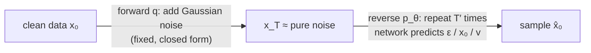
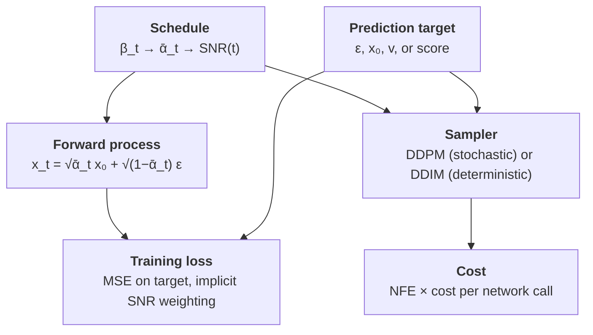

# Generative Media Module 02 — Diffusion

## 00 Why This Module Exists

A diffusion model is a denoiser that is called many times. The output image depends on the trained network and also on several settings around it:
- the noise schedule the network was trained with;
- what the network was trained to predict;
- the sampler, its step count, and its timestep spacing.

Several of these live in scheduler configuration files, not in the model weights. A mismatch between training and sampling settings rarely crashes. It produces washed-out, noisy, or over-smoothed images that look like a "quality" problem.


- Legend: $x_0$: clean sample; $x_T$: fully noised sample; $T$: training steps; $T'$: sampling steps (usually $T' \ll T$); $\varepsilon$: Gaussian noise; $v$: velocity target (Lesson GM2.2).

This module covers the forward noising process, noise schedules, training targets, DDPM and DDIM sampling, the score-based view, and the inference cost of pixel-space diffusion.
- Likelihood models, VAEs, and GANs that diffusion is compared against belong to [Generative Media Module 01](../01-generative-model-foundations/README.md).
- Running diffusion in a learned latent space belongs to [Module 03](../03-latent-diffusion/README.md). Transformer denoisers belong to [Module 04](../04-diffusion-transformers/README.md).
- Flow matching and straight-path samplers belong to [Module 05](../05-flow-matching/README.md). Conditioning and classifier-free guidance belong to [Module 06](../06-image-generation/README.md).

**Research status:** satellite 80/20 revision, 2026-11-26. Formulas below are derived in the text, and the arithmetic is checked by the runnable block in §06. Constants attributed to papers (DDPM's linear schedule, the cosine schedule offset, the zero-terminal-SNR finding) and the `huggingface/diffusers` scheduler names were written from the cited sources but were **not** re-read against a pinned commit in this revision (`TODO_VERIFY`). Pin and re-check them in the source trace before citing them elsewhere. No benchmark numbers (FID, IS) are quoted.

**Module Orientation**

- **Engineering problem:** know exactly which schedule, prediction target, and sampler a model needs, and what each sampling step costs.
- **What you will do:**
  - compute $\bar\alpha_t$, SNR, and noised samples by hand;
  - convert between $\varepsilon$, $x_0$, $v$, and score predictions;
  - run one DDPM and one DDIM step by hand;
  - train a toy 2-D diffusion model on CPU and break it with schedule and target mismatches;
  - sweep sampler step counts and measure quality against network evaluations.
- **Environment:** Python 3.10+, NumPy, PyTorch (CPU is enough). Optionally `diffusers` with a small pretrained pixel-space model (for example a 32×32 DDPM checkpoint).
- **Evidence rule:** separate source observations (**O**), derivations (**D**), and hypotheses that need measurement (**H**).
- **If You Only Have One Week**: Lessons GM2.1 and GM2.3. They cover the schedule contract and the sampler, which is where most production diffusion bugs and most of the cost live.

## 01 Baseline Assumptions

- [Generative Media Module 01](../01-generative-model-foundations/README.md): latent variables, the evidence lower bound (ELBO), and why sample quality and likelihood can disagree.
- Core [Module 00](../../advanced-ai-engineering/00-scientific-ai-engineering/README.md): paired comparisons and the observation/derivation/hypothesis split.
- Core [Module 02](../../advanced-ai-engineering/02-inference-gpu-fundamentals/README.md): FLOPs, memory traffic, and why a repeated network call dominates latency.
- Mathematical prerequisites: Gaussian distributions, adding independent Gaussians, products, logarithms, and gradients. Stochastic differential equations are mentioned, not required.

## 02 Target Mastery

```yaml
depth_contract:
  conceptual: REQUIRED
  mechanistic: REQUIRED
  mathematical: REQUIRED
  quantitative: REQUIRED
  implementation: REQUIRED
  source_code: SELECTIVE
  instrumentation: SELECTIVE
  experimental: SELECTIVE
  statistical: SELECTIVE
  production_reasoning: REQUIRED
  failure_analysis: REQUIRED
  falsification: SELECTIVE
  security: NOT_APPLICABLE
  economics: SELECTIVE
  architecture_tradeoff: SELECTIVE
  research_connection: SELECTIVE

estimated_effort:
  instruction: 2h
  guided_practice: 1.25h
  labs: 3h
  assessment: 0.75h
  source_trace: 0.5h
  total: 7.5h
```

The learner must be able to state a diffusion model's schedule, prediction target, and sampler as an explicit contract; convert between prediction targets; run sampler steps by hand; and predict the number of network evaluations and their cost before generating.

### LAYER 1: KNOWLEDGE / INSTRUCTIONAL LAYER

## 03 Knowledge Map


- Legend: β_t: per-step noise variance; ᾱ_t: cumulative signal fraction; SNR: signal-to-noise ratio; NFE: number of network function evaluations.

Keep three contracts separate:

1. **Schedule contract:** number of training steps $T$, schedule family and its constants, and the terminal value $\bar\alpha_T$.
2. **Target contract:** what the network outputs ($\varepsilon$, $x_0$, or $v$) and the timestep encoding it expects.
3. **Sampler contract:** sampler family, number of steps $T'$, timestep spacing, and stochasticity ($\eta$).

A checkpoint is trained under one schedule and target. The sampler may change, but it must use the same schedule and target.

## 04 Lessons

### Lesson GM2.1 — Forward Process, Noise Schedules, and SNR

**Engineering Question:**
How much signal is left at step $t$, and does the schedule actually reach pure noise?

**Concepts & Definitions:**

- **Forward process:** a fixed Markov chain that adds Gaussian noise: $q(x_t \mid x_{t-1}) = \mathcal{N}(\sqrt{1-\beta_t}\,x_{t-1}, \beta_t I)$. Nothing in it is learned.
- **Variance schedule $\beta_1, \dots, \beta_T$:** the noise variance added at each step. DDPM uses $T = 1000$ with $\beta_t$ linear from $10^{-4}$ to $0.02$ (**O**, `TODO_VERIFY`).
- **Cumulative signal fraction:** $\alpha_t = 1 - \beta_t$ and $\bar\alpha_t = \prod_{s=1}^{t} \alpha_s$.
- **Signal-to-noise ratio:** $\mathrm{SNR}(t) = \bar\alpha_t / (1 - \bar\alpha_t)$. It decreases with $t$.

Closed-form noising, used for training:

$$
x_t = \sqrt{\bar\alpha_t}\,x_0 + \sqrt{1-\bar\alpha_t}\,\varepsilon, \qquad \varepsilon \sim \mathcal{N}(0, I)
$$

where:

- $x_0$ is a clean training sample, scaled to roughly $[-1, 1]$;
- $x_t$ is the noised sample at step $t$;
- $\bar\alpha_t \in (0, 1]$ is the cumulative signal fraction defined above;
- $\varepsilon$ is standard Gaussian noise with the same shape as $x_0$.

*Step-by-step reading.*

1. One step: $x_1 = \sqrt{\alpha_1}\,x_0 + \sqrt{1-\alpha_1}\,\varepsilon_1$.
2. Two steps: $x_2 = \sqrt{\alpha_2}\,x_1 + \sqrt{1-\alpha_2}\,\varepsilon_2 = \sqrt{\alpha_1\alpha_2}\,x_0 + \sqrt{\alpha_2(1-\alpha_1)}\,\varepsilon_1 + \sqrt{1-\alpha_2}\,\varepsilon_2$.
3. The two noise terms are independent Gaussians, so their sum is Gaussian with variance $\alpha_2(1-\alpha_1) + (1-\alpha_2) = 1 - \alpha_1\alpha_2$.
4. Repeating gives the closed form with $\bar\alpha_t$. Training can therefore sample any $t$ directly, without simulating $t$ steps.
5. Signal variance plus noise variance is $\bar\alpha_t + (1 - \bar\alpha_t) = 1$ when $x_0$ has unit variance, so the process is variance-preserving.

**Mechanism Explanation:**

The schedule decides how training effort is spread across noise levels. The linear schedule destroys most of the signal well before $t = T$, so many late steps see almost pure noise. The cosine schedule of Nichol and Dhariwal defines $\bar\alpha_t$ directly so it falls more evenly (**O**, `TODO_VERIFY`):

$$
\bar\alpha_t = \frac{f(t)}{f(0)}, \qquad f(t) = \cos^2\!\left(\frac{t/T + s}{1 + s}\cdot\frac{\pi}{2}\right)
$$

where $s = 0.008$ is a small offset that keeps $\beta_t$ from being too small near $t = 0$, and $\beta_t = 1 - \bar\alpha_t / \bar\alpha_{t-1}$ is clipped (to at most 0.999 in the paper).

A schedule whose $\bar\alpha_T$ is not close to zero leaves a small amount of signal at the last training step. Sampling starts from pure noise, which the model never saw at $t = T$. Lin et al. report that this mismatch limits how dark or bright generated images can be, and propose rescaling to zero terminal SNR (**O**, `TODO_VERIFY`).

**Break cases:**
- loading a checkpoint with a different $T$ or schedule than it was trained with;
- data not scaled to $[-1, 1]$, so the signal-to-noise ratios are not the ones the schedule assumes;
- a terminal $\bar\alpha_T$ that is small but not zero, combined with a sampler that starts from pure noise.

**Worked Example (one noised value and the linear schedule's endpoint):**
*Input.* A pixel value $x_0 = 0.8$, noise draw $\varepsilon = 0.4$, and a step where $\bar\alpha_t = 0.25$.

*Steps.*
- $\sqrt{\bar\alpha_t} = 0.5$ and $\sqrt{1-\bar\alpha_t} = \sqrt{0.75} = 0.8660$.
- $x_t = 0.5 \times 0.8 + 0.8660 \times 0.4 = 0.4 + 0.3464 = 0.7464$.
- $\mathrm{SNR}(t) = 0.25 / 0.75 = 0.333$.

*Linear-schedule endpoint.* With $\beta_t$ linear from $10^{-4}$ to $0.02$ over 1,000 steps:
- $\ln\bar\alpha_T = \sum_t \ln(1-\beta_t) \approx -\sum_t \beta_t - \tfrac12\sum_t \beta_t^2$.
- $\sum_t \beta_t = 1000 \times (10^{-4} + 0.02)/2 = 10.05$, and the second-order term adds about $0.07$.
- $\bar\alpha_T \approx e^{-10.12} \approx 4.0 \times 10^{-5}$, so $\sqrt{\bar\alpha_T} \approx 0.0063$.

*Result.* At $t = T$ about 0.6% of the signal amplitude remains. It is small but not zero, which is the mismatch described above.

**Knowledge Check:** If training images are accidentally scaled to $[0, 255]$ instead of $[-1, 1]$, what happens to the effective SNR at every step, and which part of the schedule stops behaving as designed?

**Guided Practice:** Compute $\bar\alpha_t$ and $\log \mathrm{SNR}(t)$ for $t = 1 \dots 1000$ under the linear and cosine schedules. Plot both. Record the step where SNR first drops below 1 and the terminal $\bar\alpha_T$ for each.

**Feedback Contract:**
- *Expected Evidence*: two curves; the linear schedule's $\log\mathrm{SNR}$ falls fast early and spends many late steps near pure noise; the cosine curve is closer to linear in $\log\mathrm{SNR}$ over the middle range. Terminal $\bar\alpha_T$ is stated for both.
- *Common Failure*: computing $\bar\alpha_t$ as a sum instead of a product, or forgetting the cosine schedule's clipping.
- *Diagnostic Hint*: check that $\bar\alpha_t$ is monotone decreasing and that $\bar\alpha_1 = 1 - \beta_1$.
- *Concept to Revisit*: Schedule contract.

**Learning Outcome:** Compute $\bar\alpha_t$, SNR, and noised samples for a given schedule, and detect a schedule that does not reach pure noise.

*(Effort: 30m instruction, 20m practice)*

### Lesson GM2.2 — Training Objectives and Prediction Targets

**Engineering Question:**
What should the network predict, and how does that choice weight different noise levels in the loss?

**Concepts & Definitions:**

- **$\varepsilon$-prediction:** the network $\varepsilon_\theta(x_t, t)$ predicts the noise that was added. DDPM trains it with the simplified loss below (**O**).
- **$x_0$-prediction:** the network predicts the clean sample directly.
- **$v$-prediction:** the network predicts $v = \sqrt{\bar\alpha_t}\,\varepsilon - \sqrt{1-\bar\alpha_t}\,x_0$, introduced by Salimans and Ho (**O**, `TODO_VERIFY`).
- All three are interchangeable given $x_t$ and $\bar\alpha_t$; they differ in how the loss weights each noise level and in numerical behavior.

Simplified DDPM objective:

$$
L_{\text{simple}} = \mathbb{E}_{t,\,x_0,\,\varepsilon}\left[\,\lVert \varepsilon - \varepsilon_\theta(x_t, t) \rVert^2\,\right]
$$

where:

- $t$ is drawn uniformly from $\{1, \dots, T\}$;
- $x_0$ is drawn from the training data and $\varepsilon$ from $\mathcal{N}(0, I)$;
- $x_t$ is built from $x_0$ and $\varepsilon$ with the closed form of Lesson GM2.1;
- $\varepsilon_\theta(x_t, t)$ is the network output.

Converting a noise prediction to a clean-sample estimate:

$$
\hat x_0 = \frac{x_t - \sqrt{1-\bar\alpha_t}\,\hat\varepsilon}{\sqrt{\bar\alpha_t}}
$$

where $\hat\varepsilon = \varepsilon_\theta(x_t, t)$ and $\hat x_0$ is the implied clean sample.

*Step-by-step: the hidden weighting.*

1. Subtract the true relation $x_0 = (x_t - \sqrt{1-\bar\alpha_t}\,\varepsilon)/\sqrt{\bar\alpha_t}$ from the estimate: $\hat x_0 - x_0 = -\frac{\sqrt{1-\bar\alpha_t}}{\sqrt{\bar\alpha_t}}(\hat\varepsilon - \varepsilon)$.
2. Square both sides: $\lVert \hat x_0 - x_0 \rVert^2 = \frac{1-\bar\alpha_t}{\bar\alpha_t}\lVert \hat\varepsilon - \varepsilon \rVert^2$.
3. Rearranged: $\lVert \hat\varepsilon - \varepsilon \rVert^2 = \mathrm{SNR}(t)\,\lVert \hat x_0 - x_0 \rVert^2$.
4. So the $\varepsilon$ loss is an $x_0$ loss weighted by SNR. It puts little weight on clean-sample error at high noise (low SNR), where predicting $x_0$ is nearly impossible anyway. A plain $x_0$ loss would weight all noise levels equally and be dominated by the hardest, noisiest steps.

**Mechanism Explanation:**

$\varepsilon$-prediction keeps the regression target at unit variance at every $t$, which helps optimization. Its weakness is at very low SNR: step 1 shows that converting $\hat\varepsilon$ to $\hat x_0$ multiplies the error by $\sqrt{1-\bar\alpha_t}/\sqrt{\bar\alpha_t}$, which becomes very large as $\bar\alpha_t \to 0$. $v$-prediction keeps both ends bounded, which is why it is used with zero-terminal-SNR schedules and for distillation to few steps (**O**, `TODO_VERIFY`).

**Worked Example (error amplification):**
*Input.* From Lesson GM2.1: $x_t = 0.7464$, $\bar\alpha_t = 0.25$, true $\varepsilon = 0.4$, true $x_0 = 0.8$.

*Steps.*
- Exact prediction $\hat\varepsilon = 0.4$: $\hat x_0 = (0.7464 - 0.8660 \times 0.4)/0.5 = 0.4000/0.5 = 0.8$.
- Prediction error of $0.1$, $\hat\varepsilon = 0.5$: $\hat x_0 = (0.7464 - 0.4330)/0.5 = 0.6268$.
- Clean-sample error $0.1732 = 0.1 \times 0.8660/0.5$, a factor of $\sqrt{3} = 1.732$, i.e. $1/\sqrt{\mathrm{SNR}}$.
- $v$ target at this step: $v = 0.5 \times 0.4 - 0.8660 \times 0.8 = 0.2 - 0.6928 = -0.4928$.
- At $\bar\alpha_t = 4 \times 10^{-5}$ (the linear schedule's end), the same 0.1 noise error would become a clean-sample error of about $0.1 \times 158 = 15.8$.

*Result.* $\varepsilon$-prediction is easy to train but its implied $x_0$ is useless at the noisiest steps. That is acceptable for DDPM sampling, which starts there and corrects later, but it matters for few-step samplers.

**Knowledge Check:** Why does $\varepsilon$-prediction train more stably than direct $x_0$-prediction with an unweighted loss? Answer with the SNR weighting from step 3.

**Guided Practice:** Write functions that convert between $\varepsilon$, $x_0$, and $v$ given $x_t$ and $\bar\alpha_t$. Check round trips on random values at $\bar\alpha_t \in \{0.999, 0.5, 10^{-4}\}$ and record the largest round-trip error at each.

**Feedback Contract:**
- *Expected Evidence*: round trips accurate to floating-point precision at $\bar\alpha_t = 0.999$ and 0.5; at $10^{-4}$ the $\varepsilon \to x_0$ conversion amplifies float32 error noticeably, while $v$ round trips stay accurate.
- *Common Failure*: using $\sqrt{\bar\alpha_t}$ where $\bar\alpha_t$ is needed, or mixing $\alpha_t$ and $\bar\alpha_t$.
- *Diagnostic Hint*: test with $\bar\alpha_t = 1$ (no noise), where $\hat x_0$ must equal $x_t$ exactly.
- *Concept to Revisit*: Target contract.

**Learning Outcome:** Convert between prediction targets and explain the implicit SNR weighting of the $\varepsilon$ loss.

*(Effort: 30m instruction, 20m practice)*

### Lesson GM2.3 — Sampling: DDPM Ancestral Steps vs DDIM

**Engineering Question:**
How many network calls does a sample need, and what changes when we take fewer, larger steps?

**Concepts & Definitions:**

- **NFE (number of function evaluations):** how many times the denoiser runs per sample. It is the main driver of generation latency and cost.
- **DDPM ancestral sampling:** step from $t$ to $t-1$ for every training step, adding fresh noise each time. NFE $= T$.
- **DDIM:** a family of samplers that reuses the same trained network, can skip steps by using a subsequence of timesteps, and is deterministic when $\eta = 0$ (**O**, Song et al.).
- **Timestep spacing:** how the $T'$ sampling steps are chosen from $1 \dots T$ (evenly spaced, starting at $T$ or not). It decides whether sampling starts at the noisiest trained step.

DDIM update from step $t$ to an earlier step $t'$:

$$
x_{t'} = \sqrt{\bar\alpha_{t'}}\,\hat x_0 + \sqrt{1 - \bar\alpha_{t'} - \sigma_t^2}\;\hat\varepsilon + \sigma_t z
$$

where:

- $\hat\varepsilon = \varepsilon_\theta(x_t, t)$ is the network's noise prediction and $\hat x_0$ is the implied clean sample from Lesson GM2.2;
- $t'$ is the next timestep in the sampling subsequence ($t' < t$);
- $\sigma_t = \eta\,\sqrt{\frac{1-\bar\alpha_{t'}}{1-\bar\alpha_t}}\sqrt{1-\frac{\bar\alpha_t}{\bar\alpha_{t'}}}$ controls injected noise, with $\eta = 0$ deterministic and $\eta = 1$ matching DDPM's stochasticity;
- $z \sim \mathcal{N}(0, I)$ is fresh noise.

*Step-by-step reading.*

1. Estimate the clean sample $\hat x_0$ from the current $x_t$.
2. Re-noise that estimate to the noise level of step $t'$, reusing the predicted noise direction $\hat\varepsilon$ instead of drawing new noise.
3. With $\eta = 0$, the map from $x_T$ to $x_0$ is deterministic: the same starting noise gives the same image, which enables reproducibility and latent interpolation.
4. Because the update only needs $\bar\alpha_t$ and $\bar\alpha_{t'}$, $t'$ can be many steps earlier, so $T' = 50$ steps can replace 1,000.

**Mechanism Explanation:**

Each skipped stretch is bridged by a single straight re-noising step. The error of that approximation grows with step size, so quality drops as $T'$ shrinks, usually slowly at first and then sharply. DDIM does not change training; it changes how many network evaluations are spent and how they are placed. Higher-order ODE solvers and distillation push $T'$ lower still; flow-matching samplers are covered in [Module 05](../05-flow-matching/README.md).

**Worked Example (one deterministic DDIM step):**
*Input.* $x_t = 0.7464$, $\bar\alpha_t = 0.25$, network predicts $\hat\varepsilon = 0.4$, next step has $\bar\alpha_{t'} = 0.5$, $\eta = 0$.

*Steps.*
- $\hat x_0 = 0.8$ (from Lesson GM2.2).
- $\sqrt{\bar\alpha_{t'}} = \sqrt{1-\bar\alpha_{t'}} = 0.7071$.
- $x_{t'} = 0.7071 \times 0.8 + 0.7071 \times 0.4 = 0.5657 + 0.2828 = 0.8485$.

*Cost check.* 1,000 DDPM steps versus 50 DDIM steps: 20 times fewer network calls. If one call takes 40 ms on some GPU (illustrative), one sample takes 40 s versus 2 s, before any other overhead.

*Result.* The step moves toward the predicted clean sample while keeping the predicted noise direction. Only $\bar\alpha$ values are needed, which is what allows skipping.

**Knowledge Check:** With timestep spacing that starts sampling at $t = 981$ instead of $t = 1000$ (for 50 evenly spaced steps), what input does the model see at the first step, and why might that hurt very dark or very bright images?

**Guided Practice:** Implement DDIM ($\eta = 0$ and $\eta = 1$) for the toy model of LAB A. Fix the starting noise and generate with $T' \in \{1000, 100, 50, 20, 10, 5\}$. Record NFE and a distribution distance to the training data at each.

**Feedback Contract:**
- *Expected Evidence*: a table of $T'$, NFE, wall-clock time, and distance; with $\eta = 0$ the same starting noise gives nearly the same sample at large $T'$; quality degrades as $T'$ drops, with a visible knee.
- *Common Failure*: building the timestep subsequence so it never includes the noisiest step, or reusing DDPM's per-step variance with skipped steps.
- *Diagnostic Hint*: print the timestep list and the $\bar\alpha$ values used at each step before generating anything.
- *Concept to Revisit*: Sampler contract.

**Learning Outcome:** Run DDPM and DDIM steps, predict NFE and latency, and explain the step-count/quality trade-off.

*(Effort: 35m instruction, 20m practice)*

### Lesson GM2.4 — The Score View and the Cost of Pixel-Space Diffusion

**Engineering Question:**
What is the denoiser estimating, and why is generating large images directly in pixel space so expensive?

**Concepts & Definitions:**

- **Score:** the gradient of the log density, $\nabla_x \log p(x)$. It points toward regions of higher probability.
- **Langevin dynamics:** a sampler that follows the score plus noise: $x \leftarrow x + \tfrac{\delta}{2}\nabla_x \log p(x) + \sqrt{\delta}\,z$, with step size $\delta$ and $z \sim \mathcal{N}(0, I)$.
- **Score–noise relation:** for the Gaussian forward process, the score of $q(x_t \mid x_0)$ is $-\varepsilon/\sqrt{1-\bar\alpha_t}$. So a noise predictor is a scaled score estimator (**D**; the general result is Song et al.'s score-based SDE framework, **O**).

$$
s_\theta(x_t, t) = -\frac{\varepsilon_\theta(x_t, t)}{\sqrt{1-\bar\alpha_t}}
$$

where $s_\theta$ approximates $\nabla_{x_t} \log q_t(x_t)$, the score of the noised data distribution at step $t$.

*Step-by-step.*

1. $q(x_t \mid x_0)$ is Gaussian with mean $\sqrt{\bar\alpha_t}x_0$ and variance $(1-\bar\alpha_t)I$.
2. Its log density is $-\lVert x_t - \sqrt{\bar\alpha_t}x_0 \rVert^2 / (2(1-\bar\alpha_t))$ plus a constant.
3. The gradient with respect to $x_t$ is $-(x_t - \sqrt{\bar\alpha_t}x_0)/(1-\bar\alpha_t)$.
4. Substituting $x_t - \sqrt{\bar\alpha_t}x_0 = \sqrt{1-\bar\alpha_t}\,\varepsilon$ gives $-\varepsilon/\sqrt{1-\bar\alpha_t}$.

**Mechanism Explanation:**

Sampling is many small moves along an estimated score at decreasing noise levels. Each move needs a full network call over the whole image. In pixel space, the network input has $H \times W \times 3$ values, and U-Net self-attention layers at resolution $h \times w$ cost memory and compute proportional to $(hw)^2$ per head. That is why pixel-space models attend only at low internal resolutions and why [Module 03](../03-latent-diffusion/README.md) moves diffusion into a compressed latent space.

**Worked Example (attention cost at two resolutions):**
*Input.* A self-attention layer at internal resolution $32 \times 32$ versus $64 \times 64$, one head, fp16 (2 bytes).

*Steps.*
- $32 \times 32 = 1{,}024$ tokens: attention matrix $1{,}024^2 = 1{,}048{,}576$ entries, about 2.1 MB per head if materialized.
- $64 \times 64 = 4{,}096$ tokens: $4{,}096^2 = 16{,}777{,}216$ entries, about 33.6 MB per head, 16 times more.
- Doubling the image side doubles each internal resolution, so attention cost at a fixed layer grows by $2^4 = 16$.
- Multiply by NFE: 50 steps at the larger size is 800 times the attention work of one step at the smaller size.

*Result.* Pixel-space cost grows with the fourth power of image side for attention layers and with the square for convolutions, and every term is multiplied by NFE.

**Knowledge Check:** Fused attention kernels (core [Module 05](../../advanced-ai-engineering/05-inference-optimization/README.md)) avoid materializing the attention matrix. Which part of the cost in the worked example do they remove, and which part remains?

**Guided Practice:** For a pixel-space U-Net config you can read (number of attention layers and their resolutions), compute attention tokens and score-matrix entries per step at 64, 128, and 256 pixels. Multiply by NFE for $T' = 50$.

**Feedback Contract:**
- *Expected Evidence*: a table showing per-step and per-sample attention entries growing by 16 times per doubling of image side at each attention resolution.
- *Common Failure*: counting attention at the input resolution instead of the internal resolution where the layer sits.
- *Diagnostic Hint*: list each attention block with its feature-map size before computing anything.
- *Concept to Revisit*: Cost = NFE × per-call cost.

**Learning Outcome:** Relate noise prediction to the score, and estimate how resolution and NFE drive pixel-space diffusion cost.

*(Effort: 25m instruction, 15m practice)*

## 05 Literature & Production Source Map

**REFERENCE / BASELINE**

- [Denoising Diffusion Probabilistic Models (DDPM)](https://arxiv.org/abs/2006.11239) — Ho, Jain, Abbeel (2020). Reading pointers: §2 (forward process and closed form), §3.2 (the $\varepsilon$ parameterization and $L_{\text{simple}}$), Algorithms 1–2 (training and sampling).
- [Denoising Diffusion Implicit Models (DDIM)](https://arxiv.org/abs/2010.02502) — Song, Meng, Ermon (2020). Reading pointers: the generalized non-Markovian process, the $\eta$ parameter, and accelerated sampling with a timestep subsequence.
- [Improved Denoising Diffusion Probabilistic Models](https://arxiv.org/abs/2102.09672) — Nichol and Dhariwal (2021). Reading pointer: the cosine schedule and its offset $s$.
- [Score-Based Generative Modeling through Stochastic Differential Equations](https://arxiv.org/abs/2011.13456) — Song et al. (2021). Reading pointer: the SDE view that unifies score matching and DDPM.

**WORKLOAD-DEPENDENT / FRONTIER**

- [Progressive Distillation for Fast Sampling of Diffusion Models](https://arxiv.org/abs/2202.00512) — Salimans and Ho (2022). Source of $v$-prediction and step distillation; gains are author-reported.
- [Common Diffusion Noise Schedules and Sample Steps are Flawed](https://arxiv.org/abs/2305.08891) — Lin et al. (2023). Zero terminal SNR and timestep spacing; scope its findings to the models they tested.
- [Elucidating the Design Space of Diffusion-Based Generative Models (EDM)](https://arxiv.org/abs/2206.00364) — Karras et al. (2022). A reparameterized view of schedules, preconditioning, and samplers.

**CURRENT DEFAULT:** a pinned schedule and prediction target read from the checkpoint's own configuration, a deterministic or low-$\eta$ sampler with tens of steps, and a step count chosen from a measured quality–NFE curve.

**LEGACY / INSUFFICIENT:** "1,000 steps" as a fixed cost; swapping samplers without checking the prediction target; judging a step-count change from a handful of cherry-picked samples.

**PRODUCTION SOURCE TRACE** (pin the commit you read; no commit was pinned in this revision)

- `huggingface/diffusers`, file `src/diffusers/schedulers/scheduling_ddpm.py`: `DDPMScheduler.add_noise` (closed-form forward process) and `DDPMScheduler.step` (ancestral update); `betas_for_alpha_bar` (cosine-style schedule).
- `huggingface/diffusers`, file `src/diffusers/schedulers/scheduling_ddim.py`: `DDIMScheduler.set_timesteps` (timestep spacing) and `DDIMScheduler.step` (the update of Lesson GM2.3, including `eta`).
- Scheduler configuration fields to record: `num_train_timesteps`, `beta_schedule`, `prediction_type`, `timestep_spacing`, and terminal-SNR rescaling, if present (`TODO_VERIFY` field names at your pinned commit).
- Scope: one widely used library's implementation, not the definition of DDPM or DDIM. Other runtimes reimplement schedulers and must be checked separately.

### LAYER 2: ENGINEERING PRACTICE LAYER

## 06 Engineering Labs

All labs follow `PREDICT → BUILD → MEASURE → EXPLAIN → BREAK → IMPROVE → FALSIFY`.

### LAB A — Toy 2-D Diffusion From Scratch

- **Objective:** train an $\varepsilon$-prediction MLP on a 2-D distribution (for example a mixture of Gaussians or a spiral) on CPU, sample from it, then break the schedule and target contracts.
- **Pre-Registered Hypothesis:** sampling with the training schedule and target reproduces the data distribution; a schedule mismatch or a target mismatch produces systematically wrong spread or location, not random noise.
- **Independent Variables:** schedule (linear, cosine), prediction target ($\varepsilon$, $x_0$, $v$), data scaling, and sampler schedule versus training schedule.
- **Dependent Variables:** a distribution distance between samples and data (for example sliced Wasserstein or MMD on 2,000 points), training loss per noise-level bucket, and scatter plots.
- **Break & Falsify:** sample with a different schedule than training; treat an $\varepsilon$ model as $v$; train on unscaled data; start sampling from a non-terminal step.
- **Alignment:** Lessons GM2.1, GM2.2, GM2.4 and Incident GM2.1.
- **Effort Estimate:** 1.75h.

### LAB B — Sampler Step-Count Frontier

- **Objective:** measure quality against NFE and wall-clock time for DDPM and DDIM, on the LAB A model and optionally on a small pretrained pixel-space checkpoint.
- **Pre-Registered Hypothesis:** DDIM with $\eta = 0$ keeps most of the quality of full DDPM down to tens of steps, then degrades sharply; the knee is model- and schedule-dependent.
- **Independent Variables:** sampler, $T'$, $\eta$, and timestep spacing.
- **Dependent Variables:** distribution distance (toy) or a small-sample image metric clearly labelled as not comparable to published numbers, NFE, latency per sample, and seed-to-seed spread.
- **Break & Falsify:** use spacing that skips the noisiest step; use very small $T'$; compare paired seeds rather than independent ones.
- **Alignment:** Lesson GM2.3.
- **Effort Estimate:** 1.25h.

**Runnable arithmetic check (CPU; not a quality experiment):**
```python
import math
T = 1000
betas = [1e-4 + (0.02 - 1e-4) * i / (T - 1) for i in range(T)]
abar = 1.0
for b in betas:
    abar *= 1 - b
assert 3.5e-5 < abar < 4.5e-5                              # linear schedule endpoint
assert math.isclose(sum(betas), 10.05, rel_tol=1e-9)
x0, eps, a = 0.8, 0.4, 0.25
xt = math.sqrt(a) * x0 + math.sqrt(1 - a) * eps
assert math.isclose(xt, 0.7464, abs_tol=1e-4)              # closed-form noising
to_x0 = lambda xt, e, a: (xt - math.sqrt(1 - a) * e) / math.sqrt(a)
assert math.isclose(to_x0(xt, 0.4, a), 0.8)
err = to_x0(xt, 0.5, a) - 0.8
assert math.isclose(err, -0.1 * math.sqrt(3), abs_tol=1e-12)  # 1/sqrt(SNR) amplification
v = math.sqrt(a) * eps - math.sqrt(1 - a) * x0
assert math.isclose(v, -0.4928, abs_tol=1e-4)
a_next = 0.5                                                # DDIM, eta = 0
x_next = math.sqrt(a_next) * to_x0(xt, 0.4, a) + math.sqrt(1 - a_next) * 0.4
assert math.isclose(x_next, 0.8485, abs_tol=1e-4)
f = lambda t, s=0.008: math.cos((t / T + s) / (1 + s) * math.pi / 2) ** 2
assert f(T) / f(0) < 1e-8 and 0.99 < f(1) / f(0) < 1.0      # cosine schedule ends
assert (64 * 64) ** 2 // (32 * 32) ** 2 == 16 and 1000 // 50 == 20
```

## 07 Break / Incident Scenarios

### Incident GM2.1 — Washed-Out Images After a Sampler Swap

**Incident Symptoms:**
A team replaces the default sampler of an image service with a faster one and lowers steps from 50 to 20 to cut latency. Latency drops as expected. Users report gray, low-contrast images, and prompts asking for night scenes come out as dusk. Offline samples on a few favorite prompts looked fine.

**Diagnostic Protocol (Task):**
1. **Form Competing Hypotheses:** the new sampler assumes a different prediction target ($\varepsilon$ vs $v$); the new sampler's timestep spacing never starts at the noisiest trained step; a schedule mismatch (`num_train_timesteps` or `beta_schedule`); too few steps for this sampler; the model's schedule never reached zero terminal SNR and the old sampler happened to compensate; a real shift in the prompts users send.
2. **Identify Missing Evidence:** scheduler configurations before and after, the first three timesteps and their $\bar\alpha$ values, the checkpoint's training `prediction_type`, and per-prompt brightness/contrast statistics for old and new paths on the same seeds.
3. **Design Discriminating Measurements:** with fixed seeds and prompts, change one factor at a time: sampler, step count, spacing, prediction type. Measure mean luminance and contrast of outputs on a fixed set of dark and bright prompts.
4. **Rank Explanations:** a target mismatch changes outputs at every step count; a spacing problem appears mainly on very dark or bright prompts; a pure step-count problem goes away when steps are restored with the new sampler.
5. **Intervene:** set the correct prediction type and spacing in the scheduler configuration, or choose a step count from LAB B's measured frontier; add a configuration check that fails when sampler and checkpoint disagree.
6. **Remeasure:** luminance and contrast on the fixed prompt set, a paired comparison against the old path, and latency at the chosen step count.

### LAYER 3: MASTERY / ASSESSMENT LAYER

## 08 Mastery Assessment

### Transfer Problem — Halving the Cost of an Image Endpoint

An image endpoint runs a pixel-space diffusion model at 50 steps. The product owner wants cost per image halved without a visible quality drop.

**Required Deliverables:**
1. the schedule, target, and sampler contracts of the current checkpoint, read from its configuration and stated explicitly;
2. a hand calculation of NFE and per-sample attention work at the current and proposed settings;
3. a measured quality–NFE frontier (LAB B method) with paired seeds and a stated metric limitation;
4. a proposed setting with the evidence for it, plus the prompt slices (dark, bright, detailed) where it was checked;
5. a configuration guard that prevents Incident GM2.1, with the fields it compares.

## 09 Required Evidence & Rubric

### Required Artifact: Diffusion Contract and Sampler Report

Submit the three contracts, the LAB A break table, the LAB B frontier, and the Incident GM2.1 diagnosis.

### Rubric Dimensions

- **Mechanism:** *Insufficient* says "the model removes noise." *Competent* states schedule, target, and sampler and converts between targets. *Strong* predicts which mismatch produces which visual symptom before testing it.
- **Quantitative:** *Insufficient* quotes step counts. *Competent* computes $\bar\alpha_t$, SNR, NFE, and attention work. *Strong* ties them to latency and cost per image.
- **Experiment:** *Insufficient* compares a few cherry-picked images. *Competent* uses fixed seeds and a metric. *Strong* uses paired seeds, prompt slices, and states what the metric cannot show.
- **Diagnosis:** *Insufficient* blames step count. *Competent* changes one factor at a time. *Strong* isolates the first wrong contract field and adds a guard for it.

## 10 Capability Traceability Matrix

| Capability | Taught | Practiced | Assessed | Evidence (artifact reviewers open) |
|---|---|---|---|---|
| Schedule, $\bar\alpha_t$, and SNR | GM2.1 | GM2.1 Guided Practice; LAB A | Deliverable 1; Incident GM2.1 | Schedule plots with terminal $\bar\alpha_T$ |
| Prediction targets and loss weighting | GM2.2 | GM2.2 Guided Practice; LAB A | Deliverables 1, 5; Incident GM2.1 | Conversion round-trip table; LAB A target-swap results |
| DDPM/DDIM sampling and NFE | GM2.3 | GM2.3 Guided Practice; LAB B | Deliverables 2–4 | Quality–NFE frontier with paired seeds |
| Score view and pixel-space cost | GM2.4 | GM2.4 Guided Practice | Deliverable 2 | Attention-work table across resolutions |

## 11 Exit Criteria & Module Wrap-Up

### Exit Criteria

A learner passes when they can compute a schedule's $\bar\alpha_t$ and SNR, convert between $\varepsilon$, $x_0$, $v$, and score, run DDPM and DDIM steps by hand, predict NFE and attention cost, and diagnose a sampler–checkpoint mismatch with fixed-seed, one-factor-at-a-time evidence.

### Module Wrap-Up (Final Mental Model Reconstruction)

A diffusion model is a trained denoiser plus a schedule, a target, and a sampler. Read all three from the checkpoint's configuration, never from defaults, and count network evaluations before estimating any cost.

### Cost & Telemetry Hook

- [Lesson 22.1](../../advanced-ai-engineering/22-ai-economics/README.md): cost per image is NFE × cost per call, plus decoding and safety checks; report it at the chosen step count, not per call.
- [Lesson 23.1](../../advanced-ai-engineering/23-observability-reliability/README.md): emit sampler, step count, timestep spacing, prediction type, and seed per request so Incident GM2.1 is detectable from telemetry.

## 12 Competency Targets

```yaml
competency:
  sfia: 4
  bloom: Apply -> Analyze
  solo: Relational
  dreyfus: Advanced Beginner -> Competent
```
