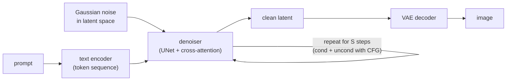
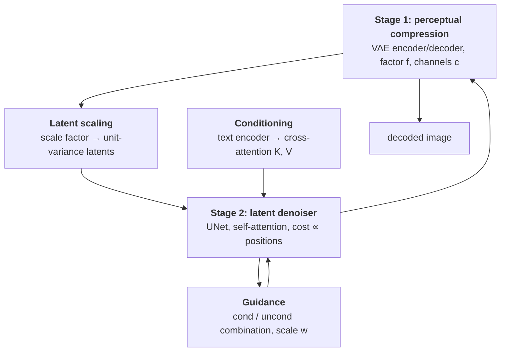

# Generative Media Module 03 — Latent Diffusion

## 00 Why This Module Exists

Pixel-space diffusion spends most of its compute modeling detail that a good autoencoder can reconstruct almost for free. Latent diffusion splits the job in two:
- a pretrained autoencoder handles **perceptual compression** (pixels ↔ a small latent grid);
- a diffusion model handles **semantic generation** inside that latent grid.

The split makes high-resolution synthesis tractable, but it also creates new contracts that are easy to break silently: a latent scale factor, a VAE version, a text-encoder token limit, and a guidance convention.


- Legend: VAE: variational autoencoder; CFG: classifier-free guidance; S: number of sampling steps.

This module covers the two-stage architecture, the compute saved by the downsampling factor, cross-attention conditioning, classifier-free guidance, and the anatomy of a Stable Diffusion–style pipeline.
- The noise schedule, forward process, and ε-prediction objective belong to [Generative Media Module 02](../02-diffusion/README.md).
- Replacing the UNet with a transformer over latent patches belongs to [Generative Media Module 04](../04-diffusion-transformers/README.md).
- Samplers, step counts, and serving an image pipeline belong to [Generative Media Module 06](../06-image-generation/README.md).
- The CLIP text encoder itself belongs to [VLM Module 02](../../vision-language-models/02-contrastive-learning/README.md).

**Research status:** satellite 80/20 revision, 2026-11-26. Element counts, attention costs, and the CFG algebra below are derived in the text. Constants attributed to papers or to the `CompVis/latent-diffusion` and `huggingface/diffusers` code (latent scale factor, default guidance scale, conditioning dropout rate, attention placement, file paths) were written from the cited sources but were **not** re-read against a pinned commit in this revision (`TODO_VERIFY`). Pin and re-check them in the source trace before citing them elsewhere. No benchmark numbers are quoted.

**Module Orientation**

- **Engineering problem:** know exactly where a latent diffusion pipeline spends compute and memory, and which hidden contracts (VAE, scale factor, tokenizer limit, guidance convention) decide image quality.
- **What you will do:**
  - compute latent sizes, element ratios, and attention costs by hand;
  - measure the VAE reconstruction ceiling on content that latents handle badly;
  - trace cross-attention shapes and prompt truncation;
  - sweep guidance scale and measure alignment, saturation, diversity, and latency.
- **Environment:** Python 3.10+, PyTorch, `diffusers`, one pinned Stable Diffusion–style checkpoint. A single GPU with 8–12 GB is enough for 512×512; CPU works for the arithmetic and VAE-only parts (slowly).
- **Evidence rule:** separate source observations (**O**), derivations (**D**), and hypotheses that need measurement (**H**).
- **If You Only Have One Week**: Lessons GM3.1 and GM3.4. They cover the reconstruction ceiling every latent model inherits and the guidance knob that dominates both quality and cost at inference.

## 01 Baseline Assumptions

- [Generative Media Module 02](../02-diffusion/README.md): forward noising, ε-prediction, and iterative denoising.
- Core [Module 01](../../advanced-ai-engineering/01-foundation-model-internals/README.md): attention as $\text{softmax}(QK^\top/\sqrt{d})V$ and its quadratic cost in sequence length.
- Core [Module 02](../../advanced-ai-engineering/02-inference-gpu-fundamentals/README.md): memory versus compute bounds and how to profile a GPU step.
- Mathematical prerequisites: tensor shapes, variance and scaling, linear interpolation and extrapolation.

## 02 Target Mastery

```yaml
depth_contract:
  conceptual: REQUIRED
  mechanistic: REQUIRED
  mathematical: REQUIRED
  quantitative: REQUIRED
  implementation: REQUIRED
  source_code: SELECTIVE
  instrumentation: SELECTIVE
  experimental: REQUIRED
  statistical: SELECTIVE
  production_reasoning: REQUIRED
  failure_analysis: REQUIRED
  falsification: SELECTIVE
  security: NOT_APPLICABLE
  economics: SELECTIVE
  architecture_tradeoff: REQUIRED
  research_connection: SELECTIVE

estimated_effort:
  instruction: 2h
  guided_practice: 1.25h
  labs: 3h
  assessment: 0.75h
  source_trace: 0.5h
  total: 7.5h
```

The learner must be able to predict latent shapes and denoiser cost from resolution and downsampling factor, explain what the autoencoder can and cannot reconstruct, trace conditioning through cross-attention, and choose a guidance scale with measured evidence about its quality and cost.

### LAYER 1: KNOWLEDGE / INSTRUCTIONAL LAYER

## 03 Knowledge Map


- Legend: f: spatial downsampling factor; c: latent channels.

Keep four contracts separate:

1. **Autoencoder contract:** VAE weights, $f$, $c$, and the latent scale factor.
2. **Denoiser contract:** latent resolution the model was trained at, noise schedule, prediction target.
3. **Conditioning contract:** text encoder, tokenizer, maximum token length, padding and truncation behavior.
4. **Guidance contract:** formula convention, scale, and whether the unconditional branch uses an empty or negative prompt.

A checkpoint is trained against one instance of each. Mixing a VAE, scale factor, or guidance convention from another pipeline runs without error and produces worse images.

## 04 Lessons

### Lesson GM3.1 — Perceptual Compression and the Reconstruction Ceiling

**Engineering Question:**
How much smaller is the latent than the image, and what detail is lost before diffusion even starts?

**Concepts & Definitions:**

- **Autoencoder stage:** an encoder $\mathcal{E}$ maps an image $x \in \mathbb{R}^{H \times W \times 3}$ to a latent $z = \mathcal{E}(x) \in \mathbb{R}^{h \times w \times c}$, and a decoder $\mathcal{D}$ maps it back. It is trained once, with reconstruction, perceptual, and adversarial losses, and then frozen (**O**, LDM paper).
- **Downsampling factor $f$:** $h = H/f$, $w = W/f$. The LDM paper studies $f \in \{1, 2, 4, 8, 16, 32\}$ and reports that moderate factors balance quality and efficiency (**O**, author-reported; scope to their datasets).
- **Regularization:** a small KL penalty toward a standard normal (KL-regularized) or a vector-quantization layer (VQ-regularized) keeps the latent space well-behaved.
- **Latent scale factor:** the denoiser assumes latents with roughly unit variance. The KL-VAE's raw latents do not have it, so they are multiplied by a constant before diffusion and divided by it before decoding. For Stable Diffusion v1 this constant is $0.18215$ (**O**, `TODO_VERIFY`).

Element ratio between image and latent:

$$
\rho = \frac{H \cdot W \cdot 3}{h \cdot w \cdot c} = \frac{3 f^2}{c}
$$

where:

- $\rho$ is how many image elements correspond to one latent element;
- $H, W$ are image height and width in pixels, with 3 color channels;
- $h = H/f$ and $w = W/f$ are the latent height and width;
- $c$ is the number of latent channels.

*Step-by-step reading.*

1. Spatial positions shrink by $f$ in each dimension, so by $f^2$ in total.
2. Channels change from 3 to $c$, multiplying the latent size by $c/3$.
3. Combining: $\rho = f^2 \cdot 3 / c$. Spatial positions and total elements are different ratios whenever $c \ne 3$.

**Mechanism Explanation:**

Everything the decoder cannot reconstruct is unreachable for the diffusion model: it can only generate latents, and the decoder defines which images those latents mean. Small high-frequency structure (fine text, distant faces, thin lines, dense textures) is where a VAE with $f = 8$ is weakest, so these failures are often a VAE ceiling, not a denoiser problem (**H**, test in LAB A).

**Break cases:**
- forgetting the scale factor, so the denoiser sees latents about 5.5 times too large (or decoded latents come out washed out);
- pairing a checkpoint with a VAE from another model family;
- decoding in fp16 with a VAE that overflows in half precision, producing NaN or black images;
- tiled decoding at high resolution, which can leave seams at tile borders.

**Worked Example (Stable Diffusion v1 shapes):**
*Input.* A 512×512 RGB image, $f = 8$, $c = 4$.

*Steps.*
- Image elements: $512 \times 512 \times 3 = 786{,}432$.
- Latent: $64 \times 64 \times 4 = 16{,}384$ elements.
- Spatial positions: $512^2 / 64^2 = 64$ times fewer.
- Elements: $\rho = 3 \times 64 / 4 = 48$ times fewer, not 64, because the latent has 4 channels instead of 3.
- At 1024×1024 with the same VAE: latent $128 \times 128 \times 4 = 65{,}536$ elements, four times the 512 case.

*Scale-factor check.* If scaled latents have unit standard deviation, raw latents have standard deviation about $1 / 0.18215 \approx 5.49$.

*Result.* The "64× reduction" commonly quoted is the spatial-position ratio. The element ratio is 48×, and denoiser cost follows positions and channels as Lesson GM3.2 shows.

**Knowledge Check:** A model's generated hands look wrong at small scale. What measurement separates a VAE ceiling from a denoiser failure?

**Guided Practice:** Encode and decode (no diffusion) ten images: two with small text, two with small faces, two with fine texture, four ordinary photos. Compute PSNR per image and inspect crops. Repeat once with the scale factor omitted on the decode side.

**Feedback Contract:**
- *Expected Evidence*: a table of PSNR and a cropped before/after for each content type; the text and small-face crops degrade most; the omitted-scale run produces clearly wrong images.
- *Common Failure*: judging the VAE by full-image PSNR, which hides small regions that fail.
- *Diagnostic Hint*: compute the error on the crop that matters, not the whole image.
- *Concept to Revisit*: Autoencoder contract.

**Learning Outcome:** Compute latent sizes and explain which output defects are inherited from the autoencoder.

*(Effort: 30m instruction, 20m practice)*

### Lesson GM3.2 — Where the Denoiser Spends Compute

**Engineering Question:**
How much attention work does moving from pixels to latents remove, and where does the remaining cost sit?

**Concepts & Definitions:**

- **UNet denoiser:** a convolutional encoder–decoder with skip connections. Transformer blocks (self-attention, cross-attention, MLP) are inserted at some resolution levels. In the Stable Diffusion v1 configuration they sit at latent resolutions 64, 32, and 16 (**O**, `TODO_VERIFY`).
- **Self-attention cost:** a feature map of $h \times w$ positions is flattened to $n = h \cdot w$ tokens. The score matrix has $n^2$ entries per head.

Score-matrix entries and memory per attention layer:

$$
E = B \cdot a \cdot n^2, \qquad M = E \cdot s
$$

where:

- $E$ is the number of attention score entries;
- $B$ is the batch size (doubled by CFG, Lesson GM3.4);
- $a$ is the number of attention heads;
- $n = h \cdot w$ is the number of spatial tokens at that level;
- $M$ is the memory in bytes if the full score matrix is materialized;
- $s$ is bytes per element (2 for fp16).

*Step-by-step reading.*

1. Each of the $n$ queries scores against all $n$ keys: $n^2$ entries per head.
2. Every head and every batch element repeats this: multiply by $a$ and $B$.
3. Memory-efficient attention kernels avoid materializing the matrix (core [Module 05](../../advanced-ai-engineering/05-inference-optimization/README.md)), so $M$ is an upper bound for naive attention, but $E$ still sets the compute.

**Mechanism Explanation:**

Convolution cost grows linearly with positions, attention cost quadratically. Moving to latents divides positions by $f^2$, so attention entries fall by $f^4$. The remaining cost concentrates in the highest-resolution attention level and in the number of denoiser calls: steps times guidance branches. The VAE decoder runs once per image, but at full pixel resolution, so at large sizes its activation memory can exceed that of a single denoiser step (**H**, check with a profiler).

**Worked Example (pixel versus latent attention):**
*Input.* 512×512 output, $f = 8$, 8 heads, fp16, batch 2 (one image with CFG).

*Steps.*
- Hypothetical self-attention at full pixel resolution: $n = 262{,}144$, $n^2 \approx 6.87 \times 10^{10}$ entries per head.
- At latent 64×64: $n = 4{,}096$, $n^2 = 16{,}777{,}216$ entries per head.
- Ratio: $(262{,}144 / 4{,}096)^2 = 64^2 = 4{,}096 = f^4$.
- Naive memory at the 64×64 level: $M = 2 \times 8 \times 16{,}777{,}216 \times 2 = 536{,}870{,}912$ bytes, about 537 MB for one layer's scores.
- At the 32×32 level: $n = 1{,}024$, so 16 times fewer entries than at 64×64.

*Result.* Pixel-space attention at 512×512 is not feasible on one GPU; at the latent 64×64 level it is about half a gigabyte per layer if materialized, which is why memory-efficient attention matters even in latent space.

**Knowledge Check:** Doubling output resolution from 512 to 1024 multiplies the 64×64-level attention entries by what factor, and why does this hit the top level hardest?

**Guided Practice:** Profile one denoiser step at 512×512 and at 768×768 with naive attention and with a memory-efficient kernel. Record peak memory and step time; separately time one VAE decode at each resolution.

**Feedback Contract:**
- *Expected Evidence*: a table of peak memory and step time for both kernels at both sizes, with the predicted scaling ($n^2$) written before measuring; a note on how VAE decode time compares with one denoiser step.
- *Common Failure*: timing the first call, which includes kernel compilation and allocator warm-up.
- *Diagnostic Hint*: discard warm-up iterations and synchronize the device before reading the timer (core [Module 02](../../advanced-ai-engineering/02-inference-gpu-fundamentals/README.md)).
- *Concept to Revisit*: Denoiser contract; attention cost.

**Learning Outcome:** Predict how resolution, factor $f$, and batch change denoiser attention cost and memory.

*(Effort: 30m instruction, 20m practice)*

### Lesson GM3.3 — Cross-Attention Conditioning

**Engineering Question:**
How does a text prompt reach every spatial position of the latent, and what part of a prompt can be silently lost?

**Concepts & Definitions:**

- **Text encoder:** Stable Diffusion v1 uses a frozen CLIP ViT-L/14 text encoder with a 77-token context, producing a $77 \times 768$ sequence (**O**, `TODO_VERIFY`).
- **Cross-attention:** queries come from the latent feature map, keys and values from the text sequence. Each spatial position computes a weighted mix of token embeddings.

$$
\text{CrossAttn}(Z, C) = \text{softmax}\!\left(\frac{(Z W_Q)(C W_K)^\top}{\sqrt{d}}\right) C W_V
$$

where:

- $Z \in \mathbb{R}^{n \times d_z}$ is the flattened latent feature map with $n = h \cdot w$ positions;
- $C \in \mathbb{R}^{m \times d_c}$ is the text encoder output with $m$ tokens;
- $W_Q, W_K, W_V$ are learned projections into dimension $d$;
- the score matrix is $n \times m$, not $n \times n$.

*Step-by-step reading.*

1. Each of the $n$ latent positions forms a query.
2. Each query scores against the $m$ text tokens, giving an $n \times m$ matrix.
3. Softmax over the $m$ tokens turns scores into weights; the output at each position is a weighted sum of projected token embeddings.
4. Because $m \ll n$, cross-attention is cheap compared with self-attention at the same level.

**Mechanism Explanation:**

The prompt enters only through $C$. Anything the tokenizer truncates is gone, with no error. The padded positions also produce embeddings and receive attention weight, so the padding convention is part of the conditioning contract. The unconditional branch for CFG uses the embedding of an empty (or negative) prompt, which makes that embedding a trained input too.

**Break cases:**
- a long prompt whose last clauses exceed 77 tokens and are dropped;
- a different tokenizer or text encoder paired with the checkpoint;
- prompt-weighting syntax from one tool passed literally to another, where it becomes ordinary text.

**Worked Example (shapes and truncation):**
*Input.* 64×64 latent level, 77-token context, a prompt that tokenizes to 95 tokens including start and end tokens.

*Steps.*
- Cross-attention scores: $4{,}096 \times 77 = 315{,}392$ per head, versus $16{,}777{,}216$ for self-attention at the same level, about 53 times fewer.
- Truncation keeps 77 of 95 tokens: the last 18 tokens, roughly the last clause of the prompt, never reach the model.

*Result.* The cost of conditioning is small; the risk is silent loss of the end of the prompt.

**Knowledge Check:** A user reports that "the background color in my prompt is ignored." What two checks would you run before blaming the model?

**Guided Practice:** Tokenize five real prompts with the checkpoint's tokenizer and report token counts. For the longest, generate with the original prompt and with the clause after token 77 removed, using the same seed; compare the images.

**Feedback Contract:**
- *Expected Evidence*: token counts per prompt; for any prompt over the limit, near-identical images with and without the truncated tail under a fixed seed.
- *Common Failure*: counting words instead of tokens.
- *Diagnostic Hint*: print the decoded tokens that actually enter the encoder.
- *Concept to Revisit*: Conditioning contract.

**Learning Outcome:** Trace prompt tokens through cross-attention and detect silent truncation.

*(Effort: 25m instruction, 15m practice)*

### Lesson GM3.4 — Classifier-Free Guidance

**Engineering Question:**
How does guidance trade prompt alignment against diversity and image quality, and what does it cost per image?

**Concepts & Definitions:**

- **Conditioning dropout:** during training, the condition is replaced by the null (empty) condition with some probability, so one network learns both $\epsilon_\theta(z_t, c)$ and $\epsilon_\theta(z_t, \varnothing)$ (**O**, Ho and Salimans).
- **Guided prediction** (the convention used by `diffusers`, with $w = 1$ meaning no guidance):

$$
\tilde{\epsilon} = \epsilon_\theta(z_t, \varnothing) + w \left( \epsilon_\theta(z_t, c) - \epsilon_\theta(z_t, \varnothing) \right)
$$

where:

- $z_t$ is the noisy latent at step $t$;
- $c$ is the prompt embedding and $\varnothing$ the null-prompt embedding;
- $\epsilon_\theta$ is the denoiser's noise prediction;
- $w$ is the guidance scale.

*Step-by-step reading.*

1. $w = 0$: the unconditional prediction. $w = 1$: the plain conditional prediction.
2. $w > 1$: start from the unconditional prediction and move **past** the conditional one along the difference vector. This is extrapolation, not interpolation.
3. The paper writes the same rule as $(1 + w')\,\epsilon_\theta(z_t, c) - w'\,\epsilon_\theta(z_t, \varnothing)$; the two forms match when $w = 1 + w'$. A "guidance 7.5" in one tool can mean "6.5" in another.
4. Each step needs both predictions, so CFG doubles denoiser evaluations (usually run as one batch of 2).

**Mechanism Explanation:**

Extrapolating the noise prediction pushes the implied clean latent toward regions the conditional model scores highly. Too far, and the implied clean latent leaves the range the VAE decoder was trained on: colors oversaturate, contrast burns in, and samples from different seeds look alike. Mitigations include lower scales, dynamic thresholding of the predicted clean sample (Imagen), and rescaling the guided prediction's standard deviation toward the conditional one (**O**, Lin et al. 2023; `TODO_VERIFY` for the `diffusers` `guidance_rescale` parameter).

**Worked Example (scalar CFG and cost):**
*Input.* One latent element with $\epsilon_\theta(z_t, \varnothing) = 0.2$ and $\epsilon_\theta(z_t, c) = 0.5$; 30 sampling steps.

*Steps.*
- $w = 1$: $0.2 + 1 \times 0.3 = 0.5$ (conditional).
- $w = 7.5$: $0.2 + 7.5 \times 0.3 = 2.45$, almost five times the conditional value.
- Paper form with $w' = 6.5$: $7.5 \times 0.5 - 6.5 \times 0.2 = 3.75 - 1.30 = 2.45$, the same.
- Cost: $30 \times 2 = 60$ denoiser evaluations per image instead of 30.

*Result.* Guidance multiplies the conditional signal far beyond what the model predicted, and doubles denoiser compute.

**Knowledge Check:** Why do negative prompts cost nothing extra under CFG, while adding a second, separately weighted condition does?

**Guided Practice:** Generate four seeds for one prompt at $w \in \{1, 3, 7.5, 15\}$. For each image, record mean saturation (HSV S channel) and inspect alignment with the prompt. Write your prediction for each column before generating.

**Feedback Contract:**
- *Expected Evidence*: a 4×4 grid with predictions written first; saturation rising with $w$; seed-to-seed variety falling at high $w$; the tool's guidance convention stated.
- *Common Failure*: comparing scales across tools without converting between $w$ and $w'$.
- *Diagnostic Hint*: set $w = 1$ and confirm the output equals plain conditional sampling for the same seed.
- *Concept to Revisit*: Guidance contract.

**Learning Outcome:** Apply and convert CFG conventions, predict their artifacts, and account for their cost.

*(Effort: 35m instruction, 20m practice)*

## 05 Literature & Production Source Map

**REFERENCE / BASELINE**

- [High-Resolution Image Synthesis with Latent Diffusion Models](https://arxiv.org/abs/2112.10752) — Rombach et al. (CVPR 2022). Reading pointers: §3.1 perceptual compression and regularization; §3.3 conditioning via cross-attention; the study of downsampling factors $f$.
- [Classifier-Free Diffusion Guidance](https://arxiv.org/abs/2207.12598) — Ho and Salimans (2022). Reading pointer: the guided score formula and the conditioning-dropout training procedure.
- [Learning Transferable Visual Models From Natural Language Supervision (CLIP)](https://arxiv.org/abs/2103.00020) — Radford et al. (2021). The text encoder family used for conditioning; see [VLM Module 02](../../vision-language-models/02-contrastive-learning/README.md).

**WORKLOAD-DEPENDENT / FRONTIER**

- [Photorealistic Text-to-Image Diffusion Models with Deep Language Understanding (Imagen)](https://arxiv.org/abs/2205.11487) — Saharia et al. (2022). Dynamic thresholding for high guidance; pixel-space cascade rather than latent diffusion.
- [Common Diffusion Noise Schedules and Sample Steps are Flawed](https://arxiv.org/abs/2305.08891) — Lin et al. (2023). Guidance rescale to reduce overexposure. Author-reported improvements; scope to their setup.
- [SDXL](https://arxiv.org/abs/2307.01952) — Podell et al. (2023). A larger latent UNet with two text encoders; its VAE uses a different scale factor from SD v1 (`TODO_VERIFY`).

**CURRENT DEFAULT:** a pinned checkpoint, VAE, and scale factor taken together from the same release; memory-efficient attention; CFG batched with the unconditional branch; the guidance convention written down next to the scale.

**LEGACY / INSUFFICIENT:** "64× fewer elements" without stating channels; swapping VAEs by file name; quoting a guidance scale without its convention; ignoring tokenizer truncation.

**PRODUCTION SOURCE TRACE** (pin the commit you read; no commit was pinned in this revision)

- `CompVis/latent-diffusion`:
  - `ldm/models/diffusion/ddpm.py`, class `LatentDiffusion`: `scale_factor`, first-stage encode/decode, conditioning hooks.
  - `ldm/modules/attention.py`: `CrossAttention` and `SpatialTransformer` (Lesson GM3.3).
- `huggingface/diffusers`:
  - `src/diffusers/pipelines/stable_diffusion/pipeline_stable_diffusion.py`, `StableDiffusionPipeline.__call__`: prompt encoding with truncation, the CFG batch and combination, `guidance_rescale`, and decoding with `vae.config.scaling_factor`.
  - `AutoencoderKL` (its file path has moved between releases; `TODO_VERIFY`).
- Scope: reference implementations. Other runtimes may fuse or reorder steps and must be checked separately.

### LAYER 2: ENGINEERING PRACTICE LAYER

## 06 Engineering Labs

All labs follow `PREDICT → BUILD → MEASURE → EXPLAIN → BREAK → IMPROVE → FALSIFY`.

### LAB A — VAE Reconstruction Ceiling

- **Objective:** measure what the autoencoder alone loses, by content type, and break the autoencoder contract on purpose.
- **Pre-Registered Hypothesis:** round-trip error concentrates in small text, small faces, and fine texture, and at least one "generation defect" seen in later labs is already present in the VAE round trip.
- **Independent Variables:** content type, resolution (512 and 1024), VAE precision (fp32, fp16), full versus tiled decoding.
- **Dependent Variables:** PSNR on full image and on region-of-interest crops, a perceptual metric if available (for example LPIPS), decode time, and peak memory.
- **Break & Falsify:** omit the scale factor; decode with another model family's VAE; decode in fp16; force small tiles to expose seams.
- **Alignment:** Lessons GM3.1–GM3.2 and Incident GM3.1.
- **Effort Estimate:** 1.5h.

### LAB B — Guidance Sweep Frontier

- **Objective:** map how guidance scale trades prompt alignment against saturation, diversity, and cost.
- **Pre-Registered Hypothesis:** alignment rises and then plateaus as $w$ increases, while saturation keeps rising and seed diversity keeps falling; guidance rescale moves the saturation curve down at matched alignment.
- **Independent Variables:** $w \in \{1, 3, 5, 7.5, 10, 15, 20\}$, guidance rescale on or off, negative prompt on or off, step count (20 and 50).
- **Dependent Variables:** CLIP score between image and prompt, mean saturation, pairwise perceptual distance across 4 seeds, time per image, and denoiser calls per image.
- **Break & Falsify:** use a very high scale; convert scales wrongly between the $w$ and $w'$ conventions; drop the unconditional branch.
- **Alignment:** Lessons GM3.3–GM3.4.
- **Effort Estimate:** 1.5h.

**Runnable arithmetic check (CPU; not a quality experiment):**
```python
import math
img, lat = 512 * 512 * 3, 64 * 64 * 4
assert (img, lat) == (786_432, 16_384)
assert img // lat == 48 and (512 * 512) // (64 * 64) == 64     # elements vs positions
f, c = 8, 4
assert 3 * f**2 // c == 48                                      # rho = 3 f^2 / c
assert 128 * 128 * 4 == 65_536                                  # 1024x1024 latent
assert round(1 / 0.18215, 2) == 5.49                            # raw latent std
n_pix, n_lat = 512 * 512, 64 * 64
assert (n_pix**2) // (n_lat**2) == 4_096 == f**4                 # attention ratio
assert 2 * 8 * n_lat**2 * 2 == 536_870_912                      # naive scores, B=2, 8 heads, fp16
assert n_lat * 77 == 315_392 and round(n_lat**2 / (n_lat * 77)) == 53
eps_u, eps_c, w = 0.2, 0.5, 7.5
guided = eps_u + w * (eps_c - eps_u)
paper = (1 + (w - 1)) * eps_c - (w - 1) * eps_u
assert math.isclose(guided, 2.45) and math.isclose(paper, guided)
assert 30 * 2 == 60                                             # denoiser calls with CFG
```

## 07 Break / Incident Scenarios

### Incident GM3.1 — Faster Pipeline, Burnt Images

**Incident Symptoms:**
An image service moves from one inference runtime to another to cut cost. The checkpoint name is unchanged. P95 latency drops by about 40% (illustrative). Within a day, users report oversaturated colors, harsh contrast, garbled small text, and some fully black images. The black images cluster at the largest output size.

**Diagnostic Protocol (Task):**
1. **Form Competing Hypotheses:** guidance convention mismatch ($w$ versus $w'$), wrong or missing latent scale factor, a different VAE bundled by the new runtime, fp16 VAE overflow at large sizes, a different sampler or step count, prompt truncation at a different limit, or a real change in user prompts.
2. **Identify Missing Evidence:** for old and new paths: guidance formula and scale, VAE identity and precision, scale factor, sampler and steps, tokenizer limit, and the per-request output size.
3. **Design Discriminating Measurements:** fix seed and prompt; compare the initial noise, the guided prediction at step 1, the final latent, and the decoded image between paths. Then swap one component at a time (VAE, precision, guidance formula, sampler).
4. **Rank Explanations:** the first tensor that diverges for identical inputs is the primary suspect; black images that appear only at large sizes and only in fp16 point to VAE overflow rather than guidance.
5. **Intervene:** align the guidance convention, pin the VAE and scale factor, run the VAE in fp32 or use a fixed half-precision VAE, and record the latency change honestly (fewer steps or no CFG explain a speed-up too).
6. **Remeasure:** saturation statistics, CLIP score, black-image rate by output size, and latency on a fixed prompt set.

### LAYER 3: MASTERY / ASSESSMENT LAYER

## 08 Mastery Assessment

### Transfer Problem — A 1024×1024 Service on a 16 GB GPU

A product team wants 1024×1024 images from a latent diffusion checkpoint on 16 GB GPUs, with a latency target per image and prompts that are often long.

**Required Deliverables:**
1. the four contracts (autoencoder, denoiser, conditioning, guidance) for the chosen checkpoint, with every parameter named;
2. hand-computed latent shapes, attention entries per level, and denoiser calls per image for the chosen steps and guidance;
3. LAB A evidence of the VAE ceiling at 1024 and the precision and tiling decision it supports;
4. LAB B evidence for the chosen guidance scale and rescale setting, with the convention stated;
5. a prompt-length policy (reject, warn, or chunk) with evidence from Lesson GM3.3;
6. a latency and memory budget separating denoiser steps, CFG doubling, and VAE decode.

## 09 Required Evidence & Rubric

### Required Artifact: Latent Pipeline Contract Sheet

Submit the four contracts, the LAB A reconstruction table, the LAB B guidance frontier, the Incident GM3.1 diagnosis, and the cost budget.

### Rubric Dimensions

- **Mechanism:** *Insufficient* says "diffusion in a compressed space." *Competent* names the VAE, scale factor, cross-attention, and CFG steps. *Strong* predicts which contract change causes which visible artifact.
- **Quantitative:** *Insufficient* quotes "64× smaller." *Competent* computes element and position ratios and attention entries. *Strong* turns them into a memory and latency budget and checks it against a profile.
- **Experimental:** *Insufficient* shows one pretty image. *Competent* sweeps guidance with fixed seeds. *Strong* reports alignment, saturation, diversity, and cost together and pre-registers predictions.
- **Diagnosis:** *Insufficient* changes settings until images look right. *Competent* compares outputs between pipelines. *Strong* finds the first divergent tensor and isolates one component at a time.

## 10 Capability Traceability Matrix

| Capability | Taught | Practiced | Assessed | Evidence (artifact reviewers open) |
|---|---|---|---|---|
| Latent shapes and reconstruction ceiling | GM3.1 | GM3.1 Guided Practice; LAB A | Deliverables 1–3; Incident GM3.1 | LAB A crop-level reconstruction table |
| Denoiser attention cost | GM3.2 | GM3.2 Guided Practice | Deliverables 2, 6 | Profile table with predicted $n^2$ scaling |
| Cross-attention and truncation | GM3.3 | GM3.3 Guided Practice; LAB B | Deliverable 5 | Token counts and fixed-seed truncation comparison |
| Classifier-free guidance | GM3.4 | GM3.4 Guided Practice; LAB B | Deliverables 4, 6; Incident GM3.1 | Guidance frontier with convention stated |

## 11 Exit Criteria & Module Wrap-Up

### Exit Criteria

A learner passes when they can compute latent shapes and attention costs by hand, show the VAE reconstruction ceiling with crop-level evidence, detect prompt truncation, convert between guidance conventions, and defend a guidance scale and precision choice with measured quality and cost.

### Module Wrap-Up (Final Mental Model Reconstruction)

Latent diffusion buys tractability by trusting a frozen autoencoder. Every image it produces is bounded by that decoder, conditioned only through tokens that survive the tokenizer, and steered by a guidance rule that doubles compute. Write all four contracts down before comparing two pipelines.

### Cost & Telemetry Hook

- [Lesson 22.1](../../advanced-ai-engineering/22-ai-economics/README.md): cost per image must count steps × guidance branches plus one VAE decode at full resolution, not a single denoiser call.
- [Lesson 23.1](../../advanced-ai-engineering/23-observability-reliability/README.md): emit checkpoint, VAE identity and precision, scale factor, guidance convention and scale, sampler, steps, output size, and prompt token count per request, so Incident GM3.1 is detectable from telemetry.

## 12 Competency Targets

```yaml
competency:
  sfia: 4
  bloom: Apply -> Analyze
  solo: Relational
  dreyfus: Advanced Beginner -> Competent
```
