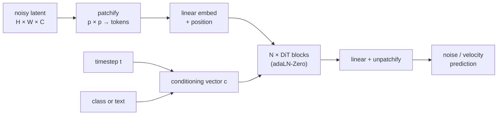
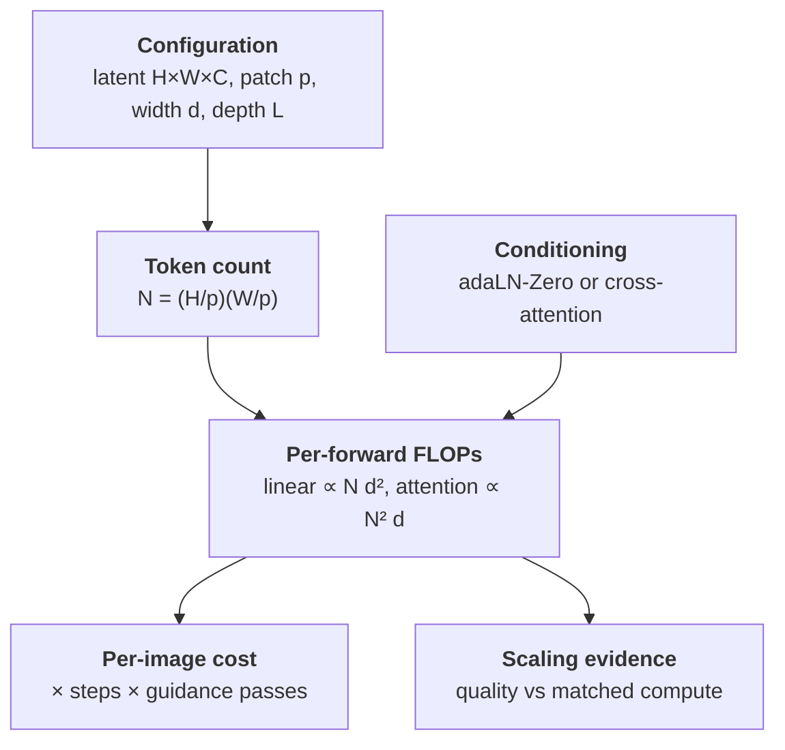

# Generative Media Module 04 — Diffusion Transformers

## 00 Why This Module Exists

A Diffusion Transformer (DiT) replaces the convolutional U-Net denoiser with a stack of plain transformer blocks over latent patches.
- The architecture change looks small, but it moves the cost model: compute is now set by token count, which is set by resolution and patch size.
- Parameter count alone no longer predicts cost. Two models with the same weights can differ in compute by more than ten times.


- Legend: p: patch size in latent pixels; C: latent channels; adaLN-Zero: adaptive layer norm with zero-initialized gates.

This module covers patchification, conditioning by adaLN-Zero versus cross-attention, the FLOP and memory model of a DiT, and how to read scaling evidence for generative transformers.
- Noise schedules and the denoising objective belong to [Generative Media Module 02](../02-diffusion/README.md).
- The VAE latent space that DiT operates on belongs to [Generative Media Module 03](../03-latent-diffusion/README.md).
- Flow-matching training targets used by recent transformer generators belong to [Generative Media Module 05](../05-flow-matching/README.md).
- Spatio-temporal tokens for video belong to [Generative Media Module 07](../07-video-generation/README.md).

**Research status:** satellite 80/20 revision, 2026-11-26. FLOP and parameter formulas are derived in the text. Architecture constants attributed to the DiT paper or the `facebookresearch/DiT` code (DiT-XL/2 depth, width, heads, parameter count, the paper's Gflops convention) were written from the cited sources but were **not** re-read against a pinned commit in this revision (`TODO_VERIFY`). All latency and throughput figures are illustrative unless you measure them.

**Module Orientation**

- **Engineering problem:** predict and control the compute, memory, and latency of a transformer denoiser from its configuration, and judge scaling claims on matched compute.
- **What you will do:**
  - compute token counts, parameters, and FLOPs by hand;
  - implement a DiT block with adaLN-Zero and verify it is the identity at initialization;
  - profile a pretrained DiT across resolution, patch size, steps, and guidance;
  - break the cost model at high resolution.
- **Environment:** Python 3.10+, PyTorch, CPU for LAB A, one GPU (or Colab GPU) for LAB B. A pretrained class-conditional DiT checkpoint and its VAE.
- **Evidence rule:** separate source observations (**O**), derivations (**D**), and hypotheses that need measurement (**H**).
- **If You Only Have One Week**: Lessons GM4.1 and GM4.3. Token count and the FLOP model explain most of what changes when a DiT is scaled or served at a new resolution.

## 01 Baseline Assumptions

- Core [Module 01](../../advanced-ai-engineering/01-foundation-model-internals/README.md): transformer blocks, attention, and parameter/FLOP accounting.
- Core [Module 02](../../advanced-ai-engineering/02-inference-gpu-fundamentals/README.md): arithmetic intensity, Roofline, and profiling.
- [Generative Media Module 02](../02-diffusion/README.md) and [Module 03](../03-latent-diffusion/README.md): what the denoiser predicts and what the latent grid is.
- Mathematical prerequisites: matrix multiplication cost, layer normalization, and big-O reasoning.

## 02 Target Mastery

```yaml
depth_contract:
  conceptual: REQUIRED
  mechanistic: REQUIRED
  mathematical: REQUIRED
  quantitative: REQUIRED
  implementation: REQUIRED
  source_code: SELECTIVE
  instrumentation: REQUIRED
  experimental: SELECTIVE
  statistical: NOT_APPLICABLE
  production_reasoning: REQUIRED
  failure_analysis: REQUIRED
  falsification: SELECTIVE
  security: NOT_APPLICABLE
  economics: SELECTIVE
  architecture_tradeoff: REQUIRED
  research_connection: SELECTIVE

estimated_effort:
  instruction: 2h
  guided_practice: 1.25h
  labs: 3h
  assessment: 0.75h
  source_trace: 0.5h
  total: 7.5h
```

The learner must be able to derive a DiT's token count, parameters, and per-image FLOPs from its configuration, explain how adaLN-Zero injects conditioning, predict how cost scales with resolution, and separate parameter scaling from compute scaling when reading results.

### LAYER 1: KNOWLEDGE / INSTRUCTIONAL LAYER

## 03 Knowledge Map



Keep three cost levels separate:

1. **Per-token cost:** set by width $d$ and depth $L$ (the weights).
2. **Per-forward cost:** per-token cost times token count $N$, plus the attention term that grows with $N^2$.
3. **Per-image cost:** per-forward cost times sampling steps times guidance passes, plus the VAE decode.

A configuration change that leaves level 1 fixed can still multiply levels 2 and 3.

## 04 Lessons

### Lesson GM4.1 — Patchifying Latents into Tokens

**Engineering Question:**
How many tokens does a DiT process for a given image, and what does the patch size trade?

**Concepts & Definitions:**

- **Latent grid:** the VAE encoder output, $H \times W \times C$. A VAE with downsampling factor $f$ maps an $R \times R$ image to $R/f \times R/f$. With the common $f=8$, $C=4$ VAE, a 256 px image becomes $32 \times 32 \times 4$ (**O**, see Module 03).
- **Patchify:** cut the grid into non-overlapping $p \times p$ patches, flatten each to a vector of length $p^2 C$, and project it linearly to width $d$.
- **Unpatchify:** the inverse at the output; the final linear layer emits $p^2 C$ values per token (or $2p^2C$ when the model also predicts a variance).

Token count:

$$
N = \frac{H}{p} \cdot \frac{W}{p} = \frac{R^2}{f^2 p^2}
$$

where:

- $N$ is the number of tokens per image;
- $H, W$ are the latent height and width;
- $p$ is the patch size in latent pixels;
- $R$ is the image side length in pixels (square images);
- $f$ is the VAE downsampling factor.

*Step-by-step reading.*

1. Each patch becomes one token, so $N$ is the number of patches.
2. Halving $p$ multiplies $N$ by 4 while changing only the embedding and output layers' parameter counts.
3. Doubling $R$ also multiplies $N$ by 4. Resolution and patch size enter the cost model the same way.

**Mechanism Explanation:**

A U-Net reduces spatial size internally, so most of its compute runs on downsampled maps. A DiT keeps all $N$ tokens at full width through every block. Smaller patches give finer spatial detail per token at quadratic token cost; this is why DiT names encode the patch size (for example `XL/2` means the XL configuration with $p=2$) (**O**).

**Worked Example (token counts):**
*Input.* $f = 8$, $C = 4$.

*Steps.*
- 256 px: latent $32 \times 32$. $p=8$: $N = 16$. $p=4$: $N=64$. $p=2$: $N=256$.
- 512 px: latent $64 \times 64$, $p=2$: $N = 1{,}024$.
- 1024 px: latent $128 \times 128$, $p=2$: $N = 4{,}096$.
- Input vector length per token at $p=2$: $2^2 \times 4 = 16$ values.

*Result.* Moving from 256 px to 1024 px at $p=2$ multiplies tokens by 16.

**Knowledge Check:** A team switches from an $f=8$ VAE to an $f=16$ VAE with more channels and keeps $p=2$. What happens to $N$ at 1024 px, and why might they also change $p$?

**Guided Practice:** Write `patchify` and `unpatchify` for a tensor of shape `(B, C, H, W)` and assert that `unpatchify(patchify(x)) == x` for $p \in \{2, 4, 8\}$. Print $N$ and the per-token vector length for each.

**Feedback Contract:**
- *Expected Evidence*: exact round-trip equality; $N = 256, 64, 16$ and vector lengths $16, 64, 256$ for a $32 \times 32 \times 4$ latent.
- *Common Failure*: a reshape that mixes channel and spatial axes, which still round-trips but feeds the model scrambled patches.
- *Diagnostic Hint*: patchify a latent where each pixel holds its own (row, col) index and check one token's contents by hand.
- *Concept to Revisit*: Token count.

**Learning Outcome:** Compute DiT token counts from image size, VAE factor, and patch size.

*(Effort: 25m instruction, 15m practice)*

### Lesson GM4.2 — Conditioning: adaLN-Zero versus Cross-Attention

**Engineering Question:**
How does a DiT inject the timestep and the class or text condition, and what does each method cost?

**Concepts & Definitions:**

- **Conditioning vector $c$:** in class-conditional DiT, the sum of a timestep embedding and a class embedding (**O**).
- **adaLN (adaptive layer norm):** instead of learned constant scale and shift, a small MLP regresses them from $c$. The modulated norm is $\mathrm{LN}(x)\,(1 + \gamma) + \beta$.
- **adaLN-Zero:** each block also regresses a gate $\alpha$ for the attention branch and for the MLP branch, and the regressing layer is initialized to zero (**O**, DiT §3.2).
- **Cross-attention conditioning:** block tokens attend to a separate sequence of condition tokens (for example text-encoder outputs).
- **In-context conditioning:** condition tokens are appended to the image token sequence.

One block with adaLN-Zero:

$$
\begin{aligned}
(\beta_1, \gamma_1, \alpha_1, \beta_2, \gamma_2, \alpha_2) &= W_c\,\mathrm{SiLU}(c) + b_c \\
x &\leftarrow x + \alpha_1 \odot \mathrm{Attn}\big(\mathrm{LN}(x)(1+\gamma_1) + \beta_1\big) \\
x &\leftarrow x + \alpha_2 \odot \mathrm{MLP}\big(\mathrm{LN}(x)(1+\gamma_2) + \beta_2\big)
\end{aligned}
$$

where:

- $x \in \mathbb{R}^{N \times d}$ are the image tokens;
- $c \in \mathbb{R}^{d}$ is the conditioning vector, shared by all tokens of one sample;
- $W_c \in \mathbb{R}^{6d \times d}$ and $b_c \in \mathbb{R}^{6d}$ produce six vectors of length $d$;
- $\beta, \gamma$ are shift and scale; $\alpha$ is a per-channel gate on each residual branch;
- $\odot$ is element-wise multiplication broadcast over tokens.

*Step-by-step reading.*

1. $c$ is the same for every token, so the six vectors are computed once per sample per block, not once per token.
2. At initialization $W_c = 0$ and $b_c = 0$, so $\alpha_1 = \alpha_2 = 0$ and both residual branches add nothing. Every block is the identity map.
3. Training then opens each gate as needed. The DiT authors report that this zero-initialized variant gave the best results among the conditioning options they compared (**O**, author-reported).

**Mechanism Explanation:**

adaLN can only express a global, per-channel modulation: it cannot point at a specific word or region. That suits a timestep and a class label. Rich text prompts need token-level interaction, which is why text-to-image transformers add cross-attention or joint attention over text and image tokens (see [Module 06](../06-image-generation/README.md)). In those models adaLN still typically carries the timestep and a pooled text summary.

**Worked Example (adaLN parameter cost):**
*Input.* Width $d = 1{,}152$, depth $L = 28$ (DiT-XL configuration, **O**, `TODO_VERIFY`).

*Steps.*
- Per block, $W_c$ and $b_c$: $6d^2 + 6d = 7{,}962{,}624 + 6{,}912 = 7{,}969{,}536$ parameters.
- Over 28 blocks: $223{,}147{,}008$, about 223 M.
- Attention plus MLP (4× expansion) per block: $4d^2 + 8d^2 = 12d^2 = 15{,}925{,}248$; over 28 blocks about 446 M.
- Sum: about 669 M, close to the roughly 675 M reported for DiT-XL/2; the gap is embeddings, biases, and the final layer (**D**; reported total `TODO_VERIFY`).

*Result.* adaLN-Zero is about one third of the weights, yet its FLOPs are negligible because it runs once per sample, not once per token.

**Knowledge Check:** Why does adding adaLN parameters change memory and checkpoint size much more than it changes per-image FLOPs?

**Guided Practice:** Implement one adaLN-Zero block in PyTorch with $d = 64$. Assert that the output equals the input at initialization for random $x$ and $c$. Then set $W_c$ to small random values and confirm the output depends on $c$.

**Feedback Contract:**
- *Expected Evidence*: `torch.equal(block(x, c), x)` at initialization, and a nonzero difference between two different $c$ after perturbing $W_c$.
- *Common Failure*: zero-initializing only the $\alpha$ slice but leaving a bias, so the identity holds only approximately.
- *Diagnostic Hint*: print the six slices of $W_c\,\mathrm{SiLU}(c) + b_c$ at initialization; all must be exactly zero.
- *Concept to Revisit*: adaLN-Zero.

**Learning Outcome:** Explain and implement adaLN-Zero and state when cross-attention is required instead.

*(Effort: 30m instruction, 20m practice)*

### Lesson GM4.3 — FLOPs, Memory, and Arithmetic Intensity of a DiT

**Engineering Question:**
How much compute does one image cost, and which term dominates as resolution grows?

**Concepts & Definitions:**

- **Linear FLOPs:** matrix multiplications in attention projections and the MLP. With the 4× MLP, the weight matrices per block hold $12d^2$ parameters, and a forward pass costs about $2 \times 12d^2 = 24d^2$ FLOPs per token.
- **Attention FLOPs:** $QK^\top$ and the weighted sum over $V$ cost about $2N^2d$ each, so $4N^2d$ per block.
- **No KV cache across steps:** DiT attention is bidirectional over all tokens, and the input changes at every denoising step, so there is nothing to cache the way an autoregressive decoder caches keys and values (**D**). Each step recomputes the full sequence.

Per-forward and per-image FLOPs:

$$
F_{\text{fwd}} \approx L\,(24 N d^2 + 4 N^2 d), \qquad F_{\text{img}} \approx S \cdot g \cdot F_{\text{fwd}}
$$

where:

- $F_{\text{fwd}}$ is the FLOPs of one denoiser forward pass;
- $L$ is the number of blocks, $d$ the width, $N$ the token count;
- $F_{\text{img}}$ is the denoiser FLOPs to generate one image (VAE decode excluded);
- $S$ is the number of sampling steps;
- $g$ is the number of forward passes per step: 2 with classifier-free guidance (conditional and unconditional), 1 without.

*Step-by-step reading.*

1. The ratio of attention to linear FLOPs per block is $4N^2d / 24Nd^2 = N / (6d)$.
2. When $N \ll 6d$, the model behaves like a stack of large matrix multiplications and cost grows linearly with $N$.
3. When $N$ approaches or exceeds $6d$, the quadratic term matters and cost grows faster than token count.
4. Embedding, adaLN, and final-layer FLOPs are small and are ignored here.

**Mechanism Explanation:**

At batch 1, a weight matrix of $d^2$ parameters in 16-bit precision is $2d^2$ bytes and is used for $2Nd^2$ FLOPs, so the weight-side arithmetic intensity is about $N$ FLOPs per byte (**D**). With hundreds or thousands of tokens, a DiT forward is usually compute-bound on modern GPUs, unlike LLM decode at one token per step (core [Module 02](../../advanced-ai-engineering/02-inference-gpu-fundamentals/README.md)). The serving levers are therefore fewer steps, cheaper guidance, fused attention, and lower precision, not KV-cache management ([core Module 05](../../advanced-ai-engineering/05-inference-optimization/README.md)).

**Worked Example (DiT-XL/2 at three resolutions):**
*Input.* $L = 28$, $d = 1{,}152$, $p = 2$, $f = 8$.

*Steps.*
- 256 px, $N = 256$:
  - Linear per block: $24 \times 256 \times 1{,}152^2 = 8.154$ GFLOP.
  - Attention per block: $4 \times 256^2 \times 1{,}152 = 0.302$ GFLOP; ratio $256 / 6{,}912 = 3.7\%$.
  - $F_{\text{fwd}} = 28 \times 8.456 = 236.8$ GFLOP.
  - The DiT paper reports about 119 Gflops for XL/2, half our figure, which suggests it counts multiply-accumulates (**D**; convention `TODO_VERIFY`).
- 512 px, $N = 1{,}024$: attention ratio $14.8\%$; $F_{\text{fwd}} = 1.049$ TFLOP.
- 1024 px, $N = 4{,}096$: attention ratio $59.3\%$; $F_{\text{fwd}} = 5.818$ TFLOP.
- Per image at 256 px with $S = 250$ and guidance ($g=2$): $500 \times 236.8$ GFLOP $= 118.4$ TFLOP.

*Result.* From 512 to 1024 px, tokens grow 4× but forward FLOPs grow $5.818 / 1.049 = 5.55$×, because attention is no longer negligible.

*Memory note.* An unfused attention kernel materializes $N^2$ scores per head. At $N = 4{,}096$ in 16-bit precision that is 32 MiB per head, 512 MiB per block for 16 heads, per sample. Fused attention avoids storing it (core Module 05).

**Knowledge Check:** Halving the step count and dropping guidance both cut per-image FLOPs by 2×. Why might they not cut latency by the same amount, and why might they not cost the same quality?

**Guided Practice:** Write a function `dit_flops(R, f, p, d, L, S, g)` and tabulate per-image FLOPs for XL/2 and XL/4 at 256, 512, and 1024 px with $S \in \{50, 250\}$ and $g \in \{1, 2\}$. Mark where attention exceeds 50% of block FLOPs.

**Feedback Contract:**
- *Expected Evidence*: a table that reproduces the worked example and shows XL/4 at 1024 px has the same $N$ as XL/2 at 512 px.
- *Common Failure*: forgetting the factor $g$, or counting multiply-accumulates in one row and FLOPs in another.
- *Diagnostic Hint*: state the FLOP convention once at the top of the table and check one row against a profiler.
- *Concept to Revisit*: Three cost levels.

**Learning Outcome:** Predict per-image denoiser FLOPs and identify when attention dominates.

*(Effort: 35m instruction, 25m practice)*

### Lesson GM4.4 — Reading Scaling Evidence for Generative Transformers

**Engineering Question:**
When a paper says a bigger DiT is better, was it bigger in parameters, in compute, or both, and was the comparison fair?

**Concepts & Definitions:**

- **Forward compute (Gflops) as the scaling axis:** the DiT paper varies both model size (S, B, L, XL) and patch size, and reports that sample quality (FID) tracks forward Gflops closely, while parameter count alone does not (**O**, author-reported).
- **Training compute:** forward compute times training steps times batch size (times about 3 for forward plus backward).
- **Sampling compute:** $F_{\text{img}}$ from Lesson GM4.3; a model that is better per forward pass may still lose at matched sampling cost.
- **Matched comparison:** two models compared at equal training compute and equal sampling budget, on the same latent space, metric, and evaluation protocol.

**Mechanism Explanation:**

Transformers give a uniform knob: width, depth, and token count change compute in predictable ways ($F_{\text{fwd}}$ above). U-Nets mix resolutions, so their compute depends on where channels are added. The claim that DiTs "scale more predictably" is best treated as a hypothesis (**H**) supported by the DiT, U-ViT, and later scaling studies on their own benchmarks, not as a law. Rectified-flow transformers for text-to-image (for example the MM-DiT in Stable Diffusion 3) extend the same scaling approach with joint text–image attention (**O**, author-reported).

**Worked Example (same parameters, different compute):**
*Input.* DiT-XL/8 versus DiT-XL/2 on a $32 \times 32 \times 4$ latent.

*Steps.*
- Block parameters are identical: only the patch embedding ($p^2 C \times d$) and the output layer differ.
  - Patch embedding: $8^2 \times 4 \times 1{,}152 = 294{,}912$ weights for $p = 8$ versus $2^2 \times 4 \times 1{,}152 = 18{,}432$ for $p = 2$.
- Tokens: $N = 16$ versus $256$, so linear FLOPs differ by 16×.
- Attention ratio at $p = 8$: $16 / 6{,}912 = 0.23\%$.

*Result.* XL/8 has slightly more parameters than XL/2 yet uses about 16× less compute per forward. A plot of quality against parameters would put them at the same x-value; a plot against Gflops separates them.

**Knowledge Check:** A vendor reports that their 8 B-parameter image model beats a 2 B-parameter model. List four facts you need before accepting that larger is better.

**Guided Practice:** Take one published DiT scaling table (DiT paper or a later study) and re-plot its quality metric against (a) parameters and (b) per-forward compute. Write two sentences on which axis gives the tighter relationship and what the plot cannot tell you.

**Feedback Contract:**
- *Expected Evidence*: two plots with the source table cited, and a statement that the evidence is author-reported on one dataset and metric.
- *Common Failure*: mixing models evaluated with different numbers of sampling steps or guidance scales on one curve.
- *Diagnostic Hint*: list steps, sampler, and guidance scale for every point before plotting.
- *Concept to Revisit*: Matched comparison.

**Learning Outcome:** Separate parameter scaling from compute scaling and audit scaling claims for matched conditions.

*(Effort: 30m instruction, 15m practice)*

## 05 Literature & Production Source Map

**REFERENCE / BASELINE**

- [Scalable Diffusion Models with Transformers (DiT)](https://arxiv.org/abs/2212.09748) — Peebles and Xie (ICCV 2023). Reading pointers: §3.2 (patchify, conditioning variants including adaLN-Zero) and §4–5 (Gflops versus FID scaling).
- [All are Worth Words: A ViT Backbone for Diffusion Models (U-ViT)](https://arxiv.org/abs/2209.12152) — Bao et al. (CVPR 2023). Transformer denoiser with long skip connections and in-context conditioning tokens.
- [High-Resolution Image Synthesis with Latent Diffusion Models](https://arxiv.org/abs/2112.10752) — Rombach et al. (CVPR 2022). The latent space and the U-Net baseline that DiT replaces.

**WORKLOAD-DEPENDENT / FRONTIER**

- [Scaling Rectified Flow Transformers for High-Resolution Image Synthesis (SD3, MM-DiT)](https://arxiv.org/abs/2403.03206) — Esser et al. (2024). Joint text–image attention and scaling studies; author-reported on their evaluations.
- Diffusion-transformer scaling-law studies (for example Liang et al., 2024, arXiv 2410.08184, `TODO_VERIFY`) fit loss against training compute. Treat fitted exponents as specific to their data, latent space, and objective.
- Reusing features across adjacent denoising steps and step distillation are active ways to cut sampling cost; they are out of scope here and do not change the per-forward cost model.

**CURRENT DEFAULT:** a transformer denoiser over VAE latents with $p = 2$, adaLN for timestep conditioning, cross-attention or joint attention for text, fused attention kernels, and cost reported per image at a stated step count and guidance setting.

**LEGACY / INSUFFICIENT:** comparing models by parameter count alone; quoting per-forward FLOPs without steps and guidance; assuming LLM KV-cache techniques apply to denoising steps.

**PRODUCTION SOURCE TRACE** (pin the commit you read; no commit was pinned in this revision)

- `facebookresearch/DiT`, file `models.py`:
  - `DiTBlock`: the `adaLN_modulation` layer producing six chunks and the `modulate` helper (Lesson GM4.2).
  - `DiT.initialize_weights`: zero-initialization of the adaLN modulation and final layers.
  - `DiT.unpatchify` and the model-size registry (`DiT_XL_2`, `DiT_XL_4`, …).
- `huggingface/diffusers`, the DiT transformer model class and its pipeline (class and file names change between releases; record them at your pinned commit).
- Scope: reference implementations of class-conditional DiT. Text-to-image transformers add components not covered here.

### LAYER 2: ENGINEERING PRACTICE LAYER

## 06 Engineering Labs

All labs follow `PREDICT → BUILD → MEASURE → EXPLAIN → BREAK → IMPROVE → FALSIFY`.

### LAB A — A Tiny DiT from Scratch

- **Objective:** implement patchify, an adaLN-Zero block, and unpatchify; verify identity at initialization; count parameters and FLOPs and compare with a profiler.
- **Pre-Registered Hypothesis:** hand-computed parameter counts match exactly, and hand-computed FLOPs match a profiler within 5% once the FLOP convention is aligned.
- **Independent Variables:** width $d$, depth $L$, patch size $p$, latent size.
- **Dependent Variables:** parameter count, profiler FLOPs, identity error at initialization, CPU forward time (illustrative only).
- **Break & Falsify:** leave a nonzero bias in the modulation layer; swap axes in patchify; compare against a profiler that counts multiply-accumulates.
- **Alignment:** Lessons GM4.1–GM4.3.
- **Effort Estimate:** 1.5h.

### LAB B — Resolution and Sampling Cost Profile

- **Objective:** measure denoiser and VAE time for a pretrained DiT across resolution (or patch size), steps, and guidance, and compare with the FLOP model.
- **Pre-Registered Hypothesis:** per-image latency scales with $S \cdot g$ and super-linearly with token count once attention exceeds about a third of block FLOPs; the VAE decode becomes a visible share at high resolution.
- **Independent Variables:** $N$ (via resolution or $p$), $S$, $g$, batch size, attention kernel (fused versus unfused), precision.
- **Dependent Variables:** denoiser time per step, VAE decode time, peak memory, achieved FLOP/s versus the GPU's peak.
- **Break & Falsify:** force an unfused attention path at the largest $N$; raise batch size until out-of-memory; check whether batching the two guidance passes changes latency.
- **Alignment:** Lessons GM4.3–GM4.4 and Incident GM4.1.
- **Effort Estimate:** 1.5h.

**Runnable arithmetic check (CPU; not a quality experiment):**
```python
import math
d, L = 1152, 28
tokens = lambda R, f=8, p=2: (R // f // p) ** 2
assert [tokens(256, p=p) for p in (8, 4, 2)] == [16, 64, 256]
assert tokens(512) == 1024 and tokens(1024) == 4096
assert 6 * d * d + 6 * d == 7_969_536                      # adaLN-Zero per block
assert (6 * d * d + 6 * d) * L == 223_147_008
assert round(((12 + 6) * d * d + 6 * d) * L / 1e6) == 669   # blocks only
fwd = lambda N: L * (24 * N * d * d + 4 * N * N * d)
assert fwd(256) == 236_760_072_192
assert math.isclose(fwd(256) / 2 / 1e9, 118.38, abs_tol=0.01)  # MAC convention
assert math.isclose(4096 / (6 * d), 0.5926, abs_tol=1e-4)
assert math.isclose(fwd(4096) / fwd(1024), 5.548, abs_tol=1e-3)
assert math.isclose(250 * 2 * fwd(256) / 1e12, 118.38, abs_tol=0.01)
assert 4096 ** 2 * 2 * 16 / 2 ** 30 == 0.5                 # unfused scores, GiB
```

## 07 Break / Incident Scenarios

### Incident GM4.1 — 1024 px Launch Is Six Times Slower, Not Four

**Incident Symptoms:**
A service moves a DiT image generator from 512 px to 1024 px with the same model, sampler, and step count. The capacity plan assumed 4× cost because pixels grew 4×. Measured p50 latency grows about 6×, batch size 4 now runs out of memory, and GPU utilization looks high. Image quality is acceptable.

**Diagnostic Protocol (Task):**
1. **Form Competing Hypotheses:** attention's quadratic term, an unfused attention fallback at the new sequence length, guidance passes no longer batched, VAE decode cost at high resolution, a changed step count or sampler default, or contention from other tenants.
2. **Identify Missing Evidence:** per-step denoiser time, VAE time, attention kernel in use, peak memory by stage, step count and guidance setting actually used, and the GPU's other workloads.
3. **Design Discriminating Measurements:** compute $F_{\text{fwd}}$ for both resolutions; time one denoiser step and the VAE separately; rerun with the fused kernel forced on and with guidance batched.
4. **Rank Explanations:** the FLOP model alone predicts about 5.5×; the remainder must come from kernel choice, VAE, or batching. Memory failure at batch 4 points to materialized attention scores or VAE activations.
5. **Intervene:** force fused attention, batch guidance passes, tile or slice the VAE decode, or reduce steps with a validated sampler.
6. **Remeasure:** latency and memory at both resolutions, and a quality check on a fixed prompt or class set.

### LAYER 3: MASTERY / ASSESSMENT LAYER

## 08 Mastery Assessment

### Transfer Problem — Pick a Configuration under a Latency Budget

A product needs 768 px class-conditional images within an illustrative budget of 2 s on one GPU. Candidates are XL/2 and XL/4 trained on the same latent space, each with 50 or 250 steps, with or without guidance.

**Required Deliverables:**
1. token count, per-forward FLOPs, and per-image FLOPs for every candidate, with the FLOP convention stated;
2. the attention share for each candidate and where it crosses 50%;
3. LAB B measurements for at least two candidates, compared with the FLOP model;
4. a recommendation that names the quality evidence used and whether it was compared at matched steps and guidance;
5. a statement of what the FLOP model leaves out (VAE, kernels, memory) and how large that gap was in LAB B.

## 09 Required Evidence & Rubric

### Required Artifact: DiT Cost Sheet

Submit the cost table from GM4.3 Guided Practice, the LAB A identity and parameter checks, the LAB B profile, and the Incident GM4.1 diagnosis.

### Rubric Dimensions

- **Mechanism:** *Insufficient* says "a transformer instead of a U-Net." *Competent* explains patchify and adaLN-Zero. *Strong* explains why adaLN cannot replace cross-attention for text and where each cost lands.
- **Quantitative:** *Insufficient* quotes parameter counts. *Competent* computes tokens and FLOPs per image. *Strong* predicts the attention crossover and checks it against measurement.
- **Evidence:** *Insufficient* cites "bigger is better." *Competent* separates parameters from compute. *Strong* audits scaling claims for matched steps, guidance, and protocol.

## 10 Capability Traceability Matrix

| Capability | Taught | Practiced | Assessed | Evidence (artifact reviewers open) |
|---|---|---|---|---|
| Patchify and token count | GM4.1 | GM4.1 Guided Practice; LAB A | Deliverable 1 | Round-trip test and token table |
| adaLN-Zero conditioning | GM4.2 | GM4.2 Guided Practice; LAB A | Rubric: Mechanism | Identity-at-init check and parameter count |
| FLOP and memory model | GM4.3 | GM4.3 Guided Practice; LAB B | Deliverables 1–3, 5; Incident GM4.1 | Cost table versus LAB B profile |
| Scaling evidence | GM4.4 | GM4.4 Guided Practice | Deliverable 4 | Quality-versus-parameters and quality-versus-compute plots |

## 11 Exit Criteria & Module Wrap-Up

### Exit Criteria

A learner passes when they can derive a DiT's tokens, parameters, and per-image FLOPs from its configuration, implement and verify an adaLN-Zero block, predict where attention dominates, explain why a KV cache does not carry across denoising steps, and audit a scaling claim for matched compute.

### Module Wrap-Up (Final Mental Model Reconstruction)

A DiT's cost is tokens times width squared times depth, plus a quadratic attention term, times steps and guidance passes. Resolution and patch size set the tokens; parameters set only the per-token cost. Compare models on compute, not on weights.

### Cost & Telemetry Hook

- [Lesson 22.1](../../advanced-ai-engineering/22-ai-economics/README.md): cost per image must include steps, guidance passes, and VAE decode at the served resolution.
- [Lesson 23.1](../../advanced-ai-engineering/23-observability-reliability/README.md): emit resolution, token count, steps, guidance setting, attention kernel, and per-stage time per request so Incident GM4.1 is visible in telemetry.
- Core [Module 24](../../advanced-ai-engineering/24-model-system-codesign/README.md): patch size and VAE factor are model choices with direct serving consequences.

## 12 Competency Targets

```yaml
competency:
  sfia: 4
  bloom: Apply -> Analyze
  solo: Relational
  dreyfus: Advanced Beginner -> Competent
```
