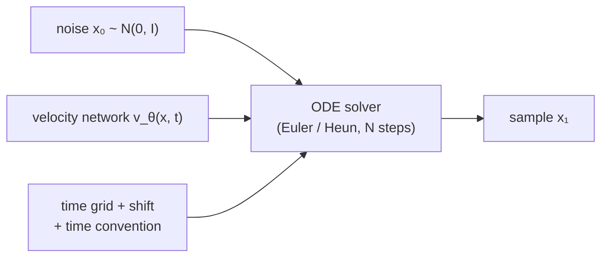
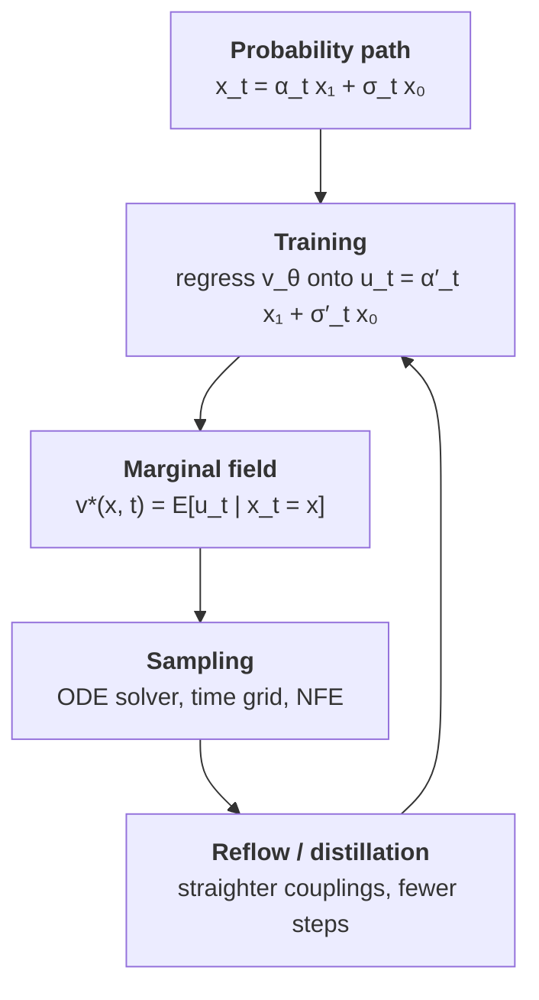

# Generative Media Module 05 — Flow Matching

## 00 Why This Module Exists

A flow-matching model does not generate an image in one shot. It learns a velocity field, and a numerical ODE solver integrates that field from noise to data over a chosen number of steps.
- Sample quality depends on the learned field **and** on the solver, step count, time grid, and time convention used at inference.
- A checkpoint served with a different time convention or schedule than it was trained with still runs and still produces images. They are just wrong.


- Legend: x₀: noise sample; x₁: generated sample; v_θ: learned velocity field; N: number of solver steps.

This module covers continuous normalizing flows, the conditional flow-matching objective, its relation to diffusion, and rectified flow with reflow for few-step sampling.
- Score-based diffusion and its SDE view belong to [Generative Media Module 02](../02-diffusion/README.md).
- Latent spaces that flow models usually run in belong to [Module 03](../03-latent-diffusion/README.md).
- Transformer backbones for the velocity network belong to [Module 04](../04-diffusion-transformers/README.md).
- Flow-matching TTS (Voicebox, Matcha-TTS) is covered in [Speech Module 03](../../speech-ai/03-text-to-speech/README.md).

**Research status:** satellite 80/20 revision, 2026-11-26. The objective, the Euler error example, and the parameterization conversions are derived in the text. Statements attributed to papers (Lipman et al., Liu et al., Esser et al.) and to the `huggingface/diffusers` scheduler code were written from the cited sources but were **not** re-read against a pinned version in this revision (`TODO_VERIFY`). No benchmark numbers are imported. Re-check before citing elsewhere.

**Module Orientation**

- **Engineering problem:** get acceptable samples with as few velocity-network evaluations as possible, and know which inference settings must match training.
- **What you will do:**
  - integrate a known ODE by hand and measure solver error against step count;
  - derive the flow-matching regression target and train a 2-D toy model;
  - convert between velocity, data, and noise predictions;
  - apply one reflow round and measure what it buys at 1–4 steps and what it costs.
- **Environment:** Python 3.10+, NumPy, PyTorch on CPU for the toy labs. A pretrained flow-matching image model is optional for LAB B's last step.
- **Evidence rule:** separate source observations (**O**), derivations (**D**), and hypotheses that need measurement (**H**).
- **If You Only Have One Week**: Lessons GM5.1 and GM5.2. They give the sampling mechanics and the training objective; the diffusion link and reflow build on them.

## 01 Baseline Assumptions

- [Generative Media Module 01](../01-generative-model-foundations/README.md): sampling from a learned distribution, likelihood versus sample quality.
- [Generative Media Module 02](../02-diffusion/README.md): forward noising, $\epsilon$-prediction, and the idea of a reverse process.
- Core [Module 00](../../advanced-ai-engineering/00-scientific-ai-engineering/README.md): paired comparisons and the observation/derivation/hypothesis split.
- Mathematical prerequisites: derivatives, ordinary differential equations, expectations, mean squared error, and Gaussian distributions.

## 02 Target Mastery

```yaml
depth_contract:
  conceptual: REQUIRED
  mechanistic: REQUIRED
  mathematical: REQUIRED
  quantitative: REQUIRED
  implementation: REQUIRED
  source_code: SELECTIVE
  instrumentation: SELECTIVE
  experimental: SELECTIVE
  statistical: SELECTIVE
  production_reasoning: SELECTIVE
  failure_analysis: REQUIRED
  falsification: SELECTIVE
  security: NOT_APPLICABLE
  economics: SELECTIVE
  architecture_tradeoff: SELECTIVE
  research_connection: SELECTIVE

estimated_effort:
  instruction: 2h
  guided_practice: 1.25h
  labs: 3h
  assessment: 0.75h
  source_trace: 0.5h
  total: 7.5h
```

The learner must be able to write the flow-matching loss from a chosen probability path, predict how solver error scales with step count and path curvature, convert between model parameterizations, and diagnose a sampler that does not match the training contract.

### LAYER 1: KNOWLEDGE / INSTRUCTIONAL LAYER

## 03 Knowledge Map


- Legend: α_t, σ_t: path coefficients; u_t: conditional target velocity; NFE: number of function (network) evaluations.

Keep three contracts separate:

1. **Path contract:** time convention (which end is noise), path coefficients $\alpha_t, \sigma_t$, and what the network predicts (velocity, data, or noise).
2. **Training contract:** how $t$ is sampled during training, conditioning inputs, and the latent space.
3. **Sampler contract:** solver, number of steps, time grid and any shift, and guidance.

A checkpoint is trained under the first two. Serving must honor them and choose the third deliberately.

## 04 Lessons

### Lesson GM5.1 — Continuous Normalizing Flows and ODE Sampling

**Engineering Question:**
How many network evaluations does a sample cost, and what decides how small that number can be?

**Concepts & Definitions:**

- **Continuous normalizing flow (CNF):** a time-dependent velocity field $v(x, t)$ that moves points by the ODE $\frac{dx}{dt} = v(x, t)$ from $t = 0$ to $t = 1$. Pushing a simple distribution (noise) through this ODE yields the model distribution.
- **Time convention:** in this module $t = 0$ is noise and $t = 1$ is data, as in Lipman et al. and Liu et al. Some systems use the opposite convention (Lesson GM5.3).
- **Euler solver:** $x_{k+1} = x_k + h\, v(x_k, t_k)$ with step $h = 1/N$.
- **NFE:** number of velocity-network evaluations per sample. Euler uses one per step; Heun (a second-order method) uses two per step, except where an implementation skips the correction on the last step.

**Mechanism Explanation:**

Euler assumes the velocity is constant across each step. If a trajectory is a straight line traversed at constant speed, the velocity really is constant and one Euler step is exact. The more a trajectory bends, the more steps are needed. Euler's global error shrinks roughly in proportion to $h$ (first order); Heun's shrinks roughly with $h^2$ but costs twice as many evaluations per step (**D**, standard numerical analysis).

$$
x_{k+1} = x_k + h\, v(x_k, t_k), \qquad t_k = k h, \qquad h = \frac{1}{N}
$$

where:

- $x_k$ is the state after $k$ steps, starting from noise $x_0$;
- $v(x, t)$ is the velocity field (the trained network at inference);
- $N$ is the number of steps and $h$ the step size;
- $t_k$ is the time at the start of step $k$.

*Step-by-step reading.*

1. Evaluate the velocity at the current point and time.
2. Move a distance $h$ times that velocity.
3. Repeat $N$ times. The result approximates the ODE solution at $t = 1$.

**Worked Example (curved versus straight trajectory):**
*Input.* Two 1-D fields started at $x_0 = 0$: a straight field $v = 1$ (exact solution $x(1) = 1$) and a curved-in-time field $v = 2t$ (exact solution $x(t) = t^2$, so $x(1) = 1$).

*Steps for $v = 2t$ with Euler.*
- $N = 1$: $x_1 = 0 + 1 \cdot 2 \cdot 0 = 0$. Error 1.
- $N = 2$: $0 + 0.5 \cdot 0 + 0.5 \cdot 1 = 0.5$. Error 0.5.
- $N = 4$: $0.25 \cdot 2 \cdot (0 + 0.25 + 0.5 + 0.75) = 0.75$. Error 0.25.
- In general the Euler sum is $\frac{N-1}{N}$, so the error is exactly $1/N$.

*Steps for $v = 2t$ with one Heun step.* Average of the velocities at the start and at the Euler-predicted end: $(0 + 2)/2 = 1$, so $x_1 = 1$. Exact, with NFE = 2.

*Steps for $v = 1$.* Euler with $N = 1$ gives $x_1 = 1$. Exact with NFE = 1.

*Result.* Step count is driven by how much the velocity changes along the trajectory, not by the dimension of the data.

**Knowledge Check:** Euler with $N = 4$ and Heun with $N = 2$ both cost 4 NFE. Which do you expect to be more accurate on a smooth curved field, and why might the answer change when the field is noisy (a poorly trained network)?

**Guided Practice:** For $v = 3t^2$ (exact $x(1) = 1$ from $x_0 = 0$), compute Euler errors for $N = 1, 2, 4$ by hand, then confirm in code up to $N = 64$ and fit the slope of log-error against log-$N$.

**Feedback Contract:**
- *Expected Evidence*: $N = 1$: $x_1 = 0$, error 1. $N = 2$: $0.5 \cdot 3 \cdot 0.25 = 0.375$, error 0.625. $N = 4$: $0.25 \cdot 3 \cdot (0 + 0.0625 + 0.25 + 0.5625) = 0.65625$, error 0.34375. Fitted slope close to $-1$.
- *Common Failure*: counting steps instead of NFE when comparing solvers.
- *Diagnostic Hint*: wrap the velocity function with a counter and report NFE next to every quality number.
- *Concept to Revisit*: Sampler contract.

**Learning Outcome:** Predict solver error and NFE from step count and trajectory curvature.

*(Effort: 25m instruction, 20m practice)*

### Lesson GM5.2 — The Conditional Flow-Matching Objective

**Engineering Question:**
What exactly does the network regress onto during training, and why do learned trajectories bend even when every training path is straight?

**Concepts & Definitions:**

- **Probability path:** a family of distributions $p_t$ moving from noise ($t = 0$) to data ($t = 1$).
- **Conditional path:** for one noise sample $x_0$ and one data sample $x_1$, a simple interpolation between them. The linear (optimal-transport-style) choice is $x_t = (1 - t)\, x_0 + t\, x_1$.
- **Conditional target velocity:** the time derivative of that interpolation, here $u_t = x_1 - x_0$.
- **Marginal velocity:** the field the network actually learns, the average of conditional targets over all pairs that pass through the same point: $v^*(x, t) = \mathbb{E}[\,x_1 - x_0 \mid x_t = x\,]$.

Conditional flow-matching loss with the linear path:

$$
\mathcal{L}(\theta) = \mathbb{E}_{t,\, x_0,\, x_1} \left\| v_\theta\big((1 - t)\, x_0 + t\, x_1,\ t\big) - (x_1 - x_0) \right\|^2
$$

where:

- $t$ is sampled from a training distribution on $[0, 1]$ (uniform in the original papers; Lesson GM5.3 discusses alternatives);
- $x_0 \sim \mathcal{N}(0, I)$ is a noise sample and $x_1$ is a data sample, drawn independently;
- $v_\theta$ is the velocity network with parameters $\theta$;
- $\|\cdot\|^2$ is the squared Euclidean norm.

*Step-by-step reading.*

1. Draw a data point, a noise point, and a time.
2. Place a training point on the straight line between them at fraction $t$.
3. Ask the network for a velocity there; penalize its distance from the straight-line velocity $x_1 - x_0$.
4. Lipman et al. show that this conditional loss has the same gradient as regressing onto the (intractable) marginal field, so its minimizer is $v^*$ (**O**, `TODO_VERIFY`). This is why no simulation of the ODE is needed during training.

The original formulation keeps a small minimum noise level $\sigma_{min}$, giving $x_t = (1 - (1 - \sigma_{min})t)\, x_0 + t\, x_1$ and target $x_1 - (1 - \sigma_{min})\, x_0$ (**O**, `TODO_VERIFY`). Setting $\sigma_{min} = 0$ gives the form above.

**Mechanism Explanation:**

Many different $(x_0, x_1)$ pairs pass through the same point $x$ at time $t$ with different straight-line velocities. The network cannot output all of them; it outputs their mean. Trajectories of the mean field therefore bend, and solver error returns (Lesson GM5.1). Straight conditional paths make training simple; they do not make sampling straight.

**Worked Example (crossing paths average out):**
*Input.* 1-D, noise $x_0 \in \{-1, +1\}$ and data $x_1 \in \{-1, +1\}$, each equally likely and independent. Look at $t = 0.5$.

*Steps.*
- The four pairs give $x_{0.5} = 0.5 x_0 + 0.5 x_1 \in \{-1, 0, 0, +1\}$.
- At $x = -1$: only the pair $(-1, -1)$, target $0$.
- At $x = +1$: only $(+1, +1)$, target $0$.
- At $x = 0$: pairs $(-1, +1)$ with target $+2$ and $(+1, -1)$ with target $-2$. The minimizer of the squared error is the mean: $v^*(0, 0.5) = 0$.

*Result.* The learned field sends nothing across the middle at $t = 0.5$. The two straight training paths that crossed there are replaced by paths that never cross, because an ODE trajectory cannot split at a point. The learned flow is a valid transport, but not the straight one the training pairs suggested.

**Knowledge Check:** If you could pair each noise sample with "its" data sample so that pairs never cross (as reflow tries to do), what would the marginal field look like along each path?

**Guided Practice:** Train a small MLP velocity network on a 2-D target (eight Gaussians or two moons) with the loss above. Sample with Euler at $N = 1, 2, 4, 8, 32$ and plot trajectories at $N = 32$.

**Feedback Contract:**
- *Expected Evidence*: a loss curve, sample scatter plots per $N$, and a trajectory plot showing visibly curved paths, especially for noise points far from any mode.
- *Common Failure*: evaluating the network at $x_1$ or $x_0$ instead of $x_t$, or using a different $t$ for the interpolation and the network input.
- *Diagnostic Hint*: at a fixed batch, check numerically that $x_t + (1 - t)(x_1 - x_0) = x_1$ before training.
- *Concept to Revisit*: Path contract.

**Learning Outcome:** Write and implement the flow-matching loss and explain why the learned field is curved.

*(Effort: 35m instruction, 25m practice)*

### Lesson GM5.3 — Flow Matching and Diffusion: Paths, Parameterizations, and Time

**Engineering Question:**
Which parts of a diffusion setup does flow matching remove, and which inference settings still have to match training?

**Concepts & Definitions:**

- **General Gaussian path:** $x_t = \alpha_t\, x_1 + \sigma_t\, x_0$ with $x_0$ noise. The target velocity is $u_t = \alpha'_t\, x_1 + \sigma'_t\, x_0$. The linear path is $\alpha_t = t$, $\sigma_t = 1 - t$. Diffusion's variance-preserving paths are other choices of $\alpha_t, \sigma_t$, and their deterministic probability-flow ODE is the same kind of object (**O**, Lipman et al., `TODO_VERIFY`).
- **Parameterizations:** a network can predict velocity $v$, clean data $\hat x_1$, or noise $\hat x_0$. On the linear path they are interchangeable given $x_t$ and $t$.
- **Training time distribution:** how often each $t$ is seen in training. Esser et al. (Stable Diffusion 3) report better results with a logit-normal distribution that emphasizes middle times (**O**, author-reported, `TODO_VERIFY`).
- **Time shift:** a remapping of the sampling grid that spends more steps at high noise, used for high-resolution images. One common form (in `diffusers`' flow-matching Euler scheduler, applied to the noise level $\sigma$) is $\sigma' = \frac{s\,\sigma}{1 + (s - 1)\,\sigma}$ (**O**, `TODO_VERIFY`).

Conversions on the linear path:

$$
\hat x_1 = x_t + (1 - t)\, v, \qquad \hat x_0 = x_t - t\, v
$$

where:

- $x_t$ is the current state at time $t$ ($t = 0$ noise, $t = 1$ data);
- $v$ is the predicted velocity;
- $\hat x_1$ and $\hat x_0$ are the implied data and noise estimates.

*Step-by-step check (with the true $v = x_1 - x_0$).*

1. $x_t + (1 - t)(x_1 - x_0) = (1 - t)x_0 + t x_1 + (1 - t)x_1 - (1 - t)x_0 = x_1$.
2. $x_t - t(x_1 - x_0) = (1 - t)x_0 + t x_1 - t x_1 + t x_0 = x_0$.

**Mechanism Explanation:**

Flow matching removes the SDE, the noise-variance schedule as a separate design object, and the need to derive a reverse-process variance: training is one regression on a chosen path. It does **not** remove time-related choices. The training time distribution, the sampling grid, any shift, and the time convention all remain, and they must be consistent between training and serving.

Time convention is the most common silent mismatch. Esser et al. write $z_t = (1 - t)\, x_0 + t\, \epsilon$ with $t = 0$ as **data** (**O**, `TODO_VERIFY`), the reverse of this module. Feeding a model $t$ from the other convention asks it for the velocity at the wrong noise level.

**Worked Example (shift and conversion):**
*Input.* Shift $s = 3$ applied to noise levels $\sigma \in \{0.25, 0.5, 0.75\}$; then a conversion at $t = 0.25$ (this module's convention) with $x_t = 0.4$ and predicted $v = 1.2$.

*Steps.*
- $\sigma = 0.25$: $0.75 / 1.5 = 0.5$.
- $\sigma = 0.5$: $1.5 / 2 = 0.75$.
- $\sigma = 0.75$: $2.25 / 2.5 = 0.9$.
- Conversion: $\hat x_1 = 0.4 + 0.75 \times 1.2 = 1.3$; $\hat x_0 = 0.4 - 0.25 \times 1.2 = 0.1$.

*Result.* With $s = 3$, the midpoint of the grid moves to noise level 0.75, so more steps are spent at high noise. Converting a velocity to $\hat x_1$ is one line, which is how previews and guidance in data space are computed.

**Knowledge Check:** A model trained with logit-normal $t$ sees few training samples near $t = 0$ and $t = 1$. What does that imply about a sampler whose first step is very close to pure noise?

**Guided Practice:** Take the LAB A toy model. Sample with the correct time convention and with $t \to 1 - t$ at $N = 8$. Then try shifts $s \in \{1, 2, 3\}$ on a uniform grid and record sample quality.

**Feedback Contract:**
- *Expected Evidence*: the flipped convention produces visibly wrong samples (collapsed or spread out), not slightly worse ones; the shift sweep is reported with its exact grid values.
- *Common Failure*: applying a shift designed for one convention to a grid in the other convention.
- *Diagnostic Hint*: print the first and last three values of the time grid actually passed to the network.
- *Concept to Revisit*: Path contract; Sampler contract.

**Learning Outcome:** Relate flow matching to diffusion, convert between parameterizations, and audit a sampler's time grid against the training contract.

*(Effort: 30m instruction, 15m practice)*

### Lesson GM5.4 — Rectified Flow, Reflow, and Few-Step Generation

**Engineering Question:**
What does it cost to straighten a flow so it can sample in one to four steps, and how do you know it worked?

**Concepts & Definitions:**

- **Rectified flow:** Liu et al.'s name for training a velocity field on the linear interpolation between paired noise and data, the same objective as Lesson GM5.2 (**O**, `TODO_VERIFY`).
- **Reflow:** run the trained model's ODE from many noise samples $z_0$ to get outputs $\hat z_1$, then train a new model on the **pairs** $(z_0, \hat z_1)$ instead of independent pairs. These pairs come from a non-crossing flow, so the new field is straighter (**O**, Liu et al., `TODO_VERIFY`).
- **Straightness:** how far the learned field departs from the constant straight-line velocity along its own trajectories:

$$
S(v) = \int_0^1 \mathbb{E}\left[\, \big\| (\hat z_1 - z_0) - v(z_t, t) \big\|^2 \right] dt
$$

where:

- $z_t$ is the trajectory of the ODE started at noise $z_0$;
- $\hat z_1$ is its endpoint at $t = 1$;
- $v$ is the velocity field. $S = 0$ means every trajectory is a straight line at constant speed, so one Euler step is exact (Lesson GM5.1).

**Mechanism Explanation:**

Reflow trades training-time compute for sampling-time steps. Generating the pairs needs a full many-step ODE solve per pair. Each reflow round can also accumulate error, because the new model learns from the previous model's samples, not from real data. Distillation to one step is often applied after reflow (**O**, Liu et al., `TODO_VERIFY`). Some production systems use other step-reduction methods instead; this module does not claim which one any specific product uses.

**Worked Example (reflow cost accounting, illustrative numbers):**
*Input.* Generate $M = 200{,}000$ reflow pairs with a 32-step Euler solve. Train the reflow model for 50,000 steps at batch 128. Assume a training step costs about 3 forward-equivalents (forward plus backward). These are illustrative choices, not measurements.

*Steps.*
- Pair generation: $200{,}000 \times 32 = 6.4$ million forward evaluations.
- Reflow training: $50{,}000 \times 128 \times 3 = 19.2$ million forward-equivalents.
- Total: about 25.6 million forward-equivalents.
- Serving saving: dropping from 32 to 4 NFE saves 28 evaluations per sample, so the one-time cost is repaid after $25.6\text{M} / 28 \approx 914{,}000$ samples.

*Result.* Reflow is an amortized investment. Whether it pays depends on serving volume and on whether 4-step quality is acceptable, which must be measured.

**Knowledge Check:** Why can a second reflow round make samples worse even if it makes trajectories straighter?

**Guided Practice:** On the LAB A model, estimate $S$ by Monte Carlo over 1,000 trajectories at 32 steps, before and after one reflow round. Report quality at $N = 1, 2, 4$ for both.

**Feedback Contract:**
- *Expected Evidence*: a lower $S$ after reflow, better quality at $N = 1$–$2$ after reflow, and an explicit note on whether quality at $N = 32$ changed.
- *Common Failure*: claiming a speedup from fewer steps while comparing against a baseline run at its own best step count, or ignoring pair-generation cost.
- *Diagnostic Hint*: plot quality against NFE for both models on one chart; the useful comparison is at equal NFE.
- *Concept to Revisit*: Straightness; NFE.

**Learning Outcome:** Measure straightness, apply reflow, and decide whether its one-time cost pays for the sampling saving.

*(Effort: 30m instruction, 15m practice)*

## 05 Literature & Production Source Map

**REFERENCE / BASELINE**

- [Flow Matching for Generative Modeling](https://arxiv.org/abs/2210.02747) — Lipman et al. (2022). Reading pointers: the conditional flow-matching objective and the theorem that its gradient matches the marginal objective; the Gaussian path family and the optimal-transport path.
- [Flow Straight and Fast: Learning to Generate and Transfer Data with Rectified Flow](https://arxiv.org/abs/2209.03003) — Liu, Gong, and Liu (2022). Reading pointers: the rectified-flow objective, reflow, and straightness.
- [Neural Ordinary Differential Equations](https://arxiv.org/abs/1806.07366) — Chen et al. (2018). Background for CNFs and ODE solvers.

**WORKLOAD-DEPENDENT / FRONTIER**

- [Scaling Rectified Flow Transformers for High-Resolution Image Synthesis (Stable Diffusion 3)](https://arxiv.org/abs/2403.03206) — Esser et al. (2024). Author-reported comparisons of path and time-sampling choices, including logit-normal $t$ and resolution-dependent shifting. Results are scoped to their models, data, and metrics.
- [Building Normalizing Flows with Stochastic Interpolants](https://arxiv.org/abs/2209.15571) — Albergo and Vanden-Eijnden (2022). A closely related formulation of the same idea.
- Commercial flow-based image models (for example the FLUX family) are described by their developers as rectified-flow transformers. Their training details are not fully published; this module makes no claims about their production performance.

**CURRENT DEFAULT:** linear path with velocity prediction, a documented time convention, and a sampler grid (including any shift) copied from the model's reference pipeline. Report quality against NFE, not against "steps."

**LEGACY / INSUFFICIENT:** "flow matching needs only one step"; comparing samplers at equal step counts instead of equal NFE; changing schedulers without checking time convention and shift.

**PRODUCTION SOURCE TRACE** (pin the version you read; no version was pinned in this revision)

- `huggingface/diffusers`, file `src/diffusers/schedulers/scheduling_flow_match_euler_discrete.py`:
  - `FlowMatchEulerDiscreteScheduler.set_timesteps`: builds the grid and applies the shift (Lesson GM5.3).
  - `FlowMatchEulerDiscreteScheduler.step`: the Euler update $x + (\sigma_{next} - \sigma)\, v$ in the noise-level convention (Lesson GM5.1).
- Record which end of the grid is noise in that code, and compare it with this module's convention before reusing any formula.
- Scope: one library's implementation, not the definition of flow matching.

### LAYER 2: ENGINEERING PRACTICE LAYER

## 06 Engineering Labs

All labs follow `PREDICT → BUILD → MEASURE → EXPLAIN → BREAK → IMPROVE → FALSIFY`.

### LAB A — Toy Flow Matching and the NFE Frontier

- **Objective:** train a 2-D flow-matching model and map sample quality against NFE for Euler and Heun.
- **Pre-Registered Hypothesis:** at equal NFE, Heun beats Euler above some NFE threshold, and both degrade sharply below 4 NFE because the learned field is curved.
- **Independent Variables:** solver, NFE, time grid (uniform or shifted), time convention.
- **Dependent Variables:** sliced Wasserstein distance or MMD to held-out target samples, trajectory plots, and wall time per sample on CPU.
- **Break & Falsify:** flip the time convention at inference; train with $x_t$ computed from a different $t$ than the one fed to the network.
- **Alignment:** Lessons GM5.1–GM5.3.
- **Effort Estimate:** 1.75h.

### LAB B — One Round of Reflow

- **Objective:** apply one reflow round to the LAB A model and measure straightness, few-step quality, and total cost.
- **Pre-Registered Hypothesis:** reflow lowers $S$ and improves quality at 1–2 NFE, with no improvement (or a small loss) at 32 NFE.
- **Independent Variables:** number of reflow pairs, solver steps used to generate them, reflow training length.
- **Dependent Variables:** straightness $S$, quality versus NFE before and after, and forward-equivalent compute for pair generation and training.
- **Break & Falsify:** generate pairs with too few solver steps (for example 2) and check whether reflow then learns the solver's error.
- **Alignment:** Lesson GM5.4.
- **Effort Estimate:** 1.25h.

**Runnable arithmetic check (CPU; not a quality experiment):**
```python
import math

def euler(v, n, x=0.0):
    h = 1.0 / n
    for k in range(n):
        x += h * v(x, k * h)
    return x

curved = lambda x, t: 2 * t
for n in (1, 2, 4, 64):
    assert math.isclose(1 - euler(curved, n), 1 / n)      # error = 1/N
assert euler(lambda x, t: 1.0, 1) == 1.0                   # straight path, one step
assert math.isclose(0 + (curved(0, 0) + curved(0, 1)) / 2, 1.0)  # one Heun step
cubic = lambda x, t: 3 * t * t
assert math.isclose(1 - euler(cubic, 2), 0.625)
assert math.isclose(1 - euler(cubic, 4), 0.34375)

x0, x1, t = -0.7, 1.9, 0.3
xt, v = (1 - t) * x0 + t * x1, x1 - x0
assert math.isclose(xt + (1 - t) * v, x1) and math.isclose(xt - t * v, x0)
assert math.isclose(0.4 + 0.75 * 1.2, 1.3) and math.isclose(0.4 - 0.25 * 1.2, 0.1)

shift = lambda s, sig: s * sig / (1 + (s - 1) * sig)
assert [round(shift(3, s), 4) for s in (0.25, 0.5, 0.75)] == [0.5, 0.75, 0.9]

pairs = [(a, b) for a in (-1, 1) for b in (-1, 1)]
at_zero = [b - a for a, b in pairs if 0.5 * a + 0.5 * b == 0]
assert sum(at_zero) / len(at_zero) == 0                   # crossing targets average out

gen, train = 200_000 * 32, 50_000 * 128 * 3
assert gen + train == 25_600_000 and round((gen + train) / 28) == 914_286
print("OK")
```

## 07 Break / Incident Scenarios

### Incident GM5.1 — Few-Step Sampling Collapses After a Scheduler Swap

**Incident Symptoms:**
A team replaces the sampler of a flow-matching image model with an in-house scheduler to reach 4-step generation. At 28 steps images look nearly normal. At 4 steps they are washed out and low-detail. The same scheduler works well with a different (diffusion) checkpoint. No errors are logged.

**Diagnostic Protocol (Task):**
1. **Form Competing Hypotheses:** reversed time convention, missing or different shift, wrong parameterization assumed (noise prediction read as velocity), guidance applied at the wrong scale, too few steps for an unstraightened model, or a latent-scaling mismatch with the autoencoder.
2. **Identify Missing Evidence:** the exact time/noise grid passed to the network in both samplers, the parameterization in the reference pipeline, shift settings, guidance scale, and the latent scale factor.
3. **Design Discriminating Measurements:** run both samplers from the same seed and log $t$, network output norm, and $\hat x_1$ at every step; then swap one setting at a time into the reference sampler.
4. **Rank Explanations:** a reversed convention or wrong parameterization shows at every step count; an unstraightened model shows mainly at low NFE and improves smoothly with more steps.
5. **Intervene:** match the reference grid and parameterization; if quality at 4 NFE is still poor, treat it as a model limitation (reflow or distillation), not a scheduler bug.
6. **Remeasure:** quality versus NFE for the fixed sampler and the reference, from matched seeds and prompts.

### LAYER 3: MASTERY / ASSESSMENT LAYER

## 08 Mastery Assessment

### Transfer Problem — Halve Sampling Cost Without a Quality Regression

A team serves a flow-matching image model at 28 Euler steps and wants to halve GPU time per image.

**Required Deliverables:**
1. the model's path, training, and sampler contracts, with time convention and parameterization stated;
2. a quality-versus-NFE curve for at least two solvers and two time grids, measured at equal NFE;
3. a prediction, made before measuring, of where quality drops, with the reasoning from Lessons GM5.1 and GM5.2;
4. a reflow or distillation option with its one-time cost and break-even serving volume;
5. a recommendation (solver change, schedule change, step reduction, or no change) with the evidence for it.

## 09 Required Evidence & Rubric

### Required Artifact: Sampler Contract and NFE Report

Submit the three contracts, the LAB A NFE frontier, the LAB B reflow comparison with cost accounting, and the Incident GM5.1 diagnosis.

### Rubric Dimensions

- **Mechanism:** *Insufficient* says "straight paths are faster." *Competent* explains the conditional target and why the learned field is curved. *Strong* predicts where few-step sampling fails before measuring.
- **Quantitative:** *Insufficient* compares step counts. *Competent* compares at equal NFE. *Strong* includes one-time training costs and a break-even volume.
- **Diagnosis:** *Insufficient* tunes step count until images look better. *Competent* checks the grid and parameterization against the reference. *Strong* separates contract mismatches from model limitations with matched-seed traces.

## 10 Capability Traceability Matrix

| Capability | Taught | Practiced | Assessed | Evidence (artifact reviewers open) |
|---|---|---|---|---|
| ODE sampling, solver error, NFE | GM5.1 | GM5.1 Guided Practice; LAB A | Deliverables 2, 3 | NFE frontier for Euler and Heun |
| Flow-matching objective | GM5.2 | GM5.2 Guided Practice; LAB A | Deliverables 1, 3 | Training code, loss curve, trajectory plot |
| Paths, parameterizations, time grid | GM5.3 | GM5.3 Guided Practice; LAB A | Deliverable 1; Incident GM5.1 | Contract sheet; convention-flip and shift results |
| Reflow and step reduction | GM5.4 | GM5.4 Guided Practice; LAB B | Deliverables 4, 5 | Straightness before/after, cost accounting |

## 11 Exit Criteria & Module Wrap-Up

### Exit Criteria

A learner passes when they can derive the flow-matching target for a stated path, predict solver error from curvature and NFE, convert between velocity, data, and noise predictions, detect a time-convention or shift mismatch, and decide with cost accounting whether reflow is worth it.

### Module Wrap-Up (Final Mental Model Reconstruction)

Flow matching makes training a single regression; it does not make sampling free. The learned field is an average and therefore curved, so step count is a measured trade-off. Every inference setting that touches time must match the training contract.

### Cost & Telemetry Hook

- [Lesson 22.1](../../advanced-ai-engineering/22-ai-economics/README.md): cost per image is NFE × cost per network evaluation, plus decoder cost; amortize reflow or distillation over expected volume.
- [Lesson 23.1](../../advanced-ai-engineering/23-observability-reliability/README.md): log sampler name, NFE, time grid, shift, and guidance scale per request so Incident GM5.1 is visible in telemetry.
- Core [Module 05](../../advanced-ai-engineering/05-inference-optimization/README.md): kernel-level and quantization speedups multiply with NFE reduction; measure them separately.

## 12 Competency Targets

```yaml
competency:
  sfia: 4
  bloom: Apply -> Analyze
  solo: Relational
  dreyfus: Advanced Beginner -> Competent
```
