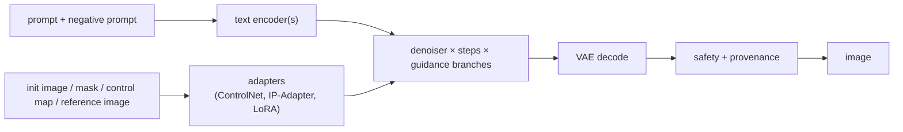
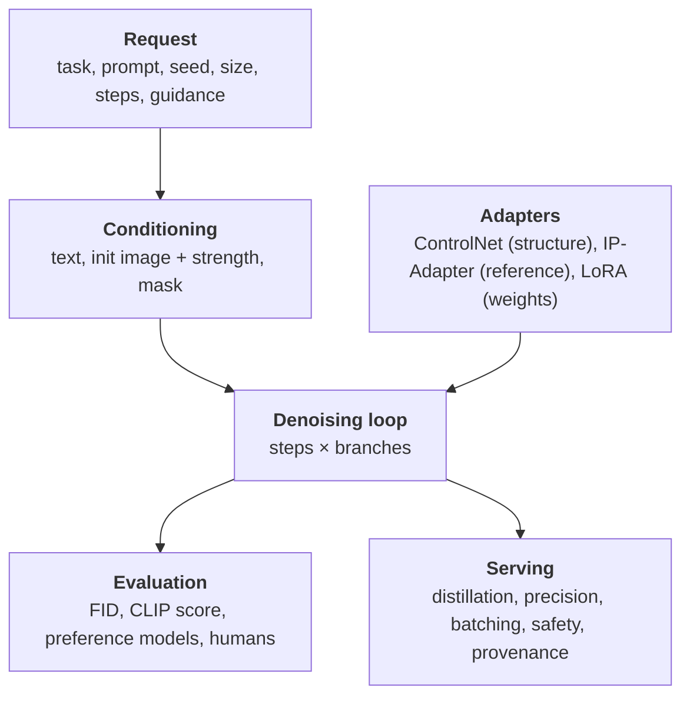

# Generative Media Module 06 — Image Generation

## 00 Why This Module Exists

A production image generator is not "a diffusion model." It is a pipeline of text encoders, a denoiser called many times, guidance arithmetic, optional structural and style adapters, a VAE decoder, and safety and provenance steps.
- Each request multiplies denoiser calls by steps, by guidance branches, and by adapters.
- Quality claims usually come from one metric computed one way. A change that improves that metric can still break what users care about.


- Legend: VAE: variational autoencoder that maps latents back to pixels; guidance branches: conditional and unconditional denoiser passes used by classifier-free guidance.

This module covers conditioned pipelines (text-to-image, image-to-image, inpainting), structural and style conditioning (ControlNet, IP-Adapter, LoRA), image-generation metrics, and serving cost with step distillation.
- The diffusion objective and samplers belong to [Generative Media Module 02](../02-diffusion/README.md).
- Latent spaces and the VAE belong to [Generative Media Module 03](../03-latent-diffusion/README.md).
- Transformer denoisers belong to [Generative Media Module 04](../04-diffusion-transformers/README.md); flow-matching samplers to [Module 05](../05-flow-matching/README.md).
- Temporal extensions belong to [Generative Media Module 07](../07-video-generation/README.md).

**Research status:** satellite 80/20 revision, 2026-11-26. Formulas below are derived in the text. Constants and behaviors attributed to papers or to the `huggingface/diffusers`, `lllyasviel/ControlNet`, and `torchmetrics` code were written from the cited sources but were **not** re-read against a pinned commit in this revision (`TODO_VERIFY`). All timings in worked examples are illustrative, not measurements. No benchmark numbers are imported.

**Module Orientation**

- **Engineering problem:** control what an image generator produces and what each request costs, and measure quality in a way that survives a model or sampler change.
- **What you will do:**
  - compute denoiser calls, latent sizes, and adapter parameter counts by hand;
  - sweep guidance, image-to-image strength, and ControlNet scale and measure their effects;
  - compute FID by hand in one dimension and measure its sample-size bias;
  - build a steps–quality–latency frontier for a full and a distilled model.
- **Environment:** Python 3.10+, PyTorch, `diffusers`, `torchmetrics` (or `clean-fid`), one GPU with at least 12 GB for SD-1.5-class models (larger for SDXL-class), and a fixed prompt set with seeds.
- **Evidence rule:** separate source observations (**O**), derivations (**D**), and hypotheses that need measurement (**H**).
- **If You Only Have One Week**: Lessons GM6.1 and GM6.4. They cover the request cost model and the serving frontier; adapters and metrics build on those two.

## 01 Baseline Assumptions

- [Generative Media Module 02](../02-diffusion/README.md): forward noising, noise prediction, and samplers.
- [Generative Media Module 03](../03-latent-diffusion/README.md): latent diffusion and the VAE downsampling factor.
- Core [Module 04](../../advanced-ai-engineering/04-serving-scheduling-capacity/README.md): batching, throughput, and tail latency.
- Core [Module 15](../../advanced-ai-engineering/15-evaluation-engineering/README.md): evaluation design and judge calibration.
- Mathematical prerequisites: vectors, matrix rank, means and covariances, and the matrix square root as a concept.

## 02 Target Mastery

```yaml
depth_contract:
  conceptual: REQUIRED
  mechanistic: REQUIRED
  mathematical: REQUIRED
  quantitative: REQUIRED
  implementation: REQUIRED
  source_code: SELECTIVE
  instrumentation: SELECTIVE
  experimental: REQUIRED
  statistical: SELECTIVE
  production_reasoning: REQUIRED
  failure_analysis: REQUIRED
  falsification: SELECTIVE
  security: SELECTIVE
  economics: REQUIRED
  architecture_tradeoff: SELECTIVE
  research_connection: SELECTIVE

estimated_effort:
  instruction: 2h
  guided_practice: 1.25h
  labs: 3h
  assessment: 0.75h
  source_trace: 0.5h
  total: 7.5h
```

The learner must be able to predict the denoiser work of any request, explain how each adapter injects its condition without destroying the base model, choose and compute quality metrics with their limits stated, and defend a serving configuration on a measured quality–latency frontier.

### LAYER 1: KNOWLEDGE / INSTRUCTIONAL LAYER

## 03 Knowledge Map


- Legend: strength: fraction of the noise schedule applied to an init image; branches: guidance passes per step.

Keep three questions separate:

1. **Control:** does the image follow the prompt, structure, and reference?
2. **Quality:** is the image distribution close to a reference distribution, and do people prefer it?
3. **Cost:** how many denoiser evaluations, at what precision and batch size, does one image take?

A change sold on one of these must be checked on the other two.

## 04 Lessons

### Lesson GM6.1 — Conditioned Pipelines: Guidance, Image-to-Image, and Inpainting

**Engineering Question:**
How many denoiser evaluations does one request cost, and which request parameters change that number?

**Concepts & Definitions:**

- **Classifier-free guidance (CFG):** at each step, run the denoiser with the condition and without it (or with a negative prompt), then extrapolate away from the unconditional prediction (**O**, Ho and Salimans):

$$
\hat\epsilon = \epsilon_u + w\,(\epsilon_c - \epsilon_u)
$$

where:

- $\hat\epsilon$ is the guided noise prediction used by the sampler;
- $\epsilon_c$ is the denoiser output with the prompt;
- $\epsilon_u$ is the output with the empty or negative prompt;
- $w$ is the guidance scale.

*Step-by-step reading.*

1. $w = 1$ gives $\hat\epsilon = \epsilon_c$: ordinary conditional sampling, no extra branch needed.
2. $w = 0$ gives $\epsilon_u$: the prompt is ignored.
3. $w > 1$ moves past $\epsilon_c$ in the direction $\epsilon_c - \epsilon_u$, which strengthens prompt adherence and usually reduces diversity. Very large $w$ oversaturates images.
4. A negative prompt replaces the empty prompt in $\epsilon_u$, so it only has an effect when the unconditional branch is computed.

- **Image-to-image (SDEdit-style):** noise an init image to an intermediate step and denoise from there (**O**, Meng et al.). With `strength` $s \in [0,1]$ and $N$ scheduled steps, about $\lfloor sN \rfloor$ steps actually run (**O**, diffusers `get_timesteps`, `TODO_VERIFY`).
- **Inpainting:** denoise only the masked region while the rest is kept from the original; dedicated inpainting checkpoints also take the mask and masked image as extra input channels.

Denoiser evaluations per image:

$$
E = S_{\text{run}} \cdot g
$$

where:

- $E$ is the number of denoiser forward passes for one image;
- $S_{\text{run}}$ is the number of sampler steps actually run ($N$ for text-to-image, about $\lfloor sN \rfloor$ for image-to-image);
- $g$ is the number of guidance branches per step: 2 with CFG, 1 without. Batching the two branches together halves calls but not FLOPs.

**Mechanism Explanation:**

Pipelines usually concatenate the conditional and unconditional inputs into one batch of 2 per step. Latency rises less than 2× at small batch because the GPU is underused, but throughput at full load roughly halves. Adapters such as ControlNet add their own forward pass per branch per step.

**Worked Example (request cost):**
*Input.* SDXL-class model, 1024×1024 output, VAE downsampling factor 8, 4 latent channels (**O**, `TODO_VERIFY`). Text-to-image with 30 steps and CFG; image-to-image with 30 steps, strength 0.6, CFG.

*Steps.*
- Latent: $1024 / 8 = 128$, so $128 \times 128 \times 4 = 65{,}536$ values per image.
- Text-to-image: $E = 30 \times 2 = 60$ denoiser passes.
- Image-to-image: $S_{\text{run}} = \lfloor 0.6 \times 30 \rfloor = 18$, so $E = 36$.
- Same image-to-image without CFG ($w = 1$): $E = 18$.

*Result.* Image-to-image at strength 0.6 costs 60% of text-to-image; removing CFG halves it again. Setting a negative prompt with $w = 1$ would cost nothing and do nothing.

**Knowledge Check:** A user reports that negative prompts "stopped working" after the team set `guidance_scale=1.0` to save latency. Explain why, using the CFG formula.

**Guided Practice:** With a fixed seed and prompt, sweep $w \in \{1, 3, 5, 7.5, 12\}$ and strength $\in \{0.3, 0.6, 0.9\}$. Log $E$ and wall time per image and save a contact sheet.

**Feedback Contract:**
- *Expected Evidence*: a table of $w$, strength, predicted $E$, measured denoiser calls (from a hook or counter), and wall time; predicted and counted calls match exactly.
- *Common Failure*: assuming wall time is proportional to $E$; text encoding, VAE decoding, and batch-of-2 effects break proportionality.
- *Diagnostic Hint*: wrap the denoiser `forward` with a counter before timing anything.
- *Concept to Revisit*: Cost question.

**Learning Outcome:** Predict denoiser work for any request and explain what guidance and strength do to output and cost.

*(Effort: 30m instruction, 20m practice)*

### Lesson GM6.2 — Structural and Style Conditioning: ControlNet, IP-Adapter, LoRA

**Engineering Question:**
How can a new condition be added to a pretrained generator without damaging what it already does?

**Concepts & Definitions:**

- **ControlNet:** freeze the base denoiser, make a trainable copy of its encoder blocks, feed the control map (edges, depth, pose, segmentation) into the copy, and add the copy's outputs back to the base through **zero convolutions**: $1\times1$ convolutions whose weights and biases start at zero (**O**, Zhang et al.).

$$
y_c = \mathcal{F}(x;\Theta) + \mathcal{Z}\big(\mathcal{F}(x + \mathcal{Z}(c;\Theta_{z1});\Theta_c);\Theta_{z2}\big)
$$

where:

- $x$ is the block input feature map and $c$ is the encoded control map;
- $\mathcal{F}(\cdot;\Theta)$ is the frozen base block with weights $\Theta$; $\Theta_c$ is its trainable copy;
- $\mathcal{Z}(\cdot;\Theta_{z})$ is a zero convolution with weights $\Theta_{z1}$ or $\Theta_{z2}$;
- $y_c$ is the block output passed on to the base model.

*Step-by-step reading.*

1. At initialization both zero convolutions output 0, so $y_c = \mathcal{F}(x;\Theta)$: the model is exactly the pretrained one.
2. The gradient of a zero convolution's weight is its input times the upstream gradient. The input is not zero, so the weights move on the first update even though the output starts at zero.
3. Training therefore starts from the base behavior and adds control gradually, instead of starting from random noise injected into a good model.
4. At inference, a **conditioning scale** multiplies the added term; 0 recovers the base model.

- **IP-Adapter:** encode a reference image with an image encoder and add a second cross-attention over image tokens next to the text cross-attention (**O**, Ye et al.):

$$
z = \mathrm{Attn}(Q, K_t, V_t) + \lambda\,\mathrm{Attn}(Q, K_i, V_i)
$$

where $Q$ comes from the denoiser features, $K_t, V_t$ from text tokens, $K_i, V_i$ from image-prompt tokens through new trainable projections, and $\lambda$ is the image-prompt scale.

- **LoRA:** replace a weight update $\Delta W \in \mathbb{R}^{d\times k}$ with $BA$, where $B \in \mathbb{R}^{d\times r}$, $A \in \mathbb{R}^{r\times k}$, and $r \ll \min(d,k)$ (**O**, Hu et al.). Trainable parameters drop from $dk$ to $r(d+k)$.

**Mechanism Explanation:**

ControlNet constrains *where* things go, IP-Adapter constrains *what it looks like*, and LoRA changes the base weights for a concept or style. They stack, and they interact: a strong control scale can fight the prompt, and several LoRAs can conflict. Each one is a new contract field that must be logged per request.

**Worked Example (zero convolution and LoRA size):**
*Input.* A zero convolution with scalar weight $W = 0$, bias $b = 0$, input $x = 3$, and upstream gradient $\partial L / \partial y = 0.5$. A LoRA on a $1280 \times 1280$ projection with $r = 16$.

*Steps.*
- Forward: $y = Wx + b = 0$, so the base output is unchanged.
- $\partial L / \partial W = x \cdot \partial L / \partial y = 1.5$; $\partial L / \partial b = 0.5$.
- One SGD step with learning rate 0.1: $W = -0.15$, $b = -0.05$. The control path is now active.
- LoRA: full $dk = 1{,}638{,}400$; LoRA $r(d+k) = 16 \times 2{,}560 = 40{,}960$, i.e. 2.5% of the full matrix.

*Result.* Zero initialization protects the pretrained model at step 0 without blocking learning, and LoRA makes per-concept weights small enough to store and swap per request.

**Knowledge Check:** Why would initializing the ControlNet copy randomly (instead of copying the base encoder) and using ordinary convolutions likely damage the base model early in training?

**Guided Practice:** Generate from one Canny-edge control map with ControlNet scale $\in \{0, 0.25, 0.5, 1.0, 1.5\}$, fixed prompt and seed. Measure edge agreement (Canny on output versus input map, F1 or IoU) and note prompt adherence by eye.

**Feedback Contract:**
- *Expected Evidence*: edge agreement rising with scale, scale 0 matching the base model output for the same seed, and at least one scale where the prompt starts losing to the control map.
- *Common Failure*: comparing across scales with different seeds, which confounds control strength with sampling noise.
- *Diagnostic Hint*: if scale 0 does not reproduce the base image, the pipeline is not the same base model or not the same seed.
- *Concept to Revisit*: Zero initialization; Control question.

**Learning Outcome:** Explain how each adapter injects its condition and measure the control–adherence trade-off.

*(Effort: 35m instruction, 20m practice)*

### Lesson GM6.3 — Measuring Image Generation: FID, CLIP Score, and Preference

**Engineering Question:**
Which metric answers which question, and when does a metric gain not mean a better product?

**Concepts & Definitions:**

- **Fréchet Inception Distance (FID):** fit a Gaussian to Inception-v3 pool features (2048-dimensional) of real images and of generated images, then compute the Fréchet distance between the two Gaussians (**O**, Heusel et al.):

$$
\mathrm{FID} = \lVert \mu_r - \mu_g \rVert^2 + \mathrm{Tr}\!\left(\Sigma_r + \Sigma_g - 2(\Sigma_r\Sigma_g)^{1/2}\right)
$$

where:

- $\mu_r, \Sigma_r$ are the mean and covariance of features of the reference (real) set;
- $\mu_g, \Sigma_g$ are the mean and covariance of features of the generated set;
- $\mathrm{Tr}$ is the matrix trace and $(\cdot)^{1/2}$ the matrix square root. Lower is better.

*Step-by-step reading in one dimension.*

1. With scalar features, $\Sigma = \sigma^2$ and $(\sigma_r^2\sigma_g^2)^{1/2} = \sigma_r\sigma_g$.
2. FID becomes $(\mu_r - \mu_g)^2 + \sigma_r^2 + \sigma_g^2 - 2\sigma_r\sigma_g = (\mu_r - \mu_g)^2 + (\sigma_r - \sigma_g)^2$.
3. So FID penalizes a shifted mean (wrong content on average) and a wrong spread (too little or too much diversity).

- **Sample-size bias:** covariance estimated from few samples is noisy, and FID computed on small sets is biased upward. FID values are comparable only at the same sample count, reference set, image resizing, and feature extractor implementation.
- **CLIP score:** cosine similarity between CLIP image and text embeddings, often scaled by 100 and clipped at 0 (**O**, Hessel et al.; scaling convention per `torchmetrics`, `TODO_VERIFY`). It measures prompt alignment, not image quality.
- **Preference models:** reward models trained on human comparisons (for example ImageReward, Xu et al.) predict which image people prefer. They are learned judges with their own biases.

**Mechanism Explanation:**

FID compares distributions through features trained for ImageNet classification, so it can reward matching ImageNet-like statistics rather than what users value, and it says nothing about prompt adherence (**O**, Kynkäänniemi et al.; Jayasumana et al.). CLIP score checks alignment but saturates and can be gamed by text rendered in the image. Preference models track human taste on their training distribution. Use each for its question and confirm product decisions with a small, blinded human comparison (core [Module 15](../../advanced-ai-engineering/15-evaluation-engineering/README.md)).

**Worked Example (FID in one dimension):**
*Input.* Reference features with $\mu_r = 0$, $\sigma_r = 1$. Model A: $\mu = 0.3$, $\sigma = 1.0$. Model B: $\mu = 0$, $\sigma = 0.5$.

*Steps.*
- A: $(0 - 0.3)^2 + (1 - 1)^2 = 0.09$.
- B: $(0 - 0)^2 + (1 - 0.5)^2 = 0.25$.

*Result.* A has the better FID despite a shifted mean; B has the right mean but half the diversity. FID mixes the two failure types into one number, so report it with a precision/recall-style or diversity check when the distinction matters.

**Knowledge Check:** Model C has better FID than model D on 1,000 samples but worse on 10,000. Give two reasons this can happen without either model changing.

**Guided Practice:** Compute FID between two halves of the *same* real dataset at $n \in \{500, 1{,}000, 5{,}000\}$ per half. Then compute FID for one model at the same $n$ values.

**Feedback Contract:**
- *Expected Evidence*: real-vs-real FID is above zero and falls as $n$ grows; the model's FID also falls with $n$; the learner states the sample count and feature implementation with every FID value.
- *Common Failure*: comparing a number from a paper with a locally computed FID that used different resizing, reference set, or $n$.
- *Diagnostic Hint*: the real-vs-real value at your $n$ is the noise floor; differences smaller than its spread across reseeds are not evidence.
- *Concept to Revisit*: Quality question.

**Learning Outcome:** Choose a metric for a stated question, compute FID correctly, and report its comparability conditions.

*(Effort: 30m instruction, 20m practice)*

### Lesson GM6.4 — Serving Economics: Step Distillation, Precision, and Safety

**Engineering Question:**
What does a 4-step distilled model buy over a 30–50-step model, and what does it give up?

**Concepts & Definitions:**

- **Step distillation:** train a student to produce in few steps what the teacher produces in many. Latent Consistency Models (LCM) target roughly 2–8 steps; adversarial diffusion distillation (SDXL-Turbo) targets 1–4 steps and is typically run without CFG (**O**, Luo et al.; Sauer et al.; `TODO_VERIFY` for recommended settings).
- **Precision:** FP16/BF16 is the usual baseline; FP8 or INT8 weights/activations reduce memory and can raise throughput on supporting hardware, with quality checked per model.
- **Engine compilation:** graph compilers such as TensorRT fuse kernels for a fixed shape set; changing resolution or batch outside the built profiles costs a rebuild or a fallback.

Per-image GPU time at batch size $b$:

$$
t_{\text{img}} = \frac{S_{\text{run}}\, g\, t_d(b) + t_{\text{text}}(b) + t_{\text{vae}}(b)}{b}
$$

where:

- $t_{\text{img}}$ is GPU time per image at steady state;
- $S_{\text{run}}$ and $g$ are as in Lesson GM6.1;
- $t_d(b)$ is the time of one denoiser pass on a batch of $b$ images;
- $t_{\text{text}}(b)$ and $t_{\text{vae}}(b)$ are text-encoding and VAE-decoding time for the batch.

**Mechanism Explanation:**

Distillation cuts $S_{\text{run}}$ and often removes the second guidance branch, so the denoiser term can fall by more than 10×. The fixed terms (text encoder, VAE decode) do not shrink, so they become a large share of latency. Removing CFG also removes negative prompts and the guidance knob. Quality loss shows up first in fine detail, text rendering, and diversity rather than in average metrics.

**Worked Example (illustrative timings, not measurements):**
*Input.* Assume $b = 1$, $t_d = 40$ ms, $t_{\text{text}} = 15$ ms, $t_{\text{vae}} = 60$ ms.

*Steps.*
- Full model, 50 steps with CFG run as a batch of 2: assume $t_d(2) = 60$ ms, so denoiser time $50 \times 60 = 3{,}000$ ms; total $3{,}075$ ms.
- Distilled model, 4 steps, no CFG: $4 \times 40 = 160$ ms; total $235$ ms.
- Speedup: $3{,}075 / 235 = 13.1\times$.
- VAE share of latency: $60 / 3{,}075 = 2\%$ before, $60 / 235 = 26\%$ after.

*Result.* After distillation, the VAE decoder and text encoder are the next optimization targets, and a GPU that served about 0.33 images/s per stream can serve about 4.3.

**Safety and provenance:**
- Attach provenance metadata (for example C2PA manifests) and consider an invisible watermark; metadata is stripped easily, and watermarks have documented removal attacks, so neither proves an image is unmodified (**O**, Fernandez et al.; Wen et al., `TODO_VERIFY`).
- Run input and output safety classification. IP-Adapter and per-person LoRAs make identity imitation easy; require consent for real-person identity adapters and log adapter IDs per request.
- Treat user-uploaded LoRA or adapter files as untrusted code paths: load only safe tensor formats. See core [Module 18](../../advanced-ai-engineering/18-ai-security/README.md).

**Knowledge Check:** After moving to a 4-step model, P50 latency fell 12× but P99 fell only 3×. Name two request-path components whose cost did not shrink.

**Guided Practice:** For one full and one distilled model, measure $t_d(b)$, $t_{\text{text}}$, and $t_{\text{vae}}$ at $b \in \{1, 4\}$ and fill in the formula. Compare predicted and measured per-image time.

**Feedback Contract:**
- *Expected Evidence*: a component table per model, predicted versus measured $t_{\text{img}}$ within about 10%, and the share of each component.
- *Common Failure*: timing without CUDA synchronization, or including model load and compile time in per-image latency.
- *Diagnostic Hint*: warm up, synchronize before reading the clock, and time each stage separately.
- *Concept to Revisit*: Cost question.

**Learning Outcome:** Build a component cost model for image serving and state what distillation trades away.

*(Effort: 25m instruction, 15m practice)*

## 05 Literature & Production Source Map

**REFERENCE / BASELINE**

- [Classifier-Free Diffusion Guidance](https://arxiv.org/abs/2207.12598) — Ho and Salimans (2022). Reading pointer: the guided score combination and the diversity–fidelity trade-off.
- [SDEdit](https://arxiv.org/abs/2108.01073) — Meng et al. (2021). Reading pointer: noising an input to an intermediate time and denoising (the basis of image-to-image).
- [Adding Conditional Control to Text-to-Image Diffusion Models (ControlNet)](https://arxiv.org/abs/2302.05543) — Zhang, Rao, and Agrawala (2023). Reading pointer: zero convolutions and the trainable copy.
- [IP-Adapter](https://arxiv.org/abs/2308.06721) — Ye et al. (2023). Reading pointer: decoupled cross-attention.
- [LoRA](https://arxiv.org/abs/2106.09685) — Hu et al. (2021).
- [GANs Trained by a Two Time-Scale Update Rule … (FID)](https://arxiv.org/abs/1706.08500) — Heusel et al. (2017).
- [CLIPScore](https://arxiv.org/abs/2104.08718) — Hessel et al. (2021).
- [SDXL](https://arxiv.org/abs/2307.01952) — Podell et al. (2023).

**WORKLOAD-DEPENDENT**

- [Latent Consistency Models](https://arxiv.org/abs/2310.04378) — Luo et al. (2023) and [Adversarial Diffusion Distillation (SDXL-Turbo)](https://arxiv.org/abs/2311.17042) — Sauer et al. (2023). Author-reported quality at few steps; check on your prompts.
- [ImageReward](https://arxiv.org/abs/2304.05977) — Xu et al. (2023). A learned judge; its preferences reflect its annotation set.

**FRONTIER / CRITIQUE**

- [The Role of ImageNet Classes in Fréchet Inception Distance](https://arxiv.org/abs/2203.06026) — Kynkäänniemi et al. (2022).
- [Rethinking FID: Towards a Better Evaluation Metric for Image Generation (CMMD)](https://arxiv.org/abs/2401.09603) — Jayasumana et al. (2024).
- Watermarking: [Stable Signature](https://arxiv.org/abs/2303.15435) — Fernandez et al. (2023); [Tree-Ring Watermarks](https://arxiv.org/abs/2305.20030) — Wen et al. (2023). Both report robustness under their own attack sets.

**CURRENT DEFAULT:** log every request's model, sampler, steps, guidance, seed, size, and adapter IDs; evaluate with a fixed prompt set using an alignment metric, a distribution metric at a declared sample count, and a small blinded human check.

**LEGACY / INSUFFICIENT:** a single FID number without $n$ and implementation; CLIP score as a quality metric; latency quoted without steps and guidance; distillation shipped on average metrics alone.

**PRODUCTION SOURCE TRACE** (pin the commit you read; no commit was pinned in this revision)

- `huggingface/diffusers`:
  - `StableDiffusionPipeline.__call__`: batching of conditional and unconditional inputs and the guidance combination (Lesson GM6.1).
  - `StableDiffusionImg2ImgPipeline.get_timesteps`: how `strength` selects the starting step.
  - `ControlNetModel` and the zero-module initialization of its output convolutions (Lesson GM6.2).
- `lllyasviel/ControlNet`, `cldm/cldm.py`: `zero_module` and the control injection path.
- `torchmetrics`, `image/fid.py`: `FrechetInceptionDistance` feature extraction and the matrix square root.
- Scope: reference implementations; production engines may reorder or fuse these steps.

### LAYER 2: ENGINEERING PRACTICE LAYER

## 06 Engineering Labs

All labs follow `PREDICT → BUILD → MEASURE → EXPLAIN → BREAK → IMPROVE → FALSIFY`.

### LAB A — Control Surfaces: Guidance, Strength, and ControlNet Scale

- **Objective:** map how guidance scale, image-to-image strength, and ControlNet scale change adherence, structure fidelity, diversity, and cost.
- **Pre-Registered Hypothesis:** prompt alignment rises with $w$ up to a point and then flattens while diversity falls; edge agreement rises with ControlNet scale while prompt alignment eventually falls.
- **Independent Variables:** $w$, strength, ControlNet scale, seed (5 seeds per setting).
- **Dependent Variables:** CLIP score, edge F1/IoU versus the control map, pairwise feature distance across seeds (diversity), denoiser call count, and wall time.
- **Break & Falsify:** set $w = 1$ with a negative prompt; set strength 1.0 and check that the init image no longer matters; feed a control map at the wrong resolution.
- **Alignment:** Lessons GM6.1 and GM6.2.
- **Effort Estimate:** 1.5h.

### LAB B — Metric Noise Floor and Serving Frontier

- **Objective:** measure FID's sample-size behavior and build a steps–quality–latency frontier for a full and a distilled model.
- **Pre-Registered Hypothesis:** FID differences between the two models at $n = 1{,}000$ are within the real-vs-real spread for at least one prompt slice, and the distilled model's latency gain is smaller at P99 than at P50.
- **Independent Variables:** model, steps, guidance on/off, batch size, sample count $n$.
- **Dependent Variables:** FID at each $n$, CLIP score, preference-model score, a 20-pair blinded human comparison, per-stage latency (P50/P99), and images per second.
- **Break & Falsify:** compute FID with mismatched resizing; time without synchronization; evaluate only on prompts the distilled model was tuned on.
- **Alignment:** Lessons GM6.3 and GM6.4, Incident GM6.1.
- **Effort Estimate:** 1.5h.

**Runnable arithmetic check (CPU; not a quality experiment):**
```python
import math
# GM6.1 request cost
assert (1024 // 8) ** 2 * 4 == 65_536
assert 30 * 2 == 60 and math.floor(0.6 * 30) * 2 == 36
eps_u, eps_c = 0.2, 0.5
guided = lambda w: eps_u + w * (eps_c - eps_u)
assert guided(1.0) == eps_c and guided(0.0) == eps_u
assert math.isclose(guided(7.5), 2.45)
# GM6.2 zero conv and LoRA
W, b, x, g = 0.0, 0.0, 3.0, 0.5
assert W * x + b == 0.0
W, b = W - 0.1 * x * g, b - 0.1 * g
assert math.isclose(W, -0.15) and math.isclose(b, -0.05)
assert 1280 * 1280 == 1_638_400 and 16 * (1280 + 1280) == 40_960
assert math.isclose(40_960 / 1_638_400, 0.025)
# GM6.3 one-dimensional FID
fid1d = lambda mr, sr, mg, sg: (mr - mg) ** 2 + sr**2 + sg**2 - 2 * sr * sg
assert math.isclose(fid1d(0, 1, 0.3, 1.0), 0.09)
assert math.isclose(fid1d(0, 1, 0, 0.5), 0.25)
# GM6.4 illustrative serving model
full = 50 * 60 + 15 + 60
distilled = 4 * 40 + 15 + 60
assert (full, distilled) == (3075, 235)
assert round(full / distilled, 1) == 13.1
assert round(60 / distilled, 2) == 0.26
```

## 07 Break / Incident Scenarios

### Incident GM6.1 — Distilled Model Rollout: Faster, Same Scores, Angry Users

**Incident Symptoms:**
A team replaces a 30-step SDXL-class model with a 4-step distilled model. Median latency falls about 10×. Offline CLIP score is unchanged and FID on 1,000 images improves slightly. Within a week, support tickets report that negative prompts are ignored, text in images is garbled, and outputs for the same prompt look alike. P99 latency improved far less than P50.

**Diagnostic Protocol (Task):**
1. **Form Competing Hypotheses:** guidance disabled (so negative prompts are inert), reduced diversity from distillation, text-rendering regression, FID noise at $n = 1{,}000$, evaluation prompts unrepresentative of traffic, fixed costs (VAE, text encoder, safety checker, queueing) dominating the tail.
2. **Identify Missing Evidence:** per-request guidance scale and branches, prompt-category mix of traffic versus evaluation set, real-vs-real FID spread at $n = 1{,}000$, per-stage latency, and a diversity measure per prompt.
3. **Design Discriminating Measurements:** replay 200 sampled production prompts on both models with 4 seeds each; measure diversity, text-rendering accuracy on a text-in-image slice, and a blinded human comparison; time each stage.
4. **Rank Explanations:** an inert negative prompt is confirmed directly by the guidance setting; diversity and text regressions need the slice results; tail latency needs the stage breakdown.
5. **Intervene:** route negative-prompt and text-rendering requests to the full model, or enable guidance where the distilled model supports it; optimize the VAE and safety stages for the tail.
6. **Remeasure:** slice metrics, human preference, and per-stage P50/P99 under production load, with the routing rule active.

### LAYER 3: MASTERY / ASSESSMENT LAYER

## 08 Mastery Assessment

### Transfer Problem — Product Photo Generator with Layout Control

A retailer wants on-brand product images: a fixed product layout from a sketch, brand style from reference photos, a 2 s P95 latency target, and a clear provenance policy.

**Required Deliverables:**
1. a request contract listing model, sampler, steps, guidance, seed, size, and every adapter with its scale;
2. hand-computed denoiser calls and an illustrative latency budget for the full and a distilled configuration;
3. LAB A evidence choosing ControlNet and IP-Adapter scales, with the trade-off shown;
4. an evaluation plan with an alignment metric, FID at a stated $n$ with its noise floor, and a blinded human check;
5. a serving recommendation from the LAB B frontier, including which request types route to which model;
6. a safety and provenance plan: watermark or metadata, consent rules for identity adapters, and adapter file handling.

## 09 Required Evidence & Rubric

### Required Artifact: Image Generation Release Report

Submit the request contract, LAB A control sweeps, LAB B metric noise floor and serving frontier, the Incident GM6.1 diagnosis, and the safety plan.

### Rubric Dimensions

- **Mechanism:** *Insufficient* says "use ControlNet for control." *Competent* explains guidance, strength, zero convolutions, and decoupled attention. *Strong* predicts each knob's effect on output and cost before measuring.
- **Evaluation:** *Insufficient* reports one FID. *Competent* states $n$, implementation, and an alignment metric. *Strong* reports the noise floor, slices, and a human check that agrees or explains disagreement.
- **Economics:** *Insufficient* quotes median latency. *Competent* decomposes per-stage time. *Strong* links steps, guidance, and batch to throughput and tail, and routes by request type.
- **Safety:** *Insufficient* omits it. *Competent* adds a watermark or metadata. *Strong* states what provenance can and cannot prove and controls identity adapters.

## 10 Capability Traceability Matrix

| Capability | Taught | Practiced | Assessed | Evidence (artifact reviewers open) |
|---|---|---|---|---|
| Request cost and guidance | GM6.1 | GM6.1 Guided Practice; LAB A | Deliverables 1, 2; Incident GM6.1 | Call-count table matched to predictions |
| Adapter conditioning | GM6.2 | GM6.2 Guided Practice; LAB A | Deliverable 3 | Scale sweeps with edge agreement and adherence |
| Metric choice and FID | GM6.3 | GM6.3 Guided Practice; LAB B | Deliverable 4; Incident GM6.1 | Real-vs-real noise floor and FID at stated $n$ |
| Serving and distillation | GM6.4 | GM6.4 Guided Practice; LAB B | Deliverables 2, 5; Incident GM6.1 | Per-stage latency frontier and routing rule |
| Safety and provenance | GM6.4 | LAB B break cases | Deliverable 6 | Provenance and identity-adapter policy |

## 11 Exit Criteria & Module Wrap-Up

### Exit Criteria

A learner passes when they can predict denoiser work for any request, explain and measure each adapter's control trade-off, compute and report FID with its comparability conditions, and defend a serving configuration on a measured quality–latency frontier with a stated safety and provenance policy.

### Module Wrap-Up (Final Mental Model Reconstruction)

An image request is steps × branches × adapters plus fixed stages. Log every knob, measure quality with metrics matched to questions and a known noise floor, and treat any speedup as a trade whose losses must be found on slices, not averages.

### Cost & Telemetry Hook

- [Lesson 22.1](../../advanced-ai-engineering/22-ai-economics/README.md): cost per accepted image must include CFG branches, adapters, VAE decode, safety checks, and regenerations.
- [Lesson 23.1](../../advanced-ai-engineering/23-observability-reliability/README.md): emit model, steps, guidance, adapter IDs and scales, and per-stage timings per request so Incident GM6.1 is detectable from telemetry.

## 12 Competency Targets

```yaml
competency:
  sfia: 4
  bloom: Apply -> Evaluate
  solo: Relational
  dreyfus: Advanced Beginner -> Competent
```
