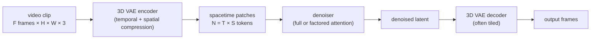
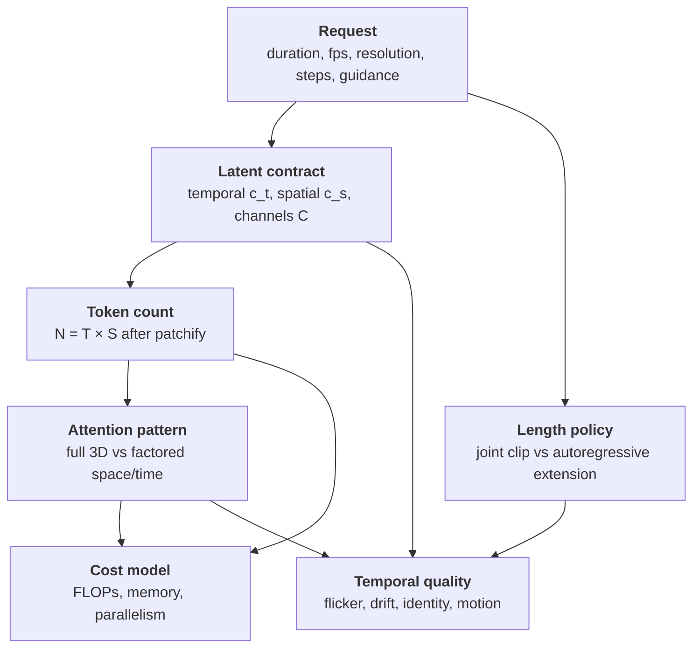

# Generative Media Module 07 — Video Generation

## 00 Why This Module Exists

A video model is an image model whose sequence length has been multiplied by the number of frames.
- Every cost that was manageable for one image (latent size, attention, activation memory, sampling steps) is now paid across time as well.
- Time also adds a failure class images do not have: frames that are each plausible but do not agree with each other (flicker, identity drift, impossible motion).


- Legend: F: pixel frames; T: latent frames; S: spatial tokens per latent frame; N: total tokens seen by the denoiser.

This module covers video latents, spatio-temporal attention, temporal consistency and long-video extension, and the compute and parallelism needed to sample a video model.
- Diffusion, latent diffusion, DiT, and flow-matching mechanics are taught in [Module 02](../02-diffusion/README.md), [Module 03](../03-latent-diffusion/README.md), [Module 04](../04-diffusion-transformers/README.md), and [Module 05](../05-flow-matching/README.md); this module reuses them unchanged.
- Conditioning and classifier-free guidance belong to [Module 06](../06-image-generation/README.md).
- Video models as learned simulators for planning belong to [World Models Module 02](../../world-models-embodied-ai/02-latent-world-models/README.md).

**Research status:** satellite 80/20 revision, 2026-11-26. Formulas and token/FLOP counts are derived in the text. Architecture constants attributed to papers (compression factors, channel counts, frame counts) and the `huggingface/diffusers` file paths were written from the cited sources but were **not** re-read against a pinned commit or paper version in this revision (`TODO_VERIFY`). Closed products are described only by what their public reports state. Every timing and hardware throughput figure is **illustrative**, not measured.

**Module Orientation**

- **Engineering problem:** predict the token count, attention cost, memory, and wall time of a video sampling job before running it, and diagnose temporal artifacts to the stage that caused them.
- **What you will do:**
  - compute video latent shapes and token counts by hand;
  - compare full and factored spatio-temporal attention in cost and in what they can model;
  - measure flicker and drift at chunk and tile boundaries;
  - build a sampling cost model and decide where sequence parallelism helps.
- **Environment:** Python 3.10+, PyTorch, NumPy, and `diffusers`. CPU is enough for LAB A. LAB B uses supplied clips on CPU; generating new clips with a small open model needs a GPU (COLAB-GPU optional).
- **Evidence rule:** separate source observations (**O**), derivations (**D**), and hypotheses that need measurement (**H**).
- **If You Only Have One Week**: Lessons GM7.1 and GM7.4. Token counting and the sampling cost model explain almost every engineering decision in video generation; attention variants and consistency build on them.

## 01 Baseline Assumptions

- [Module 03](../03-latent-diffusion/README.md) and [Module 04](../04-diffusion-transformers/README.md): VAE latents, patchification, and DiT blocks.
- [Module 06](../06-image-generation/README.md): classifier-free guidance doubles denoiser evaluations per step unless batched.
- Core [Module 02](../../advanced-ai-engineering/02-inference-gpu-fundamentals/README.md): FLOP counting, memory bandwidth, and achieved versus peak throughput.
- Core [Module 05](../../advanced-ai-engineering/05-inference-optimization/README.md): FlashAttention avoids materializing the attention matrix.
- Mathematical prerequisites: tensor shapes, big-O counting, square roots, and basic variance of a sum of independent terms.

## 02 Target Mastery

```yaml
depth_contract:
  conceptual: REQUIRED
  mechanistic: REQUIRED
  mathematical: REQUIRED
  quantitative: REQUIRED
  implementation: SELECTIVE
  source_code: SELECTIVE
  instrumentation: SELECTIVE
  experimental: SELECTIVE
  statistical: NOT_APPLICABLE
  production_reasoning: REQUIRED
  failure_analysis: REQUIRED
  falsification: SELECTIVE
  security: NOT_APPLICABLE
  economics: REQUIRED
  architecture_tradeoff: REQUIRED
  research_connection: SELECTIVE

estimated_effort:
  instruction: 2h
  guided_practice: 1.25h
  labs: 3h
  assessment: 0.75h
  source_trace: 0.5h
  total: 7.5h
```

The learner must be able to turn a requested clip (duration, frame rate, resolution) into latent shape, token count, attention cost, and sampling time; explain what factored attention gives up; and localize a temporal artifact to the VAE, the denoiser, the extension policy, or the parallel/tiling scheme.

### LAYER 1: KNOWLEDGE / INSTRUCTIONAL LAYER

## 03 Knowledge Map


- Legend: c_t: temporal compression factor; c_s: spatial compression factor per side; C: latent channels.

Keep three contracts separate:

1. **Latent contract:** VAE version, temporal and spatial compression, channels, causal first-frame handling, and tiling/overlap at decode.
2. **Sequence contract:** patch size, number of latent frames per denoiser call, attention pattern, and position encoding over time.
3. **Length contract:** how clips longer than one denoiser call are made: overlap, conditioning frames, and blending.

Temporal artifacts can originate in any of the three. Diagnose by holding two fixed and varying the third.

## 04 Lessons

### Lesson GM7.1 — Video Latents and Token Counts

**Engineering Question:**
How many tokens does the denoiser see for a requested clip, and how much does the video VAE compress?

**Concepts & Definitions:**

- **3D (spatio-temporal) VAE:** an autoencoder that compresses along time as well as height and width, typically with 3D or causal convolutions.
- **Causal first frame:** many video VAEs encode the first frame on its own and then compress each following group of $c_t$ frames into one latent frame. This lets the same VAE encode a single image (**O**, `TODO_VERIFY` per model).
- **Spacetime patch:** after encoding, each latent frame is split into $p \times p$ spatial patches; each patch of each latent frame becomes one token.

Latent shape and token count for a causal video VAE:

$$
T = 1 + \frac{F - 1}{c_t}, \qquad
S = \frac{H}{c_s\, p} \cdot \frac{W}{c_s\, p}, \qquad
N = T \cdot S
$$

where:

- $F$ is the number of pixel frames (chosen so that $F - 1$ is divisible by $c_t$);
- $H, W$ are the pixel height and width;
- $c_t$ is the temporal compression factor and $c_s$ the spatial compression factor per side;
- $p$ is the denoiser's spatial patch size in latent pixels;
- $T$ is the number of latent frames, $S$ the tokens per latent frame, and $N$ the total token count.

*Step-by-step reading.*

1. The first frame maps to one latent frame; the remaining $F - 1$ frames map to $(F - 1)/c_t$ latent frames.
2. Each latent frame is $(H/c_s) \times (W/c_s)$ latent pixels with $C$ channels.
3. Patchify divides each latent side by $p$, so $S$ tokens per latent frame, and $T \cdot S$ in total.

**Mechanism Explanation:**

The VAE sets the floor of the whole system: higher compression means fewer tokens and cheaper denoising, but fine motion and small details that the VAE cannot reconstruct are lost no matter how good the denoiser is. A larger $C$ partly compensates for stronger spatial compression.

**Worked Example (a CogVideoX-style configuration):**
*Input.* $F = 49$ frames at $480 \times 720$, $c_t = 4$, $c_s = 8$, $C = 16$, $p = 2$. These match the configuration reported for CogVideoX (**O**, `TODO_VERIFY`).

*Steps.*
- $T = 1 + 48/4 = 13$ latent frames.
- Latent frame: $480/8 \times 720/8 = 60 \times 90$, with 16 channels.
- Pixel values: $49 \times 480 \times 720 \times 3 = 50{,}803{,}200$.
- Latent values: $13 \times 60 \times 90 \times 16 = 1{,}123{,}200$.
- Compression: $50{,}803{,}200 / 1{,}123{,}200 \approx 45.2\times$.
- Tokens: $S = 30 \times 45 = 1{,}350$, so $N = 13 \times 1{,}350 = 17{,}550$.

*Result.* About 6 s of video at 8 fps becomes 17,550 tokens. A $1024 \times 1024$ image with the same $c_s = 8$, $p = 2$ is $64 \times 64 = 4{,}096$ tokens.

*Interpretation and limits.* Doubling frame rate or duration roughly doubles $T$; doubling resolution quadruples $S$. Both multiply into $N$, which then enters attention quadratically (Lesson GM7.2).

**Knowledge Check:** A product asks for the same 6 s clip at 16 fps instead of 8 fps. Using the formula, what happens to $T$ and $N$, and why is this not free even if the VAE compresses time by 4?

**Guided Practice:** Compute $T$, $S$, $N$, and the compression ratio for a 5 s clip at 24 fps ($F = 121$) and $720 \times 1280$, with $c_t = 4$, $c_s = 8$, $C = 16$, $p = 2$. Then load a pretrained video VAE, encode a real clip of that shape, and confirm the latent tensor shape.

**Feedback Contract:**
- *Expected Evidence*: $T = 1 + 120/4 = 31$; latent frame $90 \times 160$; $S = 45 \times 80 = 3{,}600$; $N = 111{,}600$; compression $= (121 \times 720 \times 1280 \times 3)/(31 \times 90 \times 160 \times 16) \approx 46.8\times$. The encoded tensor shape matches $T$ and the latent frame size.
- *Common Failure*: forgetting the causal first frame ($T = F/c_t$), or choosing $F$ so that $F - 1$ is not divisible by $c_t$ and silently losing frames.
- *Diagnostic Hint*: encode $F$ and $F + 1$ frames and compare $T$; the latent frame count reveals the VAE's padding rule.
- *Concept to Revisit*: Latent contract.

**Learning Outcome:** Convert a clip request into latent shape and token count, and state what the compression costs in detail.

*(Effort: 30m instruction, 15m practice)*

### Lesson GM7.2 — Full versus Factored Spatio-Temporal Attention

**Engineering Question:**
How much attention work does each pattern cost, and which interactions does factoring remove?

**Concepts & Definitions:**

- **Full 3D attention:** every token attends to all $N = T \cdot S$ tokens across space and time.
- **Factored attention:** a spatial layer where tokens attend only within their own latent frame, followed by a temporal layer where tokens attend only to the same spatial position in other frames. Several earlier video diffusion models use this pattern; several later ones use full 3D attention (**O**, see §05).
- **Score entries:** the number of query–key pairs, a proxy for attention FLOPs and for memory if scores are materialized.

Score entries per attention layer:

$$
A_{\text{full}} = N^2 = T^2 S^2, \qquad
A_{\text{fact}} = \underbrace{T \cdot S^2}_{\text{spatial}} + \underbrace{S \cdot T^2}_{\text{temporal}}
$$

where:

- $T$ is the number of latent frames and $S$ the tokens per latent frame;
- $A$ is the number of query–key score entries per head per layer.

*Step-by-step reading.*

1. Full attention: $N$ queries each score $N$ keys.
2. Spatial attention: each of the $T$ frames runs independent attention over $S$ tokens, $S^2$ each.
3. Temporal attention: each of the $S$ positions runs attention over its $T$ frames, $T^2$ each.
4. Ratio: $A_{\text{full}} / A_{\text{fact}} = T S / (S + T)$, which is large when both $T$ and $S$ are large.

**Mechanism Explanation:**

In factored attention, a token at frame $t$, position $s$ can reach frame $t'$, position $s'$ only through two hops (space then time, or time then space). An object that moves across positions over time must be tracked through these hops; fast or large motion is the case most likely to suffer (**H**, test it in LAB A/B). Full attention removes that limitation at quadratic cost in $N$. With FlashAttention-style kernels the $N^2$ matrix is never stored, so the binding constraint becomes FLOPs and time rather than score memory (core [Module 05](../../advanced-ai-engineering/05-inference-optimization/README.md)).

**Worked Example (17,550 tokens):**
*Input.* $T = 13$, $S = 1{,}350$ from Lesson GM7.1; fp16 scores.

*Steps.*
- Full: $A = 17{,}550^2 = 308{,}002{,}500$.
- Factored spatial: $13 \times 1{,}350^2 = 23{,}692{,}500$.
- Factored temporal: $1{,}350 \times 13^2 = 228{,}150$.
- Factored total: $23{,}920{,}650$; ratio $\approx 12.9\times$ fewer entries. Check with step 4: $13 \times 1{,}350 / 1{,}363 = 12.9$.
- If full scores were materialized in fp16: $308{,}002{,}500 \times 2 \approx 616$ MB per head per layer.

*Result.* Factoring saves an order of magnitude here, almost all of it from removing cross-frame, cross-position pairs. The temporal layer is cheap; the spatial layer dominates factored cost.

**Knowledge Check:** Doubling $T$ to 26 latent frames multiplies $A_{\text{full}}$ by what factor, and $A_{\text{fact}}$ by roughly what factor? Which pattern scales better with video length?

**Guided Practice:** On CPU or a small GPU, time one attention call with PyTorch's scaled-dot-product attention for full and factored patterns at toy sizes ($T \in \{4, 8, 16\}$, $S = 256$, one head, $d = 64$). Plot time against $T$ for both and compare with the formulas.

**Feedback Contract:**
- *Expected Evidence*: full-attention time grows close to $T^2$ and factored time close to linearly in $T$ at fixed $S$, with a note on where kernel overhead dominates small sizes.
- *Common Failure*: implementing temporal attention by reshaping $(T, S)$ in the wrong order, so it attends within a frame instead of across frames.
- *Diagnostic Hint*: feed a tensor where only frame 0 is non-zero; after a correct temporal layer, information appears in other frames only at the same spatial positions.
- *Concept to Revisit*: Sequence contract.

**Learning Outcome:** Compute attention cost for both patterns and explain the modeling capacity factoring gives up.

*(Effort: 30m instruction, 20m practice)*

### Lesson GM7.3 — Temporal Consistency and Long-Video Extension

**Engineering Question:**
When frames disagree, which stage caused it, and how does extending a clip beyond one denoiser call accumulate error?

**Concepts & Definitions:**

- **Flicker:** high-frequency frame-to-frame changes in regions that should be stable (texture, lighting, color).
- **Identity drift:** slow change of a subject's appearance over time.
- **Joint generation:** all latent frames of a clip are denoised together in one call; consistency is limited only by the model and VAE.
- **Autoregressive extension:** generate a clip, then generate the next clip conditioned on the last $k$ frames of the previous one, and blend the overlap. This allows arbitrary length but feeds generated frames back in as conditions.

Number of denoiser calls for a long video with overlapping chunks:

$$
n = 1 + \left\lceil \frac{F_{\text{total}} - F_c}{F_c - F_o} \right\rceil
$$

where:

- $F_{\text{total}}$ is the requested number of output frames;
- $F_c$ is the number of frames produced per call;
- $F_o$ is the number of overlapping (conditioning) frames shared with the previous call;
- $n$ is the number of calls; there are $n - 1$ chunk boundaries.

A simple drift model for an attribute (position, color, identity embedding) across boundaries:

$$
\text{drift}_n \approx (n-1)\,b + \sigma \sqrt{n-1}
$$

where $b$ is a systematic per-boundary bias and $\sigma$ the standard deviation of independent per-boundary error. It is a reasoning aid, not a fitted model.

*Step-by-step reading.*

1. The first call yields $F_c$ frames. Each later call yields $F_c - F_o$ new frames.
2. Bias adds linearly across boundaries; independent errors add in variance, so their standard deviation grows with the square root.

**Mechanism Explanation:**

Flicker has several distinct sources:
- the denoiser (independent noise per frame without enough temporal mixing);
- the VAE decoder (temporal chunks or spatial tiles decoded separately, creating seams in time or space);
- the length policy (chunk boundaries, conditioning on already-degraded frames).

Joint generation avoids boundary drift but caps length by memory and quadratic cost. Extension removes the cap but makes every boundary a place where errors enter and are then copied forward as conditions. Learned motion is a statistical regularity of training data, not a physics guarantee; violations such as objects merging or disappearing are expected outside the training distribution.

**Worked Example (20 s clip from 49-frame calls):**
*Input.* 20 s at 24 fps, so $F_{\text{total}} = 480$; $F_c = 49$; $F_o = 9$.

*Steps.*
- New frames per call after the first: $49 - 9 = 40$.
- $n = 1 + \lceil (480 - 49)/40 \rceil = 1 + \lceil 10.775 \rceil = 12$ calls, 11 boundaries.
- Illustrative drift with $b = 1$ px and $\sigma = 2$ px per boundary: bias $11$ px, random part $2\sqrt{11} \approx 6.6$ px.

*Result.* The bias term dominates after a few boundaries. Reducing a small systematic bias (for example, a color shift introduced by re-encoding conditioning frames) matters more than reducing random error.

**Knowledge Check:** Doubling the overlap $F_o$ to 18 reduces boundary artifacts in practice but changes $n$. Compute the new $n$ and state the cost trade-off.

**Guided Practice:** Take a supplied clip and its tiled and non-tiled VAE reconstructions. Compute mean absolute difference between consecutive frames, per frame index, on a static background mask. Mark where spikes coincide with temporal chunk or tile boundaries.

**Feedback Contract:**
- *Expected Evidence*: a per-frame curve where spikes in the tiled reconstruction align with decode chunk boundaries and are absent or smaller in the non-tiled one; the boundary indices are computed from the decode configuration, not read off the plot.
- *Common Failure*: blaming the denoiser for flicker that is already present in VAE reconstruction of real video.
- *Diagnostic Hint*: encode and decode a real clip with no denoising at all. Any flicker there belongs to the VAE.
- *Concept to Revisit*: Length contract; latent contract.

**Learning Outcome:** Separate VAE, denoiser, and length-policy causes of temporal artifacts, and predict boundary count and drift for a long clip.

*(Effort: 30m instruction, 20m practice)*

### Lesson GM7.4 — Sampling Cost, Memory, and Sequence Parallelism

**Engineering Question:**
How long will one clip take to sample, and when does splitting the sequence across GPUs help?

**Concepts & Definitions:**

- **Denoiser evaluations:** steps × guidance factor. Classifier-free guidance usually doubles evaluations (conditional and unconditional), whether run as two passes or as a batch of two.
- **Sequence (context) parallelism:** split the $N$ tokens across $G$ GPUs. DeepSpeed-Ulysses re-partitions by attention heads with all-to-all communication; Ring Attention passes key/value blocks around a ring (**O**, see §05).

Forward FLOPs per denoiser call (transformer denoiser, ignoring embeddings and the VAE):

$$
\Phi \approx 2 P N + 4 L N^2 d
$$

and total sampling FLOPs:

$$
\Phi_{\text{total}} = s \cdot g \cdot \Phi
$$

where:

- $P$ is the number of denoiser parameters in linear layers;
- $N$ is the token count (text tokens are ignored here);
- $L$ is the number of layers with full attention and $d$ the model (hidden) width;
- $s$ is the number of sampling steps and $g$ the guidance factor (2 with CFG, 1 without);
- $2PN$ counts matrix multiplies in linear layers; $4LN^2d$ counts $QK^\top$ and attention-times-$V$, each $2N^2d$ per layer.

*Step-by-step reading.*

1. Linear layers cost proportional to $N$; attention costs proportional to $N^2$.
2. The attention term overtakes the linear term when $4LN^2d > 2PN$, i.e. $N > P / (2Ld)$.
3. Wall time $\approx \Phi_{\text{total}} / R$ for an achieved throughput $R$ (FLOP/s), plus VAE decode and communication.

**Mechanism Explanation:**

For images, the linear term usually dominates. For video, $N$ is large enough that attention can match or exceed it, so attention kernels and sequence parallelism matter. Sequence parallelism reduces per-GPU activation memory and splits attention work, but adds communication per layer; it helps when per-GPU compute time per layer clearly exceeds the communication time. The VAE decoder is a separate memory peak; tiling lowers it at the risk of seams (Lesson GM7.3).

**Worked Example (a 5B-parameter denoiser, 17,550 tokens):**
*Input.* $P = 5 \times 10^9$, $L = 42$, $d = 3{,}072$, $N = 17{,}550$, $s = 50$, $g = 2$. These sizes are illustrative, chosen to be near published open models; they are not a specific model's configuration.

*Steps.*
- Linear: $2 \times 5\times10^9 \times 17{,}550 = 1.755 \times 10^{14}$.
- Attention: $4 \times 42 \times 17{,}550^2 \times 3{,}072 \approx 1.590 \times 10^{14}$.
- Per call: $\Phi \approx 3.345 \times 10^{14}$; crossover $N = P/(2Ld) \approx 19{,}376$, so attention is just below the linear term here.
- Total: $50 \times 2 \times 3.345\times10^{14} \approx 3.345 \times 10^{16}$ FLOPs.
- At an illustrative achieved $R = 400$ TFLOP/s on one GPU: about $84$ s of denoising, before VAE decode.
- Same model, $1024^2$ image ($N = 4{,}096$): attention term $(17{,}550/4{,}096)^2 \approx 18.4\times$ smaller.

*Result.* One short clip costs on the order of $10^{16}$ FLOPs. Doubling duration doubles the linear term but quadruples the attention term, which then dominates.

**Knowledge Check:** With $G = 4$ GPUs and perfect scaling, the illustrative 84 s becomes 21 s. Name two costs that make the real number larger, and which one grows with $L$.

**Guided Practice:** Build a small cost calculator from the formulas. For the worked configuration, plot linear FLOPs, attention FLOPs, and total sampling time against clip duration (2–20 s at 8 fps). Mark the duration where attention exceeds the linear term.

**Feedback Contract:**
- *Expected Evidence*: crossover at $N \approx 19{,}376$ tokens, which with $S = 1{,}350$ is $T \approx 14.4$ latent frames, about $1 + 4 \times 13.4 \approx 54$ pixel frames or roughly 7 s at 8 fps; the plot shows attention growing quadratically past it.
- *Common Failure*: counting steps but not the guidance factor, or quoting peak instead of achieved throughput.
- *Diagnostic Hint*: profile one denoiser call and compare measured time with $\Phi / R$; a large gap means $R$ is wrong or a non-modeled stage (VAE, text encoder, communication) dominates.
- *Concept to Revisit*: core [Module 02](../../advanced-ai-engineering/02-inference-gpu-fundamentals/README.md) achieved versus peak throughput.

**Learning Outcome:** Estimate sampling FLOPs and time for a clip request and reason about when sequence parallelism pays off.

*(Effort: 30m instruction, 20m practice)*

## 05 Literature & Production Source Map

All arXiv identifiers and reading pointers below were written from memory of the papers and not re-opened in this revision (`TODO_VERIFY`).

**REFERENCE / BASELINE**

- [Video Diffusion Models](https://arxiv.org/abs/2204.03458) — Ho et al. (2022). Reading pointer: the factorized space-time U-Net and joint image–video training.
- [Align your Latents: High-Resolution Video Synthesis with Latent Diffusion Models](https://arxiv.org/abs/2304.08818) — Blattmann et al. (2023). Reading pointer: inserting temporal layers into a pretrained image latent diffusion model.
- [Stable Video Diffusion](https://arxiv.org/abs/2311.15127) — Blattmann et al. (2023). Reading pointer: data curation stages for video training.
- [Latte: Latent Diffusion Transformer for Video Generation](https://arxiv.org/abs/2401.03048) — Ma et al. (2024). Reading pointer: comparison of spatial/temporal transformer block arrangements.
- [CogVideoX](https://arxiv.org/abs/2408.06072) — Yang et al. (2024). Reading pointer: 3D causal VAE and full 3D attention with an expert transformer (source of the Lesson GM7.1 configuration).
- [Towards Accurate Generative Models of Video (FVD)](https://arxiv.org/abs/1812.01717) — Unterthiner et al. (2018). The common distribution-level video metric; it does not localize temporal artifacts.

**PARALLELISM REFERENCES**

- [DeepSpeed-Ulysses](https://arxiv.org/abs/2309.14509) — Jacobs et al. (2023). All-to-all sequence parallelism over attention heads.
- [Ring Attention with Blockwise Transformers](https://arxiv.org/abs/2310.01889) — Liu et al. (2023). Key/value blocks passed around a ring of devices.

**WORKLOAD-DEPENDENT / FRONTIER**

- [Movie Gen](https://arxiv.org/abs/2410.13720) — Meta (2024), [HunyuanVideo](https://arxiv.org/abs/2412.03603) — Tencent (2024), and [Wan](https://arxiv.org/abs/2503.20314) — Wan team (2025): large open or documented video foundation models. Their quality claims are author-reported on their own benchmarks.
- OpenAI's [Video generation models as world simulators](https://openai.com/index/video-generation-models-as-world-simulators/) (2024) report states only that Sora is a diffusion transformer over spacetime patches of a compressed video latent. Treat any further internal detail as unknown.

**CURRENT DEFAULT:** a causal 3D VAE with temporal and spatial compression, a transformer denoiser over spacetime patches, flow-matching or diffusion training, and joint generation of a fixed-length clip; longer clips via overlapping extension.

**LEGACY / INSUFFICIENT:** treating video as independently generated images; quoting resolution and duration without token count; using FVD alone to claim temporal consistency; attributing all flicker to the denoiser.

**PRODUCTION SOURCE TRACE** (pin the commit you read; no commit was pinned in this revision; paths `TODO_VERIFY`)

- `huggingface/diffusers`, `src/diffusers/models/autoencoders/autoencoder_kl_cogvideox.py`: `AutoencoderKLCogVideoX`, its `enable_tiling` options and temporal frame batching in decode (Lessons GM7.1, GM7.3).
- `huggingface/diffusers`, `src/diffusers/models/transformers/cogvideox_transformer_3d.py`: `CogVideoXTransformer3DModel`, patch embedding and how text and video tokens enter attention (Lessons GM7.1, GM7.2).
- `huggingface/diffusers`, `src/diffusers/pipelines/cogvideo/pipeline_cogvideox.py`: `CogVideoXPipeline.__call__`, the step loop and guidance batching (Lesson GM7.4).
- Scope: one open implementation, not a universal design. Record the commit and the model revision you trace.

### LAYER 2: ENGINEERING PRACTICE LAYER

## 06 Engineering Labs

All labs follow `PREDICT → BUILD → MEASURE → EXPLAIN → BREAK → IMPROVE → FALSIFY`.

### LAB A — Token Budget and Attention Pattern Bench

- **Hardware:** CPU is sufficient at toy sizes; a single GPU makes the larger sizes faster.
- **Objective:** build a calculator from clip request to $T$, $S$, $N$, attention entries, and sampling FLOPs, then validate the attention scaling with measured toy kernels.
- **Pre-Registered Hypothesis:** measured full-attention time grows close to $T^2$ and factored time close to $T$ at fixed $S$, once sizes are large enough that kernel overhead is negligible.
- **Independent Variables:** duration, fps, resolution, patch size, attention pattern, $T$ and $S$ at toy scale.
- **Dependent Variables:** predicted $N$, score entries, FLOPs; measured time and peak memory per attention call.
- **Break & Falsify:** use an $F$ with $F - 1$ not divisible by $c_t$; reshape temporal attention in the wrong axis order and detect it with the frame-0 impulse test from Lesson GM7.2.
- **Alignment:** Lessons GM7.1, GM7.2, GM7.4.
- **Effort Estimate:** 1.5h.

### LAB B — Temporal Artifact Localization

- **Hardware:** CPU with supplied clips; COLAB-GPU optional to generate new clips with a small open video model.
- **Objective:** measure flicker and drift and attribute them to VAE decode, denoiser, or extension boundaries.
- **Pre-Registered Hypothesis:** in tiled or chunked decode, frame-difference spikes align with computed decode boundaries; in long extended clips, an attribute (mean color or subject embedding) drifts mostly linearly across chunk boundaries.
- **Independent Variables:** VAE tiling on/off, decode temporal chunk size, extension overlap $F_o$, number of extension calls.
- **Dependent Variables:** per-frame static-region frame difference, boundary-aligned spike ratio, attribute drift per boundary, and wall time.
- **Break & Falsify:** extend a clip to 12+ calls with minimal overlap; re-encode conditioning frames through a lossy path to inject a systematic bias and confirm the linear drift term.
- **Alignment:** Lesson GM7.3 and Incident GM7.1.
- **Effort Estimate:** 1.5h.

**Runnable arithmetic check (CPU; not a quality experiment):**
```python
import math
F, H, W, ct, cs, C, p = 49, 480, 720, 4, 8, 16, 2
T = 1 + (F - 1) // ct
lh, lw = H // cs, W // cs
assert (T, lh, lw) == (13, 60, 90)
pix, lat = F * H * W * 3, T * lh * lw * C
assert (pix, lat) == (50_803_200, 1_123_200) and round(pix / lat, 1) == 45.2
S = (lh // p) * (lw // p)
N = T * S
assert (S, N) == (1_350, 17_550)
full, fact = N ** 2, T * S ** 2 + S * T ** 2
assert (full, fact) == (308_002_500, 23_920_650) and round(full / fact, 1) == 12.9
assert math.isclose(full * 2 / 1e6, 616.005)                 # fp16 MB per head/layer
# guided practice GM7.1: 5 s, 24 fps, 720x1280
T2, S2 = 1 + 120 // 4, (720 // 16) * (1280 // 16)
assert (T2, S2, T2 * S2) == (31, 3_600, 111_600)
assert round(121 * 720 * 1280 * 3 / (31 * 90 * 160 * 16), 1) == 46.8
# GM7.3: long video
n = 1 + math.ceil((480 - 49) / (49 - 9))
assert n == 12
assert round(2 * math.sqrt(n - 1), 1) == 6.6
# GM7.4: sampling cost
P, L, d, s, g = 5e9, 42, 3072, 50, 2
lin, att = 2 * P * N, 4 * L * N ** 2 * d
assert math.isclose(lin, 1.755e14) and math.isclose(att, 1.5895885824e14)
assert round(P / (2 * L * d)) == 19_376
total = s * g * (lin + att)
assert round(total / 4e14) == 84                             # illustrative 400 TFLOP/s
assert round((N / 4096) ** 2, 1) == 18.4
print("OK")
```

## 07 Break / Incident Scenarios

### Incident GM7.1 — Periodic Flicker After a Latency Optimization

**Incident Symptoms:**
To cut latency, a team enables tiled VAE decoding, raises output length from 49 to 97 frames via overlapping extension, and moves sampling to 4-GPU sequence parallelism. Median latency falls, but users report a brightness pulse roughly every 2 s, a visible seam across the frame in some clips, and faces that change slightly after the midpoint. GPU cost per clip rises.

**Diagnostic Protocol (Task):**
1. **Form Competing Hypotheses:** decode tile or temporal-chunk seams; extension boundary bias; a numerical difference from sequence-parallel attention; changed sampling steps or guidance; a different VAE or model revision; or prompt-mix change.
2. **Identify Missing Evidence:** decode tile size, overlap, temporal chunk size; extension $F_c$ and $F_o$; parallel degree and attention backend; model and VAE revisions; per-frame difference curves.
3. **Design Discriminating Measurements:** reconstruct real video through the VAE with and without tiling (no denoiser); generate one fixed seed with and without sequence parallelism and compare latents; generate 49 versus 97 frames with the same seed and compare drift at the boundary.
4. **Rank Explanations:** artifacts present in VAE-only reconstruction implicate decoding; artifacts aligned with computed extension boundaries implicate the length policy; latent differences only under parallelism implicate the attention path.
5. **Intervene:** increase tile and chunk overlap or blend, increase $F_o$ or fix the conditioning re-encode bias, or pin the attention backend, according to the evidence.
6. **Remeasure:** boundary-aligned spike ratio, attribute drift per boundary, latency, and cost per clip, on the same prompts and seeds.

### LAYER 3: MASTERY / ASSESSMENT LAYER

## 08 Mastery Assessment

### Transfer Problem — Sizing a 15-Second Video Feature

A product team wants 15 s clips at 720p and 24 fps, delivered within a latency target, from an open video model with a causal 3D VAE ($c_t = 4$, $c_s = 8$, $C = 16$) and a transformer denoiser with $p = 2$.

**Required Deliverables:**
1. latent, sequence, and length contracts, with every parameter named;
2. hand-computed $T$, $S$, $N$ for a single joint call and for an extension plan, with the number of calls and boundaries;
3. FLOP and illustrative time estimates per clip, separating linear and attention terms, with and without CFG;
4. a recommendation between joint generation and extension, and between full and factored attention if a choice exists, with the trade-offs stated;
5. LAB B evidence locating at least one temporal artifact to a specific stage;
6. a sequence-parallel plan with the communication cost it adds and the condition under which it pays off.

## 09 Required Evidence & Rubric

### Required Artifact: Video Sampling Budget and Artifact Report

Submit the three contracts, the LAB A calculator and scaling plots, the LAB B boundary analysis, and the Incident GM7.1 diagnosis.

### Rubric Dimensions

- **Mechanism:** *Insufficient* says "video is many images." *Competent* explains VAE compression, spacetime patches, and attention patterns. *Strong* predicts which artifacts each design choice can and cannot produce.
- **Quantitative:** *Insufficient* quotes resolution and duration. *Competent* computes tokens, attention entries, and FLOPs. *Strong* identifies the linear/attention crossover and links it to the product's duration range.
- **Diagnosis:** *Insufficient* blames the model. *Competent* separates VAE-only reconstruction from generation. *Strong* aligns artifacts with computed boundaries and confirms with a controlled change.
- **Economics:** *Insufficient* ignores guidance and steps. *Competent* counts $s \cdot g$ evaluations. *Strong* states cost per clip under parallelism with communication and VAE decode included.

## 10 Capability Traceability Matrix

| Capability | Taught | Practiced | Assessed | Evidence (artifact reviewers open) |
|---|---|---|---|---|
| Video latent shape and token count | GM7.1 | GM7.1 Guided Practice; LAB A | Deliverables 1, 2 | Calculator output matched to encoded tensor shape |
| Full vs factored attention cost and capacity | GM7.2 | GM7.2 Guided Practice; LAB A | Deliverable 4 | Measured scaling plot versus formula; frame-0 impulse test |
| Temporal artifact localization | GM7.3 | GM7.3 Guided Practice; LAB B | Deliverable 5; Incident GM7.1 | Boundary-aligned frame-difference curves, VAE-only control |
| Sampling cost and parallelism | GM7.4 | GM7.4 Guided Practice; LAB A | Deliverables 3, 6; Incident GM7.1 | FLOP breakdown, crossover point, parallel plan |

## 11 Exit Criteria & Module Wrap-Up

### Exit Criteria

A learner passes when they can turn a clip request into tokens, attention cost, and sampling FLOPs by hand; explain what factored attention cannot model directly; localize a temporal artifact to VAE, denoiser, or extension policy with a controlled experiment; and justify a parallelism and length policy against a latency and cost target.

### Module Wrap-Up (Final Mental Model Reconstruction)

Video generation is image generation with $N$ multiplied by time. Count tokens first, because they set attention cost, memory, and parallelism needs. Then treat every boundary (tile, decode chunk, extension call, device shard) as a place where temporal errors can enter, and test each one with the other stages held fixed.

### Cost & Telemetry Hook

- [Lesson 22.1](../../advanced-ai-engineering/22-ai-economics/README.md): cost per delivered second of video must include all extension calls, guidance evaluations, VAE decode, and failed or regenerated clips.
- [Lesson 23.1](../../advanced-ai-engineering/23-observability-reliability/README.md): emit $N$, steps, guidance factor, extension calls, tiling settings, parallel degree, and model/VAE revisions per job, so Incident GM7.1 can be diagnosed from telemetry.
- Core [Module 20](../../advanced-ai-engineering/20-distributed-inference/README.md): sequence parallelism is a form of distributed inference; reuse its communication accounting.

## 12 Competency Targets

```yaml
competency:
  sfia: 4
  bloom: Apply -> Analyze
  solo: Relational
  dreyfus: Advanced Beginner -> Competent
```
