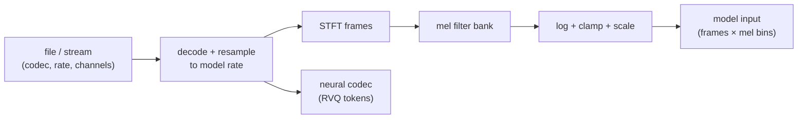
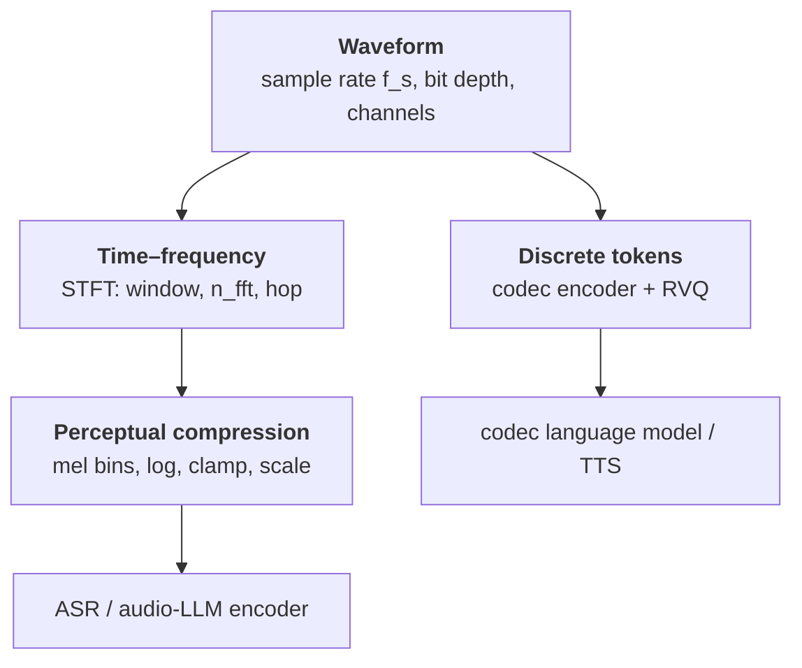

# Speech Module 01 — Audio Representation

## 00 Why This Module Exists

A speech model never sees "audio." It sees an array produced by a decoder, a resampler, a framing rule, a filter bank, a log compression, and a normalization.
- Each step has parameters that are rarely logged.
- A mismatch in any one of them silently changes what the model receives, while the waveform still "sounds fine" to a human.


- Legend: STFT: short-time Fourier transform; RVQ: residual vector quantization.

This module covers sampling, quantization, the STFT, mel features, and neural audio codecs with residual vector quantization.
- ASR architectures that consume these features belong to [Speech Module 02](../02-speech-to-text/README.md).
- Codec tokens as a target for speech generation belong to [Speech Module 03](../03-text-to-speech/README.md).
- Multimodal token budgets for audio inside an LLM belong to core [Module 21](../../advanced-ai-engineering/21-multimodal-ai-systems/README.md).

**Research status:** satellite 80/20 revision, 2026-11-26. Formulas below are derived in the text. Constants attributed to papers or to the `openai/whisper` and `facebookresearch/encodec` code were written from the cited sources but were **not** re-read against a pinned commit in this revision (`TODO_VERIFY`). Pin and re-check them in the source trace before citing them elsewhere.

**Module Orientation**

- **Engineering problem:** make the model input reproducible from a raw file, and know what each frontend parameter costs in resolution, latency, and bits.
- **What you will do:**
  - compute data rates and frame counts by hand;
  - reproduce a log-mel frontend and match a reference implementation;
  - break the frontend with rate, scale, and channel mismatches;
  - measure how codec bitrate trades against reconstruction quality.
- **Environment:** Python 3.10+, NumPy, an audio I/O library (`soundfile` or `torchaudio`), `ffmpeg`, and CPU only. A small set of clean, noisy, telephony (8 kHz), and music clips.
- **Evidence rule:** separate source observations (**O**), derivations (**D**), and hypotheses that need measurement (**H**).
- **If You Only Have One Week**: Lessons SP1.1 and SP1.3. They cover the two places where most real frontend bugs live: sample rate/scale and the log-mel contract.

## 01 Baseline Assumptions

- Core [Module 00](../../advanced-ai-engineering/00-scientific-ai-engineering/README.md): paired comparisons and the observation/derivation/hypothesis split.
- Core [Module 01](../../advanced-ai-engineering/01-foundation-model-internals/README.md): tokens, sequence length, and why sequence length drives attention cost.
- Mathematical prerequisites: sine waves, logarithms, complex magnitude, and the idea of a frequency spectrum. The Fourier transform is used, not derived.

## 02 Target Mastery

```yaml
depth_contract:
  conceptual: REQUIRED
  mechanistic: REQUIRED
  mathematical: REQUIRED
  quantitative: REQUIRED
  implementation: REQUIRED
  source_code: SELECTIVE
  instrumentation: SELECTIVE
  experimental: SELECTIVE
  statistical: NOT_APPLICABLE
  production_reasoning: REQUIRED
  failure_analysis: REQUIRED
  falsification: SELECTIVE
  security: NOT_APPLICABLE
  economics: SELECTIVE
  architecture_tradeoff: SELECTIVE
  research_connection: SELECTIVE

estimated_effort:
  instruction: 2h
  guided_practice: 1.25h
  labs: 3h
  assessment: 0.75h
  source_trace: 0.5h
  total: 7.5h
```

The learner must be able to turn a file into the exact array a model expects, predict frame and token counts, explain each frontend parameter, and diagnose a silent frontend mismatch from the model input alone.

### LAYER 1: KNOWLEDGE / INSTRUCTIONAL LAYER

## 03 Knowledge Map


- Legend: n_fft: samples per analysis window; hop: samples between window starts.

Keep three contracts separate:

1. **Signal contract:** sample rate, sample format and scale, channel layout.
2. **Feature contract:** window, `n_fft`, hop, padding, mel filter bank, log base, clamp, and normalization.
3. **Token contract:** codec version, frame rate, number of codebooks used, and codebook size.

A model is trained against one instance of each contract. Serving must reproduce all three.

## 04 Lessons

### Lesson SP1.1 — Sampling, Quantization, and Data Rate

**Engineering Question:**
What does the model actually lose or receive when audio is captured, resampled, and stored?

**Concepts & Definitions:**

- **Sample rate $f_s$:** samples per second. A sampled signal can represent frequencies only up to the **Nyquist frequency** $f_s/2$. Content above it folds back (**aliasing**) unless a low-pass filter removes it first.
- **Bit depth:** bits per sample. 16-bit PCM stores integers in $[-32768, 32767]$; models usually expect floats in $[-1, 1)$, obtained by dividing by $32768$.
- **Channels:** mono or multichannel. Most ASR models expect mono; the downmix rule (average, first channel) is part of the contract.

Raw PCM data rate:

$$
R = f_s \cdot b \cdot c
$$

where:

- $R$ is the data rate in bits per second;
- $f_s$ is the sample rate in Hz;
- $b$ is the bit depth in bits per sample;
- $c$ is the number of channels.

**Mechanism Explanation:**

Telephone speech is band-limited to roughly 300–3400 Hz and usually stored at 8 kHz. Wideband ASR models commonly use 16 kHz, which keeps content up to 8 kHz (**D** from Nyquist). Upsampling 8 kHz audio to 16 kHz makes the shapes match but cannot restore the missing 4–8 kHz band, so the model still sees out-of-distribution input.

**Break cases:**
- a 44.1 kHz file passed to a 16 kHz model without resampling;
- int16 samples passed without dividing by 32768, so values are about $3\times10^4$ times too large;
- stereo passed as interleaved mono, which doubles the apparent duration;
- resampling without an anti-alias filter.

**Worked Example (rate mismatch):**
*Input.* One second of 44.1 kHz mono audio is read as if it were 16 kHz.

*Steps.*
- Sample count: 44,100.
- Interpreted duration: $44{,}100 / 16{,}000 = 2.756$ s.
- Every frequency is scaled by $16{,}000 / 44{,}100 = 0.363$: a 200 Hz voice fundamental appears at about 73 Hz.

*Result.* The model sees slow, low-pitched speech that is 2.76 times too long. Nothing crashes.

*Data-rate check.* 16 kHz, 16-bit mono: $R = 16{,}000 \times 16 \times 1 = 256$ kbit/s. The same audio at 44.1 kHz stereo: $1{,}411.2$ kbit/s, 5.5 times more.

**Knowledge Check:** Why does upsampling 8 kHz telephony audio to 16 kHz not make it equivalent to native 16 kHz audio?

**Guided Practice:** Load one clip three ways: correct resample to 16 kHz, no resample, and int16 without scaling. For each, print sample count, min/max, and RMS, and predict which one a model would treat as silence, noise, or slowed speech.

**Feedback Contract:**
- *Expected Evidence*: a table of sample count, interpreted duration, peak, and RMS for the three loads; only the correct load has duration equal to the file's stated duration and peak below 1.0.
- *Common Failure*: checking only array shape, which hides a wrong rate when the reader resamples silently or not at all.
- *Diagnostic Hint*: print `duration = len(x) / assumed_rate` and compare it to the container's metadata before computing any feature.
- *Concept to Revisit*: Signal contract.

**Learning Outcome:** Compute data rates and detect rate, scale, and channel mismatches from array statistics.

*(Effort: 25m instruction, 15m practice)*

### Lesson SP1.2 — STFT, Frames, and the Time–Frequency Trade-off

**Engineering Question:**
How many frames will the model see, and what time and frequency resolution does each frame carry?

**Concepts & Definitions:**

- **Window length $n_{fft}$:** samples analyzed per frame. Frequency resolution is $\Delta f = f_s / n_{fft}$, and the transform yields $n_{fft}/2 + 1$ non-negative frequency bins.
- **Hop $h$:** samples between frame starts. Frame rate is $f_s / h$ frames per second.
- **Center padding:** pad $n_{fft}/2$ samples on both ends so frame $i$ is centered at sample $i\cdot h$.

Frame count for a signal of $L$ samples:

$$
N_{\text{frames}} =
\begin{cases}
1 + \left\lfloor \dfrac{L - n_{fft}}{h} \right\rfloor & \text{no padding} \\[2ex]
1 + \left\lfloor \dfrac{L}{h} \right\rfloor & \text{center padding}
\end{cases}
$$

where:

- $L$ is the signal length in samples ($L \ge n_{fft}$ in the unpadded case);
- $n_{fft}$ is the window length in samples;
- $h$ is the hop in samples.

*Step-by-step reading.*

1. Without padding, the first frame starts at sample 0 and the last must end by sample $L$, so the last start is at most $L - n_{fft}$. Counting starts $0, h, 2h, \dots$ gives the first case.
2. Center padding adds $n_{fft}/2$ on each side, so the padded length is $L + n_{fft}$. Substituting into case 1 gives $1 + \lfloor L/h \rfloor$.

**Mechanism Explanation:**

A longer window resolves pitch harmonics better but smears fast events such as plosives. A shorter hop gives finer timing but more frames, and frame count becomes the encoder sequence length. Speech frontends commonly use about 25 ms windows and 10 ms hops (**O**, for the Whisper frontend in Lesson SP1.3).

**Worked Example (Whisper-style frontend):**
*Input.* $f_s = 16{,}000$, $n_{fft} = 400$, $h = 160$, center padding, a 30 s input.

*Steps.*
- Window: $400 / 16{,}000 = 25$ ms. Hop: $160 / 16{,}000 = 10$ ms.
- Frequency resolution: $16{,}000 / 400 = 40$ Hz, with $400/2 + 1 = 201$ bins.
- $L = 30 \times 16{,}000 = 480{,}000$ samples.
- Frames: $1 + 480{,}000 / 160 = 3{,}001$. The reference implementation drops the last frame, giving 3,000 (**O**, `TODO_VERIFY` in source trace).
- The Whisper encoder's second convolution has stride 2, so the encoder sequence is $3{,}000 / 2 = 1{,}500$ positions, one per 20 ms (**O**; matches core Module 21, Lesson 21.3).

*Result.* A 30 s window becomes a $3{,}000 \times n_{mels}$ feature matrix and 1,500 encoder positions.

**Knowledge Check:** If the hop is halved to 5 ms, what happens to the frame count and to encoder self-attention cost, assuming attention cost grows with the square of sequence length?

**Guided Practice:** Compute $N_{\text{frames}}$ by hand for a 7.3 s clip with and without center padding, then confirm with your STFT library. Record the padding mode your library uses by default.

**Feedback Contract:**
- *Expected Evidence*: $L = 116{,}800$. Unpadded: $1 + \lfloor 116{,}400 / 160 \rfloor = 1 + 727 = 728$. Centered: $1 + 730 = 731$. Library output matches one of these, and the learner states which padding mode it used.
- *Common Failure*: assuming every library centers by default; padding mode differs between libraries and versions.
- *Diagnostic Hint*: compare the first frame of two libraries; an offset of $n_{fft}/2$ samples reveals a padding difference.
- *Concept to Revisit*: Feature contract.

**Learning Outcome:** Predict frame counts and resolution from frontend parameters and link them to encoder sequence length.

*(Effort: 30m instruction, 20m practice)*

### Lesson SP1.3 — Mel Filter Banks and the Log-Mel Contract

**Engineering Question:**
Which exact steps turn a power spectrogram into the features a pretrained ASR encoder expects?

**Concepts & Definitions:**

- **Mel scale:** a frequency warping that spaces filters roughly like human pitch perception: close together at low frequencies, wider at high frequencies. One common (HTK) form:

$$
m(f) = 2595 \log_{10}\!\left(1 + \frac{f}{700}\right)
$$

where $f$ is frequency in Hz and $m$ is in mels. A second common form (Slaney) is linear below 1 kHz and logarithmic above. The two give different filter banks; which one a model used is part of its contract.

- **Mel filter bank:** $n_{mels}$ triangular filters spaced evenly on the mel scale. Each mel feature is a weighted sum of STFT power bins.
- **Log compression:** speech energy spans a wide dynamic range, so features are log power, with a floor (clamp) so silence does not produce $-\infty$.

**Mechanism Explanation:**

The Whisper reference frontend computes (**O**, `TODO_VERIFY`):

1. STFT with a Hann window, $n_{fft} = 400$, hop 160, magnitude squared, last frame dropped.
2. Mel projection with a precomputed filter bank: 80 bins for most checkpoints, 128 bins for `large-v3`.
3. $\log_{10}$ after clamping power to at least $10^{-10}$.
4. Clamp each value to at least (global max $- 8$), i.e. an 80 dB dynamic range below the loudest bin.
5. Scale: $(x + 4) / 4$.

Step 4 makes the floor relative to the loudest bin in the clip. A gain change shifts every log value by the same constant, so it changes the scaled features rather than cancelling out. A clip that is mostly silence plus one loud click raises the floor for the whole clip, so quiet speech in it can be clamped away.

**Worked Example (mel spacing):**
*Input.* The HTK mel formula.

*Steps.*
- $m(1{,}000) = 2595 \log_{10}(2.4286) = 2595 \times 0.3854 = 1{,}000.0$.
- $m(4{,}000) = 2595 \log_{10}(6.7143) = 2595 \times 0.8270 = 2{,}146.1$.
- $m(8{,}000) = 2595 \log_{10}(12.4286) = 2595 \times 1.0944 = 2{,}840.0$.

*Result.* 0–1 kHz occupies 1,000 mels, while 1–8 kHz, seven times as many hertz, occupies only 1,840 mels. With evenly spaced mel filters, more than a third of the filters sit below 1 kHz.

*Interpretation.* Mel features spend resolution where speech formants and pitch carry information. That is why log-mel features suit speech better than the raw waveform for a compact encoder input, not because the waveform lacks information.

**Knowledge Check:** Why does serving `large-v3` with an 80-bin frontend fail outright, while serving it with the wrong mel formula (HTK instead of Slaney) may run and only degrade accuracy?

**Guided Practice:** Implement steps 1–5 in NumPy and compare against the reference `log_mel_spectrogram` on three clips. Report the maximum absolute difference. Then change one parameter at a time (log base, clamp floor, dynamic range, scale) and record the effect on the matrix.

**Feedback Contract:**
- *Expected Evidence*: max absolute difference below about $10^{-4}$ with the matched contract, and a table showing that each single change moves the features by far more.
- *Common Failure*: building the filter bank with a different library default and attributing the mismatch to floating-point noise.
- *Diagnostic Hint*: compare the filter-bank matrices first; if they differ, nothing downstream will match.
- *Concept to Revisit*: Feature contract.

**Learning Outcome:** Reproduce a reference log-mel frontend and list every parameter that changes the model input.

*(Effort: 35m instruction, 25m practice)*

### Lesson SP1.4 — Neural Audio Codecs and Residual Vector Quantization

**Engineering Question:**
How many discrete tokens per second does an audio codec produce, and what does each extra codebook buy?

**Concepts & Definitions:**

- **Neural audio codec:** a convolutional encoder that downsamples the waveform to a low frame rate, a quantizer, and a decoder trained to reconstruct the waveform. SoundStream, EnCodec, and DAC follow this pattern (**O**).
- **Residual vector quantization (RVQ):** quantize the encoder vector with codebook 1, subtract the chosen code, quantize the residual with codebook 2, and so on for $Q$ codebooks. The decoded vector is the sum of the chosen codes.

Codec bitrate and token rate:

$$
B = r \cdot Q \cdot \log_2 K, \qquad T = r \cdot Q
$$

where:

- $B$ is the bitrate in bits per second;
- $T$ is the number of discrete tokens per second;
- $r$ is the codec frame rate in frames per second;
- $Q$ is the number of codebooks used;
- $K$ is the codebook size (entries per codebook).

**Mechanism Explanation:**

Because each stage quantizes what earlier stages missed, early codebooks carry coarse content and later ones refine detail. Dropping later codebooks lowers bitrate with graceful quality loss. This is also why codec language models often generate the first codebook autoregressively and the rest more cheaply ([Speech Module 03](../03-text-to-speech/README.md)).

**Worked Example (RVQ on a scalar):**
*Input.* Value $x = 0.83$. Codebooks: $C_1 = \{0, 0.5, 1.0\}$, $C_2 = \{-0.25, 0, 0.25\}$, $C_3 = \{-0.1, 0, 0.1\}$.

*Steps.*
- Stage 1: nearest to 0.83 is 1.0. Residual $0.83 - 1.0 = -0.17$.
- Stage 2: nearest to $-0.17$ is $-0.25$ (distance 0.08, versus 0.17 for 0). Residual $-0.17 + 0.25 = 0.08$.
- Stage 3: nearest to 0.08 is 0.1. Residual $-0.02$.
- Reconstructions after 1, 2, 3 stages: $1.0$, $0.75$, $0.85$, with absolute errors $0.17$, $0.08$, $0.02$.

*Result.* Each stage shrinks the error; the codes $(2, 0, 2)$ index the chosen entries.

**Worked Example (EnCodec 24 kHz bitrate):**
*Input.* EnCodec's 24 kHz model downsamples by 320, so $r = 24{,}000 / 320 = 75$ Hz, with $K = 1{,}024$ (10 bits) (**O**, `TODO_VERIFY`).

*Steps.*
- $Q = 2$: $B = 75 \times 2 \times 10 = 1.5$ kbit/s.
- $Q = 8$: $B = 6$ kbit/s and $T = 600$ tokens/s.
- $Q = 32$: $B = 24$ kbit/s.

*Result.* At 6 kbit/s the codec is about $256 / 6 \approx 43$ times smaller than 16 kHz PCM, but it emits 600 tokens per second. Ten seconds of audio is 6,000 tokens, compared with roughly 25–30 text tokens for the same ten seconds of speech.

**Knowledge Check:** A codec LM must model 10 s of audio at 75 Hz with 8 codebooks. Why is predicting all 6,000 tokens in one flat autoregressive sequence expensive, and what does that suggest about model design?

**Guided Practice:** Encode one speech clip and one music clip at every supported bandwidth of a pretrained codec. Decode each, compute a log-mel distance to the original, and listen. Plot distance against bitrate.

**Feedback Contract:**
- *Expected Evidence*: a monotone or near-monotone curve per clip, a statement of $r$, $K$, and $Q$ for each point, and a note where music degrades earlier than speech (or does not).
- *Common Failure*: reporting bitrate from the model card without checking how many codebooks were actually used.
- *Diagnostic Hint*: print the code tensor shape; its codebook dimension is $Q$.
- *Concept to Revisit*: Token contract.

**Learning Outcome:** Compute codec token rates and explain the bitrate–quality–sequence-length trade-off.

*(Effort: 30m instruction, 15m practice)*

## 05 Literature & Production Source Map

**REFERENCE / BASELINE**

- [Robust Speech Recognition via Large-Scale Weak Supervision (Whisper)](https://arxiv.org/abs/2212.04356) — Radford et al. (2022). Reading pointer: §2.2, input preprocessing (16 kHz, 80-channel log-mel, 25 ms window, 10 ms stride).
- [SoundStream: An End-to-End Neural Audio Codec](https://arxiv.org/abs/2107.03312) — Zeghidour et al. (2021). Reading pointer: residual vector quantizer and quantizer dropout for variable bitrate.
- [High Fidelity Neural Audio Compression (EnCodec)](https://arxiv.org/abs/2210.13438) — Défossez et al. (2022). Reading pointer: model architecture, frame rate, and target bandwidths.

**WORKLOAD-DEPENDENT / FRONTIER**

- [High-Fidelity Audio Compression with Improved RVQGAN (DAC)](https://arxiv.org/abs/2306.06546) — Kumar et al. (2023). Author-reported quality gains over earlier codecs; scope to their benchmarks.
- Low-frame-rate codecs designed for speech LMs, such as Mimi in [Moshi](https://arxiv.org/abs/2410.00037) — Défossez et al. (2024), trade reconstruction detail for far fewer tokens per second. See [Speech Module 06](../06-voice-agent-systems/README.md).

**CURRENT DEFAULT:** for ASR, a log-mel frontend reproduced exactly from the target model's reference code; for generation, a pinned codec version with a declared number of codebooks.

**LEGACY / INSUFFICIENT:** "16 kHz mono" as the whole input contract; comparing features across libraries without matching padding and filter banks; quoting codec bitrate without the codebook count.

**PRODUCTION SOURCE TRACE** (pin the commit you read; no commit was pinned in this revision)

- `openai/whisper`, file `whisper/audio.py`:
  - `load_audio`: decodes and resamples to 16 kHz mono through `ffmpeg`.
  - `pad_or_trim`: pads or truncates to 30 s (480,000 samples).
  - `log_mel_spectrogram`: STFT, mel projection, log, clamp, and scale (Lesson SP1.3, steps 1–5).
- `facebookresearch/encodec`, file `encodec/quantization/core_vq.py`: `ResidualVectorQuantization` encode and decode loops (Lesson SP1.4).
- Scope: reference implementations, not the only valid frontends. Other runtimes (for example CTranslate2-based ones) reimplement the frontend and must be checked separately.

### LAYER 2: ENGINEERING PRACTICE LAYER

## 06 Engineering Labs

All labs follow `PREDICT → BUILD → MEASURE → EXPLAIN → BREAK → IMPROVE → FALSIFY`.

### LAB A — Reproduce and Break a Log-Mel Frontend

- **Objective:** build a log-mel frontend from NumPy primitives, match the reference within tolerance, then break it one contract field at a time.
- **Pre-Registered Hypothesis:** rate and scale mismatches change model transcripts far more than filter-bank formula changes, but all three are invisible in array shape.
- **Independent Variables:** sample rate handling, sample scaling, channel downmix, mel formula, log/clamp/scale steps.
- **Dependent Variables:** feature max difference versus reference, transcript of a small pretrained ASR model, and WER on 20 clips.
- **Break & Falsify:** feed 44.1 kHz without resampling, int16 without scaling, interleaved stereo, and HTK instead of the reference filter bank.
- **Alignment:** Lessons SP1.1–SP1.3 and Incident SP1.1.
- **Effort Estimate:** 1.75h.

### LAB B — Codec Bitrate Frontier

- **Objective:** measure reconstruction quality against bitrate and token rate for a pretrained neural codec.
- **Pre-Registered Hypothesis:** quality improves with each added codebook with diminishing returns, and the knee appears at a lower bitrate for clean speech than for music or noisy speech.
- **Independent Variables:** number of codebooks $Q$, content type (clean speech, noisy speech, music).
- **Dependent Variables:** log-mel distance, a listening note per point, tokens per second, and encode/decode time per second of audio.
- **Break & Falsify:** decode with fewer codebooks than were encoded; feed audio at the wrong sample rate.
- **Alignment:** Lesson SP1.4.
- **Effort Estimate:** 1.25h.

**Runnable arithmetic check (CPU; not a quality experiment):**
```python
import math
assert 16_000 * 16 * 1 == 256_000                       # PCM data rate
assert math.isclose(44_100 / 16_000, 2.75625)           # rate-mismatch stretch
assert 1 + (480_000 // 160) == 3_001                    # centered frames, 30 s
assert 1 + (116_800 - 400) // 160 == 728                # 7.3 s, no padding
mel = lambda f: 2595 * math.log10(1 + f / 700)
assert round(mel(1000), 1) == 1000.0 and round(mel(8000), 1) == 2840.0
assert 24_000 // 320 == 75 and 75 * 8 * math.log2(1024) == 6_000
x, recon = 0.83, 0.0
for cb in ([0, 0.5, 1.0], [-0.25, 0, 0.25], [-0.1, 0, 0.1]):
    recon += min(cb, key=lambda c: abs(x - recon - c))
assert math.isclose(recon, 0.85)
```

## 07 Break / Incident Scenarios

### Incident SP1.1 — WER Doubles After an Ingestion Migration

**Incident Symptoms:**
A team moves audio ingestion to a new service. The ASR model and decoding settings are unchanged. WER on the weekly sample rises from 9% to 19%, mostly on call-center audio. Latency drops slightly. No errors are logged.

**Diagnostic Protocol (Task):**
1. **Form Competing Hypotheses:** missing resample, wrong sample scaling, stereo handling, a new lossy codec in transport, telephony audio no longer flagged for a narrowband model, a changed frontend library, or a real traffic shift.
2. **Identify Missing Evidence:** per-request sample rate, peak/RMS, duration versus container metadata, channel count, codec, and frontend library version for old and new paths.
3. **Design Discriminating Measurements:** run the same 50 files through both ingestion paths and diff the feature matrices; then swap one stage at a time.
4. **Rank Explanations:** the earliest stage where feature matrices diverge is the primary suspect; a traffic shift predicts identical features for identical files.
5. **Intervene:** restore the missing step or pin the frontend; add a contract check (duration, peak, rate) at ingestion.
6. **Remeasure:** WER on the same sample, by audio source, with the contract check active.

### LAYER 3: MASTERY / ASSESSMENT LAYER

## 08 Mastery Assessment

### Transfer Problem — One Frontend for Two Models

A product must send the same incoming audio (8 kHz telephony and 48 kHz browser capture) to an 80-bin ASR model and to a codec-based TTS voice-cloning model.

**Required Deliverables:**
1. signal, feature, and token contracts for both models, with every parameter named;
2. hand-computed frame counts, encoder positions, and codec tokens for a 12 s clip;
3. an ingestion check that rejects or flags contract violations, with the statistics it uses;
4. LAB A evidence that the frontend matches the reference within tolerance;
5. a statement of what narrowband input costs each model, with evidence from LAB A or B.

## 09 Required Evidence & Rubric

### Required Artifact: Audio Contract Sheet

Submit the three contracts, the LAB A feature-diff table, the LAB B bitrate frontier, and the Incident SP1.1 diagnosis.

### Rubric Dimensions

- **Mechanism:** *Insufficient* says "convert audio to spectrogram." *Competent* names every frontend step and parameter. *Strong* predicts the effect of each parameter change before measuring it.
- **Quantitative:** *Insufficient* quotes model-card numbers. *Competent* computes frames, positions, and token rates. *Strong* links them to encoder or LM cost.
- **Diagnosis:** *Insufficient* inspects shapes. *Competent* diffs features against a reference. *Strong* localizes the first divergent stage and adds a guard for it.

## 10 Capability Traceability Matrix

| Capability | Taught | Practiced | Assessed | Evidence (artifact reviewers open) |
|---|---|---|---|---|
| Signal contract and data rate | SP1.1 | SP1.1 Guided Practice; LAB A | Deliverables 1, 3; Incident SP1.1 | LAB A load table (duration, peak, RMS) |
| Framing and resolution | SP1.2 | SP1.2 Guided Practice | Deliverable 2 | Hand frame counts matched to library output |
| Log-mel contract | SP1.3 | SP1.3 Guided Practice; LAB A | Deliverables 1, 4; Incident SP1.1 | Feature-diff table versus reference |
| Codec tokens and RVQ | SP1.4 | SP1.4 Guided Practice; LAB B | Deliverables 2, 5 | Bitrate frontier with $r$, $Q$, $K$ per point |

## 11 Exit Criteria & Module Wrap-Up

### Exit Criteria

A learner passes when they can reproduce a reference log-mel frontend within tolerance, predict frame and token counts by hand, detect rate/scale/channel mismatches from statistics, and explain the codec bitrate–token-rate trade-off with measured evidence.

### Module Wrap-Up (Final Mental Model Reconstruction)

Audio input is a contract, not a file. Log every field of it, diff features against a reference before blaming the model, and count frames or tokens before estimating any downstream cost.

### Cost & Telemetry Hook

- [Lesson 22.1](../../advanced-ai-engineering/22-ai-economics/README.md): cost per audio second must include decode, resample, and feature extraction, not only model time.
- [Lesson 23.1](../../advanced-ai-engineering/23-observability-reliability/README.md): emit sample rate, duration, peak, channel count, and frontend version per request so Incident SP1.1 is detectable from telemetry.

## 12 Competency Targets

```yaml
competency:
  sfia: 4
  bloom: Apply -> Analyze
  solo: Relational
  dreyfus: Advanced Beginner -> Competent
```
