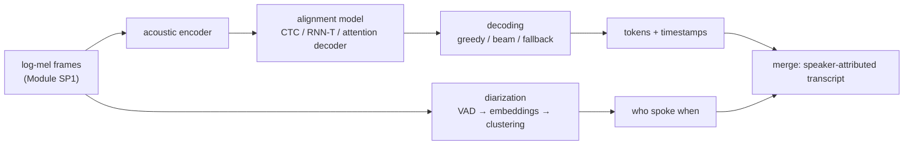
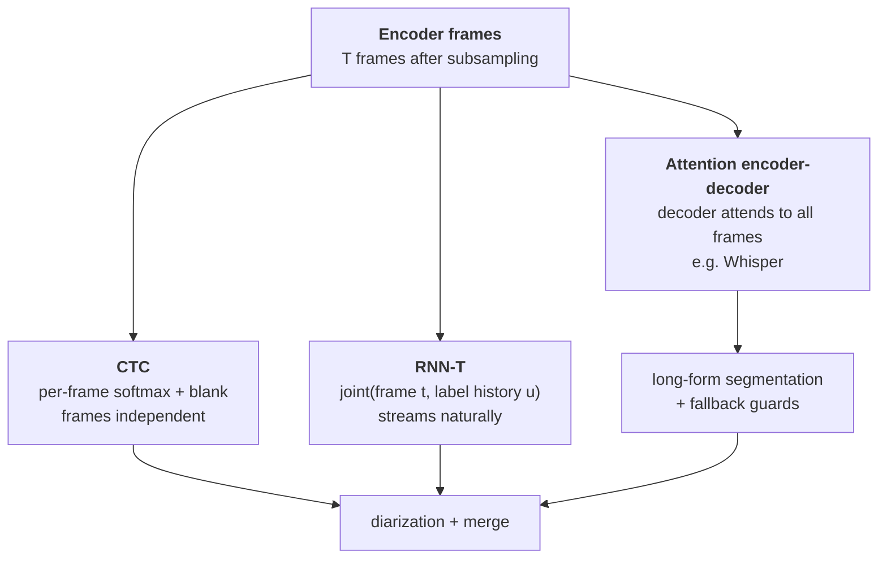

# Speech Module 02 — Speech-to-Text

## 00 Why This Module Exists

An ASR system does not "listen and write." It maps a long sequence of acoustic frames to a much shorter sequence of text tokens, without being told which frames belong to which token.
- How a model solves that alignment problem decides whether it can stream, how it fails on silence and noise, and how its timestamps behave.
- Around the model sit decoding rules, long-form segmentation, and speaker diarization, each with its own failure modes.


- Legend: CTC: connectionist temporal classification; RNN-T: recurrent neural network transducer; VAD: voice activity detection.

This module covers the three alignment families (CTC, RNN-T, attention encoder-decoder), Whisper's multitask prompt and timestamp tokens, long-form decoding and its hallucination guards, and speaker diarization.
- The audio frontend belongs to [Speech Module 01](../01-audio-representation/README.md).
- Chunked real-time decoding belongs to [Speech Module 04](../04-streaming-speech/README.md).
- WER, CER, and normalization belong to [Speech Module 05](../05-speech-evaluation/README.md).

**Research status:** satellite 80/20 revision, 2026-11-26. Formulas below are derived in the text. Constants attributed to papers or to the `openai/whisper` code (prefix tokens, 20 ms timestamp resolution, transcribe thresholds) were written from the cited sources but were **not** re-read against a pinned commit in this revision (`TODO_VERIFY`). Pin and re-check them in the source trace before citing them elsewhere. No benchmark numbers are quoted.

**Module Orientation**

- **Engineering problem:** choose an alignment family for a latency and accuracy target, and make long-form, noisy, multi-speaker transcription fail visibly instead of silently.
- **What you will do:**
  - decode CTC outputs and size CTC and RNN-T lattices by hand;
  - read and change Whisper's prefix tokens and timestamp tokens;
  - trigger and guard against long-form hallucination;
  - compute DER and attribute errors to diarization stages.
- **Environment:** Python 3.10+, PyTorch with `torchaudio`, the `openai-whisper` package, a diarization toolkit (for example `pyannote.audio`), CPU or a small GPU. A clip set with clean, noisy, long silent, and two-speaker recordings with reference transcripts and speaker turns.
- **Evidence rule:** separate source observations (**O**), derivations (**D**), and hypotheses that need measurement (**H**).
- **If You Only Have One Week**: Lessons SP2.1 and SP2.3. They cover the alignment idea every ASR model must solve and the long-form decoding behavior behind most production Whisper incidents.

## 01 Baseline Assumptions

- [Speech Module 01](../01-audio-representation/README.md): log-mel frames, frame rate, and encoder positions.
- Core [Module 01](../../advanced-ai-engineering/01-foundation-model-internals/README.md): autoregressive decoding, softmax over a vocabulary, and attention.
- Core [Module 07](../../advanced-ai-engineering/07-model-behavior-uncertainty/README.md): log-probability as a weak confidence signal.
- Mathematical prerequisites: conditional probability, sums over paths, logarithms.

## 02 Target Mastery

```yaml
depth_contract:
  conceptual: REQUIRED
  mechanistic: REQUIRED
  mathematical: REQUIRED
  quantitative: REQUIRED
  implementation: REQUIRED
  source_code: SELECTIVE
  instrumentation: SELECTIVE
  experimental: REQUIRED
  statistical: SELECTIVE
  production_reasoning: REQUIRED
  failure_analysis: REQUIRED
  falsification: SELECTIVE
  security: NOT_APPLICABLE
  economics: SELECTIVE
  architecture_tradeoff: REQUIRED
  research_connection: SELECTIVE

estimated_effort:
  instruction: 2h
  guided_practice: 1.25h
  labs: 3h
  assessment: 0.75h
  source_trace: 0.5h
  total: 7.5h
```

The learner must be able to explain how each alignment family maps frames to tokens, predict its memory and streaming properties, control Whisper's task and timestamp behavior, detect long-form hallucination, and decompose diarization error.

### LAYER 1: KNOWLEDGE / INSTRUCTIONAL LAYER

## 03 Knowledge Map


- Legend: T: number of encoder frames; u: number of output tokens emitted so far.

Keep three questions separate when comparing systems:

1. **Alignment:** how the model decides which frames produce which token (CTC, RNN-T, or attention).
2. **Decoding:** how tokens are chosen from model scores (greedy, beam, temperature fallback, external LM).
3. **Segmentation:** how audio longer than the model's window is split, and how speakers are assigned.

A transcript error can come from any of the three. Fix the layer that produced it.

## 04 Lessons

### Lesson SP2.1 — CTC: Alignment by Blanks and Collapsing

**Engineering Question:**
How can a model trained without frame-level labels output text, and what does its independence assumption cost?

**Concepts & Definitions:**

- **Blank symbol `_`:** an extra output meaning "no new token at this frame."
- **Collapse function $\mathcal{B}$:** first merge consecutive repeated symbols, then delete blanks. A blank between two identical letters keeps them separate.
- **Alignment (path) $\pi$:** one symbol per frame, $\pi = (\pi_1, \dots, \pi_T)$, with $\mathcal{B}(\pi) = y$.

CTC defines the probability of a label sequence $y$ as a sum over all paths that collapse to it (**O**, Graves et al. 2006):

$$
P(y \mid x) = \sum_{\pi \,:\, \mathcal{B}(\pi) = y} \; \prod_{t=1}^{T} p_t(\pi_t \mid x)
$$

where:

- $x$ is the input feature sequence and $T$ the number of encoder frames;
- $y = (y_1, \dots, y_U)$ is the target label sequence of length $U$;
- $\pi_t$ is the symbol (label or blank) emitted at frame $t$;
- $p_t(\cdot \mid x)$ is the encoder's softmax output at frame $t$.

*Step-by-step reading.*

1. The product treats frames as conditionally independent given $x$: the score at frame $t$ does not see which symbols were emitted at other frames.
2. The sum is computed efficiently by the forward algorithm over an extended label sequence that inserts a blank before, between, and after labels: length $S = 2U + 1$.
3. The forward lattice therefore has $T \times S$ cells, so the cost is linear in $T$ and in $U$.
4. A path must emit every label and a blank between each pair of identical adjacent labels, so a valid alignment needs $T \ge U + r$, where $r$ is the number of adjacent repeated label pairs in $y$.

**Mechanism Explanation:**

Because frames are independent, CTC has no internal language model: it can output acoustically plausible but ungrammatical spellings. Systems add an external LM during beam search to compensate. The same independence makes CTC fast, non-autoregressive, and easy to stream when the encoder is causal. CTC posteriors are also "peaky": most frames emit blank and labels fire on one or two frames, so CTC timestamps mark spikes, not word boundaries.

**Worked Example (collapse and lattice size):**
*Input.* Frame outputs `h h _ e _ l l _ l o o` ($T = 11$) and target `hello`.

*Steps.*
- Merge repeats: `h _ e _ l _ l o`.
- Delete blanks: `hello`. The blank between the two `l` runs keeps both letters.
- Without that blank, `h h e l l l o o` collapses to `helo`.
- For `hello`: $U = 5$, one repeated pair (`ll`), so $r = 1$ and the minimum $T$ is $6$.
- Extended sequence `_ h _ e _ l _ l _ o _`: $S = 2 \times 5 + 1 = 11$.
- For a 2 s utterance at 25 encoder frames per second ($T = 50$): $50 \times 11 = 550$ lattice cells.

*Result.* The decoded text depends on blank placement, and the training cost is a small $T \times S$ table.

**Knowledge Check:** An encoder subsamples to 12.5 frames per second. A speaker says a 10-character word containing three doubled letters in 0.5 s. Can CTC with a character vocabulary emit it?

**Guided Practice:** Write `ctc_collapse(path)` and test it on five hand-made paths. Then run a pretrained CTC model (for example a wav2vec 2.0 CTC checkpoint in `torchaudio`) on one clip, plot the per-frame argmax, and count the fraction of blank frames.

**Feedback Contract:**
- *Expected Evidence*: collapse outputs for all five paths; a frame plot where blank dominates and labels appear as short spikes; the blank fraction stated.
- *Common Failure*: removing blanks before merging repeats, which turns `l _ l` into `l`.
- *Diagnostic Hint*: apply the two collapse steps in order and print the intermediate string.
- *Concept to Revisit*: Alignment.

**Learning Outcome:** Decode CTC outputs, size the CTC lattice, and state what conditional independence costs.

*(Effort: 30m instruction, 20m practice)*

### Lesson SP2.2 — RNN-T: Conditioning on Label History for Streaming

**Engineering Question:**
How does RNN-T remove CTC's independence assumption while still streaming, and what does that cost in memory?

**Concepts & Definitions:**

- **Prediction network:** an autoregressive model over previously emitted labels, producing state $g_u$ after $u$ labels.
- **Joint network:** combines encoder frame $f_t$ and prediction state $g_u$ into a distribution over the vocabulary plus blank.
- **Transducer lattice:** at grid point $(t, u)$, emitting a label moves to $(t, u{+}1)$, and emitting blank moves to $(t{+}1, u)$. A full path goes from $(1, 0)$ to past frame $T$ with $u = U$ (**O**, Graves 2012).

Joint output size for one utterance during training:

$$
M = T \cdot (U + 1) \cdot V \cdot s
$$

where:

- $M$ is the memory in bytes for the joint network's output logits;
- $T$ is the number of encoder frames;
- $U$ is the number of target labels, and $U + 1$ counts label-history states including "no labels yet";
- $V$ is the vocabulary size including blank;
- $s$ is bytes per value (4 for fp32).

*Step-by-step reading.*

1. Every pair (frame $t$, history $u$) needs its own distribution, because the joint sees both.
2. The number of pairs is $T(U+1)$, and each holds $V$ logits.
3. Unlike CTC's $T \times S$ table of scalars, this is a three-dimensional tensor, so memory grows with $T \cdot U \cdot V$.

**Mechanism Explanation:**

The prediction network gives RNN-T an internal label model, so labels are no longer independent given the audio. Decoding at frame $t$ uses only frames up to $t$ (with a causal encoder) and labels already emitted, so RNN-T streams without re-decoding. The price is the training memory above; implementations reduce it with pruned or function-merging losses (`TODO_VERIFY` for specific library options).

**Worked Example (joint memory):**
*Input.* A 10 s utterance, encoder at 25 frames per second, 60 subword labels, vocabulary 1,024 including blank, fp32.

*Steps.*
- $T = 250$, $U + 1 = 61$, $V = 1{,}024$, $s = 4$.
- $M = 250 \times 61 \times 1{,}024 \times 4 = 62{,}464{,}000$ bytes, about 62.5 MB.
- A batch of 32 such utterances: about 2.0 GB for logits alone, before gradients.
- CTC on the same utterance: $T \times V = 256{,}000$ logits, about 1.0 MB.

*Result.* RNN-T's joint tensor is $U + 1 = 61$ times larger than CTC's output here, which is why long utterances and large vocabularies dominate RNN-T training memory.

**Knowledge Check:** Doubling the vocabulary and halving the label count (longer subwords) leaves $M$ roughly unchanged. Which other property of the system changes?

**Guided Practice:** Compute $M$ for 5, 15, and 30 s utterances at two vocabulary sizes and plot it. Then run `torchaudio.functional.rnnt_loss` on random logits of the predicted shape and confirm the tensor size.

**Feedback Contract:**
- *Expected Evidence*: a table of $M$ values that scales linearly with $T$ when $U$ grows with duration (so quadratically with duration), and a loss call whose logits tensor shape is `(batch, T, U+1, V)`.
- *Common Failure*: using $U$ instead of $U+1$, or forgetting that $U$ grows with duration.
- *Diagnostic Hint*: print the logits shape before calling the loss.
- *Concept to Revisit*: Transducer lattice.

**Learning Outcome:** Explain RNN-T's streaming property and estimate its training memory.

*(Effort: 25m instruction, 15m practice)*

### Lesson SP2.3 — Whisper: Prefix Tokens, Timestamps, and Long-Form Guards

**Engineering Question:**
How does one encoder-decoder do transcription, translation, language ID, and timestamps, and why does it hallucinate on long audio?

**Concepts & Definitions:**

- **Encoder-decoder:** the encoder reads a 30 s log-mel window (1,500 positions, [Speech Module 01](../01-audio-representation/README.md)); the decoder generates text tokens autoregressively with cross-attention to all encoder positions.
- **Prefix (task) tokens:** the decoder prompt sets the task (**O**, Whisper §2.3, `TODO_VERIFY`):
  - `<|startoftranscript|>`;
  - a language token, for example `<|en|>`, or one predicted by the model;
  - a task token: `<|transcribe|>` or `<|translate|>` (translate means "into English");
  - optionally `<|notimestamps|>`.
  - Previous-window text can be placed before `<|startoftranscript|>` as context.
- **Timestamp tokens:** special tokens marking times within the window, quantized to 20 ms (**O**, `TODO_VERIFY`).
- **Sequential long-form decoding:** decode a 30 s window, move the window start to the last complete timestamp, repeat.

Number of timestamp tokens per window:

$$
N_{ts} = \frac{W}{\delta} + 1
$$

where:

- $W$ is the window length in seconds (30);
- $\delta$ is the timestamp resolution in seconds (0.02);
- the $+1$ counts both endpoints, $0.00$ and $W$.

*Step-by-step.* $30 / 0.02 = 1{,}500$ intervals, so $1{,}501$ tokens from `<|0.00|>` to `<|30.00|>`. One timestamp step equals one encoder position (20 ms).

**Mechanism Explanation:**

Because the decoder is a conditional language model, it can produce fluent text the audio does not support: on silence, music, or noise it may emit common phrases, and conditioning on its own previous output can lock it into repetition. The reference `transcribe()` adds guards (**O**, `TODO_VERIFY` all values):

- **Temperature fallback:** decode at temperature 0; if a check fails, retry at 0.2, 0.4, …, 1.0.
- **Compression-ratio check:** if the gzip/zlib compression ratio of the window's text exceeds 2.4, treat it as repetitive and retry.
- **Log-probability check:** if the average token log-probability is below −1.0, retry.
- **No-speech check:** if the no-speech probability exceeds 0.6 and the average log-probability is also below −1.0, mark the window as silent and skip it.
- **`condition_on_previous_text`:** feeding prior text improves consistency but propagates a hallucination into later windows.

Compression ratio:

$$
\rho = \frac{|b|}{|\text{zlib}(b)|}
$$

where $b$ is the UTF-8 bytes of the decoded text and $|\cdot|$ is length in bytes. Repeated phrases compress well, so $\rho$ rises.

**Worked Example (prompt and timestamps):**
*Input.* A 12.6 s English clip, transcription with timestamps.

*Steps.*
- Prefix: `<|startoftranscript|><|en|><|transcribe|>` with no `<|notimestamps|>`.
- One output segment: `<|0.00|> Turn left at the bridge. <|2.48|>`.
- `<|2.48|>` is step $2.48 / 0.02 = 124$, i.e. encoder position 124.
- The clip is padded to 30 s, so positions beyond $12.6 / 0.02 = 630$ are padding; timestamps there signal a problem.

*Result.* Task, language, and timestamp behavior are controlled entirely by the prompt; there is no separate translation model.

**Knowledge Check:** Why can disabling `condition_on_previous_text` reduce repetition loops but increase inconsistent spelling of names across windows?

**Guided Practice:** On one 5-minute clip with long silences, run `transcribe()` with defaults, then with fallback disabled (single temperature 0, thresholds off), then with `condition_on_previous_text=False`. Record per-window compression ratio, average log-probability, no-speech probability, and temperature used.

**Feedback Contract:**
- *Expected Evidence*: a per-window table for the three runs, at least one window where a guard fired, and the transcript difference it caused.
- *Common Failure*: judging runs by overall WER only; hallucinated text in silent windows may barely move WER while being the worst user-visible error.
- *Diagnostic Hint*: sort windows by no-speech probability and read the transcripts of the top five.
- *Concept to Revisit*: Decoding vs segmentation.

**Learning Outcome:** Control Whisper's task and timestamp behavior and explain which guard catches which long-form failure.

*(Effort: 40m instruction, 25m practice)*

### Lesson SP2.4 — Speaker Diarization and DER

**Engineering Question:**
Which diarization stage caused a "who spoke when" error, and how is that error measured?

**Concepts & Definitions:**

- **Pipeline:** VAD finds speech regions → segmentation splits them into speaker-homogeneous pieces (and may detect overlap) → a speaker-embedding model (for example x-vector or ECAPA-TDNN) maps each piece to a vector → clustering groups vectors into speakers.
- **Speaker confusion:** speech attributed to the wrong speaker.
- **Diarization error rate (DER):**

$$
\text{DER} = \frac{T_{\text{miss}} + T_{\text{FA}} + T_{\text{conf}}}{T_{\text{ref}}}
$$

where:

- $T_{\text{ref}}$ is the total reference speech time (overlapped speech counted once per speaker);
- $T_{\text{miss}}$ is reference speech the system labeled as non-speech;
- $T_{\text{FA}}$ (false alarm) is system speech where the reference has none;
- $T_{\text{conf}}$ is speech assigned to the wrong speaker after the optimal one-to-one mapping between system and reference speaker labels.

*Step-by-step reading.*

1. Map system speaker labels to reference labels to minimize confusion; labels are arbitrary.
2. Miss and FA come mainly from VAD and overlap handling; confusion comes from embeddings and clustering.
3. Scoring conventions change DER: a forgiveness collar around reference boundaries (often 0.25 s) and whether overlapped speech is scored. Always report both.

**Mechanism Explanation:**

Clustering needs a speaker count or a threshold. Too low a threshold splits one speaker into two; too high merges two similar voices. Short turns produce noisy embeddings, so fast back-and-forth dialogue raises confusion even with a good embedding model. Overlap is hard for single-label pipelines: every overlapped second can count as miss for the second speaker.

**Worked Example (DER decomposition):**
*Input.* A 15-minute meeting with $T_{\text{ref}} = 600$ s of speech. Scoring gives $T_{\text{miss}} = 30$ s, $T_{\text{FA}} = 18$ s, $T_{\text{conf}} = 42$ s.

*Steps.*
- Total error: $30 + 18 + 42 = 90$ s.
- DER: $90 / 600 = 15\%$.
- Components: miss 5%, FA 3%, confusion 7%.

*Result.* Confusion is the largest component, so clustering or embeddings, not VAD, is the first place to look.

**Knowledge Check:** Two systems both report DER 15%. One has 12% miss, the other 12% confusion. Which one would improve if you replaced only the VAD?

**Guided Practice:** Run a pretrained diarization pipeline on two recordings, score with and without a 0.25 s collar and with and without overlap, and report all four DER values with their components.

**Feedback Contract:**
- *Expected Evidence*: a 2 × 4 table of DER with miss/FA/confusion for each scoring setting and a one-line attribution to a pipeline stage.
- *Common Failure*: comparing DER numbers produced under different collar or overlap settings.
- *Diagnostic Hint*: state the scoring settings in the same row as the number.
- *Concept to Revisit*: DER components.

**Learning Outcome:** Compute and decompose DER and route each component to a pipeline stage.

*(Effort: 25m instruction, 15m practice)*

## 05 Literature & Production Source Map

**REFERENCE / BASELINE**

- [Connectionist Temporal Classification](https://www.cs.toronto.edu/~graves/icml_2006.pdf) — Graves, Fernández, Gomez, Schmidhuber (ICML 2006). Reading pointer: §3–4, the collapse map and the forward-backward algorithm over the extended label sequence.
- [Sequence Transduction with Recurrent Neural Networks](https://arxiv.org/abs/1211.3711) — Graves (2012). Reading pointer: the transducer output lattice and its forward recursion.
- [Robust Speech Recognition via Large-Scale Weak Supervision (Whisper)](https://arxiv.org/abs/2212.04356) — Radford et al. (2022). Reading pointers: §2.3 multitask format and §4.5 long-form transcription heuristics.
- [Conformer](https://arxiv.org/abs/2005.08100) — Gulati et al. (2020): convolution-augmented encoder common in CTC and RNN-T systems.

**WORKLOAD-DEPENDENT**

- [ECAPA-TDNN](https://arxiv.org/abs/2005.07143) — Desplanques et al. (2020): speaker embeddings used in many diarization pipelines.
- [pyannote.audio](https://arxiv.org/abs/1911.01255) — Bredin et al. (2020): open diarization toolkit; pretrained pipeline versions change behavior, so pin them.
- The choice between CTC, RNN-T, and attention decoders depends on latency target, streaming need, and available text-only data.

**CURRENT DEFAULT:** for offline batch transcription, an attention encoder-decoder with long-form guards enabled and silence removed by VAD; for low-latency streaming, CTC or RNN-T with a causal or limited-lookahead encoder. Treat both as starting points to measure, not rules.

**LEGACY / INSUFFICIENT:** running long-form audio with all guards off; treating average log-probability as calibrated confidence; reporting DER without collar and overlap settings; CTC spike times used as word boundaries.

**PRODUCTION SOURCE TRACE** (pin the commit you read; no commit was pinned in this revision)

- `openai/whisper`, file `whisper/transcribe.py`: `transcribe()` — window loop, `seek` update from the last timestamp, temperature fallback, compression-ratio, log-probability, and no-speech checks (Lesson SP2.3).
- `openai/whisper`, file `whisper/decoding.py`: `DecodingTask` — prompt construction and timestamp rules applied during sampling.
- `openai/whisper`, file `whisper/tokenizer.py`: special tokens, language tokens, and timestamp token range.
- `pytorch/audio`: `torchaudio.functional.forced_align` (CTC alignment) and `torchaudio.functional.rnnt_loss` (Lessons SP2.1–SP2.2).
- Scope: reference implementations. Faster runtimes (for example `faster-whisper`) reimplement `transcribe()` and may differ in defaults; check them separately.

### LAYER 2: ENGINEERING PRACTICE LAYER

## 06 Engineering Labs

All labs follow `PREDICT → BUILD → MEASURE → EXPLAIN → BREAK → IMPROVE → FALSIFY`.

### LAB A — CTC versus Encoder-Decoder Under Noise

- **Objective:** compare a CTC model and a Whisper checkpoint of similar size on the same clips across noise levels, and classify their errors.
- **Pre-Registered Hypothesis:** as SNR falls, the CTC model produces more misspelled or non-word outputs, while the encoder-decoder produces more fluent but unsupported words (insertions); total WER alone will not show this difference.
- **Independent Variables:** model family, SNR (clean, 20, 10, 5, 0 dB with added noise), decoding (greedy, beam).
- **Dependent Variables:** WER split into substitutions, deletions, insertions; count of non-dictionary words; count of insertions in noise-only regions; real-time factor.
- **Break & Falsify:** add a 10 s noise-only segment in the middle of each clip; check which model writes text there.
- **Alignment:** Lessons SP2.1–SP2.3; WER method from [Speech Module 05](../05-speech-evaluation/README.md).
- **Effort Estimate:** 1.5h.

### LAB B — Long-Form Hallucination and Speaker Attribution

- **Objective:** produce a speaker-attributed transcript of a 20-minute, two-speaker recording with long pauses, and measure where errors arise.
- **Pre-Registered Hypothesis:** most transcript insertions fall in windows with high no-speech probability, and removing silence with VAD before transcription reduces them more than raising the decoding temperature.
- **Independent Variables:** guards on/off, `condition_on_previous_text`, VAD pre-segmentation on/off, diarization clustering threshold.
- **Dependent Variables:** insertions inside silent regions, repeated n-grams, guard firings per window, DER with components, and words assigned to the wrong speaker after merging.
- **Break & Falsify:** splice in 60 s of room tone and 30 s of music; then make the two speakers alternate every 1–2 s for one minute.
- **Alignment:** Lessons SP2.3–SP2.4 and Incident SP2.1.
- **Effort Estimate:** 1.5h.

**Runnable arithmetic check (CPU; not a quality experiment):**
```python
import itertools, zlib

def ctc_collapse(path):
    merged = [k for k, _ in itertools.groupby(path)]
    return "".join(c for c in merged if c != "_")

assert ctc_collapse("hh_e_ll_loo") == "hello"
assert ctc_collapse("hhellloo") == "helo"                 # no blank between l runs
U, r = 5, 1
assert 2 * U + 1 == 11 and U + r == 6 and 50 * (2 * U + 1) == 550
assert 250 * 61 * 1024 * 4 == 62_464_000                  # RNN-T joint logits, fp32
assert round(30 / 0.02) + 1 == 1501 and round(2.48 / 0.02) == 124
assert abs((30 + 18 + 42) / 600 - 0.15) < 1e-12           # DER

def compression_ratio(text):
    b = text.encode("utf-8")
    return len(b) / len(zlib.compress(b))

assert compression_ratio("Thank you. " * 20) > 2.4
assert compression_ratio("Turn left at the bridge, then take the second exit.") < 2.4
```

## 07 Break / Incident Scenarios

### Incident SP2.1 — Phantom Sentences in Silent Stretches

**Incident Symptoms:**
A meeting-notes product switches from a VAD-segmented pipeline to sending whole 60-minute recordings to `transcribe()` with a faster runtime. Users report sentences nobody said, often during breaks, and one recording where a phrase repeats for several minutes. Overall WER on the evaluation set changes by less than one point. Speaker labels also drift after the repeated section.

**Diagnostic Protocol (Task):**
1. **Form Competing Hypotheses:** VAD removed, guards disabled or set differently in the new runtime, `condition_on_previous_text` propagating a bad window, a different model checkpoint, frontend change ([Speech Module 01](../01-audio-representation/README.md)), or diarization merged over corrupted timestamps.
2. **Identify Missing Evidence:** per-window no-speech probability, average log-probability, compression ratio, temperature used, timestamps, runtime defaults, and the diarization turns for the same span.
3. **Design Discriminating Measurements:** replay the same recordings through old and new paths; toggle VAD, guards, and conditioning one at a time; compare insertions inside reference-silent regions, not overall WER.
4. **Rank Explanations:** a cause that is active only in the new path and whose removal eliminates silent-region insertions ranks first.
5. **Intervene:** restore VAD segmentation or equivalent defaults, enable guards, and limit conditioning across long silences.
6. **Remeasure:** silent-region insertions, repeated n-gram count, WER, and DER on the same recordings, plus a canary of hour-long files.

### LAYER 3: MASTERY / ASSESSMENT LAYER

## 08 Mastery Assessment

### Transfer Problem — Call-Center Transcription With Live Captions

A company needs live captions for agents during calls (latency target under one second) and an accurate, speaker-attributed transcript after the call.

**Required Deliverables:**
1. a choice of alignment family for each path with the reason (streaming, latency, accuracy, data);
2. hand estimates of encoder frames, CTC lattice size, and RNN-T joint memory for a 10-minute call;
3. decoding and long-form settings for the post-call path, with each guard justified;
4. a diarization configuration and the DER scoring settings you will report;
5. LAB A and LAB B evidence showing the error types each choice produces;
6. a monitoring signal that would have detected Incident SP2.1.

## 09 Required Evidence & Rubric

### Required Artifact: ASR Decision and Error-Attribution Report

Submit the alignment choice, the hand calculations, LAB A error-type tables, LAB B per-window guard table and DER components, and the Incident SP2.1 diagnosis.

### Rubric Dimensions

- **Mechanism:** *Insufficient* says "Whisper is more accurate." *Competent* explains how CTC, RNN-T, and attention decoders align frames to tokens. *Strong* predicts each family's characteristic error type before measuring it.
- **Quantitative:** *Insufficient* quotes model-card numbers. *Competent* computes lattice sizes, joint memory, and DER. *Strong* links these to batch size, latency, and cost.
- **Diagnosis:** *Insufficient* reports overall WER. *Competent* splits errors by type and region. *Strong* attributes each error to alignment, decoding, segmentation, or diarization and verifies it with a one-factor replay.

## 10 Capability Traceability Matrix

| Capability | Taught | Practiced | Assessed | Evidence (artifact reviewers open) |
|---|---|---|---|---|
| CTC alignment and decoding | SP2.1 | SP2.1 Guided Practice; LAB A | Deliverables 1–2 | Collapse tests, blank-fraction plot, LAB A error types |
| RNN-T streaming and memory | SP2.2 | SP2.2 Guided Practice | Deliverables 1–2 | Joint-memory table and logits shape check |
| Whisper prompt, timestamps, long-form guards | SP2.3 | SP2.3 Guided Practice; LAB B | Deliverables 3, 6; Incident SP2.1 | Per-window guard table across three runs |
| Diarization and DER | SP2.4 | SP2.4 Guided Practice; LAB B | Deliverables 4–5 | DER table with collar/overlap settings and components |

## 11 Exit Criteria & Module Wrap-Up

### Exit Criteria

A learner passes when they can decode CTC output by hand, estimate CTC and RNN-T costs, construct Whisper prompts for each task, show which long-form guard catches which failure, and decompose DER into stage-attributable components with stated scoring settings.

### Module Wrap-Up (Final Mental Model Reconstruction)

Every ASR system solves alignment, decoding, and segmentation. CTC buys speed with independence, RNN-T buys streaming with memory, and attention decoders buy fluency with the risk of fluent hallucination. Measure errors by type and region, not only by one WER number.

### Cost & Telemetry Hook

- [Lesson 22.1](../../advanced-ai-engineering/22-ai-economics/README.md): cost per audio hour must include fallback retries; a window decoded at several temperatures costs several decodes.
- [Lesson 23.1](../../advanced-ai-engineering/23-observability-reliability/README.md): emit per-window no-speech probability, average log-probability, compression ratio, and temperature used, so silent-region hallucination is visible in telemetry.

## 12 Competency Targets

```yaml
competency:
  sfia: 4
  bloom: Apply -> Analyze
  solo: Relational
  dreyfus: Advanced Beginner -> Competent
```
