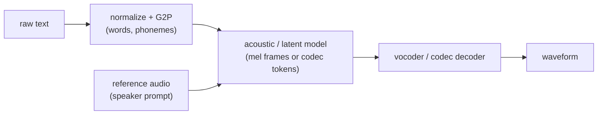
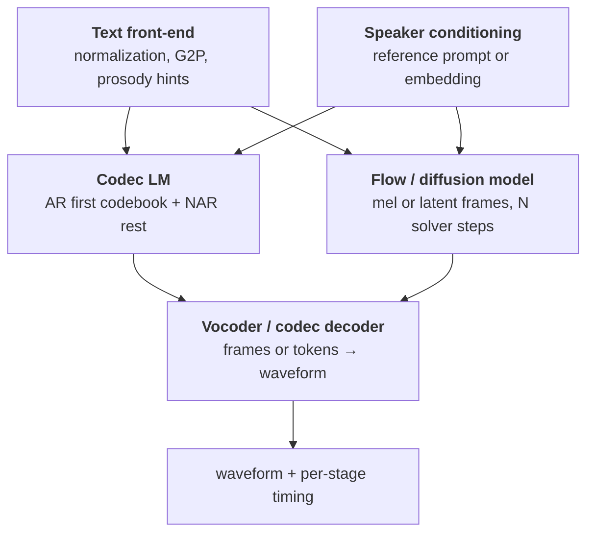

# Speech Module 03 — Text-to-Speech

## 00 Why This Module Exists

A TTS system does not "read text aloud." It runs a chain of decisions: how to expand the text, how long each sound lasts, what acoustic frames or codec tokens to produce, and how to turn those into a waveform.
- Each stage can fail on its own: a number read wrongly, a word skipped, a voice that drifts away from the reference speaker, or a click from the vocoder.
- The listener hears only the end result, so a failure in one stage is easily blamed on another.


- Legend: G2P: grapheme-to-phoneme conversion; mel frames: log-mel spectrogram frames ([Speech Module 01](../01-audio-representation/README.md)).

This module covers the TTS pipeline, text normalization, codec language models, flow-matching and diffusion acoustic models, neural vocoders, and zero-shot voice cloning.
- Audio features, codecs, and RVQ token rates are taught in [Speech Module 01](../01-audio-representation/README.md).
- Streaming TTS, sentence chunking, and time-to-first-audio belong to [Speech Module 04](../04-streaming-speech/README.md).
- MOS, UTMOS, speaker similarity, and ASR round-trip WER are defined in [Speech Module 05](../05-speech-evaluation/README.md).
- Flow matching and diffusion as general generative models are treated in depth in the [Generative Media track](../../generative-media/README.md).

**Research status:** satellite 80/20 revision, 2026-11-26. Formulas below are derived in the text. Architecture facts and constants attributed to papers (VALL-E, Voicebox, Matcha-TTS, HiFi-GAN, BigVGAN) or to reference code were written from the cited sources but were **not** re-read against a pinned paper version or commit in this revision (`TODO_VERIFY`). All latency figures in worked examples are hypothetical inputs for arithmetic, not measurements. Pin and re-check sources before citing them elsewhere.

**Module Orientation**

- **Engineering problem:** produce intelligible, correct, on-voice speech at a declared latency and compute budget, and know which stage to blame when it fails.
- **What you will do:**
  - trace a sentence through normalization, acoustic generation, and vocoding;
  - count sequential steps for autoregressive and non-autoregressive generation;
  - measure per-stage real-time factor (RTF);
  - break a codec LM and a vocoder on purpose and diagnose the result.
- **Environment:** Python 3.10+, PyTorch, one pretrained flow-matching or diffusion TTS model, one pretrained codec-LM TTS model (or its published samples), one neural vocoder, and a small ASR model for round-trip checks. A consumer GPU helps; CPU works for short clips.
- **Evidence rule:** separate source observations (**O**), derivations (**D**), and hypotheses that need measurement (**H**).
- **If You Only Have One Week**: Lessons SP3.2 and SP3.4. They cover the two cost-and-failure centers: autoregressive token generation and the vocoder/cloning boundary.

## 01 Baseline Assumptions

- [Speech Module 01](../01-audio-representation/README.md): mel frames, frame rate, codec frame rate, RVQ, and the token contract.
- Core [Module 01](../../advanced-ai-engineering/01-foundation-model-internals/README.md): autoregressive decoding and why sequential steps dominate latency.
- Core [Module 05](../../advanced-ai-engineering/05-inference-optimization/README.md): the difference between per-step cost and number of sequential steps.
- Mathematical prerequisites: conditional probability factorization, vectors and cosine similarity, and the idea of integrating an ODE with fixed-size steps.

## 02 Target Mastery

```yaml
depth_contract:
  conceptual: REQUIRED
  mechanistic: REQUIRED
  mathematical: REQUIRED
  quantitative: REQUIRED
  implementation: SELECTIVE
  source_code: SELECTIVE
  instrumentation: SELECTIVE
  experimental: SELECTIVE
  statistical: NOT_APPLICABLE
  production_reasoning: REQUIRED
  failure_analysis: REQUIRED
  falsification: SELECTIVE
  security: REQUIRED
  economics: SELECTIVE
  architecture_tradeoff: REQUIRED
  research_connection: SELECTIVE

estimated_effort:
  instruction: 2h
  guided_practice: 1.25h
  labs: 3h
  assessment: 0.75h
  source_trace: 0.5h
  total: 7.5h
```

The learner must be able to name each stage of a TTS system, count its sequential steps and frames, attribute a listening failure to the right stage, and defend an architecture choice (codec LM versus flow matching) against latency, robustness, and safety constraints.

### LAYER 1: KNOWLEDGE / INSTRUCTIONAL LAYER

## 03 Knowledge Map


- Legend: AR: autoregressive (one step per time position); NAR: non-autoregressive (all time positions in one step).

Keep three failure boundaries separate:

1. **Content failure:** wrong words are spoken (normalization error, skipped or repeated words). Detect with ASR round-trip.
2. **Identity/prosody failure:** right words, wrong voice or unnatural rhythm (speaker drift, flat prosody). Detect with speaker similarity and listening.
3. **Signal failure:** right words and voice, but artifacts (buzz, clicks, metallic sound). Usually the vocoder or a feature-contract mismatch.

## 04 Lessons

### Lesson SP3.1 — The TTS Pipeline and Text Normalization

**Engineering Question:**
Which part of the output is fixed before any neural network runs, and how many acoustic frames must the model produce?

**Concepts & Definitions:**

- **Text normalization (TN):** expanding written forms into spoken words: numbers, dates, currency, abbreviations, units. "$5.20" becomes "five dollars and twenty cents"; "Dr." becomes "doctor" or "drive" depending on context.
- **Grapheme-to-phoneme (G2P):** converting words to phonemes. Some modern systems skip it and model characters or subwords directly, which moves pronunciation errors into the acoustic model.
- **Duration:** how many acoustic frames each phoneme occupies. Systems such as FastSpeech 2 predict it explicitly; codec LMs decide it implicitly by when they stop generating (**O**).

Acoustic frame count for a mel-based model:

$$
N_{\text{frames}} = 1 + \left\lfloor \frac{D \cdot f_s}{h} \right\rfloor
$$

where:

- $N_{\text{frames}}$ is the number of mel frames the acoustic model must produce (center padding, as in Speech Module 01);
- $D$ is the output duration in seconds;
- $f_s$ is the vocoder's sample rate in Hz;
- $h$ is the hop in samples.

*Step-by-step reading.*

1. $D \cdot f_s$ is the number of waveform samples.
2. Dividing by $h$ counts hops; center padding adds one frame (Speech Module 01, Lesson SP1.2).
3. The vocoder must upsample each frame by exactly $h$ samples, so $f_s$ and $h$ are a shared contract between acoustic model and vocoder.

**Mechanism Explanation:**

Normalization is rule- or model-based and runs before synthesis, so its errors are deterministic: the same input always produces the same wrong words. Acoustic-model errors are often stochastic: the same input may be fine on one sample and skip a word on the next. This difference is the first diagnostic split.

**Break cases:**
- "1/2" read as "January second" instead of "one half";
- "2026" read as "two zero two six" in a year context;
- an abbreviation expanded for the wrong language;
- a URL or code identifier passed through unchanged and spelled letter by letter.

**Worked Example (frame budget):**
*Input.* A 22.05 kHz vocoder with hop 256 (a common HiFi-GAN configuration, **O**, `TODO_VERIFY`), and a sentence whose target duration is 10 s.

*Steps.*
- Samples: $10 \times 22{,}050 = 220{,}500$.
- Frame rate: $22{,}050 / 256 = 86.13$ frames per second.
- Frames: $1 + \lfloor 220{,}500 / 256 \rfloor = 1 + 861 = 862$.

*Result.* The acoustic model must produce an $862 \times n_{mels}$ matrix. A duration error of 10% changes this by about 86 frames and changes speaking rate audibly.

**Knowledge Check:** A transcript says "Call 555-0123 at 3:30 pm." Which errors here are normalization errors, and which would only appear after synthesis?

**Guided Practice:** Run 20 sentences containing numbers, dates, currency, units, and abbreviations through your system's normalizer (or a library normalizer). Log the normalized text before synthesis and mark each error as deterministic (normalizer) or not yet determined.

**Feedback Contract:**
- *Expected Evidence*: a table of input, normalized text, and error class; at least one error found before any audio is generated.
- *Common Failure*: judging normalization by listening, which mixes normalizer errors with acoustic errors.
- *Diagnostic Hint*: if the error is present in the normalized text, it is not the acoustic model's fault.
- *Concept to Revisit*: Content failure.

**Learning Outcome:** Separate deterministic front-end errors from acoustic errors and compute the frame budget for a target duration.

*(Effort: 25m instruction, 15m practice)*

### Lesson SP3.2 — Codec Language Models: AR First Codebook, NAR the Rest

**Engineering Question:**
How many sequential steps does a codec LM need for one utterance, and why does it sometimes repeat or skip words?

**Concepts & Definitions:**

- **Codec LM TTS:** treat speech generation as language modeling over neural-codec tokens ([Speech Module 01](../01-audio-representation/README.md), Lesson SP1.4). VALL-E conditions on phonemes and a short acoustic prompt from the target speaker and generates EnCodec tokens (**O**).
- **VALL-E factorization:** the first codebook is generated autoregressively over time; codebooks 2 to $Q$ are each generated non-autoregressively, one codebook per step, conditioned on all earlier codebooks (**O**, `TODO_VERIFY`):

$$
p(C \mid x, P) = \prod_{t=1}^{T} p\!\left(c_{t,1} \mid c_{<t,1}, x, P\right) \cdot \prod_{j=2}^{Q} p\!\left(c_{:,j} \mid c_{:,<j}, x, P\right)
$$

where:

- $C$ is the $T \times Q$ matrix of codec tokens to generate;
- $c_{t,j}$ is the token at frame $t$ in codebook $j$, and $c_{:,j}$ is the whole column for codebook $j$;
- $x$ is the phoneme sequence of the target text;
- $P$ is the acoustic prompt (codec tokens of the reference speaker);
- $T$ is the number of codec frames and $Q$ is the number of codebooks.

*Step-by-step reading.*

1. The first product has $T$ factors, each conditioned on earlier frames of codebook 1: that is $T$ sequential forward passes.
2. The second product has $Q - 1$ factors, each producing a whole codebook column in one pass: that is $Q - 1$ further passes.
3. Total sequential passes: $T + Q - 1$, instead of $T \cdot Q$ for a flat autoregressive sequence.
4. Duration is not predicted: the AR stage decides when to emit an end token, so length errors and alignment errors come from the same place.

**Mechanism Explanation:**

Nothing in the AR stage forces attention over phonemes to move monotonically forward. If it attends back to an earlier phoneme, the model repeats a word; if it jumps forward, it skips one; if it never emits the end token, it babbles until a length limit. Sampling temperature and prompt quality change how often this happens (**H**, measure in LAB A). Duration-explicit models (FastSpeech 2, Matcha-TTS) avoid this class of failure by construction but give up the free-form prosody an LM can produce.

**Worked Example (sequential steps for 10 s):**
*Input.* EnCodec 24 kHz at $r = 75$ frames per second with $Q = 8$ codebooks (6 kbit/s), as in VALL-E (**O**, `TODO_VERIFY`). A 3 s prompt and 10 s of target speech.

*Steps.*
- Target frames: $T = 10 \times 75 = 750$.
- Prompt frames: $3 \times 75 = 225$, used as context, not generated.
- AR passes for codebook 1: 750.
- NAR passes for codebooks 2–8: 7.
- Total sequential passes: $750 + 7 = 757$.
- A flat AR sequence over all tokens would need $750 \times 8 = 6{,}000$ passes.

*Result.* The hybrid design cuts sequential passes by about 7.9 times. The AR stage still dominates: 750 of the 757 passes.

*Hypothetical timing.* If one AR pass takes 12 ms and one NAR pass 30 ms on some GPU, generation takes $750 \times 0.012 + 7 \times 0.030 = 9.21$ s for 10 s of audio, an RTF near 0.92 before the codec decoder runs. These timings are assumptions for the arithmetic only.

**Knowledge Check:** Why does a longer acoustic prompt improve speaker similarity but increase the cost of every AR pass?

**Guided Practice:** For a 6 s, 20 s, and 60 s target at 75 Hz and $Q = 8$, compute AR passes, NAR passes, and the flat-AR alternative. Then compute the context length (prompt plus generated frames) at the last AR step for a 3 s prompt.

**Feedback Contract:**
- *Expected Evidence*: AR passes 450, 1,500, 4,500; NAR passes 7 in every case; flat AR 3,600, 12,000, 36,000; final context lengths 675, 1,725, 4,725 frames (plus phoneme tokens).
- *Common Failure*: counting NAR passes per frame instead of per codebook.
- *Diagnostic Hint*: NAR stages are parallel over time; only the number of codebooks sets their count.
- *Concept to Revisit*: Token contract (Speech Module 01).

**Learning Outcome:** Count sequential passes for a codec LM and explain why its main failure modes are repetition, skipping, and runaway length.

*(Effort: 35m instruction, 20m practice)*

### Lesson SP3.3 — Flow-Matching and Diffusion Acoustic Models

**Engineering Question:**
What does a flow-matching TTS model compute per step, and what do fewer solver steps cost?

**Concepts & Definitions:**

- **Conditional flow matching (CFM):** learn a velocity field that moves samples from noise $x_0$ to data $x_1$ along a chosen path. With the optimal-transport-style straight path (**O**, Lipman et al., `TODO_VERIFY`):

$$
x_t = \bigl(1 - (1 - \sigma_{\min})\,t\bigr)\,x_0 + t\,x_1, \qquad u_t = x_1 - (1 - \sigma_{\min})\,x_0
$$

where:

- $t \in [0, 1]$ is the path time, from noise ($t = 0$) to data ($t = 1$);
- $x_0$ is a Gaussian noise sample with the same shape as the target (for example a mel matrix);
- $x_1$ is the target data sample;
- $\sigma_{\min}$ is a small constant that keeps a little noise at $t = 1$;
- $x_t$ is the point on the path at time $t$, and $u_t$ is its velocity $dx_t/dt$, which is the training target for the network $v_\theta(x_t, t, \text{cond})$.

*Step-by-step reading.*

1. Differentiate $x_t$ with respect to $t$: $\frac{d}{dt}x_t = -(1 - \sigma_{\min})x_0 + x_1 = u_t$, a constant along each path.
2. Training samples $t$, builds $x_t$, and regresses $v_\theta$ onto $u_t$.
3. Sampling starts from fresh noise and integrates $dx/dt = v_\theta$ from $t = 0$ to $1$, for example with $N$ Euler steps $x \leftarrow x + \frac{1}{N} v_\theta(x, t)$.
4. Each step processes the whole utterance at once: cost is $N$ full-sequence passes, independent of duration in step count.

- **Voicebox** trains a flow-matching model to infill masked speech given text and surrounding audio, which supports zero-shot TTS, editing, and denoising (**O**). **Matcha-TTS** uses an OT-CFM decoder with an explicit duration model and reports good quality with few solver steps (**O**, author-reported).

**Mechanism Explanation:**

For one path the velocity is constant, so Euler is exact. But the network sees only $x_t$, not the target; where many targets are plausible (different prosodies), it predicts their average velocity. Few steps then land between modes and sound flat or blurred; more steps let the trajectory commit (**D**, see the example). Diffusion models follow the same logic with curved paths and usually need more steps for the same quality.

**Worked Example (why one step averages):**
*Input.* A 1-D toy: target $x_1$ is $-1$ or $+1$ with equal probability, $\sigma_{\min} = 0$, and the sampler starts at $x_0 = 0$.

*Steps.*
- At $t = 0$, $x_t = x_0 = 0$ whichever target is chosen.
- The ideal velocity is $E[x_1 - x_0 \mid x_t = 0] = 0.5(-1) + 0.5(1) - 0 = 0$.
- One Euler step: $x = 0 + 1 \times 0 = 0$, which is neither target.
- With a random $x_0 = 0.1$, the conditional expectation tilts toward $+1$ as $t$ grows, so several small steps move toward a mode instead of the mean.

*Result.* The step count trades latency against mode commitment. In TTS this shows up as flat prosody or muffled detail at very low step counts (**H**, verify in LAB A).

*Step budget.* For the 10 s utterance of Lesson SP3.2, a flow model with $N = 10$ needs 10 full-sequence passes (plus a duration model), versus 757 passes for the codec LM. Per-pass cost is higher because each pass covers all 862 frames, so compare measured time, not step counts.

**Knowledge Check:** Why does the number of solver steps not grow with utterance length, while codec-LM AR passes do?

**Guided Practice:** Generate the same sentence with a flow-matching TTS model at $N = 1, 2, 4, 10, 32$ steps. Record wall time, round-trip WER, and a short listening note per setting.

**Feedback Contract:**
- *Expected Evidence*: a table with time roughly linear in $N$, WER that stabilizes after a few steps, and listening notes that change mainly at the lowest $N$.
- *Common Failure*: changing the solver and step count together.
- *Diagnostic Hint*: hold the noise seed fixed across settings so differences come from $N$ alone.
- *Concept to Revisit*: CFM sampling.

**Learning Outcome:** Explain flow-matching TTS sampling and choose a step count from measured latency and quality.

*(Effort: 30m instruction, 20m practice)*

### Lesson SP3.4 — Vocoders, RTF, and Zero-Shot Cloning

**Engineering Question:**
Where does the remaining latency go, and how do we know the output is still the target speaker?

**Concepts & Definitions:**

- **Neural vocoder:** maps mel frames to waveform. HiFi-GAN upsamples with transposed convolutions and is trained adversarially with multi-period and multi-scale discriminators; BigVGAN adds periodic (Snake) activations and anti-aliasing for better generalization to unseen speakers and recording conditions (**O**, `TODO_VERIFY`).
- **Upsampling contract:** the product of the vocoder's upsampling rates must equal the hop $h$. HiFi-GAN V1 uses rates $8 \times 8 \times 2 \times 2 = 256$ (**O**, `TODO_VERIFY`).
- **Real-time factor:**

$$
\text{RTF} = \frac{\tau_{\text{compute}}}{D}
$$

where $\tau_{\text{compute}}$ is the wall-clock processing time in seconds and $D$ is the duration of audio produced in seconds. $\text{RTF} < 1$ means faster than real time.

- **Speaker similarity:** cosine similarity between speaker-verification embeddings of the reference and the output:

$$
\text{sim}(a, b) = \frac{a \cdot b}{\lVert a \rVert\,\lVert b \rVert}
$$

where $a$ and $b$ are embeddings from the same speaker-verification model. Scores are comparable only within one embedding model (details in [Speech Module 05](../05-speech-evaluation/README.md)).

**Mechanism Explanation:**

Stage RTFs add for an offline pipeline: $\text{RTF}_{\text{total}} = \sum_i \tau_i / D$. A fast vocoder cannot rescue a slow AR stage. A vocoder fed mel frames with the wrong sample rate, hop, or mel filter bank still runs and produces audio, but with buzz, pitch errors, or metallic tone: a signal failure caused by a contract mismatch, not by the vocoder weights.

Zero-shot cloning conditions on a few seconds of a new speaker. **Speaker drift** is the output moving away from the reference over a long utterance or across sentences, often when the prompt is noisy, very short, or in a different style from the target text (**H**). Measure similarity per segment, not only once per file.

**Worked Example (pipeline RTF):**
*Input.* Hypothetical timings for 8 s of output: text front-end 5 ms, flow model 10 steps × 15 ms, vocoder 60 ms.

*Steps.*
- Total compute: $0.005 + 0.150 + 0.060 = 0.215$ s.
- RTF: $0.215 / 8 = 0.027$.
- Vocoder share: $0.060 / 0.215 = 28\%$.

*Similarity check.* Reference embedding $a = (0.6, 0.8)$, output embedding $b = (0.8, 0.6)$, both unit length: $\text{sim} = 0.48 + 0.48 = 0.96$.

*Result.* This pipeline is far faster than real time, and the flow model dominates. Real embeddings have hundreds of dimensions, and a "good" threshold must be calibrated per embedding model.

**Knowledge Check:** An offline RTF of 0.03 is measured. Why does that number not guarantee a low time-to-first-audio in a streaming product?

**Guided Practice:** (a) Time each stage of your TTS pipeline on five sentences of different lengths and compute per-stage RTF. (b) Clone one voice from a 3 s and a 15 s prompt, generate a 60 s paragraph, and compute speaker similarity per 10 s segment.

**Feedback Contract:**
- *Expected Evidence*: (a) a stage-timing table with RTF per stage and total; (b) a similarity-by-segment plot for both prompts, with a statement of whether similarity falls over time.
- *Common Failure*: timing the first call only, which includes model loading and warm-up.
- *Diagnostic Hint*: discard warm-up runs and synchronize the GPU before reading the clock.
- *Concept to Revisit*: RTF; identity failure.

**Learning Outcome:** Attribute latency per stage and measure speaker drift with a declared embedding model.

*(Effort: 30m instruction, 20m practice)*

## 05 Literature & Production Source Map

**REFERENCE / BASELINE**

- [Natural TTS Synthesis by Conditioning WaveNet on Mel Spectrogram Predictions (Tacotron 2)](https://arxiv.org/abs/1712.05884) — Shen et al. (2018). Reading pointer: the two-stage text → mel → vocoder design.
- [FastSpeech 2](https://arxiv.org/abs/2006.04558) — Ren et al. (2020). Reading pointer: explicit duration, pitch, and energy predictors.
- [HiFi-GAN](https://arxiv.org/abs/2010.05646) — Kong et al. (2020). Reading pointer: generator upsampling and the multi-period discriminator.
- [Neural Codec Language Models are Zero-Shot Text to Speech Synthesizers (VALL-E)](https://arxiv.org/abs/2301.02111) — Wang et al. (2023). Reading pointer: the AR/NAR split over codebooks and the 3 s prompt setup.
- [Flow Matching for Generative Modeling](https://arxiv.org/abs/2210.02747) — Lipman et al. (2022). Reading pointer: the conditional flow-matching objective and the optimal-transport path.

**WORKLOAD-DEPENDENT / FRONTIER**

- [Voicebox](https://arxiv.org/abs/2306.15687) — Le et al. (2023). Text-guided flow-matching infilling; author-reported results, scope to their data.
- [Matcha-TTS](https://arxiv.org/abs/2309.03199) — Mehta et al. (2023). OT-CFM decoder with few solver steps; author-reported speed and quality.
- [BigVGAN](https://arxiv.org/abs/2206.04658) — Lee et al. (2022). Universal vocoder; author-reported out-of-distribution robustness.
- [Conditional Variational Autoencoder with Adversarial Learning for End-to-End TTS (VITS)](https://arxiv.org/abs/2106.06103) — Kim et al. (2021). End-to-end alternative that removes the separate vocoder stage (`TODO_VERIFY` arXiv ID).
- Bark and other open codec-LM systems: check the repository's own documentation; no paper-level claim is made here.

**CURRENT DEFAULT:** a logged, testable text normalizer; an acoustic model chosen by measured robustness (round-trip WER) and latency; a vocoder whose sample rate, hop, and mel contract match the acoustic model exactly; per-segment speaker similarity for cloning.

**LEGACY / INSUFFICIENT:** judging TTS by a few listened samples; reporting a single MOS without round-trip WER; comparing AR and flow models by step count instead of wall time; cloning any voice from any uploaded clip without consent checks.

**SAFETY AND CONSENT (production requirement)**

- Zero-shot cloning can impersonate a real person from a few seconds of audio. Production systems must record consent from the voice owner, restrict cloning to verified voices, and keep an audit log of prompts and outputs.
- Add a detectable signal to generated audio. Audio watermarking methods such as [AudioSeal](https://arxiv.org/abs/2401.17264) — San Roman et al. (2024) — embed a mark designed to survive common edits (author-reported robustness, `TODO_VERIFY`). A watermark helps detection but does not replace consent.
- Treat reference audio as personal data: retention limits, deletion on request, and no reuse for training without permission. Threat modeling for such features belongs to core [Module 18](../../advanced-ai-engineering/18-ai-security/README.md).

**PRODUCTION SOURCE TRACE** (pin the commit you read; no commit was pinned in this revision)

- `shivammehta25/Matcha-TTS`, file `matcha/models/components/flow_matching.py`: the CFM training loss and the fixed-step Euler sampler (Lesson SP3.3).
- `jik876/hifi-gan`, file `models.py` (`Generator`) and `config_v1.json` (`upsample_rates`): the upsampling contract (Lesson SP3.4).
- `facebookresearch/encodec`: the codec whose token contract VALL-E-style models generate (Speech Module 01 source trace).
- Scope: reference implementations. Production TTS stacks often reimplement vocoders and samplers; check each one separately.

### LAYER 2: ENGINEERING PRACTICE LAYER

## 06 Engineering Labs

All labs follow `PREDICT → BUILD → MEASURE → EXPLAIN → BREAK → IMPROVE → FALSIFY`.

### LAB A — Codec LM versus Flow Matching: Robustness and Latency

- **Objective:** compare a codec-LM TTS and a flow-matching TTS on the same sentence set for content errors, speaker similarity, and per-stage latency.
- **Pre-Registered Hypothesis:** the codec LM shows more repetitions, skips, and runaway lengths on long or unusual sentences, while the flow model is faster per utterance but flatter at its lowest step counts.
- **Independent Variables:** model family, sampling temperature (codec LM), solver steps (flow), sentence length, prompt length.
- **Dependent Variables:** round-trip WER, insertion/deletion counts, duration ratio versus a reference speaking rate, speaker similarity, and per-stage RTF.
- **Break & Falsify:** use repeated words ("the the the"), long lists, numbers, very short prompts, and a high sampling temperature.
- **Alignment:** Lessons SP3.2–SP3.4 and Incident SP3.1.
- **Effort Estimate:** 1.75h.

### LAB B — Break the Front-End and the Vocoder Contract

- **Objective:** show which listening failures come from normalization and which from a vocoder contract mismatch.
- **Pre-Registered Hypothesis:** normalization errors are deterministic and visible in text; vocoder mismatches produce signal artifacts with correct words.
- **Independent Variables:** normalizer on/off, mel sample rate and hop fed to the vocoder, mel filter bank.
- **Dependent Variables:** normalized text errors, round-trip WER, a log-mel distance to a matched-contract output, and a listening note.
- **Break & Falsify:** feed 24 kHz mels to a 22.05 kHz vocoder; feed a different hop; skip normalization on a number-heavy paragraph.
- **Alignment:** Lessons SP3.1 and SP3.4.
- **Effort Estimate:** 1.25h.

**Runnable arithmetic check (CPU; not a quality experiment):**
```python
import math
assert 1 + (10 * 22_050) // 256 == 862                   # mel frames for 10 s
assert math.isclose(22_050 / 256, 86.1328125)
r, Q = 24_000 // 320, 8
T = 10 * r
assert (T, 3 * r) == (750, 225)                          # target and prompt frames
assert T + (Q - 1) == 757 and T * Q == 6_000             # AR+NAR vs flat AR
assert [s * r for s in (6, 20, 60)] == [450, 1_500, 4_500]
assert [3 * r + s * r for s in (6, 20, 60)] == [675, 1_725, 4_725]
assert math.isclose(750 * 0.012 + 7 * 0.030, 9.21)       # hypothetical timing
assert 8 * 8 * 2 * 2 == 256                              # HiFi-GAN V1 upsampling
assert math.isclose((0.005 + 0.150 + 0.060) / 8, 0.026875)
a, b = (0.6, 0.8), (0.8, 0.6)
cos = sum(x * y for x, y in zip(a, b)) / (math.hypot(*a) * math.hypot(*b))
assert math.isclose(cos, 0.96)
# one Euler step from x0 = 0 toward targets {-1, +1}: mean velocity is 0
assert 0 + 1 * (0.5 * (-1 - 0) + 0.5 * (1 - 0)) == 0
```

## 07 Break / Incident Scenarios

### Incident SP3.1 — Cloned Voice Repeats Words and Drifts on Long Answers

**Incident Symptoms:**
After a release that raises the maximum answer length and switches the voice-cloning feature to a new codec-LM model, users report that long answers sometimes repeat a phrase, end with seconds of babble, or "turn into a different person" halfway. Short answers sound fine. Prices are also read wrongly in some replies.

**Diagnostic Protocol (Task):**
1. **Form Competing Hypotheses:** AR alignment failure on long inputs, missing length or end-token guard, high sampling temperature, a noisy or short reference prompt, prompt/target style mismatch, a normalizer regression for currency, or a vocoder contract change in the new release.
2. **Identify Missing Evidence:** normalized text per request, prompt duration and quality, sampling settings, generated frame count versus expected, round-trip transcript, and per-segment speaker similarity.
3. **Design Discriminating Measurements:** replay the failing requests through the old and new model with the same normalized text and prompt; then vary one factor (length, temperature, prompt) at a time.
4. **Rank Explanations:** errors present in normalized text are front-end bugs; insertions and duration overruns that grow with length point to AR alignment; similarity falling by segment points to drift.
5. **Intervene:** fix the normalizer; split long answers at sentence boundaries; add a maximum-duration guard derived from text length; tune temperature; require a minimum prompt quality.
6. **Remeasure:** round-trip WER, insertion rate, duration ratio, and per-segment similarity on the same replay set and on fresh long answers.

### LAYER 3: MASTERY / ASSESSMENT LAYER

## 08 Mastery Assessment

### Transfer Problem — A Cloned-Voice Narrator for Support Articles

A company wants support articles (up to 5 minutes each) read in the voice of a consenting staff narrator, generated offline overnight and also on demand for short snippets.

**Required Deliverables:**
1. a stage diagram with the text, frame, and token contracts between each stage;
2. hand-computed frame counts, AR and NAR passes, and solver-step budgets for a 5 min article and a 10 s snippet;
3. an architecture choice (codec LM or flow matching) for each use, defended with LAB A evidence;
4. a normalization test suite and its results (LAB B);
5. a long-form strategy (chunking, guards) with per-segment speaker similarity evidence;
6. a consent, watermarking, and data-retention plan for the narrator's voice.

## 09 Required Evidence & Rubric

### Required Artifact: TTS Stage Report

Submit the stage diagram, stage-timing table, LAB A comparison, LAB B break table, Incident SP3.1 diagnosis, and the safety plan.

### Rubric Dimensions

- **Mechanism:** *Insufficient* says "the model generates speech." *Competent* names each stage and its contract. *Strong* predicts which stage causes a given listening failure before measuring.
- **Quantitative:** *Insufficient* quotes model-card speed. *Competent* counts frames, passes, and steps and measures per-stage RTF. *Strong* explains how each count scales with duration and why.
- **Diagnosis:** *Insufficient* listens and guesses. *Competent* uses normalized text, round-trip WER, and similarity. *Strong* separates content, identity, and signal failures with one-factor replays.
- **Safety:** *Insufficient* ignores cloning risk. *Competent* adds consent and logging. *Strong* adds watermarking, verified-voice restrictions, and retention rules with a stated threat model.

## 10 Capability Traceability Matrix

| Capability | Taught | Practiced | Assessed | Evidence (artifact reviewers open) |
|---|---|---|---|---|
| Pipeline stages and text normalization | SP3.1 | SP3.1 Guided Practice; LAB B | Deliverables 1, 4; Incident SP3.1 | Normalization error table; stage diagram |
| Codec LM step counting and failure modes | SP3.2 | SP3.2 Guided Practice; LAB A | Deliverables 2, 3; Incident SP3.1 | Pass counts; insertion and duration-ratio table |
| Flow-matching sampling and step budget | SP3.3 | SP3.3 Guided Practice; LAB A | Deliverables 2, 3 | Step-sweep table (time, WER, listening notes) |
| Vocoder contract and RTF | SP3.4 | SP3.4 Guided Practice (a); LAB B | Deliverable 1 | Stage-timing table; contract-mismatch break table |
| Cloning, drift, and safety | SP3.4; §05 Safety | SP3.4 Guided Practice (b); LAB A | Deliverables 5, 6 | Per-segment similarity plot; consent and watermark plan |

## 11 Exit Criteria & Module Wrap-Up

### Exit Criteria

A learner passes when they can count frames, AR/NAR passes, and solver steps for any duration; measure per-stage RTF; attribute a failure to normalization, acoustic generation, cloning, or vocoding with evidence; and defend an architecture and safety plan for a cloned-voice product.

### Module Wrap-Up (Final Mental Model Reconstruction)

TTS is a chain of contracts: text to words, words to frames or tokens, frames to waveform, and reference voice to identity. Check the text before the audio, count sequential steps before buying hardware, measure identity per segment, and never ship cloning without consent and a detectable mark.

### Cost & Telemetry Hook

- [Lesson 22.1](../../advanced-ai-engineering/22-ai-economics/README.md): cost per generated audio second, split by acoustic model and vocoder, including retries after failed round-trip checks.
- [Lesson 23.1](../../advanced-ai-engineering/23-observability-reliability/README.md): emit normalized text, generated frame count versus expected, round-trip WER on a sample, per-segment similarity, and model/vocoder versions per request so Incident SP3.1 is detectable from telemetry.

## 12 Competency Targets

```yaml
competency:
  sfia: 4
  bloom: Apply -> Analyze
  solo: Relational
  dreyfus: Advanced Beginner -> Competent
```
