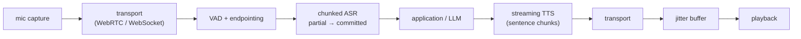
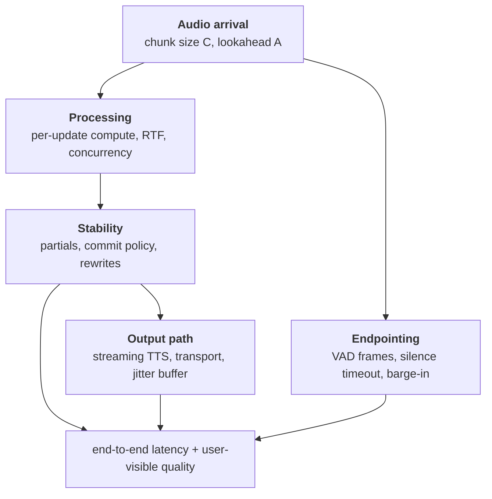

# Speech Module 04 — Streaming Speech

## 00 Why This Module Exists

An offline ASR or TTS model answers "what was said" or "how should this sound." A streaming system must also answer "how soon" and "how stable," while audio is still arriving.
- Latency is not one number: it is waiting for audio, waiting for context, computing, transporting, and buffering.
- A streaming transcript can be fast and wrong, then rewritten. Users see the rewrites.


- Legend: VAD: voice activity detection; ASR: automatic speech recognition; TTS: text-to-speech.

This module covers chunked and sliding-window ASR, the latency anatomy of a chunk, Real-Time Factor (RTF) and Time-To-First-Audio (TTFA), partial-transcript stability, VAD and endpointing, barge-in, streaming TTS, and playback buffering.
- Feature frontends and frame counts belong to [Speech Module 01](../01-audio-representation/README.md).
- ASR architectures (CTC, RNN-T, encoder–decoder) belong to [Speech Module 02](../02-speech-to-text/README.md).
- TTS model families belong to [Speech Module 03](../03-text-to-speech/README.md).
- Latency metric definitions for evaluation belong to [Speech Module 05](../05-speech-evaluation/README.md).
- The full turn-taking state machine belongs to [Speech Module 06](../06-voice-agent-systems/README.md).
- Queueing under concurrent streams builds on core [Module 04](../../advanced-ai-engineering/04-serving-scheduling-capacity/README.md); media clocks build on core [Module 21, Lesson 21.4](../../advanced-ai-engineering/21-multimodal-ai-systems/README.md).

**Research status:** satellite 80/20 revision, 2026-11-26. Latency, RTF, re-transcription, and buffering formulas are derived in the text. Constants attributed to papers or code (WebRTC VAD frame sizes and modes, Silero VAD chunk size, the LocalAgreement policy and its default $n$ in `whisper_streaming`) were written from the cited sources but were **not** re-read against a pinned commit in this revision (`TODO_VERIFY`). All per-chunk compute times in worked examples are hypothetical inputs, not measurements.

**Module Orientation**

- **Engineering problem:** deliver transcripts and synthesized audio within a latency budget, with stable partial output and no playback gaps, under concurrent load.
- **What you will do:**
  - decompose chunk latency into algorithmic, compute, and transport parts;
  - compute RTF and stream capacity for a sliding-window ASR loop;
  - measure partial-transcript stability under a commit policy;
  - tune VAD endpointing and barge-in against false triggers;
  - size a playback buffer for streaming TTS.
- **Environment:** Python 3.10+, a streaming-capable ASR runtime (for example `faster-whisper` with the `whisper_streaming` policy, or a chunked RNN-T/CTC model), a VAD (Silero or WebRTC VAD), any streaming TTS, and a way to replay audio in real time with injected network jitter. CPU works for single streams; a GPU is optional for concurrency tests.
- **Evidence rule:** separate source observations (**O**), derivations (**D**), and hypotheses that need measurement (**H**).
- **If You Only Have One Week**: Lessons SP4.1 and SP4.2. They give the latency decomposition and the RTF/capacity arithmetic that every other streaming decision depends on.

## 01 Baseline Assumptions

- [Speech Module 01](../01-audio-representation/README.md): sample rate, frames, hop, and the Whisper 30 s input contract.
- [Speech Module 02](../02-speech-to-text/README.md): which ASR families can emit tokens before the utterance ends.
- Core [Module 04](../../advanced-ai-engineering/04-serving-scheduling-capacity/README.md): utilization, queueing delay, and why delay grows without bound when arrival rate exceeds service rate.
- Mathematical prerequisites: arithmetic series, intervals, and longest common prefix of two sequences.

## 02 Target Mastery

```yaml
depth_contract:
  conceptual: REQUIRED
  mechanistic: REQUIRED
  mathematical: REQUIRED
  quantitative: REQUIRED
  implementation: REQUIRED
  source_code: SELECTIVE
  instrumentation: REQUIRED
  experimental: REQUIRED
  statistical: SELECTIVE
  production_reasoning: REQUIRED
  failure_analysis: REQUIRED
  falsification: SELECTIVE
  security: NOT_APPLICABLE
  economics: SELECTIVE
  architecture_tradeoff: REQUIRED
  research_connection: SELECTIVE

estimated_effort:
  instruction: 2h
  guided_practice: 1.25h
  labs: 3h
  assessment: 0.75h
  source_trace: 0.5h
  total: 7.5h
```

The learner must be able to predict the latency range of a committed word from chunk, lookahead, commit policy, and compute time; compute RTF and stream capacity; measure transcript stability; size endpoint and playback buffers; and diagnose a streaming lag that grows over time.

### LAYER 1: KNOWLEDGE / INSTRUCTIONAL LAYER

## 03 Knowledge Map


- Legend: C: audio per update (s); A: future context the model waits for (s); RTF: processing time divided by audio duration.

Keep three latency sources separate:

1. **Algorithmic latency:** audio the system must wait for before it can decide (chunk, lookahead, silence timeout, commit confirmations). It exists even with infinitely fast hardware.
2. **Compute latency:** time to process one update, which grows with load when streams share hardware.
3. **Transport and playout latency:** network, jitter buffer, and device buffers.

Only compute latency is fixed by faster hardware. The other two are design choices.

## 04 Lessons

### Lesson SP4.1 — Latency Anatomy of a Chunked ASR Update

**Engineering Question:**
When a user says a word, how long until it appears as committed text, and which parts of that delay can be engineered away?

**Concepts & Definitions:**

- **Chunk size $C$:** seconds of new audio consumed per update.
- **Lookahead $A$:** seconds of future audio a chunked model needs after the chunk before it emits outputs for it (common in chunked Conformer/RNN-T designs; zero in a pure sliding-window Whisper loop, which instead relies on commit confirmation).
- **Commit policy:** the rule that turns unstable partial hypotheses into committed text. A policy that waits for agreement across $n$ consecutive updates adds $(n-1)$ extra chunks of waiting.
- **Compute time $t_c$** per update and **transport time $t_n$** from client to server.

Committed-word latency, measured from the moment the word ends:

$$
L_{\text{commit}} \in \big[\,A + (n-1)C + t_c + t_n,\;\; C + A + (n-1)C + t_c + t_n\,\big]
$$

where:

- $L_{\text{commit}}$ is the delay from the end of the spoken word to its committed display, in seconds;
- $C$ is the chunk size and $A$ the lookahead, in seconds;
- $n \ge 1$ is the number of consecutive updates that must agree before commit ($n = 1$ means commit immediately);
- $t_c$ is compute time per update and $t_n$ is one-way transport time, in seconds.

*Step-by-step reading.*

1. A word that ends exactly at a chunk boundary is processed as soon as the lookahead $A$ has also arrived: best case wait $A$.
2. A word that ends just after a boundary must wait almost a full chunk $C$ for the next boundary, then $A$: worst case wait $C + A$. With uniform word timing the mean wait is $C/2 + A$.
3. A commit policy needing $n$ agreeing updates adds $(n-1)$ further chunks, because the word must survive $n-1$ more updates.
4. Each update then costs $t_c$, and the result travels $t_n$ back (count transport once here if capture-to-server dominates; add the return path when the display is on the client).

**Mechanism Explanation:**

Shrinking $C$ lowers the algorithmic term but increases the number of updates per second, which multiplies compute (Lesson SP4.2) and usually lowers accuracy because each decision has less context. Lookahead $A$ buys accuracy at a fixed latency cost. A commit policy buys stability at a cost of $(n-1)C$.

**Worked Example (sliding-window loop with agreement):**
*Input.* $C = 1.0$ s, $A = 0$, $n = 2$, $t_c = 0.30$ s, $t_n = 0.05$ s (hypothetical inputs).

*Steps.*
- Best case: $0 + (2-1)\times1.0 + 0.30 + 0.05 = 1.35$ s.
- Worst case: $1.0 + 0 + 1.0 + 0.30 + 0.05 = 2.35$ s.
- Mean, uniform word timing: $1.85$ s.

*Same budget, chunked model:* $C = 0.64$ s, $A = 0.32$ s, $n = 1$, same $t_c$, $t_n$:
- Range $[0.32 + 0.35,\; 0.96 + 0.35] = [0.67, 1.31]$ s.

*Result.* The chunked model with lookahead commits roughly a second sooner because it does not need a confirming update, not because it computes faster.

**Knowledge Check:** Halving $C$ in the first example from 1.0 s to 0.5 s: what happens to the worst-case commit latency, and what new cost appears?

**Guided Practice:** Instrument one streaming run. Log, for every committed word, the word's end time (from forced alignment or the model's timestamps), the update in which it was first emitted, and the update in which it was committed. Plot the distribution of $L_{\text{commit}}$ and compare it with the predicted interval.

**Feedback Contract:**
- *Expected Evidence*: a histogram whose bulk lies inside the predicted interval, with outliers explained (compute spikes, words revised more than once).
- *Common Failure*: measuring latency from the chunk boundary instead of from the word's end, which hides the $C$ term.
- *Diagnostic Hint*: if measured latency exceeds the interval's upper bound on many words, $t_c$ under load is larger than the value you assumed; log it per update.
- *Concept to Revisit*: Algorithmic versus compute latency.

**Learning Outcome:** Predict and measure the committed-word latency interval from chunk, lookahead, commit policy, and compute time.

*(Effort: 30m instruction, 20m practice)*

### Lesson SP4.2 — RTF, Re-Transcription Cost, and Stream Capacity

**Engineering Question:**
How much compute does one live stream consume, and how many streams fit on one device before latency starts to grow?

**Concepts & Definitions:**

- **Real-Time Factor:** $\text{RTF} = \dfrac{\text{processing time}}{\text{audio duration}}$. Offline, RTF $< 1$ means faster than real time. For a live stream, the relevant RTF is per update, at the actual concurrency.
- **Sliding-window re-transcription:** each update re-runs the model on a buffer that contains already-processed audio plus the new chunk. Work is repeated.
- **Fixed-window encoder:** the reference Whisper encoder pads every input to 30 s, so encoder cost per update is the same whether the buffer holds 2 s or 29 s ([Speech Module 01](../01-audio-representation/README.md), Lesson SP1.2).

Per-stream RTF of a sliding-window loop:

$$
\text{RTF}_{\text{stream}} = \frac{t_e + t_d}{C}
$$

where:

- $t_e$ is encoder time per update (constant for a padded 30 s window);
- $t_d$ is decoder time per update (grows with the number of tokens re-decoded in the buffer);
- $C$ is the chunk size, i.e. audio seconds advanced per update.

*Step-by-step reading.*

1. In real time, one update happens every $C$ seconds of audio.
2. Each update costs $t_e + t_d$ seconds of device time.
3. Device seconds per audio second is therefore $(t_e + t_d)/C$.
4. If the encoder were not padded and the buffer grew by $C$ per update up to $k$ updates, total encoder work would be proportional to $C(1 + 2 + \dots + k) = C\,k(k+1)/2$: quadratic in stream length until the buffer is trimmed. Trimming the buffer at committed sentence boundaries is what keeps this bounded.

Capacity without batching: a device serving streams one update at a time saturates when the sum of per-stream RTF reaches 1:

$$
N_{\max} = \left\lfloor \frac{1}{\text{RTF}_{\text{stream}}} \right\rfloor
$$

where $N_{\max}$ is the largest number of concurrent streams whose total device time per second stays below one second. Beyond it, updates queue and latency grows without bound (core Module 04).

**Mechanism Explanation:**

Offline benchmarks report RTF for one long file processed once. A sliding-window stream processes each second of audio many times, so its RTF is set by $C$ and the fixed window, not by offline throughput. Batching updates from many streams raises $N_{\max}$ but adds waiting for the batch to form, which is another latency term.

**Worked Example (chunk size versus capacity):**
*Input.* Hypothetical per-update times $t_e = 0.12$ s, $t_d = 0.08$ s.

*Steps.*
- $C = 1.0$ s: $\text{RTF} = 0.20/1.0 = 0.20$, $N_{\max} = 5$.
- $C = 0.5$ s: $\text{RTF} = 0.40$, $N_{\max} = 2$.
- $C = 0.25$ s: $\text{RTF} = 0.80$, $N_{\max} = 1$.

*Result.* Cutting the chunk from 1 s to 0.25 s saves at most 0.75 s of algorithmic latency per word but cuts capacity from five streams to one on the same device.

*Unpadded growth check.* With $C = 1$ s and no trimming, 30 updates process $1 + 2 + \dots + 30 = 465$ audio-seconds for 30 s of speech, 15.5 times the audio length.

**Knowledge Check:** Why can a model with offline RTF 0.05 still fall behind in a live sliding-window deployment with four concurrent users?

**Guided Practice:** Measure $t_e$ and $t_d$ per update at $C \in \{0.25, 0.5, 1.0, 2.0\}$ s with one stream, compute predicted $N_{\max}$, then run $N_{\max}$ and $N_{\max}+1$ concurrent streams and record whether per-update latency stays flat or grows.

**Feedback Contract:**
- *Expected Evidence*: a table of $C$, measured $t_e$, $t_d$, predicted RTF and $N_{\max}$, and a latency-over-time plot showing growth only above $N_{\max}$.
- *Common Failure*: measuring $t_e$ with a short unpadded input, which underestimates the padded encoder cost.
- *Diagnostic Hint*: if latency grows below predicted capacity, check whether $t_d$ grows with buffer length because the buffer is never trimmed.
- *Concept to Revisit*: Re-transcription cost; queueing above saturation.

**Learning Outcome:** Compute per-stream RTF and capacity for a sliding-window loop and verify the saturation point under load.

*(Effort: 30m instruction, 20m practice)*

### Lesson SP4.3 — Partial Stability, VAD, Endpointing, and Barge-In

**Engineering Question:**
When should the system show, commit, or end a transcript, and when should it stop talking because the user started?

**Concepts & Definitions:**

- **Partial hypothesis:** the current best transcript of uncommitted audio. It may change at the next update.
- **LocalAgreement-$n$:** commit the longest common prefix of the last $n$ hypotheses. `whisper_streaming` (Macháček et al., 2023) uses this policy, with $n = 2$ as its default (**O**, `TODO_VERIFY`).
- **Revision (flicker):** a displayed word that is later changed or removed. A simple stability metric is revisions per committed word.
- **VAD:** a classifier that labels short frames as speech or non-speech.
  - WebRTC VAD: a lightweight statistical detector working on 10, 20, or 30 ms frames at 8, 16, 32, or 48 kHz, with aggressiveness modes 0–3 (**O**, `TODO_VERIFY`).
  - Silero VAD: a small neural detector run on fixed-size chunks (512 samples at 16 kHz, 32 ms, in recent versions) that outputs a speech probability (**O**, `TODO_VERIFY`).
- **Endpointing:** declaring the user's turn finished, usually after a silence timeout $T_s$.
- **Barge-in:** detecting that the user started speaking while the system is playing audio, then stopping playback.

End-of-turn latency:

$$
L_{\text{end}} = T_s + f + t_f
$$

where:

- $L_{\text{end}}$ is the time from the user's last speech frame to a final transcript;
- $T_s$ is the silence timeout;
- $f$ is one VAD frame (the detector needs at least one non-speech frame to start the timer);
- $t_f$ is final ASR processing after the endpoint.

**Mechanism Explanation:**

A short $T_s$ makes the system respond quickly but cuts users off during natural pauses. A long $T_s$ feels sluggish. For barge-in, the system's own TTS played through a speaker reaches the microphone; without echo cancellation, VAD fires on the system's own voice. Requiring a minimum speech duration before barge-in reduces false triggers at the cost of reacting later.

**Worked Example (LocalAgreement-2 stability):**
*Input.* Three consecutive hypotheses over the same uncommitted audio:
- $H_1$ = "the cat"
- $H_2$ = "the cap sat"
- $H_3$ = "the cap sat on"

*Steps.*
- After $H_2$: common prefix of $H_1, H_2$ is "the". Commit "the".
- After $H_3$: common prefix of $H_2, H_3$ is "the cap sat". Commit "cap sat".
- Displayed partials changed "cat" to "cap" once: 1 revision, 3 committed words, 0.33 revisions per committed word.

*Result.* The user saw one wrong word briefly, but no committed word was ever changed.

**Worked Example (endpoint budget):**
*Input.* $T_s = 0.50$ s, WebRTC frame $f = 0.03$ s, $t_f = 0.15$ s (hypothetical).

*Steps.* $L_{\text{end}} = 0.50 + 0.03 + 0.15 = 0.68$ s.

*Result.* More than two thirds of the end-of-turn delay is the silence timeout, a policy choice, not compute.

**Knowledge Check:** Why does LocalAgreement never change committed text, and what does it trade for that guarantee?

**Guided Practice:** Run a streaming transcript at $n \in \{1, 2, 3\}$ and measure revisions per committed word and mean commit latency. Then sweep $T_s \in \{0.3, 0.5, 0.8, 1.2\}$ s on recordings with natural mid-sentence pauses and count premature endpoints.

**Feedback Contract:**
- *Expected Evidence*: revisions fall as $n$ rises while commit latency rises by about $C$ per step; premature endpoints fall as $T_s$ rises.
- *Common Failure*: counting revisions only on committed text, which is always zero under LocalAgreement and hides the flicker users see in partials.
- *Diagnostic Hint*: log every displayed partial with its update index; diff consecutive partials word by word.
- *Concept to Revisit*: Commit policy; silence timeout.

**Learning Outcome:** Choose a commit policy and endpoint timeout from measured stability and cut-off rates.

*(Effort: 35m instruction, 20m practice)*

### Lesson SP4.4 — Streaming TTS, Transport, and the Playback Buffer

**Engineering Question:**
How long until the first audio plays, and how much buffering prevents gaps once it does?

**Concepts & Definitions:**

- **Time-To-First-Audio (TTFA):** time from the request (or from the first text token) to the first audible sample at the listener.
- **Sentence-boundary chunking:** start synthesizing as soon as the first sentence or clause of text is complete, rather than waiting for the whole response.
- **TTS RTF $\rho$:** generation time divided by generated audio duration.
- **Jitter buffer:** a playout delay that absorbs variable packet arrival times. **Underrun:** playback reaches the end of buffered audio before the next chunk arrives, producing a gap.
- **Transport:** WebSocket runs over TCP, so one lost packet delays every later packet (head-of-line blocking). WebRTC carries media over UDP (RTP), tolerates loss, and includes its own jitter buffer; audio and other streams keep their own media clocks (core Module 21, Lesson 21.4).

Pre-buffer needed to play an utterance without underrun:

$$
B \ge \max\big(0,\; (\rho - 1)\,U\big) + J
$$

where:

- $B$ is the playout delay before starting playback, in seconds;
- $\rho$ is the TTS RTF;
- $U$ is the utterance duration in seconds;
- $J$ is the worst-case arrival jitter to absorb, in seconds.

*Step-by-step reading.*

1. Audio up to time $\tau$ of the utterance finishes generating at about $\rho\tau$ after synthesis starts.
2. If playback starts after delay $B$, audio at $\tau$ is needed at $B + \tau$.
3. No underrun requires $B + \tau \ge \rho\tau$ for every $\tau \le U$, i.e. $B \ge (\rho - 1)\tau$. The worst case is $\tau = U$, giving $(\rho - 1)U$ when $\rho > 1$ and zero otherwise.
4. Network jitter adds independently: each chunk can arrive up to $J$ late, so add $J$.

**Mechanism Explanation:**

When $\rho < 1$, generation stays ahead of playback and only jitter needs buffering, so TTFA is dominated by the first sentence: waiting for its text, then generating its first chunk. When $\rho > 1$ (overloaded TTS or a slow model), the required buffer grows with utterance length and long answers either start late or stutter.

**Worked Example:**
*Input.* $U = 8$ s, $J = 0.10$ s.

*Steps.*
- $\rho = 0.5$: $B \ge 0 + 0.10 = 0.10$ s.
- $\rho = 1.25$: $B \ge 0.25 \times 8 + 0.10 = 2.10$ s.

*TTFA example.* First sentence complete 0.40 s after the LLM starts, first TTS chunk generated in 0.15 s, transport 0.05 s, jitter buffer 0.10 s: TTFA $= 0.40 + 0.15 + 0.05 + 0.10 = 0.70$ s from the start of LLM output.

*Result.* A 25% slowdown in TTS turns a 0.1 s buffer into a 2.1 s one for an 8 s answer.

**Knowledge Check:** Why can splitting a long answer into sentences, each synthesized and buffered separately, avoid the $(\rho - 1)U$ penalty only partly when $\rho > 1$?

**Guided Practice:** Stream a TTS response to a client through a link with injected delay and jitter. Vary playout delay and record TTFA and underrun count. Repeat with TTS artificially slowed to $\rho = 1.2$.

**Feedback Contract:**
- *Expected Evidence*: underruns vanish once $B$ exceeds the predicted bound; at $\rho = 1.2$ the needed $B$ grows with utterance length.
- *Common Failure*: measuring TTFA at the server send time instead of first audible sample at the client, missing transport and playout delay.
- *Diagnostic Hint*: timestamp first-chunk send on the server and first-sample render on the client against one clock; the gap is transport plus buffer.
- *Concept to Revisit*: Jitter buffer; TTS RTF.

**Learning Outcome:** Decompose TTFA and size a playout buffer from TTS RTF, utterance length, and jitter.

*(Effort: 25m instruction, 15m practice)*

## 05 Literature & Production Source Map

**REFERENCE / BASELINE**

- [Turning Whisper into Real-Time Transcription System](https://arxiv.org/abs/2307.14743) — Macháček, Dabre, and Bojar (2023). Reading pointer: the LocalAgreement-$n$ policy, buffer trimming, and latency evaluation (Lesson SP4.3).
- [Sequence Transduction with Recurrent Neural Networks (RNN-T)](https://arxiv.org/abs/1211.3711) — Graves (2012). Background for frame-synchronous streaming output; architecture depth is in [Speech Module 02](../02-speech-to-text/README.md).
- [Robust Speech Recognition via Large-Scale Weak Supervision (Whisper)](https://arxiv.org/abs/2212.04356) — Radford et al. (2022). The 30 s window contract that makes sliding-window encoder cost constant per update.

**WORKLOAD-DEPENDENT / FRONTIER**

- Chunked and lookahead-limited Conformer/transducer models trade a fixed lookahead for not needing confirmation updates; reported latencies depend on model, chunk configuration, and hardware.
- End-to-end full-duplex speech models remove explicit endpointing; see [Speech Module 06](../06-voice-agent-systems/README.md).

**CURRENT DEFAULT:** a measured latency budget split into algorithmic, compute, and transport terms; a commit policy with stability metrics; VAD-gated processing; WebRTC for interactive two-way audio; client-side playout buffering sized from measured jitter.

**LEGACY / INSUFFICIENT:** offline RTF quoted as streaming capacity; latency measured from chunk boundaries; a single fixed silence timeout with no cut-off measurement; TTFA measured at the server.

**PRODUCTION SOURCE TRACE** (pin the commit you read; no commit was pinned in this revision)

- `ufal/whisper_streaming`, file `whisper_online.py`: the hypothesis buffer and its insert/flush logic (LocalAgreement commit), and the online processor's buffer-trimming rule.
- `snakers4/silero-vad`: the model's expected chunk size and sample rates, and the iterator that turns probabilities into speech segments (threshold, minimum silence, padding).
- `wiseman/py-webrtcvad`: accepted frame durations, sample rates, and modes.
- Scope: reference implementations of one policy each, not the only valid designs.

### LAYER 2: ENGINEERING PRACTICE LAYER

## 06 Engineering Labs

All labs follow `PREDICT → BUILD → MEASURE → EXPLAIN → BREAK → IMPROVE → FALSIFY`.

### LAB A — Chunk-Size Frontier for Streaming ASR

- **Objective:** map committed-word latency, revisions, accuracy, and capacity against chunk size and commit policy.
- **Pre-Registered Hypothesis:** smaller $C$ lowers mean commit latency until compute saturates, after which latency rises again; capacity falls roughly as $1/C$ for a fixed-window encoder.
- **Independent Variables:** chunk size $C$, agreement $n$, number of concurrent streams.
- **Dependent Variables:** $L_{\text{commit}}$ distribution, revisions per committed word, WER versus offline transcript, per-update $t_e$ and $t_d$, measured $N_{\max}$.
- **Break & Falsify:** run $N_{\max}+1$ streams; disable buffer trimming; feed a 20-minute recording.
- **Alignment:** Lessons SP4.1–SP4.3 and Incident SP4.1.
- **Effort Estimate:** 1.75h.

### LAB B — Endpointing, Barge-In, and Playback Buffer

- **Objective:** tune VAD endpointing and size a playout buffer for a streaming TTS response under jitter.
- **Pre-Registered Hypothesis:** premature endpoints fall and response latency rises monotonically with $T_s$; underruns disappear once playout delay exceeds the Lesson SP4.4 bound.
- **Independent Variables:** VAD type and threshold, $T_s$, minimum barge-in duration, playout delay, injected jitter, TTS RTF.
- **Dependent Variables:** premature-endpoint rate, false barge-ins from echo, $L_{\text{end}}$, TTFA at the client, underrun count.
- **Break & Falsify:** play TTS through a speaker into the mic without echo cancellation; inject 200 ms jitter bursts; slow TTS to $\rho > 1$.
- **Alignment:** Lessons SP4.3–SP4.4.
- **Effort Estimate:** 1.25h.

**Runnable arithmetic check (CPU; hypothetical timings, not a measurement):**
```python
import math
def commit_range(C, A, n, tc, tn):
    lo = A + (n - 1) * C + tc + tn
    return lo, lo + C
lo, hi = commit_range(1.0, 0.0, 2, 0.30, 0.05)
assert math.isclose(lo, 1.35) and math.isclose(hi, 2.35)
lo, hi = commit_range(0.64, 0.32, 1, 0.30, 0.05)
assert math.isclose(lo, 0.67) and math.isclose(hi, 1.31)
for C, n_max in [(1.0, 5), (0.5, 2), (0.25, 1)]:
    rtf = (0.12 + 0.08) / C
    assert math.floor(1 / rtf + 1e-9) == n_max
assert sum(range(1, 31)) == 465                          # unpadded re-transcription
def lcp(a, b):
    out = []
    for x, y in zip(a.split(), b.split()):
        if x != y: break
        out.append(x)
    return out
assert lcp("the cat", "the cap sat") == ["the"]
assert lcp("the cap sat", "the cap sat on") == ["the", "cap", "sat"]
assert math.isclose(0.50 + 0.03 + 0.15, 0.68)            # endpoint budget
buf = lambda rho, U, J: max(0.0, (rho - 1) * U) + J
assert math.isclose(buf(0.5, 8, 0.10), 0.10) and math.isclose(buf(1.25, 8, 0.10), 2.10)
assert math.isclose(0.40 + 0.15 + 0.05 + 0.10, 0.70)     # TTFA
```

## 07 Break / Incident Scenarios

### Incident SP4.1 — Live Captions Drift Further Behind During Peak Hours

**Incident Symptoms:**
A live-caption service is fine in the morning. During afternoon peaks, caption lag for long meetings grows steadily from about 2 s to over 40 s within 20 minutes and never recovers until the meeting ends. Short meetings look normal. GPU utilization is near 100%. WER is unchanged.

**Diagnostic Protocol (Task):**
1. **Form Competing Hypotheses:** total per-stream RTF above 1 at peak concurrency, untrimmed buffers making $t_d$ grow with meeting length, network backlog on WebSocket/TCP, a client rendering bottleneck, or a VAD failure that keeps silence in the buffer.
2. **Identify Missing Evidence:** concurrent stream count, per-update $t_e$ and $t_d$ over meeting time, buffer length per update, server queue depth, client receive timestamps.
3. **Design Discriminating Measurements:** replay one long meeting alone and with peak concurrency; plot lag, buffer length, and $t_d$ against time. Saturation predicts lag growth only under concurrency; untrimmed buffers predict growth even alone.
4. **Rank Explanations:** compare measured total RTF at peak with 1; check whether lag slope equals (total RTF $-$ 1).
5. **Intervene:** enforce buffer trimming at committed sentence boundaries, cap concurrency per device with admission control, increase $C$ under load, or batch updates.
6. **Remeasure:** lag over time for long meetings at peak, capacity per device, and WER, with the intervention active.

### LAYER 3: MASTERY / ASSESSMENT LAYER

## 08 Mastery Assessment

### Transfer Problem — Live Captions and Spoken Replies for a Support Line

Design the streaming path for a support line that shows live captions to an agent and speaks automated replies to callers over the phone network, with a target of 1.5 s committed-caption latency and 0.8 s TTFA.

**Required Deliverables:**
1. a latency budget table splitting each target into algorithmic, compute, and transport terms, with $C$, $A$, $n$, $T_s$, and playout delay chosen and justified;
2. RTF and $N_{\max}$ per device from measured $t_e$, $t_d$, with an admission-control rule above $N_{\max}$;
3. LAB A evidence for the chosen chunk size and commit policy, including revisions per committed word;
4. LAB B evidence for endpoint timeout, barge-in rule, and playout buffer;
5. a diagnosis plan for Incident SP4.1 applied to this system.

## 09 Required Evidence & Rubric

### Required Artifact: Streaming Latency Budget and Stability Report

Submit the budget table, the LAB A frontier, the LAB B endpoint and buffer results, and the Incident SP4.1 diagnosis.

### Rubric Dimensions

- **Mechanism:** *Insufficient* says "use smaller chunks for lower latency." *Competent* separates algorithmic, compute, and transport latency. *Strong* predicts the latency interval and capacity before measuring and explains any mismatch.
- **Quantitative:** *Insufficient* quotes offline RTF. *Competent* computes per-stream RTF and $N_{\max}$. *Strong* links lag growth slope to total RTF above 1.
- **User experience:** *Insufficient* reports latency only. *Competent* measures revisions, premature endpoints, and underruns. *Strong* chooses parameters on a stated trade-off between them.

## 10 Capability Traceability Matrix

| Capability | Taught | Practiced | Assessed | Evidence (artifact reviewers open) |
|---|---|---|---|---|
| Chunk latency decomposition | SP4.1 | SP4.1 Guided Practice; LAB A | Deliverable 1 | Commit-latency histogram against predicted interval |
| RTF, re-transcription, capacity | SP4.2 | SP4.2 Guided Practice; LAB A | Deliverable 2; Incident SP4.1 | $C$/RTF/$N_{\max}$ table and latency-over-time plot |
| Commit policy and endpointing | SP4.3 | SP4.3 Guided Practice; LABs A–B | Deliverables 3–4 | Revisions per committed word; premature-endpoint sweep |
| Streaming TTS and playout buffer | SP4.4 | SP4.4 Guided Practice; LAB B | Deliverables 1, 4 | Client-side TTFA and underrun counts versus playout delay |

## 11 Exit Criteria & Module Wrap-Up

### Exit Criteria

A learner passes when they can predict committed-word latency and stream capacity from chunk, lookahead, commit policy, and measured compute; measure transcript stability and premature endpoints; size a playout buffer from TTS RTF and jitter; and diagnose lag that grows over time.

### Module Wrap-Up (Final Mental Model Reconstruction)

Streaming latency is mostly waiting by design, plus compute that grows with load. Write the budget before tuning, measure latency from the user's word or the listener's ear, and check total RTF against 1 before blaming the model.

### Cost & Telemetry Hook

- [Lesson 22.1](../../advanced-ai-engineering/22-ai-economics/README.md): cost per stream-hour follows from per-stream RTF and $N_{\max}$, not from offline RTF.
- [Lesson 23.1](../../advanced-ai-engineering/23-observability-reliability/README.md): emit per-update $t_e$, $t_d$, buffer length, commit lag, revisions, and client-side TTFA so Incident SP4.1 is visible before users report it.

## 12 Competency Targets

```yaml
competency:
  sfia: 4
  bloom: Apply -> Analyze
  solo: Relational
  dreyfus: Advanced Beginner -> Competent
```
