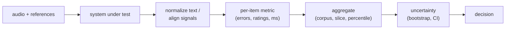
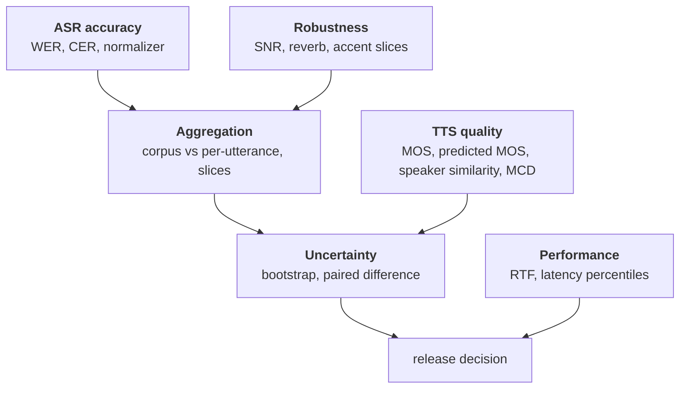

# Speech Module 05 — Speech Evaluation

## 00 Why This Module Exists

A speech metric is a measurement procedure, not a number. "WER 8.1%" means nothing until you know the reference transcripts, the text normalizer, the averaging rule, the slices, and the uncertainty.
- Two teams can report different WERs for the same transcripts and both be arithmetically correct.
- A TTS score from an automatic predictor can rank systems differently from human listeners.
- An average latency can meet a target while one request in twenty breaks the conversation.


- Legend: CI: confidence interval.

This module covers ASR error rates and text normalization, aggregation and confidence intervals, TTS quality metrics, latency percentiles and real-time factor, and robustness slices.
- How ASR and TTS systems produce their outputs belongs to [Speech Module 02](../02-speech-to-text/README.md) and [Speech Module 03](../03-text-to-speech/README.md).
- Streaming latency mechanics belong to [Speech Module 04](../04-streaming-speech/README.md); end-to-end turn latency belongs to [Speech Module 06](../06-voice-agent-systems/README.md).
- General evaluation design (judges, offline–online mismatch) belongs to core [Module 15](../../advanced-ai-engineering/15-evaluation-engineering/README.md).

**Research status:** satellite 80/20 revision, 2026-11-26. Formulas below are derived or checked in the text and in the runnable check. Standards (ITU-T P.800, P.862, P.863), paper section pointers, and library function names were written from the cited sources but were **not** re-read against a pinned version in this revision (`TODO_VERIFY`). No benchmark numbers are imported.

**Module Orientation**

- **Engineering problem:** turn speech outputs into a decision you can defend: is system B better than system A, on which slices, by how much, and with what uncertainty?
- **What you will do:**
  - compute WER and CER by hand and with an edit-distance implementation;
  - show how normalization and averaging rules change the number;
  - attach bootstrap confidence intervals and paired comparisons;
  - check an automatic MOS predictor against a small listening test;
  - report latency as percentiles and robustness as slices.
- **Environment:** Python 3.10+, NumPy, an evaluation library (`jiwer` or NIST `sclite`), one pretrained ASR model, one TTS model, and CPU only. A labeled set of at least 200 utterances with speaker and recording metadata.
- **Evidence rule:** separate source observations (**O**), derivations (**D**), and hypotheses that need measurement (**H**).
- **If You Only Have One Week**: Lessons SP5.1 and SP5.2. A correct, normalized, uncertainty-aware WER is the measurement every other speech decision in this track depends on.

## 01 Baseline Assumptions

- Core [Module 00](../../advanced-ai-engineering/00-scientific-ai-engineering/README.md): experimental units, paired comparisons, confidence intervals, and the observation/derivation/hypothesis split.
- Core [Module 15](../../advanced-ai-engineering/15-evaluation-engineering/README.md): evaluation sets, slices, and metric validity.
- [Speech Module 01](../01-audio-representation/README.md): sample rates and signal power, used for noise mixing.
- Mathematical prerequisites: dynamic programming, means and standard deviations, percentiles, logarithms (decibels), and cosine similarity.

## 02 Target Mastery

```yaml
depth_contract:
  conceptual: REQUIRED
  mechanistic: REQUIRED
  mathematical: REQUIRED
  quantitative: REQUIRED
  implementation: REQUIRED
  source_code: SELECTIVE
  instrumentation: SELECTIVE
  experimental: REQUIRED
  statistical: REQUIRED
  production_reasoning: REQUIRED
  failure_analysis: REQUIRED
  falsification: SELECTIVE
  security: NOT_APPLICABLE
  economics: SELECTIVE
  architecture_tradeoff: SELECTIVE
  research_connection: SELECTIVE

estimated_effort:
  instruction: 2h
  guided_practice: 1.25h
  labs: 3h
  assessment: 0.75h
  source_trace: 0.5h
  total: 7.5h
```

The learner must be able to compute and reproduce speech metrics, state every choice that changes them, attach uncertainty, compare systems with paired evidence, and refuse a release decision that rests on an unnormalized average.

### LAYER 1: KNOWLEDGE / INSTRUCTIONAL LAYER

## 03 Knowledge Map


- Legend: MOS: mean opinion score; MCD: mel-cepstral distortion; RTF: real-time factor; SNR: signal-to-noise ratio.

Keep three layers of an evaluation separate:

1. **Item metric:** what is measured for one utterance (errors, a rating, a latency).
2. **Aggregation rule:** how items become one number (pooled, averaged, percentile, per slice).
3. **Uncertainty and comparison:** how much the number would move with a different sample, and whether a difference between systems survives that movement.

A reported number must state all three.

## 04 Lessons

### Lesson SP5.1 — WER, CER, and Text Normalization

**Engineering Question:**
Which transcript differences count as errors, and who decided?

**Concepts & Definitions:**

- **Word error rate (WER):** the minimum number of word substitutions, deletions, and insertions needed to turn the hypothesis into the reference, divided by the number of reference words.

$$
\mathrm{WER} = \frac{S + D + I}{N}
$$

where:

- $S$ is the number of substituted words;
- $D$ is the number of deleted words (in the reference, missing from the hypothesis);
- $I$ is the number of inserted words (in the hypothesis, absent from the reference);
- $N$ is the number of words in the reference;
- $S$, $D$, $I$ come from one minimum-cost alignment with unit costs.

- **Character error rate (CER):** the same formula over characters. Use it for languages written without spaces (Chinese, Japanese, Thai) and for error analysis of spelling-level mistakes.
- **Text normalizer:** a function applied to both reference and hypothesis before alignment: case folding, punctuation removal, number and abbreviation expansion, spelling variants, filler-word removal. Whisper reports results after its own English normalizer (**O**, `TODO_VERIFY` section pointer).

*Step-by-step reading of the formula.*

1. $S + D + I$ is the Levenshtein distance between the two word sequences, computed by dynamic programming over a $(N+1) \times (M+1)$ table, where $M$ is the hypothesis length.
2. The denominator is $N$, not $\max(N, M)$. Insertions are unbounded, so WER can exceed 1.0.
3. If $N = 0$ (a reference with no speech), WER is undefined. Count insertions on no-speech items separately instead of dropping them.
4. Different minimum alignments can split the same distance into different $S$, $D$, $I$ counts; the total is unique, the breakdown is not.

**Mechanism Explanation:**

The normalizer is part of the metric. Removing punctuation and case is nearly universal; expanding "5" to "five", merging "p m" into "pm", or deleting "um" are choices that can move WER by several points on conversational or numeric speech (**H**, measure on your data). Comparing WERs computed with different normalizers compares the normalizers, not the systems.

**Worked Example (alignment):**
*Input.* Reference: `set a timer for ten minutes` ($N = 6$). Hypothesis: `set the timer for ten minute please`.

*Steps.*
- `set`=`set`, `timer`=`timer`, `for`=`for`, `ten`=`ten`: 4 correct.
- `a`→`the`: substitution. `minutes`→`minute`: substitution. $S = 2$.
- `please` has no reference word: insertion. $I = 1$, $D = 0$.
- WER $= (2 + 0 + 1) / 6 = 0.50$.

*Result.* 50% WER, although a human reads the hypothesis as correct in meaning.

**Worked Example (WER above 1 and the normalizer):**
- Reference `yes`, hypothesis `yes yes yes`: $I = 2$, $N = 1$, WER $= 2.0$.
- Reference `It's 5 PM.`, hypothesis `it is five p m`, split on whitespace with no normalizer: 3 reference tokens, 5 hypothesis tokens, no token matches. Distance $= 3$ substitutions $+ 2$ insertions $= 5$, WER $= 5/3 = 1.67$.
- With a normalizer that lowercases, expands contractions and digits, and joins spelled-out `p m`: both become `it is five pm`, WER $= 0$.

**Knowledge Check:** Why does a hallucinating model on silent clips look perfect if utterances with $N = 0$ are dropped from the evaluation set?

**Guided Practice:** Implement word-level edit distance returning $S$, $D$, $I$. Check it against `jiwer` or `sclite` on 20 utterances. Then score the same transcripts with three normalizers (none, lowercase + punctuation, a full English normalizer) and tabulate WER for each.

**Feedback Contract:**
- *Expected Evidence*: identical totals to the reference tool on all 20 utterances; a three-row table where WER falls as normalization increases, with one example per row showing which edits disappeared.
- *Common Failure*: normalizing only the hypothesis, or using a different tokenizer for reference and hypothesis.
- *Diagnostic Hint*: print the normalized reference and hypothesis side by side for the five worst utterances before trusting any aggregate.
- *Concept to Revisit*: Item metric; normalizer as part of the metric.

**Learning Outcome:** Compute WER and CER exactly and state the normalizer as part of every reported number.

*(Effort: 30m instruction, 20m practice)*

### Lesson SP5.2 — Aggregation, Slices, and Confidence Intervals

**Engineering Question:**
How large must a WER difference be before you believe system B is better?

**Concepts & Definitions:**

- **Corpus (pooled) WER:** total errors over total reference words.

$$
\mathrm{WER}_{\text{corpus}} = \frac{\sum_{u} E_u}{\sum_{u} N_u}, \qquad
\mathrm{WER}_{\text{mean}} = \frac{1}{|U|}\sum_{u} \frac{E_u}{N_u}
$$

where:

- $u$ indexes utterances in the evaluation set $U$, and $|U|$ is their count;
- $E_u = S_u + D_u + I_u$ is the error count of utterance $u$;
- $N_u$ is the number of reference words in $u$ ($N_u > 0$ for $\mathrm{WER}_{\text{mean}}$).

- **Utterance bootstrap:** resample utterances with replacement, recompute pooled WER on each resample, and take percentiles of the replicates as an interval. The utterance (or the speaker, if speakers repeat) is the resampling unit because errors inside one utterance are not independent (**O**, Bisani and Ney 2004, `TODO_VERIFY`).
- **Paired bootstrap:** use the same resampled utterances for both systems and compute the interval of the difference. Both systems saw the same audio, so pairing removes the shared difficulty of each utterance.

*Step-by-step.*

1. Pooled WER weights each word equally; mean-of-utterance WER weights each utterance equally, so short utterances dominate it.
2. The two agree only when all $N_u$ are equal or errors are proportional to length.
3. Standard practice in ASR reporting is pooled WER (**O**, `TODO_VERIFY` against `sclite` documentation); per-utterance WER is useful for finding bad items, not for headline numbers.

**Mechanism Explanation:**

A test set of 200 utterances from 10 speakers is closer to 10 samples of "speaker difficulty" than to 2,000 independent words. If one speaker contributes most errors, the interval must reflect that, which is why the resampling unit is the utterance or speaker, never the word. Slices (by speaker group, device, noise level) need their own intervals; a slice with 15 utterances can rarely support a strong claim.

**Worked Example (averaging rule):**
*Input.* Utterance 1: reference `no thanks`, hypothesis `go thanks okay`: one substitution and one insertion, so $E_1 = 2$, $N_1 = 2$. Utterance 2: $E_2 = 0$, $N_2 = 18$.

*Steps.*
- Per-utterance WERs: $2/2 = 1.0$ and $0/18 = 0$. Mean: $0.50$.
- Pooled: $(2 + 0)/(2 + 18) = 0.10$.

*Result.* The same transcripts give 50% or 10% depending on the rule.

**Worked Example (paired comparison, reading the output):**
*Input.* Systems A and B on 400 utterances; pooled WER 9.4% and 8.9%; a paired utterance bootstrap with 1,000 replicates gives a 95% interval for $\mathrm{WER}_B - \mathrm{WER}_A$ of $[-1.1, +0.1]$ points (hypothetical numbers for reading practice).

*Interpretation.* The interval includes 0, so this sample does not show B is better. It also bounds the plausible gain to at most about 1.1 points, which is useful if the release needs a 2-point gain.

**Knowledge Check:** Why can two unpaired intervals overlap while the paired interval of the difference excludes zero?

**Guided Practice:** On your evaluation set, compute pooled and mean WER, a 95% utterance-bootstrap interval for one system, and a paired interval for the difference between two systems. Repeat the single-system interval with speakers as the resampling unit.

**Feedback Contract:**
- *Expected Evidence*: both averages with the rule named; three intervals with the number of replicates and seed; the speaker-level interval at least as wide as the utterance-level one (**H**; explain if not).
- *Common Failure*: bootstrapping words, or bootstrapping the two systems with independent resamples.
- *Diagnostic Hint*: store the resampled indices once and reuse them for both systems.
- *Concept to Revisit*: Aggregation rule; Uncertainty and comparison.

**Learning Outcome:** Report pooled WER with an interval and decide system comparisons with paired evidence.

*(Effort: 35m instruction, 25m practice)*

### Lesson SP5.3 — TTS Quality: MOS, Predicted MOS, Speaker Similarity, and MCD

**Engineering Question:**
Which TTS metric measures what, and when can an automatic score replace listeners?

**Concepts & Definitions:**

- **Mean opinion score (MOS):** listeners rate each sample on a 1–5 absolute category scale (ITU-T P.800, **O**, `TODO_VERIFY`); MOS is the mean rating. Report it with an interval:

$$
\text{CI}_{95} = \bar{x} \pm t_{0.975,\,n-1} \cdot \frac{s}{\sqrt{n}}
$$

where:

- $\bar{x}$ is the mean of the $n$ ratings;
- $s$ is their sample standard deviation;
- $t_{0.975,\,n-1}$ is the 97.5th percentile of Student's $t$ distribution with $n - 1$ degrees of freedom.

This formula treats ratings as independent. Ratings from the same listener or of the same sentence are correlated, so a bootstrap over listeners and items gives a more honest interval.

- **Predicted MOS:** a neural model trained to predict MOS from audio alone, such as UTMOS (**O**, Saeki et al. 2022). Its accuracy depends on how close your systems are to its training data. Validate it against human ratings before using it to rank systems.
- **Speaker similarity:** cosine similarity between speaker embeddings (for example from an ECAPA-TDNN or WavLM-based verifier) of the reference voice and the synthesized audio. Scores are comparable only under the same embedding model.
- **Mel-cepstral distortion (MCD):** a distance between mel-cepstral coefficients of reference and synthesized speech, per frame:

$$
\mathrm{MCD} = \frac{10}{\ln 10}\sqrt{2\sum_{d=1}^{D}\left(c_d - \hat{c}_d\right)^2}
$$

where:

- $c_d$ and $\hat{c}_d$ are the $d$-th mel-cepstral coefficients of the reference and synthesized frame;
- $D$ is the number of coefficients used; the energy term $c_0$ is usually excluded;
- the result is in decibels and is averaged over aligned frames.

Implementations differ in the $\sqrt{2}$ factor, $c_0$ handling, and coefficient count (`TODO_VERIFY` for any tool you use), so MCD values are comparable only within one implementation.

- **PESQ and POLQA:** intrusive perceptual quality models standardized as ITU-T P.862 and P.863 (**O**, `TODO_VERIFY`). They compare a degraded signal with a clean, time-aligned reference and were designed for telephony and codec degradation, not for judging the naturalness of synthesized speech.

**Mechanism Explanation:**

Synthesized speech rarely has the reference's timing, so frame-by-frame comparison needs dynamic time warping (DTW) first. DTW picks the alignment that minimizes the distance, which biases MCD downward and hides timing errors. MCD and PESQ also reward closeness to one reference recording; a natural rendition with different prosody scores badly. For zero-shot voices, the usual set is listener MOS (or a validated predictor), speaker similarity, and the WER of an ASR model on the synthesized audio as an intelligibility check.

**Worked Example (MOS interval):**
*Input.* Five ratings: 4, 5, 3, 4, 4.

*Steps.*
- $\bar{x} = 20/5 = 4.0$.
- Squared deviations: $0, 1, 1, 0, 0$; $s = \sqrt{2/4} = 0.707$.
- Standard error: $0.707/\sqrt{5} = 0.316$. With $t_{0.975,4} = 2.776$: half-width $= 0.878$.

*Result.* MOS $4.0 \pm 0.88$: the interval spans 3.1 to 4.9 and cannot separate most systems. With $n = 100$ and the same $s$, the half-width is about $1.98 \times 0.0707 = 0.14$.

**Worked Example (MCD on one frame):**
*Input.* Coefficient differences $c - \hat{c} = (0.1, -0.2, 0.05)$.

*Steps.*
- Sum of squares: $0.01 + 0.04 + 0.0025 = 0.0525$.
- $\sqrt{2 \times 0.0525} = \sqrt{0.105} = 0.3240$.
- $10/\ln 10 = 4.3429$, so MCD $= 1.407$ dB.

**Worked Example (speaker similarity):** embeddings $(0.6, 0.8)$ and $(0.8, 0.6)$ are unit vectors, so cosine $= 0.48 + 0.48 = 0.96$.

**Knowledge Check:** A new TTS system improves MCD but lowers listener MOS. Name two mechanisms that produce this and how you would tell them apart.

**Guided Practice:** For two TTS systems on 30 sentences, collect ratings from at least 8 listeners, compute MOS with a listener-and-item bootstrap interval, and compare the system ranking to a MOS predictor's ranking. Add speaker similarity and ASR WER on the synthesized audio.

**Feedback Contract:**
- *Expected Evidence*: a table with MOS (interval, $n$ listeners, $n$ items), predicted MOS, speaker similarity (embedding model named), and ASR WER (model and normalizer named) per system; a sentence stating whether the predictor agrees with listeners at this sample size.
- *Common Failure*: reporting predicted MOS as if it were listener MOS, or comparing speaker similarity across embedding models.
- *Diagnostic Hint*: if listeners and the predictor disagree, listen to the items where they disagree most.
- *Concept to Revisit*: Item metric; validity of automatic metrics (core Module 15).

**Learning Outcome:** Choose and report TTS metrics with their validity limits and an honest interval.

*(Effort: 35m instruction, 20m practice)*

### Lesson SP5.4 — Latency Percentiles, Real-Time Factor, and Robustness Slices

**Engineering Question:**
Is the system fast enough for every user, and accurate enough under the conditions users actually have?

**Concepts & Definitions:**

- **Real-time factor (RTF):** processing time divided by audio duration. RTF $< 1$ means faster than real time. It is a throughput measure; it says nothing about how long a user waits for the first result ([Speech Module 04](../04-streaming-speech/README.md)).
- **Latency percentile $p_q$:** the value below which a fraction $q$ of requests fall. With the nearest-rank method on $n$ sorted values, $p_q$ is the value at rank $\lceil q \cdot n \rceil$.
- **Noise at a target SNR:** to mix noise $n(t)$ into speech $s(t)$ at a chosen SNR, scale the noise by

$$
\alpha = \sqrt{\frac{P_s}{P_n \cdot 10^{\mathrm{SNR}_{\mathrm{dB}}/10}}}
$$

where:

- $P_s$ and $P_n$ are the mean squared amplitudes (powers) of the speech and the unscaled noise over the mixed segment;
- $\mathrm{SNR}_{\mathrm{dB}}$ is the target signal-to-noise ratio in decibels;
- the mixture is $s(t) + \alpha\, n(t)$.

*Step-by-step.* SNR in decibels is $10 \log_{10}(P_s / P_{\text{noise}})$. Scaling noise by $\alpha$ multiplies its power by $\alpha^2$. Setting $10 \log_{10}(P_s / (\alpha^2 P_n)) = \mathrm{SNR}_{\mathrm{dB}}$ and solving for $\alpha$ gives the formula.

- **Robustness slices:** evaluation subsets by SNR level, reverberation (speech convolved with a room impulse response), accent or dialect, device, and domain. Each slice gets its own pooled WER and interval.

**Mechanism Explanation:**

Averages hide tails. A voice product that meets mean latency but has a p99 of three seconds fails for one turn in a hundred, which for a long call is nearly every call. Likewise an overall WER can improve while a minority accent slice regresses, because the large slices dominate the pooled number. Synthetic noise and reverb are controlled stress tests, not substitutes for real recordings from the target environment.

**Worked Example (RTF and percentile):**
*Input.* A 60 s file processed in 12 s; 20 request latencies (ms), sorted: 180, 185, 190, 190, 195, 200, 200, 205, 210, 210, 215, 220, 225, 230, 240, 250, 260, 300, 650, 1,400.

*Steps.*
- RTF $= 12/60 = 0.2$, i.e. 5× faster than real time.
- Mean: $5{,}955/20 = 297.75$ ms. Median (average of ranks 10 and 11): $(210 + 215)/2 = 212.5$ ms.
- p95 by nearest rank: $\lceil 0.95 \times 20 \rceil = 19$, so p95 $= 650$ ms.

*Result.* Mean 298 ms looks acceptable for a 500 ms budget; p95 at 650 ms does not. With 20 samples, p99 cannot be estimated meaningfully.

**Worked Example (noise scaling):**
*Input.* $P_s = 0.01$, $P_n = 0.04$, target 10 dB.

*Steps.* $\alpha = \sqrt{0.01 / (0.04 \times 10)} = \sqrt{0.025} = 0.158$. Check: $\alpha^2 P_n = 0.001$, and $10 \log_{10}(0.01/0.001) = 10$ dB.

**Knowledge Check:** Why should the SNR be computed over speech-active regions rather than the whole file when clips contain long silences?

**Guided Practice:** Run one ASR model on your set at SNR 20, 10, 5, and 0 dB with two noise types, plus one reverberant condition. Record pooled WER with intervals per condition, RTF, and p50/p95/p99 latency over at least 200 requests.

**Feedback Contract:**
- *Expected Evidence*: a condition-by-metric table with intervals and counts; a latency table with sample size and percentile method; one sentence naming the worst slice.
- *Common Failure*: estimating p99 from fewer than about 100 requests, or reusing one noise segment for every clip.
- *Diagnostic Hint*: plot WER against SNR per noise type; a sudden cliff usually signals a decoding failure mode (insertions, loops) rather than gradual degradation.
- *Concept to Revisit*: Aggregation rule; percentiles.

**Learning Outcome:** Report performance as percentiles and accuracy as slices, and identify the condition that breaks the system.

*(Effort: 20m instruction, 10m practice)*

## 05 Literature & Production Source Map

**REFERENCE / BASELINE**

- [Robust Speech Recognition via Large-Scale Weak Supervision (Whisper)](https://arxiv.org/abs/2212.04356) — Radford et al. (2022). Reading pointer: the discussion of text normalization before WER and the appendix describing their normalizer (`TODO_VERIFY` exact appendix).
- [Bootstrap Estimates for Confidence Intervals in ASR Performance Evaluation](https://doi.org/10.1109/ICASSP.2004.1326009) — Bisani and Ney (ICASSP 2004). Reading pointer: utterance-level resampling and paired comparison of two systems.
- ITU-T Recommendations P.800 (subjective rating methods, ACR scale), P.808 (crowdsourced listening tests), P.862 (PESQ), and P.863 (POLQA). Reading pointer: scope sections, which state what conditions each method was validated for.
- Kubichek, "Mel-cepstral distance measure for objective speech quality assessment" (IEEE PACRIM 1993). Reading pointer: the distance definition used by later MCD implementations.

**WORKLOAD-DEPENDENT / FRONTIER**

- [UTMOS: UTokyo-SaruLab System for VoiceMOS Challenge 2022](https://arxiv.org/abs/2204.02152) — Saeki et al. (2022). Author-reported correlation with human MOS on the challenge data; validate on your own systems before relying on it.
- [ECAPA-TDNN](https://arxiv.org/abs/2005.07143) — Desplanques et al. (2020). A common speaker-embedding backbone for similarity scoring; scores are specific to the trained model.

**CURRENT DEFAULT:** pooled WER after a declared normalizer, with an utterance- or speaker-level bootstrap interval and per-slice results; paired comparison for system decisions; listener MOS with an interval for TTS, plus speaker similarity and ASR WER on synthesized audio; latency as p50/p95/p99 with sample size.

**LEGACY / INSUFFICIENT:** WER without the normalizer; mean of per-utterance WER as a headline; dropping no-speech utterances; MOS from fewer than a handful of listeners; predicted MOS reported as human MOS; mean latency only; one overall number with no slices.

**PRODUCTION SOURCE TRACE** (pin the version you read; none was pinned in this revision)

- `openai/whisper`, file `whisper/normalizers/english.py`: `EnglishTextNormalizer` and its number and spelling standardizers (Lesson SP5.1).
- `jiwer` package: the word-level measure functions (`wer`, `process_words`) and their default transforms (`TODO_VERIFY` names and defaults in the version you install).
- `usnistgov/SCTK`, tool `sclite`: alignment, report formats, and pooled error rates (Lesson SP5.2).
- Scope: reference tools, not the only valid implementations. Check that the tool's default transforms match the normalizer you declare.

### LAYER 2: ENGINEERING PRACTICE LAYER

## 06 Engineering Labs

All labs follow `PREDICT → BUILD → MEASURE → EXPLAIN → BREAK → IMPROVE → FALSIFY`.

### LAB A — An ASR Evaluation Harness That Survives Review

- **Objective:** build a harness that reports pooled WER with a declared normalizer, bootstrap intervals, paired system comparison, robustness slices, RTF, and latency percentiles.
- **Pre-Registered Hypothesis:** changing only the normalizer moves WER by more than the paired interval between two adjacent model sizes on conversational audio.
- **Independent Variables:** normalizer, aggregation rule, resampling unit, model, SNR/reverb condition.
- **Dependent Variables:** pooled WER and $S$/$D$/$I$ breakdown, interval width, paired difference interval, per-slice WER, insertions on no-speech clips, RTF, p50/p95/p99 latency.
- **Break & Falsify:** include no-speech clips, a slice with fewer than 20 utterances, and a 0 dB noise condition; show what each does to the headline number.
- **Alignment:** Lessons SP5.1, SP5.2, SP5.4 and Incident SP5.1.
- **Effort Estimate:** 1.75h.

### LAB B — Validate a TTS Metric Panel

- **Objective:** test whether automatic TTS metrics rank two or three systems the same way listeners do.
- **Pre-Registered Hypothesis:** predicted MOS agrees with listener MOS on the system ranking when listener intervals do not overlap, and is unreliable when they do.
- **Independent Variables:** TTS system, sentence set, listener pool.
- **Dependent Variables:** listener MOS with interval, predicted MOS, speaker similarity, MCD (DTW-aligned), ASR WER on synthesized audio.
- **Break & Falsify:** add a system that copies the reference prosody poorly but sounds natural, and one that is close in MCD but has audible artifacts.
- **Alignment:** Lesson SP5.3.
- **Effort Estimate:** 1.25h.

**Runnable arithmetic check (CPU; not a quality experiment):**
```python
import math, random

def edit_distance(ref, hyp):
    d = list(range(len(hyp) + 1))
    for i, r in enumerate(ref, 1):
        prev, d[0] = d[0], i
        for j, h in enumerate(hyp, 1):
            prev, d[j] = d[j], min(d[j] + 1, d[j - 1] + 1, prev + (r != h))
    return d[-1]

def wer(ref, hyp):
    r = ref.split()
    return edit_distance(r, hyp.split()) / len(r)

assert wer("set a timer for ten minutes", "set the timer for ten minute please") == 0.5
assert wer("yes", "yes yes yes") == 2.0
assert math.isclose(wer("It's 5 PM.", "it is five p m"), 5 / 3)
assert wer("it is five pm", "it is five pm") == 0.0

errors, words = [2, 0], [2, 18]                          # corpus vs mean
assert sum(errors) / sum(words) == 0.10
assert sum(e / n for e, n in zip(errors, words)) / 2 == 0.5

ratings = [4, 5, 3, 4, 4]                                # MOS interval
m = sum(ratings) / 5
s = math.sqrt(sum((x - m) ** 2 for x in ratings) / 4)
assert math.isclose(2.776 * s / math.sqrt(5), 0.8778, abs_tol=1e-3)

diff = [0.1, -0.2, 0.05]                                 # MCD, one frame
mcd = 10 / math.log(10) * math.sqrt(2 * sum(x * x for x in diff))
assert math.isclose(mcd, 1.4073, abs_tol=1e-3)
assert math.isclose(0.6 * 0.8 + 0.8 * 0.6, 0.96)         # cosine, unit vectors

alpha = math.sqrt(0.01 / (0.04 * 10 ** (10 / 10)))       # noise at 10 dB SNR
assert math.isclose(10 * math.log10(0.01 / (alpha ** 2 * 0.04)), 10.0)

lat = sorted([180, 185, 190, 190, 195, 200, 200, 205, 210, 210,
              215, 220, 225, 230, 240, 250, 260, 300, 650, 1400])
assert lat[math.ceil(0.95 * len(lat)) - 1] == 650 and sum(lat) / 20 == 297.75
assert 12 / 60 == 0.2                                    # RTF

rng = random.Random(0)                                   # paired bootstrap
E_a = [rng.randint(0, 3) for _ in range(200)]
E_b = [max(0, e - rng.randint(0, 1)) for e in E_a]
N = [rng.randint(5, 20) for _ in range(200)]
diffs = []
for _ in range(1000):
    idx = [rng.randrange(200) for _ in range(200)]
    n = sum(N[i] for i in idx)
    diffs.append((sum(E_b[i] for i in idx) - sum(E_a[i] for i in idx)) / n)
diffs.sort()
lo, hi = diffs[24], diffs[974]
point = (sum(E_b) - sum(E_a)) / sum(N)
assert lo <= point <= hi and hi < 0                      # B never worse here
```

## 07 Break / Incident Scenarios

### Incident SP5.1 — The New Model Wins the Benchmark, Complaints Rise

**Incident Symptoms:**
A new ASR model reports WER 7.2% versus 9.0% for the current model on the team's benchmark and is released. Within a week, support tickets about wrong transcripts rise, mostly from users on mobile in noisy places and from one regional accent group. The benchmark script was also updated in the same release.

**Diagnostic Protocol (Task):**
1. **Form Competing Hypotheses:** a normalizer change in the updated script; no-speech utterances newly excluded; averaging rule changed; benchmark overlap with the new model's training data; a real regression on noisy or accented slices hidden by the pooled number; a latency tail causing timeouts that users report as wrong transcripts.
2. **Identify Missing Evidence:** both script versions, both normalizers, the exact utterance list each run used, per-slice WER with intervals, insertions on no-speech clips, training-data provenance, and p95/p99 latency with timeout counts.
3. **Design Discriminating Measurements:** rescore both models' saved transcripts with the old script and with the new one (2 × 2); compute paired slice intervals; replay a sample of failing production audio through both models.
4. **Rank Explanations:** if the gain disappears under a single fixed script, the metric changed, not the model; if slices regress with intervals excluding zero, the pooled gain hides a real regression.
5. **Intervene:** pin the evaluation script and normalizer as a versioned artifact; add the regressed slices and production samples as release gates; roll back or gate the model by slice if needed.
6. **Remeasure:** report old and new models under the pinned harness with paired slice intervals and latency percentiles.

### LAYER 3: MASTERY / ASSESSMENT LAYER

## 08 Mastery Assessment

### Transfer Problem — A Release Gate for a Voice Product

A product team will swap both its ASR model and its TTS voice next quarter. Design the evaluation that decides whether each swap ships.

**Required Deliverables:**
1. the ASR metric definition: normalizer (versioned), aggregation rule, handling of no-speech items, and slices;
2. a sample-size argument: how many utterances and speakers are needed to detect a 1-point WER change on the main slice, supported by a bootstrap on existing data;
3. LAB A evidence: paired intervals and the normalizer sensitivity table;
4. the TTS panel: listener protocol (listeners, items, interval method), automatic metrics, and LAB B evidence of whether the predictor can stand in for listeners;
5. latency and robustness gates stated as percentiles and per-slice thresholds;
6. the Incident SP5.1 diagnosis and the guard you added to prevent it.

## 09 Required Evidence & Rubric

### Required Artifact: Speech Evaluation Report

Submit the metric definitions, the harness version, LAB A and LAB B tables with intervals, the sample-size argument, and the release-gate thresholds.

### Rubric Dimensions

- **Measurement:** *Insufficient* reports "WER 8%." *Competent* states normalizer, aggregation, and data. *Strong* shows how much each choice moves the number.
- **Statistics:** *Insufficient* compares point estimates. *Competent* attaches bootstrap intervals with the right unit. *Strong* uses paired differences, slice intervals, and a sample-size argument.
- **Validity:** *Insufficient* trusts any automatic score. *Competent* names each metric's scope. *Strong* validates automatic metrics against listeners on the systems in question.
- **Production:** *Insufficient* reports mean latency. *Competent* reports percentiles. *Strong* links tails and slice regressions to user-visible failures.

## 10 Capability Traceability Matrix

| Capability | Taught | Practiced | Assessed | Evidence (artifact reviewers open) |
|---|---|---|---|---|
| WER/CER and normalization | SP5.1 | SP5.1 Guided Practice; LAB A | Deliverables 1, 3; Incident SP5.1 | Edit-distance check against reference tool; normalizer sensitivity table |
| Aggregation and intervals | SP5.2 | SP5.2 Guided Practice; LAB A | Deliverables 2, 3; Incident SP5.1 | Pooled vs mean WER; utterance and speaker bootstrap; paired difference interval |
| TTS quality metrics | SP5.3 | SP5.3 Guided Practice; LAB B | Deliverable 4 | MOS with interval, predictor agreement, speaker similarity, ASR WER on TTS |
| Latency and robustness | SP5.4 | SP5.4 Guided Practice; LAB A | Deliverable 5; Incident SP5.1 | Percentile table with sample size; per-SNR and per-slice WER with intervals |

## 11 Exit Criteria & Module Wrap-Up

### Exit Criteria

A learner passes when they can compute WER exactly, show how normalization and averaging change it, attach and interpret bootstrap and paired intervals, validate an automatic TTS metric against listeners, and set release gates in percentiles and slices.

### Module Wrap-Up (Final Mental Model Reconstruction)

Every speech number is item metric × aggregation rule × uncertainty. Pin the normalizer and harness, compare systems on the same items, report tails and slices, and trust an automatic score only after it has agreed with people on your systems.

### Cost & Telemetry Hook

- [Lesson 22.1](../../advanced-ai-engineering/22-ai-economics/README.md): price listener studies and evaluation compute per release; a sample-size argument decides how much evaluation a decision needs.
- [Lesson 23.1](../../advanced-ai-engineering/23-observability-reliability/README.md): emit per-request latency, audio duration, and slice metadata (device, detected SNR, locale) so production percentiles and slice regressions are visible without a new study.

## 12 Competency Targets

```yaml
competency:
  sfia: 4
  bloom: Analyze -> Evaluate
  solo: Relational
  dreyfus: Competent
```
