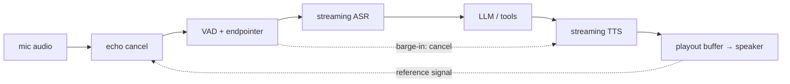
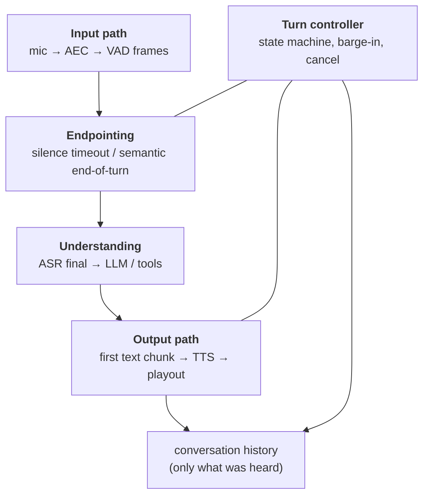
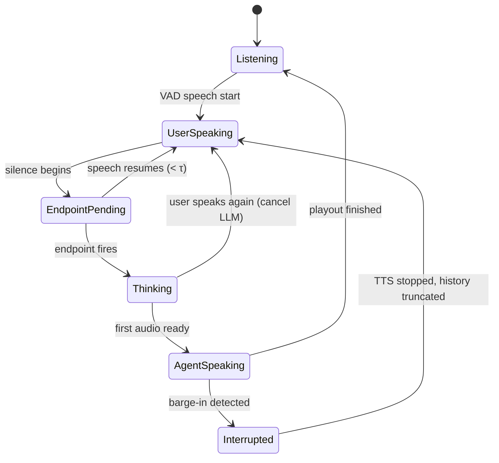

# Speech Module 06 — Voice Agent Systems

## 00 Why This Module Exists

A voice agent is not "ASR plus an LLM plus TTS." It is a real-time control loop that must decide when the user has finished, answer before the silence feels awkward, stop the moment the user interrupts, and remember only what the user actually heard.
- Each stage can be fast in isolation while the turn is still slow, because the stages sit on one critical path.
- Most user-visible failures (talking over the user, cutting them off, answering to its own echo) come from turn-taking control, not from model quality.


- Legend: AEC: acoustic echo cancellation; VAD: voice activity detection; TTS: text-to-speech.

This module covers the cascaded voice loop, turn latency budgets, endpointing and the turn-taking state machine, barge-in with echo cancellation, and native speech-to-speech models as an alternative.
- Audio frontends and codec tokens belong to [Speech Module 01](../01-audio-representation/README.md).
- ASR architectures belong to [Speech Module 02](../02-speech-to-text/README.md); TTS synthesis to [Speech Module 03](../03-text-to-speech/README.md).
- Chunking, RTF, and VAD internals belong to [Speech Module 04](../04-streaming-speech/README.md); metric definitions to [Speech Module 05](../05-speech-evaluation/README.md).
- LLM serving latency (TTFT, queueing) belongs to core [Module 04](../../advanced-ai-engineering/04-serving-scheduling-capacity/README.md); tool-calling loops to core [Module 12](../../advanced-ai-engineering/12-agent-loop-engineering/README.md).

**Research status:** satellite 80/20 revision, 2026-11-26. Latency formulas and worked examples are derived in the text from stated assumptions; the stage timings are illustrative, not measurements of any product. Figures attributed to the Moshi paper and to conversation-analysis studies were written from the cited sources but were **not** re-read in this revision (`TODO_VERIFY`). No latency figure for any commercial voice product is claimed here.

**Module Orientation**

- **Engineering problem:** minimize the user-perceived gap between "user stops talking" and "agent audio is heard," without cutting users off, talking over them, or corrupting conversation state on interruption.
- **What you will do:**
  - build a turn latency budget and find its critical path;
  - tune an endpointer against a measured pause distribution;
  - implement barge-in with cancellation and history truncation;
  - compare cascaded and native speech-to-speech designs on latency, control, and observability.
- **Environment:** Python 3.10+ with `asyncio`, a streaming ASR (local or API), any streaming LLM endpoint, a streaming TTS, a VAD (for example Silero VAD), and one monotonic clock for all timestamps. CPU is sufficient if ASR and TTS are remote; a laptop speaker and mic for the echo tests.
- **Evidence rule:** separate source observations (**O**), derivations (**D**), and hypotheses that need measurement (**H**).
- **If You Only Have One Week**: Lessons SP6.1 and SP6.2. The turn budget shows where time goes, and the endpointer is usually the largest single term.

## 01 Baseline Assumptions

- [Speech Module 04](../04-streaming-speech/README.md): chunked streaming, RTF, time-to-first-audio, and VAD frames.
- Core [Module 04](../../advanced-ai-engineering/04-serving-scheduling-capacity/README.md): TTFT, inter-token latency, queueing, and tail latency.
- Core [Module 12](../../advanced-ai-engineering/12-agent-loop-engineering/README.md): agent loops and tool calls.
- Core [Module 14](../../advanced-ai-engineering/14-durable-agent-runtime/README.md): cancellation and consistent state after interruption.
- Mathematical prerequisites: sums of latencies, empirical distributions and quantiles, and the probability of at least one event in $n$ independent trials.

## 02 Target Mastery

```yaml
depth_contract:
  conceptual: REQUIRED
  mechanistic: REQUIRED
  mathematical: SELECTIVE
  quantitative: REQUIRED
  implementation: REQUIRED
  source_code: SELECTIVE
  instrumentation: REQUIRED
  experimental: REQUIRED
  statistical: SELECTIVE
  production_reasoning: REQUIRED
  failure_analysis: REQUIRED
  falsification: SELECTIVE
  security: SELECTIVE
  economics: SELECTIVE
  architecture_tradeoff: REQUIRED
  research_connection: SELECTIVE

estimated_effort:
  instruction: 2h
  guided_practice: 1.25h
  labs: 3h
  assessment: 0.75h
  source_trace: 0.5h
  total: 7.5h
```

The learner must be able to instrument a voice turn end to end, attribute its latency to stages on the critical path, tune endpointing from data, make interruption safe for conversation state, and defend a cascaded or native design for a stated workload.

### LAYER 1: KNOWLEDGE / INSTRUCTIONAL LAYER

## 03 Knowledge Map



Keep three questions separate:

1. **Latency:** how long from user end-of-speech to first agent audio at the user's ear?
2. **Turn correctness:** did the agent start only when the user was done, and stop when interrupted?
3. **State correctness:** does the conversation history match what the user actually heard?

A design can win on one and fail the others; every lab measures all three.

## 04 Lessons

### Lesson SP6.1 — The Cascaded Loop and the Turn Latency Budget

**Engineering Question:**
Which stages sit on the critical path of a voice turn, and which one should be optimized first?

**Concepts & Definitions:**

- **Turn latency (user-perceived):** time from the user's last speech sound to the first agent audio sample played at the user's device.
- **Streaming stage:** a stage that works while its input is still arriving. Streaming ASR transcribes during the user's speech, so only its finalization lands after end-of-speech.
- **First speakable chunk:** the smallest LLM output that TTS will start on (for example a clause or sentence). TTS cannot start before it exists.

For a cascaded loop where each listed stage starts only after the previous one produces its first useful output:

$$
L_{\text{turn}} = t_{\text{eot}} + t_{\text{asr}} + t_{\text{ttft}} + t_{\text{chunk}} + t_{\text{ttfa}} + t_{\text{net}} + t_{\text{play}}
$$

where:

- $L_{\text{turn}}$ is the user-perceived turn latency in ms;
- $t_{\text{eot}}$ is the end-of-turn decision delay: silence the endpointer waits for, or the delay of a semantic end-of-turn model;
- $t_{\text{asr}}$ is the ASR finalization time after end-of-turn;
- $t_{\text{ttft}}$ is the LLM time to first token, including queueing (core Module 04);
- $t_{\text{chunk}}$ is the time from first token to the first speakable chunk: $n_{\text{chunk}} / v_{\text{tok}}$, with $n_{\text{chunk}}$ tokens in the chunk and $v_{\text{tok}}$ the decode rate in tokens/s;
- $t_{\text{ttfa}}$ is TTS time to first audio for that chunk;
- $t_{\text{net}}$ is network transit not already overlapped with speech (typically the final uplink audio plus the first downlink audio);
- $t_{\text{play}}$ is client playout buffering before the first sample is heard.

*Step-by-step reading.*

1. Anything that runs *during* the user's speech (streaming ASR partials, uplink of earlier audio) is off the critical path; only its tail after end-of-speech counts.
2. Terms add because each stage waits for the previous one's first output. If two stages overlap (for example, the LLM starts on an ASR partial before the endpoint fires), the overlapped part leaves the sum and only the longer branch counts.
3. Per-stage averages do not add to a turn percentile: p95 of a sum is not the sum of p95s. Measure the turn directly on one clock.

**Mechanism Explanation:**

The endpointer usually dominates because it must wait for silence to be confident the user is done. Model latency is the next lever: a smaller TTFT and a shorter first chunk both remove time. Tool calls add a full round trip inside $t_{\text{ttft}}$ unless the agent speaks a short acknowledgement first.

**Worked Example (hand budget, illustrative numbers):**
*Input.* Silence-timeout endpointer of 500 ms; ASR finalization 100 ms; LLM TTFT 350 ms; first speakable chunk of 8 tokens at 40 tokens/s; TTS TTFA 150 ms; final uplink plus first downlink 2 × 40 ms; client playout buffer 60 ms.

*Steps.*
- $t_{\text{chunk}} = 8 / 40 = 0.2$ s $= 200$ ms.
- $L_{\text{turn}} = 500 + 100 + 350 + 200 + 150 + 80 + 60 = 1{,}440$ ms.
- Share of the endpointer: $500 / 1{,}440 = 35\%$.

*Improvement.* Replace the timeout with a 250 ms decision (semantic end-of-turn) and start TTS on a 4-token clause ($4/40 = 100$ ms):
- $L_{\text{turn}} = 250 + 100 + 350 + 100 + 150 + 80 + 60 = 1{,}090$ ms.

*Result.* Two control changes remove 350 ms without touching any model. A faster LLM would have to cut TTFT by the same 350 ms to match.

*Interpretation and limits.* Conversation-analysis studies report that typical gaps between human turns are a few hundred milliseconds (Stivers et al., 2009, author-reported, `TODO_VERIFY`). That is a reference point, not a product target; the shorter endpoint also raises cut-off risk (Lesson SP6.2).

**Knowledge Check:** The LLM adds a tool call that takes 400 ms before any text. Where does it enter the formula, and what change to the output path would hide it from the user?

**Guided Practice:** Instrument one turn of your loop: timestamp user end-of-speech (from the VAD), endpoint fire, ASR final, first LLM token, first speakable chunk, first TTS byte, and first sample played. Build the waterfall and compare the measured turn with the sum of your stage means.

**Feedback Contract:**
- *Expected Evidence*: one monotonic-clock timeline per turn for at least 20 turns, a waterfall, measured p50 and p95 turn latency, and a note on which stages overlapped.
- *Common Failure*: measuring from endpoint fire instead of from end-of-speech, which hides $t_{\text{eot}}$ entirely; mixing client and server clocks.
- *Diagnostic Hint*: record end-of-speech from the VAD frame timestamps, not from when the endpoint event arrives.
- *Concept to Revisit*: Critical path; turn latency definition.

**Learning Outcome:** Attribute turn latency to stages on the critical path and rank optimizations by the time they remove.

*(Effort: 35m instruction, 20m practice)*

### Lesson SP6.2 — Endpointing and the Turn-Taking State Machine

**Engineering Question:**
How long should the agent wait in silence before deciding the user is done, and what states must the controller track?

**Concepts & Definitions:**

- **Endpointer:** decides end-of-turn. A *silence-timeout* endpointer fires after $\tau$ ms of non-speech. A *semantic* endpointer also uses the transcript or prosody to predict completion.
- **Premature cut-off:** the endpointer fires during an intra-turn pause (the user was thinking, not done).
- **Pause distribution:** the empirical distribution of silences *inside* user turns, measured from your own traffic.

With a timeout $\tau$ and intra-turn pauses treated as independent:

$$
p(\tau) = \Pr[\text{pause} > \tau], \qquad P_{\text{cut}}(\tau, n) = 1 - \bigl(1 - p(\tau)\bigr)^{n}
$$

where:

- $p(\tau)$ is the fraction of intra-turn pauses longer than $\tau$;
- $n$ is the number of intra-turn pauses in a user turn;
- $P_{\text{cut}}$ is the probability that a turn with $n$ pauses is cut off at least once.

*Step-by-step reading.*

1. Each pause longer than $\tau$ triggers the endpoint, so $p(\tau)$ is the per-pause cut-off chance.
2. The turn survives only if every pause is shorter than $\tau$: probability $(1-p)^n$. One minus that is the chance of at least one cut-off.
3. Raising $\tau$ lowers $P_{\text{cut}}$ but adds $\tau$ directly to $t_{\text{eot}}$ in Lesson SP6.1. The independence assumption is optimistic for users who pause a lot; measure $P_{\text{cut}}$ per turn as well.

**Mechanism Explanation:**

The controller is a state machine. Every audio, endpoint, and playback event is a transition, and every transition that abandons work must cancel it.


- Legend: τ: silence timeout; barge-in: user speech while the agent is speaking (Lesson SP6.3).

The transitions back to `UserSpeaking` are where bugs live: an LLM request or TTS stream left running after them produces audio for a turn that no longer exists.

**Worked Example (choosing τ from data):**
*Input.* Ten measured intra-turn pauses (ms): 120, 180, 250, 300, 340, 420, 480, 610, 750, 900. Typical turn has $n = 2$ pauses.

*Steps.*
- $\tau = 500$: pauses above it are 610, 750, 900, so $p = 3/10 = 0.3$. $P_{\text{cut}} = 1 - 0.7^2 = 0.51$.
- $\tau = 800$: only 900 exceeds it, so $p = 0.1$. $P_{\text{cut}} = 1 - 0.9^2 = 0.19$.

*Result.* Moving from 500 ms to 800 ms cuts the turn cut-off probability from 51% to 19% but adds 300 ms to every turn.

*Interpretation.* Neither value is good, which is why production designs add a semantic signal: wait longer when the transcript is clearly incomplete ("I'd like to book a…") and fire early when it is complete. Ten pauses is far too few to set a threshold; use hundreds from your own users.

**Knowledge Check:** Why does a semantic endpointer change $p(\tau)$ for some turns but not the formula itself?

**Guided Practice:** From 30 recorded turns, extract intra-turn pauses with your VAD, plot their survival curve $p(\tau)$, and pick $\tau$ for a target per-turn cut-off rate of 10% at your median $n$. State the latency cost.

**Feedback Contract:**
- *Expected Evidence*: a pause histogram with the VAD parameters used, the survival curve, the chosen $\tau$, the predicted $P_{\text{cut}}$, and a measured cut-off rate on held-out turns.
- *Common Failure*: measuring pauses with one VAD setting and serving with another; VAD minimum-silence parameters change the pause distribution.
- *Diagnostic Hint*: if measured cut-offs exceed predicted ones, check whether pauses in one turn are correlated (hesitant speakers pause often and long).
- *Concept to Revisit*: Pause distribution; state transitions that require cancellation.

**Learning Outcome:** Set and defend an endpointing policy from a measured pause distribution and implement it as an explicit state machine.

*(Effort: 35m instruction, 25m practice)*

### Lesson SP6.3 — Barge-In, Echo Cancellation, and State After Interruption

**Engineering Question:**
How does the agent stop quickly when interrupted, avoid interrupting itself, and keep history consistent with what the user heard?

**Concepts & Definitions:**

- **Barge-in:** user speech while the agent is speaking. The controller must stop playout, cancel pending TTS and LLM work, and return to listening.
- **Acoustic echo cancellation (AEC):** subtracts an estimate of the agent's own playback (the *reference signal*) from the microphone signal. Without it, on a speakerphone the VAD hears the agent and triggers false barge-in.
- **Full-duplex:** input and output audio flow at the same time; the system must keep listening while speaking.
- **Heard-text truncation:** after an interruption, the assistant message in history is cut to the words actually played, not the words generated.

Barge-in stop latency and heard text:

$$
L_{\text{stop}} = t_{\text{detect}} + t_{\text{cancel}} + t_{\text{flush}}, \qquad
w_{\text{heard}} \approx \left\lfloor r_{\text{w}} \cdot t_{\text{played}} \right\rfloor
$$

where:

- $L_{\text{stop}}$ is the time from the user starting to speak until agent audio stops at the speaker;
- $t_{\text{detect}}$ is the barge-in detection delay (for example a minimum speech duration that rejects coughs and clicks);
- $t_{\text{cancel}}$ is the time for the stop signal to reach the playback path;
- $t_{\text{flush}}$ is audio already in device or network buffers that still plays (zero if buffers are flushed);
- $w_{\text{heard}}$ is the number of words the user heard;
- $r_{\text{w}}$ is the TTS speaking rate in words per second;
- $t_{\text{played}}$ is audio actually played before the stop, *not* audio generated or sent.

*Step-by-step reading.*

1. Detection trades speed for robustness: a 200 ms minimum speech duration ignores short noises but adds 200 ms to every stop.
2. Audio sent but not yet played is invisible to the server; only the client knows $t_{\text{played}}$, so the client must report it.
3. The rate approximation is coarse; word timestamps from TTS, when available, give exact truncation.

**Mechanism Explanation:**

If history keeps the full generated reply, the next LLM turn assumes the user heard content they never heard ("as I said, the fee is…"). If cancellation does not reach the LLM, the old generation keeps consuming capacity and may race a new reply. Both are state bugs, and core [Module 14](../../advanced-ai-engineering/14-durable-agent-runtime/README.md) treats the same problem as cancellation with consistent state.

**Worked Example (interruption mid-reply):**
*Input.* The agent's reply is 40 words, synthesized as 12 s of audio. The client reports 3.2 s played when the user barges in; 0.4 s more was buffered but flushed. Detection uses a 200 ms minimum speech duration, cancel propagation takes 60 ms, and buffers are flushed.

*Steps.*
- Speaking rate: $r_w = 40 / 12 = 3.33$ words/s.
- Heard words: $\lfloor 3.33 \times 3.2 \rfloor = \lfloor 10.67 \rfloor = 10$.
- Stop latency: $200 + 60 + 0 = 260$ ms.
- If the 0.4 s buffer were not flushed: $L_{\text{stop}} = 660$ ms, and the user would hear about one more word than recorded in history.

*Result.* History keeps the first 10 words plus an interruption marker; the remaining 30 words are discarded, and the next LLM call sees that the reply was cut short.

**Knowledge Check:** On a laptop without AEC, the agent stops itself every few seconds. Which state transition fires, and what evidence in the audio logs would confirm echo rather than real user speech?

**Guided Practice:** Add barge-in to your loop. Interrupt the agent at scripted points in 10 replies, log $t_{\text{played}}$ from the client, and compare the truncated history to a transcript of the recorded speaker output.

**Feedback Contract:**
- *Expected Evidence*: per interruption: $L_{\text{stop}}$ broken into its three terms, the truncated history entry, and a match (within one word) to what the speaker recording contains; plus confirmation that the cancelled LLM stream stopped.
- *Common Failure*: truncating by audio *sent* from the server, which overstates what was heard by the network and device buffers.
- *Diagnostic Hint*: play a known tone sequence through TTS and record the speaker; the tone index at the stop gives ground truth for $t_{\text{played}}$.
- *Concept to Revisit*: Full-duplex; heard-text truncation.

**Learning Outcome:** Implement barge-in whose stop latency is measured and whose history matches what the user heard.

*(Effort: 30m instruction, 20m practice)*

### Lesson SP6.4 — Native Speech-to-Speech vs Cascaded Pipelines

**Engineering Question:**
When does a single model that listens and speaks in audio tokens beat a cascade, and what control does it give up?

**Concepts & Definitions:**

- **Cascaded pipeline:** separate ASR, LLM, and TTS with text between them. Text is a checkpoint for logging, guardrails, tool calls, and swapping components.
- **Native speech-to-speech model:** consumes and produces audio tokens directly. Moshi models the user's and its own audio streams in parallel, which allows overlap and backchannels, and predicts time-aligned text tokens of its own speech as an "inner monologue" (**O**, Défossez et al., 2024, `TODO_VERIFY`).
- **Codec frame period:** a model that generates one codec frame per step cannot react faster than one frame. Moshi's Mimi codec runs at 12.5 Hz (**O**, `TODO_VERIFY`).

Frame period and token rate:

$$
t_{\text{frame}} = \frac{1000}{r}, \qquad T = r \cdot Q
$$

where:

- $t_{\text{frame}}$ is the frame period in ms;
- $r$ is the codec frame rate in Hz;
- $T$ is the number of audio tokens per second per stream;
- $Q$ is the number of codebooks per frame (Speech Module 01, Lesson SP1.4).

**Mechanism Explanation:**

A native model removes the text bottleneck: no ASR finalization, no first-chunk wait, and paralinguistic cues (tone, laughter, hesitation) survive end to end. Its endpointing is learned rather than a timeout. The authors report a theoretical latency of 160 ms and about 200 ms in practice for Moshi (author-reported, `TODO_VERIFY`); these are their measurements on their setup, not a general bound.

What it gives up: a text checkpoint to log, filter, or route; easy tool calling and retrieval in the middle of a reply; and independent upgrades of ASR, LLM, or voice. Cascades remain easier to debug, because each stage has an inspectable output.

**Worked Example (token budgets):**
*Input.* Mimi at $r = 12.5$ Hz with $Q = 8$ codebooks (`TODO_VERIFY`); EnCodec 24 kHz at $r = 75$ Hz with $Q = 8$ (Speech Module 01).

*Steps.*
- Mimi frame period: $1000 / 12.5 = 80$ ms. Tokens: $12.5 \times 8 = 100$ per second per stream.
- EnCodec: $1000 / 75 = 13.3$ ms frames; $75 \times 8 = 600$ tokens per second.
- Two streams (user and agent) for 60 s of conversation with Mimi: $2 \times 100 \times 60 = 12{,}000$ audio tokens.
- 160 ms is exactly $160 / 80 = 2$ Mimi frames.

*Result.* A low frame rate makes full-duplex modeling of two streams affordable, and the reported latency corresponds to a couple of frames rather than to a pipeline of stages.

**Knowledge Check:** A regulated support line must log a text record of everything the agent said and block certain phrases before they are spoken. Which design satisfies this more simply, and what would the other design need to add?

**Guided Practice:** Write a one-page comparison for one workload you choose (for example a booking agent with two tool calls per conversation): latency path, interruption behavior, logging and guardrails, tool use, cost per minute, and what you would measure to decide.

**Feedback Contract:**
- *Expected Evidence*: a table with each dimension, explicit assumptions, author-reported figures labeled as such, and a decision with the measurement that would reverse it.
- *Common Failure*: comparing a native model's best-case published latency with a cascade's measured p95 under load.
- *Diagnostic Hint*: compare like with like: same network, same percentile, same definition of turn latency (Lesson SP6.1).
- *Concept to Revisit*: Text checkpoint; frame period as a latency floor.

**Learning Outcome:** Defend a cascaded or native design for a stated workload with comparable evidence.

*(Effort: 20m instruction, 10m practice)*

## 05 Literature & Production Source Map

**REFERENCE / BASELINE**

- [Moshi: a speech-text foundation model for real-time dialogue](https://arxiv.org/abs/2410.00037) — Défossez et al. (2024). Reading pointers: the multi-stream design (user and system audio), the inner-monologue text stream, the Mimi codec frame rate, and the reported latency measurement setup.
- Universals and cultural variation in turn-taking in conversation — Stivers et al. (PNAS, 2009). Reading pointer: the distribution of gaps between turns across languages (`TODO_VERIFY`: re-read before quoting any number).
- [Silero VAD](https://github.com/snakers4/silero-vad) — model card and usage notes: frame sizes, speech threshold, and minimum speech/silence durations.

**WORKLOAD-DEPENDENT**

- Voice Activity Projection — Ekstedt and Skantze (2022). Predicts upcoming turn shifts from audio; an example of a learned endpointer. Scope its results to their dialogue data (`TODO_VERIFY`: confirm venue and link).
- WebRTC audio processing (AEC, noise suppression, automatic gain control): the reference path for browser and mobile clients; behavior depends on device and platform.

**CURRENT DEFAULT:** a cascaded pipeline with streaming ASR, VAD-based endpointing tuned from measured pauses plus a semantic signal, sentence- or clause-level TTS streaming, client-side AEC, explicit barge-in cancellation, and heard-text truncation.

**FRONTIER:** native full-duplex speech-to-speech models; learned end-of-turn prediction; speculative LLM start on ASR partials before the endpoint fires.

**LEGACY / INSUFFICIENT:** a single fixed silence timeout chosen by feel; per-stage averages reported as turn latency; history that stores generated rather than heard text; barge-in that stops playback but not generation.

**PRODUCTION SOURCE TRACE** (pin the commit you read; no commit was pinned in this revision)

- `snakers4/silero-vad`: the streaming iterator (`VADIterator`) and the offline `get_speech_timestamps` function. Record the parameters that shape endpointing: `threshold`, `min_speech_duration_ms`, `min_silence_duration_ms`, and `speech_pad_ms` (`TODO_VERIFY` names at your commit).
- `kyutai-labs/moshi`: locate where the model consumes the user stream and emits its own audio and text tokens each step, and where the Mimi frame rate is set. Record file and symbol names at the commit you pin.
- Scope: reference implementations. Hosted voice APIs hide these parameters; treat their behavior as a black box you must measure.

### LAYER 2: ENGINEERING PRACTICE LAYER

## 06 Engineering Labs

All labs follow `PREDICT → BUILD → MEASURE → EXPLAIN → BREAK → IMPROVE → FALSIFY`.

### LAB A — Instrumented Cascaded Voice Loop

- **Objective:** build an `asyncio` cascaded loop (VAD → streaming ASR → LLM → streaming TTS → playout) with every stage timestamped on one monotonic clock, and find the critical path.
- **Pre-Registered Hypothesis:** endpointing and first-chunk wait together exceed LLM TTFT in the p50 turn; the measured p95 turn exceeds the sum of stage p50s.
- **Independent Variables:** silence timeout $\tau$, first-chunk policy (sentence vs clause), LLM model size or endpoint, and TTS streaming on/off.
- **Dependent Variables:** per-turn waterfall, p50/p95 turn latency, share of each stage, and per-turn cut-off count.
- **Break & Falsify:** a long first sentence, a cold LLM endpoint, a tool call before the first token, and 150 ms of added network delay.
- **Alignment:** Lessons SP6.1 and SP6.2.
- **Effort Estimate:** 1.75h.

### LAB B — Turn-Taking and Barge-In Stress Test

- **Objective:** replay scripted conversations with pauses, interruptions, and speaker echo, and measure turn and state correctness.
- **Pre-Registered Hypothesis:** without AEC the false barge-in rate on speaker playback is high enough to make the agent unusable; with AEC and a minimum speech duration it falls near zero at a measurable cost in $L_{\text{stop}}$.
- **Independent Variables:** AEC on/off, barge-in minimum speech duration, buffer flush on/off, and endpointer $\tau$.
- **Dependent Variables:** premature cut-off rate, false barge-in rate, $L_{\text{stop}}$ by term, heard-text truncation error in words, and orphaned LLM/TTS streams after cancel.
- **Break & Falsify:** speakerphone playback, coughs and door slams during agent speech, interruptions during the first 300 ms of a reply, and two interruptions in a row.
- **Alignment:** Lessons SP6.2 and SP6.3 and Incident SP6.1.
- **Effort Estimate:** 1.25h.

**Runnable arithmetic check (CPU; not a latency experiment):**
```python
import math
budget = [500, 100, 350, 8 / 40 * 1000, 150, 2 * 40, 60]
assert math.isclose(sum(budget), 1_440)
improved = [250, 100, 350, 4 / 40 * 1000, 150, 80, 60]
assert math.isclose(sum(improved), 1_090)
pauses = [120, 180, 250, 300, 340, 420, 480, 610, 750, 900]
p = lambda tau: sum(x > tau for x in pauses) / len(pauses)
cut = lambda tau, n: 1 - (1 - p(tau)) ** n
assert p(500) == 0.3 and math.isclose(cut(500, 2), 0.51)
assert p(800) == 0.1 and math.isclose(cut(800, 2), 0.19)
assert math.floor(40 / 12 * 3.2) == 10                  # heard words
assert 200 + 60 + 0 == 260 and 200 + 60 + 400 == 660     # stop latency
assert 1000 / 12.5 == 80 and 12.5 * 8 == 100            # Mimi frame, tokens/s
assert 2 * 100 * 60 == 12_000 and 160 / 80 == 2
```

## 07 Break / Incident Scenarios

### Incident SP6.1 — The Kiosk Agent Interrupts Itself

**Incident Symptoms:**
A voice agent that tested well on headsets is deployed to speakerphone kiosks. Users report that the agent stops mid-sentence for no reason and sometimes answers questions nobody asked. p95 turn latency also rises from 1.3 s to 1.9 s. ASR WER on the logged user audio looks normal.

**Diagnostic Protocol (Task):**
1. **Form Competing Hypotheses:** no AEC or a disabled reference signal on the kiosk audio path; VAD threshold too sensitive for the room; background speech from other people; endpointer timeout changed in the new build; slower LLM or network at the kiosk site; history corrupted by untruncated interruptions.
2. **Identify Missing Evidence:** raw mic and reference audio around each self-interruption, VAD events with timestamps, state-machine transitions, client-reported $t_{\text{played}}$, per-stage turn waterfalls, and the build's endpointer and VAD parameters.
3. **Design Discriminating Measurements:** play agent audio in the kiosk room with no user present; count barge-in events with AEC on and off. Correlate "answers nobody asked" with ASR transcripts of agent speech appearing as user turns.
4. **Rank Explanations:** self-interruptions that line up with agent playback and disappear with AEC on point to echo; latency rise that sits in $t_{\text{eot}}$ points to the endpointer reacting to room noise rather than to model latency.
5. **Intervene:** enable AEC with the correct reference, raise the barge-in minimum speech duration for kiosks, and re-tune $\tau$ from kiosk pause data.
6. **Remeasure:** false barge-in rate, cut-off rate, p95 turn latency by stage, and history truncation error on a kiosk replay set.

### LAYER 3: MASTERY / ASSESSMENT LAYER

## 08 Mastery Assessment

### Transfer Problem — Phone Booking Agent with Tools

Design a phone voice agent that books appointments, calls a calendar tool up to twice per conversation, must log a text record of everything it says, and targets a p95 turn latency the team can defend.

**Required Deliverables:**
1. a turn latency budget by stage with assumptions, critical path, and where tool calls enter;
2. an endpointing policy set from measured pause data, with predicted and measured cut-off rates;
3. the turn-taking state machine with every cancellation point marked;
4. barge-in design with $L_{\text{stop}}$ measured by term and heard-text truncation verified against recordings;
5. a cascaded-versus-native decision for this workload, using comparable evidence and labeling author-reported figures;
6. LAB A and LAB B evidence and the Incident SP6.1 diagnosis.

## 09 Required Evidence & Rubric

### Required Artifact: Voice Turn Trace and Design Note

Submit per-turn waterfalls, the pause survival curve and chosen $\tau$, the state machine, barge-in measurements, the truncation audit, and the design decision.

### Rubric Dimensions

- **Latency reasoning:** *Insufficient* reports model latency only. *Competent* measures the full turn on one clock. *Strong* identifies the critical path and predicts the effect of each change before measuring it.
- **Turn control:** *Insufficient* uses a fixed timeout by feel. *Competent* tunes from measured pauses. *Strong* combines silence and semantic signals and measures cut-off and false barge-in rates together.
- **State correctness:** *Insufficient* stores generated text. *Competent* truncates on interruption. *Strong* verifies truncation against speaker recordings and proves no orphaned generation.
- **Architecture trade-off:** *Insufficient* picks the lowest published latency. *Competent* lists control and observability trade-offs. *Strong* states the measurement that would reverse the decision.

## 10 Capability Traceability Matrix

| Capability | Taught | Practiced | Assessed | Evidence (artifact reviewers open) |
|---|---|---|---|---|
| Turn latency budget and critical path | SP6.1 | SP6.1 Guided Practice; LAB A | Deliverable 1; Incident SP6.1 step 4 | Per-turn waterfalls with p50/p95 and stage shares |
| Endpointing and state machine | SP6.2 | SP6.2 Guided Practice; LAB A, LAB B | Deliverables 2, 3 | Pause survival curve, chosen $\tau$, predicted vs measured cut-off rate |
| Barge-in, AEC, heard-text truncation | SP6.3 | SP6.3 Guided Practice; LAB B | Deliverable 4; Incident SP6.1 steps 3, 5 | $L_{\text{stop}}$ by term, false barge-in rate, truncation audit |
| Cascaded vs native trade-off | SP6.4 | SP6.4 Guided Practice | Deliverable 5 | Comparison table with labeled sources and a reversal condition |

## 11 Exit Criteria & Module Wrap-Up

### Exit Criteria

A learner passes when they can measure turn latency end to end and attribute it to the critical path, set an endpointing policy from data, implement barge-in with measured stop latency and verified history truncation, and defend a cascaded or native design with comparable evidence.

### Module Wrap-Up (Final Mental Model Reconstruction)

A voice agent is a real-time controller wrapped around models. Measure the turn from the user's last sound to the agent's first sound, treat every state transition as a place where work must be cancelled, and keep history equal to what the user heard.

### Cost & Telemetry Hook

- [Lesson 22.1](../../advanced-ai-engineering/22-ai-economics/README.md): cost per conversation minute must include ASR, LLM, TTS, and the work wasted on cancelled generations.
- [Lesson 23.1](../../advanced-ai-engineering/23-observability-reliability/README.md): emit per-turn stage timestamps, state transitions, barge-in events, and $t_{\text{played}}$ so Incident SP6.1 is diagnosable from telemetry; alert on p95 turn latency and false barge-in rate, not on per-stage means.

## 12 Competency Targets

```yaml
competency:
  sfia: 5
  bloom: Analyze -> Evaluate
  solo: Relational
  dreyfus: Competent
```
