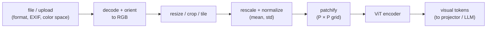
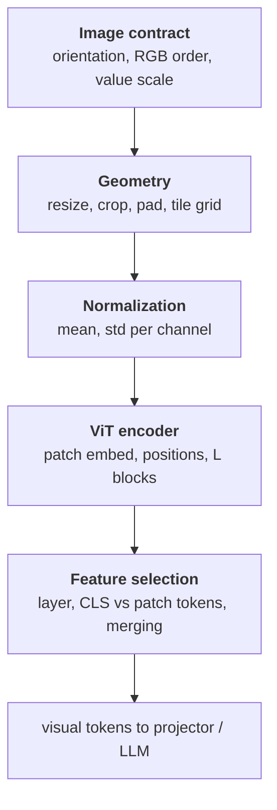

# Vision-Language Module 01 — Vision Representation

## 00 Why This Module Exists

A vision-language model never sees "an image." It sees a tensor produced by a decoder, an orientation fix, a resize or tiling rule, a crop, a channel order, a normalization, and a patch grid.
- Each step has parameters that are rarely logged.
- A mismatch in any one of them silently changes what the encoder receives, while the picture still "looks fine" to a human.


- Legend: P: patch side length in pixels; ViT: Vision Transformer.

This module covers the image input contract, patchification and the ViT encoder, the relation between resolution and compute, and tiling and feature-selection strategies.
- Contrastive image–text training of these encoders belongs to [VL Module 02](../02-contrastive-learning/README.md).
- Projectors and how visual tokens enter the language model belong to [VL Module 03](../03-vlm-architectures/README.md).
- Visual-token serving cost, batching, and KV budgets belong to [VL Module 07](../07-vlm-serving/README.md) and core [Module 21](../../advanced-ai-engineering/21-multimodal-ai-systems/README.md).

**Research status:** satellite 80/20 revision, 2026-11-26. Formulas below are derived in the text. Constants attributed to papers or to the `openai/CLIP` and `huggingface/transformers` code were written from the cited sources but were **not** re-read against a pinned commit in this revision (`TODO_VERIFY`). Pin and re-check them in the source trace before citing them elsewhere.

**Module Orientation**

- **Engineering problem:** make the encoder input reproducible from a raw upload, and know what each resolution and tiling choice costs in tokens, FLOPs, and lost detail.
- **What you will do:**
  - compute patch counts, parameter counts, and per-layer FLOPs by hand;
  - reproduce a reference preprocessing pipeline and match its tensor;
  - break the pipeline with channel-order, normalization, orientation, and crop mismatches;
  - measure the token–accuracy frontier of fixed resizing versus tiling.
- **Environment:** Python 3.10+, NumPy, Pillow, PyTorch, a small pretrained ViT or CLIP image encoder, CPU or a free Colab GPU. A set of photos, screenshots with small text, and wide or tall images.
- **Evidence rule:** separate source observations (**O**), derivations (**D**), and hypotheses that need measurement (**H**).
- **If You Only Have One Week**: Lessons VL1.1 and VL1.3. They cover where most real bugs live (the preprocessing contract) and where most real cost lives (tokens as a function of resolution).

## 01 Baseline Assumptions

- Core [Module 00](../../advanced-ai-engineering/00-scientific-ai-engineering/README.md): paired comparisons and the observation/derivation/hypothesis split.
- Core [Module 01](../../advanced-ai-engineering/01-foundation-model-internals/README.md): transformer blocks, attention, and parameter/FLOP accounting.
- Core [Module 02](../../advanced-ai-engineering/02-inference-gpu-fundamentals/README.md): latency measurement and why FLOPs alone do not predict latency.
- Mathematical prerequisites: matrix multiplication, image tensors of shape $C \times H \times W$, and the mean/standard deviation of a set of values.

## 02 Target Mastery

```yaml
depth_contract:
  conceptual: REQUIRED
  mechanistic: REQUIRED
  mathematical: REQUIRED
  quantitative: REQUIRED
  implementation: REQUIRED
  source_code: SELECTIVE
  instrumentation: SELECTIVE
  experimental: SELECTIVE
  statistical: NOT_APPLICABLE
  production_reasoning: REQUIRED
  failure_analysis: REQUIRED
  falsification: SELECTIVE
  security: NOT_APPLICABLE
  economics: SELECTIVE
  architecture_tradeoff: REQUIRED
  research_connection: SELECTIVE

estimated_effort:
  instruction: 2h
  guided_practice: 1.25h
  labs: 3h
  assessment: 0.75h
  source_trace: 0.5h
  total: 7.5h
```

The learner must be able to turn an upload into the exact tensor an encoder expects, predict visual-token counts and encoder FLOPs for a resolution or tiling policy, and diagnose a silent preprocessing mismatch from the tensor alone.

### LAYER 1: KNOWLEDGE / INSTRUCTIONAL LAYER

## 03 Knowledge Map


- Legend: CLS: a learned summary token prepended to the patch sequence; L: number of transformer blocks.

Keep three contracts separate:

1. **Pixel contract:** decode, EXIF orientation, color space, channel order, value range.
2. **Geometry contract:** resize rule and interpolation, crop or pad, tile grid, final resolution.
3. **Token contract:** patch size, position-embedding grid, which layer and which tokens are exported, and any token merging.

An encoder is trained against one instance of each contract. Serving must reproduce all three.

## 04 Lessons

### Lesson VL1.1 — The Image Preprocessing Contract

**Engineering Question:**
Which exact steps turn an uploaded file into the tensor the pretrained encoder expects?

**Concepts & Definitions:**

- **Orientation:** many phone photos store pixels sideways plus an EXIF orientation tag. A decoder that ignores the tag hands the model a rotated image.
- **Channel order:** RGB versus BGR. OpenCV decodes to BGR by default; Pillow decodes to RGB.
- **Rescale:** convert 8-bit values in $[0, 255]$ to floats, usually by dividing by 255.
- **Per-channel normalization:** subtract a per-channel mean and divide by a per-channel standard deviation computed on the pretraining data.

$$
x' = \frac{v / 255 - \mu_c}{\sigma_c}
$$

where:

- $v$ is the 8-bit pixel value in channel $c$;
- $\mu_c$ and $\sigma_c$ are the mean and standard deviation for channel $c$ declared by the encoder's preprocessing config;
- $x'$ is the value the patch embedding receives.

Common constants (**O**, `TODO_VERIFY`): ImageNet uses $\mu = (0.485, 0.456, 0.406)$, $\sigma = (0.229, 0.224, 0.225)$. CLIP uses $\mu = (0.4815, 0.4578, 0.4082)$, $\sigma = (0.2686, 0.2613, 0.2758)$.

**Mechanism Explanation:**

The patch embedding is a linear map learned on inputs with roughly zero mean and unit variance per channel. Wrong constants shift and scale every input; swapped channels move red-channel statistics into the blue weights. The network still produces a confident output, so the failure is silent.

**Break cases:**
- normalization applied twice (once by a client library, once by the server);
- BGR input from OpenCV;
- EXIF orientation ignored;
- an RGBA or grayscale image passed without conversion;
- images rescaled to $[0, 1]$ but the encoder expects $[-1, 1]$.

**Worked Example (double normalization):**
*Input.* A red-channel value $v = 128$ and CLIP constants for red: $\mu = 0.4815$, $\sigma = 0.2686$.

*Steps.*
- Rescale: $128 / 255 = 0.5020$.
- Correct normalization: $(0.5020 - 0.4815) / 0.2686 = 0.0762$.
- Normalized again: $(0.0762 - 0.4815) / 0.2686 = -1.5090$.

*Result.* A mid-gray pixel becomes a strongly negative input, about 1.5 standard deviations below the training mean. Applied to every pixel, this makes the whole image look much darker and lower-contrast to the encoder.

**Knowledge Check:** Why can a BGR/RGB swap leave zero-shot accuracy almost unchanged on grayscale-like documents but break it on natural photos?

**Guided Practice:** Load one phone photo, one PNG with alpha, and one grayscale scan. For each, print the decoded mode, size before and after EXIF transposition, and per-channel mean and standard deviation after normalization.

**Feedback Contract:**
- *Expected Evidence*: a table where the correctly processed tensors have per-channel means near 0 and standard deviations near 1 on typical photos, and each break case shows a visible shift.
- *Common Failure*: checking only the tensor shape, which is identical in every break case above.
- *Diagnostic Hint*: compute per-channel mean and standard deviation of the final tensor and compare them across clients.
- *Concept to Revisit*: Pixel contract.

**Learning Outcome:** Reproduce an encoder's preprocessing and detect orientation, channel, and normalization mismatches from tensor statistics.

*(Effort: 25m instruction, 15m practice)*

### Lesson VL1.2 — Patchification and the Vision Transformer

**Engineering Question:**
How does an image become a sequence of tokens, and what does each design choice fix in place?

**Concepts & Definitions:**

- **Patchification:** split an $H \times W$ image into non-overlapping $P \times P$ patches, flatten each, and project it to dimension $D$ with one shared linear map. In code this is a convolution with kernel size $P$ and stride $P$ (**O**, ViT).
- **Position embeddings:** one learned vector per grid position, added to the patch embeddings. The grid size is fixed at pretraining resolution.
- **CLS token:** an extra learned token whose final state is often used as a global summary.

Patch count and patch-embedding parameters:

$$
N = \frac{H}{P} \cdot \frac{W}{P}, \qquad \text{params}_{\text{embed}} = P^2 \cdot C \cdot D + D
$$

where:

- $N$ is the number of patch tokens (excluding CLS);
- $H$, $W$ are image height and width in pixels, assumed divisible by $P$;
- $P$ is the patch side in pixels;
- $C$ is the number of input channels (3 for RGB);
- $D$ is the encoder hidden size; the final $+D$ is the bias.

*Step-by-step reading.*

1. Each patch holds $P \cdot P \cdot C$ numbers after flattening.
2. The projection maps that vector to $D$ numbers, so its weight matrix is $(P^2 C) \times D$.
3. The same matrix is used for every patch, so the parameter count does not depend on $N$.

**Mechanism Explanation:**

Pixels as tokens would make $N = HW$: a $224 \times 224$ image would be 50,176 tokens. Patching cuts that by $P^2$ and lets attention work on a few hundred tokens. The price is that detail smaller than a patch is mixed inside one linear projection before any attention happens.

When the serving resolution differs from pretraining, the learned position grid must be resized, usually by bicubic interpolation of the 2-D grid (**O**, `TODO_VERIFY`). That is an approximation the encoder never saw in pretraining.

**Worked Example (ViT-B/16 and ViT-L/14):**
*Input.* ViT-B/16 at 224 px ($P = 16$, $D = 768$) and ViT-L/14 at 336 px ($P = 14$, $D = 1024$).

*Steps.*
- ViT-B/16: grid $224 / 16 = 14$, so $N = 196$; with CLS, 197 tokens.
- Embedding parameters: $16^2 \cdot 3 \cdot 768 + 768 = 589{,}824 + 768 = 590{,}592$.
- ViT-L/14 at 336: grid $336 / 14 = 24$, so $N = 576$.
- Serving ViT-B/16 at 384 px: grid $384 / 16 = 24$, so the $14 \times 14$ position grid must be interpolated to $24 \times 24$ (576 positions).

*Result.* Token count is set by grid size; the patch-embedding parameter count is not.

**Knowledge Check:** Why does a 7 px-high line of text survive better through a $P = 14$ encoder at 672 px than through the same encoder at 336 px?

**Guided Practice:** Implement patchification with `reshape`/`permute` and with a stride-$P$ convolution sharing the same weights. Confirm identical outputs. Then run the encoder at its native resolution and at 1.5 times that resolution with interpolated positions, and compare the cosine similarity of pooled features.

**Feedback Contract:**
- *Expected Evidence*: maximum absolute difference near floating-point noise between the two patchify implementations; a reported cosine similarity for the resized run, with a note that it is not 1.0.
- *Common Failure*: flattening patches in a different order (channel-last versus channel-first) and getting a different but valid-looking sequence.
- *Diagnostic Hint*: patchify an image whose pixels encode their own coordinates; the output must be readable back as a grid.
- *Concept to Revisit*: Token contract.

**Learning Outcome:** Compute patch counts and embedding parameters, and explain what changes when serving resolution differs from pretraining.

*(Effort: 30m instruction, 20m practice)*

### Lesson VL1.3 — Resolution, Token Count, and Encoder Cost

**Engineering Question:**
When does raising image resolution make attention, rather than the linear layers, dominate encoder compute?

**Concepts & Definitions:**

Per-layer forward FLOPs of a transformer block, counting a multiply–add as 2 FLOPs and an MLP hidden size of $4D$:

$$
F_{\text{linear}} = 24\,N D^2, \qquad F_{\text{attn}} = 4\,N^2 D, \qquad \frac{F_{\text{attn}}}{F_{\text{linear}}} = \frac{N}{6D}
$$

where:

- $N$ is the number of tokens per image (or per tile);
- $D$ is the hidden size;
- $F_{\text{linear}}$ covers the Q, K, V, and output projections and the MLP;
- $F_{\text{attn}}$ covers the score matrix $QK^\top$ and the weighted sum with $V$.

*Step-by-step.*

1. Q, K, V projections: three $N \times D$ by $D \times D$ products, $3 \cdot 2ND^2 = 6ND^2$.
2. Output projection: $2ND^2$.
3. MLP: $D \to 4D \to D$, two products of $2 \cdot N \cdot D \cdot 4D$ each, $16ND^2$.
4. Sum of linear terms: $6 + 2 + 16 = 24$, so $24ND^2$.
5. Attention: $QK^\top$ is $N \times D$ by $D \times N$, $2N^2D$; multiplying by $V$ is another $2N^2D$; total $4N^2D$.
6. The ratio is $4N^2D / 24ND^2 = N / 6D$. Attention FLOPs equal linear FLOPs when $N = 6D$.

Normalization, softmax, and the CLS token are ignored; they do not change the scaling.

**Mechanism Explanation:**

Doubling resolution side length multiplies $N$ by 4, linear FLOPs by 4, and attention FLOPs by 16. At low resolution the encoder is dominated by its linear layers; at high resolution attention takes over. Fused attention kernels reduce memory traffic but not these FLOPs (core [Module 05](../../advanced-ai-engineering/05-inference-optimization/README.md)).

**Worked Example (ViT-L/14, $D = 1024$, 24 layers):**
*Input.* Square images at 336, 672, and 1344 px.

*Steps.*
- 336 px: $N = 576$.
  - $F_{\text{linear}} = 24 \times 576 \times 1024^2 = 14.50$ GFLOPs per layer.
  - $F_{\text{attn}} = 4 \times 576^2 \times 1024 = 1.36$ GFLOPs per layer.
  - Ratio $576 / 6144 = 0.094$. Encoder total about $24 \times 15.85 = 380.5$ GFLOPs.
- 672 px: $N = 2{,}304$. Linear $58.0$ G, attention $21.7$ G per layer, ratio $0.375$.
- 1344 px: $N = 9{,}216$. Ratio $9{,}216 / 6{,}144 = 1.5$: attention now exceeds the linear layers.

*Result.* From 336 to 1344 px, tokens grow 16 times, but per-layer encoder FLOPs grow by about $\frac{231.9 + 347.9}{15.85} \approx 36.6$ times.

*Interpretation and limits.* These are FLOP counts, not latency. Measured latency also depends on kernels, memory bandwidth, and batch shape; treat FLOPs as a prediction to test (core [Module 02](../../advanced-ai-engineering/02-inference-gpu-fundamentals/README.md)).

**Knowledge Check:** For ViT-B ($D = 768$), at what token count do attention FLOPs equal linear FLOPs, and what square resolution with $P = 16$ is that?

**Guided Practice:** Time one encoder forward pass at three resolutions with warm-up and repeated runs. Plot measured time against your predicted FLOPs and note where they diverge.

**Feedback Contract:**
- *Expected Evidence*: for ViT-B, $N = 6 \times 768 = 4{,}608$, which at $P = 16$ is a square grid of about 68 patches per side, about $68 \times 16 = 1{,}088$ px. Timing table with median and spread over repeats, and a stated device and dtype.
- *Common Failure*: timing a single cold run, or comparing runs where a different attention kernel was selected.
- *Diagnostic Hint*: record which attention implementation ran for each resolution.
- *Concept to Revisit*: FLOPs versus latency.

**Learning Outcome:** Predict how encoder FLOPs scale with resolution and identify the crossover where attention dominates.

*(Effort: 35m instruction, 20m practice)*

### Lesson VL1.4 — Tiling, Dynamic Resolution, and Feature Selection

**Engineering Question:**
How do you show a VLM fine detail without paying quadratic attention on one huge image, and which encoder outputs should it receive?

**Concepts & Definitions:**

- **Fixed resize:** squash or center-crop every image to the pretraining resolution. Cheap and predictable; loses detail and can crop content at the edges.
- **Tiling (AnyRes-style):** choose a grid of native-resolution tiles that best fits the image aspect ratio, encode each tile separately, and usually add one downscaled global view (**O**, LLaVA-NeXT, `TODO_VERIFY`).
- **Native-resolution packing:** encode patches at the image's own aspect ratio and pack variable-length sequences into one batch (**O**, NaViT).
- **Feature selection:** which layer's outputs to export (final or penultimate), whether to drop CLS, and whether to merge neighboring patch tokens before the language model.

Visual tokens sent to the language model with tiling:

$$
T_{\text{vis}} = \frac{(g_h \cdot g_w + u) \cdot N_{\text{tile}}}{m^2}
$$

where:

- $g_h$, $g_w$ are the tile-grid rows and columns;
- $u$ is 1 if a global thumbnail is added, else 0;
- $N_{\text{tile}}$ is patch tokens per tile, $(S / P)^2$ for tile side $S$;
- $m$ is the side of the token-merge window ($m = 1$ means no merging, $m = 2$ merges $2 \times 2$ neighbors).

**Mechanism Explanation:**

Tiling keeps attention inside each tile, so encoder attention cost grows linearly with the number of tiles rather than quadratically with total pixels. The price is that tiles do not attend to each other inside the encoder; cross-tile context comes only from the global view and from the language model. Every visual token also enters the language model's prefill and KV cache, so tokens, not pixels, set downstream cost (core [Module 03](../../advanced-ai-engineering/03-kv-cache-engineering/README.md)).

Some LLaVA-style models export patch tokens from the penultimate encoder layer and drop CLS (**O**, LLaVA-1.5, `TODO_VERIFY`). The final layer of a contrastively trained encoder is shaped for global image–text matching, which can discard local detail.

**Worked Example (2×2 tiles versus one 672 px image):**
*Input.* ViT-L/14 with 336 px tiles ($N_{\text{tile}} = 576$), $D = 1024$, a near-square image.

*Steps.*
- Tiling with a $2 \times 2$ grid plus a global view: $T_{\text{vis}} = (4 + 1) \times 576 = 2{,}880$ tokens.
- Encoder FLOPs per layer: $5 \times (14.50 + 1.36) = 79.3$ G.
- One native 672 px pass: $N = 2{,}304$, $58.0 + 21.7 = 79.7$ G per layer, and 2,304 tokens.
- With $2 \times 2$ merging on the tiled output: $2{,}880 / 4 = 720$ tokens to the language model.

*Result.* Encoder compute is almost the same here, but tiling sends 25% more tokens to the language model than the native pass and loses cross-tile attention inside the encoder; merging cuts language-model tokens by 4 at the cost of spatial detail.

**Knowledge Check:** A $1 \times 4$ panorama and a $2 \times 2$ grid both cost 5 tiles. Which images benefit from each, and what happens if the grid is chosen without checking aspect ratio?

**Guided Practice:** For five images of different aspect ratios, compute the token count under fixed resize, a $2 \times 2$ tiling, an aspect-matched tiling, and aspect-matched tiling with $2 \times 2$ merging. Then crop the regions each policy discards or downsamples most.

**Feedback Contract:**
- *Expected Evidence*: a table of $g_h$, $g_w$, $u$, $m$, and $T_{\text{vis}}$ per image and policy, plus one crop per policy showing lost content.
- *Common Failure*: counting encoder tokens instead of language-model tokens after merging, or forgetting the global view.
- *Diagnostic Hint*: log $T_{\text{vis}}$ from the model's actual input embeddings, not from the config.
- *Concept to Revisit*: Token contract.

**Learning Outcome:** Choose a resolution or tiling policy from a declared detail requirement and a language-model token budget.

*(Effort: 30m instruction, 20m practice)*

## 05 Literature & Production Source Map

**REFERENCE / BASELINE**

- [An Image is Worth 16x16 Words (ViT)](https://arxiv.org/abs/2010.11929) — Dosovitskiy et al. (2020). Reading pointer: §3.1, patch embedding, CLS, position embeddings; fine-tuning at higher resolution with 2-D interpolation of position embeddings.
- [Learning Transferable Visual Models From Natural Language Supervision (CLIP)](https://arxiv.org/abs/2103.00020) — Radford et al. (2021). Reading pointer: image encoder variants and input resolution.
- [Improved Baselines with Visual Instruction Tuning (LLaVA-1.5)](https://arxiv.org/abs/2310.03744) — Liu et al. (2023). Reading pointer: the 336 px CLIP encoder and the visual features passed to the projector.

**WORKLOAD-DEPENDENT / FRONTIER**

- [Patch n' Pack: NaViT](https://arxiv.org/abs/2307.06304) — Dehghani et al. (2023). Native aspect ratios via sequence packing; author-reported efficiency gains, scope to their setup.
- LLaVA-NeXT (AnyRes tiling) — Liu et al., project blog post (2024), not a peer-reviewed paper (`TODO_VERIFY` for the exact grid set).
- [Token Merging (ToMe)](https://arxiv.org/abs/2210.09461) — Bolya et al. (2022). Reduces tokens inside the encoder; accuracy cost is task-dependent.
- [DINOv2](https://arxiv.org/abs/2304.07193) — Oquab et al. (2023). Self-supervised features often preferred for dense, local tasks; compare against contrastive features on your task.

**CURRENT DEFAULT:** preprocessing reproduced exactly from the encoder's published config, an aspect-aware tiling or native-resolution policy where fine detail matters, and a logged visual-token count per request.

**LEGACY / INSUFFICIENT:** "resize to 224" as the whole input contract; center crop on documents or screenshots; quoting image count instead of visual-token count; comparing encoders at different resolutions without stating it.

**PRODUCTION SOURCE TRACE** (pin the commit you read; no commit was pinned in this revision)

- `openai/CLIP`, file `clip/clip.py`: `_transform` (resize, center crop, RGB conversion, normalization constants) (Lesson VL1.1).
- `huggingface/transformers`, file `src/transformers/models/vit/modeling_vit.py`:
  - `ViTPatchEmbeddings`: stride-$P$ convolution (Lesson VL1.2);
  - `ViTEmbeddings.interpolate_pos_encoding`: 2-D position-grid interpolation (Lesson VL1.2).
- `huggingface/transformers`, file `src/transformers/models/clip/image_processing_clip.py`: `CLIPImageProcessor` resize, crop, rescale, and normalize defaults.
- Scope: reference implementations, not the only valid pipelines. Serving runtimes often reimplement preprocessing (for example on GPU) and must be checked separately.

### LAYER 2: ENGINEERING PRACTICE LAYER

## 06 Engineering Labs

All labs follow `PREDICT → BUILD → MEASURE → EXPLAIN → BREAK → IMPROVE → FALSIFY`.

### LAB A — Reproduce and Break an Image Preprocessing Pipeline

- **Objective:** build a preprocessing pipeline from Pillow and NumPy, match the reference processor's tensor within tolerance, then break it one contract field at a time.
- **Pre-Registered Hypothesis:** orientation and crop errors change zero-shot predictions most on photos and screenshots; normalization and channel errors change embeddings everywhere but are invisible in tensor shape.
- **Independent Variables:** EXIF handling, channel order, normalization constants and count, resize interpolation, center crop versus pad.
- **Dependent Variables:** max tensor difference versus reference, cosine similarity of image embeddings to the reference embedding, zero-shot top-1 on 50 labeled images.
- **Break & Falsify:** BGR input, double normalization, ignored EXIF, bilinear instead of bicubic, center crop on wide screenshots.
- **Alignment:** Lessons VL1.1 and VL1.2; Incident VL1.1.
- **Effort Estimate:** 1.5h.

### LAB B — Resolution and Tiling Token Frontier

- **Objective:** measure detail-sensitive accuracy against visual-token count and encoder time for fixed resize, native high resolution, and tiling with and without merging.
- **Pre-Registered Hypothesis:** on small-text crops, tiling recovers most of the native-high-resolution accuracy, and $2 \times 2$ merging loses accuracy mainly on the smallest text.
- **Independent Variables:** resolution, tile grid, global view on/off, merge window $m$.
- **Dependent Variables:** task accuracy on 50 small-text and 50 natural images, $T_{\text{vis}}$, encoder FLOPs (predicted), and encoder time (measured; median of repeats).
- **Break & Falsify:** extreme aspect ratios, text that straddles tile borders, and images smaller than one tile.
- **Alignment:** Lessons VL1.3 and VL1.4.
- **Effort Estimate:** 1.5h.

**Runnable arithmetic check (CPU; not a quality experiment):**
```python
import math
mu_r, sd_r = 0.4815, 0.2686
once = (128 / 255 - mu_r) / sd_r
twice = (once - mu_r) / sd_r
assert round(once, 4) == 0.0762 and round(twice, 3) == -1.509
assert (224 // 16) ** 2 == 196 and (336 // 14) ** 2 == 576
assert 16 * 16 * 3 * 768 + 768 == 590_592
lin = lambda n, d: 24 * n * d * d
att = lambda n, d: 4 * n * n * d
D = 1024
assert round(lin(576, D) / 1e9, 2) == 14.50 and round(att(576, D) / 1e9, 2) == 1.36
assert round(24 * (lin(576, D) + att(576, D)) / 1e9, 1) == 380.5
assert math.isclose(att(9216, D) / lin(9216, D), 1.5)
growth = (lin(9216, D) + att(9216, D)) / (lin(576, D) + att(576, D))
assert round(growth, 1) == 36.6
tiled = 5 * (lin(576, D) + att(576, D)); native = lin(2304, D) + att(2304, D)
assert round(tiled / 1e9, 1) == 79.3 and round(native / 1e9, 1) == 79.7
assert (4 + 1) * 576 == 2_880 and 2_880 // 4 == 720
assert 6 * 768 == 4_608 and round(math.sqrt(4_608)) * 16 == 1_088
```

## 07 Break / Incident Scenarios

### Incident VL1.1 — Screenshot Q&A Fails After an Image-Service Rewrite

**Incident Symptoms:**
A team replaces its image-upload service. The VLM and prompts are unchanged. Answers about photos look normal, but questions about screenshots and receipts get worse: totals at the bottom of receipts and menu items at the right edge are "not visible," and some phone photos are described as sideways. No errors are logged; latency drops slightly.

**Diagnostic Protocol (Task):**
1. **Form Competing Hypotheses:** center crop added, tiling disabled, EXIF ignored, JPEG recompression at lower quality, channel order changed, normalization duplicated, or a real shift in upload types.
2. **Identify Missing Evidence:** per-request original size, orientation tag, final tensor size, tile grid, $T_{\text{vis}}$, per-channel tensor statistics, and processor version for old and new paths.
3. **Design Discriminating Measurements:** send the same 50 uploads through both services and diff the final tensors and visual-token counts; then swap one stage at a time.
4. **Rank Explanations:** a drop in $T_{\text{vis}}$ points to tiling or resize; missing edge content with unchanged $T_{\text{vis}}$ points to cropping; rotated tensors point to EXIF; shifted channel statistics point to normalization or channel order.
5. **Intervene:** restore the missing step or pin the processor; add a contract check (orientation applied, tensor statistics, $T_{\text{vis}}$ range) at ingestion.
6. **Remeasure:** task accuracy by upload type on the same sample, with the contract check active.

### LAYER 3: MASTERY / ASSESSMENT LAYER

## 08 Mastery Assessment

### Transfer Problem — One Image Pipeline for Photos and Documents

A product sends phone photos, screenshots, and multi-page scanned documents to the same VLM with a ViT-L/14 encoder at 336 px tiles and a fixed language-model budget of 3,000 visual tokens per request.

**Required Deliverables:**
1. pixel, geometry, and token contracts with every parameter named;
2. hand-computed $T_{\text{vis}}$ and encoder FLOPs for a $1080 \times 2340$ screenshot and a $4032 \times 3024$ photo under your chosen policy;
3. an ingestion check that rejects or flags contract violations, with the statistics it uses;
4. LAB A evidence that preprocessing matches the reference within tolerance;
5. LAB B evidence for the chosen tiling and merging policy, including the content it still loses.

## 09 Required Evidence & Rubric

### Required Artifact: Image Contract Sheet

Submit the three contracts, the LAB A tensor-diff table, the LAB B token frontier, and the Incident VL1.1 diagnosis.

### Rubric Dimensions

- **Mechanism:** *Insufficient* says "resize and normalize." *Competent* names every preprocessing step and parameter. *Strong* predicts the effect of each change before measuring it.
- **Quantitative:** *Insufficient* quotes image counts. *Competent* computes patch counts, $T_{\text{vis}}$, and FLOPs. *Strong* links them to language-model prefill and KV cost and checks FLOP predictions against measured time.
- **Diagnosis:** *Insufficient* inspects shapes. *Competent* diffs tensors against a reference. *Strong* localizes the first divergent stage and adds a guard for it.

## 10 Capability Traceability Matrix

| Capability | Taught | Practiced | Assessed | Evidence (artifact reviewers open) |
|---|---|---|---|---|
| Pixel and normalization contract | VL1.1 | VL1.1 Guided Practice; LAB A | Deliverables 1, 3; Incident VL1.1 | LAB A tensor statistics and diff table |
| Patchification and position grids | VL1.2 | VL1.2 Guided Practice; LAB A | Deliverables 1, 2 | Patchify equivalence check; interpolation cosine report |
| Resolution and encoder cost | VL1.3 | VL1.3 Guided Practice; LAB B | Deliverable 2 | FLOP predictions beside measured encoder time |
| Tiling, merging, feature selection | VL1.4 | VL1.4 Guided Practice; LAB B | Deliverables 2, 5; Incident VL1.1 | Token frontier with $g_h$, $g_w$, $u$, $m$ per point |

## 11 Exit Criteria & Module Wrap-Up

### Exit Criteria

A learner passes when they can reproduce a reference preprocessing pipeline within tolerance, predict patch counts, visual tokens, and encoder FLOPs by hand, detect orientation/channel/normalization mismatches from tensor statistics, and defend a tiling policy with measured accuracy and token evidence.

### Module Wrap-Up (Final Mental Model Reconstruction)

Image input is a contract, not a file. Log every field of it, diff tensors against a reference before blaming the model, and count visual tokens, not images, before estimating any downstream cost.

### Cost & Telemetry Hook

- [Lesson 22.1](../../advanced-ai-engineering/22-ai-economics/README.md): cost per request must count visual tokens after tiling and merging, plus decode and preprocessing time.
- [Lesson 23.1](../../advanced-ai-engineering/23-observability-reliability/README.md): emit original size, orientation applied, tile grid, $T_{\text{vis}}$, and processor version per request so Incident VL1.1 is detectable from telemetry.

## 12 Competency Targets

```yaml
competency:
  sfia: 4
  bloom: Apply -> Analyze
  solo: Relational
  dreyfus: Advanced Beginner -> Competent
```
