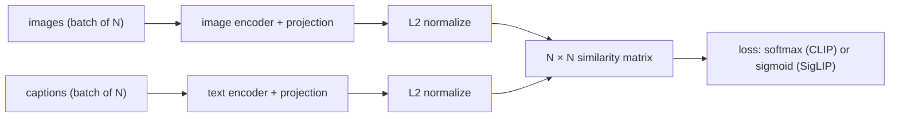
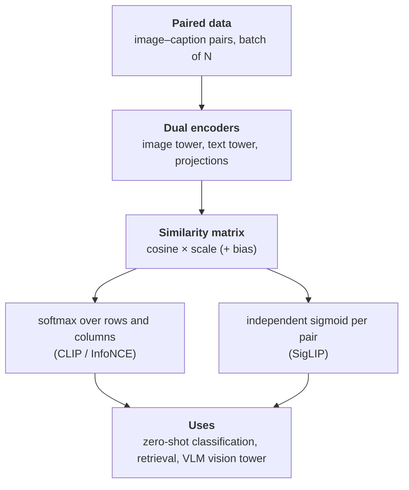

# Vision-Language Module 02 — Contrastive Learning

## 00 Why This Module Exists

A contrastive image–text model never learns what an image "means." It learns to give one matching caption a higher score than the other captions in the same batch.
- Everything the model can do later, such as zero-shot classification, retrieval, and serving as a VLM vision tower, follows from that ranking objective.
- So do its blind spots: word order, counting, negation, and fine spatial relations are often not needed to win the batch ranking.


- Legend: N: batch size; the diagonal of the similarity matrix holds the matching pairs.

This module covers the InfoNCE/CLIP objective, temperature and batch-size effects, the SigLIP sigmoid loss, and how a trained dual encoder is used for zero-shot classification and retrieval.
- Patch embeddings and the ViT image encoder belong to [Vision-Language Module 01](../01-vision-representation/README.md).
- Using a contrastive image encoder as the vision tower of a generative VLM belongs to [Vision-Language Module 03](../03-vlm-architectures/README.md).
- Retrieval indexing, ANN search, and ranking metrics are taught in depth in core [Module 09](../../advanced-ai-engineering/09-retrieval-engineering/README.md).

**Research status:** satellite 80/20 revision, 2026-11-26. Loss formulas are derived in the text, and every worked number is recomputed in the LAB check block. Training constants attributed to the CLIP and SigLIP papers or to the `openai/CLIP` and `mlfoundations/open_clip` code (temperature initialization and clipping, SigLIP bias initialization, batch sizes, dataset sizes) were written from the cited sources but were **not** re-read against a pinned paper version or commit in this revision (`TODO_VERIFY`). No benchmark accuracy is quoted. Pin and re-check them in the source trace before citing them elsewhere.

**Module Orientation**

- **Engineering problem:** know what a contrastive score means, what the batch and temperature do to training, and where a dual encoder will fail before you put it behind search or a VLM.
- **What you will do:**
  - compute CLIP and SigLIP losses by hand on a 3 × 3 batch;
  - compute the memory and communication cost of large contrastive batches;
  - run zero-shot classification and retrieval with a pretrained checkpoint;
  - break the model with compositional probes and an embedding-contract mismatch.
- **Environment:** Python 3.10+, PyTorch, `open_clip` or an equivalent loader, a small image–caption set (a few thousand pairs), and CPU or a free Colab GPU. No large-scale pretraining.
- **Evidence rule:** separate source observations (**O**), derivations (**D**), and hypotheses that need measurement (**H**).
- **If You Only Have One Week**: Lessons VL2.1 and VL2.4. They cover what the score is and how it is used; temperature, batch size, and the sigmoid variant explain training behavior you will rarely reproduce yourself.

## 01 Baseline Assumptions

- [Vision-Language Module 01](../01-vision-representation/README.md): an image encoder maps an image to one pooled vector.
- Core [Module 01](../../advanced-ai-engineering/01-foundation-model-internals/README.md): softmax, cross-entropy, and transformer encoders.
- Core [Module 09](../../advanced-ai-engineering/09-retrieval-engineering/README.md), Lesson 9.2: dense dual encoders and why cosine equals inner product only for normalized vectors.
- Mathematical prerequisites: dot products, softmax, logarithms, the logistic sigmoid, and the idea of a gradient.

## 02 Target Mastery

```yaml
depth_contract:
  conceptual: REQUIRED
  mechanistic: REQUIRED
  mathematical: REQUIRED
  quantitative: REQUIRED
  implementation: REQUIRED
  source_code: SELECTIVE
  instrumentation: SELECTIVE
  experimental: SELECTIVE
  statistical: SELECTIVE
  production_reasoning: REQUIRED
  failure_analysis: REQUIRED
  falsification: SELECTIVE
  security: NOT_APPLICABLE
  economics: SELECTIVE
  architecture_tradeoff: REQUIRED
  research_connection: SELECTIVE

estimated_effort:
  instruction: 2h
  guided_practice: 1.25h
  labs: 3h
  assessment: 0.75h
  source_trace: 0.5h
  total: 7.5h
```

The learner must be able to compute both contrastive losses by hand, predict how batch size and temperature change training cost and difficulty, use a pretrained dual encoder correctly for zero-shot classification and retrieval, and name the failure classes a ranking objective does not train away.

### LAYER 1: KNOWLEDGE / INSTRUCTIONAL LAYER

## 03 Knowledge Map


- Legend: scale: inverse temperature; bias: SigLIP's learned offset.

Keep three contracts separate:

1. **Embedding contract:** checkpoint, image preprocessing (resize, crop, mean/std), tokenizer and context length, projection, and L2 normalization.
2. **Score contract:** cosine similarity, plus the logit scale and bias only when probabilities are needed. Rankings do not depend on scale; probabilities do.
3. **Use contract:** prompt templates for zero-shot classes, the index's embedding version, and the metric (accuracy, Recall@K).

## 04 Lessons

### Lesson VL2.1 — InfoNCE and the CLIP Symmetric Loss

**Engineering Question:**
What exactly does the CLIP loss reward, and what does a low loss on a batch tell you?

**Concepts & Definitions:**

- **Positive pair:** an image and its own caption. **Negatives:** the other $N-1$ captions (for an image) or images (for a caption) in the same batch.
- **InfoNCE:** cross-entropy that asks the model to pick the positive among the $N$ candidates.
- **Symmetric loss:** CLIP applies InfoNCE in both directions, image→text over rows and text→image over columns, and averages them (**O**).

With L2-normalized embeddings $u_i$ (image) and $v_j$ (text), CLIP's loss is:

$$
\mathcal{L}_{\text{CLIP}} = \frac{1}{2N}\sum_{i=1}^{N}\left[
-\log\frac{e^{s_{ii}/\tau}}{\sum_{j=1}^{N} e^{s_{ij}/\tau}}
-\log\frac{e^{s_{ii}/\tau}}{\sum_{j=1}^{N} e^{s_{ji}/\tau}}
\right]
$$

where:

- $N$ is the batch size;
- $s_{ij} = u_i \cdot v_j$ is the cosine similarity between image $i$ and caption $j$ (both unit vectors);
- $\tau > 0$ is the temperature; CLIP learns the **logit scale** $1/\tau$;
- the first term is the image→text loss for row $i$, and the second is the text→image loss for column $i$.

*Step-by-step reading.*

1. Divide every similarity by $\tau$ to get logits.
2. For row $i$, softmax over the $N$ captions gives the probability that caption $i$ is the match; the loss is minus its log.
3. Do the same down column $i$ for the text→image direction.
4. Average all $2N$ terms. The loss is zero only when every positive has probability 1 in both directions.

**Mechanism Explanation:**

The loss only compares candidates **inside the batch**. A near-duplicate caption elsewhere in the batch is treated as a negative (a false negative), and an easy batch gives almost no gradient. The objective also bounds mutual information: InfoNCE satisfies $I(u; v) \ge \log N - \mathcal{L}_{\text{InfoNCE}}$ (**O**, van den Oord et al.), so a batch of $N$ can certify at most $\log N$ nats.

**Worked Example (3 × 3 batch):**
*Input.* $\tau = 0.1$ and cosine similarities:

| | caption 1 | caption 2 | caption 3 |
|---|---|---|---|
| image 1 | **0.8** | 0.2 | 0.1 |
| image 2 | 0.3 | **0.7** | 0.2 |
| image 3 | 0.1 | 0.4 | **0.6** |

*Steps.*
- Logits are similarities × 10: rows $(8, 2, 1)$, $(3, 7, 2)$, $(1, 4, 6)$.
- Image→text, row 1: $-\log\frac{e^8}{e^8+e^2+e^1} = 0.0034$. Row 2: $0.0247$. Row 3: $-\log\frac{e^6}{e^1+e^4+e^6} = 0.1328$. Mean $0.0537$.
- Text→image, column 1 $(8, 3, 1)$: $0.0076$. Column 2 $(2, 7, 4)$: $0.0550$. Column 3 $(1, 2, 6)$: $0.0247$. Mean $0.0291$.
- $\mathcal{L}_{\text{CLIP}} = (0.0537 + 0.0291)/2 = 0.0414$.

*Result.* Image 3 contributes most because caption 2 scores $0.4$ against it, only $0.2$ below the positive. The two directions differ, which is why both are kept.

**Knowledge Check:** If two captions in a batch describe the same photo equally well, what does the loss push the model to do, and why is that harmful?

**Guided Practice:** Implement the symmetric loss in PyTorch with `F.cross_entropy` on the logits and on their transpose. Reproduce $0.0414$ on the matrix above, then set caption 2 equal to caption 3 and recompute.

**Feedback Contract:**
- *Expected Evidence*: the loss matches $0.0414$ within $10^{-4}$; with duplicated captions, both duplicates split probability and the loss rises even though the model is "right."
- *Common Failure*: using unnormalized embeddings, so the logit scale is applied to dot products of arbitrary length.
- *Diagnostic Hint*: print the norms of the embeddings before the matrix product; they must all be 1.
- *Concept to Revisit*: Embedding contract; false negatives.

**Learning Outcome:** Compute the CLIP loss by hand and explain why it is a within-batch ranking objective.

*(Effort: 35m instruction, 20m practice)*

### Lesson VL2.2 — Temperature, Batch Size, and the Cost of Negatives

**Engineering Question:**
Why do contrastive models train with very large batches, and what does a large batch cost?

**Concepts & Definitions:**

- **Temperature $\tau$:** small $\tau$ sharpens the softmax so hard negatives dominate the gradient; large $\tau$ spreads the gradient over all negatives. CLIP learns $\log(1/\tau)$, initialized to the equivalent of $\tau = 0.07$ and clipped so $1/\tau \le 100$ (**O**, `TODO_VERIFY`).
- **Negatives per positive:** $N-1$. More negatives make the task harder and raise the $\log N$ ceiling from Lesson VL2.1.
- **Global batch:** with data parallelism, each device embeds a local batch, then **all-gathers** embeddings so every device can score its local items against the full batch.

Memory and communication per step:

$$
M_{\text{full}} = N^2 \cdot s, \qquad M_{\text{local}} = \frac{N}{P} \cdot N \cdot s, \qquad C_{\text{gather}} = N \cdot d \cdot s_e
$$

where:

- $N$ is the global batch size and $P$ the number of devices;
- $s$ is the bytes per logit (4 for fp32);
- $M_{\text{full}}$ is the full logit matrix if one device held it; $M_{\text{local}}$ is the slice each device holds;
- $d$ is the embedding dimension, and $s_e$ the bytes per embedding value;
- $C_{\text{gather}}$ is the size of the gathered embeddings for one modality on each device.

*Step-by-step reading.*

1. Every image is scored against every caption: $N^2$ logits.
2. A device only needs rows for its own $N/P$ images, but against all $N$ captions, so its slice is $N/P \times N$.
3. To build that slice it must receive every caption embedding: $N \times d$ values.

**Mechanism Explanation:**

Embedding cost grows linearly in $N$, but the score matrix grows as $N^2$. At small $d$ and large $N$, the matrix and the all-gather, not the encoders, set the batch-size limit. Gradient accumulation does not reproduce a large contrastive batch, because negatives come only from the same forward pass; methods such as gradient caching exist for this reason ([core Module 09](../../advanced-ai-engineering/09-retrieval-engineering/README.md), Lesson 9.7).

**Worked Example (a 32,768 batch):**
*Input.* $N = 32{,}768$, $P = 256$, fp32 logits, $d = 512$, bf16 embeddings. CLIP reports a batch of 32,768 (**O**, `TODO_VERIFY`).

*Steps.*
- $M_{\text{full}} = 32{,}768^2 \times 4 = 4{,}294{,}967{,}296$ bytes, about 4.29 GB.
- Local batch $N/P = 128$; $M_{\text{local}} = 128 \times 32{,}768 \times 4 = 16.8$ MB.
- $C_{\text{gather}} = 32{,}768 \times 512 \times 2 = 33.6$ MB per modality per step.
- $\log N = \ln 32{,}768 = 10.40$ nats, versus $\ln 10 = 2.30$ for a batch of 10.

*Result.* Sharding makes the logit matrix small per device, but every step still moves about 67 MB of embeddings per device, and every logit still has to be computed somewhere.

**Knowledge Check:** You halve $\tau$ while keeping $N$ fixed. Which negatives now carry most of the gradient, and what happens if many of them are false negatives?

**Guided Practice:** Train only the projection heads on frozen precomputed image and text features for a few thousand pairs. Sweep $N \in \{32, 128, 512\}$ and a fixed versus learned $\tau$. Record validation Recall@1 and the learned $1/\tau$.

**Feedback Contract:**
- *Expected Evidence*: a table of $N$, $\tau$ mode, final $1/\tau$, and Recall@1, with the hardware and seed recorded; any trend is stated as specific to this small setup.
- *Common Failure*: comparing batch sizes at different numbers of steps or epochs, so the batch effect is confounded with training length.
- *Diagnostic Hint*: hold the number of seen pairs fixed across runs.
- *Concept to Revisit*: Negatives per positive; global batch.

**Learning Outcome:** Predict the memory and communication cost of a contrastive batch and explain the role of temperature.

*(Effort: 30m instruction, 20m practice)*

### Lesson VL2.3 — SigLIP: A Sigmoid Loss per Pair

**Engineering Question:**
What changes when every image–caption pair is scored as an independent yes/no decision instead of a softmax over the batch?

**Concepts & Definitions:**

- **Pairwise sigmoid loss:** each of the $N^2$ pairs is a binary classification: match or not. There is no normalization across the row or column (**O**, Zhai et al.).
- **Learned scale $t$ and bias $b$:** logits are $t \cdot s_{ij} + b$. The paper initializes $t = 10$ and $b = -10$ (**O**, `TODO_VERIFY`).

$$
\mathcal{L}_{\text{SigLIP}} = -\frac{1}{N}\sum_{i=1}^{N}\sum_{j=1}^{N}
\log \sigma\!\big(z_{ij}\,(t\, s_{ij} + b)\big)
$$

where:

- $\sigma(x) = 1/(1 + e^{-x})$ is the logistic sigmoid;
- $z_{ij} = +1$ if $i = j$ (a positive pair) and $-1$ otherwise;
- $s_{ij}$ is the cosine similarity, $t > 0$ the learned scale, and $b$ the learned bias;
- the sum runs over all $N^2$ pairs and is divided by $N$, the number of images.

*Step-by-step reading.*

1. Each pair gets a logit $t\,s_{ij} + b$.
2. For a positive, the loss is $-\log\sigma(\text{logit})$, small when the logit is large.
3. For a negative, $z = -1$ flips the sign, so the loss is small when the logit is very negative.
4. Pairs do not compete, so each device can compute the loss on blocks of pairs without first normalizing over the whole batch.

**Mechanism Explanation:**

There are $N$ positives and $N^2 - N$ negatives. Starting from $b = 0$, every pair predicts 0.5 and the loss is dominated by the negatives. A strongly negative initial bias makes the model start by predicting "no match" for every pair, so the large negative term is already near zero and early gradients focus on the positives. Because no row softmax is needed, the authors compute the loss chunk by chunk across devices, exchanging text embeddings between neighbors instead of materializing the full matrix (**O**, `TODO_VERIFY`).

**Worked Example (initialization and a trained state):**
*Input.* The same 3 × 3 similarity matrix as Lesson VL2.1.

*Steps.*
- *At initialization* ($s_{ij} \approx 0$, $t = 10$, $b = -10$): every logit is $-10$.
  - Each positive: $-\log\sigma(-10) = 10.0000$. Three positives: $30.0001$.
  - Each negative: $-\log\sigma(10) = 0.000045$. Six negatives: $0.0003$.
  - Loss $= 30.0004 / 3 = 10.0001$, almost all from positives.
- *Same start with $b = 0$*: every pair costs $\ln 2 = 0.693$, so the loss per image is $N \ln 2$, of which $(N-1)\ln 2$ comes from negatives. At $N = 32{,}768$, negatives are 99.997% of it.
- *Trained state* ($t = 10$, $b = -5$): row 1 logits are $(3, -3, -4)$, giving match probabilities $(0.953, 0.047, 0.018)$.
  - Over all pairs: positives contribute $0.4888$, negatives $0.5737$; loss $= 1.0625 / 3 = 0.3541$.

*Result.* The bias sets the prior for "this pair matches," and in the trained state the negatives still carry slightly more than half the loss ($0.5737$ of $1.0625$) because there are twice as many of them even at $N = 3$.

**Knowledge Check:** Why can SigLIP's per-pair probabilities be read as "does this caption match this image" in isolation, while CLIP's softmax probabilities depend on which other captions are in the candidate set?

**Guided Practice:** Implement the SigLIP loss and reproduce the three numbers above. Then plug both losses into the projection-head setup from Lesson VL2.2 at $N = 32$ and $N = 512$.

**Feedback Contract:**
- *Expected Evidence*: losses $10.0001$, $3 \ln 2 = 2.0794$ (all-zero similarities with $b = 0$), and $0.3541$; a two-row table comparing CLIP and SigLIP Recall@1 at both batch sizes, with the caveat that a projection-head toy cannot confirm paper-scale claims.
- *Common Failure*: dividing by $N^2$ instead of $N$, or forgetting the sign flip for negatives.
- *Diagnostic Hint*: with all similarities equal to zero and $b = 0$, the loss must be exactly $N \ln 2$.
- *Concept to Revisit*: Score contract.

**Learning Outcome:** Compute the SigLIP loss and explain why its bias initialization and per-pair structure matter at large batch sizes.

*(Effort: 25m instruction, 15m practice)*

### Lesson VL2.4 — Zero-Shot Classification, Retrieval, and the Limits of Dual Encoders

**Engineering Question:**
How do you turn a contrastive checkpoint into a classifier or a search engine, and which questions can it not answer?

**Concepts & Definitions:**

- **Zero-shot classification:** embed one text prompt per class (for example "a photo of a {label}."), score the image against every prompt, and pick the highest. **Prompt ensembling** averages the normalized embeddings of several templates per class (**O**, CLIP).
- **Cross-modal retrieval:** embed a corpus once, then rank by cosine similarity to a query from the other modality. Evaluated with Recall@K.
- **Bag-of-words behavior:** dual encoders often score "a horse riding a person" close to "a person riding a horse." Benchmarks such as Winoground and ARO were built to expose this (**O**).
- **Modality gap:** image and text embeddings of a trained CLIP model occupy separated regions of the sphere, so absolute cosine values across modalities are not comparable to within-modality values (**O**, Liang et al.).

Zero-shot class probability:

$$
p(c \mid x) = \frac{e^{\lambda\, u_x \cdot w_c}}{\sum_{c'} e^{\lambda\, u_x \cdot w_{c'}}}
$$

where:

- $u_x$ is the normalized image embedding;
- $w_c$ is the normalized (and, if ensembled, re-normalized averaged) text embedding for class $c$;
- $\lambda$ is the model's logit scale $1/\tau$;
- the sum runs over the candidate classes only.

**Mechanism Explanation:**

The argmax depends only on the cosine ranking, so it is unaffected by $\lambda$. The probabilities depend on $\lambda$ and on the candidate set: adding a class changes every probability. Retrieval is ordinary dense retrieval, so every lesson of core Module 09 applies: pinned embedding versions, normalization, exact-versus-ANN checks, and slice metrics.

**Worked Example (zero-shot probabilities):**
*Input.* An image scores cosine $0.28$, $0.31$, $0.22$ against the prompts for "cat," "dog," and "fox," with $\lambda = 100$.

*Steps.*
- Logits: $28$, $31$, $22$.
- $p(\text{dog}) = e^{31} / (e^{28} + e^{31} + e^{22}) = 0.9525$; $p(\text{cat}) = 0.0474$; $p(\text{fox}) = 0.0001$.

*Result.* A cosine difference of only $0.03$ becomes 95% confidence. The probability reflects the logit scale and the three listed classes, not calibrated certainty about the world (see core [Module 07](../../advanced-ai-engineering/07-model-behavior-uncertainty/README.md)).

**Knowledge Check:** Why can a dual encoder rank "a red cube on a blue sphere" and "a blue cube on a red sphere" nearly the same, and why does a generative VLM built on the same image encoder not automatically fix this?

**Guided Practice:** With a pretrained checkpoint, run zero-shot classification on 200 images from 10 classes with (a) bare class names, (b) one template, and (c) a small template ensemble. Then build 20 caption pairs that differ only in word order or attribute binding and record how often the correct caption wins.

**Feedback Contract:**
- *Expected Evidence*: accuracy for (a)–(c) with the template list recorded, and a word-order win rate with its 20 examples listed; results are stated for this checkpoint and data only.
- *Common Failure*: preprocessing images with a different resize/crop or normalization than the checkpoint's own transform.
- *Diagnostic Hint*: load the checkpoint's preprocessing function rather than writing your own.
- *Concept to Revisit*: Use contract; bag-of-words behavior.

**Learning Outcome:** Use a dual encoder correctly for classification and retrieval and name the question types it cannot reliably answer.

*(Effort: 30m instruction, 20m practice)*

## 05 Literature & Production Source Map

**REFERENCE / BASELINE**

- [Representation Learning with Contrastive Predictive Coding](https://arxiv.org/abs/1807.03748) — van den Oord, Li, and Vinyals (2018). Reading pointer: the InfoNCE loss and its mutual-information lower bound.
- [Learning Transferable Visual Models From Natural Language Supervision (CLIP)](https://arxiv.org/abs/2103.00020) — Radford et al. (2021). Reading pointers: §2.3 and Figure 3 (symmetric loss pseudocode, learned temperature), §3.1 (zero-shot transfer and prompt engineering).
- [Sigmoid Loss for Language Image Pre-Training (SigLIP)](https://arxiv.org/abs/2303.15343) — Zhai et al. (2023). Reading pointers: the sigmoid loss definition, bias initialization, and the chunked multi-device implementation.

**WORKLOAD-DEPENDENT / LIMITATIONS**

- [Reproducible Scaling Laws for Contrastive Language-Image Learning](https://arxiv.org/abs/2212.07143) — Cherti et al. (2023). Open reproduction with OpenCLIP; scope its scaling results to its data and compute.
- [Winoground](https://arxiv.org/abs/2204.03162) — Thrush et al. (2022), and [When and Why Vision-Language Models Behave like Bags-of-Words (ARO)](https://arxiv.org/abs/2210.01936) — Yuksekgonul et al. (2023). Compositional probes for Lesson VL2.4.
- [Mind the Gap: Understanding the Modality Gap in Multi-modal Contrastive Representation Learning](https://arxiv.org/abs/2203.02053) — Liang et al. (2022).

**CURRENT DEFAULT:** a pretrained open checkpoint loaded with its own preprocessing, L2-normalized embeddings, pinned embedding version in any index, and task-specific evaluation before use.

**LEGACY / INSUFFICIENT:** treating softmax zero-shot probabilities as calibrated confidence; comparing cosine thresholds across checkpoints; assuming gradient accumulation reproduces a large contrastive batch.

**PRODUCTION SOURCE TRACE** (pin the commit you read; no commit was pinned in this revision)

- `openai/CLIP`, file `clip/model.py`: `CLIP.forward` (normalization, `logit_scale.exp()`, logits in both directions) and the `logit_scale` parameter initialization.
- `mlfoundations/open_clip`, file `src/open_clip/loss.py`: `ClipLoss` (embedding gather across devices, local-loss option, symmetric cross-entropy) and `SigLipLoss` (pairwise sigmoid, neighbor exchange of text features).
- Scope: two reference implementations; other training codebases may gather, shard, or initialize differently.

### LAYER 2: ENGINEERING PRACTICE LAYER

## 06 Engineering Labs

All labs follow `PREDICT → BUILD → MEASURE → EXPLAIN → BREAK → IMPROVE → FALSIFY`.

### LAB A — Two Losses on a Small Budget

- **Objective:** implement the CLIP and SigLIP losses, verify them against hand values, and compare them by training projection heads on frozen features.
- **Pre-Registered Hypothesis:** on this small setup, Recall@1 improves with batch size for both losses, and the gap between the losses is smaller than the batch-size effect. This may not hold; record the result either way.
- **Independent Variables:** loss type, global batch $N$, fixed versus learned temperature or scale, SigLIP bias initialization.
- **Dependent Variables:** validation Recall@1 and Recall@5 in both directions, learned scale (and bias), loss curves, and step memory.
- **Break & Falsify:** initialize SigLIP with $b = 0$; inject duplicate captions to create false negatives; use unnormalized embeddings.
- **Alignment:** Lessons VL2.1–VL2.3.
- **Effort Estimate:** 1.75h (COLAB-GPU optional; CPU suffices for frozen features).

### LAB B — Zero-Shot and Retrieval Under Contract Changes

- **Objective:** evaluate a pretrained checkpoint for zero-shot classification and text→image retrieval, then measure what breaks when one contract field changes.
- **Pre-Registered Hypothesis:** a preprocessing or embedding-version mismatch costs more Recall@K than any prompt-template choice, and compositional probes stay near chance regardless of templates.
- **Independent Variables:** prompt template set, image preprocessing, checkpoint used for corpus versus query, normalization.
- **Dependent Variables:** zero-shot accuracy, Recall@1/5/10, word-order probe win rate, embedding throughput (images per second, illustrative and hardware-specific).
- **Break & Falsify:** index the corpus with checkpoint A and query with checkpoint B; drop normalization on one side; use the wrong crop.
- **Alignment:** Lesson VL2.4 and Incident VL2.1.
- **Effort Estimate:** 1.25h.

**Runnable arithmetic check (CPU; not a quality experiment):**
```python
import math
S = [[0.8, 0.2, 0.1], [0.3, 0.7, 0.2], [0.1, 0.4, 0.6]]
def ce(row, i):
    m = max(row)
    return math.log(sum(math.exp(x - m) for x in row)) + m - row[i]
L = [[s / 0.1 for s in r] for r in S]
i2t = sum(ce(L[i], i) for i in range(3)) / 3
t2i = sum(ce([L[r][i] for r in range(3)], i) for i in range(3)) / 3
assert round(i2t, 4) == 0.0537 and round(t2i, 4) == 0.0291
assert round((i2t + t2i) / 2, 4) == 0.0414
sig = lambda x: 1 / (1 + math.exp(-x))
def siglip(M, t, b):
    n = len(M)
    return sum(-math.log(sig((1 if i == j else -1) * (t * M[i][j] + b)))
               for i in range(n) for j in range(n)) / n
Z = [[0.0] * 3 for _ in range(3)]
assert round(siglip(Z, 10, -10), 4) == 10.0001
assert math.isclose(siglip(Z, 10, 0), 3 * math.log(2))
assert round(siglip(S, 10, -5), 4) == 0.3541
assert 32_768 ** 2 * 4 == 4_294_967_296
assert 128 * 32_768 * 4 == 16_777_216 and 32_768 * 512 * 2 == 33_554_432
e = [math.exp(100 * c) for c in (0.28, 0.31, 0.22)]
assert round(e[1] / sum(e), 4) == 0.9525
```

## 07 Break / Incident Scenarios

### Incident VL2.1 — Image Search Recall Collapses After a Model Upgrade

**Incident Symptoms:**
A product-image search swaps its CLIP-style encoder for a newer checkpoint. Offline evaluation of the new model looked better. After deployment, text-to-image Recall@10 on the weekly judged sample drops from 0.71 to 0.22 (illustrative), new products are found normally, and older products are rarely returned. No errors are logged.

**Diagnostic Protocol (Task):**
1. **Form Competing Hypotheses:** old corpus embeddings mixed with new query embeddings, a changed preprocessing transform, missing normalization on one path, a changed tokenizer or context length, a stale ANN index, or a real change in query traffic.
2. **Identify Missing Evidence:** embedding model version stored per indexed item, the query encoder version, preprocessing config on both paths, embedding norms, and the index build time.
3. **Design Discriminating Measurements:** re-embed a sample of old products with the new model and query them exactly (no ANN); compare against the served results for the same queries.
4. **Rank Explanations:** if exact search over re-embedded items recovers recall, the cause is the embedding-version mix, not the model; a traffic shift predicts no difference between old and new items.
5. **Intervene:** re-embed the corpus or roll back the query encoder; store and check the embedding version at query time.
6. **Remeasure:** Recall@10 on the same judged sample, split by product age, with an exact-search audit (core [Module 09](../../advanced-ai-engineering/09-retrieval-engineering/README.md), Lesson 9.3).

### LAYER 3: MASTERY / ASSESSMENT LAYER

## 08 Mastery Assessment

### Transfer Problem — Choosing and Shipping a Dual Encoder

A team wants one image–text encoder for two uses: zero-shot tagging of user uploads into 40 categories and text search over 2 million product photos. They may fine-tune projection heads but cannot pretrain.

**Required Deliverables:**
1. embedding, score, and use contracts for both uses, with every field named;
2. hand computation of the CLIP and SigLIP losses for one 3 × 3 batch of your own, and the logit-matrix memory and all-gather size for the team's planned fine-tuning batch;
3. LAB A results comparing the two losses and two batch sizes, with the setup's limits stated;
4. LAB B zero-shot and retrieval results, including one contract-break measurement;
5. a list of query or tag types the dual encoder should not be trusted with, backed by compositional probes;
6. a release check that blocks mixing embedding versions in the index.

## 09 Required Evidence & Rubric

### Required Artifact: Contrastive Encoder Release Note

Submit the three contracts, hand loss computations, LAB A and LAB B tables, the compositional-probe results, and the Incident VL2.1 diagnosis.

### Rubric Dimensions

- **Mechanism:** *Insufficient* says "CLIP aligns images and text." *Competent* explains the within-batch ranking objective in both directions. *Strong* predicts the effect of false negatives, temperature, and bias initialization before measuring.
- **Quantitative:** *Insufficient* quotes batch sizes. *Competent* computes losses, logit memory, and gather size. *Strong* ties those numbers to a sharding or batch-size decision.
- **Use and limits:** *Insufficient* reports zero-shot accuracy alone. *Competent* pins preprocessing and prompts. *Strong* shows where the model fails with probes and scopes its use accordingly.
- **Diagnosis:** *Insufficient* blames the new model. *Competent* checks embedding versions. *Strong* separates version mix, preprocessing, and index effects with exact-search audits.

## 10 Capability Traceability Matrix

| Capability | Taught | Practiced | Assessed | Evidence (artifact reviewers open) |
|---|---|---|---|---|
| InfoNCE / CLIP loss | VL2.1 | VL2.1 Guided Practice; LAB A | Deliverable 2 | Hand loss matching the implementation within $10^{-4}$ |
| Temperature and batch cost | VL2.2 | VL2.2 Guided Practice; LAB A | Deliverables 2, 3 | Logit memory and gather computation; batch-size table |
| SigLIP loss | VL2.3 | VL2.3 Guided Practice; LAB A | Deliverables 2, 3 | Loss checks at initialization and trained state; loss comparison table |
| Zero-shot and retrieval use | VL2.4 | VL2.4 Guided Practice; LAB B | Deliverables 1, 4, 6; Incident VL2.1 | Contract sheet; Recall@K and accuracy with pinned preprocessing |
| Dual-encoder limits | VL2.4 | VL2.4 Guided Practice; LAB B | Deliverable 5 | Compositional probe set and win rates |

## 11 Exit Criteria & Module Wrap-Up

### Exit Criteria

A learner passes when they can compute both contrastive losses by hand, predict the memory and communication cost of a contrastive batch, use a pretrained checkpoint with its exact preprocessing for zero-shot classification and retrieval, and show with probes which queries the model cannot be trusted with.

### Module Wrap-Up (Final Mental Model Reconstruction)

A contrastive model is a ranking model trained on batches. Its score is meaningful only within one embedding contract, its probabilities only within one candidate set, and its competence only for distinctions the batch ranking actually rewarded.

### Cost & Telemetry Hook

- [Lesson 22.1](../../advanced-ai-engineering/22-ai-economics/README.md): cost per indexed image includes re-embedding the whole corpus on every encoder upgrade.
- [Lesson 23.1](../../advanced-ai-engineering/23-observability-reliability/README.md): emit the embedding model version for every query and indexed item, plus embedding norms, so Incident VL2.1 is visible in telemetry.
- [Module 15](../../advanced-ai-engineering/15-evaluation-engineering/README.md): keep the compositional probe set as a regression suite for every checkpoint change.

## 12 Competency Targets

```yaml
competency:
  sfia: 4
  bloom: Apply -> Analyze
  solo: Relational
  dreyfus: Advanced Beginner -> Competent
```
