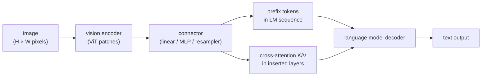
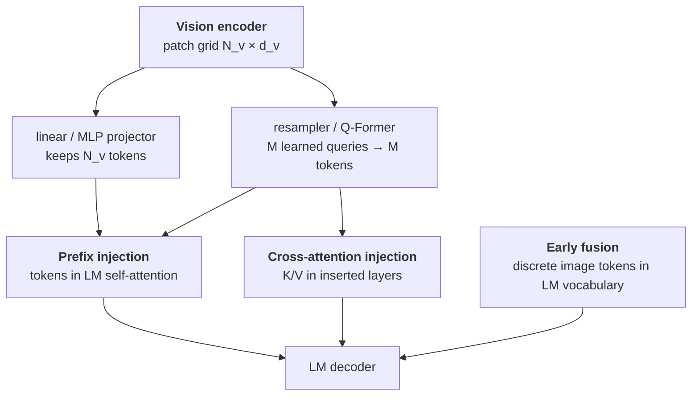

# Vision-Language Module 03 — VLM Architectures

## 00 Why This Module Exists

A vision-language model (VLM) is not "an LLM that can see." It is a vision encoder, a connector, and a language model, joined by a contract about how many visual tokens exist, where they enter the language model, and what they may attend to.
- That contract decides sequence length, KV-cache size, which weights must be trained, and which failure modes are possible.
- Two VLMs with the same language backbone can differ by an order of magnitude in visual tokens per image.


- Legend: ViT: Vision Transformer; K/V: attention keys and values; connector: also called projector or adapter.

This module covers the encoder–connector–LM blueprint, prefix-token injection under causal masks, cross-attention and resampler connectors, and native early-fusion models.
- How images become patch embeddings belongs to [Vision-Language Module 01](../01-vision-representation/README.md); why those embeddings are language-aligned belongs to [Module 02](../02-contrastive-learning/README.md).
- Which components are trained in which stage belongs to [Module 04](../04-multimodal-training/README.md).
- Serving cost of visual tokens (batching, prefix caching, encoder placement) belongs to [Module 07](../07-vlm-serving/README.md) and core [Module 21](../../advanced-ai-engineering/21-multimodal-ai-systems/README.md).

**Research status:** satellite 80/20 revision, 2026-11-26. Formulas are derived in the text. Architecture constants attributed to papers (LLaVA, LLaVA-1.5, Flamingo, BLIP-2, Chameleon) and to the `huggingface/transformers`, `haotian-liu/LLaVA`, and `mlfoundations/open_flamingo` code were written from the cited sources but were **not** re-read against a pinned commit in this revision (`TODO_VERIFY`). Model configurations used in worked examples are illustrative unless attributed. No benchmark results are quoted.

**Module Orientation**

- **Engineering problem:** predict, for a given VLM design, how many tokens and how much memory one image costs, where visual information enters the decoder, and which design choice explains a given failure.
- **What you will do:**
  - count visual tokens and connector parameters by hand;
  - build the attention mask for an interleaved image–text sequence;
  - compare prefix-token and cross-attention designs by KV memory and attention work;
  - break a VLM by changing image resolution or placeholder expansion and diagnose the result.
- **Environment:** Python 3.10+, PyTorch, `transformers`, and one small open VLM checkpoint (for example a LLaVA-style model with a sub-1B or 7B backbone). CPU is enough for counting and mask labs; a single GPU is optional for timing.
- **Evidence rule:** separate source observations (**O**), derivations (**D**), and hypotheses that need measurement (**H**).
- **If You Only Have One Week**: Lessons VL3.1 and VL3.2. They cover the token count and the causal-mask contract, which explain most cost and correctness questions about open VLMs.

## 01 Baseline Assumptions

- Core [Module 01](../../advanced-ai-engineering/01-foundation-model-internals/README.md): decoder blocks, self-attention, causal masks, and parameter counting.
- Core [Module 03](../../advanced-ai-engineering/03-kv-cache-engineering/README.md): per-token KV-cache size.
- [Vision-Language Module 01](../01-vision-representation/README.md): patch embedding and ViT token grids.
- Mathematical prerequisites: matrix shapes, matrix multiplication cost, and the softmax attention formula.

## 02 Target Mastery

```yaml
depth_contract:
  conceptual: REQUIRED
  mechanistic: REQUIRED
  mathematical: REQUIRED
  quantitative: REQUIRED
  implementation: REQUIRED
  source_code: SELECTIVE
  instrumentation: SELECTIVE
  experimental: SELECTIVE
  statistical: NOT_APPLICABLE
  production_reasoning: REQUIRED
  failure_analysis: REQUIRED
  falsification: SELECTIVE
  security: NOT_APPLICABLE
  economics: SELECTIVE
  architecture_tradeoff: REQUIRED
  research_connection: SELECTIVE

estimated_effort:
  instruction: 2h
  guided_practice: 1.25h
  labs: 3h
  assessment: 0.75h
  source_trace: 0.5h
  total: 7.5h
```

The learner must be able to draw any common VLM as encoder, connector, and injection point; compute its visual token count, connector size, and KV cost; build its attention mask; and attribute a failure to the component or contract that caused it.

### LAYER 1: KNOWLEDGE / INSTRUCTIONAL LAYER

## 03 Knowledge Map


- Legend: $N_v$: visual tokens from the encoder; $d_v$: encoder width; $M$: number of learned queries.

Keep three design decisions separate:

1. **Token budget:** how many visual tokens reach the LM ($N_v$, or $M$ after resampling).
2. **Injection point:** prefix tokens inside self-attention, or keys/values in separate cross-attention layers.
3. **Representation:** continuous embeddings from a separate encoder, or discrete tokens from an image tokenizer shared with text.

Most cost and failure questions are answered by naming all three for the model at hand.

## 04 Lessons

### Lesson VL3.1 — The Encoder–Projector–LM Blueprint and the Token Budget

**Engineering Question:**
How many visual tokens does one image become, and where do the parameters of a VLM actually live?

**Concepts & Definitions:**

- **Vision encoder:** usually a ViT pretrained with a contrastive objective (CLIP or SigLIP family). It turns an image into a grid of patch embeddings.
- **Projector (connector):** maps encoder width $d_v$ to LM width $d_t$. LLaVA used a single linear layer; LLaVA-1.5 used a two-layer MLP with GELU (**O**, `TODO_VERIFY`).
- **Language model:** a decoder-only LM that receives projected visual tokens as part of its input sequence.

Visual tokens for a square ViT input:

$$
N_v = \left(\frac{S}{p}\right)^2 \cdot \frac{1}{m^2}
$$

where:

- $N_v$ is the number of visual tokens per image entering the LM;
- $S$ is the encoder input side length in pixels after resizing;
- $p$ is the patch size in pixels;
- $m$ is the spatial merge factor ($m = 1$ means no merging; $m = 2$ merges each $2 \times 2$ block of patches into one token).

Projector parameters (weights plus biases):

$$
P_{\text{linear}} = d_v d_t + d_t, \qquad
P_{\text{MLP}} = (d_v d_t + d_t) + (d_t d_t + d_t)
$$

where $d_v$ is the encoder output width and $d_t$ is the LM hidden width; the MLP's hidden width is taken equal to $d_t$.

*Step-by-step reading.*

1. The encoder cuts the $S \times S$ image into $(S/p)^2$ non-overlapping patches, one token each. A class token, if present, is usually dropped or counted separately.
2. Merging $m \times m$ neighbours divides the count by $m^2$ and multiplies the per-token feature width by $m^2$ before projection.
3. A linear map from $d_v$ to $d_t$ has a $d_v \times d_t$ weight matrix and $d_t$ biases; the second MLP layer adds a $d_t \times d_t$ matrix and $d_t$ biases.

**Mechanism Explanation:**

The projector is tiny relative to the encoder and the LM. The visual token count, not the projector size, drives sequence length and therefore LM compute and KV memory. Raising input resolution raises $N_v$ quadratically.

**Worked Example (LLaVA-1.5-style configuration):**
*Input.* A ViT-L/14 encoder at $S = 336$ with $d_v = 1{,}024$, a 7B-class LM with $d_t = 4{,}096$, a two-layer MLP projector, no merging (**O** for $S$, $p$, and projector type; `TODO_VERIFY`).

*Steps.*
- Patch grid: $336 / 14 = 24$, so $N_v = 24^2 = 576$ tokens per image.
- Linear layer alone: $1{,}024 \times 4{,}096 + 4{,}096 = 4{,}198{,}400$ parameters.
- MLP: $4{,}198{,}400 + 4{,}096 \times 4{,}096 + 4{,}096 = 20{,}979{,}712$, about 21 M.
- With a $2 \times 2$ merge: $N_v = 576 / 4 = 144$.

*Result.* The projector is about 0.3% of a 7B LM. One image adds 576 positions to the LM sequence, as many as a long paragraph of text.

**Knowledge Check:** If the input side rises from 336 to 672 pixels at the same patch size, by what factor does $N_v$ grow, and by what factor does the projector parameter count grow?

**Guided Practice:** Load a small open VLM. Print the parameter count of the vision tower, the projector, and the LM separately, and the shape of the projector input and output. Predict $N_v$ from the processor configuration before running one image through it.

**Feedback Contract:**
- *Expected Evidence*: a three-row parameter table, a hand prediction of $N_v$, and the measured number of image positions in the LM input; prediction and measurement agree, or the gap is explained (class token, tiling, merge).
- *Common Failure*: reading $N_v$ from the encoder's output shape and forgetting that the processor may tile the image into several crops.
- *Diagnostic Hint*: count how many times the image placeholder is expanded in the tokenized input.
- *Concept to Revisit*: Token budget.

**Learning Outcome:** Compute a VLM's visual token budget and parameter distribution from its configuration.

*(Effort: 30m instruction, 20m practice)*

### Lesson VL3.2 — Prefix Tokens, Causal Masks, and KV Cost

**Engineering Question:**
When visual tokens are placed in the LM's input sequence, what can attend to what, and what does each image cost in KV cache?

**Concepts & Definitions:**

- **Prefix injection:** projected visual tokens replace a placeholder token (often `<image>`) in the text sequence. The LM then runs ordinary causal self-attention over the mixed sequence. LLaVA follows this design (**O**).
- **Causal mask:** position $i$ attends to positions $j \le i$. With the image before the question, every text token can attend to every visual token, but visual tokens cannot attend to later text.
- **Positions:** visual tokens consume position indices like text. Some newer models use multi-dimensional rotary positions for images; the simplest designs use 1-D positions (**O**, `TODO_VERIFY`).

Attended pairs under a causal mask and per-token KV size:

$$
A = \frac{L(L+1)}{2}, \qquad
B_{\text{KV}} = 2 \cdot n_{\text{layers}} \cdot n_{\text{kv}} \cdot d_{\text{head}} \cdot s
$$

where:

- $L = N_v + N_t$ is the total sequence length, with $N_t$ text tokens;
- $A$ is the number of (query, key) pairs that a full causal pass scores;
- $B_{\text{KV}}$ is the KV-cache size per token in bytes;
- the factor 2 counts keys and values;
- $n_{\text{layers}}$ is the number of decoder layers, $n_{\text{kv}}$ the number of key/value heads, $d_{\text{head}}$ the head dimension;
- $s$ is bytes per element (2 for fp16/bf16).

*Step-by-step reading.*

1. Row $i$ of a causal mask has $i$ allowed entries (1-indexed), so the total is $1 + 2 + \dots + L = L(L+1)/2$.
2. Every layer stores one key and one value vector per KV head per token, each of $d_{\text{head}}$ elements.

**Mechanism Explanation:**

Because visual tokens sit in the same sequence, they are cached exactly like text tokens and are re-read at every decode step. Within the image block the mask is usually still causal, so patch 1 cannot see patch 2. Text after the image sees the whole image; text before the image sees none of it. Placeholder order is therefore semantic, not cosmetic.

**Worked Example (one image, short question):**
*Input.* $N_v = 576$, $N_t = 50$, an illustrative 7B-class LM with 32 layers, 32 KV heads, $d_{\text{head}} = 128$, bf16.

*Steps.*
- $L = 626$, so $A = 626 \times 627 / 2 = 196{,}251$ pairs per head per layer in prefill.
- Text-to-image pairs: $50 \times 576 = 28{,}800$. Image-to-text pairs: 0.
- $B_{\text{KV}} = 2 \times 32 \times 32 \times 128 \times 2 = 524{,}288$ bytes = 0.5 MiB per token.
- Image KV: $576 \times 0.5 = 288$ MiB; text KV: $25$ MiB.

*Result.* The image is 92% of the KV cache for this request. Grouped-query attention (fewer KV heads) shrinks both terms by the same factor but does not change the ratio.

**Knowledge Check:** A prompt puts the question first and the image second. Which tokens can now use the image during prefill, and why might answer quality drop even though the same tokens are present?

**Guided Practice:** Build the boolean attention mask for the sequence `[text 3][image 4][text 3]` by hand, then print the mask your VLM actually uses. Mark which cells are text→image, image→image, and image→text.

**Feedback Contract:**
- *Expected Evidence*: a $10 \times 10$ lower-triangular mask with $55$ allowed cells, the image→text cells for the last three text tokens all zero, and a confirmation that the model's mask matches or a description of where it differs (for example, bidirectional attention inside the image block).
- *Common Failure*: assuming visual tokens attend bidirectionally because the encoder did; the encoder's attention and the LM's mask are separate.
- *Diagnostic Hint*: inspect the 4-D mask passed into the first decoder layer, not the 2-D padding mask.
- *Concept to Revisit*: Injection point.

**Learning Outcome:** Construct the attention mask and KV ledger for an interleaved image–text sequence.

*(Effort: 30m instruction, 20m practice)*

### Lesson VL3.3 — Cross-Attention and Resampler Connectors

**Engineering Question:**
What does a cross-attention or resampler design buy over prefix tokens, and why did many open VLMs return to simple MLP projectors?

**Concepts & Definitions:**

- **Perceiver Resampler (Flamingo):** a small transformer in which a fixed set of $M$ learned latent queries cross-attends to the encoder's patch features, producing $M$ visual tokens regardless of input size. Flamingo used 64 latents (**O**, `TODO_VERIFY`).
- **Gated cross-attention layers (Flamingo):** new cross-attention blocks inserted between frozen LM layers. Text queries attend to visual keys/values; the output is multiplied by $\tanh(\alpha)$ with $\alpha$ initialized to 0, so the frozen LM is unchanged at the start of training (**O**, `TODO_VERIFY`).
- **Q-Former (BLIP-2):** a transformer with 32 learned queries that extracts a fixed set of visual features from a frozen encoder; its outputs are then projected into the LM input as prefix tokens (**O**, `TODO_VERIFY`).

Attention work for $M$ queries over $N_v$ keys, compared with self-attention over the patches:

$$
W_{\text{xattn}} = M \cdot N_v, \qquad W_{\text{self}} = N_v^2
$$

where $W$ counts query–key score computations per head; $M$ is the number of learned queries; $N_v$ is the number of patch tokens.

KV memory for cross-attention injection, over $n_x$ inserted layers:

$$
B_{\text{xattn}} = 2 \cdot n_x \cdot M \cdot d \cdot s
$$

where $n_x$ is the number of gated cross-attention layers, $d$ is the key/value width per layer (all heads), and $s$ is bytes per element. These K/V are computed once per image and do not grow with generated text.

**Mechanism Explanation:**

Cross-attention keeps visual tokens out of the LM's self-attention sequence, so text length and image count do not compete for the same context window, and visual K/V exist only in $n_x$ layers. The costs are new layers inside the LM, a fixed and lossy $M$-token bottleneck, and more complex training. Commonly cited reasons for the shift to MLP projectors with prefix tokens include simpler training, reuse of unmodified LM code and inference engines, and keeping per-patch detail for OCR and grounding (**H**: these are design rationales, not a single controlled comparison).

**Worked Example (KV memory, prefix versus cross-attention):**
*Input.* Same illustrative LM as Lesson VL3.2 ($d = 32 \times 128 = 4{,}096$, bf16). Prefix design: $N_v = 576$ over 32 layers. Cross-attention design: $M = 64$ latents, cross-attention inserted every 4th layer, so $n_x = 8$.

*Steps.*
- Prefix image KV: 288 MiB (Lesson VL3.2).
- Cross-attention image KV: $2 \times 8 \times 64 \times 4{,}096 \times 2 = 8{,}388{,}608$ bytes = 8 MiB.
- Resampler work: $64 \times 576 = 36{,}864$ scores per head per resampler layer, versus $576^2 = 331{,}776$ for patch self-attention.

*Result.* In this configuration the cross-attention design stores 36 times less visual KV. The prefix design keeps all 576 patch tokens available to every LM layer.

**Knowledge Check:** Why does the $\tanh(\alpha)$ gate initialized at zero matter for a frozen LM, and what would happen at step 0 without it?

**Guided Practice:** For a document image that needs fine text reading, compare the information budget of $M = 64$ resampler tokens with $N_v = 576$ prefix tokens. Then, in an open cross-attention implementation, locate the gate parameter and print its value in a trained checkpoint.

**Feedback Contract:**
- *Expected Evidence*: a short argument that the 64-token bottleneck limits per-patch detail, and the printed gate values (non-zero after training), with the file and class where they live.
- *Common Failure*: treating fewer visual tokens as strictly better; it saves memory but can remove the detail the task needs.
- *Diagnostic Hint*: test both designs on a small OCR-heavy slice before generalizing.
- *Concept to Revisit*: Token budget versus injection point.

**Learning Outcome:** Compare prefix and cross-attention connectors by memory, compute, and information bottleneck.

*(Effort: 35m instruction, 20m practice)*

### Lesson VL3.4 — Native Early Fusion and Token Reduction

**Engineering Question:**
What changes when images become discrete tokens in the LM's own vocabulary, and how do newer designs cut visual tokens without losing detail?

**Concepts & Definitions:**

- **Early fusion with discrete image tokens:** an image tokenizer (a VQ-style model) maps an image to a sequence of codebook indices, which are added to the LM vocabulary. One transformer then models interleaved text and image tokens and can also generate image tokens. Chameleon follows this design, with 1,024 tokens per $512 \times 512$ image from an 8,192-entry codebook (**O**, `TODO_VERIFY`).
- **Token reduction:** merging neighbouring patches ($m \times m$ merge), pooling, or dynamic resolution that varies $N_v$ with image size. Several recent open VLMs merge $2 \times 2$ patches before the LM (**O**, `TODO_VERIFY`).
- **Tiling ("any-resolution"):** split a large image into crops, encode each at the native encoder resolution, and concatenate, often with a downscaled global view. $N_v$ then scales with the number of crops.

Visual tokens under tiling:

$$
N_v^{\text{tiled}} = (c + g) \cdot N_v^{\text{crop}}
$$

where $c$ is the number of crops, $g$ is 1 if a global thumbnail is added and 0 otherwise, and $N_v^{\text{crop}}$ is the per-crop token count from Lesson VL3.1.

**Mechanism Explanation:**

Discrete early fusion makes understanding and generation one sequence-modelling problem, but every image costs its full token count in the shared context, and the tokenizer's reconstruction quality caps visual detail. Continuous-encoder designs cannot generate images directly but can use strong pretrained encoders. Token reduction trades fine spatial detail for shorter sequences; tiling trades the opposite way.

**Worked Example (tiling versus merging):**
*Input.* A $672 \times 672$ image. Per-crop encoder at 336 px with $p = 14$ ($N_v^{\text{crop}} = 576$).

*Steps.*
- Tiling into $2 \times 2$ crops plus a global view: $(4 + 1) \times 576 = 2{,}880$ tokens.
- Same tiling with a $2 \times 2$ merge per crop: $(4 + 1) \times 144 = 720$ tokens.
- Early-fusion tokenizer at $512 \times 512$: 1,024 tokens regardless of content.

*Result.* The same image costs 720 to 2,880 LM positions depending on two configuration flags, a factor of 4.

**Knowledge Check:** A product sends phone screenshots (tall, text-dense) to a VLM with tiling. Which configuration change reduces cost most, and which detail does it risk?

**Guided Practice:** For your VLM's processor, measure $N_v$ for images of $336^2$, $672^2$, and $1344 \times 336$ pixels. Fit the result to the tiling formula and record $c$ and $g$ for each.

**Feedback Contract:**
- *Expected Evidence*: a table of image size, crops, global view, and measured $N_v$, matching $(c + g) \cdot N_v^{\text{crop}}$ exactly or with an explained offset (separator or newline tokens).
- *Common Failure*: estimating cost from the encoder resolution alone and ignoring the crop count.
- *Diagnostic Hint*: count special separator tokens between crops; some processors add one per row.
- *Concept to Revisit*: Token budget.

**Learning Outcome:** Explain the early-fusion trade-off and predict visual token counts under tiling and merging.

*(Effort: 25m instruction, 15m practice)*

## 05 Literature & Production Source Map

**REFERENCE / BASELINE**

- [Visual Instruction Tuning (LLaVA)](https://arxiv.org/abs/2304.08485) — Liu et al. (2023). Reading pointer: architecture section (linear projection of CLIP features into the LM input).
- [Improved Baselines with Visual Instruction Tuning (LLaVA-1.5)](https://arxiv.org/abs/2310.03744) — Liu et al. (2023). Reading pointer: MLP projector and 336 px encoder.
- [Flamingo: a Visual Language Model for Few-Shot Learning](https://arxiv.org/abs/2204.14198) — Alayrac et al. (2022). Reading pointer: Perceiver Resampler and gated cross-attention dense layers.
- [BLIP-2: Bootstrapping Language-Image Pre-training with Frozen Image Encoders and Large Language Models](https://arxiv.org/abs/2301.12597) — Li et al. (2023). Reading pointer: Q-Former and its learned queries.

**WORKLOAD-DEPENDENT / FRONTIER**

- [Chameleon: Mixed-Modal Early-Fusion Foundation Models](https://arxiv.org/abs/2405.09818) — Chameleon Team (2024). Discrete image tokens in a shared vocabulary; author-reported training stability measures.
- Dynamic-resolution and token-merging designs in recent open VLMs (for example the Qwen2-VL report, [arXiv 2409.12191](https://arxiv.org/abs/2409.12191)). Scope any token-count claim to the exact processor configuration (`TODO_VERIFY`).

**CURRENT DEFAULT** (for open VLMs, as a design baseline, not a survey): a contrastively pretrained ViT, an MLP projector, prefix-token injection into a decoder-only LM, with tiling or merging to control $N_v$.

**LEGACY / INSUFFICIENT:** describing a VLM only by its LM size; quoting "one image" as a cost unit without $N_v$; assuming visual tokens are free because the encoder is small.

**PRODUCTION SOURCE TRACE** (pin the commit you read; no commit was pinned in this revision, `TODO_VERIFY`)

- `huggingface/transformers`, file `src/transformers/models/llava/modeling_llava.py`:
  - `LlavaMultiModalProjector`: the two-layer MLP projector.
  - `get_image_features` and the forward pass: selection of encoder layer outputs and replacement of image placeholder positions with projected features.
- `haotian-liu/LLaVA`, file `llava/model/multimodal_projector/builder.py`: `build_vision_projector` and the `mlp2x_gelu` option.
- `mlfoundations/open_flamingo`, file `open_flamingo/src/helpers.py`: `PerceiverResampler` and `GatedCrossAttentionBlock` (look for the tanh-gated residual).
- Scope: reference implementations of three designs, not a description of any closed model.

### LAYER 2: ENGINEERING PRACTICE LAYER

## 06 Engineering Labs

All labs follow `PREDICT → BUILD → MEASURE → EXPLAIN → BREAK → IMPROVE → FALSIFY`.

### LAB A — Token and Memory Ledger Across Three Designs

- **Objective:** for one image and one question, compute and then measure visual tokens, connector parameters, prefill attention pairs, and KV memory for a prefix-MLP VLM; compute the same ledger for a resampler/cross-attention design and an early-fusion design.
- **Pre-Registered Hypothesis:** for the prefix design, measured image positions and KV growth match the hand ledger exactly; visual tokens dominate KV for prompts under about 500 text tokens.
- **Independent Variables:** image resolution, tiling on/off, merge factor, text length.
- **Dependent Variables:** $N_v$, sequence length, peak memory during prefill, KV bytes, prefill time (illustrative on your hardware).
- **Break & Falsify:** raise resolution until the sequence exceeds the context window; send several images in one prompt.
- **Alignment:** Lessons VL3.1, VL3.2, VL3.4.
- **Effort Estimate:** 1.5h.

### LAB B — Mask and Placeholder Audit

- **Objective:** verify the attention mask and placeholder expansion for interleaved image–text inputs, then break them deliberately.
- **Pre-Registered Hypothesis:** moving the image after the question degrades answers on image-dependent questions while leaving token counts unchanged; a placeholder/feature count mismatch either raises an error or silently misaligns features, depending on the implementation.
- **Independent Variables:** image position in the prompt, number of placeholders versus images, processor version.
- **Dependent Variables:** mask cells (text→image, image→text), raised errors, answer correctness on 20 image-dependent questions.
- **Break & Falsify:** duplicate a placeholder, remove one, use a tokenizer whose placeholder ID differs from the model config.
- **Alignment:** Lessons VL3.2, VL3.3, and Incident VL3.1.
- **Effort Estimate:** 1.5h.

**Runnable arithmetic check (CPU; not a quality experiment):**
```python
assert 336 // 14 == 24 and 24 * 24 == 576                 # patch tokens
assert (24 // 2) ** 2 == 144                               # 2x2 merge
lin = 1024 * 4096 + 4096
assert lin == 4_198_400
mlp = lin + 4096 * 4096 + 4096
assert mlp == 20_979_712                                   # ~21 M params
L = 576 + 50
assert L * (L + 1) // 2 == 196_251                         # causal pairs
assert 50 * 576 == 28_800                                  # text->image pairs
kv = 2 * 32 * 32 * 128 * 2
assert kv == 524_288                                       # 0.5 MiB per token
assert 576 * kv == 288 * 2**20                             # image KV
assert 2 * 8 * 64 * 4096 * 2 == 8 * 2**20                  # cross-attn KV
assert 64 * 576 == 36_864 and 576 ** 2 == 331_776
assert (4 + 1) * 576 == 2_880 and (4 + 1) * 144 == 720     # tiling
assert (448 // 14) ** 2 == 1_024                           # 448 px encoder
assert abs(1024 / 576 - 1.7778) < 1e-3
mask = [[1 if j <= i else 0 for j in range(10)] for i in range(10)]
assert sum(map(sum, mask)) == 55
```

## 07 Break / Incident Scenarios

### Incident VL3.1 — Higher-Resolution Encoder, Worse Answers and OOM

**Incident Symptoms:**
A team swaps the 336 px vision tower for a 448 px variant of the same family to improve small-text reading, reusing the existing projector and LM. Batch-8 inference now runs out of memory, long prompts lose the end of the user's question, and answers on charts become less accurate, not more. No error is logged for most requests.

**Diagnostic Protocol (Task):**
1. **Form Competing Hypotheses:** visual token growth ($24^2 \to 32^2$ patches), context truncation of trailing text, projector trained on a different encoder's feature distribution, position handling for a longer image block, processor and model configs out of sync, or a genuine data shift.
2. **Identify Missing Evidence:** $N_v$ per request before and after, total sequence length versus context limit, truncation counts, KV bytes per request, projector training provenance, processor and model config versions.
3. **Design Discriminating Measurements:** run 50 fixed requests through both towers; log $N_v$, truncation, and peak memory; then hold resolution fixed and swap only the projector, and vice versa.
4. **Rank Explanations:** $N_v$ grows by $1{,}024 / 576 = 1.78\times$, which accounts for memory and truncation; accuracy loss that persists without truncation points to the untrained projector.
5. **Intervene:** retrain or re-align the projector for the new encoder, add a merge or reduce tiling to restore the token budget, and enforce a truncation policy that never cuts the question.
6. **Remeasure:** memory at batch 8, truncation rate, and accuracy on the chart slice, compared with the 336 px baseline.

### LAYER 3: MASTERY / ASSESSMENT LAYER

## 08 Mastery Assessment

### Transfer Problem — Choose a Connector for a Document-QA Product

A product answers questions about scanned forms (dense small text) and photos (coarse content) under a fixed per-request memory budget and a 4k-token context.

**Required Deliverables:**
1. an encoder–connector–injection diagram for two candidate designs (prefix MLP with tiling, and resampler or merge-based);
2. a hand ledger of $N_v$, connector parameters, attention pairs, and KV bytes for a form and a photo under each design;
3. LAB B evidence of the correct mask and placeholder expansion for the chosen design;
4. a stated hypothesis about which design loses small-text accuracy, and the measurement that would falsify it;
5. a recommendation with the configuration flags (resolution, tiling, merge) and the rollback condition.

## 09 Required Evidence & Rubric

### Required Artifact: VLM Architecture Sheet

Submit the design diagrams, the LAB A ledger (predicted versus measured), the LAB B mask audit, and the Incident VL3.1 diagnosis.

### Rubric Dimensions

- **Mechanism:** *Insufficient* says "the LLM sees the image." *Competent* names encoder, connector, and injection point. *Strong* predicts mask and position behavior and verifies it in code.
- **Quantitative:** *Insufficient* quotes model size. *Competent* computes $N_v$ and KV bytes. *Strong* reconciles predicted and measured ledgers, including tiling and separators.
- **Trade-off:** *Insufficient* prefers the newest design. *Competent* compares memory and detail. *Strong* ties the choice to the workload and names a falsifying measurement.

## 10 Capability Traceability Matrix

| Capability | Taught | Practiced | Assessed | Evidence (artifact reviewers open) |
|---|---|---|---|---|
| Token budget and parameter distribution | VL3.1 | VL3.1 Guided Practice; LAB A | Deliverables 1, 2; Incident VL3.1 | LAB A ledger, parameter table |
| Prefix injection and causal mask | VL3.2 | VL3.2 Guided Practice; LAB B | Deliverable 3 | LAB B mask printout and placeholder audit |
| Cross-attention and resamplers | VL3.3 | VL3.3 Guided Practice; LAB A | Deliverables 1, 4 | KV comparison and gate inspection |
| Early fusion, tiling, merging | VL3.4 | VL3.4 Guided Practice; LAB A | Deliverables 2, 5; Incident VL3.1 | Tiling table fitted to $(c + g) \cdot N_v^{\text{crop}}$ |

## 11 Exit Criteria & Module Wrap-Up

### Exit Criteria

A learner passes when they can draw any common VLM as encoder, connector, and injection point; compute its visual token count and KV cost by hand and match the measurement; build its attention mask; and diagnose a resolution or placeholder change down to the component responsible.

### Module Wrap-Up (Final Mental Model Reconstruction)

A VLM's behaviour is set by three choices: how many visual tokens, where they enter, and what they are made of. Count the tokens before estimating cost, print the mask before trusting the prompt order, and treat every encoder or resolution change as a new contract for the connector.

### Cost & Telemetry Hook

- [Lesson 22.1](../../advanced-ai-engineering/22-ai-economics/README.md): price a request by visual tokens plus text tokens, not by "images"; tiling can multiply cost by the crop count.
- [Lesson 23.1](../../advanced-ai-engineering/23-observability-reliability/README.md): emit $N_v$, crop count, sequence length, and truncation per request so Incident VL3.1 is visible in telemetry.

## 12 Competency Targets

```yaml
competency:
  sfia: 4
  bloom: Apply -> Analyze
  solo: Relational
  dreyfus: Advanced Beginner -> Competent
```
