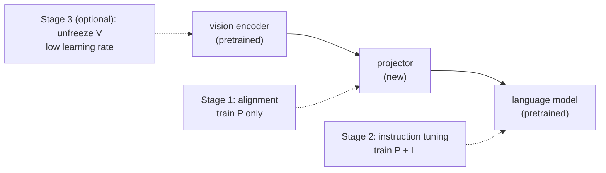
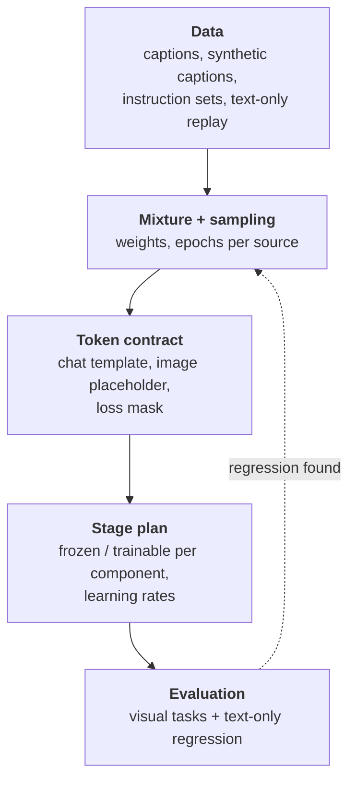

# Vision-Language Module 04 — Multimodal Training

## 00 Why This Module Exists

A vision-language model (VLM) is usually not trained from scratch. It is assembled from a pretrained vision encoder and a pretrained language model, then joined by a small projector and trained in stages.
- Each stage decides which parameters move, which tokens carry loss, and which data the model sees.
- Those three choices, not the architecture diagram, decide whether the model learns to see without forgetting how to write.


- Legend: dotted arrows mark which component each stage starts updating.

This module covers staged training, loss masking and token accounting, data mixtures including synthetic captions, and catastrophic forgetting.
- Patch and token counts come from [VL Module 01](../01-vision-representation/README.md).
- Contrastive pretraining of the vision encoder belongs to [VL Module 02](../02-contrastive-learning/README.md).
- Projector and cross-attention architectures belong to [VL Module 03](../03-vlm-architectures/README.md).
- Measuring the result, including hallucination, belongs to [VL Module 06](../06-vlm-evaluation/README.md).
- General fine-tuning methods (SFT, LoRA, DPO) are taught in core [Module 19](../../advanced-ai-engineering/19-model-adaptation/README.md).

**Research status:** satellite 80/20 revision, 2026-11-26. Formulas below are derived in the text. Dataset sizes, stage recipes, and code locations attributed to the LLaVA, LLaVA-1.5, ShareGPT4V, and Prismatic papers or to the `haotian-liu/LLaVA` repository were written from those sources but were **not** re-read against a pinned version in this revision (`TODO_VERIFY`). No benchmark numbers are quoted. All accuracy and timing values in worked examples are illustrative.

**Module Orientation**

- **Engineering problem:** add visual ability to a language model at a known compute and memory cost, without an unmeasured loss of text ability.
- **What you will do:**
  - count trainable parameters, optimizer memory, and training FLOPs per stage;
  - audit which tokens carry loss in an instruction sample;
  - design and sweep a data mixture with a text-only share;
  - measure language regression as a paired difference with an interval.
- **Environment:** Python 3.10+, PyTorch, a small open LLM (≤ 1B parameters) and a small pretrained vision encoder, one GPU or a Colab GPU. Labs may replay supplied training logs on CPU; a replay demonstrates analysis, not a model-quality result.
- **Evidence rule:** separate source observations (**O**), derivations (**D**), and hypotheses that need measurement (**H**).
- **If You Only Have One Week**: Lessons VL4.1 and VL4.4. They cover what each stage costs and what it can break; the loss-masking and mixture lessons refine those two.

## 01 Baseline Assumptions

- Core [Module 00](../../advanced-ai-engineering/00-scientific-ai-engineering/README.md): paired comparisons, uncertainty, and the observation/derivation/hypothesis split.
- Core [Module 01](../../advanced-ai-engineering/01-foundation-model-internals/README.md): parameter and FLOP accounting for decoder models.
- [VL Module 01](../01-vision-representation/README.md) and [VL Module 03](../03-vlm-architectures/README.md): visual token counts and the encoder–projector–LM pipeline.
- Mathematical prerequisites: cross-entropy, matrix shapes, sums and proportions, and a standard error.

## 02 Target Mastery

```yaml
depth_contract:
  conceptual: REQUIRED
  mechanistic: REQUIRED
  mathematical: SELECTIVE
  quantitative: REQUIRED
  implementation: SELECTIVE
  source_code: SELECTIVE
  instrumentation: SELECTIVE
  experimental: REQUIRED
  statistical: SELECTIVE
  production_reasoning: REQUIRED
  failure_analysis: REQUIRED
  falsification: SELECTIVE
  security: NOT_APPLICABLE
  economics: SELECTIVE
  architecture_tradeoff: REQUIRED
  research_connection: SELECTIVE

estimated_effort:
  instruction: 2h
  guided_practice: 1.25h
  labs: 3h
  assessment: 0.75h
  source_trace: 0.5h
  total: 7.5h
```

The learner must be able to state what each training stage updates and costs, show which tokens carry loss, design a data mixture with an explicit text-only share, and defend a recipe with a measured language-regression interval.

### LAYER 1: KNOWLEDGE / INSTRUCTIONAL LAYER

## 03 Knowledge Map


- Legend: the dotted arrow is the usual repair path: change the mixture before changing the architecture.

Keep three questions separate:

1. **Which parameters move?** (stage plan, memory, optimizer state)
2. **Which tokens teach?** (loss mask, supervised-token share)
3. **Which distribution is learned?** (mixture weights, synthetic data, text-only replay)

A recipe that changes all three at once cannot explain its own result.

## 04 Lessons

### Lesson VL4.1 — Staged Training: What Moves and What It Costs

**Engineering Question:**
For each stage, how many parameters are trained, how much memory does that need, and how much compute does a training token cost?

**Concepts & Definitions:**

- **Stage 1, feature alignment:** vision encoder and LLM frozen; only the projector trains, usually on image–caption pairs. In LLaVA-1.5 this is a two-layer MLP projector trained on about 558K caption pairs (**O**, `TODO_VERIFY`).
- **Stage 2, visual instruction tuning:** projector and LLM train on conversational and question-answer data; the vision encoder usually stays frozen. LLaVA-1.5 uses a mixture of about 665K samples (**O**, `TODO_VERIFY`).
- **Stage 3, unfreezing the encoder:** some recipes also update the vision encoder, typically with a smaller learning rate, to improve fine detail such as text in images.

Approximate training memory for weights and optimizer state with mixed-precision Adam:

$$
M \approx 2\,P_{\text{frozen}} + 16\,P_{\text{train}} \quad \text{(bytes)}
$$

where:

- $P_{\text{frozen}}$ is the number of frozen parameters, stored once in 16-bit (2 bytes each);
- $P_{\text{train}}$ is the number of trainable parameters, each needing a 16-bit weight (2), a 16-bit gradient (2), a 32-bit master copy (4), and two 32-bit Adam moments (8): 16 bytes;
- activations are excluded; they depend on batch size, sequence length, and checkpointing.

Approximate training FLOPs per token for a decoder of $N$ parameters:

$$
C_{\text{token}} \approx
\begin{cases}
6N & \text{all decoder weights trained} \\
4N & \text{decoder frozen, but a module before it is trained}
\end{cases}
$$

*Step-by-step reading.*

1. The forward pass costs about $2N$ FLOPs per token (one multiply and one add per weight).
2. The backward pass has two parts, each about $2N$: gradients with respect to activations, and gradients with respect to weights.
3. When the LLM is frozen but the projector before it trains, the loss gradient must still travel back *through* the LLM to reach the projector. The activation-gradient part ($2N$) is still paid; only the weight-gradient part is skipped. So $2N + 2N = 4N$.
4. If nothing before the LLM were trainable, backward through the LLM could be skipped entirely; that is not the case in stage 1.

**Mechanism Explanation:**

Stage 1 is cheap in *memory* because few parameters carry optimizer state, but not cheap in *compute*: every token still costs about two-thirds of full training. Staging exists mainly to protect the pretrained components while the randomly initialized projector learns a usable mapping; a random projector feeding gradients into an unfrozen LLM can damage it early. Some later studies report that the separate alignment stage can be shortened or skipped for some recipes (**O**, author-reported, Prismatic; `TODO_VERIFY`). Treat staging as a hypothesis to test, not a law.

**Worked Example (LLaVA-1.5-like 7B):**
*Input.* Vision encoder with output width 1,024 and about 0.3B parameters, LLM hidden size 4,096 and about 7B parameters, projector = Linear(1,024→4,096), GELU, Linear(4,096→4,096), both with bias.

*Steps.*
- Projector parameters: $1{,}024 \times 4{,}096 + 4{,}096 + 4{,}096 \times 4{,}096 + 4{,}096 = 20{,}979{,}712 \approx 21$M.
- Stage 1 memory: $2 \times 7.3\text{B} + 16 \times 0.021\text{B} = 14.6 + 0.34 \approx 14.9$ GB.
- Stage 2 memory (LLM + projector trained): $2 \times 0.3\text{B} + 16 \times 7.021\text{B} = 0.6 + 112.3 \approx 112.9$ GB, which is why stage 2 needs sharded optimizers (core Module 26) or adapters (core Module 19).
- Stage 1 compute: about 558K samples × 640 tokens (576 image + ~64 text) $\approx 3.57 \times 10^8$ tokens. $4 \times 7 \times 10^9 \times 3.57 \times 10^8 \approx 1.0 \times 10^{19}$ FLOPs, ignoring the frozen encoder's forward pass.

*Result.* Stage 1 needs about 1/7.6 of stage 2's weight-and-optimizer memory, but each token costs 4N rather than 6N, so its compute per token is two-thirds of full training.

**Knowledge Check:** Why does freezing the LLM in stage 1 not reduce per-token compute to the forward-pass cost $2N$?

**Guided Practice:** For your lab model pair, compute $P_{\text{train}}$, $M$, and $C_{\text{token}}$ for: projector only; projector + LoRA on the LLM (rank 16 on attention projections); projector + full LLM. Then measure peak GPU memory for one step of each at a fixed batch and compare with your estimate.

**Feedback Contract:**
- *Expected Evidence*: a table of predicted and measured peak memory per configuration; the gap is explained by activations, which you also estimate.
- *Common Failure*: counting only trainable parameters and forgetting that frozen weights still occupy memory and still cost forward and activation-gradient compute.
- *Diagnostic Hint*: print `sum(p.numel() for p in model.parameters() if p.requires_grad)` per component before launching any run.
- *Concept to Revisit*: Stage plan.

**Learning Outcome:** Predict per-stage trainable parameters, memory, and compute, and justify a stage plan from those numbers.

*(Effort: 35m instruction, 20m practice)*

### Lesson VL4.2 — The Token Contract: Templates, Image Placeholders, and Loss Masks

**Engineering Question:**
In one training sample, which tokens produce gradient, and how much of the sequence is that?

**Concepts & Definitions:**

- **Chat template:** the exact string format with role markers that the LLM was trained on. A VLM inserts an image placeholder that is replaced by the projector's output vectors.
- **Loss mask:** a per-token flag. Masked positions get a label of `-100`, which PyTorch's cross-entropy ignores by default (**O**). Image positions, system prompts, and user turns are usually masked; assistant answers are not.
- **Supervised-token share:**

$$
s = \frac{n_{\text{answer}}}{n_{\text{image}} + n_{\text{prompt}} + n_{\text{answer}}}
$$

where:

- $n_{\text{image}}$ is the number of visual tokens inserted for the image(s);
- $n_{\text{prompt}}$ is the number of system and user text tokens, including template markers;
- $n_{\text{answer}}$ is the number of assistant tokens that carry loss.

**Mechanism Explanation:**

Every token in the sequence costs compute, but only answer tokens teach. Short-answer VQA data therefore buys little gradient per FLOP, and a template mismatch can silently put loss on the wrong tokens: on user text (the model learns to imitate questions) or on nothing at all (the sample contributes zero gradient). Averaging loss per token across a batch also weights long answers more than short ones, so the mixture by sample count is not the mixture by gradient.

**Worked Example (supervised share):**
*Input.* A 336 × 336 image with patch size 14, one user question of 40 tokens including template markers, and an assistant answer of 60 tokens.

*Steps.*
- Visual tokens: $(336/14)^2 = 24^2 = 576$ ([VL Module 01](../01-vision-representation/README.md)).
- Sequence length: $576 + 40 + 60 = 676$.
- Supervised share: $s = 60 / 676 = 8.9\%$.
- A one-word VQA answer (say 2 tokens including the end marker): $s = 2 / 618 = 0.32\%$.

*Result.* The VQA sample costs about 91% as much compute as the conversational one but carries about 1/30 of the supervised tokens.

**Knowledge Check:** A batch mixes one conversational sample (60 answer tokens) and one VQA sample (2 answer tokens). With per-token averaging over the batch, what fraction of the loss comes from the VQA sample?

**Guided Practice:** Take 20 samples from an instruction dataset and run them through your training collator. For each, print the decoded tokens that carry loss, $n_{\text{image}}$, $n_{\text{prompt}}$, $n_{\text{answer}}$, and $s$. Then deliberately use the wrong chat template and repeat.

**Feedback Contract:**
- *Expected Evidence*: a per-sample table; with the correct template only assistant text is decoded from loss-carrying positions; with the wrong template the learner shows exactly which tokens moved into or out of the mask.
- *Common Failure*: trusting the dataset's role field without decoding the masked tensor.
- *Diagnostic Hint*: decode `input_ids[labels != -100]` for one sample before any training run.
- *Concept to Revisit*: Token contract.

**Learning Outcome:** Audit a loss mask and compute the supervised-token share per sample and per batch.

*(Effort: 25m instruction, 20m practice)*

### Lesson VL4.3 — Data Mixtures, Synthetic Captions, and Sampling

**Engineering Question:**
How do mixture weights decide what the model is trained on, and when does synthetic data help or mislead?

**Concepts & Definitions:**

- **Data sources:** web image–text pairs (noisy, short alt-text), synthetic dense captions written by a stronger captioning model, instruction datasets (conversations, VQA, OCR, grounding), and text-only instruction data.
- **Synthetic captioning:** ShareGPT4V reports collecting about 100K detailed captions from a proprietary VLM, training a captioner on them, and using it to caption about 1.2M images (**O**, author-reported, `TODO_VERIFY`). The caption model's errors and style become training targets.
- **Temperature sampling:** a common rule for drawing from sources of very different sizes:

$$
p_i = \frac{n_i^{\alpha}}{\sum_j n_j^{\alpha}}
$$

where:

- $p_i$ is the probability that the next sample comes from source $i$;
- $n_i$ is the number of samples (or tokens) in source $i$;
- $\alpha \in [0, 1]$ controls flattening: $\alpha = 1$ is proportional sampling, $\alpha = 0$ is uniform over sources.

*Step-by-step reading.*

1. With $\alpha = 1$, $p_i = n_i / \sum_j n_j$: each sample in the pool is equally likely.
2. With $\alpha < 1$, large sources are shrunk more than small ones (because $n^{\alpha}$ grows slower than $n$), so small sources are up-sampled.
3. Up-sampling a small source means repeating it: its effective epochs are $p_i \cdot S / n_i$ for a total of $S$ drawn samples.

**Mechanism Explanation:**

Mixture weights are hyperparameters with large effects and are rarely ablated one at a time. Repeating a small, high-quality source many times can overfit its style; flattening too much can starve the main capability. Synthetic captions raise caption detail but can import the teacher's hallucinations, and if the teacher saw your evaluation images, the mixture is contaminated (core [Module 08](../../advanced-ai-engineering/08-ai-data-engineering/README.md)).

**Worked Example (sampling and repetition):**
*Input.* Three sources: captions 600K, visual instructions 300K, text-only instructions 100K. Training draws $S = 1{,}000{,}000$ samples.

*Steps.*
- $\alpha = 1$: $p = (0.600, 0.300, 0.100)$. Text-only epochs: $0.1 \times 10^6 / 10^5 = 1.0$.
- $\alpha = 0.5$: $\sqrt{n} = (774.6, 547.7, 316.2)$, sum $1{,}638.5$, so $p = (0.473, 0.334, 0.193)$.
- Text-only epochs at $\alpha = 0.5$: $0.193 \times 10^6 / 10^5 = 1.93$. Caption epochs: $0.473 \times 10^6 / 6 \times 10^5 = 0.79$.

*Result.* Flattening nearly doubles the text-only share and the number of times each text-only sample is seen, while captions are no longer seen once each.

**Knowledge Check:** A source is repeated 8 times under your mixture. What evidence would show whether that repetition helps or overfits?

**Guided Practice:** Write the mixture for your lab as a table: source, size, $\alpha$, $p_i$, epochs, mean answer tokens, and supervised-token share by source (from Lesson VL4.2). Mark which sources are synthetic and which model generated them.

**Feedback Contract:**
- *Expected Evidence*: a mixture table whose probabilities sum to 1, with effective epochs and the share of *supervised tokens* (not samples) per source.
- *Common Failure*: reporting mixture by sample count when the loss is averaged per token.
- *Diagnostic Hint*: multiply $p_i$ by mean answer tokens per source; the result is the gradient share.
- *Concept to Revisit*: Data mixtures; contamination (core Module 08).

**Learning Outcome:** Design a mixture table with sampling probabilities, effective epochs, and gradient share, and name the risks of each synthetic source.

*(Effort: 30m instruction, 20m practice)*

### Lesson VL4.4 — Catastrophic Forgetting and Text-Only Replay

**Engineering Question:**
How much text ability did multimodal training cost, with what uncertainty, and what mixture change reduces it?

**Concepts & Definitions:**

- **Catastrophic forgetting:** loss of previously learned capability when training on a new distribution. For VLMs it shows up as weaker text-only instruction following, reasoning, or safety behavior.
- **Text-only replay:** keeping a share $r$ of text-only data in the mixture. There is no universal correct $r$; it must be measured for the model, data, and stage (**H**).
- **Paired regression on a fixed item set:** evaluate base and trained model on the same $n$ items. Let $b$ be items the base got right and the new model wrong, and $c$ the reverse. Then:

$$
\Delta = \frac{c - b}{n}, \qquad
SE(\Delta) \approx \frac{1}{n}\sqrt{b + c - \frac{(b - c)^2}{n}}
$$

where:

- $\Delta$ is the change in accuracy (negative means regression);
- $n$ is the number of evaluation items;
- $b$ and $c$ are the discordant counts defined above; items both models got right or both got wrong do not change $\Delta$.

*Step-by-step reading.*

1. Accuracy change is (new correct − base correct)/$n$. Items both models agree on cancel, leaving $(c - b)/n$.
2. Per item, the paired difference is $+1$, $-1$, or $0$. Its variance is $\frac{b + c}{n} - \Delta^2$; dividing by $n$ and taking the square root gives the standard error above.
3. An approximate 95% interval is $\Delta \pm 1.96\,SE$. Pairing removes item difficulty from the variance, so it is much tighter than comparing two independent accuracies.

**Mechanism Explanation:**

Stage 2 shifts the LLM toward short, image-conditioned answers. Without replay, text-only prompts become out-of-distribution for the tuned model. Unfreezing the vision encoder adds a second forgetting risk: its features drift away from what the encoder learned contrastively ([VL Module 02](../02-contrastive-learning/README.md)), which is why it gets a lower learning rate. LoRA reduces but does not remove forgetting (core [Module 19](../../advanced-ai-engineering/19-model-adaptation/README.md)).

**Worked Example (illustrative regression interval):**
*Input.* 500 text-only items. Base model correct on 310 (62.0%). After stage 2, $b = 60$ items lost and $c = 25$ items gained.

*Steps.*
- New correct: $310 - 60 + 25 = 275$ (55.0%). $\Delta = (25 - 60)/500 = -0.070$.
- $SE = \frac{1}{500}\sqrt{85 - 35^2/500} = \frac{1}{500}\sqrt{82.55} = 0.0182$.
- 95% interval: $-0.070 \pm 0.036 = [-0.106, -0.034]$.

*Result.* The regression is clearly non-zero on this item set. Whether 7 points is acceptable is a product decision; whether a replay share fixes it is the next experiment.

**Knowledge Check:** Why can an increase in a visual benchmark and a decrease in text-only accuracy both be real effects of the same run, and why does a single combined average hide this?

**Guided Practice:** Using LAB B outputs (or the supplied replay logs), compute $\Delta$ and its 95% interval for each text-only share $r$. Plot $\Delta$ against $r$ next to a visual-task metric.

**Feedback Contract:**
- *Expected Evidence*: a two-curve plot (text regression and visual gain against $r$) with paired intervals, and a stated choice of $r$ with the criterion used.
- *Common Failure*: comparing to the base model on a different item sample, or treating overlapping unpaired intervals as "no regression."
- *Diagnostic Hint*: save per-item correctness for both models; $b$ and $c$ come straight from that table.
- *Concept to Revisit*: Paired comparison (core Module 00).

**Learning Outcome:** Measure forgetting as a paired difference with an interval and choose a replay share from a measured trade-off curve.

*(Effort: 30m instruction, 15m practice)*

## 05 Literature & Production Source Map

**REFERENCE / BASELINE**

- [Visual Instruction Tuning (LLaVA)](https://arxiv.org/abs/2304.08485) — Liu et al. (2023). Reading pointer: the two-stage training procedure and the generated instruction data.
- [Improved Baselines with Visual Instruction Tuning (LLaVA-1.5)](https://arxiv.org/abs/2310.03744) — Liu et al. (2023). Reading pointer: MLP projector, data mixture, and the stage recipe.
- [BLIP-2](https://arxiv.org/abs/2301.12597) — Li et al. (2023). Reading pointer: frozen encoder and frozen LLM joined by a trained query transformer; a different bridge with the same "freeze the expensive parts" idea.

**WORKLOAD-DEPENDENT / FRONTIER**

- [ShareGPT4V](https://arxiv.org/abs/2311.12793) — Chen et al. (2023). Synthetic dense captions; author-reported gains, scoped to their models and benchmarks.
- [Prismatic VLMs](https://arxiv.org/abs/2402.07865) — Karamcheti et al. (2024). A controlled study of VLM design choices, including whether the separate alignment stage is needed. Author-reported; scope to their setup.
- [Cambrian-1](https://arxiv.org/abs/2406.16860) — Tong et al. (2024). Data-mixture and vision-encoder studies; author-reported.

**CURRENT DEFAULT** (the module's recommended baseline, not a survey of industry practice): a pinned chat template, decoded loss-mask audit, a mixture table with explicit text-only share, and paired text-only regression reported with every visual gain.

**LEGACY / INSUFFICIENT:** reporting only visual benchmarks; mixtures stated by sample count; unaudited synthetic captions; "we kept some text data" without a share or a measured effect.

**PRODUCTION SOURCE TRACE** (pin the commit you read; no commit was pinned in this revision)

- `haotian-liu/LLaVA`:
  - `llava/train/train.py`: the preprocessing functions that build conversations from the template and set masked labels to `IGNORE_INDEX` (Lesson VL4.2).
  - `llava/model/multimodal_projector/builder.py`: projector construction, including the `mlp2x_gelu` option (Lesson VL4.1).
  - `scripts/v1_5/pretrain.sh` and `scripts/v1_5/finetune.sh`: which components are frozen per stage and the learning rates used.
- Scope: one reference implementation. Other training stacks build masks and freeze modules differently; trace yours the same way.

### LAYER 2: ENGINEERING PRACTICE LAYER

## 06 Engineering Labs

All labs follow `PREDICT → BUILD → MEASURE → EXPLAIN → BREAK → IMPROVE → FALSIFY`.

### LAB A — Stage Plan Ablation on a Small VLM

- **Hardware:** one GPU (Colab is enough) for a ≤1B LLM with a small vision encoder; or CPU replay of supplied logs, which demonstrates analysis only.
- **Objective:** compare projector-only, projector + LoRA, and projector + full LLM on a fixed small caption + instruction set.
- **Pre-Registered Hypothesis:** projector-only training reaches a usable caption loss but lags on instruction following; full LLM training gains most on visual tasks and loses most on text-only items.
- **Independent Variables:** trainable components, learning rate per component, presence of a stage-1 warm-up.
- **Dependent Variables:** predicted vs measured peak memory, step time, validation loss on captions and on instructions, a small visual QA accuracy, and text-only paired $\Delta$.
- **Break & Falsify:** skip stage 1 with a randomly initialized projector and a high LLM learning rate; check whether early loss spikes and text regression grow.
- **Alignment:** Lessons VL4.1, VL4.2, and Incident VL4.1.
- **Effort Estimate:** 1.75h.

### LAB B — Text-Only Replay Sweep

- **Objective:** measure the trade-off between visual gain and text regression as the text-only share $r$ changes.
- **Pre-Registered Hypothesis:** text regression shrinks as $r$ rises from 0% to about 25%, with little visual cost at small $r$; reject if paired intervals do not support a monotone trend.
- **Independent Variables:** $r \in \{0, 5, 10, 25\}\%$ with total training tokens held fixed.
- **Dependent Variables:** visual task metric, text-only paired $\Delta$ with 95% interval, supervised-token share by source.
- **Break & Falsify:** use a text-only source that overlaps the text evaluation items; show how the measured "regression" disappears for the wrong reason.
- **Alignment:** Lessons VL4.3 and VL4.4.
- **Effort Estimate:** 1.25h.

**Runnable arithmetic check (CPU; not a quality experiment):**
```python
import math
proj = 1024 * 4096 + 4096 + 4096 * 4096 + 4096
assert proj == 20_979_712
stage1_gb = (2 * 7.3e9 + 16 * proj) / 1e9
stage2_gb = (2 * 0.3e9 + 16 * (7e9 + proj)) / 1e9
assert round(stage1_gb, 1) == 14.9 and round(stage2_gb, 1) == 112.9
assert math.isclose(4 * 7e9 * 558_000 * 640, 1.0e19, rel_tol=0.01)
assert (336 // 14) ** 2 == 576
assert round(60 / (576 + 40 + 60), 3) == 0.089
n = [600_000, 300_000, 100_000]
w = [x ** 0.5 for x in n]
p = [x / sum(w) for x in w]
assert [round(x, 3) for x in p] == [0.473, 0.334, 0.193]
assert round(p[2] * 1_000_000 / n[2], 2) == 1.93
b, c, items = 60, 25, 500
delta = (c - b) / items
se = math.sqrt(b + c - (b - c) ** 2 / items) / items
assert delta == -0.07 and round(se, 4) == 0.0182
assert [round(delta - 1.96 * se, 3), round(delta + 1.96 * se, 3)] == [-0.106, -0.034]
```

## 07 Break / Incident Scenarios

### Incident VL4.1 — Better VQA, Worse Assistant

**Incident Symptoms:**
A new VLM checkpoint improves internal visual QA accuracy by a large margin. After release, users report that text-only chats got terse, the model sometimes says "In the image…" when no image was sent, and it answers some safety-relevant text prompts it used to decline. The training run changed the mixture, unfroze the vision encoder, and updated the chat template.

**Diagnostic Protocol (Task):**
1. **Form Competing Hypotheses:** no or reduced text-only replay; template change moved loss onto the wrong tokens; short-answer VQA dominating the gradient share; evaluation contamination inflating VQA; encoder unfreezing; the old model's safety data missing from the new mixture.
2. **Identify Missing Evidence:** mixture tables (by samples and by supervised tokens) for both runs, decoded loss masks under both templates, per-item text-only results for both checkpoints, overlap between training images and the VQA evaluation set.
3. **Design Discriminating Measurements:** retrain or replay one factor at a time on a small model: template only, mixture only, encoder unfreeze only; compute paired $\Delta$ on text-only and safety items for each.
4. **Rank Explanations:** keep the explanations whose single-factor change reproduces the regression; treat the VQA gain as unproven until the contamination check is done.
5. **Intervene:** restore the template, add text-only and safety replay at a measured share, or keep the encoder frozen if it does not pay for itself.
6. **Remeasure:** visual metrics, text-only and safety paired $\Delta$ with intervals, and a no-image prompt set, all against the previous release.

### LAYER 3: MASTERY / ASSESSMENT LAYER

## 08 Mastery Assessment

### Transfer Problem — Adding Document Vision to a Production Assistant

A team has a production text assistant (7B) and wants it to read screenshots and scanned forms. Text quality must not regress beyond a declared margin.

**Required Deliverables:**
1. a stage plan with trainable components, learning rates, predicted memory, and compute per stage;
2. a decoded loss-mask audit for each data source;
3. a mixture table with sampling rule, effective epochs, supervised-token share, and synthetic-data provenance;
4. a contamination check against the visual and text evaluation sets;
5. a replay sweep with paired text-only and safety $\Delta$ and intervals, and the chosen share;
6. a release recommendation that states the regression margin and rollback condition.

## 09 Required Evidence & Rubric

### Required Artifact: Training Recipe Card

Submit the stage plan, mask audit, mixture table, LAB A and LAB B results, the Incident VL4.1 diagnosis, and the release recommendation.

### Rubric Dimensions

- **Mechanism:** *Insufficient* says "fine-tune on image data." *Competent* states what each stage freezes and which tokens carry loss. *Strong* predicts how each choice moves memory, compute, and forgetting before measuring.
- **Quantitative:** *Insufficient* quotes recipe sizes. *Competent* computes parameters, memory, FLOPs, and supervised-token shares. *Strong* reconciles predictions with measured memory and step time.
- **Evaluation:** *Insufficient* reports visual metrics only. *Competent* adds text-only results. *Strong* reports paired intervals, safety items, and a contamination check.
- **Decision:** *Insufficient* picks the best visual score. *Competent* states a trade-off. *Strong* sets a regression margin in advance and defends the recipe against it.

## 10 Capability Traceability Matrix

| Capability | Taught | Practiced | Assessed | Evidence (artifact reviewers open) |
|---|---|---|---|---|
| Stage plan cost accounting | VL4.1 | VL4.1 Guided Practice; LAB A | Deliverable 1 | Predicted vs measured memory and step-time table |
| Loss-mask audit | VL4.2 | VL4.2 Guided Practice; LAB A | Deliverable 2; Incident VL4.1 step 2 | Decoded loss-carrying tokens per source |
| Mixture design and synthetic data | VL4.3 | VL4.3 Guided Practice; LAB B | Deliverables 3, 4 | Mixture table with gradient share and provenance |
| Forgetting measurement | VL4.4 | VL4.4 Guided Practice; LAB B | Deliverables 5, 6; Incident VL4.1 steps 3–6 | Replay curve with paired intervals |

## 11 Exit Criteria & Module Wrap-Up

### Exit Criteria

A learner passes when they can predict per-stage memory and compute, prove which tokens carry loss, express a mixture as gradient share with effective epochs, measure text-only regression as a paired interval, and choose a replay share from a measured curve.

### Module Wrap-Up (Final Mental Model Reconstruction)

Multimodal training is three decisions: which parameters move, which tokens teach, and which distribution is learned. Change one at a time, decode the mask before training, and never report a visual gain without the paired text-only cost.

### Cost & Telemetry Hook

- [Lesson 22.1](../../advanced-ai-engineering/22-ai-economics/README.md): training cost per stage from the $4N$/$6N$ token model, plus the encoder forward pass and repeated epochs of small sources.
- [Lesson 23.1](../../advanced-ai-engineering/23-observability-reliability/README.md): log mixture version, template version, frozen-component set, and per-source supervised tokens with every checkpoint, so Incident VL4.1 can be traced from metadata.

## 12 Competency Targets

```yaml
competency:
  sfia: 4
  bloom: Apply -> Evaluate
  solo: Relational
  dreyfus: Advanced Beginner -> Competent
```
