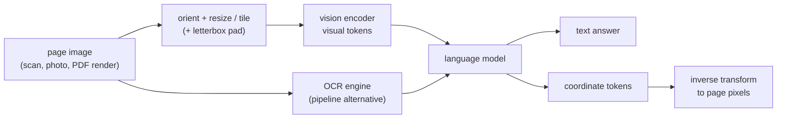
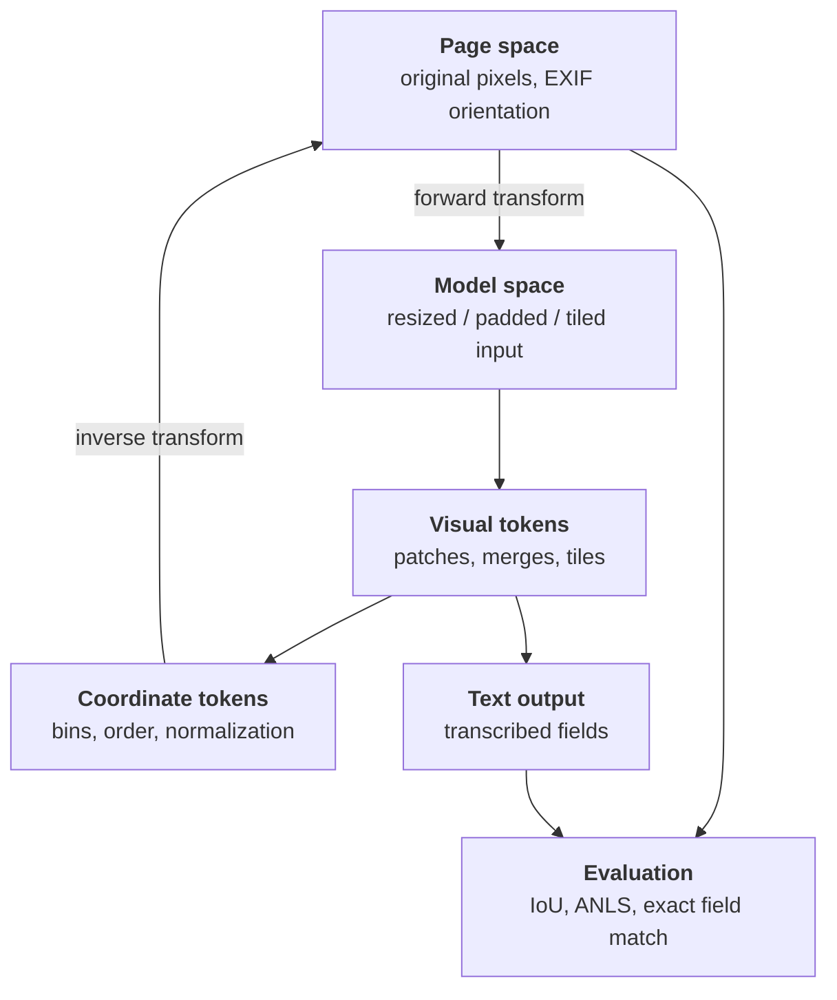

# Vision-Language Module 05 — Grounding, Documents, OCR

## 00 Why This Module Exists

A VLM that "reads a receipt" or "points at the signature box" is doing two things a chat demo hides.
- It must see glyphs that are only a few pixels tall after the image is resized for the encoder.
- It must emit spatial coordinates as text tokens, and the caller must map those tokens back through every resize, pad, and rotation that happened before the model saw the image.

Either step can fail while the output still looks fluent: a plausible but invented invoice number, or a box that is drawn 40 px below the line it names.


- Legend: letterbox pad: padding added to keep aspect ratio inside a fixed square input; OCR: optical character recognition.

This module covers coordinates as tokens, grounding evaluation, high-resolution document inputs, and the choice between OCR-free models and OCR pipelines.
- How images become patch tokens belongs to [Vision-Language Module 01](../01-vision-representation/README.md).
- Projector and resampler designs belong to [Vision-Language Module 03](../03-vlm-architectures/README.md).
- Benchmark design and judging belong to [Vision-Language Module 06](../06-vlm-evaluation/README.md); serving cost of many visual tokens belongs to [Vision-Language Module 07](../07-vlm-serving/README.md).
- Document ingestion lineage belongs to core [Module 08](../../advanced-ai-engineering/08-ai-data-engineering/README.md), and retrieval over parsed documents to core [Module 10](../../advanced-ai-engineering/10-advanced-rag/README.md).

**Research status:** satellite 80/20 revision, 2026-11-26. Formulas below are derived in the text. Coordinate conventions, token counts, and metric definitions attributed to papers or to model code (PaliGemma, Qwen2-VL / Qwen2.5-VL, LLaVA-NeXT, Pix2Seq, DocVQA) were written from the cited sources but were **not** re-read against a pinned commit or paper revision in this revision (`TODO_VERIFY`). No benchmark numbers are quoted. All timings and document measurements in worked examples are illustrative.

**Module Orientation**

- **Engineering problem:** extract text and locations from documents and images with known error bounds, and map every coordinate back to the original page exactly.
- **What you will do:**
  - quantize and dequantize coordinates by hand and bound the error;
  - invert resize and letterbox transforms and catch the classic offset bugs;
  - compute IoU and grounding accuracy, and see why thin text boxes are fragile;
  - count visual tokens for a page under downscale, tiling, and native-resolution schemes;
  - compare an OCR pipeline with an OCR-free VLM on the same documents.
- **Environment:** Python 3.10+, Pillow, NumPy, one OCR engine (for example Tesseract or PaddleOCR), one open VLM with grounding output, and CPU or a single small GPU. A set of 30–50 documents with field-level ground truth and boxes: receipts, forms, a table, and phone photos.
- **Evidence rule:** separate source observations (**O**), derivations (**D**), and hypotheses that need measurement (**H**).
- **If You Only Have One Week**: Lessons VL5.1 and VL5.3. Coordinate round-trips and pixel budgets cause most production grounding and document failures.

## 01 Baseline Assumptions

- [Vision-Language Module 01](../01-vision-representation/README.md): patches, patch size, and image-to-token counts.
- [Vision-Language Module 03](../03-vlm-architectures/README.md): how visual tokens enter the language model.
- Core [Module 00](../../advanced-ai-engineering/00-scientific-ai-engineering/README.md): paired comparisons and the observation/derivation/hypothesis split.
- Mathematical prerequisites: affine transforms (scale and translate), floor/rounding, areas of rectangles, and edit distance.

## 02 Target Mastery

```yaml
depth_contract:
  conceptual: REQUIRED
  mechanistic: REQUIRED
  mathematical: REQUIRED
  quantitative: REQUIRED
  implementation: REQUIRED
  source_code: SELECTIVE
  instrumentation: SELECTIVE
  experimental: REQUIRED
  statistical: SELECTIVE
  production_reasoning: REQUIRED
  failure_analysis: REQUIRED
  falsification: SELECTIVE
  security: SELECTIVE
  economics: SELECTIVE
  architecture_tradeoff: REQUIRED
  research_connection: SELECTIVE

estimated_effort:
  instruction: 2h
  guided_practice: 1.25h
  labs: 3h
  assessment: 0.75h
  source_trace: 0.5h
  total: 7.5h
```

The learner must be able to state a model's coordinate contract, round-trip any box between model space and page space, predict whether text will be legible at a given input resolution, count the visual tokens that costs, and choose between OCR pipeline and OCR-free extraction with evidence.

### LAYER 1: KNOWLEDGE / INSTRUCTIONAL LAYER

## 03 Knowledge Map


- Legend: IoU: intersection over union; ANLS: average normalized Levenshtein similarity.

Keep three contracts separate:

1. **Geometry contract:** orientation handling, resize rule, padding, tiling, and the exact inverse transform.
2. **Coordinate contract:** coordinate order (`x` first or `y` first), normalization range, number of bins, and box format (corners or center plus size).
3. **Text contract:** what counts as a correct field: exact match after normalization, or a tolerance such as ANLS.

A grounding or document system is reproducible only when all three are written down and tested.

## 04 Lessons

### Lesson VL5.1 — Coordinates as Tokens and the Inverse Transform

**Engineering Question:**
How does a language model emit a box, and how exactly do you turn its tokens back into page pixels?

**Concepts & Definitions:**

- **Quantized coordinates:** a continuous position is normalized to $[0, 1)$ and mapped to one of $N$ bins. Each bin is either a dedicated vocabulary token or a number written as text.
  - PaliGemma uses 1,024 location tokens, written `<loc0000>`–`<loc1023>`, in the order `ymin, xmin, ymax, xmax` (**O**, `TODO_VERIFY`).
  - Qwen2-VL writes integer coordinates normalized to $[0, 1000)$ in `(x, y)` order; Qwen2.5-VL switches to absolute pixel coordinates in the resized image (**O**, `TODO_VERIFY`).
  - Pix2Seq introduced discretized coordinates as tokens for detection (**O**).
- **Forward transform:** orientation fix, then resize (scale $s$), then padding $(p_x, p_y)$.
- **Inverse transform:** undo padding, then undo scale, then undo orientation. A model coordinate is meaningless without it.

Quantization and dequantization for one axis:

$$
q = \min\!\left(N - 1,\ \left\lfloor \frac{c}{S} N \right\rfloor\right), \qquad
\hat c = \frac{q + 0.5}{N} S, \qquad
|c - \hat c| \le \frac{S}{2N}
$$

where:

- $c$ is the coordinate in pixels along the axis, with $0 \le c \le S$;
- $S$ is the axis length in pixels (width for $x$, height for $y$) of the space being normalized;
- $N$ is the number of bins;
- $q$ is the bin index the model emits;
- $\hat c$ is the dequantized coordinate at the bin center.

*Step-by-step reading.*

1. $c/S$ normalizes to $[0, 1]$; multiplying by $N$ and taking the floor picks a bin. The $\min$ keeps $c = S$ inside the last bin.
2. Each bin spans $S/N$ pixels. Returning the bin center puts the reconstruction at most half a bin away from any point in that bin, which gives the error bound.

Letterbox inverse for $x$ (the $y$ case is symmetric):

$$
x_{\text{page}} = \frac{x_{\text{model}} - p_x}{s}
$$

where $x_{\text{model}}$ is the coordinate in the padded model input, $p_x$ is the left padding in pixels, and $s$ is the resize scale (model pixels per page pixel).

**Mechanism Explanation:**

The model only learns the coordinate contract it was trained on. If the caller assumes `x, y` order for a `y, x` model, every box is transposed. If the caller divides by the page size instead of the padded input size, or forgets the padding, every box is shifted or stretched. None of these produce an error message.

**Break cases:**
- `x`/`y` order swapped;
- normalizing by page size when the model normalized by padded input size;
- forgetting letterbox padding;
- phone photos whose EXIF orientation is applied by one library and ignored by another, so the model sees a rotated page.

**Worked Example (bin error):**
*Input.* A receipt 3,000 px tall, $N = 1{,}024$ bins.

*Steps.*
- Bin height: $3{,}000 / 1{,}024 = 2.93$ px.
- Worst-case dequantization error: $2.93 / 2 = 1.46$ px.
- With $N = 2{,}048$: worst case $0.73$ px.

*Result.* Quantization alone is rarely the problem for document boxes; the transform bugs below are tens or hundreds of pixels.

**Worked Example (letterbox inverse):**
*Input.* A portrait page 1,000 × 1,500 px (W × H) letterboxed into a 1,024 × 1,024 input. The model returns $x_{\text{model}} = 512$.

*Steps.*
- Scale: $s = 1{,}024 / 1{,}500 = 0.6827$ (the long side fits).
- Resized width: $1{,}000 \times 0.6827 = 682.7 \to 683$ px.
- Left padding: $p_x = \lfloor (1{,}024 - 683) / 2 \rfloor = 170$ px.
- Correct inverse: $(512 - 170) / 0.6827 = 501.0$ px.
- Forgetting the padding: $512 / 0.6827 = 750.0$ px, a 249 px error.

*Result.* A correct-looking box lands a quarter of the page to the right. The fix is to log $s$, $p_x$, $p_y$ for every request.

**Knowledge Check:** A model normalizes coordinates by the padded $1{,}024 \times 1{,}024$ input, and the caller divides by the original page width and height instead. For the portrait page above, which axis is wrong, and is the error a shift, a stretch, or both?

**Guided Practice:** Write `forward(box_page) -> box_model` and `inverse(box_model) -> box_page` for resize plus letterbox plus quantization. Round-trip 1,000 random boxes on portrait, landscape, and square pages and report the maximum error per axis.

**Feedback Contract:**
- *Expected Evidence*: maximum round-trip error no larger than $s^{-1} \cdot S_{\text{model}} / (2N)$ plus one pixel of rounding on each axis, for all three aspect ratios.
- *Common Failure*: testing only square images, where padding is zero and the padding bug cannot appear.
- *Diagnostic Hint*: draw the round-tripped boxes on the page; a constant offset on one axis means padding, a proportional drift means the wrong normalizer.
- *Concept to Revisit*: Geometry contract; Coordinate contract.

**Learning Outcome:** State a model's coordinate contract and implement an exact, tested inverse transform.

*(Effort: 35m instruction, 25m practice)*

### Lesson VL5.2 — Grounding Evaluation: IoU and Why Text Boxes Are Fragile

**Engineering Question:**
When is a predicted box "correct," and which box shapes make the threshold unforgiving?

**Concepts & Definitions:**

- **Referring expression comprehension (REC):** given an image and a phrase ("the total amount"), return the box of the referred region. A common score is accuracy at IoU $\ge 0.5$ (**O**, convention from REC benchmarks such as RefCOCO, `TODO_VERIFY` for each benchmark's exact rule).
- **Intersection over union:**

$$
\text{IoU}(A, B) = \frac{|A \cap B|}{|A| + |B| - |A \cap B|}
$$

where:

- $A$ and $B$ are axis-aligned boxes $[x_1, y_1, x_2, y_2]$ in the same coordinate space;
- $|A|$ is the area $(x_2 - x_1)(y_2 - y_1)$;
- $|A \cap B|$ is the overlap area, $\max(0, \min(x_2^A, x_2^B) - \max(x_1^A, x_1^B))$ times the same expression for $y$.

*Step-by-step reading.*

1. Compute the overlap on each axis separately; a negative overlap means no intersection, clipped to 0.
2. Union is the sum of the two areas minus the overlap, which is counted twice otherwise.
3. IoU is 1 for identical boxes and 0 for disjoint ones.

**Mechanism Explanation:**

For a vertical shift $\delta$ of a box with height $h$ (and no other error), the overlap height is $h - \delta$, so

$$
\text{IoU} = \frac{h - \delta}{h + \delta} \quad (0 \le \delta \le h)
$$

which falls below 0.5 once $\delta > h/3$ (**D**). A text line 60 px tall fails at a 21 px shift; a 600 px figure tolerates 200 px. Grounding metrics therefore punish exactly the thin boxes that document tasks care about.

**Worked Example (thin box shift):**
*Input.* Ground truth $[100, 200, 300, 260]$ (a 200 × 60 px text line). Prediction shifted down by 40 px: $[100, 240, 300, 300]$.

*Steps.*
- Each area: $200 \times 60 = 12{,}000$.
- Overlap: $x$: $200$; $y$: $\min(260, 300) - \max(200, 240) = 20$. Overlap area $4{,}000$.
- Union: $12{,}000 + 12{,}000 - 4{,}000 = 20{,}000$.
- IoU $= 4{,}000 / 20{,}000 = 0.20$. Check with the shift formula: $(60 - 40)/(60 + 40) = 0.20$.

*Result.* A 40 px error, invisible on a full-page thumbnail, fails the IoU 0.5 test.

**Knowledge Check:** Why can a model's aggregate REC accuracy rise while its accuracy on single text lines falls?

**Guided Practice:** Compute IoU for your round-tripped boxes from Lesson VL5.1 after injecting a 10 px vertical shift. Report IoU separately for boxes shorter than 50 px and taller than 200 px.

**Feedback Contract:**
- *Expected Evidence*: a two-row table where short boxes lose far more IoU than tall boxes for the same shift, matching $(h - \delta)/(h + \delta)$.
- *Common Failure*: computing IoU with one box in model space and the other in page space.
- *Diagnostic Hint*: assert that both boxes lie within the same image bounds before computing IoU.
- *Concept to Revisit*: Coordinate contract.

**Learning Outcome:** Compute IoU, predict its sensitivity to box shape, and report grounding accuracy by box-size slice.

*(Effort: 25m instruction, 15m practice)*

### Lesson VL5.3 — Pixel Budgets: Legibility Versus Visual Tokens

**Engineering Question:**
How many pixels does a glyph need, and how many visual tokens does it cost to give a full page that many pixels?

**Concepts & Definitions:**

- **Fixed-resolution input:** the whole page is resized to one square size, for example 336 px, then cut into patches.
- **Tiling (any-resolution):** the page is split into tiles at the encoder's native size, plus a downscaled global view. LLaVA-NeXT's "AnyRes" is one such scheme (**O**, `TODO_VERIFY`).
- **Native dynamic resolution with patch merging:** the page is kept near its own size and aspect ratio, cut into patches, and adjacent patches are merged. Qwen2-VL uses 14 px patches merged $2 \times 2$, so one language-model token covers 28 × 28 px (**O**, `TODO_VERIFY`).

Visual token count for native resolution with merge:

$$
N_{\text{tok}} = \left\lceil \frac{H}{p\,m} \right\rceil \cdot \left\lceil \frac{W}{p\,m} \right\rceil
$$

where:

- $H$ and $W$ are the image height and width in pixels after any resize;
- $p$ is the patch size in pixels;
- $m$ is the merge factor per side (1 means no merge).

For tiling with $t$ tiles of $T_{\text{tile}}$ tokens each plus one global view: $N_{\text{tok}} = (t + 1)\,T_{\text{tile}}$.

**Mechanism Explanation:**

Legibility depends on glyph height in input pixels, not on the page's original resolution. Downscaling a full page to a small square makes body text a few pixels tall, and no amount of language-model capacity recovers characters that are not in the pixels. Raising resolution restores glyphs but multiplies visual tokens, which raises prefill time, KV memory, and cost (see [Vision-Language Module 07](../07-vlm-serving/README.md)).

**Worked Example (A4 page, three input schemes):**
*Input.* An A4 page scanned at 200 dpi: $1{,}654 \times 2{,}339$ px (W × H). Body text is 10 pt; assume an x-height of about half the point size, i.e. 5 pt $= 1.76$ mm $\approx 13.9$ px at 200 dpi (illustrative typography assumption).

*Steps.*
- **Fixed 336 px:** scale $336 / 2{,}339 = 0.144$. X-height $13.9 \times 0.144 = 2.0$ px. With 14 px patches, $(336/14)^2 = 576$ tokens.
- **Tiling, 2 × 2 grid of 336 px tiles plus a global view:** effective long side 672 px, scale $0.287$, x-height $4.0$ px. Tokens $(4 + 1) \times 576 = 2{,}880$.
- **Native resolution, $p = 14$, $m = 2$:** x-height stays 13.9 px. Tokens $\lceil 1{,}654/28 \rceil \cdot \lceil 2{,}339/28 \rceil = 60 \times 84 = 5{,}040$.

*Result.* Only the native-resolution input keeps body text at a size a reader would call legible, at almost nine times the tokens of the fixed input. A ten-page contract at native resolution is about 50,000 visual tokens before any text.

**Knowledge Check:** A form has 6 pt footnotes that matter legally. Which knob would you change first: tile count, DPI of the PDF render, or the model? Justify with an x-height calculation.

**Guided Practice:** Render one PDF page at 72, 150, and 300 dpi. For each, compute the token count under your VLM's preprocessing and ask the VLM to transcribe one paragraph. Record character error rate against the PDF text layer.

**Feedback Contract:**
- *Expected Evidence*: a table of DPI, x-height in input pixels, visual tokens, and CER, showing CER collapse once x-height drops below a few pixels.
- *Common Failure*: reporting the PDF's DPI instead of the pixels the model actually received after its own resize.
- *Diagnostic Hint*: save the exact tensor the processor produced and view it as an image; if you cannot read it, neither can the model.
- *Concept to Revisit*: Geometry contract; visual token count.

**Learning Outcome:** Predict legibility and visual-token cost for a document under fixed, tiled, and native-resolution inputs.

*(Effort: 35m instruction, 20m practice)*

### Lesson VL5.4 — OCR Pipelines Versus OCR-Free Models

**Engineering Question:**
Under which conditions should a document system read text with an OCR engine first, and when should a VLM read the pixels directly?

**Concepts & Definitions:**

- **OCR pipeline:** OCR engine (text plus word boxes) → optional layout model → language model over the text. Every extracted string can be traced to a box on the page.
- **OCR-free model:** an image encoder and text decoder trained to output the target text or structure directly. Donut and Pix2Struct are early examples (**O**); general VLMs now do this as one of many tasks.
- **ANLS:** the DocVQA metric. For each question, take the best similarity over accepted answers, where similarity is $1 - \text{NL}$ if the normalized Levenshtein distance NL is below a threshold $\tau = 0.5$, and 0 otherwise; average over questions (**O**, `TODO_VERIFY`).

$$
\text{ANLS} = \frac{1}{Q} \sum_{i=1}^{Q} \max_{j} \; s(a_{ij}, o_i), \qquad
s = \begin{cases} 1 - \text{NL}(a_{ij}, o_i) & \text{NL} < \tau \\ 0 & \text{otherwise} \end{cases}
$$

where:

- $Q$ is the number of questions;
- $a_{ij}$ is the $j$-th accepted answer for question $i$ and $o_i$ is the model output;
- $\text{NL}(a, o)$ is the Levenshtein distance divided by $\max(|a|, |o|)$;
- $\tau$ is the threshold, 0.5 in DocVQA.

**Mechanism Explanation:**

The two designs fail differently.
- An OCR pipeline compounds errors: a misread character stays wrong downstream, but the error is visible and locatable.
- An OCR-free model can produce a fluent string that is not on the page at all, with no box to check it against.

ANLS gives partial credit to near-misses, which suits open-ended reading but not fields such as invoice numbers or amounts, where one wrong character is a wrong answer. Production extraction usually needs exact match after a declared normalization, plus a provenance check that the value appears on the page.

**Worked Example (ANLS versus exact match):**
*Input.* Accepted answer `INV-20481` (9 characters).

*Steps.*
- Output `INV-2048I`: distance 1, NL $= 1/9 = 0.111$, $s = 0.889$. Exact match: 0.
- Output `20481`: distance 4, NL $= 4/9 = 0.444$, $s = 0.556$. Exact match: 0.
- Output `INV-20481`: $s = 1$, exact match: 1.

*Result.* Two wrong invoice numbers average ANLS 0.72 and exact match 0.

**Worked Example (error compounding, illustrative):**
*Input.* An OCR engine with a 2% per-character error rate, a 10-character field, errors assumed independent.
- Probability the field is read perfectly: $0.98^{10} = 0.817$.

*Result.* A per-character rate that sounds excellent loses almost one field in five. Real errors cluster (smudges, fonts), so measure field accuracy directly.

**Knowledge Check:** Name one document type where you would expect an OCR-free VLM to beat a pipeline, and one where you would expect the reverse. State the mechanism, not a benchmark.

**Guided Practice:** For 10 documents, extract three fields with both an OCR pipeline and a VLM. For every VLM answer, check whether the string occurs in the OCR text or inside a crop of the VLM's own returned box.

**Feedback Contract:**
- *Expected Evidence*: per-field exact match for both systems, ANLS for both, and a count of VLM answers with no on-page support.
- *Common Failure*: scoring with ANLS only and calling a near-miss correct.
- *Diagnostic Hint*: sort disagreements by field type; numbers and IDs usually reveal the difference first.
- *Concept to Revisit*: Text contract.

**Learning Outcome:** Choose and defend a pipeline or OCR-free design with field-level, provenance-checked evidence.

*(Effort: 25m instruction, 15m practice)*

## 05 Literature & Production Source Map

**REFERENCE / BASELINE**

- [Pix2seq: A Language Modeling Framework for Object Detection](https://arxiv.org/abs/2109.10852) — Chen et al. (2021). Reading pointer: coordinate discretization into tokens.
- [OCR-free Document Understanding Transformer (Donut)](https://arxiv.org/abs/2111.15664) — Kim et al. (2022).
- [Pix2Struct: Screenshot Parsing as Pretraining for Visual Language Understanding](https://arxiv.org/abs/2210.03347) — Lee et al. (2023). Reading pointer: variable-resolution input.
- [DocVQA: A Dataset for VQA on Document Images](https://arxiv.org/abs/2007.00398) — Mathew et al. (2021). Reading pointer: ANLS definition and threshold.

**WORKLOAD-DEPENDENT / FRONTIER** (scope any author-reported gains to their benchmarks)

- [PaliGemma](https://arxiv.org/abs/2407.07726) — Beyer et al. (2024). Location tokens for detection and segmentation.
- [Qwen2-VL](https://arxiv.org/abs/2409.12191) — Wang et al. (2024). Native dynamic resolution and patch merging.
- LLaVA-NeXT "AnyRes" tiling (LLaVA project release notes, 2024). `TODO_VERIFY`: confirm tile grids and token counts from the release you use.
- [Nougat: Neural Optical Understanding for Academic Documents](https://arxiv.org/abs/2308.13418) — Blecher et al. (2023). OCR-free PDF-to-markup for scientific papers.

**CURRENT DEFAULT:** a written geometry and coordinate contract with a tested inverse transform; resolution chosen from a legibility calculation; exact-match field scoring with on-page provenance for business fields; an OCR pipeline kept as a baseline.

**LEGACY / INSUFFICIENT:** testing grounding only on square images; reporting ANLS alone for ID or amount fields; downscaling full pages to a small square and blaming the model for misreads; trusting VLM text with no box or OCR support.

**SECURITY NOTE:** text inside documents reaches the language model as instructions-looking content. Treat extracted text as untrusted input (prompt injection through a scanned page is possible); see core [Module 18](../../advanced-ai-engineering/18-ai-security/README.md).

**PRODUCTION SOURCE TRACE** (pin the commit you read; no commit was pinned in this revision)

- `QwenLM/Qwen2.5-VL`, package `qwen-vl-utils`: the `smart_resize` function that rounds image sides to multiples of the merged patch size and bounds total pixels (`TODO_VERIFY` exact name and location).
- `huggingface/transformers`, the PaliGemma processor: how location tokens are added to the tokenizer and parsed (`TODO_VERIFY` file path at your pinned version).
- `clovaai/donut`: the decoder's task prompt and output-structure parsing.
- Scope: reference implementations of each model's contract, not a universal convention.

### LAYER 2: ENGINEERING PRACTICE LAYER

## 06 Engineering Labs

All labs follow `PREDICT → BUILD → MEASURE → EXPLAIN → BREAK → IMPROVE → FALSIFY`.

### LAB A — Coordinate Round-Trip and Grounding Audit

- **Objective:** implement the full geometry and coordinate contract for one grounding VLM, prove the round-trip, then measure grounding accuracy by box size.
- **Pre-Registered Hypothesis:** with a correct inverse transform, grounding failures concentrate in boxes shorter than about 50 px; with any one transform bug injected, accuracy drops on all non-square pages but not on square ones.
- **Independent Variables:** page aspect ratio, EXIF orientation, coordinate order, normalizer (page versus padded input), box height.
- **Dependent Variables:** round-trip error per axis, IoU per box, accuracy at IoU $\ge 0.5$ by box-height slice.
- **Break & Falsify:** swap `x`/`y`, drop the padding term, ignore EXIF rotation, and evaluate on square pages only to show the bug hiding.
- **Alignment:** Lessons VL5.1 and VL5.2; Incident VL5.1.
- **Effort Estimate:** 1.5h.

### LAB B — Pipeline Versus OCR-Free Under a Token Budget

- **Objective:** compare an OCR pipeline and an OCR-free VLM on field extraction across input resolutions, with cost and provenance.
- **Pre-Registered Hypothesis:** the VLM matches or beats the pipeline on layout-heavy fields at native resolution but falls below it at low resolution, and a measurable share of its wrong answers has no on-page support.
- **Independent Variables:** system (pipeline, VLM), render DPI or VLM resolution setting, document type.
- **Dependent Variables:** exact field match, ANLS, unsupported-answer rate, visual tokens per page, wall time per page on your hardware.
- **Break & Falsify:** blurred phone photos, rotated scans, a table that spans two pages, and a page containing an instruction-like sentence.
- **Alignment:** Lessons VL5.3 and VL5.4.
- **Effort Estimate:** 1.5h.

**Runnable arithmetic check (CPU; not a quality experiment):**
```python
import math

def quant(c, S, N):
    return min(N - 1, math.floor(c / S * N))

def dequant(q, S, N):
    return (q + 0.5) / N * S

assert math.isclose(3000 / 1024 / 2, 1.46484375)                  # bin error bound
assert abs(dequant(quant(1234.0, 3000, 1024), 3000, 1024) - 1234.0) <= 3000 / 2048

s = 1024 / 1500
pad_x = (1024 - round(1000 * s)) // 2
assert pad_x == 170
assert round((512 - pad_x) / s, 1) == 501.0                       # correct inverse
assert round(512 / s, 1) == 750.0                                 # padding forgotten

def iou(a, b):
    ix = max(0, min(a[2], b[2]) - max(a[0], b[0]))
    iy = max(0, min(a[3], b[3]) - max(a[1], b[1]))
    inter = ix * iy
    area = lambda r: (r[2] - r[0]) * (r[3] - r[1])
    return inter / (area(a) + area(b) - inter)

assert math.isclose(iou([100, 200, 300, 260], [100, 240, 300, 300]), 0.2)
assert math.isclose((60 - 40) / (60 + 40), 0.2)                   # shift formula

assert (336 // 14) ** 2 == 576 and (4 + 1) * 576 == 2880
assert math.ceil(1654 / 28) * math.ceil(2339 / 28) == 5040

def lev(a, b):
    prev = list(range(len(b) + 1))
    for i, ca in enumerate(a, 1):
        cur = [i]
        for j, cb in enumerate(b, 1):
            cur.append(min(prev[j] + 1, cur[j - 1] + 1, prev[j - 1] + (ca != cb)))
        prev = cur
    return prev[-1]

def anls_one(ans, out, tau=0.5):
    nl = lev(ans, out) / max(len(ans), len(out))
    return 1 - nl if nl < tau else 0.0

assert math.isclose(anls_one("INV-20481", "INV-2048I"), 8 / 9)
assert math.isclose(anls_one("INV-20481", "20481"), 5 / 9)
assert round(0.98 ** 10, 3) == 0.817
print("OK")
```

## 07 Break / Incident Scenarios

### Incident VL5.1 — Highlights Drift on Mobile Uploads

**Incident Symptoms:**
An expense app highlights the total and the merchant name on uploaded receipts. After a preprocessing refactor, desktop scans look correct, but on phone photos the highlight sits below or beside the right text, and about one in ten extracted totals does not appear anywhere on the receipt. The model version is unchanged.

**Diagnostic Protocol (Task):**
1. **Form Competing Hypotheses:** missing letterbox term in the inverse, wrong normalizer, `x`/`y` order swap, EXIF orientation applied in preprocessing but not in the viewer (or the reverse), reduced input resolution after the refactor, or a real shift in receipt types.
2. **Identify Missing Evidence:** per-request original size, EXIF orientation tag, scale, padding, model-input size, raw coordinate tokens, and the processed input tensor.
3. **Design Discriminating Measurements:** replay 50 phone receipts through the old and new preprocessing; diff transforms field by field; round-trip a synthetic box through both paths.
4. **Rank Explanations:** a constant offset on one axis implicates padding; a 90° pattern implicates orientation; invented totals that track lower input resolution implicate the pixel budget (Lesson VL5.3), not geometry.
5. **Intervene:** fix the inverse transform and orientation handling in one shared function; restore the input resolution; reject extracted totals that fail an on-page provenance check.
6. **Remeasure:** IoU by box height and unsupported-answer rate on the same 50 receipts, split by desktop and phone.

### LAYER 3: MASTERY / ASSESSMENT LAYER

## 08 Mastery Assessment

### Transfer Problem — Clickable Contract Review

A legal team wants a tool that answers questions about 20-page contracts and highlights the exact clause it used, including footnotes in 6 pt type.

**Required Deliverables:**
1. geometry, coordinate, and text contracts for the chosen model, with the inverse transform written out;
2. a legibility and visual-token calculation per page and per contract, with the chosen DPI or resolution setting;
3. LAB A round-trip evidence on portrait and landscape pages, and grounding accuracy by box-height slice;
4. LAB B evidence for choosing pipeline, OCR-free, or a hybrid (for example OCR for text plus VLM for layout);
5. a provenance rule that rejects answers with no supporting text inside the returned box;
6. a note on handling instruction-like text inside contracts.

## 09 Required Evidence & Rubric

### Required Artifact: Document Grounding Contract Sheet

Submit the three contracts, the round-trip test results, the pixel-budget table, the LAB B comparison, and the Incident VL5.1 diagnosis.

### Rubric Dimensions

- **Geometry:** *Insufficient* draws boxes and checks by eye. *Competent* implements and tests the inverse transform. *Strong* proves it on non-square and rotated inputs and logs every transform parameter.
- **Quantitative:** *Insufficient* quotes model resolution. *Competent* computes x-height and token counts. *Strong* links them to measured CER and serving cost.
- **Evaluation:** *Insufficient* reports one aggregate score. *Competent* reports exact match and IoU by slice. *Strong* adds provenance checks and separates geometry errors from reading errors.
- **Design:** *Insufficient* picks the newest model. *Competent* compares pipeline and OCR-free on the same documents. *Strong* defends a hybrid or a choice with field-level evidence and cost.

## 10 Capability Traceability Matrix

| Capability | Taught | Practiced | Assessed | Evidence (artifact reviewers open) |
|---|---|---|---|---|
| Coordinate contract and inverse transform | VL5.1 | VL5.1 Guided Practice; LAB A | Deliverables 1, 3; Incident VL5.1 | Round-trip error table on three aspect ratios |
| Grounding evaluation by box shape | VL5.2 | VL5.2 Guided Practice; LAB A | Deliverable 3 | IoU and accuracy by box-height slice |
| Pixel budget and visual tokens | VL5.3 | VL5.3 Guided Practice; LAB B | Deliverable 2 | DPI / x-height / tokens / CER table |
| Pipeline versus OCR-free design | VL5.4 | VL5.4 Guided Practice; LAB B | Deliverables 4, 5 | Exact match, ANLS, unsupported-answer rate per system |

## 11 Exit Criteria & Module Wrap-Up

### Exit Criteria

A learner passes when they can state and test a model's coordinate contract on non-square, rotated pages; predict grounding fragility from box shape; compute legibility and visual-token cost for a document; and defend a pipeline, OCR-free, or hybrid design with exact-match and provenance evidence.

### Module Wrap-Up (Final Mental Model Reconstruction)

A box is only as correct as its inverse transform, and a transcription is only as correct as the pixels behind it. Write the contracts down, log every transform parameter, count the pixels per glyph before blaming the model, and require on-page evidence for any value a business decision depends on.

### Cost & Telemetry Hook

- [Lesson 22.1](../../advanced-ai-engineering/22-ai-economics/README.md): cost per correctly extracted field, including visual tokens at the chosen resolution and any OCR stage.
- [Lesson 23.1](../../advanced-ai-engineering/23-observability-reliability/README.md): emit original size, orientation tag, scale, padding, model-input size, visual-token count, and provenance-check result per request so Incident VL5.1 is visible in telemetry.

## 12 Competency Targets

```yaml
competency:
  sfia: 4
  bloom: Apply -> Analyze
  solo: Relational
  dreyfus: Advanced Beginner -> Competent
```
