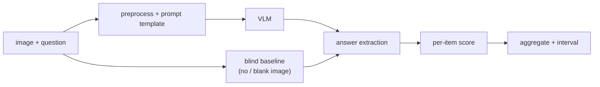
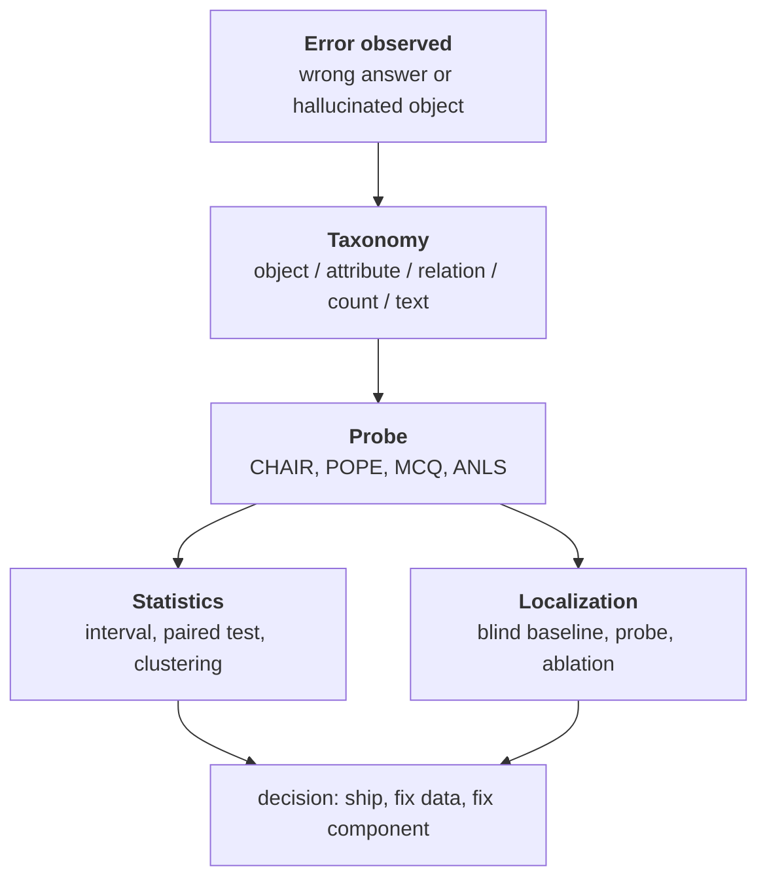
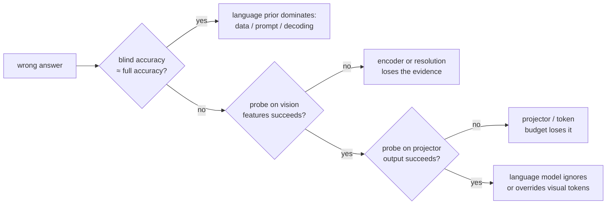

# Vision-Language Module 06 — VLM Evaluation

## 00 Why This Module Exists

A VLM benchmark score is the output of a pipeline: image preprocessing, a prompt template, the model, an answer extractor, a metric, and an aggregation rule.
- A change in any of these moves the score.
- A VLM can also answer many "visual" questions without looking at the image, because the language model has strong priors about what scenes usually contain.

So a higher number does not by itself mean better perception.


- Legend: the blind baseline sends the same question without usable visual input to measure how much the language prior alone can answer.

This module covers multimodal hallucination metrics, polling-based probes such as POPE, benchmark scoring rules (MME, MMBench, DocVQA, MathVista), statistical comparison of VLMs, LLM-as-judge and human protocols, and localizing an error to the encoder, projector, or language model.
- How the vision encoder produces features belongs to [Vision-Language Module 01](../01-vision-representation/README.md) and [Module 03](../03-vlm-architectures/README.md).
- Grounding and document-specific failure modes belong to [Module 05](../05-grounding-documents-ocr/README.md).
- General evaluation design, judge calibration, and offline–online mismatch belong to core [Module 15](../../advanced-ai-engineering/15-evaluation-engineering/README.md).

**Research status:** satellite 80/20 revision, 2026-11-26. Formulas and worked examples are derived in the text. Benchmark protocols (POPE sampling splits, MME scoring, MMBench CircularEval, DocVQA ANLS threshold and normalization) are written from the cited papers but were **not** re-read against the papers or a pinned evaluation-harness commit in this revision (`TODO_VERIFY`). No benchmark results are quoted. All confusion matrices and scores below are illustrative.

**Module Orientation**

- **Engineering problem:** decide whether a VLM change improves visual grounding, with uncertainty, and localize where an error comes from.
- **What you will do:**
  - compute hallucination and polling metrics by hand;
  - reproduce benchmark scoring rules, including answer extraction;
  - attach intervals to scores and compare models with paired tests;
  - measure the language-prior share with a blind baseline;
  - calibrate an LLM judge against human labels;
  - run a localization ablation across encoder, projector, and language model.
- **Environment:** Python 3.10+, one small open VLM that runs on a single GPU or Colab, an evaluation harness (`lmms-eval` or `VLMEvalKit`), and a few hundred items from public benchmarks.
- **Evidence rule:** separate source observations (**O**), derivations (**D**), and hypotheses that need measurement (**H**).
- **If You Only Have One Week**: Lessons VL6.2 and VL6.3. They teach how a polling probe exposes yes-bias and how to put an interval and a paired test on a benchmark delta.

## 01 Baseline Assumptions

- Core [Module 00](../../advanced-ai-engineering/00-scientific-ai-engineering/README.md): paired comparisons, uncertainty, and causal diagnosis.
- Core [Module 07](../../advanced-ai-engineering/07-model-behavior-uncertainty/README.md): failure taxonomies and calibration.
- Core [Module 15](../../advanced-ai-engineering/15-evaluation-engineering/README.md): evaluation taxonomy and LLM-as-judge.
- [Vision-Language Module 03](../03-vlm-architectures/README.md): encoder → projector → language model data path.
- Mathematical prerequisites: confusion matrices, binomial proportions, standard error, and edit distance.

## 02 Target Mastery

```yaml
depth_contract:
  conceptual: REQUIRED
  mechanistic: REQUIRED
  mathematical: REQUIRED
  quantitative: REQUIRED
  implementation: REQUIRED
  source_code: SELECTIVE
  instrumentation: SELECTIVE
  experimental: REQUIRED
  statistical: REQUIRED
  production_reasoning: SELECTIVE
  failure_analysis: REQUIRED
  falsification: REQUIRED
  security: NOT_APPLICABLE
  economics: SELECTIVE
  architecture_tradeoff: SELECTIVE
  research_connection: SELECTIVE

estimated_effort:
  instruction: 2h
  guided_practice: 1.25h
  labs: 3h
  assessment: 0.75h
  source_trace: 0.5h
  total: 7.5h
```

The learner must be able to state a benchmark's full scoring contract, compute its metrics by hand, separate visual evidence from language prior, report a model delta with a paired interval, and run an ablation that points to the component responsible for an error.

### LAYER 1: KNOWLEDGE / INSTRUCTIONAL LAYER

## 03 Knowledge Map



Keep three questions separate:

1. **What kind of error?** Object existence, attribute binding, spatial relation, counting, or text reading.
2. **Is the measured change real?** Scoring contract, interval, and paired comparison.
3. **Where does the error come from?** Visual features, the projector/bridge, or the language model's prior and decoding.

## 04 Lessons

### Lesson VL6.1 — Multimodal Hallucination and Caption Metrics

**Engineering Question:**
How do we count hallucinated content in free-form output instead of judging captions by overall fluency?

**Concepts & Definitions:**

- **Object hallucination:** the output mentions an object that is not in the image.
- **Attribute binding error:** the object exists but a property is wrong ("red car" when the car is blue), or a property moves to the wrong object.
- **Relation error:** objects and attributes are right, but the spatial or action relation is wrong ("cup left of laptop" when it is right).
- **CHAIR** (Caption Hallucination Assessment with Image Relevance), from Rohrbach et al. (2018) (**O**, `TODO_VERIFY`): match mentioned objects against ground-truth object annotations, using a synonym list.

$$
\text{CHAIR}_i = \frac{|\{\text{hallucinated object mentions}\}|}{|\{\text{all object mentions}\}|},
\qquad
\text{CHAIR}_s = \frac{|\{\text{captions with} \ge 1 \text{ hallucinated object}\}|}{|\{\text{all captions}\}|}
$$

where:

- an *object mention* is a word or phrase in the generated caption that maps to an object category in the annotation vocabulary;
- a mention is *hallucinated* when its category is not in the image's ground-truth object set;
- $\text{CHAIR}_i$ is measured per mention (instance level) and $\text{CHAIR}_s$ per caption (sentence level).

*Step-by-step reading.*

1. Extract object words from each caption and map them to categories (synonyms, plurals).
2. For each mention, check the category against the image's annotations.
3. Count hallucinated mentions over all mentions for $\text{CHAIR}_i$, and captions with at least one hallucination over all captions for $\text{CHAIR}_s$.
4. Lower is better for both. Neither measures recall: a caption that mentions nothing scores 0.

**Mechanism Explanation:**

Hallucinated objects are often ones that co-occur with real objects in training data ("fork" next to "plate"). A caption metric that rewards fluency or n-gram overlap can rise while hallucination also rises. CHAIR is limited by its annotation vocabulary: an object outside the category list is neither counted correct nor hallucinated.

**Worked Example:**
*Input.* Five captions with 20 object mentions in total. Three mentions are hallucinated: two in caption 2, one in caption 4.

*Steps.*
- $\text{CHAIR}_i = 3 / 20 = 0.15$.
- Captions with at least one hallucination: 2 of 5, so $\text{CHAIR}_s = 0.40$.
- A shorter decoding setting removes caption 4's hallucination but also drops 8 correct mentions: $\text{CHAIR}_i = 2 / 11 = 0.18$, $\text{CHAIR}_s = 0.20$.

*Result.* The two metrics move in opposite directions. Report both, plus the mean number of mentions per caption, so a "less hallucination" claim cannot come from saying less.

**Knowledge Check:** Why can a decoding change lower $\text{CHAIR}_s$ without making the model see better?

**Guided Practice:** Caption 50 images with two decoding settings. Compute $\text{CHAIR}_i$, $\text{CHAIR}_s$, and mentions per caption for each, then hand-check 10 flagged hallucinations for synonym-mapping errors.

**Feedback Contract:**
- *Expected Evidence*: a table of the three numbers per setting, and an audit of the 10 flags stating how many are true hallucinations versus vocabulary or synonym misses.
- *Common Failure*: reporting $\text{CHAIR}_s$ alone, or trusting the synonym list without auditing it.
- *Diagnostic Hint*: if flagged "hallucinations" cluster on one word, check the synonym list before blaming the model.
- *Concept to Revisit*: Hallucination taxonomy.

**Learning Outcome:** Measure object hallucination in free-form output and explain what the metric cannot see.

*(Effort: 25m instruction, 15m practice)*

### Lesson VL6.2 — Polling Probes and Language-Prior Bias (POPE)

**Engineering Question:**
How do we test object existence directly, and tell a model that sees from a model that says "yes"?

**Concepts & Definitions:**

- **POPE** (Polling-based Object Probing Evaluation), Li et al. (2023): ask "Is there a ⟨object⟩ in the image?" for objects that are present (answer yes) and absent (answer no), balanced 50/50 (**O**, `TODO_VERIFY`).
- **Negative sampling settings** (**O**, `TODO_VERIFY`):
  - *random*: absent objects drawn uniformly;
  - *popular*: absent objects drawn from the most frequent categories in the dataset;
  - *adversarial*: absent objects that frequently co-occur with the image's real objects.
- **Yes-ratio:** the share of all answers that are "yes." On a balanced set, an unbiased model has a yes-ratio near 0.5.

With TP, FP, TN, FN counted on "yes" as the positive class:

$$
\text{Acc} = \frac{TP + TN}{N},\quad
P = \frac{TP}{TP + FP},\quad
R = \frac{TP}{TP + FN},\quad
F_1 = \frac{2PR}{P + R},\quad
\text{Yes} = \frac{TP + FP}{N}
$$

where:

- $TP$: present objects answered yes; $FN$: present objects answered no;
- $FP$: absent objects answered yes (hallucinations); $TN$: absent objects answered no;
- $N = TP + FP + TN + FN$;
- $P$ is precision, $R$ is recall, and $\text{Yes}$ is the yes-ratio.

**Mechanism Explanation:**

Adversarial negatives target the language prior: "Is there a fork?" on a dinner-table image is likely to get "yes" from a model that relies on co-occurrence. The gap between random and adversarial precision is therefore a measure of prior-driven hallucination, not a separate capability. POPE also depends on answer extraction: free-form answers ("I can see a plate but no fork") must be mapped to yes/no by a fixed rule.

**Worked Example:**
*Input.* An illustrative adversarial split with 300 present and 300 absent objects. $TP = 270$, $FN = 30$, $FP = 75$, $TN = 225$.

*Steps.*
- $\text{Acc} = (270 + 225) / 600 = 0.825$.
- $P = 270 / 345 = 0.783$; $R = 270 / 300 = 0.900$.
- $F_1 = 2 \times 0.783 \times 0.900 / 1.683 = 0.837$.
- $\text{Yes} = 345 / 600 = 0.575$.

*Baseline.* A model that always answers yes: $\text{Acc} = 0.5$, $P = 0.5$, $R = 1.0$, $F_1 = 0.667$, $\text{Yes} = 1.0$.

*Result.* The real model's yes-ratio of 0.575 shows a moderate yes-bias; most of its errors are FP (hallucinations), not FN. F1 alone hides this, because the always-yes baseline already reaches 0.667.

**Knowledge Check:** A new checkpoint raises POPE accuracy by lowering its yes-ratio from 0.575 to 0.45. What must you check before calling this a hallucination fix?

**Guided Practice:** Run POPE-style questions on 100 images in the random and adversarial settings. Report the full table above for both, and the precision gap between them.

**Feedback Contract:**
- *Expected Evidence*: two confusion matrices, all five metrics per setting, and the random-minus-adversarial precision gap with a one-line interpretation.
- *Common Failure*: reporting accuracy only; mapping unparseable answers silently to "no."
- *Diagnostic Hint*: count unparseable answers separately; a rising count changes accuracy without any change in perception.
- *Concept to Revisit*: Language-prior bias; answer extraction.

**Learning Outcome:** Compute polling metrics, detect answer bias, and interpret the random-to-adversarial gap.

*(Effort: 30m instruction, 20m practice)*

### Lesson VL6.3 — Benchmark Scoring Contracts and Statistical Comparison

**Engineering Question:**
Is a 2-point benchmark gain between two VLMs real, and does it measure what the benchmark name says?

**Concepts & Definitions:**

- **Scoring contract:** prompt template, image preprocessing (resolution, tiling), decoding settings, answer extraction, metric, and aggregation. Two scores are comparable only under the same contract.
- **MME-style paired yes/no** (**O**, `TODO_VERIFY`): each image has two yes/no questions; besides per-question accuracy, "accuracy+" counts an image only if both answers are right, which penalizes always-yes behavior.
- **MMBench CircularEval** (**O**, `TODO_VERIFY`): a multiple-choice question with $n$ options is asked $n$ times with the options rotated; the item counts as correct only if all rotations are answered correctly. This removes most of the gain from guessing and from a fixed position preference.
- **ANLS** (Average Normalized Levenshtein Similarity), used by DocVQA (**O**, `TODO_VERIFY`):

$$
s(a, g) = \begin{cases} 1 - \text{NL}(a, g) & \text{if } \text{NL}(a, g) < \tau \\ 0 & \text{otherwise} \end{cases},
\qquad
\text{NL}(a, g) = \frac{\text{lev}(a, g)}{\max(|a|, |g|)}
$$

where:

- $a$ is the predicted answer string and $g$ one ground-truth answer;
- $\text{lev}$ is the Levenshtein edit distance (insertions, deletions, substitutions);
- $|a|$ is string length in characters;
- $\tau = 0.5$ is the threshold;
- the question score is the maximum of $s$ over all ground-truth answers, and ANLS is the mean over questions.

- **MathVista-style extraction:** free-form reasoning answers are reduced to a final answer by a rule or an LLM extractor; the extractor is part of the contract (**O**, `TODO_VERIFY`).

*Interval for an accuracy.* For $n$ independent items with accuracy $\hat p$:

$$
\text{SE} = \sqrt{\frac{\hat p (1 - \hat p)}{n}},\qquad
\text{DE} = 1 + (m - 1)\rho,\qquad
n_{\text{eff}} = \frac{n}{\text{DE}}
$$

where:

- $\text{SE}$ is the standard error; an approximate 95% interval is $\hat p \pm 1.96\,\text{SE}$;
- $m$ is the number of questions per image and $\rho$ is the intra-image correlation of correctness;
- $\text{DE}$ is the design effect and $n_{\text{eff}}$ is the effective sample size to use in place of $n$ when questions share images.

*Paired comparison (McNemar).* On the same items, let $b$ be items model A gets right and B wrong, and $c$ the reverse:

$$
\chi^2 = \frac{(|b - c| - 1)^2}{b + c}
$$

with one degree of freedom (3.84 is the 5% critical value). Items both models get right or both get wrong carry no information about the difference. When items cluster by image, prefer a paired bootstrap that resamples images, not questions.

**Mechanism Explanation:**

Rotations, paired questions, and blind baselines all remove credit that does not require the image. Intervals and paired tests then tell you whether what remains differs between models more than sampling noise would.

**Worked Example (scoring rules):**
*CircularEval.* A random guesser on 4-option items scores 0.25 per pass, but $0.25^4 = 0.0039$ under CircularEval (assuming independent guesses). A model that always picks option A scores 0 under CircularEval, because the correct option moves.

*ANLS.* Ground truth `INV-20931` (9 characters).
- Prediction `INV-2093l`: one substitution, $\text{NL} = 1/9 = 0.111$, $s = 0.889$.
- Prediction `20931`: four deletions, $\text{NL} = 4/9 = 0.444$, $s = 0.556$.
- Prediction `INV-209`: two deletions, $\text{NL} = 2/9$, $s = 0.778$, even though it would be useless for an invoice lookup.

**Worked Example (statistics, illustrative):**
- Model A accuracy 0.825 on 600 POPE questions: $\text{SE} = \sqrt{0.825 \times 0.175 / 600} = 0.0155$, interval $\pm 0.030$.
- With 6 questions per image and $\rho = 0.2$: $\text{DE} = 2.0$, $n_{\text{eff}} = 300$, $\text{SE} = 0.0219$, interval $\pm 0.043$.
- Model B on the same items: $b = 40$, $c = 22$. $\chi^2 = 17^2 / 62 = 4.66 > 3.84$, so the difference passes at 5% if items were independent; repeat with an image-level bootstrap before claiming it.

**Knowledge Check:** Why is ANLS a poor release metric for extracting invoice numbers, even though it suits the DocVQA benchmark?

**Guided Practice:** Score one model on 200 MMBench-style items with and without CircularEval, and on 100 DocVQA items with ANLS and with exact match. Report each score with an image-clustered bootstrap interval.

**Feedback Contract:**
- *Expected Evidence*: four scores with intervals, the full scoring contract for each, and a note on which items change status between single-pass and circular scoring.
- *Common Failure*: comparing a score from a paper with one from your harness under a different prompt or extractor.
- *Diagnostic Hint*: re-score saved raw outputs with the other extractor before re-running any model.
- *Concept to Revisit*: Scoring contract; clustered uncertainty.

**Learning Outcome:** State a benchmark's scoring contract, compute its metric, and report a model difference with a paired, clustered interval.

*(Effort: 40m instruction, 25m practice)*

### Lesson VL6.4 — Localizing Errors and Calibrating Judges

**Engineering Question:**
When a VLM answers wrongly, is the cause the visual features, the bridge to the language model, or the language model itself, and can an LLM judge be trusted to grade it?

**Concepts & Definitions:**

- **Blind baseline:** the same questions with a blank image or no image. Its accuracy estimates what the language prior alone can solve.
- **Image-attributable gain:** accuracy with the image minus blind accuracy.
- **Linear probe:** a small classifier trained on frozen vision features (or on projector outputs) to predict the attribute in question. If the probe succeeds and the VLM fails, the information reached that stage but was lost later.
- **Perturbation test:** crop, mask, or upscale the relevant region and watch whether the answer follows the evidence.
- **Cohen's kappa** for agreement between a judge and humans (or two humans):

$$
\kappa = \frac{p_o - p_e}{1 - p_e},\qquad p_e = \sum_k p_{A,k}\, p_{B,k}
$$

where:

- $p_o$ is the observed share of items where both raters agree;
- $p_{A,k}$ and $p_{B,k}$ are the shares of items rater A and rater B assign to label $k$;
- $p_e$ is the agreement expected by chance from those label rates.

**Mechanism Explanation:**

Localization works stage by stage:



An LLM judge for multimodal answers adds its own failure modes: position bias between two answers, preference for longer answers, and, if the judge is text-only, no access to the image. Agreement with humans must be measured on the same items, by slice.

**Worked Example (blind baseline, illustrative):**
*Input.* 4-option MCQ, chance 0.25. Accuracy with the image 0.62, with a blank image 0.48.

*Steps.*
- Image-attributable gain: $0.62 - 0.48 = 0.14$.
- Blind accuracy minus chance: $0.48 - 0.25 = 0.23$ of the score comes from priors and question wording.

*Result.* Most of the score above chance does not need the image. A checkpoint that gains 3 points must show whether the gain is in the image-attributable part.

**Worked Example (judge agreement, illustrative):**
*Input.* 100 answers graded correct/incorrect by a human and by an LLM judge. Both "correct": 40; both "incorrect": 35; human correct, judge incorrect: 15; human incorrect, judge correct: 10.

*Steps.*
- $p_o = (40 + 35) / 100 = 0.75$.
- Human "correct" rate $0.55$; judge "correct" rate $0.50$.
- $p_e = 0.55 \times 0.50 + 0.45 \times 0.50 = 0.50$.
- $\kappa = (0.75 - 0.50) / (1 - 0.50) = 0.50$.

*Result.* 75% raw agreement is only moderate agreement once chance is removed. Report $\kappa$ by slice before using the judge as a release gate.

**Knowledge Check:** A VLM fails to read small text in a chart. A probe on the vision encoder's features at the model's input resolution also fails, but succeeds at twice the resolution. Which component do you change first?

**Guided Practice:** For 50 failures from Lesson VL6.3, run the blind baseline and one perturbation (crop to the relevant region). Classify each failure as prior-driven, evidence-missing, or evidence-ignored.

**Feedback Contract:**
- *Expected Evidence*: a table of 50 items with blind answer, cropped answer, and assigned class, plus counts per class.
- *Common Failure*: treating every wrong answer as "hallucination" without testing whether the evidence reached the model.
- *Diagnostic Hint*: if cropping fixes the answer, the evidence exists but is diluted by resolution or token budget.
- *Concept to Revisit*: Localization flow; image-attributable gain.

**Learning Outcome:** Attribute VLM errors to a pipeline stage with ablation evidence and validate an LLM judge with chance-corrected agreement.

*(Effort: 25m instruction, 15m practice)*

## 05 Literature & Production Source Map

**REFERENCE / BASELINE**

- [Object Hallucination in Image Captioning](https://arxiv.org/abs/1809.02156) — Rohrbach et al. (EMNLP 2018). Reading pointer: definition of $\text{CHAIR}_i$ and $\text{CHAIR}_s$ and the synonym mapping.
- [Evaluating Object Hallucination in Large Vision-Language Models (POPE)](https://arxiv.org/abs/2305.10355) — Li et al. (EMNLP 2023). Reading pointer: polling questions and the random/popular/adversarial negative settings.
- [MME: A Comprehensive Evaluation Benchmark for Multimodal Large Language Models](https://arxiv.org/abs/2306.13394) — Fu et al. (2023). Reading pointer: paired yes/no questions and accuracy+.
- [MMBench: Is Your Multi-modal Model an All-around Player?](https://arxiv.org/abs/2307.06281) — Liu et al. (2023). Reading pointer: CircularEval and LLM-based choice extraction.
- [DocVQA: A Dataset for VQA on Document Images](https://arxiv.org/abs/2007.00398) — Mathew et al. (WACV 2021). Reading pointer: ANLS definition and threshold.
- [MathVista](https://arxiv.org/abs/2310.02255) — Lu et al. (ICLR 2024). Reading pointer: answer extraction for free-form math answers.

**WORKLOAD-DEPENDENT / FRONTIER**

- Studies that test whether benchmarks need the image at all, by evaluating with blank or no images, are directly relevant to Lesson VL6.4; use one as a design reference and verify its claims before citing (`TODO_VERIFY`, no specific result claimed).
- LLM-as-judge for multimodal output is workload-dependent; core [Module 15](../../advanced-ai-engineering/15-evaluation-engineering/README.md) covers judge calibration in general.

**CURRENT DEFAULT:** a pinned scoring contract per benchmark; POPE-style probes with yes-ratio reported; circular or paired scoring for MCQ and yes/no; blind baselines; image-clustered intervals; human-calibrated judges with $\kappa$ by slice.

**LEGACY / INSUFFICIENT:** a single headline score; scores copied from papers into a comparison table; accuracy without yes-ratio; F1 without the always-yes baseline; an LLM judge accepted on raw agreement.

**PRODUCTION SOURCE TRACE** (pin the commit you read; no commit was pinned in this revision)

- `EvolvingLMMs-Lab/lmms-eval`: find the POPE task definition and its metric aggregation, and the MMBench task's handling of option rotation.
- `open-compass/VLMEvalKit`: find the MMBench CircularEval implementation and the answer-extraction fallback (rule first, LLM extractor second).
- For each, record: prompt template, how unparseable answers are scored, and how per-item results are aggregated. File and function names differ across versions (`TODO_VERIFY`).

### LAYER 2: ENGINEERING PRACTICE LAYER

## 06 Engineering Labs

All labs follow `PREDICT → BUILD → MEASURE → EXPLAIN → BREAK → IMPROVE → FALSIFY`.

### LAB A — Hallucination Probe with Bias and Uncertainty

- **Objective:** measure object hallucination of one VLM with CHAIR and POPE, report bias and intervals, and test whether one mitigation helps perception or only shifts bias.
- **Pre-Registered Hypothesis:** adversarial-setting precision is lower than random-setting precision by more than the image-clustered interval, and a "say no when unsure" prompt lowers FP mainly by lowering the yes-ratio, at a recall cost.
- **Independent Variables:** negative-sampling setting, prompt (default versus cautious), decoding length.
- **Dependent Variables:** full POPE table, $\text{CHAIR}_i$, $\text{CHAIR}_s$, mentions per caption, unparseable-answer count, image-clustered bootstrap intervals.
- **Break & Falsify:** change only the answer extractor and re-score saved outputs; show the score shift with no model change.
- **Alignment:** Lessons VL6.1–VL6.3.
- **Effort Estimate:** 1.5h.

### LAB B — Localize, Then Gate with a Calibrated Judge

- **Objective:** build a blind-baseline and perturbation ablation on one benchmark slice, then validate an LLM judge on 100 human-labeled answers.
- **Pre-Registered Hypothesis:** at least a third of failures on the slice are prior-driven (blind answer equals full answer), and judge–human $\kappa$ is lower on that slice than overall.
- **Independent Variables:** image condition (full, blank, cropped), judge prompt, answer order for pairwise judging.
- **Dependent Variables:** image-attributable gain with interval, failure class counts, $\kappa$ by slice, judge position-swap disagreement rate.
- **Break & Falsify:** swap answer order for pairwise judging and measure how often the verdict flips; give a text-only judge an item that needs the image.
- **Alignment:** Lesson VL6.4 and Incident VL6.1.
- **Effort Estimate:** 1.5h.

**Runnable arithmetic check (CPU; not a quality experiment):**
```python
import math

def lev(a, b):
    prev = list(range(len(b) + 1))
    for i, ca in enumerate(a, 1):
        cur = [i]
        for j, cb in enumerate(b, 1):
            cur.append(min(prev[j] + 1, cur[j - 1] + 1, prev[j - 1] + (ca != cb)))
        prev = cur
    return prev[-1]

def anls(a, golds, tau=0.5):
    best = 0.0
    for g in golds:
        nl = lev(a, g) / max(len(a), len(g))
        best = max(best, 1 - nl if nl < tau else 0.0)
    return best

# VL6.1 CHAIR
assert math.isclose(3 / 20, 0.15) and math.isclose(2 / 5, 0.40)
# VL6.2 POPE
TP, FN, FP, TN = 270, 30, 75, 225
N = TP + FN + FP + TN
P, R = TP / (TP + FP), TP / (TP + FN)
F1 = 2 * P * R / (P + R)
assert math.isclose((TP + TN) / N, 0.825) and round(P, 3) == 0.783
assert round(F1, 3) == 0.837 and math.isclose((TP + FP) / N, 0.575)
assert round(2 * 0.5 * 1.0 / 1.5, 3) == 0.667          # always-yes F1
# VL6.3 CircularEval, ANLS, intervals, McNemar
assert math.isclose(0.25 ** 4, 0.00390625)
assert round(anls("INV-2093l", ["INV-20931"]), 3) == 0.889
assert round(anls("20931", ["INV-20931"]), 3) == 0.556
assert anls("INV", ["INV-20931"]) == 0.0                # NL = 6/9 >= 0.5
se = math.sqrt(0.825 * 0.175 / 600)
assert round(se, 4) == 0.0155
de = 1 + (6 - 1) * 0.2
assert de == 2.0 and round(math.sqrt(0.825 * 0.175 / (600 / de)), 4) == 0.0219
b, c = 40, 22
assert round((abs(b - c) - 1) ** 2 / (b + c), 2) == 4.66
# VL6.4 blind gain and kappa
assert math.isclose(0.62 - 0.48, 0.14)
po, pe = 0.75, 0.55 * 0.50 + 0.45 * 0.50
assert math.isclose((po - pe) / (1 - pe), 0.5)
print("OK")
```

## 07 Break / Incident Scenarios

### Incident VL6.1 — Better POPE, Worse Captions

**Incident Symptoms:**
A new VLM checkpoint gains 6 points of POPE accuracy and is promoted. Within a week, users of the captioning feature report more invented objects. The internal judge-based caption score is flat. The evaluation harness was upgraded in the same release.

**Diagnostic Protocol (Task):**
1. **Form Competing Hypotheses:** yes-ratio shift on POPE without better perception; harness upgrade changed prompt, preprocessing, or answer extraction; POPE (short yes/no) and long captions exercise different behavior; judge cannot see the image or prefers longer captions; traffic shifted to harder images.
2. **Identify Missing Evidence:** full POPE tables (not accuracy) for both checkpoints under both harness versions, unparseable counts, $\text{CHAIR}_i$/$\text{CHAIR}_s$ and mentions per caption on a production sample, judge–human $\kappa$ on captions.
3. **Design Discriminating Measurements:** cross checkpoint × harness version on the same POPE items; score saved captions from both checkpoints with CHAIR; label 100 production captions by hand.
4. **Rank Explanations:** an effect that appears only under the new harness is a measurement change; a yes-ratio drop with flat adversarial precision is bias, not perception; a CHAIR rise with longer captions points to decoding length.
5. **Intervene:** pin the harness contract; add CHAIR and yes-ratio to the release gate; fix or replace the judge on captions; adjust decoding if length drives hallucination.
6. **Remeasure:** both checkpoints under the pinned contract, with image-clustered intervals and the human-labeled caption sample.

### LAYER 3: MASTERY / ASSESSMENT LAYER

## 08 Mastery Assessment

### Transfer Problem — Release Gate for a Document and Photo Assistant

A product uses one VLM for photo descriptions and for reading fields from scanned forms. Design the evaluation that decides whether a new checkpoint ships.

**Required Deliverables:**
1. an error taxonomy for both use cases, with one example per class;
2. a scoring contract per probe (prompt, preprocessing, decoding, extraction, metric, aggregation);
3. hallucination metrics with yes-ratio and the always-yes baseline;
4. a document metric chosen for the use case (with a stated reason if not ANLS);
5. image-clustered intervals and a paired comparison between checkpoints;
6. a blind baseline and image-attributable gain per slice;
7. a judge validated against human labels with $\kappa$ by slice;
8. a localization of the top failure class to encoder, projector, or language model, with ablation evidence.

## 09 Required Evidence & Rubric

### Required Artifact: VLM Evaluation Report

Submit scoring contracts, raw per-item outputs, LAB A and LAB B tables with intervals, judge calibration, the localization table, and the Incident VL6.1 diagnosis.

### Rubric Dimensions

- **Measurement:** *Insufficient* reports one headline score. *Competent* reports full metric tables under a pinned contract. *Strong* shows the score is robust to extractor and prompt variants, or quantifies how much it moves.
- **Statistics:** *Insufficient* compares point estimates. *Competent* reports intervals and a paired test. *Strong* accounts for image clustering and multiple slices.
- **Diagnosis:** *Insufficient* calls every error "hallucination." *Competent* separates prior-driven from evidence-missing errors. *Strong* localizes the error to a component with probe or ablation evidence.
- **Judging:** *Insufficient* trusts an LLM judge. *Competent* measures $\kappa$. *Strong* measures it by slice and tests position and length bias.

## 10 Capability Traceability Matrix

| Capability | Taught | Practiced | Assessed | Evidence (artifact reviewers open) |
|---|---|---|---|---|
| Hallucination taxonomy and CHAIR | VL6.1 | VL6.1 Guided Practice; LAB A | Deliverables 1, 3; Incident VL6.1 | CHAIR table with mentions per caption and synonym audit |
| Polling probes and bias | VL6.2 | VL6.2 Guided Practice; LAB A | Deliverable 3; Incident VL6.1 step 4 | Full POPE tables, yes-ratio, random–adversarial gap |
| Scoring contracts and statistics | VL6.3 | VL6.3 Guided Practice; LAB A | Deliverables 2, 4, 5 | Contracts, clustered intervals, paired test |
| Error localization | VL6.4 | VL6.4 Guided Practice; LAB B | Deliverables 6, 8 | Blind/crop ablation table and failure class counts |
| Judge calibration | VL6.4 | LAB B | Deliverable 7; Incident VL6.1 step 2 | $\kappa$ by slice and position-swap flip rate |

## 11 Exit Criteria & Module Wrap-Up

### Exit Criteria

A learner passes when they can compute CHAIR, POPE, CircularEval, and ANLS by hand, state a benchmark's full scoring contract, report a checkpoint delta with an image-clustered paired interval, measure the language-prior share with a blind baseline, validate a judge with chance-corrected agreement, and localize a failure class with ablation evidence.

### Module Wrap-Up (Final Mental Model Reconstruction)

A VLM score is a pipeline output. Pin the contract, subtract what the language prior can answer alone, put an interval on every delta, and before calling something a hallucination, check whether the visual evidence ever reached the language model.

### Cost & Telemetry Hook

- [Lesson 22.1](../../advanced-ai-engineering/22-ai-economics/README.md): evaluation cost includes judge calls and CircularEval's $n$-fold re-asking; budget it per release gate.
- [Lesson 23.1](../../advanced-ai-engineering/23-observability-reliability/README.md): log yes-ratio, unparseable-answer rate, and output length on production traffic so a bias shift like Incident VL6.1 is visible before user reports.

## 12 Competency Targets

```yaml
competency:
  sfia: 4
  bloom: Analyze -> Evaluate
  solo: Relational
  dreyfus: Advanced Beginner -> Competent
```
