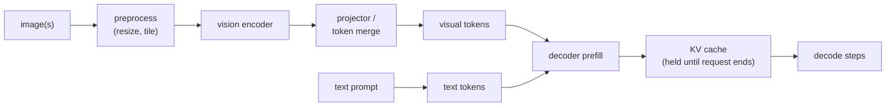
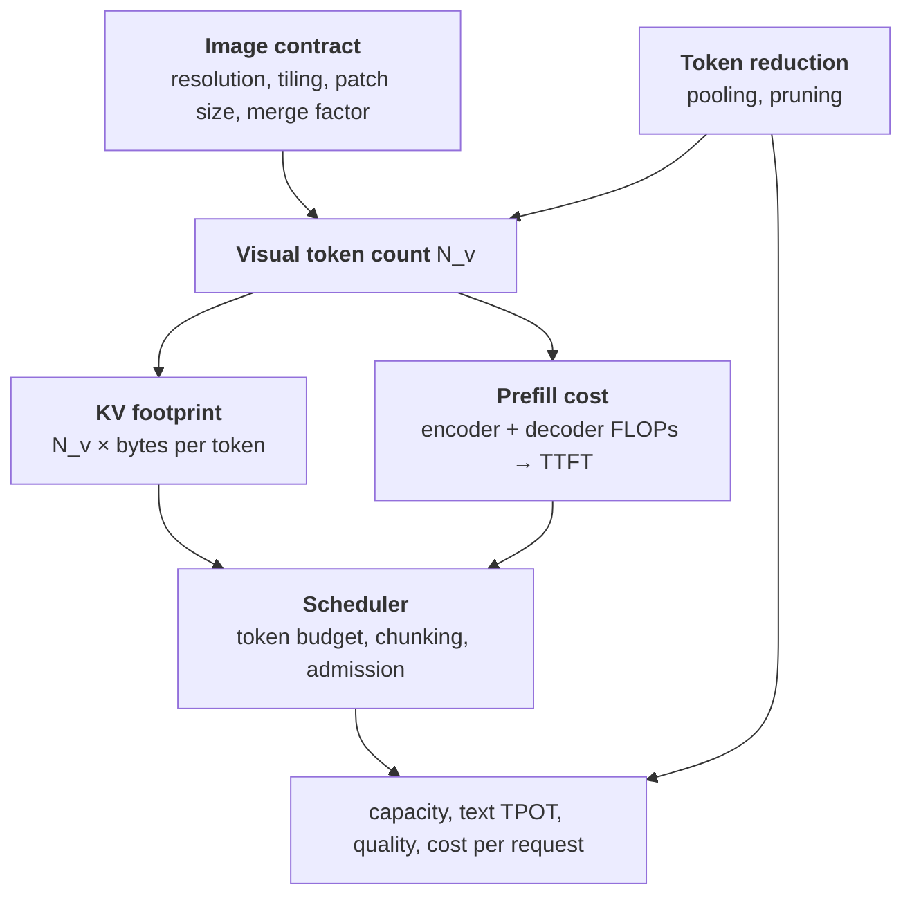

# Vision-Language Module 07 — VLM Serving

## 00 Why This Module Exists

A text chat request might carry a few hundred prompt tokens. Attach one high-resolution screenshot and the same request can carry several thousand.
- Those visual tokens enter the decoder like text tokens: they are prefilled, they occupy KV cache for the whole request lifetime, and they compete for the same batch slots.
- A serving engine tuned for text therefore loses capacity and tail latency as soon as images arrive, often without any error.


- Legend: KV: key/value cache; prefill: the forward pass over the whole prompt before the first output token.

This module covers visual token accounting, KV and prefill cost, scheduling mixed text–vision traffic, and inference-time visual token reduction.
- The general multimodal stage ledger, encoder/bridge token accounting by architecture, batching, and caching belong to core [Module 21](../../advanced-ai-engineering/21-multimodal-ai-systems/README.md) (Lessons 21.1–21.3, 21.5). This module applies them to VLM serving decisions and does not repeat them.
- KV mechanics (paging, prefix caching) belong to core [Module 03](../../advanced-ai-engineering/03-kv-cache-engineering/README.md); chunked prefill and queueing to core [Module 04](../../advanced-ai-engineering/04-serving-scheduling-capacity/README.md).
- How encoders and projectors produce visual tokens is taught in [VLM Module 03](../03-vlm-architectures/README.md); how quality is measured, in [VLM Module 06](../06-vlm-evaluation/README.md).

**Research status:** satellite 80/20 revision, 2026-11-26. Formulas are derived in the text. Architecture constants attributed to papers or model code (patch sizes, tile counts, merge factors, pruning settings) were written from the cited sources but were **not** re-read against a pinned commit or paper revision in this revision (`TODO_VERIFY`). All GPU throughputs, latencies, and prices in worked examples are illustrative, not measurements or quoted vendor prices.

**Module Orientation**

- **Engineering problem:** serve image-bearing requests next to conversational text traffic without collapsing KV capacity or decode latency, and know what each visual token costs.
- **What you will do:**
  - compute visual tokens, KV bytes, and prefill FLOPs per request by hand;
  - build a token and KV ledger for a real VLM on a serving engine;
  - measure how image-heavy traffic changes text TPOT under chunked prefill;
  - measure the quality–memory frontier of visual token pooling and pruning.
- **Environment:** one GPU (a 24 GB card is enough for a ~7B VLM in bf16 with a short context, or use a smaller VLM), a serving engine with VLM support and chunked prefill (for example vLLM or SGLang), Python 3.10+, and a small evaluation set with document/OCR and general-photo slices.
- **Evidence rule:** separate source observations (**O**), derivations (**D**), and hypotheses that need measurement (**H**).
- **If You Only Have One Week**: Lessons VL7.1 and VL7.3. They give the token/KV ledger and the scheduling consequences; prefill cost and token reduction build on those two.

## 01 Baseline Assumptions

- Core [Module 03](../../advanced-ai-engineering/03-kv-cache-engineering/README.md): KV bytes per token, paged allocation, prefix caching.
- Core [Module 04](../../advanced-ai-engineering/04-serving-scheduling-capacity/README.md): TTFT/TPOT, continuous batching, chunked prefill (Lesson 4.3), queueing.
- Core [Module 21](../../advanced-ai-engineering/21-multimodal-ai-systems/README.md): the multimodal stage ledger and token accounting by architecture.
- [VLM Module 01](../01-vision-representation/README.md) and [VLM Module 03](../03-vlm-architectures/README.md): patches, ViT encoders, projectors.
- Mathematical prerequisites: arithmetic with bytes and FLOPs, ceiling division, and ratios.

## 02 Target Mastery

```yaml
depth_contract:
  conceptual: REQUIRED
  mechanistic: REQUIRED
  mathematical: REQUIRED
  quantitative: REQUIRED
  implementation: SELECTIVE
  source_code: SELECTIVE
  instrumentation: REQUIRED
  experimental: REQUIRED
  statistical: SELECTIVE
  production_reasoning: REQUIRED
  failure_analysis: REQUIRED
  falsification: SELECTIVE
  security: NOT_APPLICABLE
  economics: REQUIRED
  architecture_tradeoff: REQUIRED
  research_connection: SELECTIVE

estimated_effort:
  instruction: 2h
  guided_practice: 1.25h
  labs: 3h
  assessment: 0.75h
  source_trace: 0.5h
  total: 7.5h
```

The learner must be able to predict a VLM request's visual tokens, KV footprint, and prefill cost from its image sizes and model configuration; explain why image traffic hurts text tail latency; choose a scheduling and token-reduction policy; and defend it with measured quality and capacity evidence.

### LAYER 1: KNOWLEDGE / INSTRUCTIONAL LAYER

## 03 Knowledge Map


- Legend: TTFT: time to first token; TPOT: time per output token.

Keep three costs separate:

1. **Token cost:** how many visual tokens the image contract produces.
2. **Memory cost:** how long and how much KV those tokens hold.
3. **Time cost:** encoder plus decoder prefill work, and how the scheduler spreads it across iterations that also serve other requests' decodes.

A reduction technique is worth deploying only if it lowers one of these costs without breaking the quality slice that motivated the images.

## 04 Lessons

### Lesson VL7.1 — Visual Tokens and the KV Ledger

**Engineering Question:**
How many KV bytes does one image cost, and how many concurrent image requests fit next to text traffic?

**Concepts & Definitions:**

- **Visual token count $N_v$:** the number of positions the image occupies in the decoder sequence. For a ViT with patch size $p$ on an $H \times W$ input with no merging, $N_v = (H/p)(W/p)$. Spatial merging of $m \times m$ neighboring patches divides this by $m^2$. Tiling multiplies it by the number of tiles.
- **KV bytes per token** for a decoder with $L$ layers, $n_{kv}$ KV heads, head dimension $d_h$, and $s$ bytes per element:

$$
b_{kv} = 2 \cdot L \cdot n_{kv} \cdot d_h \cdot s
$$

where:

- $b_{kv}$ is bytes of KV cache per sequence position;
- the factor 2 counts keys and values;
- $L$ is the number of decoder layers;
- $n_{kv}$ is the number of key/value heads (smaller than the query head count under grouped-query attention);
- $d_h$ is the head dimension;
- $s$ is bytes per element (2 for fp16/bf16).

Request KV footprint: $M = (N_v + N_t + N_o)\, b_{kv}$, where $N_t$ is text prompt tokens and $N_o$ is generated tokens.

*Step-by-step reading.*

1. Every layer stores one key and one value vector per KV head per position, each $d_h$ elements long, so one position costs $2\, n_{kv}\, d_h$ elements per layer.
2. Multiply by $L$ layers and $s$ bytes per element.
3. Visual positions are ordinary positions to the decoder, so they cost exactly $b_{kv}$ each, for the request's entire lifetime.

**Mechanism Explanation:**

Visual tokens are usually far more numerous than the text in the same request, and they are fixed at prefill. A long answer adds decode tokens slowly; an image adds its entire $N_v$ at once. Paged KV allocation ([Lesson 3.3](../../advanced-ai-engineering/03-kv-cache-engineering/README.md)) prevents fragmentation but does not shrink $N_v$.

**Worked Example (single-tile and tiled images):**
*Input.* A LLaVA-1.5-style model: CLIP ViT-L/14 at 336 px, no merging (**O**, `TODO_VERIFY`), and a 7B decoder with $L = 32$, $n_{kv} = 32$, $d_h = 128$, bf16.

*Steps.*
- $N_v = (336/14)^2 = 24^2 = 576$ tokens.
- $b_{kv} = 2 \times 32 \times 32 \times 128 \times 2 = 524{,}288$ bytes = 0.5 MiB per token.
- One image: $576 \times 0.5 = 288$ MiB of KV.
- A tiling scheme with 4 high-resolution tiles plus 1 downscaled overview: $5 \times 576 = 2{,}880$ tokens, i.e. 1,440 MiB.
- A text turn with 200 prompt tokens and 300 output tokens: $500 \times 0.5 = 250$ MiB.

*Result.* One tiled image costs as much KV as about 5.8 such text turns. With 12 GiB left for KV after weights, the engine fits about 49 text turns, or about 8 tiled-image requests.

*Interpretation.* A decoder with grouped-query attention ($n_{kv} = 8$) would cut $b_{kv}$ by 4 for both kinds of request. It changes absolute capacity, not the ratio between image and text requests.

**Knowledge Check:** A model merges $2 \times 2$ patches after a 14-px ViT. How many tokens does a $448 \times 448$ image produce, and by what factor does the merge change KV per image?

**Guided Practice:** For your serving model, read $L$, $n_{kv}$, $d_h$, dtype, patch size, merge factor, and tiling rule from its config. Fill a table of $N_v$ and KV MiB for images of $336^2$, $672^2$, $1024^2$, and a $1920 \times 1080$ screenshot.

**Feedback Contract:**
- *Expected Evidence*: a config extract with every field used, a hand table, and the engine's own reported prompt-token count for each image matching the hand count.
- *Common Failure*: counting only the encoder's patch grid and forgetting tiles, overview images, separator/newline tokens, or the merge factor.
- *Diagnostic Hint*: send the image with an empty text prompt and read `prompt_tokens` from the engine's usage field; the difference from your count localizes the missing term.
- *Concept to Revisit*: Token cost.

**Learning Outcome:** Compute visual tokens and KV bytes per request from configuration and verify them against the engine.

*(Effort: 30m instruction, 20m practice)*

### Lesson VL7.2 — Prefill Cost and TTFT for Image Requests

**Engineering Question:**
Where does an image request's time to first token go, and how much of it scales with resolution?

**Concepts & Definitions:**

- **Encoder cost:** the vision encoder runs once per image (or tile) before decoder prefill.
- **Decoder prefill cost:** a forward pass over all prompt positions.

A first-order estimate of forward FLOPs for a dense transformer, ignoring attention's quadratic term:

$$
F \approx 2 \cdot P \cdot N
$$

where:

- $F$ is forward-pass floating-point operations;
- $P$ is the number of parameters in the network that processes the tokens;
- $N$ is the number of tokens processed.

The prefill time estimate is $t \approx F / \Theta$, where $\Theta$ is the effective achieved FLOP/s.

*Step-by-step reading.*

1. Each weight participates in one multiply and one add per token, which gives $2P$ FLOPs per token.
2. Summing over $N$ tokens gives $2PN$.
3. Attention adds a term that grows with $N^2$; for a few thousand tokens on a 7B model it is a minority but not negligible, so treat $2PN$ as a lower bound.

**Mechanism Explanation:**

Image prefill has two serial parts: encoder then decoder. The decoder part usually dominates, because the decoder is much larger than the encoder and processes all $N_v$ tokens. Higher resolution raises $N_v$ and therefore both KV (Lesson VL7.1) and prefill time roughly linearly, plus a growing attention term. Caching encoder outputs by image hash removes the encoder part for repeated images; prefix caching can remove decoder prefill only when the image and everything before it are identical (core [Lesson 21.3](../../advanced-ai-engineering/21-multimodal-ai-systems/README.md)).

**Worked Example (where TTFT goes):**
*Input.* A ViT-L encoder with about $0.3$B parameters on 577 positions (576 patches + 1 class token), a 7B decoder, 100 text tokens, and an illustrative effective throughput $\Theta = 150$ TFLOP/s.

*Steps.*
- Encoder: $2 \times 0.3 \times 10^9 \times 577 \approx 3.46 \times 10^{11}$ FLOPs, about 2.3 ms.
- Decoder, one 576-token image: $2 \times 7 \times 10^9 \times 676 \approx 9.46 \times 10^{12}$ FLOPs, about 63 ms.
- Decoder, text only: $2 \times 7 \times 10^9 \times 100 = 1.4 \times 10^{12}$ FLOPs, about 9.3 ms.
- Decoder, 2,880-token tiled image: $2 \times 7 \times 10^9 \times 2{,}980 \approx 4.17 \times 10^{13}$ FLOPs, about 278 ms.

*Result.* On this estimate the image raises prefill about 6.8 times for one tile and about 30 times when tiled, and the encoder is a small share.

*Interpretation and limits.* Real encoders may run at lower utilization (small batches, preprocessing on CPU), so the encoder share can be larger than this estimate; measure it in LAB A before choosing to optimize it.

**Knowledge Check:** Why can encoder caching by image hash fail to reduce TTFT much, while it still reduces GPU time per request?

**Guided Practice:** Instrument one request with spans for preprocessing, encoder, decoder prefill, and first decode step. Compare measured spans with the $2PN$ estimate for three resolutions.

**Feedback Contract:**
- *Expected Evidence*: a span table per resolution on one clock, the predicted versus measured ratio for the decoder span, and a note on which span deviates most from prediction.
- *Common Failure*: measuring TTFT at the client and attributing all of it to the model, including queueing and image download.
- *Diagnostic Hint*: run one request alone on an idle engine first; queueing delay should then be near zero.
- *Concept to Revisit*: Time cost; core [Lesson 4.1](../../advanced-ai-engineering/04-serving-scheduling-capacity/README.md) metric decomposition.

**Learning Outcome:** Decompose image-request TTFT and predict how it scales with resolution.

*(Effort: 25m instruction, 15m practice)*

### Lesson VL7.3 — Scheduling Mixed Text and Vision Traffic

**Engineering Question:**
Which scheduling policy keeps conversational decode latency inside its SLO when image-heavy prefills arrive?

**Concepts & Definitions:**

- **Token budget $B$:** the maximum number of tokens an engine iteration processes, counting one per running decode plus the prefill tokens scheduled in that iteration.
- **Chunked prefill:** split a long prefill into pieces that fit the leftover budget, so decodes keep running every iteration ([Lesson 4.3](../../advanced-ai-engineering/04-serving-scheduling-capacity/README.md)).
- **Encoder disaggregation:** run the vision encoder in a separate worker or pool so encoder work never blocks decoder iterations.

Number of iterations needed to prefill an image request:

$$
n_{it} = \left\lceil \frac{N_v + N_t}{B - D} \right\rceil
$$

where:

- $n_{it}$ is the number of engine iterations spent on this request's prefill;
- $N_v + N_t$ is the request's prompt length in tokens;
- $B$ is the per-iteration token budget;
- $D$ is the number of running decodes, each consuming one budget slot per iteration;
- $\lceil\cdot\rceil$ rounds up.

*Step-by-step reading.*

1. Each iteration first serves the $D$ running decodes, one token each.
2. The remaining $B - D$ slots go to prefill.
3. Dividing the prompt by the remaining slots and rounding up gives the iteration count; TTFT for this request is roughly $n_{it}$ iteration times plus queueing.

**Mechanism Explanation:**

Without chunking, one 2,880-token prefill runs in a single long iteration, and every running decode waits for it: text TPOT spikes. With chunking, each iteration stays bounded, so decodes see a smaller per-iteration slowdown, but the image request's TTFT is spread over more iterations. A larger $B$ favors image TTFT; a smaller $B$ favors text TPOT. Admission control can also cap concurrent image prefills, or route image traffic to a separate pool.

**Worked Example (budget trade-off):**
*Input.* $D = 64$ running text decodes, a 2,880 + 100 token image request, and illustrative iteration times: 25 ms for a 512-token iteration and 90 ms for a 2,048-token iteration.

*Steps.*
- $B = 512$: $n_{it} = \lceil 2{,}980 / 448 \rceil = 7$ iterations, about 175 ms of prefill. Text TPOT during that period: 25 ms.
- $B = 2{,}048$: $n_{it} = \lceil 2{,}980 / 1{,}984 \rceil = 2$ iterations, about 180 ms. Text TPOT during that period: 90 ms.
- No chunking: one iteration of 3,044 tokens. All 64 decodes wait the full iteration.

*Result.* Here the smaller budget gives similar image TTFT and a much lower text TPOT, because iteration time grows with tokens. The numbers are illustrative; the shape of the trade-off is what LAB A measures.

**Knowledge Check:** Under what traffic mix does routing images to a separate pool waste more capacity than chunked prefill in a shared pool?

**Guided Practice:** Using the formula, tabulate $n_{it}$ for $B \in \{256, 512, 1024, 2048\}$ and $D \in \{16, 64, 128\}$. Predict which configuration violates a 50 ms text TPOT target using your LAB A iteration-time curve.

**Feedback Contract:**
- *Expected Evidence*: the table, the measured iteration time versus tokens curve, and the predicted SLO-violating cells.
- *Common Failure*: tuning $B$ against average TPOT, which hides the spikes during image prefills.
- *Diagnostic Hint*: plot TPOT per iteration with image-prefill iterations marked.
- *Concept to Revisit*: core [Lesson 4.3](../../advanced-ai-engineering/04-serving-scheduling-capacity/README.md) and [Lesson 4.6](../../advanced-ai-engineering/04-serving-scheduling-capacity/README.md).

**Learning Outcome:** Choose a token budget and admission policy for mixed traffic from measured iteration curves.

*(Effort: 35m instruction, 20m practice)*

### Lesson VL7.4 — Visual Token Reduction at Inference

**Engineering Question:**
How much KV and prefill can pooling or pruning remove, and which tasks pay for it?

**Concepts & Definitions:**

- **Pooling / merging:** average or concatenate-and-project neighboring visual tokens before the decoder. Fixed reduction, applied at every layer.
- **Pruning after layer $K$:** run the first $K$ decoder layers on all visual tokens, rank them (for example by attention received from text), and drop a fraction $r$ for the remaining layers. FastV is one published instance (**O**, `TODO_VERIFY`).

KV saving from pruning visual tokens after layer $K$:

$$
S = \frac{r \cdot N_v \cdot (L - K)}{(N_v + N_t) \cdot L}
$$

where:

- $S$ is the fraction of the request's prompt KV removed;
- $r$ is the fraction of visual tokens dropped;
- $N_v$ and $N_t$ are visual and text prompt tokens;
- $L$ is the number of decoder layers and $K$ the layer after which pruning happens.

*Step-by-step reading.*

1. Without pruning, prompt KV is $(N_v + N_t) \cdot L$ token-layers.
2. Pruned tokens still occupy KV in the first $K$ layers, and disappear in the remaining $L - K$.
3. Saved token-layers: $r N_v (L - K)$. Dividing gives $S$.

**Mechanism Explanation:**

Attention-score pruning needs the attention weights, but fused attention kernels ([Lesson 5.1](../../advanced-ai-engineering/05-inference-optimization/README.md)) do not materialize them, so pruning may require an extra scoring pass or a kernel change. Every reduction method discards spatial detail; small text, dense tables, and counting tasks fail first. A token budget that works for photo captions can break OCR. Quality must be measured per slice ([VLM Module 06](../06-vlm-evaluation/README.md)), not on an average.

**Worked Example (pruning saving):**
*Input.* $N_v = 576$, $N_t = 100$, $L = 32$, $K = 2$, $r = 0.5$.

*Steps.*
- Saved token-layers: $0.5 \times 576 \times 30 = 8{,}640$.
- Total prompt token-layers: $676 \times 32 = 21{,}632$.
- $S = 8{,}640 / 21{,}632 = 0.399$, i.e. 39.9% of prompt KV.
- Compare $2 \times 2$ pooling before the decoder: $N_v$ becomes 144, saving $432 / 676 = 63.9\%$ of prompt KV and of prefill tokens.

*Result.* Pooling saves more but is applied blindly; pruning keeps the tokens the model attends to and saves less.

**Knowledge Check:** Why might pruning reduce KV substantially but reduce TTFT only slightly?

**Guided Practice:** Evaluate a VLM at three reduction settings on an OCR slice and a photo-QA slice. Record accuracy, $N_v$, KV per request, and TTFT.

**Feedback Contract:**
- *Expected Evidence*: a per-slice table with confidence intervals, and a statement of which setting meets a declared OCR accuracy floor at lowest KV.
- *Common Failure*: reporting one average accuracy that hides an OCR collapse.
- *Diagnostic Hint*: inspect three failed OCR items at the strongest setting and check whether the text region survived reduction.
- *Concept to Revisit*: Token cost versus quality slice.

**Learning Outcome:** Quantify reduction savings and defend a setting with per-slice quality evidence.

*(Effort: 30m instruction, 20m practice)*

## 05 Literature & Production Source Map

**REFERENCE / BASELINE**

- [Improved Baselines with Visual Instruction Tuning (LLaVA-1.5)](https://arxiv.org/abs/2310.03744) — Liu et al. (2023). Reading pointer: CLIP ViT-L/336 encoder and MLP projector; 576 visual tokens per image.
- [Efficient Memory Management for Large Language Model Serving with PagedAttention (vLLM)](https://arxiv.org/abs/2309.06180) — Kwon et al. (2023). Reading pointer: KV paging; applies unchanged to visual positions.
- [SARATHI: Efficient LLM Inference by Piggybacking Decodes with Chunked Prefills](https://arxiv.org/abs/2308.16369) — Agrawal et al. (2023). Reading pointer: chunked prefill and decode piggybacking.

**WORKLOAD-DEPENDENT / FRONTIER**

- [Qwen2-VL](https://arxiv.org/abs/2409.12191) — Wang et al. (2024). Dynamic resolution with $2 \times 2$ token merging; token count grows with image area (`TODO_VERIFY` for exact merge and rounding rules).
- [An Image is Worth 1/2 Tokens After Layer 2 (FastV)](https://arxiv.org/abs/2403.06764) — Chen et al. (2024). Attention-based visual token pruning after an early layer. Author-reported savings are scoped to their models and benchmarks.
- Tiling ("AnyRes") schemes in the LLaVA-NeXT line raise detail at a multiple of the single-image token cost; tile grids and overview handling differ between releases (`TODO_VERIFY`).

**CURRENT DEFAULT:** paged KV, chunked prefill with a token budget chosen from measured iteration curves, encoder-output caching keyed by image hash, and per-request visual token accounting in telemetry.

**LEGACY / INSUFFICIENT:** sizing VLM serving from text-only benchmarks; a single "tokens per image" constant across resolutions; enabling token reduction on average accuracy alone.

**PRODUCTION SOURCE TRACE** (pin the commit you read; no commit was pinned in this revision)

- `vllm-project/vllm`: the multimodal input processing path (`vllm/multimodal/`) and the per-model files under `vllm/model_executor/models/` (for example the LLaVA family) that compute how many placeholder tokens an image expands to. Locate the function that returns the visual token count and compare it with Lesson VL7.1.
- `vllm-project/vllm`: the scheduler's chunked-prefill token budget (`max_num_batched_tokens`) and how encoder work is budgeted for multimodal requests.
- Scope: one engine at one commit; other engines (SGLang, TensorRT-LLM) organize these paths differently.

### LAYER 2: ENGINEERING PRACTICE LAYER

## 06 Engineering Labs

All labs follow `PREDICT → BUILD → MEASURE → EXPLAIN → BREAK → IMPROVE → FALSIFY`.

### LAB A — Visual Token Ledger and Mixed-Traffic Capacity

- **Objective:** build a per-request ledger (visual tokens, KV MiB, encoder/prefill/decode spans) and measure how image traffic changes text TPOT and capacity.
- **Pre-Registered Hypothesis:** at a fixed offered load, raising the image share from 0% to 20% raises text P99 TPOT more than it raises text P50 TPOT, and a smaller chunked-prefill budget reduces the P99 increase at the cost of image TTFT.
- **Independent Variables:** image share, image resolution/tiling, token budget $B$, maximum concurrent sequences.
- **Dependent Variables:** engine-reported prompt tokens versus hand count, KV usage, preemptions, text TTFT/TPOT P50/P99, image TTFT, and requests per second meeting the SLO.
- **Break & Falsify:** send a burst of tiled screenshots during steady chat load; disable chunked prefill; set $B$ below a single tile's token count.
- **Alignment:** Lessons VL7.1–VL7.3 and Incident VL7.1.
- **Effort Estimate:** 1.75h.

### LAB B — Token Reduction Frontier

- **Objective:** measure quality, KV, and TTFT across pooling and pruning settings on an OCR/document slice and a photo slice.
- **Pre-Registered Hypothesis:** the strongest setting that keeps photo-QA accuracy within 2 points loses more than 2 points on the OCR slice.
- **Independent Variables:** reduction method, reduction ratio, pruning layer $K$, image resolution.
- **Dependent Variables:** per-slice accuracy with bootstrap intervals, $N_v$, KV per request, TTFT, and throughput at fixed SLO.
- **Break & Falsify:** use images with small text in a corner and counting questions; check whether the pruning score ever keeps the relevant region.
- **Alignment:** Lesson VL7.4.
- **Effort Estimate:** 1.25h.

**Runnable arithmetic check (CPU; not a quality experiment):**
```python
import math
n_v = (336 // 14) ** 2
assert n_v == 576
b_kv = 2 * 32 * 32 * 128 * 2
assert b_kv == 524_288                                   # 0.5 MiB per token
assert n_v * b_kv / 2**20 == 288                         # MiB per image
assert 5 * n_v * b_kv / 2**20 == 1_440                   # 4 tiles + overview
assert round(12 * 1024 / 250) == 49 and int(12 * 1024 / 1440) == 8
assert (448 // 14) ** 2 // 4 == 256                      # 2x2 merge
enc = 2 * 0.3e9 * 577; dec = 2 * 7e9 * 676; txt = 2 * 7e9 * 100
assert math.isclose(dec / 150e12 * 1e3, 63.09, rel_tol=1e-3)
assert math.isclose(dec / txt, 6.76)
assert math.ceil(2_980 / (512 - 64)) == 7
assert math.ceil(2_980 / (2_048 - 64)) == 2
s = 0.5 * 576 * (32 - 2) / ((576 + 100) * 32)
assert math.isclose(s, 8_640 / 21_632) and round(s, 3) == 0.399
assert round(432 / 676, 3) == 0.639
```

## 07 Break / Incident Scenarios

### Incident VL7.1 — Chat Latency Spikes After a Document-Upload Launch

**Incident Symptoms:**
A product adds "upload a document page" to an existing chat assistant served from the same VLM pool. Average text TPOT is unchanged, but text P99 TPOT triples during business hours, preemptions appear in engine logs, and GPU utilization is unchanged. Image requests are only 6% of traffic.

**Diagnostic Protocol (Task):**
1. **Form Competing Hypotheses:** large tiled prefills stalling decodes, KV exhaustion causing preemption and recompute, encoder running on the decoder's critical path, image download/preprocessing blocking an event loop, a token budget too large for the new mix, or an unrelated traffic increase.
2. **Identify Missing Evidence:** per-request visual token counts, KV usage over time, preemption counts, per-iteration token counts and durations, and encoder spans.
3. **Design Discriminating Measurements:** replay the same traffic with images replaced by same-length text prompts; then with images downscaled to one tile; then with a smaller token budget.
4. **Rank Explanations:** if same-length text reproduces the spikes, the cause is prompt length, not vision; if only images do, look at encoder placement and preprocessing.
5. **Intervene:** cap tiles per page, lower the token budget, limit concurrent image prefills, or route documents to a separate pool, based on step 4.
6. **Remeasure:** text P99 TPOT, image TTFT, preemptions, and document-task accuracy on the same replay.

### LAYER 3: MASTERY / ASSESSMENT LAYER

## 08 Mastery Assessment

### Transfer Problem — Serving Screenshots and Chat From One Pool

A support assistant receives 90% text chat and 10% requests with one or two full-HD screenshots. The text SLO is P99 TPOT under 60 ms; screenshot requests need correct reading of small UI text.

**Required Deliverables:**
1. a visual token and KV ledger for the chosen model at the actual screenshot resolutions;
2. a prefill cost estimate and measured TTFT decomposition (LAB A);
3. a scheduling policy (budget, admission, pool split) with the measured text TPOT curve;
4. a token-reduction decision with per-slice quality evidence (LAB B), including the decision not to reduce if justified;
5. a cost per request for text and screenshot requests, stating every assumption;
6. the Incident VL7.1 diagnosis with the discriminating replay.

## 09 Required Evidence & Rubric

### Required Artifact: VLM Serving Ledger and Policy Report

Submit the ledger, span measurements, iteration-time curve, the scheduling and reduction decisions with evidence, and the incident replay results.

### Rubric Dimensions

- **Mechanism:** *Insufficient* says "images are expensive." *Competent* derives $N_v$, KV, and prefill per image. *Strong* links each to a specific capacity or latency effect and verifies it against engine counters.
- **Measurement:** *Insufficient* reports averages. *Competent* reports P50/P99 per traffic class. *Strong* attributes tail spikes to specific iterations and requests.
- **Trade-off:** *Insufficient* enables a reduction method because it is published. *Competent* measures one quality slice. *Strong* defends a setting against the slice most likely to break.

## 10 Capability Traceability Matrix

| Capability | Taught | Practiced | Assessed | Evidence (artifact reviewers open) |
|---|---|---|---|---|
| Visual token and KV accounting | VL7.1 | VL7.1 Guided Practice; LAB A | Deliverable 1 | Ledger with hand counts matched to engine `prompt_tokens` |
| Prefill decomposition | VL7.2 | VL7.2 Guided Practice; LAB A | Deliverable 2 | Span table per resolution, predicted vs measured |
| Mixed-traffic scheduling | VL7.3 | VL7.3 Guided Practice; LAB A | Deliverables 3, 6; Incident VL7.1 | TPOT-per-iteration plot, budget sweep |
| Token reduction trade-off | VL7.4 | VL7.4 Guided Practice; LAB B | Deliverable 4 | Per-slice accuracy with intervals vs KV and TTFT |
| Cost per request | VL7.1, VL7.2 | LAB A | Deliverable 5 | Cost table with stated assumptions |

## 11 Exit Criteria & Module Wrap-Up

### Exit Criteria

A learner passes when they can predict visual tokens, KV, and prefill cost from configuration and confirm them against an engine; explain and measure how image prefills affect text tail latency; choose a token budget and admission policy from measured curves; and defend or reject a token-reduction setting with per-slice evidence.

### Module Wrap-Up (Final Mental Model Reconstruction)

An image is a long prompt that arrives all at once. Count its tokens, price its KV for the whole request lifetime, keep its prefill from stalling other requests' decodes, and reduce it only where the quality slice that needed the image survives.

### Cost & Telemetry Hook

- [Lesson 22.1](../../advanced-ai-engineering/22-ai-economics/README.md): cost per successful task must count visual tokens, encoder time, and the KV-seconds an image holds, not only output tokens.
- [Lesson 22.4](../../advanced-ai-engineering/22-ai-economics/README.md): an encoder-output or prefix cache hit counts only if the image hash and preprocessing version match.
- [Lesson 23.1](../../advanced-ai-engineering/23-observability-reliability/README.md): emit visual token count, tiles, resolution, encoder span, and preemptions per request, and split TTFT/TPOT SLIs by traffic class.

## 12 Competency Targets

```yaml
competency:
  sfia: 4
  bloom: Apply -> Evaluate
  solo: Relational
  dreyfus: Advanced Beginner -> Competent
```
