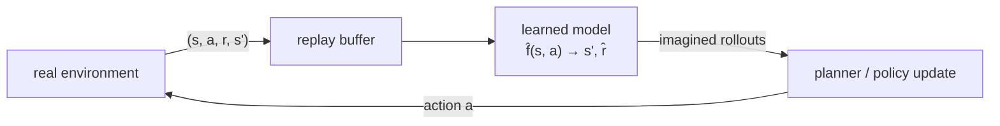
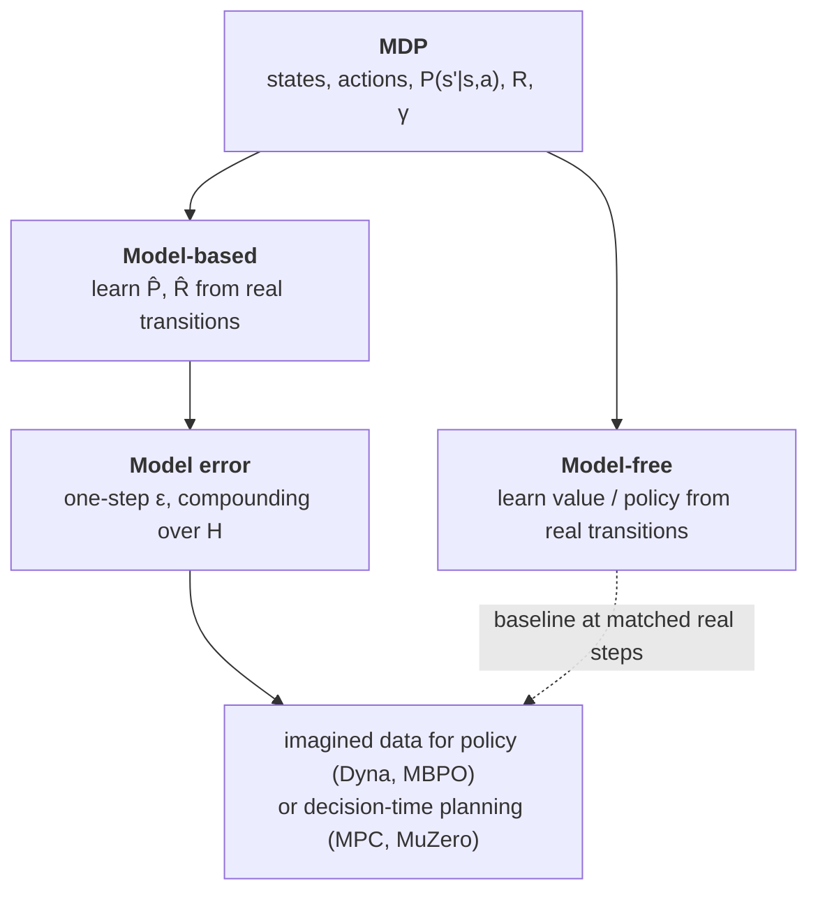

# World Models Module 01 — Model-Based Learning

## 00 Why This Module Exists

A learned world model is a function that answers "what happens if I do this?" before the action is taken.
- Planning or policy learning can then use imagined experience instead of real experience.
- Real experience is slow, expensive, or dangerous for robots and physical systems, so imagined experience is attractive.
- The same function is also a source of silent failure: an optimizer will find and exploit every place where the model is wrong.


- Legend: s: state; a: action; r: reward; s': next state; f̂: learned transition model.

This module covers the model-free versus model-based split, learning transition and reward models, compounding rollout error, and when a model actually saves real interactions.
- Learning the model in a latent space from pixels belongs to [World Models Module 02](../02-latent-world-models/README.md).
- Using the model to choose actions (MPC, CEM, tree search) belongs to [World Models Module 03](../03-planning/README.md).
- Transfer from simulator to hardware belongs to [World Models Module 06](../06-simulation-sim2real/README.md).

**Research status:** satellite 80/20 revision, 2026-11-26. The formulas below are derived in the text. Algorithm descriptions attributed to papers (Dyna, PETS, MBPO, MuZero) were written from the cited sources but were **not** re-read for this revision, and no implementation was pinned to a commit (`TODO_VERIFY`). Re-check them in the source trace before citing them elsewhere.

**Module Orientation**

- **Engineering problem:** decide when a learned model reduces the real-interaction budget, and bound how far its predictions can be trusted.
- **What you will do:**
  - compute returns and effective horizons by hand;
  - fit tabular and neural transition models and measure their one-step and multi-step error;
  - compare model-free and model-based learning at a fixed real-step budget;
  - break a planner by letting it exploit model error, then guard against it.
- **Environment:** Python 3.10+, NumPy, a small RL environment library (for example Gymnasium), and CPU only. A gridworld and one continuous-control task (pendulum or similar).
- **Evidence rule:** separate source observations (**O**), derivations (**D**), and hypotheses that need measurement (**H**).
- **If You Only Have One Week**: Lessons WM1.3 and WM1.4. They cover why rollouts drift and when a model is worth having; the definitions in WM1.1–WM1.2 can be skimmed.

## 01 Baseline Assumptions

- Core [Module 00](../../advanced-ai-engineering/00-scientific-ai-engineering/README.md): paired comparisons, seeds, and the observation/derivation/hypothesis split.
- Core [Module 06](../../advanced-ai-engineering/06-reasoning-test-time-compute/README.md): spending compute at decision time instead of training time; planning with a model is the control-theory version of the same trade.
- Core [Module 27](../../advanced-ai-engineering/27-rl-post-training-systems/README.md) is useful but not required: it treats RL for language models, where the "environment" is a reward model or verifier.
- Mathematical prerequisites: expectation, geometric series, conditional probability, and least-squares regression.

## 02 Target Mastery

```yaml
depth_contract:
  conceptual: REQUIRED
  mechanistic: REQUIRED
  mathematical: REQUIRED
  quantitative: REQUIRED
  implementation: REQUIRED
  source_code: SELECTIVE
  instrumentation: SELECTIVE
  experimental: REQUIRED
  statistical: SELECTIVE
  production_reasoning: SELECTIVE
  failure_analysis: REQUIRED
  falsification: REQUIRED
  security: NOT_APPLICABLE
  economics: SELECTIVE
  architecture_tradeoff: REQUIRED
  research_connection: SELECTIVE

estimated_effort:
  instruction: 2h
  guided_practice: 1.25h
  labs: 3h
  assessment: 0.75h
  source_trace: 0.5h
  total: 7.5h
```

The learner must be able to state what a transition model predicts and from what data, bound its multi-step error, measure sample efficiency against a model-free baseline at a matched real-step budget, and detect when a planner is exploiting model error.

### LAYER 1: KNOWLEDGE / INSTRUCTIONAL LAYER

## 03 Knowledge Map


- Legend: MDP: Markov decision process; P̂, R̂: learned transition and reward models; H: rollout horizon.

Keep three questions separate:

1. **Model accuracy:** how well does $\hat f$ predict $s'$ and $r$ on states the data covers?
2. **Model usefulness:** does using $\hat f$ improve the real return per real step?
3. **Model exploitation:** does the optimizer drive the policy into states where $\hat f$ is confidently wrong?

A model can score well on (1) and still fail (2) because of (3).

## 04 Lessons

### Lesson WM1.1 — MDPs, Returns, and the Model-Free / Model-Based Split

**Engineering Question:**
What exactly does a model-based method learn that a model-free method does not, and what does each one spend real interactions on?

**Concepts & Definitions:**

- **MDP:** states $s$, actions $a$, transition distribution $P(s' \mid s, a)$, reward $R(s, a)$, and discount $\gamma \in [0, 1)$.
- **Policy $\pi(a \mid s)$:** the behavior being learned.
- **Model-free RL:** learns a value function or policy directly from real transitions. It never predicts $s'$.
- **Model-based RL:** learns $\hat P$ (or a deterministic $\hat f$) and $\hat R$, then uses them to generate imagined transitions or to plan.

Discounted return from time $t$:

$$
G_t = \sum_{k=0}^{\infty} \gamma^k \, r_{t+k}
$$

where:

- $G_t$ is the return from time step $t$;
- $r_{t+k}$ is the reward received $k$ steps after $t$;
- $\gamma$ is the discount factor.

*Step-by-step reading.*

1. Each future reward is weighted by $\gamma^k$, so rewards far in the future count less.
2. If every reward equals 1, $G_t = \sum_k \gamma^k = 1/(1-\gamma)$ (geometric series). This value is called the **effective horizon**: rewards much beyond about $1/(1-\gamma)$ steps barely affect $G_t$.

**Mechanism Explanation:**

A model-free learner needs real transitions for every value update. A model-based learner spends real transitions on fitting $\hat P$ and $\hat R$, which is supervised learning with a dense target (the whole next state), then generates as many imagined transitions as compute allows. The gain exists only if the model is accurate where the policy will go (**D**).

**Worked Example (return and horizon):**
*Input.* Rewards $(0, 0, 1)$ then termination, with $\gamma = 0.9$.

*Steps.*
- $G_0 = 0 + 0.9 \cdot 0 + 0.9^2 \cdot 1 = 0.81$.
- Effective horizon at $\gamma = 0.9$: $1/(1-0.9) = 10$ steps.
- At $\gamma = 0.99$: $1/(1-0.99) = 100$ steps.

*Result.* Raising $\gamma$ from 0.9 to 0.99 makes the objective care about ten times further ahead, which is also ten times further a model would have to predict if it were used for full-horizon rollouts.

**Knowledge Check:** A task needs about 200 steps of foresight. Why is $\gamma = 0.9$ a poor choice, and what does a larger $\gamma$ ask of a learned model?

**Guided Practice:** For one gridworld, write down which quantities a Q-learning agent and a Dyna agent each store, and count how many real transitions each one needs per value update.

**Feedback Contract:**
- *Expected Evidence*: Q-learning stores $Q(s,a)$ and uses one real transition per update; Dyna stores $Q(s,a)$ plus a model table and uses one real transition plus $n$ imagined updates per real step.
- *Common Failure*: calling any method that uses a replay buffer "model-based"; a buffer replays real data and cannot answer "what if I took a different action?".
- *Diagnostic Hint*: ask whether the method can produce a transition for a state–action pair it never observed.
- *Concept to Revisit*: Model-based RL.

**Learning Outcome:** Distinguish what model-free and model-based methods learn and how each spends real interactions.

*(Effort: 25m instruction, 15m practice)*

### Lesson WM1.2 — Learning Transition and Reward Models

**Engineering Question:**
How is a transition model fit from data, and how do we know which parts of it to trust?

**Concepts & Definitions:**

- **Tabular model:** count-based estimate for discrete states and actions.
- **Neural dynamics model:** a network $\hat f_\theta(s, a)$ trained by regression on observed $(s, a, s')$. A common target is the difference $s' - s$ rather than $s'$ itself.
- **Aleatoric uncertainty:** randomness in the environment itself; modeled by predicting a distribution (for example a Gaussian mean and variance).
- **Epistemic uncertainty:** uncertainty from limited data; commonly estimated by disagreement in an **ensemble** of models trained on bootstrapped data, as in PETS (**O**, `TODO_VERIFY`).

Tabular maximum-likelihood estimate:

$$
\hat P(s' \mid s, a) = \frac{N(s, a, s')}{N(s, a)}
$$

where:

- $N(s, a)$ is the number of times action $a$ was taken in state $s$;
- $N(s, a, s')$ is how many of those times led to $s'$.

*Step-by-step reading.*

1. This is the empirical frequency of each outcome. It is exact in the limit of many visits.
2. Each estimate is a proportion, so its standard error is about $\sqrt{\hat p(1-\hat p)/N(s,a)}$. Rarely visited pairs have wide uncertainty even when the estimate looks precise.
3. Pairs with $N(s,a) = 0$ have no estimate at all; a planner that queries them is extrapolating.

**Mechanism Explanation:**

Dyna (Sutton, 1991) combines direct RL on real transitions with extra updates on transitions sampled from the learned model (**O**, `TODO_VERIFY`). Neural methods follow the same split but must also handle continuous states, stochasticity, and extrapolation, which is why ensembles and short rollouts appear in PETS and MBPO (**O**).

**Worked Example (tabular estimate and its uncertainty):**
*Input.* In state $s$, action $a$ was taken 20 times: 14 led to $s_1$ and 6 to $s_2$.

*Steps.*
- $\hat P(s_1 \mid s, a) = 14/20 = 0.70$; $\hat P(s_2 \mid s, a) = 0.30$.
- Standard error: $\sqrt{0.70 \times 0.30 / 20} = \sqrt{0.0105} = 0.1025$.
- A rough 95% interval for $P(s_1)$: $0.70 \pm 1.96 \times 0.1025 = [0.50, 0.90]$.

*Result.* Twenty visits pin the probability only to about $\pm 0.2$. A planner that treats 0.70 as exact will be overconfident.

**Knowledge Check:** Why does an ensemble's disagreement grow on states far from the training data, while each member's own predicted variance (aleatoric) may not?

**Guided Practice:** Collect 2,000 random-policy transitions from a pendulum task. Fit a 5-member ensemble of small MLPs predicting $s' - s$. Plot one-step error and ensemble disagreement against distance from the training data (for example, angular velocity beyond the training range).

**Feedback Contract:**
- *Expected Evidence*: a held-out one-step error table, and a plot where disagreement rises outside the data range.
- *Common Failure*: evaluating the model only on held-out transitions from the same random policy, then planning with a different policy that visits new states.
- *Diagnostic Hint*: evaluate on transitions collected by the policy you will actually use.
- *Concept to Revisit*: Epistemic versus aleatoric uncertainty.

**Learning Outcome:** Fit a transition model and report where its predictions are supported by data.

*(Effort: 30m instruction, 20m practice)*

### Lesson WM1.3 — Compounding Error and the Viable Rollout Horizon

**Engineering Question:**
How fast does a small one-step error grow over a multi-step imagined rollout?

**Concepts & Definitions:**

- **One-step error $\varepsilon$:** the largest distance between true and predicted next state for the same input, $\|\hat f(s, a) - f(s, a)\| \le \varepsilon$.
- **Lipschitz constant $L$ of the true dynamics:** $\|f(x, a) - f(y, a)\| \le L \|x - y\|$. $L > 1$ means nearby states drift apart.
- **Rollout error $e_t$:** distance between the imagined state $\hat s_t$ and the true state $s_t$ after $t$ steps from the same start and actions.

Error bound after $H$ steps (**D**):

$$
e_H \le \varepsilon \sum_{k=0}^{H-1} L^k =
\begin{cases}
\varepsilon \, \dfrac{L^H - 1}{L - 1} & L \ne 1 \\[2ex]
\varepsilon H & L = 1
\end{cases}
$$

where:

- $e_H$ is the rollout error after $H$ steps;
- $\varepsilon$ is the one-step model error bound;
- $L$ is the Lipschitz constant of the true dynamics;
- $H$ is the rollout horizon.

*Step-by-step derivation.*

1. $e_{t+1} = \|\hat f(\hat s_t, a_t) - f(s_t, a_t)\|$.
2. Add and subtract $f(\hat s_t, a_t)$, then use the triangle inequality: $e_{t+1} \le \|\hat f(\hat s_t, a_t) - f(\hat s_t, a_t)\| + \|f(\hat s_t, a_t) - f(s_t, a_t)\| \le \varepsilon + L e_t$.
3. Unroll from $e_0 = 0$: $e_1 \le \varepsilon$, $e_2 \le \varepsilon + L\varepsilon$, and so on, giving the sum.
4. If $L < 1$ the sum converges to $\varepsilon/(1-L)$: error stays bounded. If $L > 1$ it grows geometrically.

**Mechanism Explanation:**

The bound is a worst case, but its shape matches practice: errors that are invisible at one step dominate after tens of steps in unstable or contact-rich systems. MBPO responds by starting short model rollouts from real states in the buffer, instead of long rollouts from the initial state (**O**, `TODO_VERIFY`). Planning with replanning at every step (MPC, [World Models Module 03](../03-planning/README.md)) limits the damage by using only the first action of each plan.

**Worked Example (horizon sweep):**
*Input.* $\varepsilon = 0.01$.

*Steps.*
- $L = 1.1$, $H = 10$: $1.1^{10} = 2.594$, so $e_{10} \le 0.01 \times 1.594 / 0.1 = 0.159$.
- $L = 1.1$, $H = 20$: $1.1^{20} = 6.727$, so $e_{20} \le 0.01 \times 5.727 / 0.1 = 0.573$.
- $L = 1$, $H = 20$: $e_{20} \le 0.20$.
- $L = 0.9$, any $H$: $e_H \le 0.01 / 0.1 = 0.10$.

*Result.* With mildly unstable dynamics, doubling the horizon from 10 to 20 multiplies the bound by 3.6, not 2.

**Knowledge Check:** Why can a model with lower one-step error produce worse 50-step rollouts than another model?

**Guided Practice:** Using the LAB B ensemble, measure $e_H$ for $H = 1, 5, 10, 20, 50$ from 100 real start states. Fit $\varepsilon$ and an apparent $L$, and compare the measured curve with the bound.

**Feedback Contract:**
- *Expected Evidence*: a median and 90th-percentile $e_H$ curve; the measured curve lies below the bound and grows faster than linearly for the unstable regime.
- *Common Failure*: reporting only one-step error, or averaging over start states so that rare divergent rollouts disappear.
- *Diagnostic Hint*: plot individual rollouts; divergence usually starts at a specific event (contact, angle wrap, saturation).
- *Concept to Revisit*: Lipschitz constant; viable horizon.

**Learning Outcome:** Bound and measure compounding error, and choose a rollout horizon from evidence.

*(Effort: 35m instruction, 25m practice)*

### Lesson WM1.4 — Sample Efficiency, Model Exploitation, and Next-Token Predictors

**Engineering Question:**
When does a model actually save real interactions, and how is an action-conditioned world model different from an autoregressive next-token predictor?

**Concepts & Definitions:**

- **Sample efficiency:** real return reached per real environment step. Imagined steps and gradient updates are compute, not samples.
- **Model exploitation:** the policy or planner improves imagined return by steering into regions where the model is wrong in its favor.
- **Action-conditioned prediction:** a world model predicts $p(s_{t+1} \mid s_{\le t}, a_{\le t})$ and is queried with actions the agent chooses, including actions the data-collecting policy rarely took.

Update budget in Dyna-style training:

$$
U = N_{\text{real}} \,(1 + n)
$$

where:

- $U$ is the total number of value updates;
- $N_{\text{real}}$ is the number of real environment steps;
- $n$ is the number of imagined (model) updates per real step.

**Mechanism Explanation:**

A next-token language model and a transition model share the same factorization, but they are used differently (**D**):
- A language model is evaluated on sequences drawn from roughly the same distribution it was trained on.
- A world model is queried *counterfactually*: the planner asks about actions and states the logged policy did not produce, and the policy changes as it learns.
- The second use is exactly where models extrapolate, so model exploitation is a property of the training loop, not of the network alone.

Model-based methods tend to pay off when real steps are expensive and the dynamics are smooth enough to learn; model-free methods remain competitive when simulation is cheap and fast (**H**, scoped to your task in LAB A).

**Worked Example (real-step cost):**
*Input.* A robot arm runs at 10 control steps per second. A model-free method needs $10^6$ real steps; a model-based method reaches the same real return in $5 \times 10^4$ real steps with $n = 10$. Both figures are illustrative.

*Steps.*
- Model-free wall time: $10^6 / 10 = 10^5$ s $= 27.8$ h of robot time.
- Model-based wall time: $5 \times 10^4 / 10 = 5{,}000$ s $= 1.39$ h.
- Model-based updates: $U = 5 \times 10^4 \times 11 = 5.5 \times 10^5$, of which $5 \times 10^5$ are imagined.

*Result.* The saving is in robot hours, paid for in compute. In a fast simulator where $10^6$ steps take minutes, the same trade may not be worth it.

**Knowledge Check:** A planner's imagined return keeps rising across iterations while real return falls. Name two measurements that discriminate model exploitation from a reward-model bug.

**Guided Practice:** In the LAB B setup, run the planner against the learned model with and without an ensemble-disagreement penalty. Log imagined return, real return, and mean disagreement along the chosen trajectories.

**Feedback Contract:**
- *Expected Evidence*: without the penalty, a growing gap between imagined and real return that coincides with rising disagreement; with the penalty, a smaller gap.
- *Common Failure*: reporting imagined return as the result.
- *Diagnostic Hint*: replay the planned action sequence in the real environment and compare state by state.
- *Concept to Revisit*: Model exploitation; epistemic uncertainty.

**Learning Outcome:** Measure sample efficiency correctly and detect model exploitation.

*(Effort: 30m instruction, 15m practice)*

## 05 Literature & Production Source Map

**REFERENCE / BASELINE**

- *Reinforcement Learning: An Introduction* (2nd ed.) — Sutton and Barto (2018). Reading pointer: Chapter 8, planning and learning with tabular methods (Dyna-Q).
- *Dyna, an Integrated Architecture for Learning, Planning, and Reacting* — Sutton (SIGART Bulletin, 1991).
- [Deep Reinforcement Learning in a Handful of Trials using Probabilistic Dynamics Models (PETS)](https://arxiv.org/abs/1805.12114) — Chua et al. (2018). Reading pointer: probabilistic ensembles and trajectory sampling.
- [When to Trust Your Model: Model-Based Policy Optimization (MBPO)](https://arxiv.org/abs/1906.08253) — Janner et al. (2019). Reading pointer: the argument for short branched rollouts from real states.
- [World Models](https://arxiv.org/abs/1803.10122) — Ha and Schmidhuber (2018). Bridge to [World Models Module 02](../02-latent-world-models/README.md).

**WORKLOAD-DEPENDENT / FRONTIER**

- [MuZero](https://arxiv.org/abs/1911.08265) — Schrittwieser et al. (2020). Learns a model that predicts only the quantities planning needs (value, policy, reward), not observations. Scope its results to the reported games and compute.
- [DreamerV3](https://arxiv.org/abs/2301.04104) — Hafner et al. (2023). Latent-space model learning; covered in Module 02.

**CURRENT DEFAULT:** an ensemble dynamics model, short model rollouts or MPC with replanning, an uncertainty penalty or rollout cutoff, and a model-free baseline at a matched real-step budget.

**LEGACY / INSUFFICIENT:** long open-loop rollouts from a single model; reporting imagined return; comparing methods by gradient steps instead of real steps; evaluating the model only on data from the collection policy.

**PRODUCTION SOURCE TRACE** (pin the commit you read; no commit was pinned in this revision)

- An open MBPO or PETS implementation, for example the authors' `jannerm/mbpo` repository or `facebookresearch/mbrl-lib` (`TODO_VERIFY` file paths at your pinned commit). Locate:
  - where ensemble members are trained on bootstrapped data;
  - where rollouts start from buffer states and how their length is set;
  - how model-generated and real transitions are mixed for the policy update.
- Scope: one implementation's choices, not a definition of model-based RL.

### LAYER 2: ENGINEERING PRACTICE LAYER

## 06 Engineering Labs

All labs follow `PREDICT → BUILD → MEASURE → EXPLAIN → BREAK → IMPROVE → FALSIFY`.

### LAB A — Dyna-Q versus Q-Learning at a Matched Real-Step Budget

- **Objective:** measure how many real steps each method needs to reach a target return on a gridworld, and how that changes with planning updates $n$ and environment stochasticity.
- **Pre-Registered Hypothesis:** Dyna-Q with $n \ge 5$ reaches the target in fewer real steps than Q-learning on a deterministic gridworld, and the advantage shrinks when transitions become stochastic or the environment changes mid-run.
- **Independent Variables:** $n \in \{0, 5, 20, 50\}$, slip probability, and a mid-run change to the map.
- **Dependent Variables:** real steps to target return (median over at least 10 seeds), total updates, and wall time.
- **Break & Falsify:** move a wall after convergence so the stored model is stale; record how long each method takes to recover.
- **Alignment:** Lessons WM1.1, WM1.2, WM1.4.
- **Effort Estimate:** 1.25h.

### LAB B — Compounding Error and Model Exploitation on a Continuous Task

- **Objective:** fit an ensemble model on a pendulum-type task, measure multi-step error, then plan against it and measure the imagined–real gap.
- **Pre-Registered Hypothesis:** multi-step error grows faster than linearly with horizon, and a planner without an uncertainty penalty achieves higher imagined but lower real return than one with the penalty.
- **Independent Variables:** rollout horizon, ensemble size, data amount, uncertainty penalty weight.
- **Dependent Variables:** $e_H$ percentiles, ensemble disagreement, imagined return, real return.
- **Break & Falsify:** train only on low-velocity data, then let the planner reach high velocity; check whether disagreement flags the failure before real return drops.
- **Alignment:** Lessons WM1.2–WM1.4 and Incident WM1.1.
- **Effort Estimate:** 1.75h.

**Runnable arithmetic check (CPU; not an RL experiment):**
```python
import math
assert math.isclose(sum(0.9**k * r for k, r in enumerate([0, 0, 1])), 0.81)
assert math.isclose(1 / (1 - 0.9), 10) and math.isclose(1 / (1 - 0.99), 100)
p, n = 14 / 20, 20
se = math.sqrt(p * (1 - p) / n)
assert math.isclose(p, 0.7) and round(se, 4) == 0.1025
bound = lambda eps, L, H: eps * H if L == 1 else eps * (L**H - 1) / (L - 1)
assert round(bound(0.01, 1.1, 10), 3) == 0.159
assert round(bound(0.01, 1.1, 20), 3) == 0.573
assert math.isclose(bound(0.01, 1, 20), 0.2)
assert bound(0.01, 0.9, 1000) <= 0.1 + 1e-12
assert math.isclose(1e6 / 10 / 3600, 27.777, rel_tol=1e-4)
assert 50_000 * (1 + 10) == 550_000
```

## 07 Break / Incident Scenarios

### Incident WM1.1 — Imagined Return Rises, Real Return Falls

**Incident Symptoms:**
A team trains a manipulation policy with model-based updates in simulation. Over three days, the return predicted by imagined rollouts rises steadily. Real (simulator) evaluation return peaks on day one and then falls. The model's held-out one-step loss keeps improving.

**Diagnostic Protocol (Task):**
1. **Form Competing Hypotheses:** model exploitation in under-covered states, a reward-model error that the policy exploits, rollouts too long for the model's accuracy, a stale model after a policy shift, an evaluation/training environment mismatch, or seed noise.
2. **Identify Missing Evidence:** state-visitation coverage of the current policy versus the training data, ensemble disagreement on visited states, predicted versus true reward on real trajectories, rollout length schedule, and environment configs for training and evaluation.
3. **Design Discriminating Measurements:** replay the current policy's real trajectories through the model step by step; compare predicted and true next states and rewards; evaluate held-out loss on data from the *current* policy, not the original buffer.
4. **Rank Explanations:** exploitation predicts high disagreement and large state error on newly visited states; a reward bug predicts accurate states but wrong rewards; a config mismatch predicts error from step one.
5. **Intervene:** add an uncertainty penalty or truncate rollouts at a disagreement threshold, shorten rollouts, retrain the model on current-policy data, or fix the reward head.
6. **Remeasure:** real return over at least five seeds and the imagined–real gap, with the change and without it.

### LAYER 3: MASTERY / ASSESSMENT LAYER

## 08 Mastery Assessment

### Transfer Problem — Should This Robot Team Use a World Model?

A team has a manipulation task with a simulator that runs at 50 times real time and a real robot available for 20 hours per week. They must decide whether to add a learned dynamics model.

**Required Deliverables:**
1. a statement of which quantities would be modeled and from which data, and which would not;
2. hand-computed effective horizon for the task's $\gamma$ and a compounding-error bound for the planned rollout length;
3. a real-step budget comparison for simulator and robot, using LAB A evidence for the shape of the gain;
4. a model-exploitation guard (penalty, cutoff, or replanning) with the measurement that triggers it, backed by LAB B;
5. a recommendation for simulator and for robot separately, with the evidence that would change it.

## 09 Required Evidence & Rubric

### Required Artifact: Model-Usefulness Report

Submit the LAB A real-step curves, the LAB B horizon-error and imagined–real plots, and the Incident WM1.1 diagnosis.

### Rubric Dimensions

- **Mechanism:** *Insufficient* says "the model imagines the future." *Competent* states what is predicted, from what data, and how it is used. *Strong* predicts where the model will be exploited before running the planner.
- **Quantitative:** *Insufficient* reports training curves by gradient step. *Competent* reports real steps and horizon error. *Strong* links the measured error curve to a chosen rollout length.
- **Diagnosis:** *Insufficient* trusts imagined return. *Competent* compares imagined and real return. *Strong* localizes the divergence to specific states and adds a guard that fires before real return drops.

## 10 Capability Traceability Matrix

| Capability | Taught | Practiced | Assessed | Evidence (artifact reviewers open) |
|---|---|---|---|---|
| Model-free versus model-based accounting | WM1.1 | WM1.1 Guided Practice; LAB A | Deliverables 1, 3 | LAB A real-step curves with total-update counts |
| Transition model fitting and uncertainty | WM1.2 | WM1.2 Guided Practice; LAB B | Deliverables 1, 4 | Ensemble disagreement versus data-coverage plot |
| Compounding error and horizon choice | WM1.3 | WM1.3 Guided Practice; LAB B | Deliverable 2; Incident WM1.1 | Measured $e_H$ percentiles against the bound |
| Sample efficiency and model exploitation | WM1.4 | WM1.4 Guided Practice; LABs A, B | Deliverables 3–5; Incident WM1.1 | Imagined–real return gap with and without the guard |

## 11 Exit Criteria & Module Wrap-Up

### Exit Criteria

A learner passes when they can compute returns and horizons, fit a transition model and show where it is supported by data, bound and measure compounding error, compare methods at a matched real-step budget, and detect and guard against model exploitation with measured evidence.

### Module Wrap-Up (Final Mental Model Reconstruction)

A world model trades real interactions for compute and for trust in its predictions. Count real steps, measure error at the horizon you use, and treat any optimizer that uses the model as an adversary searching for its mistakes.

### Cost & Telemetry Hook

- [Lesson 22.1](../../advanced-ai-engineering/22-ai-economics/README.md): cost per unit of real return must include robot or simulator time and model-training compute, not only policy updates.
- [Lesson 23.1](../../advanced-ai-engineering/23-observability-reliability/README.md): log imagined and real return side by side, plus ensemble disagreement on visited states, so Incident WM1.1 is visible on a dashboard.

## 12 Competency Targets

```yaml
competency:
  sfia: 4
  bloom: Apply -> Analyze
  solo: Relational
  dreyfus: Advanced Beginner -> Competent
```
