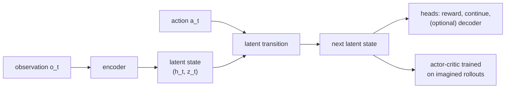
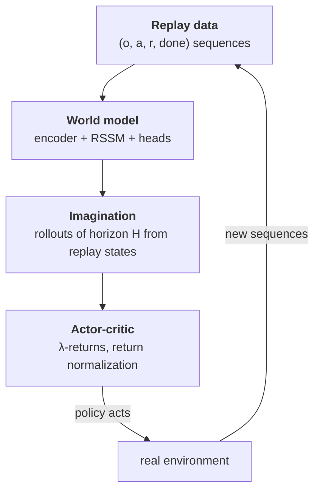

# World Models Module 02 — Latent World Models

## 00 Why This Module Exists

A world model is useful only if a policy can be trained or planned inside it more cheaply than in the real environment, and if what the policy learns there still holds when it acts for real.
- Predicting future frames pixel by pixel is expensive and spends capacity on details that do not matter for control.
- A latent world model encodes each observation into a compact state, learns how that state moves under actions, and lets a policy practice entirely in that state space ("imagination").


- Legend: $h_t$: deterministic recurrent state; $z_t$: stochastic latent state; "continue": predicted probability that the episode does not end.

This module covers why latent dynamics beat pixel prediction for control, the recurrent state-space model (RSSM), the loss terms and robustness tricks of the Dreamer family, and actor-critic learning in imagination.
- Why a model helps at all (sample efficiency, the model-bias problem) belongs to [World Models Module 01](../01-model-based-learning/README.md).
- Searching over actions with a learned model (MPC, CEM, MCTS) belongs to [World Models Module 03](../03-planning/README.md).
- Pixel-space video generators used as "world simulators" belong to [Generative Media Module 07](../../generative-media/07-video-generation/README.md).

**Research status:** satellite 80/20 revision, 2026-11-26. Formulas are derived in the text, and worked examples are computed by hand and checked in LAB code. Architecture sizes and hyperparameters attributed to PlaNet, DreamerV1–V3, and the `danijar/dreamerv3` code were written from the cited papers but were **not** re-read against a pinned commit or paper version in this revision (`TODO_VERIFY`). Benchmark results are named only as author-reported claims, with no numbers imported.

**Module Orientation**

- **Engineering problem:** learn a latent dynamics model whose imagined rollouts are accurate enough, for long enough, that a policy trained on them improves in the real environment.
- **What you will do:**
  - compare the size and error growth of pixel versus latent prediction;
  - compute RSSM prior/posterior KL terms and their gradients by hand;
  - reproduce the DreamerV3 robustness transforms (symlog, two-hot, return normalization);
  - compute $\lambda$-returns on an imagined trajectory;
  - break a small world model and measure the gap between imagined and real return.
- **Environment:** Python 3.10+, PyTorch or JAX, a small control environment with image or state observations (for example a pendulum, cart-pole, or grid world), CPU or one small GPU.
- **Evidence rule:** separate source observations (**O**), derivations (**D**), and hypotheses that need measurement (**H**).
- **If You Only Have One Week**: Lessons WM2.2 and WM2.4. They cover the state representation and the place where world models fail in practice: a policy exploiting model error.

## 01 Baseline Assumptions

- [World Models Module 01](../01-model-based-learning/README.md): MDPs, returns, discounting, and the model-bias problem.
- Core [Module 01](../../advanced-ai-engineering/01-foundation-model-internals/README.md): sequence models, recurrent and attention state, and parameter accounting.
- Core [Module 07](../../advanced-ai-engineering/07-model-behavior-uncertainty/README.md): epistemic versus aleatoric uncertainty and calibration.
- Mathematical prerequisites: expectation, KL divergence, the reparameterization idea, and the Bellman equation.

## 02 Target Mastery

```yaml
depth_contract:
  conceptual: REQUIRED
  mechanistic: REQUIRED
  mathematical: REQUIRED
  quantitative: REQUIRED
  implementation: REQUIRED
  source_code: SELECTIVE
  instrumentation: SELECTIVE
  experimental: REQUIRED
  statistical: SELECTIVE
  production_reasoning: SELECTIVE
  failure_analysis: REQUIRED
  falsification: REQUIRED
  security: NOT_APPLICABLE
  economics: SELECTIVE
  architecture_tradeoff: REQUIRED
  research_connection: SELECTIVE

estimated_effort:
  instruction: 2h
  guided_practice: 1.25h
  labs: 3h
  assessment: 0.75h
  source_trace: 0.5h
  total: 7.5h
```

The learner must be able to draw the RSSM and name what each state carries, write its loss terms, explain each DreamerV3 robustness transform as a fix for a specific failure, compute imagined returns, and diagnose when a policy is exploiting the model rather than solving the task.

### LAYER 1: KNOWLEDGE / INSTRUCTIONAL LAYER

## 03 Knowledge Map


- Legend: $H$: imagination horizon (steps); $\lambda$: return mixing parameter.

Keep three error sources separate:

1. **Representation error:** the latent state drops information the task needs (the reward or a fast-moving object is not encoded).
2. **Dynamics error:** the latent transition drifts from real trajectories, and the drift compounds with horizon.
3. **Exploitation error:** the policy finds actions where the model is wrong in its favour; imagined return rises while real return does not.

Each has a different measurement: reconstruction or probe accuracy, open-loop prediction error by horizon, and the imagined-versus-real return gap.

## 04 Lessons

### Lesson WM2.1 — Why Predict in Latent Space

**Engineering Question:**
What does it cost to predict the future in pixel space, and what do we gain by predicting a compact state instead?

**Concepts & Definitions:**

- **Observation space:** raw inputs such as a $64 \times 64$ RGB frame ($12{,}288$ values).
- **Latent state:** a learned vector that should keep what matters for reward and future dynamics and drop the rest.
- **Open-loop rollout:** predicting $H$ steps ahead from one starting state, feeding the model its own predictions instead of real observations.
- **Compounding error:** small one-step errors accumulate because each prediction is the input to the next one.

Error bound under a Lipschitz transition:

$$
e_H \le \varepsilon \cdot \frac{L^H - 1}{L - 1}, \qquad L \ne 1
$$

where:

- $e_H$ is the state error after $H$ open-loop steps;
- $\varepsilon$ is the maximum one-step prediction error;
- $L$ is the Lipschitz constant of the true transition (how much it can amplify a state difference in one step);
- $H$ is the rollout horizon.

*Step-by-step reading.*

1. Step 1 adds at most $\varepsilon$. At step 2, the existing error is amplified by at most $L$, then a new $\varepsilon$ is added: $e_2 \le L\varepsilon + \varepsilon$.
2. Repeating gives $e_H \le \varepsilon(1 + L + \dots + L^{H-1})$, a geometric sum equal to $\varepsilon (L^H - 1)/(L - 1)$.
3. If $L < 1$ (contracting dynamics), the bound saturates at $\varepsilon / (1 - L)$. If $L > 1$, it grows exponentially in $H$. If $L = 1$, the sum is $H\varepsilon$.

This is a worst-case bound (**D**), not a prediction of actual error, but it explains why imagination horizons are short.

**Mechanism Explanation:**

A pixel model must reproduce backgrounds, textures, and lighting at every step, so most of its capacity and loss goes to details the controller ignores. A latent model can be much smaller per step and can be rolled out in large batches cheaply. The trade-off: a latent model trained only to reconstruct may still keep irrelevant detail, and a latent model trained without reconstruction may drop task-relevant detail that reward alone does not reveal ([§05 Frontier](#05-literature--production-source-map)).

**Worked Example (state size and error growth):**
*Input.* A $64 \times 64 \times 3$ frame at 8 bits per value, versus a DreamerV2-style stochastic state of 32 categorical variables with 32 classes each (**O**, `TODO_VERIFY`).

*Steps.*
- Pixel frame: $12{,}288 \times 8 = 98{,}304$ bits.
- Stochastic state: $32 \times \log_2 32 = 32 \times 5 = 160$ bits.
- Ratio: $98{,}304 / 160 = 614.4$.
- Error growth with $\varepsilon = 0.01$ and $L = 1.1$:
  - $H = 15$: $1.1^{15} = 4.177$, so $e_{15} \le 0.01 \times 3.177 / 0.1 = 0.318$.
  - $H = 50$: $1.1^{50} = 117.39$, so $e_{50} \le 0.01 \times 116.39 / 0.1 = 11.64$.

*Result.* The latent sample is about 600 times smaller than one frame. More horizon is not free: the worst-case error bound grows 37 times from $H = 15$ to $H = 50$.

*Interpretation and limits.* The deterministic state $h_t$ (Lesson WM2.2) adds hundreds of floats, so the full latent is not 160 bits; the comparison is for the sampled stochastic part. The point is the order of magnitude per imagined step.

**Knowledge Check:** Why can a world model with lower one-step error still produce worse 50-step rollouts than another model?

**Guided Practice:** Train a one-step predictor on a toy environment in two variants: pixel-to-pixel and encoder-to-latent-to-latent. Plot open-loop error against horizon for $H = 1, 5, 15, 50$, measured in a shared space (for example decoded frames or a probe of the true state).

**Feedback Contract:**
- *Expected Evidence*: two curves of error versus horizon with the same starting states, plus parameter counts and wall-clock time per imagined step for each variant.
- *Common Failure*: comparing pixel MSE against latent MSE directly; the two spaces have different scales.
- *Diagnostic Hint*: evaluate both in one space, such as decoded frames or a linear probe of true positions.
- *Concept to Revisit*: Compounding error; open-loop rollout.

**Learning Outcome:** Quantify the size and horizon trade-off between pixel and latent prediction.

*(Effort: 25m instruction, 15m practice)*

### Lesson WM2.2 — The Recurrent State-Space Model (RSSM)

**Engineering Question:**
Why does the RSSM keep both a deterministic and a stochastic state, and what does each one fix?

**Concepts & Definitions:**

The RSSM, introduced in PlaNet and used by DreamerV1–V3 (**O**), has these components:

$$
\begin{aligned}
&\text{recurrent:} && h_t = f_\phi(h_{t-1}, z_{t-1}, a_{t-1}) \\
&\text{posterior:} && z_t \sim q_\phi(z_t \mid h_t, o_t) \\
&\text{prior:} && \hat z_t \sim p_\phi(\hat z_t \mid h_t) \\
&\text{heads:} && \hat r_t \sim p_\phi(r_t \mid h_t, z_t), \quad \hat c_t \sim p_\phi(c_t \mid h_t, z_t), \quad \hat o_t \sim p_\phi(o_t \mid h_t, z_t)
\end{aligned}
$$

where:

- $h_t$ is the deterministic recurrent state (a GRU hidden vector);
- $z_t$ is the stochastic state (Gaussian in V1, a vector of categoricals in V2/V3);
- $a_{t-1}$ is the previous action and $o_t$ the current observation;
- $q_\phi$ (posterior, or "representation model") sees the observation; $p_\phi$ (prior, or "dynamics model") does not;
- $r_t$ is reward and $c_t \in \{0, 1\}$ is the continue flag;
- $\phi$ are all world-model parameters.

**Mechanism Explanation:**

- During training on replay data, the model uses the **posterior**, because the observation is available.
- During imagination, there is no observation, so the model samples from the **prior**.
- A KL term pulls the prior toward the posterior, so imagined states look like states the encoder would produce.
- The deterministic path $h_t$ carries information across many steps without sampling noise. A purely stochastic model must re-sample its memory each step and tends to lose it (**O**, PlaNet ablation, `TODO_VERIFY`).
- The stochastic path $z_t$ represents what cannot be predicted: several possible futures from the same history. A purely deterministic model must average them, which blurs predictions.

**Worked Example (KL between categorical posterior and prior):**
*Input.* One categorical latent variable with 3 classes. Posterior $q = (0.7, 0.2, 0.1)$, prior $p = (0.5, 0.3, 0.2)$.

*Steps.* $\mathrm{KL}(q \,\|\, p) = \sum_k q_k \ln(q_k / p_k)$:
- $0.7 \ln(1.4) = 0.7 \times 0.33647 = 0.23553$.
- $0.2 \ln(0.6667) = 0.2 \times (-0.40547) = -0.08109$.
- $0.1 \ln(0.5) = 0.1 \times (-0.69315) = -0.06931$.
- Sum: $0.08512$ nats.

*Result.* The prior is close to the posterior for this variable. With 32 such variables, the total KL is the sum over variables, because they are modelled as independent given $h_t$.

**Knowledge Check:** During imagination the model samples from the prior. What happens to imagined rollouts if the KL term is weighted so low that the prior never learns to match the posterior?

**Guided Practice:** Implement one RSSM step (GRU cell, prior MLP, posterior MLP, straight-through sampling for categoricals). Unroll it over a 16-step batch with posterior states, then over the same batch with prior states only, and compare reward-head predictions.

**Feedback Contract:**
- *Expected Evidence*: tensor shapes for $h$, $z$ logits, and samples at each step; a per-step KL trace; reward prediction error for posterior versus prior unrolls.
- *Common Failure*: feeding the posterior into imagination, so evaluation silently uses observations the model will not have.
- *Diagnostic Hint*: in an imagination unroll, assert that no observation tensor is read after the first step.
- *Concept to Revisit*: Prior versus posterior.

**Learning Outcome:** Build and unroll an RSSM and explain the role of each state and each distribution.

*(Effort: 35m instruction, 25m practice)*

### Lesson WM2.3 — World-Model Losses and the DreamerV3 Robustness Transforms

**Engineering Question:**
Which loss terms train the world model, and which transforms let one set of hyperparameters work across very different reward scales?

**Concepts & Definitions:**

World-model loss with KL balancing in the DreamerV3 form (**O**, `TODO_VERIFY`):

$$
\mathcal{L}(\phi) = \mathbb{E}\Big[\sum_t \big(\mathcal{L}_{\text{pred}} + \beta_{\text{dyn}} \mathcal{L}_{\text{dyn}} + \beta_{\text{rep}} \mathcal{L}_{\text{rep}}\big)\Big]
$$

$$
\mathcal{L}_{\text{dyn}} = \max\!\big(1, \mathrm{KL}[\mathrm{sg}(q_t) \,\|\, p_t]\big), \qquad
\mathcal{L}_{\text{rep}} = \max\!\big(1, \mathrm{KL}[q_t \,\|\, \mathrm{sg}(p_t)]\big)
$$

where:

- $\mathcal{L}_{\text{pred}}$ is the negative log-likelihood of the observation (decoder), reward, and continue heads;
- $q_t$ and $p_t$ are the posterior and prior distributions at step $t$;
- $\mathrm{sg}(\cdot)$ is stop-gradient: that side is treated as a constant;
- $\mathcal{L}_{\text{dyn}}$ trains only the prior toward the posterior; $\mathcal{L}_{\text{rep}}$ trains only the posterior toward the prior;
- $\beta_{\text{dyn}} = 0.5$ and $\beta_{\text{rep}} = 0.1$ in the paper, so the prior moves more than the representation;
- the $\max(1, \cdot)$ is **free bits**: below 1 nat, the term is constant and produces no gradient.

Two value transforms:

$$
\mathrm{symlog}(x) = \mathrm{sign}(x)\ln(1 + |x|), \qquad \mathrm{symexp}(x) = \mathrm{sign}(x)(e^{|x|} - 1)
$$

- **Two-hot encoding:** a scalar target $y$ between bins $b_k \le y < b_{k+1}$ becomes weight $(b_{k+1} - y)/(b_{k+1} - b_k)$ on bin $k$ and the rest on bin $k + 1$. The head is trained with cross-entropy over bins placed in symlog space.
- **Return normalization:** advantages are divided by $\max(1, S)$, where $S$ is the range between the 95th and 5th percentiles of recent returns, smoothed with an exponential moving average.

**Mechanism Explanation:**

- Without free bits, the model can drive the KL to almost zero by making the posterior ignore the observation: **posterior collapse**. Free bits stop that pressure once the KL is small.
- With different $\beta$s, the prior is pushed to predict the posterior more strongly than the posterior is pushed to become predictable. A posterior that is too predictable has thrown away information.
- symlog compresses large magnitudes but is close to the identity near zero, so a reward of 1,000 and a reward of 1 produce gradients of similar scale.
- Two-hot cross-entropy makes the loss scale independent of the reward scale, unlike squared error.
- Dividing by $\max(1, S)$ scales down large returns but never amplifies small, noisy ones.

**Worked Example (transforms by hand):**
*Input.* A reward of $1{,}000$; a target $y = 2.3$ with integer bins; recent returns with $P_5 = 0.2$ and $P_{95} = 0.6$; a KL of $0.085$ nats.

*Steps.*
- $\mathrm{symlog}(1{,}000) = \ln(1{,}001) = 6.909$. $\mathrm{symlog}(1) = \ln 2 = 0.693$. The ratio drops from 1,000 to about 10.
- Two-hot for $y = 2.3$: weight $0.7$ on bin 2 and $0.3$ on bin 3. Check: $0.7 \times 2 + 0.3 \times 3 = 2.3$.
- Return scale: $S = 0.6 - 0.2 = 0.4$, so the divisor is $\max(1, 0.4) = 1$. Small returns are not amplified.
- Free bits: $\max(1, 0.085) = 1$. The KL term is constant here and gives no gradient.

*Result.* Each transform is a fix for a scale problem: symlog for large magnitudes, two-hot for loss scale, $\max(1, S)$ for sparse or tiny returns, and free bits for posterior collapse.

**Knowledge Check:** The Lesson WM2.2 example had a KL of 0.085 nats per variable, and a state has 32 variables. If free bits are applied to the summed KL rather than per variable, does that state receive a KL gradient?

**Guided Practice:** Train the same small world model three ways: no free bits, free bits at 1 nat, and $\beta_{\text{rep}} = \beta_{\text{dyn}}$. Log the KL per step and decoder loss, and probe whether the posterior still encodes the true state.

**Feedback Contract:**
- *Expected Evidence*: KL traces showing collapse or not, probe accuracy per variant, and an explanation linking each outcome to the loss term changed.
- *Common Failure*: reading a near-zero KL as "the prior is perfect" when the posterior has stopped encoding the observation.
- *Diagnostic Hint*: if KL is near zero, check whether decoded frames still change when the input frame changes.
- *Concept to Revisit*: Free bits; KL balancing.

**Learning Outcome:** Explain each DreamerV3 loss term and transform as a fix for a named failure, and detect posterior collapse.

*(Effort: 35m instruction, 20m practice)*

### Lesson WM2.4 — Learning Behavior in Imagination

**Engineering Question:**
How does the actor-critic learn from imagined trajectories, and how do we know it is not just exploiting model error?

**Concepts & Definitions:**

From each replay state, the world model imagines $H$ steps using the prior and the current actor. The critic is trained toward $\lambda$-returns:

$$
R^\lambda_t = r_t + \gamma c_t \big[(1 - \lambda)\, v(s_{t+1}) + \lambda R^\lambda_{t+1}\big], \qquad R^\lambda_H = v(s_H)
$$

where:

- $R^\lambda_t$ is the $\lambda$-return target at imagined step $t$;
- $r_t$ is the predicted reward and $c_t$ the predicted continue probability;
- $\gamma$ is the discount factor;
- $\lambda \in [0, 1]$ mixes one-step bootstrapping ($\lambda = 0$) and the full imagined return ($\lambda = 1$);
- $v(s)$ is the critic's value of model state $s = (h, z)$;
- $H$ is the imagination horizon; the recursion runs backward from $t = H - 1$.

**Mechanism Explanation:**

- Gradients for the actor come from imagined advantages, not from real rewards. Real data only enters through the world model and the replay starting states.
- **Model exploitation:** the actor maximizes predicted return, so it is pushed toward states where the model overestimates reward. Imagined return can rise while real return falls.
- Short horizons ($H$ around 15 in Dreamer, **O**, `TODO_VERIFY`) limit compounding error (Lesson WM2.1), and the critic bootstrap covers rewards beyond the horizon.
- The **train ratio** (imagined or replayed steps per real environment step) is a key cost and stability knob: a higher ratio uses data more but overfits the model to the replay buffer.

**Worked Example ($\lambda$-return, $H = 3$):**
*Input.* $\gamma = 0.9$, $\lambda = 0.95$, $c_t = 1$. Rewards $r_0 = 1$, $r_1 = 0$, $r_2 = 2$. Values $v(s_1) = 5$, $v(s_2) = 4$, $v(s_3) = 3$.

*Steps* (backward):
- $R^\lambda_3 = v(s_3) = 3$.
- $R^\lambda_2 = 2 + 0.9 \times [0.05 \times 3 + 0.95 \times 3] = 2 + 2.7 = 4.7$.
- $R^\lambda_1 = 0 + 0.9 \times [0.05 \times 4 + 0.95 \times 4.7] = 0.9 \times 4.665 = 4.1985$.
- $R^\lambda_0 = 1 + 0.9 \times [0.05 \times 5 + 0.95 \times 4.1985] = 1 + 0.9 \times 4.23858 = 4.8147$.

*Result.* $R^\lambda_0 = 4.815$. With $\lambda = 0.95$ the target leans on imagined rewards; if the reward head is biased upward, that bias flows almost directly into the critic target.

**Knowledge Check:** Why does lowering $\lambda$ reduce sensitivity to reward-head error but increase sensitivity to critic error?

**Guided Practice:** After each training epoch, run the policy for 10 real episodes and also compute the imagined return from the same starting states. Plot both and their difference.

**Feedback Contract:**
- *Expected Evidence*: a curve of imagined minus real return over training, with the train ratio and horizon stated; a note on whether the gap grows when $H$ is doubled.
- *Common Failure*: reporting imagined return as policy performance.
- *Diagnostic Hint*: replay the real actions of a failed episode through the model; the first step where predicted and real reward diverge shows where the model is wrong.
- *Concept to Revisit*: Model exploitation; $\lambda$-return.

**Learning Outcome:** Compute imagined targets and measure the imagined-versus-real gap that reveals model exploitation.

*(Effort: 25m instruction, 15m practice)*

## 05 Literature & Production Source Map

**REFERENCE / BASELINE**

- [World Models](https://arxiv.org/abs/1803.10122) — Ha and Schmidhuber (2018). Reading pointer: the V (VAE), M (MDN-RNN), C (controller) decomposition and training a controller inside the model.
- [Learning Latent Dynamics for Planning from Pixels (PlaNet)](https://arxiv.org/abs/1811.04551) — Hafner et al. (2019). Reading pointer: the RSSM and the ablation of deterministic-only and stochastic-only variants.
- [Dream to Control (DreamerV1)](https://arxiv.org/abs/1912.01603) — Hafner et al. (2020). Reading pointer: value gradients through imagined trajectories and $\lambda$-returns.
- [Mastering Atari with Discrete World Models (DreamerV2)](https://arxiv.org/abs/2010.02193) — Hafner et al. (2021). Reading pointer: categorical latents and KL balancing.
- [Mastering Diverse Domains through World Models (DreamerV3)](https://arxiv.org/abs/2301.04104) — Hafner et al. (2023). Reading pointer: symlog, two-hot, free bits, return normalization, and fixed hyperparameters across domains. The authors report collecting diamonds in Minecraft from scratch without human data; treat this as an author-reported result scoped to their setup.

**WORKLOAD-DEPENDENT / FRONTIER**

- Transformer world models over discrete tokens, such as [IRIS](https://arxiv.org/abs/2209.00588) — Micheli et al. (2023), trade recurrent state for attention over tokenized frames.
- Decoder-free latent models trained through value and reward prediction, such as [TD-MPC2](https://arxiv.org/abs/2310.16828) — Hansen et al. (2024), avoid reconstruction cost but risk dropping task-relevant detail that reward does not expose. They pair the model with planning ([World Models Module 03](../03-planning/README.md)).
- Large video-prediction models presented as world simulators: see [Generative Media Module 07](../../generative-media/07-video-generation/README.md). Visual plausibility is not the same as action-conditioned accuracy.

**CURRENT DEFAULT:** an RSSM-style latent model with categorical stochastic state, KL balancing with free bits, symlog/two-hot heads, short imagination horizons, and real-environment evaluation of every policy checkpoint.

**LEGACY / INSUFFICIENT:** reporting imagined return as performance; long open-loop horizons without error measurement; one shared $\beta$ for both KL directions with no collapse check; reward-scale tuning per environment presented as a general method.

**PRODUCTION SOURCE TRACE** (pin the commit you read; no commit was pinned in this revision)

- `danijar/dreamerv3`:
  - the RSSM class: `img_step` (prior, used in imagination) and `obs_step` (posterior). Its file has moved between releases (`nets.py` in earlier versions, a dedicated RSSM module in later ones) (`TODO_VERIFY`).
  - the loss definition: dynamics and representation KL terms with free bits, and the reward/continue heads.
  - the symlog, symexp, and two-hot helpers.
  - the actor-critic: imagination rollout, $\lambda$-return, and percentile return normalization.
- Scope: one reference implementation. Hyperparameters in configs may differ from those printed in the paper; record both.

### LAYER 2: ENGINEERING PRACTICE LAYER

## 06 Engineering Labs

All labs follow `PREDICT → BUILD → MEASURE → EXPLAIN → BREAK → IMPROVE → FALSIFY`.

### LAB A — Build and Ablate a Small RSSM

- **Objective:** train an RSSM on a toy control environment and measure open-loop prediction error by horizon for the full model and its ablations.
- **Pre-Registered Hypothesis:** removing the deterministic path increases long-horizon error; removing the stochastic path increases error on transitions with multiple plausible outcomes; removing free bits causes posterior collapse.
- **Independent Variables:** deterministic path on/off, stochastic path on/off, free bits on/off, $\beta_{\text{dyn}}$ and $\beta_{\text{rep}}$.
- **Dependent Variables:** open-loop error at $H = 1, 5, 15, 50$ in a shared evaluation space, KL per step, probe accuracy of the true state, and training time.
- **Break & Falsify:** add a stochastic event (a randomly appearing object) and a long-memory requirement (a cue shown once, needed 30 steps later).
- **Alignment:** Lessons WM2.1–WM2.3.
- **Effort Estimate:** 1.75h.

### LAB B — Imagined Versus Real Return

- **Objective:** train an actor-critic in imagination and measure when and why its imagined return diverges from real return.
- **Pre-Registered Hypothesis:** the imagined-minus-real gap grows with imagination horizon and with train ratio, and shrinks when more real data is collected.
- **Independent Variables:** horizon $H$, $\lambda$, train ratio, and replay buffer size.
- **Dependent Variables:** real return over 10 episodes, imagined return from matched start states, the gap, and the first step where reward predictions diverge on replayed failed episodes.
- **Break & Falsify:** introduce a reward-head bias in one region of state space and check whether the policy moves there.
- **Alignment:** Lesson WM2.4 and Incident WM2.1.
- **Effort Estimate:** 1.25h.

**Runnable arithmetic check (CPU; not a training experiment):**
```python
import math
assert 64 * 64 * 3 * 8 == 98_304 and 32 * int(math.log2(32)) == 160
bound = lambda eps, L, H: eps * (L**H - 1) / (L - 1)
assert math.isclose(bound(0.01, 1.1, 15), 0.3177, abs_tol=1e-4)
assert math.isclose(bound(0.01, 1.1, 50), 11.639, abs_tol=1e-3)
q, p = [0.7, 0.2, 0.1], [0.5, 0.3, 0.2]
kl = sum(a * math.log(a / b) for a, b in zip(q, p))
assert math.isclose(kl, 0.08512, abs_tol=1e-5) and max(1.0, kl) == 1.0
symlog = lambda x: math.copysign(math.log1p(abs(x)), x)
symexp = lambda x: math.copysign(math.expm1(abs(x)), x)
assert math.isclose(symlog(1000), 6.9088, abs_tol=1e-4)
assert math.isclose(symexp(symlog(-37.5)), -37.5)
lo, hi, y = 2, 3, 2.3
w_lo = (hi - y) / (hi - lo)
assert math.isclose(w_lo, 0.7) and math.isclose(w_lo * lo + (1 - w_lo) * hi, y)
g, lam, r, v = 0.9, 0.95, [1, 0, 2], [None, 5, 4, 3]
R = v[3]
for t in reversed(range(3)):
    R = r[t] + g * ((1 - lam) * v[t + 1] + lam * R)
assert math.isclose(R, 4.8147175)
```

## 07 Break / Incident Scenarios

### Incident WM2.1 — Imagined Return Climbs, Real Return Falls

**Incident Symptoms:**
A team doubles the imagination horizon from 15 to 30 and raises the train ratio to save environment time. Over the next training run, imagined return keeps rising, but real return peaks and then drops by half. World-model reconstruction loss looks normal. The policy now spends most episodes in a corner of the arena that was rare in early data.

**Diagnostic Protocol (Task):**
1. **Form Competing Hypotheses:** model exploitation in a poorly covered region, compounding dynamics error from the longer horizon, reward-head overestimation, critic divergence, replay overfitting from the higher train ratio, or a real change in the environment.
2. **Identify Missing Evidence:** state-visitation counts in replay by region, reward-head error by region, open-loop error at $H = 15$ and $H = 30$, critic value versus real returns, and the config diff.
3. **Design Discriminating Measurements:** replay real episodes that end in the corner through the model and find the first step where predicted reward exceeds real reward; revert one change at a time (horizon, train ratio).
4. **Rank Explanations:** reward overestimation only in the low-coverage corner points to exploitation; uniform error growth with horizon points to dynamics drift; no model error points to the critic or environment.
5. **Intervene:** restore the shorter horizon, lower the train ratio, collect more real data in the exploited region, or add an uncertainty penalty (for example ensemble disagreement) to imagined reward.
6. **Remeasure:** real return, the imagined-minus-real gap, and per-region reward error over the same number of environment steps.

### LAYER 3: MASTERY / ASSESSMENT LAYER

## 08 Mastery Assessment

### Transfer Problem — A World Model for a Sparse-Reward Task with Memory

A task gives a reward of 100 only after a cue shown at step 5 is acted on correctly at step 60. Rewards are otherwise zero. Data from the real environment is expensive.

**Required Deliverables:**
1. an RSSM design with state sizes, stating what $h_t$ must carry and what $z_t$ must represent for this task;
2. the loss with each term and weight, and the reason free bits and KL balancing are or are not needed;
3. a choice of imagination horizon and $\lambda$, justified with the error-growth bound and the 55-step cue delay;
4. the transforms needed for a reward of 100 under fixed hyperparameters, with hand calculations;
5. an evaluation plan that reports real return and the imagined-versus-real gap, with the checks used to detect model exploitation;
6. LAB A or LAB B evidence for at least one design choice.

## 09 Required Evidence & Rubric

### Required Artifact: World-Model Training and Evaluation Report

Submit the LAB A ablation table (error by horizon, KL, probe accuracy), the LAB B imagined-versus-real curves, the Incident WM2.1 diagnosis, and the mastery design.

### Rubric Dimensions

- **Mechanism:** *Insufficient* says "the model dreams." *Competent* names prior, posterior, heads, and what each state carries. *Strong* predicts which ablation breaks which test case before running it.
- **Mathematics:** *Insufficient* copies the loss. *Competent* computes KL, transforms, and $\lambda$-returns by hand. *Strong* uses the error-growth bound to justify a horizon.
- **Evaluation:** *Insufficient* reports imagined return. *Competent* reports real return. *Strong* tracks the imagined-versus-real gap by state region and links it to model error.
- **Diagnosis:** *Insufficient* retunes at random. *Competent* reverts one change at a time. *Strong* finds the first step where model and reality diverge.

## 10 Capability Traceability Matrix

| Capability | Taught | Practiced | Assessed | Evidence (artifact reviewers open) |
|---|---|---|---|---|
| Latent versus pixel prediction cost | WM2.1 | WM2.1 Guided Practice; LAB A | Deliverable 3 | Error-by-horizon curves in a shared space |
| RSSM structure | WM2.2 | WM2.2 Guided Practice; LAB A | Deliverable 1 | Unroll trace with shapes; posterior vs prior reward error |
| Losses and robustness transforms | WM2.3 | WM2.3 Guided Practice; LAB A | Deliverables 2, 4 | KL traces, collapse probe, hand transform calculations |
| Imagination and exploitation | WM2.4 | WM2.4 Guided Practice; LAB B | Deliverable 5; Incident WM2.1 | Imagined-versus-real gap curves; first-divergence replay |

## 11 Exit Criteria & Module Wrap-Up

### Exit Criteria

A learner passes when they can build and unroll an RSSM, explain what each state and loss term does, compute KL, symlog, two-hot, and $\lambda$-return targets by hand, detect posterior collapse, and show with real-environment evidence whether a policy is solving the task or exploiting the model.

### Module Wrap-Up (Final Mental Model Reconstruction)

A latent world model is a compressed simulator trained to be good enough for a policy, not to be a faithful video. Keep imagination short, measure open-loop error by horizon, and never trust imagined return without the real return beside it.

### Cost & Telemetry Hook

- [Lesson 22.1](../../advanced-ai-engineering/22-ai-economics/README.md): cost per real environment step must include world-model training and imagined steps at the chosen train ratio; a lower environment cost can hide a higher compute cost.
- [Lesson 23.1](../../advanced-ai-engineering/23-observability-reliability/README.md): log imagined return, real return, their gap, KL per step, and open-loop error by horizon for every checkpoint, so Incident WM2.1 is visible before deployment.

## 12 Competency Targets

```yaml
competency:
  sfia: 4
  bloom: Apply -> Analyze
  solo: Relational
  dreyfus: Advanced Beginner -> Competent
```
