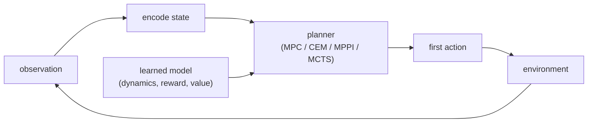
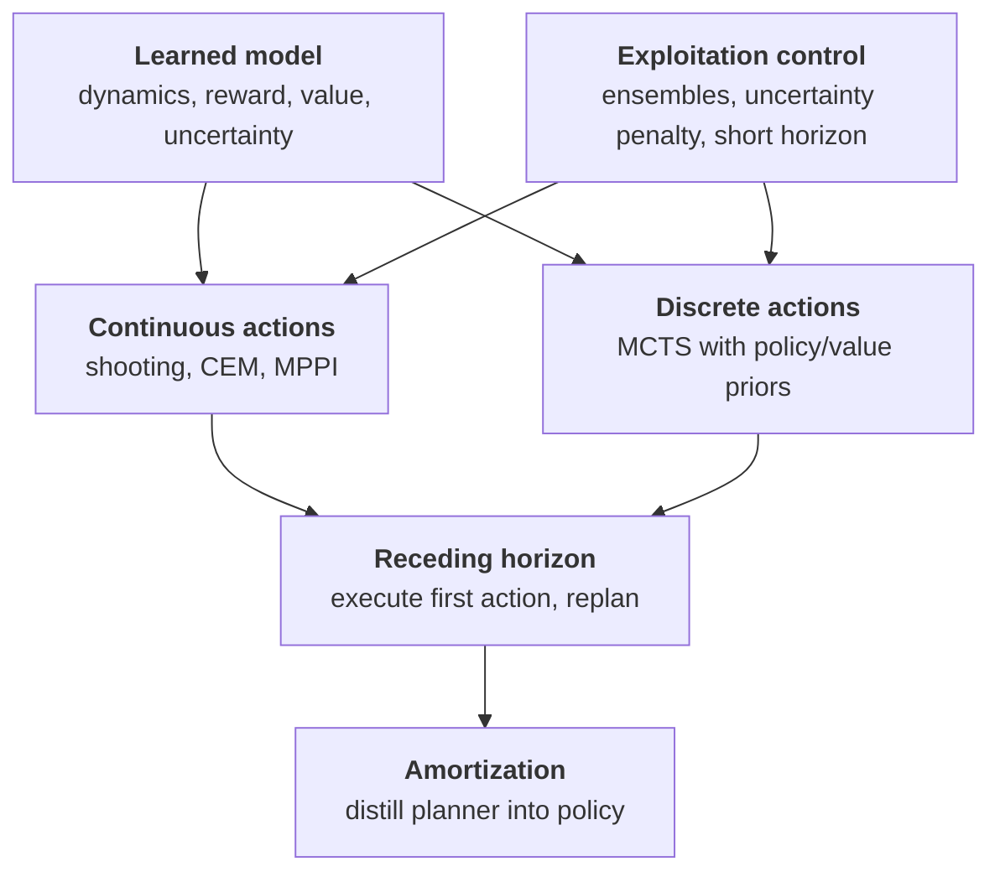

# World Models Module 03 — Planning

## 00 Why This Module Exists

A learned world model is only useful if something searches it. Planning turns "the model predicts what happens next" into "the agent chooses what to do now."
- The planner optimizes against the model, so it also finds and exploits the model's errors.
- The planner spends compute on every decision, so it competes with the control period for time.


- Legend: MPC: model predictive control; CEM: cross-entropy method; MPPI: model predictive path integral; MCTS: Monte Carlo tree search.

This module covers receding-horizon control, sampling-based trajectory optimization, tree search with learned models, and the decision to amortize planning into a policy.
- How the dynamics model is learned belongs to [World Models Module 01](../01-model-based-learning/README.md) and [Module 02](../02-latent-world-models/README.md).
- Language-conditioned policies that skip explicit planning belong to [Module 04](../04-vision-language-action/README.md).
- Sim-to-real transfer of a planner's assumptions belongs to [Module 06](../06-simulation-sim2real/README.md).
- Search over LLM outputs (best-of-N, trees with verifiers) is taught in core [Module 06](../../advanced-ai-engineering/06-reasoning-test-time-compute/README.md); Lesson WM3.4 maps the parallel.

**Research status:** satellite 80/20 revision, 2026-11-26. Formulas and worked examples are derived in the text. Algorithm details and constants attributed to the cited papers (PETS, TD-MPC, AlphaZero, MuZero) and to the `nicklashansen/tdmpc2` and `google-deepmind/mctx` code were written from those sources but were **not** re-read against a pinned paper version or commit in this revision (`TODO_VERIFY`). All timings in examples are illustrative, not measurements.

**Module Orientation**

- **Engineering problem:** choose actions with a learned model inside a fixed control period, without letting the optimizer exploit the model's mistakes.
- **What you will do:**
  - compute planner compute budgets against a control period;
  - run CEM and MPPI updates by hand;
  - trace one PUCT selection step;
  - compare open-loop and receding-horizon execution under a biased model;
  - measure how sample count increases model exploitation;
  - decide when to distill a planner into a policy.
- **Environment:** Python 3.10+, NumPy, a small continuous-control simulator (a point mass or pendulum you write, or a standard Gymnasium task), CPU only. GPU optional for batched rollouts.
- **Evidence rule:** separate source observations (**O**), derivations (**D**), and hypotheses that need measurement (**H**).
- **If You Only Have One Week**: Lessons WM3.1 and WM3.2. They cover the replanning loop and the sampling optimizer that most model-based control systems start from.

## 01 Baseline Assumptions

- Core [Module 00](../../advanced-ai-engineering/00-scientific-ai-engineering/README.md): paired comparisons, seeds, and the observation/derivation/hypothesis split.
- Core [Module 07](../../advanced-ai-engineering/07-model-behavior-uncertainty/README.md): uncertainty estimates and ensembles.
- [World Models Module 01](../01-model-based-learning/README.md): a learned dynamics model $\hat f(s, a)$ and its one-step error.
- Mathematical prerequisites: expectation, Gaussian distributions, discounted sums, and $\arg\max$.

## 02 Target Mastery

```yaml
depth_contract:
  conceptual: REQUIRED
  mechanistic: REQUIRED
  mathematical: REQUIRED
  quantitative: REQUIRED
  implementation: REQUIRED
  source_code: SELECTIVE
  instrumentation: SELECTIVE
  experimental: REQUIRED
  statistical: SELECTIVE
  production_reasoning: REQUIRED
  failure_analysis: REQUIRED
  falsification: SELECTIVE
  security: NOT_APPLICABLE
  economics: SELECTIVE
  architecture_tradeoff: REQUIRED
  research_connection: SELECTIVE

estimated_effort:
  instruction: 2h
  guided_practice: 1.25h
  labs: 3h
  assessment: 0.75h
  source_trace: 0.5h
  total: 7.5h
```

The learner must be able to implement receding-horizon sampling MPC, size its compute against a control period, explain tree search with learned models, detect planner exploitation of model error, and defend planning versus an amortized policy with measured evidence.

### LAYER 1: KNOWLEDGE / INSTRUCTIONAL LAYER

## 03 Knowledge Map



Keep three budgets separate:

1. **Model budget:** how many model steps one decision may spend ($N \times H \times I$ for sampling planners, simulations × depth for MCTS).
2. **Time budget:** the control period minus sensing, encoding, and actuation latency.
3. **Trust budget:** the horizon and action region over which the model's predictions are reliable.

A planner that fits budget 2 but violates budget 3 is fast and wrong.

## 04 Lessons

### Lesson WM3.1 — Receding-Horizon Control (MPC)

**Engineering Question:**
Why does replanning every step tolerate an imperfect model, and what does it cost per decision?

**Concepts & Definitions:**

- **Horizon $H$:** number of future steps the planner simulates.
- **Open-loop execution:** plan $H$ actions once and execute all of them.
- **Receding-horizon (MPC) execution:** plan $H$ actions, execute only the first, observe the real state, and plan again.
- **Planning objective:** for a candidate action sequence $a_{0:H-1}$ starting from state $s_0$,

$$
J(a_{0:H-1}) = \sum_{t=0}^{H-1} \gamma^{t}\, \hat r(\hat s_t, a_t) + \gamma^{H}\, \hat V(\hat s_H), \qquad \hat s_{t+1} = \hat f(\hat s_t, a_t), \ \hat s_0 = s_0
$$

where:

- $\hat f$ is the learned dynamics model and $\hat s_t$ the predicted state;
- $\hat r$ is the learned (or known) reward;
- $\gamma \in (0, 1]$ is the discount;
- $\hat V$ is an optional learned terminal value; with $\hat V = 0$ the planner ignores everything after step $H$.

**Mechanism Explanation:**

Model errors compound with the rollout length. MPC uses the model only to choose the next action, then corrects with a real observation. The model must be accurate enough to rank the *first* actions correctly, not to predict the whole trajectory.

Per-decision compute for a sampling planner:

$$
S = N \cdot H \cdot I
$$

where $S$ is the number of model steps per decision, $N$ the number of sampled sequences per iteration, $H$ the horizon, and $I$ the number of optimizer iterations.

**Break cases:**
- planning time exceeds the control period, so the executed action was computed for a stale state;
- a long horizon with no terminal value, where late-horizon predictions are mostly model error;
- a short horizon with no terminal value, where the planner cannot see delayed rewards.

**Worked Example (bias compounding and compute):**
*Input.* A 1-D model $\hat f(s, a) = s + a + b$ with constant bias $b = 0.02$ per step versus true $f(s, a) = s + a$. Horizon $H = 15$.

*Steps.*
- Open-loop: after 15 executed steps, predicted and real positions differ by $15 \times 0.02 = 0.30$.
- MPC: every step starts from the real observed state, so each decision sees only one step of bias: $0.02$. Feedback keeps tracking error from accumulating.
- Compute with $N = 500$, $H = 15$, $I = 3$: $S = 22{,}500$ model steps per decision.
- At a 20 Hz control rate (50 ms period): $22{,}500 \times 20 = 450{,}000$ model steps per second.
- If one batched model step over 500 samples takes an illustrative 0.8 ms, a decision takes $15 \times 3 \times 0.8 = 36$ ms, leaving 14 ms for sensing and actuation.

*Result.* Replanning turns linear error growth into a one-step error, at the price of a full plan every period.

**Knowledge Check:** If you double $H$ to 30 with no terminal value, which of the three budgets is most likely to be violated first?

**Guided Practice:** Implement the 1-D example for 50 steps toward a goal at position 1.0. Compare final error for open-loop and MPC as $b$ varies over $\{0, 0.01, 0.02, 0.05\}$.

**Feedback Contract:**
- *Expected Evidence*: a table of final error by $b$ and mode; open-loop error grows roughly linearly in $b \times$ steps; MPC error stays near one step's bias.
- *Common Failure*: letting MPC read the *predicted* state instead of the real one, which silently turns it back into open-loop execution.
- *Diagnostic Hint*: log the state used to start each plan and assert it came from the environment.
- *Concept to Revisit*: Receding horizon; trust budget.

**Learning Outcome:** Explain why MPC tolerates model bias and compute its per-decision cost.

*(Effort: 30m instruction, 20m practice)*

### Lesson WM3.2 — Shooting, CEM, and MPPI

**Engineering Question:**
How do sampling optimizers search continuous action sequences, and how do their update rules differ?

**Concepts & Definitions:**

- **Random shooting:** sample $N$ action sequences, score each with $J$, execute the first action of the best one.
- **Cross-entropy method (CEM):** keep a Gaussian over action sequences. Each iteration samples $N$ sequences, keeps the $K$ best (**elites**), and refits the mean and standard deviation to the elites. PETS and PlaNet use CEM inside MPC (**O**, `TODO_VERIFY`).
- **MPPI:** instead of a hard top-$K$, weight every sample by its score:

$$
w_i = \frac{\exp\!\big(-(C_i - C_{\min})/\lambda\big)}{\sum_{j=1}^{N} \exp\!\big(-(C_j - C_{\min})/\lambda\big)}, \qquad \mu' = \sum_{i=1}^{N} w_i\, a^{(i)}
$$

where:

- $C_i = -J(a^{(i)})$ is the cost of sample $i$ (lower is better);
- $C_{\min}$ is the smallest cost in the batch, subtracted for numerical stability (it cancels in the ratio);
- $\lambda > 0$ is the temperature: small $\lambda$ approaches picking the best sample, large $\lambda$ approaches a plain average;
- $a^{(i)}$ is sample $i$'s action sequence and $\mu'$ the new mean.

TD-MPC uses an MPPI-style update with a learned terminal value (**O**, `TODO_VERIFY`).

*Step-by-step reading of the MPPI weight.*

1. $\exp(-C/\lambda)$ is largest for the lowest cost and decays with cost.
2. Dividing by the sum makes the weights non-negative and sum to 1.
3. Subtracting $C_{\min}$ multiplies numerator and denominator by the same $\exp(C_{\min}/\lambda)$, so the weights do not change; it only prevents underflow.

**Mechanism Explanation:**

CEM discards everything outside the elites, which makes it robust to a few very bad samples but sensitive to $K$. MPPI uses all samples, which gives a smoother update but lets $\lambda$ decide how greedy it is. Both usually warm-start from the previous step's plan shifted by one step, so fewer iterations are needed.

**Worked Example (one CEM iteration and one MPPI update, 1-D, $H = 1$):**
*Input.* Cost $C(a) = (a - 0.7)^2$. Samples $a = (0.2, 0.9, -0.4, 0.6, 1.3, 0.1)$. CEM keeps $K = 3$.

*Steps (CEM).*
- Costs: $0.25, 0.04, 1.21, 0.01, 0.36, 0.36$.
- Elites: $0.6$ (0.01), $0.9$ (0.04), $0.2$ (0.25).
- New mean: $(0.6 + 0.9 + 0.2)/3 = 0.5667$.
- New std (population): $\sqrt{(0.0333^2 + 0.3333^2 + 0.3667^2)/3} = \sqrt{0.0822} = 0.2867$.

*Steps (MPPI on three costs).* Costs $C = (1, 2, 4)$, $\lambda = 1$.
- $\exp(0) = 1$, $\exp(-1) = 0.3679$, $\exp(-3) = 0.0498$; sum $= 1.4177$.
- Weights: $0.7054$, $0.2595$, $0.0351$.
- With $\lambda = 0.25$: $\exp(-4) = 0.0183$, $\exp(-12) \approx 6.1\times10^{-6}$, so the weights become $0.982$, $0.018$, $0.000$: almost greedy.

*Result.* CEM moved the mean from wherever it started toward the elites and shrank the spread; MPPI's temperature controls how much the second-best sample still counts.

**Knowledge Check:** Why does CEM's standard deviation collapse too fast when $K$ is very small, and what do implementations add to prevent it?

**Guided Practice:** Run 5 CEM iterations on $C(a) = (a - 0.7)^2$ from mean 0, std 1, $N = 20$, $K = 4$, with three seeds. Then run MPPI with $\lambda \in \{0.01, 0.1, 1\}$. Plot the mean over iterations.

**Feedback Contract:**
- *Expected Evidence*: CEM converges near 0.7 with shrinking std; MPPI with small $\lambda$ behaves like best-sample selection and with large $\lambda$ moves slowly; three seeds shown.
- *Common Failure*: computing MPPI weights without subtracting $C_{\min}$, which underflows to all zeros for large costs.
- *Diagnostic Hint*: assert the weights sum to 1 and print the largest weight each iteration.
- *Concept to Revisit*: Model budget; elites versus soft weights.

**Learning Outcome:** Implement CEM and MPPI updates and predict how $K$ and $\lambda$ change their behavior.

*(Effort: 35m instruction, 25m practice)*

### Lesson WM3.3 — Tree Search with Learned Models (AlphaZero / MuZero)

**Engineering Question:**
How does tree search allocate a fixed simulation budget between promising and unexplored actions when the model and evaluator are learned?

**Concepts & Definitions:**

- **MCTS:** repeatedly select a path down a search tree, expand a leaf, evaluate it, and back up the value. After a budget of simulations, act on the visit counts at the root.
- **AlphaZero:** uses the true game rules for transitions and a network for policy prior $P$ and value $V$ (**O**).
- **MuZero:** also learns the transition. A representation network encodes the observation into a latent state; a dynamics network predicts the next latent state and reward; a prediction network outputs $P$ and $V$. Search runs entirely in latent space (**O**).
- **PUCT selection rule** (AlphaZero form):

$$
a^{*} = \arg\max_{a} \left[ Q(s, a) + c \cdot P(s, a) \cdot \frac{\sqrt{N(s)}}{1 + N(s, a)} \right]
$$

where:

- $Q(s, a)$ is the mean backed-up value of action $a$ at node $s$ (0 if unvisited in this convention);
- $P(s, a)$ is the network's prior probability for $a$;
- $N(s)$ is the visit count of node $s$ and $N(s, a)$ that of the child for action $a$;
- $c > 0$ is the exploration constant. MuZero adds a slowly growing term to $c$ and normalizes $Q$ to $[0, 1]$ using the min and max values seen in the tree (**O**, `TODO_VERIFY`).

*Step-by-step reading.*

1. The first term exploits: actions that have backed up high value score high.
2. The second term explores: it is large when the prior is high and the action has few visits relative to its parent.
3. As $N(s, a)$ grows, the exploration bonus shrinks like $1/(1 + N(s, a))$, so visits shift toward actions whose $Q$ stays high.

**Mechanism Explanation:**

With a learned dynamics model, deep branches compound latent-state error, just as long horizons do in Lesson WM3.1. The learned value at the leaf limits how deep the search needs to go. Search quality is therefore bounded by the value network's accuracy as much as by the simulation budget.

**Worked Example (one selection step):**
*Input.* Root with $N(s) = 10$, $c = 1.25$, three actions.

| action | $Q$ | $P$ | $N(s,a)$ |
|---|---|---|---|
| $a_1$ | 0.6 | 0.3 | 6 |
| $a_2$ | 0.4 | 0.6 | 3 |
| $a_3$ | 0.0 | 0.1 | 0 |

*Steps.* $\sqrt{10} = 3.1623$.
- $a_1$: $0.6 + 1.25 \times 0.3 \times 3.1623 / 7 = 0.6 + 0.1694 = 0.7694$.
- $a_2$: $0.4 + 1.25 \times 0.6 \times 3.1623 / 4 = 0.4 + 0.5929 = 0.9929$.
- $a_3$: $0 + 1.25 \times 0.1 \times 3.1623 / 1 = 0.3953$.

*Result.* $a_2$ is selected despite a lower $Q$ than $a_1$: its strong prior and few visits earn a large bonus. The unvisited $a_3$ is not selected because its prior is small.

**Knowledge Check:** If the value network is systematically optimistic for one action, how does PUCT's behavior change as the simulation budget grows?

**Guided Practice:** Continue the example for 5 more simulations, assuming each visit to $a_1$ returns 0.6, $a_2$ returns 0.3, and $a_3$ returns 0.5. Track $Q$, $N$, and the selected action at each step.

**Feedback Contract:**
- *Expected Evidence*: a step-by-step table with updated $Q$ as running means and the selection at each step; $a_2$'s $Q$ falls toward 0.3 as it accumulates visits, and selection shifts away from it.
- *Common Failure*: updating $Q$ as a sum instead of a mean, or forgetting to increment $N(s)$ at the root.
- *Diagnostic Hint*: after each simulation, check that $\sum_a N(s,a)$ equals the number of simulations that passed through the root, and state whether your $N(s)$ also counts the root's own expansion.
- *Concept to Revisit*: Exploit/explore terms; learned-model depth error.

**Learning Outcome:** Trace PUCT selection by hand and explain how learned priors, values, and dynamics bound search quality.

*(Effort: 30m instruction, 20m practice)*

### Lesson WM3.4 — Model Exploitation, Amortization, and the Test-Time Compute Parallel

**Engineering Question:**
When does more planning make decisions worse, and when should planning be distilled into a reactive policy?

**Concepts & Definitions:**

- **Model exploitation:** the planner selects action sequences whose *predicted* return is high because the model is wrong there. More samples find more such errors.
- **Optimizer's curse:** for $N$ candidates with equal true value and independent zero-mean prediction noise of standard deviation $\sigma$, the best *predicted* candidate is optimistic in expectation. For $N = 2$:

$$
\mathbb{E}[\max(\epsilon_1, \epsilon_2)] = \frac{\sigma}{\sqrt{\pi}}, \qquad \epsilon_i \sim \mathcal{N}(0, \sigma^2)
$$

and for large $N$ the bias grows roughly like $\sigma\sqrt{2 \ln N}$ (an upper-order approximation).

where:

- $\epsilon_i$ is the model's prediction error for candidate $i$;
- $\sigma$ is the standard deviation of that error;
- $N$ is the number of candidates compared.

*Step-by-step for $N = 2$.* $\max(\epsilon_1, \epsilon_2) = \frac{\epsilon_1 + \epsilon_2}{2} + \frac{|\epsilon_1 - \epsilon_2|}{2}$. The first term has mean 0. $\epsilon_1 - \epsilon_2 \sim \mathcal{N}(0, 2\sigma^2)$, and $\mathbb{E}|X| = \sqrt{2/\pi}\,\text{sd}(X)$ for a zero-mean Gaussian, so $\mathbb{E}|\epsilon_1 - \epsilon_2| = \sqrt{2/\pi}\cdot\sqrt{2}\,\sigma = 2\sigma/\sqrt{\pi}$. Halving gives $\sigma/\sqrt{\pi}$.

- **Controls:** ensembles with a disagreement penalty (PETS-style probabilistic ensembles), short horizons with a learned terminal value, and limiting how far the plan may move from the data distribution.
- **Amortization (policy distillation):** train a policy network $\pi(a \mid s)$ to imitate the planner's chosen actions, often with DAgger-style data collection on states the policy itself visits (**O**).

**Mechanism Explanation:**

A planner pays its compute on every decision; a distilled policy pays once in training and then costs one forward pass. The planner adapts to new objectives and states without retraining; the policy is only as good as its training distribution.

The same structure appears in LLM test-time compute (core [Module 06](../../advanced-ai-engineering/06-reasoning-test-time-compute/README.md)):

| World-model planning | LLM test-time compute |
|---|---|
| learned dynamics $\hat f$ | the generator's own continuation |
| learned value / reward | verifier or reward model |
| more samples $N$ | best-of-$N$ |
| MCTS with value | tree search with a process verifier |
| model exploitation | verifier exploitation (reward hacking) |
| distill planner to policy | distill reasoning traces into a cheaper model |

**Worked Example (exploitation and latency):**
*Input.* Prediction noise $\sigma = 0.1$ on return; candidates with equal true return.

*Steps.*
- $N = 2$: expected optimism $0.1 / \sqrt{\pi} = 0.0564$.
- $N = 1{,}000$: approximation $0.1 \times \sqrt{2 \ln 1000} = 0.1 \times 3.717 = 0.372$, over six times larger.
- Latency, illustrative: a planner needs 36 ms per decision (Lesson WM3.1) and a distilled policy 1 ms. At 20 Hz (50 ms) both fit; at 50 Hz (20 ms) only the policy fits.

*Result.* Raising $N$ without an uncertainty control buys optimism, not quality, and faster control rates can force amortization regardless of quality.

**Knowledge Check:** Why can a distilled policy *outperform* its teacher planner on the real system in some cases?

**Guided Practice:** Draw $N$ candidate "true returns" all equal to 0, add Gaussian noise with $\sigma = 0.1$, and record the selected candidate's predicted return over 2,000 trials for $N \in \{2, 10, 100, 1000\}$. Compare with $\sigma/\sqrt{\pi}$ at $N = 2$ and with $\sigma\sqrt{2\ln N}$.

**Feedback Contract:**
- *Expected Evidence*: simulated mean at $N = 2$ within about 0.005 of 0.0564; mean bias increasing with $N$ and staying below $\sigma\sqrt{2\ln N}$.
- *Common Failure*: reporting the selected candidate's *predicted* return as its real return.
- *Diagnostic Hint*: always re-evaluate the chosen plan in the real (or held-out) environment and report both numbers.
- *Concept to Revisit*: Trust budget; optimizer's curse.

**Learning Outcome:** Quantify model exploitation, choose an uncertainty control, and justify planning versus amortization with a latency and quality argument.

*(Effort: 25m instruction, 10m practice)*

## 05 Literature & Production Source Map

**REFERENCE / BASELINE**

- [Mastering Chess and Shogi by Self-Play with a General Reinforcement Learning Algorithm (AlphaZero)](https://arxiv.org/abs/1712.01815) — Silver et al. (2017). Reading pointer: the search algorithm and PUCT selection.
- [Mastering Atari, Go, Chess and Shogi by Planning with a Learned Model (MuZero)](https://arxiv.org/abs/1911.08265) — Schrittwieser et al. (2019). Reading pointers: the three networks, the search with min-max normalized values, and the pseudocode appendix.
- [Deep Reinforcement Learning in a Handful of Trials using Probabilistic Dynamics Models (PETS)](https://arxiv.org/abs/1805.12114) — Chua et al. (2018). Reading pointer: probabilistic ensembles with CEM-based MPC.
- [Learning Latent Dynamics for Planning from Pixels (PlaNet)](https://arxiv.org/abs/1811.04551) — Hafner et al. (2018). Reading pointer: CEM planning in a learned latent space.
- [A Reduction of Imitation Learning and Structured Prediction to No-Regret Online Learning (DAgger)](https://arxiv.org/abs/1011.0686) — Ross, Gordon, and Bagnell (2011).

**WORKLOAD-DEPENDENT / FRONTIER**

- [Temporal Difference Learning for Model Predictive Control (TD-MPC)](https://arxiv.org/abs/2203.04955) — Hansen, Wang, and Su (2022), and [TD-MPC2](https://arxiv.org/abs/2310.16828) — Hansen, Su, and Wang (2023). Short-horizon MPPI-style planning with a learned terminal value. Author-reported results; scope to their benchmarks.
- Information-theoretic MPC / MPPI — Williams et al. (ICRA 2017). Originally with known or learned dynamics on a physical vehicle.

**CURRENT DEFAULT:** receding-horizon sampling MPC (CEM or MPPI) with warm start, a learned terminal value, and an ensemble or uncertainty penalty; for discrete actions, MCTS with learned priors and values.

**LEGACY / INSUFFICIENT:** open-loop execution of long model rollouts; reporting the planner's predicted return as performance; raising sample count without re-evaluating in the real environment; planners whose latency is not measured against the control period.

**PRODUCTION SOURCE TRACE** (pin the commit you read; no commit was pinned in this revision, `TODO_VERIFY`)

- `nicklashansen/tdmpc2`, file `tdmpc2/tdmpc2.py`: the `plan` method (sample from policy prior and Gaussian, roll out the latent model, score with reward plus terminal value, select elites, update mean and std, warm-start shift).
- `google-deepmind/mctx`, file `mctx/_src/policies.py`: `muzero_policy` and `gumbel_muzero_policy` entry points; follow them into the search and action-selection modules to find the PUCT-style score.
- Scope: reference implementations of two planner families, not universal defaults.

### LAYER 2: ENGINEERING PRACTICE LAYER

## 06 Engineering Labs

All labs follow `PREDICT → BUILD → MEASURE → EXPLAIN → BREAK → IMPROVE → FALSIFY`.

### LAB A — Open-Loop vs MPC Under a Biased Model

- **Objective:** implement CEM-based MPC on a point mass or pendulum with a deliberately biased model, and compare it with open-loop execution.
- **Pre-Registered Hypothesis:** MPC keeps final error near the one-step bias across horizons, while open-loop error grows with horizon; beyond some horizon without terminal value, MPC quality stops improving.
- **Independent Variables:** model bias $b$, horizon $H$, samples $N$, iterations $I$, execution mode.
- **Dependent Variables:** real return, final error, per-decision latency (median and p99) against the control period, model steps per decision.
- **Break & Falsify:** set the planning time above the control period and apply actions late; remove the warm start; raise $H$ with no terminal value.
- **Alignment:** Lessons WM3.1 and WM3.2; Incident WM3.1.
- **Effort Estimate:** 1.75h.

### LAB B — Exploitation Sweep and Distillation

- **Objective:** measure how sample count raises predicted-minus-real return, add an ensemble disagreement penalty, then distill the planner into a small policy.
- **Pre-Registered Hypothesis:** without a penalty, the gap between predicted and real return grows with $N$; the penalty reduces the gap at some cost in predicted return; the distilled policy matches the planner within a predeclared margin on the training task and degrades on a shifted task.
- **Independent Variables:** $N$, penalty weight, ensemble size, training states (planner-only versus DAgger-style).
- **Dependent Variables:** predicted return, real return, their gap, decision latency, and policy-versus-planner return on in-distribution and shifted tasks.
- **Break & Falsify:** train the model on a narrow state region and let the planner push outside it; change the goal after distillation.
- **Alignment:** Lessons WM3.3 and WM3.4.
- **Effort Estimate:** 1.25h.

**Runnable arithmetic check (CPU; not a control experiment):**
```python
import math
assert math.isclose(15 * 0.02, 0.30)                       # open-loop bias
assert 500 * 15 * 3 == 22_500 and 22_500 * 20 == 450_000    # model budget
assert math.isclose(15 * 3 * 0.8, 36.0)                     # illustrative ms
a = [0.2, 0.9, -0.4, 0.6, 1.3, 0.1]
elite = sorted(a, key=lambda x: (x - 0.7) ** 2)[:3]
mu = sum(elite) / 3
sd = math.sqrt(sum((x - mu) ** 2 for x in elite) / 3)
assert round(mu, 4) == 0.5667 and round(sd, 4) == 0.2867
C = [1, 2, 4]
e = [math.exp(-(c - min(C)) / 1.0) for c in C]
w = [x / sum(e) for x in e]
assert [round(x, 4) for x in w] == [0.7054, 0.2595, 0.0351]
puct = lambda q, p, n: q + 1.25 * p * math.sqrt(10) / (1 + n)
s = [puct(0.6, 0.3, 6), puct(0.4, 0.6, 3), puct(0.0, 0.1, 0)]
assert [round(x, 4) for x in s] == [0.7694, 0.9929, 0.3953]
assert round(0.1 / math.sqrt(math.pi), 4) == 0.0564
assert round(math.sqrt(2 * math.log(1000)), 3) == 3.717
```

## 07 Break / Incident Scenarios

### Incident WM3.1 — More Samples, Worse Robot

**Incident Symptoms:**
A team raises the MPC sample count from 256 to 2,048 to "improve planning." In simulation the planner's predicted return rises. On the real arm, success on a reaching task drops, motions become jerky, and logs show occasional actions applied one control period late. The dynamics model was not retrained.

**Diagnostic Protocol (Task):**
1. **Form Competing Hypotheses:** model exploitation (more samples find model errors), latency overrun (plans finish after the control deadline), warm-start loss after a code change, numeric issues in MPPI weights, or a real hardware change.
2. **Identify Missing Evidence:** per-decision planning time versus deadline, predicted versus real return per episode, ensemble disagreement along chosen plans, and the state each plan started from.
3. **Design Discriminating Measurements:** replay recorded states offline with both sample counts and no deadline; then run on hardware at 2,048 samples with the control rate lowered so the deadline is met.
4. **Rank Explanations:** exploitation predicts a predicted–real gap that grows with $N$ even offline; latency overrun predicts failures that disappear when the deadline is relaxed.
5. **Intervene:** add a disagreement penalty or shorten the horizon; cap $N$ to meet the deadline, or batch rollouts more efficiently; enforce a hard deadline that falls back to the previous plan's next action.
6. **Remeasure:** real success, predicted–real gap, and deadline misses at each $N$.

### LAYER 3: MASTERY / ASSESSMENT LAYER

## 08 Mastery Assessment

### Transfer Problem — Planner for a Mobile Manipulator at 30 Hz

A mobile manipulator must pick objects on cluttered shelves using a learned latent world model. The control loop runs at 30 Hz and the GPU is shared with perception.

**Required Deliverables:**
1. the three budgets (model, time, trust) with numbers, and the resulting $N$, $H$, $I$ or simulation count;
2. choice of planner family (CEM, MPPI, MCTS over discrete skills) with the reason;
3. an exploitation control and evidence from LAB B that it narrows the predicted–real gap;
4. a deadline policy for overruns and its measured miss rate;
5. a planning-versus-distillation decision, with the latency and shifted-task evidence that would reverse it.

## 09 Required Evidence & Rubric

### Required Artifact: Planner Budget and Exploitation Report

Submit the budget table, LAB A open-loop versus MPC results, LAB B exploitation sweep and distillation results, and the Incident WM3.1 diagnosis.

### Rubric Dimensions

- **Mechanism:** *Insufficient* says "the agent searches for the best plan." *Competent* explains receding horizon, CEM/MPPI updates, and PUCT. *Strong* predicts how model error enters each planner.
- **Quantitative:** *Insufficient* quotes sample counts. *Competent* computes model steps and latency per decision. *Strong* links them to the control period and to optimizer's-curse bias.
- **Evaluation:** *Insufficient* reports predicted return. *Competent* re-evaluates in the real environment. *Strong* reports the predicted–real gap across $N$ with seeds.
- **Trade-off:** *Insufficient* prefers planning or a policy by default. *Competent* compares both on one task. *Strong* states the workload condition that would reverse the decision.

## 10 Capability Traceability Matrix

| Capability | Taught | Practiced | Assessed | Evidence (artifact reviewers open) |
|---|---|---|---|---|
| Receding-horizon control and budgets | WM3.1 | WM3.1 Guided Practice; LAB A | Deliverables 1, 4; Incident WM3.1 | LAB A error table and latency-versus-deadline log |
| CEM and MPPI | WM3.2 | WM3.2 Guided Practice; LAB A | Deliverable 2 | CEM/MPPI convergence plots with seeds |
| Tree search with learned models | WM3.3 | WM3.3 Guided Practice | Deliverable 2 | Hand-traced PUCT table |
| Exploitation and amortization | WM3.4 | WM3.4 Guided Practice; LAB B | Deliverables 3, 5; Incident WM3.1 | Predicted–real gap sweep; policy-versus-planner table |

## 11 Exit Criteria & Module Wrap-Up

### Exit Criteria

A learner passes when they can implement receding-horizon CEM or MPPI, size it against a control period, trace a PUCT selection, show with measurements that more samples can increase model exploitation, and defend planning versus a distilled policy for a stated workload.

### Module Wrap-Up (Final Mental Model Reconstruction)

A planner is an optimizer pointed at a model. Replan to keep model error local, budget compute against the deadline, penalize uncertainty so the optimizer cannot cash in on model mistakes, and always score the chosen plan in the real environment.

### Cost & Telemetry Hook

- [Lesson 22.1](../../advanced-ai-engineering/22-ai-economics/README.md): cost per decision is model steps × step cost; compare it with the one-time cost of distillation over the expected number of decisions.
- [Lesson 23.1](../../advanced-ai-engineering/23-observability-reliability/README.md): emit planning latency against the deadline, deadline misses, predicted return, and ensemble disagreement per decision.
- Core [Module 12](../../advanced-ai-engineering/12-agent-loop-engineering/README.md): the same budget-per-step discipline applies to LLM agent loops.

## 12 Competency Targets

```yaml
competency:
  sfia: 4
  bloom: Apply -> Analyze
  solo: Relational
  dreyfus: Advanced Beginner -> Competent
```
