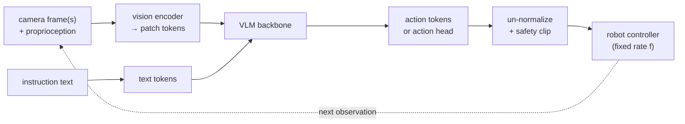
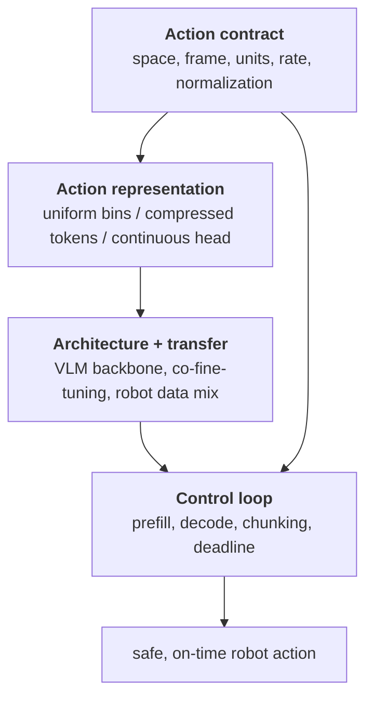

# World Models Module 04 — Vision-Language-Action Models

## 00 Why This Module Exists

A vision-language-action (VLA) model is a vision-language model whose output is a robot command instead of text.
- The camera image and instruction go in through a VLM backbone.
- Continuous joint or end-effector commands come out, either as discrete tokens or through a continuous action head.
- The output then drives a physical system on a fixed control clock, where a late or wrong action has consequences a wrong sentence does not.


- Legend: proprioception: the robot's own joint and gripper state; f: control frequency in Hz.

This module covers the VLA paradigm, action spaces, action tokenization, the RT-1 / RT-2 / OpenVLA lineage, what transfers from web-scale pretraining, and the latency limits of running a multi-billion-parameter policy inside a control loop.
- VLM internals (vision encoder, projector, token budget) belong to [VLM Module 03](../../vision-language-models/03-vlm-architectures/README.md).
- Learned dynamics models and planning belong to [WM Module 02](../02-latent-world-models/README.md) and [WM Module 03](../03-planning/README.md).
- Long-horizon task decomposition with an LLM planner over skills belongs to [WM Module 05](../05-embodied-agents/README.md).
- Simulation, domain randomization, and transfer to hardware belong to [WM Module 06](../06-simulation-sim2real/README.md).

**Research status:** satellite 80/20 revision, 2026-11-26. Formulas below are derived in the text. Architecture details and constants attributed to RT-1, RT-2, OpenVLA, π0, and the `openvla/openvla` code were written from the cited papers but were **not** re-read against a pinned paper version or commit in this revision (`TODO_VERIFY`). All latency numbers in worked examples are **illustrative**, chosen to make the arithmetic clear, not measurements of any model or GPU.

**Module Orientation**

- **Engineering problem:** turn a pretrained VLM into a policy whose actions are correctly scaled, correctly framed, and delivered before the control deadline.
- **What you will do:**
  - define an action contract (space, frame, units, rate, normalization);
  - build and audit an action tokenizer;
  - trace what an RT-2 or OpenVLA-style model reuses from its VLM;
  - budget per-step latency and compare single-step decoding with action chunking;
  - diagnose a deployment where a correct model moves the robot wrongly.
- **Environment:** Python 3.10+, NumPy, PyTorch, a small public robot dataset (for example a LeRobot or Open X-Embodiment subset), and a simulator or a replay harness. A GPU helps for LAB B but is optional: a smaller VLM can stand in to measure the loop.
- **Evidence rule:** separate source observations (**O**), derivations (**D**), and hypotheses that need measurement (**H**).
- **If You Only Have One Week**: Lessons WM4.2 and WM4.4. They cover the two places where VLA deployments most often fail silently: the action normalization contract and the control-loop deadline.

## 01 Baseline Assumptions

- [VLM Module 03](../../vision-language-models/03-vlm-architectures/README.md): vision encoder, projector, and image tokens in the LLM sequence.
- Core [Module 01](../../advanced-ai-engineering/01-foundation-model-internals/README.md): autoregressive decoding and tokenizers.
- Core [Module 02](../../advanced-ai-engineering/02-inference-gpu-fundamentals/README.md): prefill versus decode latency and memory per parameter.
- [WM Module 01](../01-model-based-learning/README.md): policy, state, action, and reward vocabulary.
- Mathematical prerequisites: vectors, coordinate frames, uniform quantization, and quantiles.

## 02 Target Mastery

```yaml
depth_contract:
  conceptual: REQUIRED
  mechanistic: REQUIRED
  mathematical: REQUIRED
  quantitative: REQUIRED
  implementation: REQUIRED
  source_code: SELECTIVE
  instrumentation: REQUIRED
  experimental: SELECTIVE
  statistical: NOT_APPLICABLE
  production_reasoning: REQUIRED
  failure_analysis: REQUIRED
  falsification: SELECTIVE
  security: SELECTIVE
  economics: SELECTIVE
  architecture_tradeoff: REQUIRED
  research_connection: SELECTIVE

estimated_effort:
  instruction: 2h
  guided_practice: 1.25h
  labs: 3h
  assessment: 0.75h
  source_trace: 0.5h
  total: 7.5h
```

The learner must be able to write the full action contract for a VLA, compute tokenization error and token counts, explain which capabilities come from web pretraining and which must come from robot data, and predict whether a given model and decoding scheme meets a control-rate deadline.

### LAYER 1: KNOWLEDGE / INSTRUCTIONAL LAYER

## 03 Knowledge Map



Keep three contracts separate:

1. **Action contract:** which quantities the model outputs, in which coordinate frame, in which units, at which control rate, with which normalization statistics.
2. **Representation contract:** how a continuous action becomes model output (bin count, bin bounds, token IDs, or the continuous head's output scaling).
3. **Timing contract:** the control frequency, the per-step deadline, and what the controller does when an action is late.

A VLA checkpoint is trained against one instance of each contract. Deployment on a robot must reproduce all three.

## 04 Lessons

### Lesson WM4.1 — The VLA Paradigm and the Action Contract

**Engineering Question:**
What exactly does a VLA output, and what must be known to turn that output into a correct robot motion?

**Concepts & Definitions:**

- **Policy:** a function from observation and goal to action, $a_t \sim \pi_\theta(a \mid o_t, \ell)$, where the VLA's parameters are $\theta$.
- **Action space:** a common manipulation choice is an end-effector delta: change in position $(\Delta x, \Delta y, \Delta z)$, change in orientation $(\Delta\text{roll}, \Delta\text{pitch}, \Delta\text{yaw})$, and a gripper command. That gives $D = 7$ dimensions. Joint-space actions instead command each joint.
- **Frame:** deltas can be expressed in the robot base frame or in the end-effector frame. The same numbers mean different motions in different frames.
- **Control frequency $f$:** how many actions per second the controller consumes. A delta action is a displacement *per step*, so its physical speed depends on $f$.
- **Normalization:** training pipelines rescale each action dimension using dataset statistics (mean/std or quantiles). The model emits normalized values; deployment must un-normalize with the **same** statistics.

Physical velocity implied by a delta action:

$$
v = \Delta p \cdot f
$$

where:

- $v$ is the commanded speed along one axis in m/s;
- $\Delta p$ is the per-step position delta along that axis in m;
- $f$ is the control frequency in Hz (steps per second).

**Mechanism Explanation:**

RT-1 used a 7-dimensional arm action, 3 base dimensions, and a mode dimension, each discretized, at a low control rate (**O**, `TODO_VERIFY`). OpenVLA predicts a 7-dimensional end-effector delta plus gripper per step (**O**, `TODO_VERIFY`). Pooled datasets such as Open X-Embodiment mix robots with different action spaces, frames, and rates, so every dataset needs its own normalization statistics and its own action contract.

**Break cases:**
- the deployment runs the controller at a different rate than the training data;
- the model was trained on base-frame deltas but the robot interprets them in the end-effector frame;
- un-normalization uses statistics from a different dataset;
- the gripper dimension is continuous in one dataset and binary open/close in another.

**Worked Example (rate mismatch):**
*Input.* A policy trained on data recorded at $f = 5$ Hz outputs $\Delta x = 0.01$ m per step. The deployment controller runs at 15 Hz.

*Steps.*
- Training-time speed: $0.01 \times 5 = 0.05$ m/s.
- Deployment speed: $0.01 \times 15 = 0.15$ m/s.
- Over a 2 s reach, the training data moved $0.10$ m; the deployment moves $0.30$ m.

*Result.* The model is "correct" and the robot overshoots by a factor of 3. Nothing in the model's logits reveals it.

**Knowledge Check:** Why is "the model outputs 7 numbers per step" an incomplete specification of a VLA's action space?

**Guided Practice:** Pick one dataset from a public robot collection. Write its action contract: dimensions and their order, units, frame, control rate, gripper convention, and normalization statistics. Mark every field you could not find in the dataset's metadata.

**Feedback Contract:**
- *Expected Evidence*: a filled contract table with a source for each field (metadata file, paper, or measured from the data, for example $f$ from timestamps).
- *Common Failure*: inferring the control rate from a paper's text when the recorded timestamps disagree.
- *Diagnostic Hint*: compute the median difference between consecutive timestamps; its inverse is the recorded rate.
- *Concept to Revisit*: Action contract.

**Learning Outcome:** Write a complete action contract and predict the physical effect of a rate or frame mismatch.

*(Effort: 25m instruction, 15m practice)*

### Lesson WM4.2 — Tokenizing Continuous Actions

**Engineering Question:**
How is a continuous multi-axis action turned into discrete tokens, and how much precision does that cost?

**Concepts & Definitions:**

- **Uniform binning:** each action dimension is clipped to bounds $[lo, hi]$ and split into $B$ equal bins. RT-1, RT-2, and OpenVLA use $B = 256$ bins per dimension (**O**, `TODO_VERIFY`).
- **Bound choice:** min/max bounds are stretched by outliers; OpenVLA sets bounds at the 1st and 99th percentiles of each dimension, so rare extreme values are clipped (**O**, `TODO_VERIFY`).
- **Token mapping:** RT-2 writes bin indices as integer strings in the VLM's existing vocabulary; OpenVLA overwrites the 256 least-used tokens of its LLM tokenizer with action bins (**O**, `TODO_VERIFY`).
- **Compressed tokenization:** schemes such as FAST transform an action chunk (for example with a discrete cosine transform) and compress it before tokenizing, so smooth high-rate trajectories need fewer tokens (**O**, `TODO_VERIFY`).

Bin index, reconstruction, and error:

$$
k = \min\!\left(B-1,\ \left\lfloor \frac{\mathrm{clip}(a, lo, hi) - lo}{w} \right\rfloor\right),
\qquad
\hat a = lo + \left(k + \tfrac12\right) w,
\qquad
w = \frac{hi - lo}{B}
$$

where:

- $a$ is one continuous action value for one dimension;
- $lo, hi$ are the bin bounds for that dimension;
- $B$ is the number of bins;
- $w$ is the bin width;
- $k \in \{0, \dots, B-1\}$ is the bin index (the token);
- $\hat a$ is the reconstructed value at the bin center.

*Step-by-step reading.*

1. Clipping forces $a$ into $[lo, hi]$; any value outside is mapped to the edge bin, so its error can be arbitrarily large.
2. Subtracting $lo$ and dividing by $w$ gives the position in bin units; the floor picks the bin.
3. The $\min(B-1, \cdot)$ handles $a = hi$, which would otherwise land in bin $B$.
4. For in-bounds $a$, the bin center is at most $w/2$ away, so the maximum error is $w/2 = (hi - lo)/(2B)$.

**Mechanism Explanation:**

Each step costs $D$ tokens, decoded one after another. Uniform bins spend equal resolution on all values, while most real deltas cluster near zero; that is why bound choice matters more than $B$ for precise manipulation. Compressed tokenizers and continuous heads (Lesson WM4.4) attack the token count and the precision limit directly.

**Worked Example (precision and clipping):**
*Input.* $\Delta x$ bounds $[-0.05, 0.05]$ m, $B = 256$, action $a = 0.0123$ m.

*Steps.*
- $w = 0.1 / 256 = 0.000390625$ m, so the maximum in-bounds error is $0.195$ mm.
- Position in bins: $(0.0123 + 0.05) / 0.000390625 = 159.49$, so $k = 159$.
- $\hat a = -0.05 + 159.5 \times 0.000390625 = 0.0123047$ m; error $\approx 0.005$ mm.
- An outlier $a = 0.08$ m clips to bin 255, $\hat a = 0.0498$ m; error $30.2$ mm.

*Result.* In-bounds precision is sub-millimetre; clipped values lose centimetres. If min/max bounds were set by a single $0.5$ m outlier instead, $w$ would grow to about $4.1$ mm, losing precision for every normal action.

**Knowledge Check:** Why can using 1st–99th percentile bounds improve fine manipulation even though it guarantees that about 2% of training values are clipped?

**Guided Practice:** On one dataset, tokenize every action dimension with min/max bounds and with 1st–99th percentile bounds at $B \in \{64, 256, 1024\}$. Report mean and max reconstruction error and the clipping rate for each setting.

**Feedback Contract:**
- *Expected Evidence*: a table per dimension showing that percentile bounds cut mean error and introduce a small, reported clipping rate, plus the dimension where the gripper's binary values make binning trivial.
- *Common Failure*: computing bounds on the evaluation split, or on all datasets pooled when the model un-normalizes per dataset.
- *Diagnostic Hint*: a dimension whose histogram is a spike at zero plus long tails is the one where bound choice dominates.
- *Concept to Revisit*: Representation contract.

**Learning Outcome:** Build an action tokenizer, compute its error bound, and justify the bounds from data.

*(Effort: 35m instruction, 25m practice)*

### Lesson WM4.3 — Architecture Anatomy and What Transfers

**Engineering Question:**
Which parts of a VLA come from web-scale pretraining, which must be learned from robot data, and how do RT-1, RT-2, and OpenVLA differ?

**Concepts & Definitions:**

- **RT-1:** a robot-specific Transformer trained from scratch on robot demonstrations. An ImageNet-pretrained convolutional encoder conditioned on the instruction (FiLM) feeds a token-reduction step and a Transformer that outputs discretized actions (**O**, `TODO_VERIFY`).
- **RT-2:** a large pretrained VLM co-fine-tuned on web vision-language data and robot trajectories, with actions written as text tokens. The authors report better generalization to unseen objects and instructions than RT-1, scoped to their evaluation (**O**, author-reported).
- **OpenVLA:** an open 7B VLA built from a Llama 2 language model with fused DINOv2 and SigLIP vision features, fine-tuned on roughly 970k trajectories from Open X-Embodiment (**O**, `TODO_VERIFY`).
- **Continuous action heads:** later models such as Octo (diffusion head) and π0 (flow-matching "action expert" producing action chunks) keep the VLM backbone but replace token decoding of actions (**O**, `TODO_VERIFY`). See [Generative Media Module 05](../../generative-media/05-flow-matching/README.md) for flow matching.

Prefix length for one control step:

$$
N_{\text{prefix}} = n_{\text{img}} \cdot \left(\frac{S}{p}\right)^2 + N_{\text{text}} + N_{\text{proprio}}
$$

where:

- $N_{\text{prefix}}$ is the number of tokens processed before the first action token;
- $n_{\text{img}}$ is the number of camera images per step;
- $S$ is the image side length in pixels after resizing;
- $p$ is the vision encoder's patch size in pixels;
- $N_{\text{text}}$ is the number of instruction and template tokens;
- $N_{\text{proprio}}$ is the number of tokens used for robot state (zero if state is not an input).

This assumes one token per patch with no pooling or resampler; models that pool or resample (see [VLM Module 03](../../vision-language-models/03-vlm-architectures/README.md)) have fewer.

**Mechanism Explanation:**

What plausibly transfers from web data: object and attribute recognition, instruction grounding, and some semantic reasoning ("move the extinct animal"). What does not: contact dynamics, the robot's kinematics, and the action contract itself; these come only from robot data. Co-fine-tuning keeps web data in the mix so robot fine-tuning does not erase the semantic skills (**H** for any new setting; **O** as RT-2's reported design).

**Worked Example (prefix and per-step compute):**
*Input.* One 224 × 224 image, patch size 14, 20 instruction tokens, no proprioception tokens, a 7B backbone, $D = 7$ action tokens.

*Steps.*
- Image tokens: $(224 / 14)^2 = 16^2 = 256$.
- Prefix: $256 + 20 = 276$ tokens. (Fusing two encoders per patch, as OpenVLA does, changes the feature width, not the token count.)
- Forward FLOPs, using the $2 \times$ parameters per token rule from core Module 01: prefill $\approx 2 \times 7\times10^9 \times 276 = 3.9\times10^{12}$; each action token $\approx 1.4\times10^{10}$.
- Weights in bf16: $7\times10^9 \times 2 = 14$ GB before activations and KV cache.

*Result.* Prefill dominates FLOPs, but the 7 decode steps are serial, memory-bound passes over 14 GB of weights; Lesson WM4.4 turns this into a latency budget.

**Knowledge Check:** A VLA fine-tuned only on robot data follows "pick up the red cup" well but fails "pick up the drink container." Which ingredient of RT-2's recipe addresses this, and what evidence would show it is the cause?

**Guided Practice:** For a VLA you can load, print the processor output for one step: image tensor shape, token count of the full prompt, and the IDs used for action tokens. Confirm $N_{\text{prefix}}$ against the formula.

**Feedback Contract:**
- *Expected Evidence*: measured prefix length within a few tokens of the formula (template tokens explain the gap), and the list of action token IDs.
- *Common Failure*: assuming the model sees the full camera resolution; images are resized before patching.
- *Diagnostic Hint*: print the pixel tensor shape after the processor, not before.
- *Concept to Revisit*: Representation contract; VLM token budget.

**Learning Outcome:** Explain the VLA lineage and compute what a control step costs before measuring it.

*(Effort: 35m instruction, 20m practice)*

### Lesson WM4.4 — The Real-Time Control Loop

**Engineering Question:**
Can this model produce each action before the controller needs it, and what are the options when it cannot?

**Concepts & Definitions:**

- **Deadline:** at control rate $f$, a new action is needed every $1/f$ seconds.
- **Action chunking:** predict $H$ future actions per inference call and execute them before the next call (ACT, π0). It amortizes inference but executes some actions open-loop (**O**, `TODO_VERIFY`).
- **Temporal ensembling:** average overlapping predictions from successive chunks for smoother motion (ACT) (**O**, `TODO_VERIFY`).
- **Staleness:** the observation used for an action is older than the action's execution time by the inference latency plus any time spent waiting in the chunk.

Per-call latency for token-decoded actions:

$$
t_{\text{call}} = t_{\text{pre}} + t_{\text{prefill}} + N_{\text{act}} \cdot t_{\text{tok}},
\qquad
f_{\max} = \frac{H}{t_{\text{call}}}
$$

where:

- $t_{\text{call}}$ is the time from observation capture to the last action being available;
- $t_{\text{pre}}$ is image capture, resize, and transfer time;
- $t_{\text{prefill}}$ is the prefill time for $N_{\text{prefix}}$ tokens;
- $N_{\text{act}} = D \cdot H$ is the number of action tokens decoded serially;
- $t_{\text{tok}}$ is the per-token decode time;
- $H$ is the number of actions per call (1 without chunking);
- $f_{\max}$ is the highest sustainable control rate if calls run back to back.

*Step-by-step reading.*

1. Prefill processes all prefix tokens in parallel, so it is one large step.
2. Action tokens are decoded one at a time, so their cost grows linearly with $D \cdot H$.
3. One call yields $H$ actions, so the sustainable rate is $H$ actions per $t_{\text{call}}$.
4. A continuous head replaces term $N_{\text{act}} \cdot t_{\text{tok}}$ with a fixed head cost (for flow matching, a fixed number of integration steps) independent of $H$ up to its trained chunk size.

**Mechanism Explanation:**

RT-2 and OpenVLA authors report single-digit Hz control rates for their large models on their hardware (**O**, author-reported, `TODO_VERIFY`). Chunking raises $f_{\max}$ but lengthens open-loop execution; a continuous head decouples chunk size from decode count.

**Worked Example (illustrative numbers, not measurements):**
*Input.* $t_{\text{pre}} = 10$ ms, $t_{\text{prefill}} = 50$ ms, $t_{\text{tok}} = 15$ ms, $D = 7$.

*Steps.*
- Single step, $H = 1$: $t_{\text{call}} = 10 + 50 + 7 \times 15 = 165$ ms; $f_{\max} = 1 / 0.165 = 6.1$ Hz. A 10 Hz controller misses every deadline.
- Token chunk, $H = 8$: $N_{\text{act}} = 56$, $t_{\text{call}} = 60 + 840 = 900$ ms; $f_{\max} = 8 / 0.9 = 8.9$ Hz, but the last action in each chunk is based on an observation up to 0.9 s plus 0.8 s of execution old.
- Continuous head, $H = 8$, 10 integration steps at an illustrative 8 ms each: $t_{\text{call}} = 60 + 80 = 140$ ms; $f_{\max} = 8 / 0.14 = 57$ Hz.

*Result.* Token decoding of chunks barely helps; the gain comes from removing the serial per-dimension decode.

**Knowledge Check:** Why can a chunked policy that meets the deadline still fail at catching a moving object, while a slower single-step policy succeeds?

**Guided Practice:** Instrument one inference call: timestamp capture, preprocessing, prefill end, and each action token. Report the distribution over 200 calls (p50, p95, max) and compute $f_{\max}$ at p95, not at the mean.

**Feedback Contract:**
- *Expected Evidence*: a per-stage timing table, a p95-based $f_{\max}$, and a statement of how many deadlines a chosen $f$ would miss.
- *Common Failure*: timing only `model.generate` and omitting capture, preprocessing, and host-to-device transfer.
- *Diagnostic Hint*: use one monotonic clock for every timestamp, as in core Module 21's stage ledger.
- *Concept to Revisit*: Timing contract.

**Learning Outcome:** Predict and measure whether a VLA meets a control deadline, and choose between single-step, chunked, and continuous-head decoding.

*(Effort: 25m instruction, 15m practice)*

## 05 Literature & Production Source Map

**REFERENCE / BASELINE**

- [RT-1: Robotics Transformer for Real-World Control at Scale](https://arxiv.org/abs/2212.06817) — Brohan et al. (2022). Reading pointer: action discretization and model architecture sections.
- [RT-2: Vision-Language-Action Models Transfer Web Knowledge to Robotic Control](https://arxiv.org/abs/2307.15818) — Brohan et al. (2023). Reading pointer: actions as text tokens and co-fine-tuning.
- [OpenVLA: An Open-Source Vision-Language-Action Model](https://arxiv.org/abs/2406.09246) — Kim et al. (2024). Reading pointer: action tokenization (percentile bounds, overwritten tokens) and inference efficiency.
- [Open X-Embodiment: Robotic Learning Datasets and RT-X Models](https://arxiv.org/abs/2310.08864) — Open X-Embodiment Collaboration (2023). Reading pointer: dataset mixture and per-dataset action conventions.

**WORKLOAD-DEPENDENT / FRONTIER** (author-reported results; scope to their robots and tasks)

- [Learning Fine-Grained Bimanual Manipulation with Low-Cost Hardware (ACT)](https://arxiv.org/abs/2304.13705) — Zhao et al. (2023): action chunking and temporal ensembling.
- [Diffusion Policy](https://arxiv.org/abs/2303.04137) — Chi et al. (2023): diffusion over action sequences.
- [Octo: An Open-Source Generalist Robot Policy](https://arxiv.org/abs/2405.12213) — Octo Model Team (2024): diffusion action head on a Transformer backbone.
- [π0: A Vision-Language-Action Flow Model for General Robot Control](https://arxiv.org/abs/2410.24164) — Black et al. (2024): flow-matching action expert and action chunks.
- [FAST: Efficient Action Tokenization for Vision-Language-Action Models](https://arxiv.org/abs/2501.09747) — Pertsch et al. (2025): frequency-domain compression of action chunks.

**CURRENT DEFAULT:** a pinned action contract per dataset and robot, percentile-bounded normalization stored with the checkpoint, and a measured control-loop budget before any hardware run.

**LEGACY / INSUFFICIENT:** reporting success rate without the control rate and action contract; un-normalizing with "the" dataset statistics when the checkpoint was trained on a mixture; timing only the model forward pass.

**SAFETY:** a VLA drives a physical system. Clip every action to workspace and velocity limits outside the model, keep a hardware emergency stop, and treat a new robot, frame, or rate as a new deployment that needs low-speed validation. See core [Module 18](../../advanced-ai-engineering/18-ai-security/README.md) for capability scoping.

**PRODUCTION SOURCE TRACE** (pin the commit you read; no commit was pinned in this revision, `TODO_VERIFY`)

- `openvla/openvla`, file `prismatic/vla/action_tokenizer.py`: the `ActionTokenizer` class that maps clipped continuous actions to bins and to the overwritten token IDs (Lesson WM4.2).
- The OpenVLA Hugging Face model class's `predict_action` method: decodes action tokens, maps them back to bin centers, and un-normalizes with dataset statistics selected by an `unnorm_key` argument (Lessons WM4.1 and WM4.2, Incident WM4.1).
- Scope: one open implementation, not the only valid design. Other VLAs store normalization statistics and token mappings differently and must be checked separately.

### LAYER 2: ENGINEERING PRACTICE LAYER

## 06 Engineering Labs

All labs follow `PREDICT → BUILD → MEASURE → EXPLAIN → BREAK → IMPROVE → FALSIFY`.

### LAB A — Action Tokenizer Round-Trip and Contract Audit

- **Objective:** build a per-dimension action tokenizer for one public dataset, audit its error and clipping, and break it with contract mismatches.
- **Pre-Registered Hypothesis:** percentile bounds reduce mean reconstruction error on translation dimensions compared with min/max bounds at the same $B$, and the wrong normalization statistics cause a larger trajectory error than halving $B$.
- **Independent Variables:** bound method, $B$, normalization statistics used at decode time, assumed control rate.
- **Dependent Variables:** per-dimension mean and max reconstruction error, clipping rate, and end-point error of a replayed trajectory integrated from decoded deltas.
- **Break & Falsify:** decode with another dataset's statistics; integrate deltas at 3× the recorded rate; swap base and end-effector frames for one episode.
- **Alignment:** Lessons WM4.1 and WM4.2, Incident WM4.1.
- **Effort Estimate:** 1.5h.

### LAB B — Control-Loop Latency Budget

- **Objective:** measure per-call latency for a VLA (or a stand-in VLM of similar architecture) and compare single-step, token-chunked, and continuous-head decoding against a control deadline.
- **Pre-Registered Hypothesis:** at the chosen control rate, single-step token decoding misses the p95 deadline, token chunking meets it only with long open-loop execution, and a continuous head meets it with shorter staleness.
- **Independent Variables:** decoding scheme, chunk size $H$, image count, precision (bf16 versus int8/int4 weights), and GPU contention.
- **Dependent Variables:** per-stage latency (capture, preprocessing, prefill, per-token decode or head), p50/p95/max $t_{\text{call}}$, deadline misses per minute, and action staleness.
- **Break & Falsify:** add a second process on the GPU; add a second camera; run with a cold cache after model reload.
- **Alignment:** Lessons WM4.3 and WM4.4.
- **Effort Estimate:** 1.5h.

**Runnable arithmetic check (CPU; not a quality or latency experiment):**
```python
import math

def tok(a, lo, hi, B):
    w = (hi - lo) / B
    k = min(B - 1, int((min(max(a, lo), hi) - lo) // w))
    return k, lo + (k + 0.5) * w

lo, hi, B = -0.05, 0.05, 256
w = (hi - lo) / B
assert math.isclose(w, 0.000390625) and math.isclose(w / 2, 0.0001953125)
k, a_hat = tok(0.0123, lo, hi, B)
assert k == 159 and abs(a_hat - 0.0123) < w / 2
k, a_hat = tok(0.08, lo, hi, B)                  # clipped outlier
assert k == 255 and math.isclose(0.08 - a_hat, 0.0301953125)
assert tok(hi, lo, hi, B)[0] == B - 1            # upper edge stays in range
assert math.isclose(0.01 * 15 / (0.01 * 5), 3.0) # rate mismatch overshoot
assert (224 // 14) ** 2 + 20 == 276              # prefix tokens
assert 7e9 * 2 == 14e9                           # bf16 weight bytes
t_single = 10 + 50 + 7 * 15                      # illustrative ms
t_chunk = 10 + 50 + 7 * 8 * 15
t_head = 10 + 50 + 10 * 8
assert (t_single, t_chunk, t_head) == (165, 900, 140)
assert round(1000 / t_single, 1) == 6.1
assert round(8 * 1000 / t_chunk, 1) == 8.9 and round(8 * 1000 / t_head) == 57
print("OK")
```

## 07 Break / Incident Scenarios

### Incident WM4.1 — Correct Model, Wrong Motion After a Robot Swap

**Incident Symptoms:**
A team fine-tunes an open VLA on demonstrations from their own arm and validates it in replay: predicted actions match held-out demonstrations closely. On hardware, the arm moves in the right general direction but overshoots grasps, sometimes rotates the gripper the wrong way, and is jerky. GPU utilization is moderate; no errors are logged.

**Diagnostic Protocol (Task):**
1. **Form Competing Hypotheses:** un-normalization with the wrong dataset statistics, control rate different from the recording rate, base versus end-effector frame mismatch, rotation convention mismatch (Euler order or units), deadline misses causing skipped or repeated actions, or a genuine generalization failure.
2. **Identify Missing Evidence:** the `unnorm_key` or statistics actually used, the controller's rate and its behavior on a late action, the frame and rotation convention expected by the robot driver, and per-step timestamps of observation and action.
3. **Design Discriminating Measurements:** replay a recorded episode's *ground-truth* actions through the deployment path. If the robot still overshoots, the model is not the cause. Then replay model outputs with each contract field fixed one at a time.
4. **Rank Explanations:** a constant scale error points to normalization or rate; sign or axis errors point to frame or rotation convention; jerkiness that correlates with late actions points to the timing contract.
5. **Intervene:** store the action contract and statistics with the checkpoint, assert them at load time, run the controller at the recorded rate, and clip actions to safe limits.
6. **Remeasure:** end-point error on the same tasks at low speed first, then at full speed, with deadline misses logged.

### LAYER 3: MASTERY / ASSESSMENT LAYER

## 08 Mastery Assessment

### Transfer Problem — Bringing an Open VLA to a New Arm

You must deploy an open VLA checkpoint on an arm that was not in its training mixture, after fine-tuning on a few hundred demonstrations recorded at 10 Hz.

**Required Deliverables:**
1. the full action contract for the new arm and for the checkpoint's original training data, with every difference marked;
2. tokenizer bounds and $B$ for the fine-tuning data, with LAB A error and clipping evidence;
3. a hand-computed prefix length and per-call latency estimate, followed by the measured LAB B budget at p95;
4. a decoding choice (single-step, chunked, or continuous head) defended against the 10 Hz deadline and the task's need for closed-loop correction;
5. a statement of which capabilities you expect to transfer from pretraining and which you expect to need from the new demonstrations, and how you would test that split;
6. safety limits applied outside the model and the low-speed validation plan.

## 09 Required Evidence & Rubric

### Required Artifact: VLA Deployment Contract Sheet

Submit the action, representation, and timing contracts, the LAB A tokenizer audit, the LAB B latency table, and the Incident WM4.1 diagnosis.

### Rubric Dimensions

- **Mechanism:** *Insufficient* says "the VLM outputs actions." *Competent* traces tokenization, un-normalization, and the controller. *Strong* predicts the physical effect of each contract mismatch before testing it.
- **Quantitative:** *Insufficient* quotes model-card control rates. *Competent* computes prefix tokens, error bounds, and per-call latency. *Strong* uses measured p95 timing and staleness to choose a decoding scheme.
- **Diagnosis:** *Insufficient* retrains the model. *Competent* replays ground-truth actions through the deployment path. *Strong* isolates scale, sign, and timing errors one contract field at a time.
- **Safety:** *Insufficient* relies on the model's outputs being reasonable. *Competent* clips actions. *Strong* also validates at low speed and logs deadline misses as safety events.

## 10 Capability Traceability Matrix

| Capability | Taught | Practiced | Assessed | Evidence (artifact reviewers open) |
|---|---|---|---|---|
| Action contract | WM4.1 | WM4.1 Guided Practice; LAB A | Deliverables 1, 6; Incident WM4.1 | Contract table with a source per field |
| Action tokenization | WM4.2 | WM4.2 Guided Practice; LAB A | Deliverable 2 | Per-dimension error and clipping table |
| Architecture and transfer | WM4.3 | WM4.3 Guided Practice | Deliverables 3, 5 | Measured versus computed prefix length; transfer hypothesis and test |
| Control-loop timing | WM4.4 | WM4.4 Guided Practice; LAB B | Deliverables 3, 4; Incident WM4.1 | p95 stage-timing table and deadline-miss count |

## 11 Exit Criteria & Module Wrap-Up

### Exit Criteria

A learner passes when they can write a complete action contract, build and audit an action tokenizer, compute prefix length and per-call latency by hand, measure them on a real or stand-in model, choose a decoding scheme against a deadline, and diagnose a contract mismatch by replaying ground-truth actions.

### Module Wrap-Up (Final Mental Model Reconstruction)

A VLA is a VLM plus three contracts: what an action means, how it is represented, and when it must arrive. Most deployment failures break a contract, not the model. Pin all three with the checkpoint, measure the loop at p95, and enforce safety limits outside the model.

### Cost & Telemetry Hook

- [Lesson 22.1](../../advanced-ai-engineering/22-ai-economics/README.md): cost per robot-hour depends on the GPU needed to meet the deadline at p95, not on mean throughput.
- [Lesson 23.1](../../advanced-ai-engineering/23-observability-reliability/README.md): emit per-step observation and action timestamps, the normalization key, clipping events, and deadline misses so Incident WM4.1 is detectable from telemetry.
- Core [Module 05](../../advanced-ai-engineering/05-inference-optimization/README.md): quantization and speculative or parallel decoding are the levers for the decode term in Lesson WM4.4.

## 12 Competency Targets

```yaml
competency:
  sfia: 4
  bloom: Apply -> Analyze
  solo: Relational
  dreyfus: Advanced Beginner -> Competent
```
