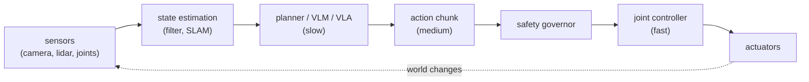
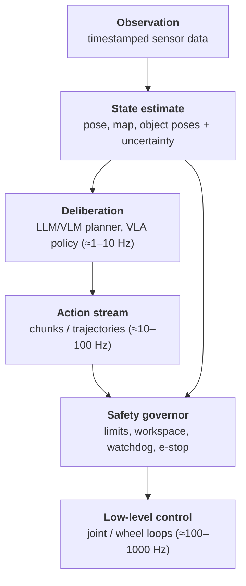

# World Models Module 05 — Embodied Agents

## 00 Why This Module Exists

A software agent that makes a bad tool call can usually be rolled back. A robot that makes a bad move has already moved.
- Embodied agents run several control loops at very different rates, on noisy sensors, with actuators that respond late.
- A foundation model in that stack is slow, non-deterministic, and occasionally wrong. The system must stay safe when it is.


- Legend: SLAM: simultaneous localization and mapping; VLM: vision-language model; VLA: vision-language-action model.

This module covers the physical agent loop, rate hierarchies, state estimation for navigation and manipulation, safety isolation around learned policies, and how physical failures and evaluation differ from software agents.
- How VLA policies map observations to actions belongs to [World Models Module 04](../04-vision-language-action/README.md).
- Predicting and planning with learned models belongs to [Module 02](../02-latent-world-models/README.md) and [Module 03](../03-planning/README.md).
- Training in simulation and transferring to hardware belongs to [Module 06](../06-simulation-sim2real/README.md).
- Software agent loops, durable execution, and capability scoping are core [Module 12](../../advanced-ai-engineering/12-agent-loop-engineering/README.md), [Module 14](../../advanced-ai-engineering/14-durable-agent-runtime/README.md), and [Module 18](../../advanced-ai-engineering/18-ai-security/README.md).

**Research status:** satellite 80/20 revision, 2026-11-26. Formulas are derived in the text. Rates such as "5 Hz planning, 50 Hz actions, 500 Hz joint control" are typical orders of magnitude, not a standard. Claims attributed to papers, safety standards, or the `ros2_control` and `lerobot` code were written from the cited sources but were **not** re-read against a pinned commit or edition in this revision (`TODO_VERIFY`). All latencies and speeds in worked examples are illustrative.

**Module Orientation**

- **Engineering problem:** let a slow, fallible model direct a fast physical system without ever letting its output bypass physical safety limits.
- **What you will do:**
  - compute command staleness and chunk coverage for a rate hierarchy;
  - fuse noisy state estimates and score navigation runs;
  - derive stopping distance and a speed limit from sensing range;
  - build a safety governor around an untrusted policy and try to break it;
  - estimate success rates honestly from few physical trials.
- **Environment:** Python 3.10+, NumPy, and a CPU simulator (a NumPy point-mass or arm model is enough; MuJoCo or PyBullet optional). No robot hardware required.
- **Evidence rule:** separate source observations (**O**), derivations (**D**), and hypotheses that need measurement (**H**).
- **If You Only Have One Week**: Lessons WM5.1 and WM5.3. They cover the two decisions that most often cause physical incidents: acting on stale commands and trusting model output without an independent safety layer.

## 01 Baseline Assumptions

- Core [Module 00](../../advanced-ai-engineering/00-scientific-ai-engineering/README.md): experimental units, uncertainty, and the observation/derivation/hypothesis split.
- Core [Module 04](../../advanced-ai-engineering/04-serving-scheduling-capacity/README.md): latency distributions and tail latency.
- Core [Module 12](../../advanced-ai-engineering/12-agent-loop-engineering/README.md): observe–decide–act loops and loop pathologies.
- [World Models Module 04](../04-vision-language-action/README.md): what a VLA outputs (action tokens or chunks).
- Mathematical prerequisites: kinematics with constant acceleration, variance, and binomial proportions.

## 02 Target Mastery

```yaml
depth_contract:
  conceptual: REQUIRED
  mechanistic: REQUIRED
  mathematical: REQUIRED
  quantitative: REQUIRED
  implementation: REQUIRED
  source_code: SELECTIVE
  instrumentation: REQUIRED
  experimental: SELECTIVE
  statistical: SELECTIVE
  production_reasoning: REQUIRED
  failure_analysis: REQUIRED
  falsification: SELECTIVE
  security: REQUIRED
  economics: SELECTIVE
  architecture_tradeoff: REQUIRED
  research_connection: SELECTIVE

estimated_effort:
  instruction: 2h
  guided_practice: 1.25h
  labs: 3h
  assessment: 0.75h
  source_trace: 0.5h
  total: 7.5h
```

The learner must be able to place a model in a multi-rate control stack, bound the age of every command it issues, design a safety layer that does not depend on the model being correct, and report physical results with honest uncertainty.

### LAYER 1: KNOWLEDGE / INSTRUCTIONAL LAYER

## 03 Knowledge Map


- Legend: rates are typical orders of magnitude for illustration, not requirements.

Keep three contracts separate:

1. **Timing contract:** the rate of each loop, the maximum age of a command when it is applied, and what happens when a command is late.
2. **State contract:** which frame each estimate is in, its timestamp, and its uncertainty.
3. **Safety contract:** limits enforced *outside* the model (speed, force, workspace, watchdog, e-stop) and who may change them.

A learned model may change what the robot tries to do. It must never be able to change the safety contract.

## 04 Lessons

### Lesson WM5.1 — The Physical Agent Loop and the Rate Hierarchy

**Engineering Question:**
How old is a model's command when the motors finally execute it, and what does that age cost in position error?

**Concepts & Definitions:**

- **Rate hierarchy:** slow deliberation (task planning, VLM reasoning), medium-rate action generation, and fast feedback control. Each faster loop tracks the setpoint from the slower loop above it.
- **Command age:** time from the sensor observation a command was based on to the moment the command is applied.
- **Action chunking:** the policy outputs $H$ future actions per inference, and the controller executes them while the next inference runs. ACT popularized this for low-cost manipulation (**O**, `TODO_VERIFY`).

Command age and the resulting error:

$$
a = t_{\text{sense}} + t_{\text{infer}} + t_{\text{queue}} + t_{\text{act}}, \qquad e \approx v \cdot a
$$

where:

- $a$ is the command age in seconds;
- $t_{\text{sense}}$ is the time from capture to the observation being available to the model;
- $t_{\text{infer}}$ is model inference time;
- $t_{\text{queue}}$ is the time the command waits before the controller uses it;
- $t_{\text{act}}$ is actuator response delay;
- $v$ is the relative speed between the robot and the thing it is acting on;
- $e$ is the position error caused by acting on the old observation, to first order.

Chunk coverage condition:

$$
\frac{H}{f_a} \ge t_{\text{infer}} + t_{\text{sense}} + m
$$

where $H$ is the chunk length in actions, $f_a$ is the action rate in Hz, and $m$ is a safety margin in seconds.

*Step-by-step reading.*

1. A chunk lasts $H / f_a$ seconds when executed at $f_a$.
2. The next chunk must be ready before the current one runs out, so it must be computed within that time, including sensing.
3. If the condition fails, the controller either holds the last action (risky while moving) or stops; both must be decided in advance.
4. A longer chunk covers slow inference but executes further into the future open-loop, so $a$ for its last action grows.

**Mechanism Explanation:**

A fast joint controller cannot fix a wrong setpoint; it only tracks it well. Slow reasoning is acceptable when it decides *goals*; it is dangerous when it emits *motions* that are executed long after the observation they were based on.

**Worked Example (staleness and chunk coverage):**
*Input (illustrative).* A VLA runs inference in 300 ms on images that arrive 50 ms after capture. Actions run at 50 Hz with chunk $H = 25$. The target object is on a conveyor moving at 0.2 m/s. Actuator delay is 20 ms.

*Steps.*
- Chunk duration: $25 / 50 = 0.5$ s.
- Coverage: $0.5 \ge 0.30 + 0.05 + m$ holds for $m \le 0.15$ s.
- Age of the first action in a chunk: $0.05 + 0.30 + 0 + 0.02 = 0.37$ s, so $e \approx 0.2 \times 0.37 = 0.074$ m.
- Age of the last action: add $24 / 50 = 0.48$ s of queue, giving $0.85$ s and $e \approx 0.17$ m.

*Result.* The chunk covers inference time, but by its end the robot acts on a 0.85 s old view of an object that moved 17 cm. Shorter chunks with overlap (or temporal ensembling of overlapping chunks), or a faster closed-loop tracker for the object, are needed.

**Knowledge Check:** Why does doubling the joint controller rate from 500 Hz to 1 kHz do almost nothing for the error in this example?

**Guided Practice:** For the same setup, find the largest $H$ for which the last action's error stays below 5 cm, and say whether coverage still holds.

**Feedback Contract:**
- *Expected Evidence*: error budget $0.05 / 0.2 = 0.25$ s of total age, but the first action is already 0.37 s old, so no $H$ satisfies it; the learner concludes that inference latency, not chunk length, must change (or the target must be tracked by a faster loop).
- *Common Failure*: counting only inference time and forgetting sensing, queue, and actuation delays.
- *Diagnostic Hint*: timestamp the observation and the moment of application on one clock; their difference is $a$.
- *Concept to Revisit*: Timing contract.

**Learning Outcome:** Compute command age and chunk coverage, and identify which loop must change to meet an error budget.

*(Effort: 35m instruction, 20m practice)*

### Lesson WM5.2 — State Estimation, Spatial Maps, and Navigation Metrics

**Engineering Question:**
How confident is the robot about where it and the objects are, and how do we score whether it got somewhere efficiently?

**Concepts & Definitions:**

- **State estimation:** fusing a motion prediction with noisy measurements. The Kalman filter is the linear-Gaussian case; SLAM jointly estimates the robot pose and a map (**O**, ORB-SLAM as one visual example).
- **Point-goal navigation:** reach a goal given in coordinates relative to the start. **Object-goal** navigation names a category instead. **Mobile manipulation** combines navigation and grasping, so errors in both compound.
- **SPL (Success weighted by Path Length):** a navigation metric that rewards success and penalizes detours (**O**, Anderson et al. 2018).

One-dimensional Kalman measurement update:

$$
K = \frac{\sigma_p^2}{\sigma_p^2 + \sigma_z^2}, \qquad \hat{x} = x_p + K (z - x_p), \qquad \hat{\sigma}^2 = (1 - K)\, \sigma_p^2
$$

where:

- $x_p, \sigma_p^2$ are the predicted (prior) position and its variance;
- $z, \sigma_z^2$ are the measurement and its variance;
- $K \in [0, 1]$ is the Kalman gain: how much to trust the measurement;
- $\hat{x}, \hat{\sigma}^2$ are the updated estimate and its variance.

SPL over $N$ episodes:

$$
\text{SPL} = \frac{1}{N} \sum_{i=1}^{N} S_i \, \frac{\ell_i}{\max(p_i, \ell_i)}
$$

where $S_i \in \{0, 1\}$ is success on episode $i$, $\ell_i$ is the shortest-path length to the goal, and $p_i$ is the length of the path the agent actually took.

*Step-by-step reading.*

1. A failed episode contributes 0 regardless of path.
2. A successful episode contributes $\ell_i / p_i \le 1$; a perfect path contributes 1.
3. The $\max$ guards against $p_i < \ell_i$ from measurement noise.

**Mechanism Explanation:**

A planner that receives a single "best" pose with no uncertainty cannot tell when to slow down or re-localize. Pass the variance along with the estimate, and let the safety layer tighten limits when uncertainty grows.

**Worked Example (fusion and SPL):**
*Input.* Prior $x_p = 1.00$ m, $\sigma_p^2 = 0.04$; measurement $z = 1.20$ m, $\sigma_z^2 = 0.01$. Three navigation episodes: success with $\ell = 10$, $p = 12.5$; failure; success with $\ell = 8$, $p = 8$.

*Steps.*
- $K = 0.04 / 0.05 = 0.8$.
- $\hat{x} = 1.00 + 0.8 \times 0.20 = 1.16$ m; $\hat{\sigma}^2 = 0.2 \times 0.04 = 0.008$.
- SPL terms: $10 / 12.5 = 0.8$, $0$, $8 / 8 = 1.0$. SPL $= 1.8 / 3 = 0.6$. Success rate $= 2/3 = 0.667$.

*Result.* The fused estimate leans toward the more precise measurement and is more certain than either input. SPL sits below success rate because one success took a detour.

**Knowledge Check:** Two agents both score SPL 0.6. One succeeds rarely but takes perfect paths; the other always succeeds with long detours. What extra number would tell them apart?

**Guided Practice:** Repeat the update with $\sigma_z^2 = 0.16$ (a worse sensor). Then add a fourth episode, a success with $p = 2\ell$, and recompute SPL.

**Feedback Contract:**
- *Expected Evidence*: $K = 0.04 / 0.20 = 0.2$, $\hat{x} = 1.04$, $\hat{\sigma}^2 = 0.032$; SPL $= (0.8 + 0 + 1.0 + 0.5) / 4 = 0.575$.
- *Common Failure*: averaging the prior and the measurement equally, or reporting SPL without the success rate.
- *Diagnostic Hint*: check that the posterior variance is smaller than both input variances.
- *Concept to Revisit*: State contract.

**Learning Outcome:** Fuse estimates with uncertainty and report navigation results with both success rate and SPL.

*(Effort: 25m instruction, 20m practice)*

### Lesson WM5.3 — Safety Isolation: Governors, Watchdogs, and Stopping Distance

**Engineering Question:**
What independent mechanism keeps the robot safe when the model outputs something wrong, late, or malformed?

**Concepts & Definitions:**

- **Safety governor (filter):** a deterministic layer between policy and controller that clips or rejects commands that violate speed, acceleration, force, joint, or workspace limits. Control barrier functions are one formal version (**O**, Ames et al. 2019).
- **Watchdog:** if no fresh, valid command arrives within a timeout, the system goes to a defined safe state (decelerate to stop, hold, or compliant mode). The safe state is chosen per robot; "hold position" is not safe for every task.
- **Emergency stop:** a hardware path that removes or limits power without depending on any software in the stack.
- **Safety standards:** industrial and collaborative robot standards (for example ISO 10218 and ISO/TS 15066) define requirements such as speed and separation monitoring; consult the current editions directly (`TODO_VERIFY`, no values quoted here).

Stopping distance and the speed limit it implies:

$$
d_{\text{stop}} = v\, t_r + \frac{v^2}{2 a_{\max}}, \qquad
v_{\max} = a_{\max}\left(-t_r + \sqrt{t_r^2 + \frac{2 (D - m)}{a_{\max}}}\right)
$$

where:

- $d_{\text{stop}}$ is the distance travelled from detecting an obstacle to standstill;
- $v$ is the current speed;
- $t_r$ is the reaction time: detection plus command plus actuator delay;
- $a_{\max}$ is the guaranteed deceleration;
- $D$ is the distance at which obstacles are reliably detected;
- $m$ is a safety margin;
- $v_{\max}$ is the largest speed with $d_{\text{stop}} \le D - m$.

*Step-by-step reading.*

1. During $t_r$ the robot keeps moving at $v$: distance $v t_r$.
2. Braking from $v$ to 0 at constant $a_{\max}$ covers $v^2 / (2 a_{\max})$.
3. Setting $d_{\text{stop}} = D - m$ gives $\frac{v^2}{2a_{\max}} + v t_r - (D - m) = 0$; the positive root of this quadratic is $v_{\max}$.

**Mechanism Explanation:**

The governor must be simpler than the thing it guards: no learned components, no network calls, and limits stored where the model cannot write them. It checks the *path* to a target, not only the target. Every rejection is logged so policy failures stay visible instead of being silently absorbed.

**Worked Example (stopping distance):**
*Input (illustrative).* $v = 1.0$ m/s, $t_r = 0.1$ s, $a_{\max} = 2.0$ m/s², detection range $D = 1.0$ m, margin $m = 0.2$ m.

*Steps.*
- $d_{\text{stop}} = 1.0 \times 0.1 + 1.0 / 4.0 = 0.35$ m, within $D - m = 0.8$ m.
- $v_{\max} = 2.0 \left(-0.1 + \sqrt{0.01 + 0.8}\right) = 2.0 \times 0.8 = 1.6$ m/s.
- If a slow planner adds 0.3 s to the reaction path ($t_r = 0.4$ s): $v_{\max} = 2.0(-0.4 + \sqrt{0.16 + 0.8}) = 2.0 \times 0.5798 = 1.16$ m/s.

*Result.* Putting the model inside the reaction path cuts the safe speed by about 28%. Obstacle stops belong in the fast loop, not behind the planner.

**Knowledge Check:** Why must the watchdog timeout be derived from stopping distance and loop rates, rather than set to "a few seconds"?

**Guided Practice:** List five malformed or adversarial policy outputs (NaN, out-of-workspace target, joint-limit violation, sudden reversal, valid-looking command 2 s old). For each, state which governor check catches it and what the robot does.

**Feedback Contract:**
- *Expected Evidence*: a table mapping each case to exactly one check (validation, workspace, joint limit, acceleration limit, watchdog/age) and to a defined safe action; none relies on the model to fix itself.
- *Common Failure*: checking only the final target pose, so a straight-line path through an obstacle passes.
- *Diagnostic Hint*: for each check, ask "would this still work if the policy were replaced by random numbers?"
- *Concept to Revisit*: Safety contract.

**Learning Outcome:** Derive speed limits from stopping distance and design a governor that is independent of model correctness.

*(Effort: 35m instruction, 20m practice)*

### Lesson WM5.4 — Physical Failure Modes and Trial-Efficient Evaluation

**Engineering Question:**
How do physical failures differ from sandbox agent failures, and how much can 20 real trials tell us?

**Concepts & Definitions:**

- **Irreversibility:** physical actions cannot be rolled back; broken objects, collisions, and wear persist. Durable-execution ideas from core [Module 14](../../advanced-ai-engineering/14-durable-agent-runtime/README.md) apply to task state, not to the world.
- **Non-stationarity:** lighting, friction, battery voltage, and calibration drift between trials, so trials are not perfectly identical.
- **Hardware heterogeneity:** the same policy on a different arm, gripper, or camera faces different kinematics, latencies, and noise.
- **Wilson score interval:** a binomial confidence interval that behaves sensibly for small $n$ and proportions near 0 or 1.

$$
\tilde{p} = \frac{\hat{p} + \frac{z^2}{2n}}{1 + \frac{z^2}{n}}, \qquad
w = \frac{z}{1 + \frac{z^2}{n}} \sqrt{\frac{\hat{p}(1-\hat{p})}{n} + \frac{z^2}{4n^2}}
$$

where:

- $\hat{p} = s / n$ is the observed success rate from $s$ successes in $n$ trials;
- $z$ is the normal quantile (1.96 for about 95%);
- $\tilde{p}$ is the interval center and $w$ its half-width; the interval is $[\tilde{p} - w, \tilde{p} + w]$.

*Step-by-step reading.*

1. The center is pulled from $\hat{p}$ toward 0.5 by $z^2 / (2n)$, more strongly for small $n$.
2. The width includes a $z^2 / (4n^2)$ term, so it never collapses to zero at $\hat{p} = 0$ or $1$.

**Mechanism Explanation:**

Physical trials are slow and costly, so results are reported from small $n$. Treat each trial as a unit, record its conditions (object, position, lighting, hardware ID), and compare policies on matched conditions. A single headline success rate without an interval hides how little 20 trials can separate.

**Worked Example (17 of 20):**
*Input.* $s = 17$, $n = 20$, $z = 1.96$.

*Steps.*
- $\hat{p} = 0.85$; $z^2 = 3.8416$; $1 + z^2/n = 1.1921$.
- Center: $(0.85 + 0.0960) / 1.1921 = 0.7936$.
- Half-width: $1.96 \sqrt{0.006375 + 0.002401} / 1.1921 = 1.96 \times 0.09368 / 1.1921 = 0.1540$.
- Interval: about $[0.640, 0.948]$.

*Result.* "85% success" from 20 trials is consistent with anything from about 64% to 95%. A competitor's 75% on 20 trials is not distinguishable from it.

**Knowledge Check:** Why are matched trial conditions (same object placements for both policies) worth more than simply running more unmatched trials?

**Guided Practice:** Compute the Wilson interval for 20/20 and for 0/20. Then classify ten failure videos or logs into perception, state estimation, planning, action execution, and safety-stop categories.

**Feedback Contract:**
- *Expected Evidence*: 20/20 gives about $[0.839, 1.0]$ and 0/20 about $[0, 0.161]$; a failure table with one primary category per trial and the evidence used.
- *Common Failure*: reporting "100% success" from 20 trials as if it were certain, or counting safety stops as successes.
- *Diagnostic Hint*: for each failure, find the earliest stage whose output was already wrong.
- *Concept to Revisit*: Wilson interval; irreversibility.

**Learning Outcome:** Report physical success rates with honest intervals and attribute failures to stages of the loop.

*(Effort: 25m instruction, 15m practice)*

## 05 Literature & Production Source Map

**REFERENCE / BASELINE**

- [Do As I Can, Not As I Say: Grounding Language in Robotic Affordances (SayCan)](https://arxiv.org/abs/2204.01691) — Ahn et al. (2022). Reading pointer: an LLM chooses among pre-trained skills scored by value functions; the LLM never emits motor commands.
- [Learning Fine-Grained Bimanual Manipulation with Low-Cost Hardware (ACT)](https://arxiv.org/abs/2304.13705) — Zhao et al. (2023). Reading pointer: action chunking and temporal ensembling.
- [On Evaluation of Embodied Navigation Agents](https://arxiv.org/abs/1807.06757) — Anderson et al. (2018). Reading pointer: the SPL definition.
- [Habitat: A Platform for Embodied AI Research](https://arxiv.org/abs/1904.01201) — Savva et al. (2019). Reading pointer: point-goal navigation setup.
- [ORB-SLAM: a Versatile and Accurate Monocular SLAM System](https://arxiv.org/abs/1502.00956) — Mur-Artal et al. (2015).
- [Control Barrier Functions: Theory and Applications](https://arxiv.org/abs/1903.11199) — Ames et al. (2019). Reading pointer: safety filters as constrained optimization over control inputs.

**WORKLOAD-DEPENDENT / FRONTIER**

- [Diffusion Policy](https://arxiv.org/abs/2303.04137) — Chi et al. (2023): action sequences generated by diffusion; author-reported results are scoped to their tasks and hardware.
- [Code as Policies](https://arxiv.org/abs/2209.07753) — Liang et al. (2022): an LLM writes policy code that calls perception and control APIs. Generated code still runs under the same governor.
- VLA policies such as RT-2 are covered in [World Models Module 04](../04-vision-language-action/README.md).

**CURRENT DEFAULT:** foundation models choose goals or skills, or emit short action chunks; a deterministic governor, watchdog, and hardware e-stop sit below them; every command carries a timestamp.

**LEGACY / INSUFFICIENT:** letting a model's output drive actuators directly; a single success rate from a handful of trials; safety limits stored in the same config the model or its prompt can change.

**PRODUCTION SOURCE TRACE** (pin the commit you read; no commit was pinned in this revision)

- `ros-controls/ros2_control`: the controller manager's periodic `update` loop, which reads hardware state, updates active controllers, and writes commands at a fixed rate (`TODO_VERIFY` file and symbol names at your pinned commit).
- `huggingface/lerobot`: the ACT policy's action selection, which keeps a queue of predicted actions and runs inference only when the queue empties (`TODO_VERIFY` path; it has moved between versions).
- Scope: these show one rate-hierarchy and one chunking implementation, not a certified safety architecture.

### LAYER 2: ENGINEERING PRACTICE LAYER

## 06 Engineering Labs

All labs follow `PREDICT → BUILD → MEASURE → EXPLAIN → BREAK → IMPROVE → FALSIFY`.

### LAB A — A Multi-Rate Loop in Simulation

- **Objective:** build a simulated robot (point mass or 2-link arm) with a slow "planner" thread, a medium action stream, and a fast controller, then measure command age and tracking error against a moving target.
- **Pre-Registered Hypothesis:** tracking error grows roughly linearly with command age; shortening chunks or adding a fast target tracker reduces error more than raising controller rate.
- **Independent Variables:** planner latency distribution (including injected spikes), chunk length $H$, action rate, controller rate, target speed.
- **Dependent Variables:** command age per applied action, tracking error, chunk gaps (time with no valid command), and watchdog stops.
- **Break & Falsify:** inject 2× and 10× planner latency spikes and dropped frames; check whether the system holds, stops, or keeps executing stale actions.
- **Alignment:** Lessons WM5.1 and WM5.2.
- **Effort Estimate:** 1.5h.

### LAB B — Safety Governor Under an Untrusted Policy

- **Objective:** wrap a deliberately bad policy (random, adversarial, and stale outputs) with a governor and watchdog, and show that no safety limit is violated.
- **Pre-Registered Hypothesis:** with path-aware workspace checks, acceleration limits, and an age-based watchdog, the violation count is zero across all injected faults; removing any one check produces violations.
- **Independent Variables:** policy type, enabled checks, watchdog timeout, injected faults (NaN, out-of-workspace, sudden reversal, 2 s old command).
- **Dependent Variables:** limit violations (must be 0), collisions with a virtual obstacle, commands clipped or rejected by reason, and task progress.
- **Break & Falsify:** disable one check at a time; place an obstacle between two allowed targets to test path versus endpoint checking.
- **Alignment:** Lessons WM5.3 and WM5.4 and Incident WM5.1.
- **Effort Estimate:** 1.5h.

**Runnable arithmetic check (CPU; not a robotics experiment):**
```python
import math
# WM5.1 command age and chunk coverage
age_first = 0.05 + 0.30 + 0.0 + 0.02
assert math.isclose(age_first, 0.37) and math.isclose(0.2 * age_first, 0.074)
age_last = age_first + 24 / 50
assert math.isclose(age_last, 0.85) and 25 / 50 >= 0.30 + 0.05
# WM5.2 Kalman update and SPL
K = 0.04 / (0.04 + 0.01)
assert math.isclose(K, 0.8) and math.isclose(1.0 + K * 0.2, 1.16) and math.isclose((1 - K) * 0.04, 0.008)
spl = lambda eps: sum(s * l / max(p, l) for s, l, p in eps) / len(eps)
assert math.isclose(spl([(1, 10, 12.5), (0, 5, 9), (1, 8, 8)]), 0.6)
assert math.isclose(spl([(1, 10, 12.5), (0, 5, 9), (1, 8, 8), (1, 4, 8)]), 0.575)
# WM5.3 stopping distance and speed limit
d_stop = lambda v, tr, a: v * tr + v * v / (2 * a)
v_max = lambda tr, a, D, m: a * (-tr + math.sqrt(tr * tr + 2 * (D - m) / a))
assert math.isclose(d_stop(1.0, 0.1, 2.0), 0.35)
assert math.isclose(v_max(0.1, 2.0, 1.0, 0.2), 1.6)
assert math.isclose(d_stop(v_max(0.4, 2.0, 1.0, 0.2), 0.4, 2.0), 0.8)
assert abs(v_max(0.4, 2.0, 1.0, 0.2) - 1.1596) < 1e-3
# WM5.4 Wilson interval
def wilson(s, n, z=1.96):
    p = s / n; d = 1 + z * z / n
    c = (p + z * z / (2 * n)) / d
    w = z * math.sqrt(p * (1 - p) / n + z * z / (4 * n * n)) / d
    return c - w, c + w
lo, hi = wilson(17, 20)
assert abs(lo - 0.640) < 1e-3 and abs(hi - 0.948) < 1e-3
assert abs(wilson(20, 20)[0] - 0.839) < 1e-3 and abs(wilson(0, 20)[1] - 0.161) < 1e-3
print("OK")
```

## 07 Break / Incident Scenarios

### Incident WM5.1 — The Mobile Manipulator Clips a Shelf After a Model Upgrade

**Incident Symptoms:**
A warehouse mobile manipulator receives a larger VLM for task planning. Task success in the weekly sample rises slightly. Two days later the arm clips a shelf edge while reaching. Logs show the commanded end-effector target was inside the allowed workspace. Median planner latency is similar to before, but p99 roughly tripled (illustrative). No e-stop was triggered.

**Diagnostic Protocol (Task):**
1. **Form Competing Hypotheses:** stale commands executed after a latency spike; governor checks only target poses, not paths; a shifted camera calibration; a map that missed the shelf; watchdog timeout longer than the stopping budget; a mechanical fault.
2. **Identify Missing Evidence:** per-command observation and application timestamps, governor decisions with reasons, the planned path, localization variance at the time, calibration history, and watchdog configuration.
3. **Design Discriminating Measurements:** replay the logged commands in simulation with recorded latencies; re-run with path checking enabled; re-run with the old model's latency distribution.
4. **Rank Explanations:** a target-only check plus a straight-line path predicts a collision even with fresh commands; staleness alone predicts errors only during spikes. Use the replay to separate them.
5. **Intervene:** add path-aware workspace checks; set the watchdog timeout from the stopping-distance budget; reject commands older than a declared age; keep the model's upgrade only if it passes the same safety tests.
6. **Remeasure:** LAB B fault-injection suite with zero violations, command-age p99 within the timing contract, and a matched-condition success comparison with Wilson intervals.

### LAYER 3: MASTERY / ASSESSMENT LAYER

## 08 Mastery Assessment

### Transfer Problem — A Language-Directed Tabletop Robot in a Shared Space

Design the control stack for a robot arm that takes spoken or typed instructions ("put the red cup on the tray") in a lab where people walk nearby.

**Required Deliverables:**
1. a rate hierarchy with each loop's rate, the component at each level, and the timing contract (maximum command age, late-command behavior);
2. hand-computed command age, chunk coverage, and position error for the chosen design;
3. the safety contract: governor checks, watchdog timeout derived from stopping distance, e-stop path, and who may change limits;
4. LAB A and LAB B evidence, including zero violations under fault injection;
5. an evaluation plan with matched trial conditions and Wilson intervals, and a failure taxonomy by loop stage.

## 09 Required Evidence & Rubric

### Required Artifact: Embodied Agent Timing and Safety Sheet

Submit the three contracts, LAB A age/error measurements, the LAB B fault-injection table, the Incident WM5.1 diagnosis, and the evaluation plan.

### Rubric Dimensions

- **Mechanism:** *Insufficient* says "the VLM controls the robot." *Competent* places each component in a rate hierarchy. *Strong* bounds command age at every boundary and states late-command behavior.
- **Safety:** *Insufficient* relies on the model to behave. *Competent* adds limits and an e-stop. *Strong* proves, by fault injection, that safety does not depend on model correctness, and derives timeouts from physics.
- **Quantitative:** *Insufficient* quotes rates. *Competent* computes age, stopping distance, and SPL. *Strong* links them to a speed limit and an error budget.
- **Evaluation:** *Insufficient* reports one success rate. *Competent* adds intervals. *Strong* uses matched conditions and stage-level failure attribution.

## 10 Capability Traceability Matrix

| Capability | Taught | Practiced | Assessed | Evidence (artifact reviewers open) |
|---|---|---|---|---|
| Rate hierarchy and command age | WM5.1 | WM5.1 Guided Practice; LAB A | Deliverables 1–2; Incident WM5.1 | LAB A age and error measurements |
| State estimation and navigation metrics | WM5.2 | WM5.2 Guided Practice; LAB A | Deliverable 5 | Fused estimates with variance; SPL with success rate |
| Safety governor and stopping distance | WM5.3 | WM5.3 Guided Practice; LAB B | Deliverables 3–4; Incident WM5.1 | LAB B fault-injection table with zero violations |
| Physical evaluation and failure attribution | WM5.4 | WM5.4 Guided Practice; LAB B | Deliverable 5 | Wilson intervals and failure taxonomy table |

## 11 Exit Criteria & Module Wrap-Up

### Exit Criteria

A learner passes when they can compute command age and chunk coverage, fuse estimates with uncertainty, derive a speed limit and watchdog timeout from stopping distance, demonstrate a governor with zero violations under fault injection, and report small-sample physical results with intervals and stage-level failure attribution.

### Module Wrap-Up (Final Mental Model Reconstruction)

In an embodied agent, the model proposes and the safety layer disposes. Timestamp every command, bound its age, keep safety limits outside the model's reach, and treat each physical trial as expensive evidence that deserves an honest interval.

### Cost & Telemetry Hook

- [Lesson 22.1](../../advanced-ai-engineering/22-ai-economics/README.md): cost per successful task must include robot time, resets, operator supervision, and failed trials, not only inference.
- [Lesson 23.1](../../advanced-ai-engineering/23-observability-reliability/README.md): emit observation and application timestamps, governor decisions with reasons, watchdog events, and localization variance so Incident WM5.1 is diagnosable from telemetry.

## 12 Competency Targets

```yaml
competency:
  sfia: 4
  bloom: Apply -> Analyze
  solo: Relational
  dreyfus: Advanced Beginner -> Competent
```
