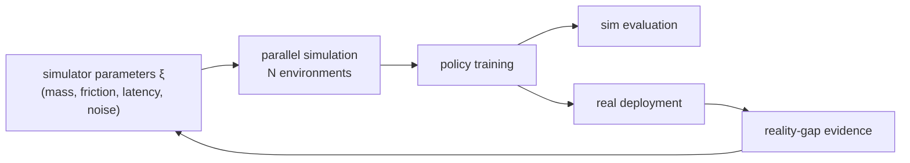
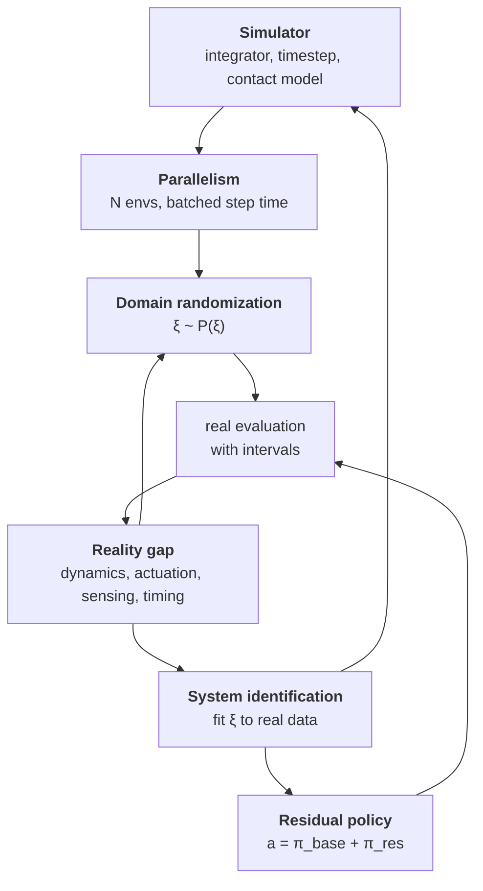

# World Models Module 06 — Simulation & Sim-to-Real

## 00 Why This Module Exists

A simulator is a data engine with its own model of physics. A policy trained in it learns the simulator's physics, including its errors.
- When the policy reaches real hardware, every difference in friction, contact, actuation, sensing, and timing becomes an input the policy never saw.
- Many of these differences are invisible in simulation metrics: a policy can succeed 98% of the time in simulation and still fail on the first real contact.


- Legend: ξ (xi): the vector of simulator parameters for one environment instance.

This module covers GPU-parallel simulation and its numerical limits, the sources of the reality gap, domain randomization, system identification, residual policies, and the cost trade-off between simulated and physical data.
- Learned world models that replace or complement a physics engine belong to [World Models Module 02](../02-latent-world-models/README.md).
- Planning with a model (MPC) belongs to [World Models Module 03](../03-planning/README.md).
- Robot task loops, manipulation, and navigation belong to [World Models Module 05](../05-embodied-agents/README.md).

**Research status:** satellite 80/20 revision, 2026-11-26. Formulas below are derived in the text. Statements attributed to papers and to the `google-deepmind/mujoco` and `leggedrobotics/legged_gym` code were written from the cited sources but were **not** re-read against a pinned commit or paper revision in this revision (`TODO_VERIFY`). No benchmark numbers from papers are reproduced. All timings and prices in worked examples are **illustrative**, chosen to make the arithmetic visible, not measured.

**Module Orientation**

- **Engineering problem:** produce a policy whose real-world performance can be predicted from simulation evidence, and know when simulation evidence stops being informative.
- **What you will do:**
  - compute simulation throughput and numerical stability limits by hand;
  - list the gap sources for one task and estimate the effect of latency;
  - train policies with narrow and wide domain randomization and test them on a held-out "pseudo-real" simulator;
  - identify one physical parameter from a recorded trajectory and fit a residual correction.
- **Environment:** Python 3.10+, MuJoCo (CPU) or a GPU-batched simulator (MuJoCo MJX, Brax, or Isaac Lab), and a small RL library. A physical robot is optional; LAB B uses a perturbed simulator as a stand-in and states that limitation.
- **Evidence rule:** separate source observations (**O**), derivations (**D**), and hypotheses that need measurement (**H**). Report real-world success with an interval, never as a bare rate.
- **If You Only Have One Week**: Lessons WM6.2 and WM6.3. They cover where the gap comes from and what randomization can and cannot do about it.

## 01 Baseline Assumptions

- Core [Module 00](../../advanced-ai-engineering/00-scientific-ai-engineering/README.md): paired comparisons, uncertainty intervals, and the observation/derivation/hypothesis split.
- Core [Module 08](../../advanced-ai-engineering/08-ai-data-engineering/README.md): synthetic data, provenance, and distribution shift.
- [World Models Module 01](../01-model-based-learning/README.md): the transition function $p(s' \mid s, a)$ and why a model's error compounds over a rollout.
- Mathematical prerequisites: Newton's second law, a mass–spring system, expectations over a distribution, and binomial proportions.

## 02 Target Mastery

```yaml
depth_contract:
  conceptual: REQUIRED
  mechanistic: REQUIRED
  mathematical: REQUIRED
  quantitative: REQUIRED
  implementation: SELECTIVE
  source_code: SELECTIVE
  instrumentation: SELECTIVE
  experimental: REQUIRED
  statistical: SELECTIVE
  production_reasoning: REQUIRED
  failure_analysis: REQUIRED
  falsification: REQUIRED
  security: NOT_APPLICABLE
  economics: SELECTIVE
  architecture_tradeoff: REQUIRED
  research_connection: SELECTIVE

estimated_effort:
  instruction: 2h
  guided_practice: 1.25h
  labs: 3h
  assessment: 0.75h
  source_trace: 0.5h
  total: 7.5h
```

The learner must be able to size a simulation run, name the gap sources for a task, design a randomization range and defend its width, estimate a physical parameter from data, and state with an interval how much real-world evidence supports a transfer claim.

### LAYER 1: KNOWLEDGE / INSTRUCTIONAL LAYER

## 03 Knowledge Map


- Legend: π_base: a fixed or simulation-trained controller; π_res: a learned correction added to its output.

Two strategies, often combined:

1. **Make the simulator right:** measure the real system and fit simulator parameters (system identification), or learn a correction for what the simulator cannot express.
2. **Make the policy indifferent:** randomize parameters so the policy works across a range that is meant to contain reality.

Neither strategy removes the need for real evaluation. Both change how many real trials you need and what they test.

## 04 Lessons

### Lesson WM6.1 — Simulation Throughput and Numerical Limits

**Engineering Question:**
How much experience per wall-clock hour does a simulator produce, and what limits the timestep?

**Concepts & Definitions:**

- **Physics timestep $\Delta t$:** the integrator step. **Control period** $T_c$: how often the policy acts. **Decimation** $d = T_c / \Delta t$: physics steps per policy action.
- **Batched step time $t_b$:** wall-clock time for one policy step across all $N$ environments, including physics, observation, and policy inference.
- **Simulated-time ratio $\rho$:** simulated seconds produced per wall-clock second, summed over environments.

$$
\rho = \frac{N \cdot T_c}{t_b}
$$

where:

- $\rho$ is simulated robot-seconds per wall-clock second;
- $N$ is the number of parallel environments;
- $T_c$ is the control period in seconds (one policy step advances each environment by $T_c$);
- $t_b$ is the wall-clock time of one batched policy step in seconds.

*Step-by-step reading.*

1. One batched step advances each of the $N$ environments by $T_c$ simulated seconds, so it produces $N T_c$ robot-seconds.
2. It costs $t_b$ wall-clock seconds, so the rate is $N T_c / t_b$.
3. A single physical robot has $\rho \le 1$, and less once resets and supervision are counted.

**Mechanism Explanation:**

GPU simulators keep the state of all environments in device arrays and step them in one kernel launch, so $t_b$ grows slowly with $N$ until the device saturates (**O** for Isaac Gym and Brax, `TODO_VERIFY`). The timestep cannot be raised freely to buy throughput. Stiff contacts behave like very stiff springs, and explicit or semi-implicit integrators become unstable when the step is too large relative to the fastest oscillation.

For an undamped mass–spring system integrated with semi-implicit (symplectic) Euler, the update is stable only when:

$$
\omega \, \Delta t \le 2, \qquad \omega = \sqrt{k / m}
$$

where:

- $\omega$ is the natural angular frequency in rad/s;
- $k$ is the spring (or contact) stiffness in N/m;
- $m$ is the mass in kg;
- $\Delta t$ is the integrator timestep in seconds.

*Step-by-step reading.*

1. Semi-implicit Euler updates velocity first, $v_{n+1} = v_n - \omega^2 x_n \Delta t$, then position with the new velocity, $x_{n+1} = x_n + v_{n+1}\Delta t$.
2. Writing this as a $2\times2$ linear map, its eigenvalues have magnitude 1 (no growth) exactly when $(\omega \Delta t)^2 \le 4$.
3. Above that bound one eigenvalue exceeds 1 in magnitude, so the oscillation amplitude grows every step: the simulation "explodes."
4. Stiffer contacts (larger $k$) or lighter bodies (smaller $m$) raise $\omega$ and shrink the stable $\Delta t$.

**Worked Example (throughput and stability):**
*Input (illustrative).* $N = 4{,}096$ environments, control at 50 Hz ($T_c = 0.02$ s), physics $\Delta t = 0.005$ s, batched step $t_b = 0.02$ s. A contact modeled as $k = 10^4$ N/m on a $0.1$ kg link.

*Steps.*
- Decimation: $d = 0.02 / 0.005 = 4$ physics steps per action.
- $\rho = 4{,}096 \times 0.02 / 0.02 = 4{,}096$ robot-seconds per second.
- Per wall-clock hour: 4,096 robot-hours, i.e. about 170 robot-days.
- Policy steps per second: $4{,}096 / 0.02 = 204{,}800$.
- $\omega = \sqrt{10^4 / 0.1} = 316.2$ rad/s, so the stable bound is $\Delta t \le 2 / 316.2 = 6.32$ ms.
- The chosen 5 ms step is inside the bound, with about 21% margin. Doubling stiffness to $2\times10^4$ N/m gives $\omega = 447.2$ and a bound of 4.47 ms: the same 5 ms step is now unstable.

*Result.* Throughput comes from $N$, not from a larger timestep; the timestep is capped by the stiffest element in the scene.

**Knowledge Check:** A team doubles $\Delta t$ to halve $t_b$. Training reward rises, but the policy exploits contacts that bounce unrealistically. Which quantity should they have computed first?

**Guided Practice:** For a simulator you can run, measure $t_b$ at $N = 1, 64, 512, 4{,}096$ (or the largest your hardware allows). Plot $\rho$ against $N$ and mark where it stops growing linearly. Then find the largest stable $\Delta t$ for one contact-rich scene by doubling it until the energy of a resting object grows.

**Feedback Contract:**
- *Expected Evidence*: a $\rho$–$N$ table with hardware, simulator version, and whether policy inference was included in $t_b$; the instability timestep reported together with the scene's stiffest contact settings.
- *Common Failure*: timing physics alone and reporting it as training throughput.
- *Diagnostic Hint*: time each stage of one batched step separately (physics, observation, inference, reset).
- *Concept to Revisit*: Simulated-time ratio; stability bound.

**Learning Outcome:** Size a simulation run in robot-hours and explain why the timestep is a physics constraint, not a speed knob.

*(Effort: 30m instruction, 20m practice)*

### Lesson WM6.2 — Sources of the Reality Gap

**Engineering Question:**
Which differences between simulator and robot matter for this task, and how do you measure the gap honestly?

**Concepts & Definitions:**

- **Reality gap:** the difference between the simulator's transition and observation model and the real system's. A policy's sim success minus its real success is one task-level symptom of it.
- Gap sources, in the order they usually need checking:
  - **Timing:** control latency, sensor delay, jitter, control-rate mismatch.
  - **Actuation:** motor torque limits, gear backlash, motor dynamics, PD gain mismatch.
  - **Sensing:** noise, bias, dropped frames, camera exposure and color.
  - **Dynamics parameters:** mass, inertia, friction, damping, restitution.
  - **Unmodeled physics:** deformable objects, fluids, cables, and contact-rich interactions that the contact model approximates poorly.

**Mechanism Explanation:**

A policy is a feedback controller. Latency adds phase lag, and a controller tuned without lag can oscillate when lag appears. For a sinusoidal motion at frequency $f$, a delay $\tau$ produces a phase lag:

$$
\phi = 360^\circ \cdot f \cdot \tau
$$

where:

- $\phi$ is the phase lag in degrees;
- $f$ is the frequency of the motion in Hz;
- $\tau$ is the total delay between observation and applied action in seconds.

*Step-by-step reading.* One period lasts $1/f$ seconds and corresponds to $360^\circ$. A delay $\tau$ is the fraction $\tau / (1/f) = f\tau$ of a period, i.e. $360^\circ f \tau$.

Real evaluation is expensive, so real success rates come from few trials. Report them with an interval. The Wilson score interval for $s$ successes in $n$ trials, with $\hat p = s/n$ and normal quantile $z$:

$$
\frac{\hat p + \frac{z^2}{2n}}{1 + \frac{z^2}{n}} \;\pm\; \frac{z}{1 + \frac{z^2}{n}} \sqrt{\frac{\hat p (1-\hat p)}{n} + \frac{z^2}{4n^2}}
$$

where:

- $\hat p$ is the observed success fraction;
- $n$ is the number of real trials;
- $z$ is the normal quantile for the confidence level ($z = 1.96$ for 95%).

*Step-by-step reading.* The center is pulled from $\hat p$ toward $0.5$, more strongly when $n$ is small. The half-width shrinks roughly like $1/\sqrt{n}$. Unlike the plain $\hat p \pm z\sqrt{\hat p(1-\hat p)/n}$, it stays inside $[0, 1]$ and does not collapse to zero width at $\hat p = 0$ or $1$.

**Worked Example (latency and trial count):**
*Input (illustrative).* Control at 50 Hz. The real system adds two control steps of delay. A gait oscillates at 2 Hz. On the robot, 14 of 20 trials succeed; in simulation, 98% succeed.

*Steps.*
- $\tau = 2 \times 0.02 = 0.04$ s.
- $\phi = 360 \times 2 \times 0.04 = 28.8^\circ$ of lag that the simulator never produced.
- Wilson interval with $\hat p = 0.7$, $n = 20$, $z = 1.96$:
  - $z^2/n = 3.8416 / 20 = 0.19208$.
  - Center: $(0.7 + 0.09604) / 1.19208 = 0.6678$.
  - Half-width: $1.96 \sqrt{0.0105 + 0.0024010} / 1.19208 = 1.96 \times 0.11358 / 1.19208 = 0.1867$.
  - Interval: $[0.481, 0.855]$.

*Result.* The sim-to-real drop is real (0.98 is far above the interval), but 20 trials cannot distinguish a real success rate of 50% from 85%. Two policies with 14/20 and 16/20 cannot be ranked from this evidence.

**Knowledge Check:** Why should latency and actuator effects be checked before friction ranges, even though friction is the parameter most often randomized?

**Guided Practice:** For one task you know (a reach, a push, a walking gait), write the gap-source list above with one concrete measurement for each source and its expected effect on the policy. Then compute how many real trials you need for a Wilson half-width of at most 0.1 when the true rate is near 0.7.

**Feedback Contract:**
- *Expected Evidence*: a table of source, measurement, and predicted effect; a trial count of about 80 (half-width $\approx 1.96\sqrt{0.21/n} \le 0.1$ gives $n \ge 81$ for the simple form; the Wilson form gives a similar number).
- *Common Failure*: listing only dynamics parameters and ignoring timing and actuation.
- *Diagnostic Hint*: log timestamps at observation capture, policy output, and actuator command on the real robot; the difference is $\tau$.
- *Concept to Revisit*: Reality gap; Wilson interval.

**Learning Outcome:** Enumerate gap sources for a task and report real-world transfer with an honest interval.

*(Effort: 30m instruction, 20m practice)*

### Lesson WM6.3 — Domain Randomization: What It Buys and What It Costs

**Engineering Question:**
How wide should randomization ranges be, and why does randomization not guarantee zero-shot transfer?

**Concepts & Definitions:**

- **Domain randomization (DR):** sample simulator parameters $\xi$ from a distribution $P(\xi)$ for each episode and train one policy across them. Visual DR randomizes textures, lighting, and cameras (Tobin et al., **O**); dynamics DR randomizes physical parameters and latency (Peng et al., **O**).
- **Automatic domain randomization (ADR):** grow the ranges as the policy succeeds at the current ones (OpenAI et al., 2019, **O**, `TODO_VERIFY`).

DR trains a policy for the objective:

$$
\pi^\star = \arg\max_\pi \; \mathbb{E}_{\xi \sim P(\xi)} \big[ J(\pi; \xi) \big]
$$

where:

- $\pi$ is the policy;
- $\xi$ is one draw of simulator parameters;
- $P(\xi)$ is the randomization distribution chosen by the engineer;
- $J(\pi; \xi)$ is the expected return (or success rate) of $\pi$ in the simulator configured by $\xi$.

*Step-by-step reading.*

1. The objective averages performance over the randomization distribution, not over reality.
2. If the real system behaves like some $\xi_{real}$ in the support of $P$, the policy was trained on similar cases.
3. If reality is outside the support, or the gap is something no parameter in $\xi$ can express (an unmodeled contact effect), the objective says nothing about it.
4. A wider $P$ covers more possibilities but asks one policy to do well on all of them, which often makes it more conservative.

**Mechanism Explanation:**

DR is a bet that reality looks like one more sample from $P(\xi)$. It does not guarantee transfer; it shifts the question from "is the simulator right?" to "is reality inside the range, and is the range expressible by the simulator?" Policies with memory or history inputs can partly infer $\xi$ online and adapt (as in rapid motor adaptation, Kumar et al., **O**).

**Worked Example (narrow versus wide):**
*Input (illustrative).* Friction coefficient $\mu$. Policy A is trained at $\mu \in [0.8, 1.2]$ and succeeds 95% inside that range and 30% outside it. Policy B is trained at $\mu \in [0.5, 1.5]$ and succeeds 80% everywhere in that range.

*Steps.*
- If the real $\mu$ is unknown and equally likely anywhere in $[0.5, 1.5]$:
  - A: inside-range fraction $0.4 / 1.0 = 0.4$, so $0.4 \times 0.95 + 0.6 \times 0.30 = 0.38 + 0.18 = 0.56$.
  - B: $0.80$.
- If the real $\mu$ has been measured at about 1.0: A gives 0.95, B gives 0.80.
- If the real $\mu$ is 0.4 (outside both ranges): neither result applies; both must be tested.

*Result.* Width is worth what you do not know. Measuring a parameter (Lesson WM6.4) lets you narrow its range and recover performance.

**Knowledge Check:** A policy trained with very wide mass randomization transfers, but moves slowly and timidly. Which term in the objective explains this, and what would you change?

**Guided Practice:** Pick three parameters for one task. For each, write a range and a one-line justification (measured, manufacturer tolerance, or guess). Mark which ranges you would narrow first if you could measure one thing on the real robot.

**Feedback Contract:**
- *Expected Evidence*: a table of parameter, range, justification, and source of the range; at least one timing or actuator parameter.
- *Common Failure*: ranges copied from another robot's config without a justification.
- *Diagnostic Hint*: for each range ask: "what evidence says reality is inside it?"
- *Concept to Revisit*: DR objective; support of $P(\xi)$.

**Learning Outcome:** Design randomization ranges with stated evidence and explain the robustness–performance trade-off.

*(Effort: 30m instruction, 20m practice)*

### Lesson WM6.4 — System Identification, Residual Policies, and Data Cost

**Engineering Question:**
When should you measure the robot instead of randomizing, and what does a real robot-hour cost compared with a simulated one?

**Concepts & Definitions:**

- **System identification (SysID):** estimate simulator parameters from real trajectories, for example by minimizing the error between recorded and simulated motion under the same commands. Learned actuator models trained on real motor data are one variant (Hwangbo et al., **O**, `TODO_VERIFY`).
- **Residual policy:** $a = \pi_{base}(s) + \pi_{res}(s)$, where $\pi_{base}$ is a fixed controller or a simulation-trained policy and $\pi_{res}$ is a small learned correction trained on real data (Silver et al.; Johannink et al., **O**).

One simple SysID case: damping from a free-decay test. For an underdamped oscillation with successive peaks $x_1$ and $x_2$ one period apart:

$$
\delta = \ln \frac{x_1}{x_2}, \qquad \zeta = \frac{\delta}{\sqrt{4\pi^2 + \delta^2}}
$$

where:

- $\delta$ is the logarithmic decrement (dimensionless);
- $x_1, x_2$ are successive peak amplitudes, one period apart;
- $\zeta$ is the damping ratio (0 is undamped, 1 is critically damped).

*Step-by-step reading.* The envelope of a damped oscillation decays like $e^{-\zeta \omega_n t}$. Over one damped period $T_d = 2\pi / (\omega_n\sqrt{1-\zeta^2})$, the ratio of peaks is $e^{\zeta\omega_n T_d}$, so $\delta = 2\pi\zeta / \sqrt{1-\zeta^2}$. Solving for $\zeta$ gives the second formula.

**Mechanism Explanation:**

SysID narrows the ranges that DR must cover, and residual learning absorbs what the simulator cannot express. Both need real data, so they trade robot time for a better match. Simulated experience is cheap per robot-hour but carries the gap; real experience is expensive but has no gap. The useful question is how to spend a fixed real-robot budget: on SysID, on residual training, or on evaluation trials.

**Worked Example (damping and cost):**
*Input.* A free-decay test of one joint gives peaks $x_1 = 1.0$ and $x_2 = 0.6$ (rad). Costs are **illustrative**: a GPU at \$2 per hour producing $\rho = 4{,}096$ (Lesson WM6.1), and a physical robot at \$50 per robot-hour including operator time.

*Steps.*
- $\delta = \ln(1.0 / 0.6) = \ln 1.6667 = 0.5108$.
- $\zeta = 0.5108 / \sqrt{39.478 + 0.261} = 0.5108 / 6.3039 = 0.0810$.
- Simulated cost per robot-hour: $2 / 4{,}096 = \$0.00049$.
- Physical cost per robot-hour: \$50, about 100,000 times more.
- 80 real evaluation trials of 2 minutes each (Lesson WM6.2): $80 \times 2 / 60 = 2.67$ robot-hours, about \$133, before resets and repairs.

*Result.* The simulator should hold the training budget; the real robot should hold identification and evaluation, which are the parts simulation cannot supply.

**Knowledge Check:** After SysID, sim and real trajectories match well in free motion but not during grasping. Would you widen randomization, fit more parameters, or train a residual? Justify.

**Guided Practice:** Simulate a damped joint with a known $\zeta$, record peaks with added sensor noise, and estimate $\zeta$ from the log decrement using one period and using the average over five periods. Compare errors.

**Feedback Contract:**
- *Expected Evidence*: true versus estimated $\zeta$ for both methods; the five-period average has lower error under noise ($\delta$ over $k$ periods is $\frac{1}{k}\ln(x_1/x_{k+1})$).
- *Common Failure*: reading peaks from a sampled signal without interpolation, which biases low peaks.
- *Diagnostic Hint*: plot $\ln$ of the peaks against peak index; it should be a straight line with slope $-\delta$.
- *Concept to Revisit*: SysID; residual policy; cost per robot-hour.

**Learning Outcome:** Estimate a physical parameter from real data and allocate a real-robot budget between identification, adaptation, and evaluation.

*(Effort: 30m instruction, 15m practice)*

## 05 Literature & Production Source Map

**REFERENCE / BASELINE**

- [MuJoCo: A physics engine for model-based control](https://ieeexplore.ieee.org/document/6386109) — Todorov, Erez, and Tassa (IROS 2012). Reading pointer: the contact model and its soft-constraint formulation.
- [Domain Randomization for Transferring Deep Neural Networks from Simulation to the Real World](https://arxiv.org/abs/1703.06907) — Tobin et al. (2017). Visual randomization for object localization.
- [Sim-to-Real Transfer of Robotic Control with Dynamics Randomization](https://arxiv.org/abs/1710.06537) — Peng et al. (2018). Randomized dynamics and a recurrent policy.
- [Residual Policy Learning](https://arxiv.org/abs/1812.06298) — Silver et al. (2018) and [Residual Reinforcement Learning for Robot Control](https://arxiv.org/abs/1812.03201) — Johannink et al. (2019).

**WORKLOAD-DEPENDENT / FRONTIER**

- [Isaac Gym: High Performance GPU-Based Physics Simulation For Robot Learning](https://arxiv.org/abs/2108.10470) — Makoviychuk et al. (2021) and [Brax](https://arxiv.org/abs/2106.13281) — Freeman et al. (2021): GPU-batched simulation. Speedups are author-reported and hardware-specific.
- [Learning to Walk in Minutes Using Massively Parallel Deep RL](https://arxiv.org/abs/2109.11978) — Rudin et al. (2022): thousands of parallel environments for legged locomotion (`TODO_VERIFY` training-time claims; not reproduced here).
- [Learning Agile and Dynamic Motor Skills for Legged Robots](https://arxiv.org/abs/1901.08652) — Hwangbo et al. (2019): learned actuator network from real motor data (`TODO_VERIFY`).
- [RMA: Rapid Motor Adaptation for Legged Robots](https://arxiv.org/abs/2107.04034) — Kumar et al. (2021): online inference of environment parameters from history.
- [Solving Rubik's Cube with a Robot Hand](https://arxiv.org/abs/1910.07113) — OpenAI et al. (2019): automatic domain randomization (`TODO_VERIFY`).
- Newer engines such as Genesis and MuJoCo MJX change throughput and differentiability, not the need for real evaluation. Their performance claims are not reproduced here.

**CURRENT DEFAULT:** GPU-parallel training with dynamics, latency, and sensor-noise randomization whose ranges are justified by measurement where possible; SysID for the parameters you can measure; real-world evaluation reported with intervals.

**LEGACY / INSUFFICIENT:** sim success reported as expected real success; randomization ranges without justification; ignoring latency and actuator dynamics; claiming "zero-shot transfer" from a handful of real trials.

**Known hard cases:** deformable objects, cloth, cables, fluids, granular media, and contact-rich manipulation with sliding and sticking transitions remain poorly matched by rigid-body contact models. Expect a larger residual gap and plan more real data for them.

**PRODUCTION SOURCE TRACE** (pin the commit you read; no commit was pinned in this revision)

- `google-deepmind/mujoco`: `mj_step` and the `mjOption` fields `timestep` and `integrator` (Lesson WM6.1). Record which integrator your model file selects.
- `leggedrobotics/legged_gym`, file `legged_gym/envs/base/legged_robot.py`: friction randomization in `_process_rigid_shape_props` and external pushes in `_push_robots` (Lesson WM6.3) (`TODO_VERIFY` method names).
- Scope: one engine and one training framework, not a universal implementation of randomization. Isaac Lab and other frameworks organize randomization differently; record where yours does it.

### LAYER 2: ENGINEERING PRACTICE LAYER

## 06 Engineering Labs

All labs follow `PREDICT → BUILD → MEASURE → EXPLAIN → BREAK → IMPROVE → FALSIFY`.

### LAB A — Throughput and Stability Sweep

- **Objective:** measure simulated-time ratio against environment count and find the stable timestep limit for a contact-rich scene.
- **Pre-Registered Hypothesis:** $\rho$ grows nearly linearly with $N$ until a hardware-dependent knee; the measured instability timestep lies within a factor of two of $2/\omega$ computed from the stiffest contact.
- **Independent Variables:** $N$, $\Delta t$, contact stiffness, whether policy inference is included in the timed step.
- **Dependent Variables:** $t_b$ per stage, $\rho$, energy drift of a resting object, and whether the episode explodes.
- **Break & Falsify:** raise $\Delta t$ past the bound; double contact stiffness; report whether a policy trained at the larger step exploits non-physical behavior.
- **Alignment:** Lesson WM6.1.
- **Effort Estimate:** 1.25h.

### LAB B — Randomization Width Against a Held-Out Pseudo-Real Simulator

- **Objective:** train one task policy with no, narrow, and wide randomization and evaluate on a held-out simulator configuration that stands in for reality (perturbed friction, mass, two steps of action latency, sensor noise).
- **Pre-Registered Hypothesis:** the wide-randomization policy has the best pseudo-real success but the lowest nominal-sim success; adding latency to the randomization matters more than widening friction.
- **Independent Variables:** randomization ranges, inclusion of latency, pseudo-real configuration.
- **Dependent Variables:** success with Wilson intervals on nominal sim and pseudo-real, episode return, and a qualitative note on conservativeness.
- **Break & Falsify:** move the pseudo-real friction outside the trained range; add an effect no parameter covers (for example, a motor torque limit lower than any trained value).
- **Limitation:** sim-to-sim transfer tests the method, not the real gap. State this in the report. If a robot is available, add 20+ real trials.
- **Alignment:** Lessons WM6.2–WM6.4 and Incident WM6.1.
- **Effort Estimate:** 1.75h.

**Runnable arithmetic check (CPU; not a training experiment):**
```python
import math
N, Tc, tb, dt = 4096, 0.02, 0.02, 0.005
assert round(Tc / dt) == 4                                  # decimation
assert math.isclose(N * Tc / tb, 4096)                      # rho
w = math.sqrt(1e4 / 0.1)
assert math.isclose(2 / w, 0.0063246, rel_tol=1e-4)         # stable dt bound
assert 2 / math.sqrt(2e4 / 0.1) < dt                        # stiffer contact: 5 ms unstable
# semi-implicit Euler: bounded below the bound, growing above it
def peak(dt_, w_, steps=2000):
    x, v, m = 1.0, 0.0, 0.0
    for _ in range(steps):
        v -= w_ * w_ * x * dt_; x += v * dt_; m = max(m, abs(x))
    return m
assert peak(0.006, w) < 10 and peak(0.0066, w) > 1e3
assert math.isclose(360 * 2 * 0.04, 28.8)                   # phase lag
def wilson(s, n, z=1.96):
    p = s / n; d = 1 + z * z / n
    c = (p + z * z / (2 * n)) / d
    h = z * math.sqrt(p * (1 - p) / n + z * z / (4 * n * n)) / d
    return c - h, c + h
lo, hi = wilson(14, 20)
assert abs(lo - 0.481) < 1e-3 and abs(hi - 0.855) < 1e-3
assert math.isclose(0.4 * 0.95 + 0.6 * 0.30, 0.56)          # narrow DR expected success
d = math.log(1.0 / 0.6); zeta = d / math.sqrt(4 * math.pi**2 + d * d)
assert abs(zeta - 0.0810) < 1e-4
assert math.isclose(80 * 2 / 60 * 50, 133.33, rel_tol=1e-3)
```

## 07 Break / Incident Scenarios

### Incident WM6.1 — 98% in Simulation, Jitter on the Robot

**Incident Symptoms:**
A manipulation policy reaches 98% success across randomized simulation. On the real arm, 7 of 20 trials succeed. The arm visibly oscillates near the object before grasping, and the oscillation is worse when the policy runs on the robot's onboard computer than on a workstation. Friction and mass were randomized widely; nothing else was.

**Diagnostic Protocol (Task):**
1. **Form Competing Hypotheses:** unmodeled latency, control-rate mismatch, actuator gain or torque-limit mismatch, observation normalization differing between sim and real, sensor noise or camera lag, friction outside the trained range, or an unmodeled contact effect.
2. **Identify Missing Evidence:** timestamps for observation capture, policy output, and command application on both computers; real control rate; PD gains and torque limits in sim and on the robot; observation statistics in sim and real.
3. **Design Discriminating Measurements:** replay the same recorded observations through the policy on both computers and compare action timing; inject the measured delay into simulation and see whether the oscillation appears there.
4. **Rank Explanations:** an oscillation whose amplitude depends on which computer runs the policy points to timing first; a friction explanation predicts no dependence on the computer.
5. **Intervene:** add the measured latency and its jitter to randomization, match the control rate, fix observation normalization, and retrain or fine-tune.
6. **Remeasure:** at least 20 real trials, with Wilson intervals, on both computers; compare against the 7/20 baseline (interval about $[0.18, 0.57]$).

### LAYER 3: MASTERY / ASSESSMENT LAYER

## 08 Mastery Assessment

### Transfer Problem — Budgeting a Sim-to-Real Project

A team must ship a pick-and-place policy for a new arm. They have one GPU node for four weeks and 10 hours of real-robot time.

**Required Deliverables:**
1. a simulation sizing plan: $N$, $\Delta t$ with its stability justification, $T_c$, and expected robot-hours;
2. a gap-source table for the task with one measurement per source;
3. randomization ranges with stated evidence, including timing and actuation;
4. a plan for the 10 real hours split between SysID, residual training, and evaluation, with the trial count needed for a target interval width;
5. LAB B evidence showing how randomization width changed pseudo-real success, with intervals;
6. an Incident WM6.1-style diagnosis plan for the first failed real test.

## 09 Required Evidence & Rubric

### Required Artifact: Sim-to-Real Transfer Report

Submit the LAB A sweep, the LAB B results with intervals, the randomization-range table with justifications, the real-time budget, and the Incident WM6.1 diagnosis.

### Rubric Dimensions

- **Mechanism:** *Insufficient* says "use domain randomization." *Competent* names gap sources and the DR objective. *Strong* predicts which source dominates a given symptom and tests that prediction.
- **Quantitative:** *Insufficient* reports sim success. *Competent* computes throughput, stability bounds, and intervals. *Strong* allocates real-robot time using those numbers.
- **Evidence:** *Insufficient* claims transfer from a few trials. *Competent* reports Wilson intervals. *Strong* separates sim-to-sim method evidence from real-gap evidence and states what each can show.
- **Diagnosis:** *Insufficient* widens ranges. *Competent* measures timing and actuation. *Strong* reproduces the real failure in simulation before fixing it.

## 10 Capability Traceability Matrix

| Capability | Taught | Practiced | Assessed | Evidence (artifact reviewers open) |
|---|---|---|---|---|
| Throughput and stability | WM6.1 | WM6.1 Guided Practice; LAB A | Deliverable 1 | LAB A $\rho$–$N$ table and instability timestep |
| Gap sources and real-world intervals | WM6.2 | WM6.2 Guided Practice; LAB B | Deliverables 2, 4; Incident WM6.1 | Gap-source table; Wilson intervals on every success rate |
| Randomization design | WM6.3 | WM6.3 Guided Practice; LAB B | Deliverables 3, 5 | Range table with justifications; width-versus-success results |
| SysID, residuals, and data cost | WM6.4 | WM6.4 Guided Practice | Deliverable 4 | Estimated parameter with error; real-time budget split |

## 11 Exit Criteria & Module Wrap-Up

### Exit Criteria

A learner passes when they can size a simulation run and justify its timestep, list and measure the gap sources for a task, design randomization ranges with evidence, estimate a parameter from real or recorded data, and report transfer with intervals that say how much the evidence supports.

### Module Wrap-Up (Final Mental Model Reconstruction)

Simulation buys experience; it does not buy truth. Spend simulated hours on training, spend real hours on measurement and evaluation, randomize what you cannot measure, and never report real success without an interval.

### Cost & Telemetry Hook

- [Lesson 22.1](../../advanced-ai-engineering/22-ai-economics/README.md): cost per successful real-world episode must include simulation GPU hours, real-robot time, resets, and repairs.
- [Lesson 23.1](../../advanced-ai-engineering/23-observability-reliability/README.md): log observation, policy-output, and command timestamps on the robot so latency (Incident WM6.1) is visible in telemetry.
- Core [Module 15](../../advanced-ai-engineering/15-evaluation-engineering/README.md) and [Module 16](../../advanced-ai-engineering/16-falsification-engineering/README.md): treat the pseudo-real simulator as an adversarial evaluation set, and design break cases outside the trained ranges.

## 12 Competency Targets

```yaml
competency:
  sfia: 4
  bloom: Apply -> Analyze
  solo: Relational
  dreyfus: Advanced Beginner -> Competent
```
